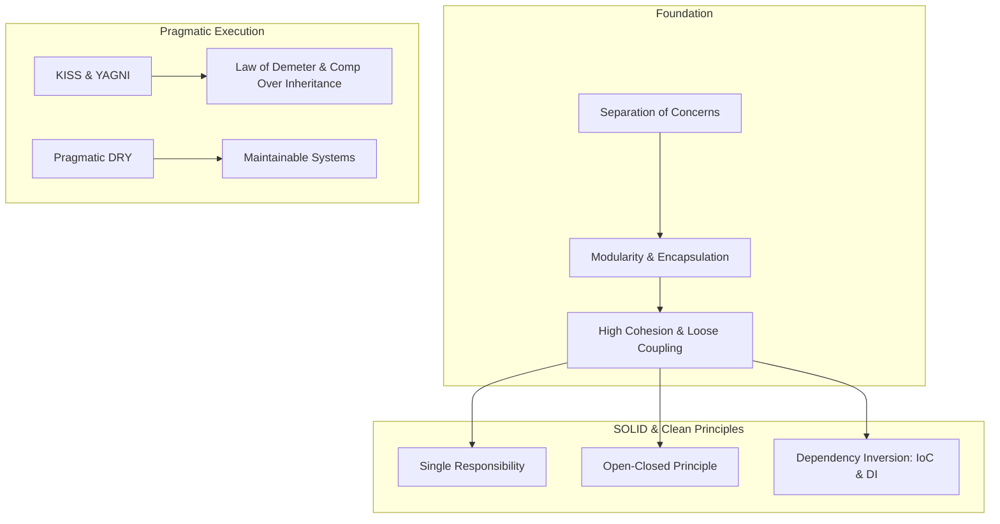
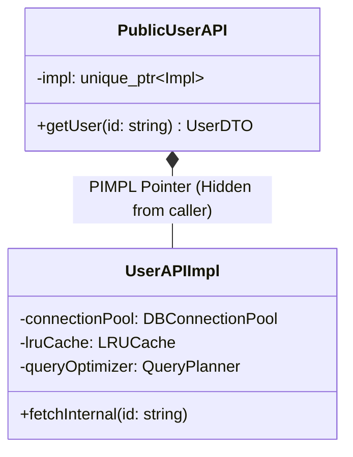
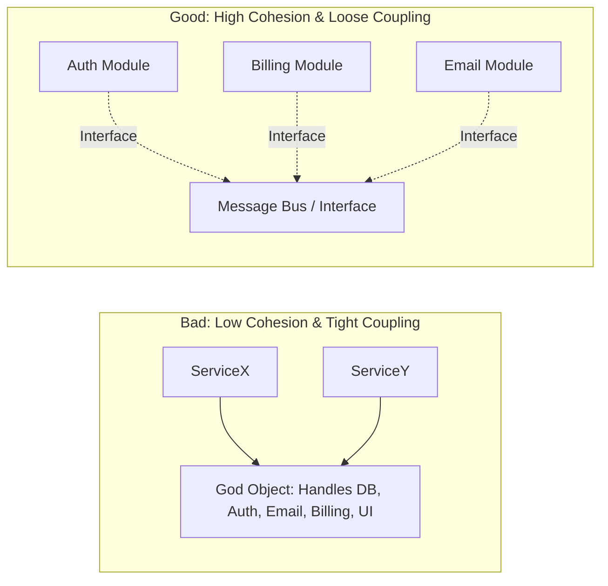
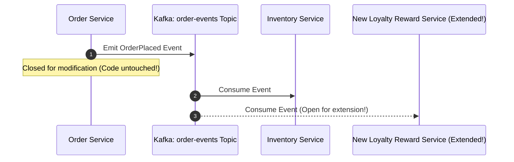
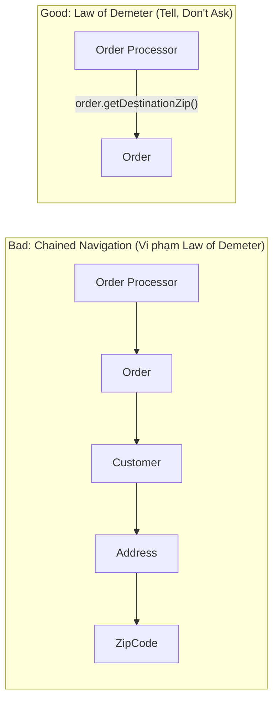
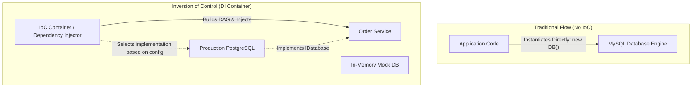

# 04.1. Core Software Design Principles (Các Nguyên Lý Thiết Kế Phần Mềm Cốt Lõi)

## Tổng quan về Các Nguyên Lý Thiết Kế Phần Mềm Cốt Lõi
Các nguyên lý thiết kế phần mềm cốt lõi không phải là những giáo điều trừu tượng, mà là các quy luật kinh nghiệm được chắt lọc qua nhiều thập kỷ nhằm giải quyết bài toán lớn nhất của ngành phần mềm: **Kiểm soát chi phí thay đổi (Cost of Change)**. Khi một hệ thống phần mềm mở rộng về quy mô và số lượng kỹ sư, mã nguồn có xu hướng tự nhiên bị thoái hóa thành một mớ hỗn độn (Entropy gia tăng).

Việc áp dụng các nguyên lý như **SOLID**, **DRY**, **KISS**, **YAGNI**, **Law of Demeter** và **Dependency Inversion** giúp duy trì ranh giới rõ ràng, giảm thiểu sự phụ thuộc chéo, từ đó cho phép hệ thống dễ bảo trì, dễ kiểm thử và có thể tiến hóa an toàn trong nhiều năm.



---

## 2. Chi tiết từng Keyword (Under-the-Hood Deep Dive)

### 1. Separation of Concerns, Modularity, Encapsulation & Information Hiding (Phân Tách Mối Quan Tâm, Tính Mô-đun và Đóng Gói Thông Tin)

#### 1. Khái niệm bản chất (What & Why)
- **Separation of Concerns (SoC - Phân tách mối quan tâm)**: Nguyên tắc chia hệ thống thành các phần riêng biệt, mỗi phần chỉ tập trung giải quyết một khía cạnh nghiệp vụ hoặc kỹ thuật độc lập (ví dụ: tách biệt việc xử lý HTTP request khỏi logic tính toán thuế và việc ghi đĩa database).
- **Modularity (Tính mô-đun)**: Mức độ mà phần mềm có thể được chia thành các khối độc lập (Modules), có thể phát triển, biên dịch, kiểm thử và thay thế độc lập.
- **Encapsulation & Information Hiding (Đóng gói và Ẩn giấu thông tin)**: Giữ kín các chi tiết hiện thực hóa (Implementation Details: cấu trúc dữ liệu nội bộ, thuật toán private) bên trong một thành phần và chỉ phơi bày ra bên ngoài một giao diện (Public API) ổn định.

#### 2. Cơ chế hoạt động sâu (Under the hood / Hardcore Internals)
Ở tầng trình biên dịch (Compiler) và bộ nhớ:
- **C++ Compilation Units & Header Isolation (PIMPL Idiom - Pointer to Implementation)**:
  Nếu một class C++ phơi bày các `private member variables` trong file header (`.hpp`), mỗi khi thay đổi cấu trúc dữ liệu nội bộ (thêm một trường `int`), toàn bộ hàng trăm file mã nguồn khác có `#include` header này đều bị ép phải **Biên dịch lại từ đầu (Recompilation)**, làm bùng nổ thời gian build.
  - Sử dụng **PIMPL Idiom**: Đóng gói toàn bộ biến private vào một `struct Impl` và chỉ lưu một con trỏ `std::unique_ptr<Impl>` trong header. Binary ABI (Application Binary Interface) được giữ ổn định tuyệt đối; kích thước của class trên stack không bao giờ đổi.

#### 3. Sơ đồ minh họa


#### 4. Code ví dụ thực chiến (C++20 - PIMPL Pattern tối ưu hóa Compilation Firewall & Information Hiding)
```cpp
// ==================== UserServiceClient.hpp ====================
#pragma once
#include <memory>
#include <string>

class UserServiceClient {
public:
    UserServiceClient();
    ~UserServiceClient(); // Bắt buộc định nghĩa destructor trong .cpp khi dùng unique_ptr với incomplete type

    std::string fetchUserName(int user_id);

private:
    struct Impl;                  // Incomplete type: Ẩn hoàn toàn chi tiết tầng mạng/socket
    std::unique_ptr<Impl> pimpl_; // ABI Firewall: Kích thước con trỏ 8 bytes bất biến
};

// ==================== UserServiceClient.cpp ====================
#include <iostream>
#include <unordered_map>

// Chi tiết nội bộ: Sử dụng Cache, Socket, SSL context không lộ ra Header!
struct UserServiceClient::Impl {
    std::unordered_map<int, std::string> internal_cache;

    std::string queryNetwork(int id) {
        if (internal_cache.find(id) != internal_cache.end()) {
            return internal_cache[id];
        }
        std::string name = "User_" + std::to_string(id);
        internal_cache[id] = name;
        return name;
    }
};

UserServiceClient::UserServiceClient() : pimpl_(std::make_unique<Impl>()) {}
UserServiceClient::~UserServiceClient() = default;

std::string UserServiceClient::fetchUserName(int user_id) {
    return pimpl_->queryNetwork(user_id);
}

// ==================== main.cpp ====================
int main() {
    UserServiceClient client;
    std::cout << "Fetched: " << client.fetchUserName(42) << "\n";
    return 0;
}
```

#### 5. Ưu / Nhược điểm, Pitfalls & Anti-patterns
- **Anti-pattern: Leaky Abstraction (Trừu tượng rò rỉ)**: Tạo ra một Interface trừu tượng nhưng lại để lộ chi tiết của cơ sở dữ liệu bên dưới (ví dụ: Interface trả về kiểu dữ liệu `SQLException` của JDBC thay vì Domain Exception).

#### 6. Ứng dụng thực tế trong Backend / Systems
Linux Kernel áp dụng triệt để: Mọi thiết bị phần cứng (bàn phím, ổ đĩa, card mạng) đều được trừu tượng hóa thành "File Descriptor" thông qua giao diện VFS (Virtual File System) thống nhất (`open`, `read`, `write`, `close`).

---

### 2. High Cohesion & Loose Coupling (Gắn Kết Cao và Ghép Nối Lỏng)

#### 1. Khái niệm bản chất (What & Why)
- **High Cohesion (Tính gắn kết cao)**: Mọi dòng code, hàm và class bên trong một module đều phục vụ cho **cùng một mục đích duy nhất và có mối liên hệ mật thiết với nhau**. Khi nghiệp vụ thay đổi, chỉ có duy nhất module đó bị sửa đổi.
- **Loose Coupling (Tính ghép nối lỏng)**: Mức độ phụ thuộc lẫn nhau giữa các module ở mức **tối thiểu nhất có thể**. Module A có thể hoạt động mà không cần biết chi tiết Module B được hiện thực hóa bằng công nghệ hay thuật toán gì.

#### 2. Cơ chế hoạt động sâu (Under the hood / Hardcore Internals)
Đo lường Coupling và Cohesion bằng toán học phần mềm (Robert C. Martin Metrics):
- **Afferent Coupling ($C_a$)**: Số lượng các module bên ngoài phụ thuộc vào module này (Đo lường mức độ chịu trách nhiệm).
- **Efferent Coupling ($C_e$)**: Số lượng các module bên ngoài mà module này phải phụ thuộc vào.
- **Instability Index ($I$)**:
  $$I = \frac{C_e}{C_a + C_e}$$
  - $I = 0$: Module cực kỳ ổn định (Maximal Stability), các module khác dựa vào nó, nó không dựa vào ai (ví dụ: Standard Library).
  - $I = 1$: Module cực kỳ bất ổn (Maximal Instability), nó phụ thuộc vào rất nhiều thứ, không ai dựa vào nó (ví dụ: Main Application Controller).
- **Nguyên lý Stable Dependencies Principle (SDP)**: Chiều của các phụ thuộc phải luôn luôn hướng về phía các thành phần có độ ổn định cao hơn ($I$ nhỏ hơn).

#### 3. Sơ đồ minh họa


#### 4. Code ví dụ thực chiến (TypeScript - Loose Coupling qua Event Driven Interfaces)
```typescript
// Gắn kết cao: NotificationService chỉ lo việc gửi tin nhắn
interface INotificationChannel {
  send(recipient: string, message: string): Promise<void>;
}

export class EmailChannel implements INotificationChannel {
  async send(recipient: string, message: string): Promise<void> {
    console.log(`[Email] Sent to ${recipient}: ${message}`);
  }
}

export class SMSChannel implements INotificationChannel {
  async send(recipient: string, message: string): Promise<void> {
    console.log(`[SMS] Sent to ${recipient}: ${message}`);
  }
}

// Ghép nối lỏng: NotificationManager không phụ thuộc cứng vào Email hay SMS cụ thể
export class NotificationManager {
  private channels: INotificationChannel[] = [];

  public registerChannel(channel: INotificationChannel) {
    this.channels.push(channel);
  }

  public async broadcast(recipient: string, msg: string) {
    await Promise.all(this.channels.map(c => c.send(recipient, msg)));
  }
}
```

#### 5. Ưu / Nhược điểm, Pitfalls & Anti-patterns
- **Anti-pattern: The God Object (Lớp vạn năng)**: Một class hoặc một file mã nguồn phình to lên 10,000 dòng code, làm mọi việc từ kiểm tra quyền đăng nhập, parse JSON, format ngày tháng đến chạy query SQL.

#### 6. Ứng dụng thực tế trong Backend / Systems
Các kiến trúc Plugin của Webpack, Babel hoặc Envoy Proxy đều dựa trên Loose Coupling: cho phép mở rộng tính năng mới thông qua Filter Chains mà không cần sửa core binary.

---

### 3. SOLID Principles in Distributed Systems (Nguyên Lý SOLID Trong Thiết Kế Hệ Thống)

#### 1. Khái niệm bản chất (What & Why)
Bộ 5 nguyên lý do Robert C. Martin tổng hợp:
1. **Single Responsibility Principle (SRP)**: Một module chỉ nên có **một lý do duy nhất để thay đổi** (chỉ phục vụ một tác nhân duy nhất).
2. **Open-Closed Principle (OCP)**: Phần mềm nên **mở cho việc mở rộng (Open for Extension)** nhưng **đóng đối với việc sửa đổi (Closed for Modification)**.
3. **Liskov Substitution Principle (LSP)**: Các đối tượng của lớp con phải có thể thay thế lớp cha mà không làm thay đổi tính đúng đắn của chương trình.
4. **Interface Segregation Principle (ISP)**: Không nên ép client phụ thuộc vào các interface chứa các method mà chúng không sử dụng (chia nhỏ interface lớn thành nhiều interface chuyên biệt).
5. **Dependency Inversion Principle (DIP)**: Các module cấp cao không được phụ thuộc vào các module cấp thấp; cả hai đều phải phụ thuộc vào sự trừu tượng hóa (Abstractions).

#### 2. Cơ chế hoạt động sâu (Under the hood / Hardcore Internals)
Ánh xạ SOLID từ tầng Code Class lên tầng **Kiến trúc Hệ thống Phân tán (Distributed Systems)**:
- **Distributed SRP**: Một Microservice chỉ phục vụ một Bounded Context nghiệp vụ (Order Service không kiêm nhiệm Billing).
- **Distributed OCP**: Mở rộng hệ thống bằng cách đăng ký Consumer mới vào Kafka Topic thay vì sửa code của Producer để gọi thêm HTTP endpoint mới.
- **Distributed ISP**: Sử dụng mô hình **Backend-for-Frontend (BFF)** hoặc **GraphQL**: Mobile App chỉ nhận đúng 4 trường cần hiển thị trên màn hình nhỏ thay vì nhận về một payload khổng lồ 50 trường của Web Admin.
- **Distributed DIP**: Các Service không gọi trực tiếp địa chỉ IP cố định của Database mà phụ thuộc vào Service Discovery / Cloud DNS hoặc Connection String trừu tượng.

#### 3. Sơ đồ minh họa (Distributed Open-Closed Principle qua Kafka)


#### 4. Code ví dụ thực chiến (C++20 - Interface Segregation Principle & Dependency Inversion)
```cpp
#include <iostream>
#include <memory>
#include <string>

// ISP: Chia nhỏ Interface thay vì một interface khổng lồ IStorageEngine
class IReadOnlyRepository {
public:
    virtual ~IReadOnlyRepository() = default;
    virtual std::string findById(int id) = 0;
};

class IWriteOnlyRepository {
public:
    virtual ~IWriteOnlyRepository() = default;
    virtual void save(int id, const std::string& data) = 0;
};

// DIP: High-level Service chỉ phụ thuộc vào Interface trừu tượng
class UserReaderService {
private:
    std::shared_ptr<IReadOnlyRepository> reader_;
public:
    explicit UserReaderService(std::shared_ptr<IReadOnlyRepository> reader) 
        : reader_(reader) {}

    void displayUser(int id) {
        std::cout << "[UserReader] Data: " << reader_->findById(id) << "\n";
    }
};

// Low-level component hiện thực hóa cả 2 interface
class RocksDBStore : public IReadOnlyRepository, public IWriteOnlyRepository {
public:
    std::string findById(int id) override {
        return "Payload_From_RocksDB_" + std::to_string(id);
    }
    void save(int id, const std::string& data) override {
        std::cout << "[RocksDB] Saved key: " << id << "\n";
    }
};

int main() {
    auto db = std::make_shared<RocksDBStore>();
    UserReaderService service(db); // Service chỉ nhìn thấy giao diện IReadOnlyRepository!
    service.displayUser(1001);
    return 0;
}
```

#### 5. Ưu / Nhược điểm, Pitfalls & Anti-patterns
- **Pitfall: Dogmatic Over-abstraction**: Tạo ra 10 tầng Interface cho một chức năng duy nhất không bao giờ có phương án thay thế thứ hai, khiến người đọc phải bấm qua 5 file interface mới tới được dòng code thực thi thực tế.

#### 6. Ứng dụng thực tế trong Backend / Systems
Mọi SDK cloud hiện đại (AWS SDK, GCP Client Libraries) đều tuân thủ triệt để DIP và ISP để cho phép lập trình viên chèn Mock Client vào kiểm thử mà không phát sinh cước phí cloud.

---

### 4. Pragmatic Engineering: DRY, KISS, YAGNI & Law of Demeter (Nguyên Lý Kỹ Nghệ Thực Dụng)

#### 1. Khái niệm bản chất (What & Why)
- **DRY (Don't Repeat Yourself)**: Mọi mẩu tri thức trong hệ thống phải có một đại diện duy nhất, không mơ hồ và có thẩm quyền (Single Source of Truth).
  - *Lưu ý quan trọng*: **Accidental Duplication vs Real Duplication**. Nếu hai đoạn code trông giống hệt nhau về mặt cú pháp nhưng phục vụ cho hai lý do nghiệp vụ khác nhau (ví dụ: format địa chỉ nhận hàng và format địa chỉ văn phòng công ty), việc gộp chúng lại sẽ tạo ra sự ghép nối sai lầm!
- **KISS (Keep It Simple, Stupid)**: Hệ thống hoạt động tốt nhất khi được thiết kế đơn giản nhất có thể. Đơn giản ở đây là tinh tế (Simplicity is hard), chứ không phải là sơ sài.
- **YAGNI (You Aren't Gonna Need It)**: Luôn triển khai những gì thực sự cần ngay lúc này, tuyệt đối không bao giờ triển khai những gì bạn *nghĩ* là sẽ cần trong tương lai.
- **Law of Demeter (LoD - Nguyên tắc hiểu biết tối thiểu)**: *"Chỉ nói chuyện với bạn bè thân thiết nhất của bạn"*. Một đối tượng chỉ nên gọi các phương thức của: chính nó, các tham số được truyền vào, các đối tượng do chính nó tạo ra hoặc các thành phần thuộc tính trực tiếp. Nghiêm cấm các chuỗi gọi xuyên thấu: `a.getB().getC().getD().doSomething()`.

#### 2. Cơ chế hoạt động sâu (Under the hood / Hardcore Internals)
Tại sao vi phạm Law of Demeter lại cực kỳ nguy hiểm trong Backend:
- Đoạn code: `order.getCustomer().getAddress().getZipCode()`
- **Hậu quả**: Class gọi code này bị gắn kết chặt chẽ vào cấu trúc hình học bên trong của cả 4 class (`Order`, `Customer`, `Address`, `ZipCode`). Nếu ngày mai đội Core sửa cấu trúc để một Customer có nhiều địa chỉ (`List<Address>`), toàn bộ hàng trăm vị trí gọi hàm trên toàn hệ thống sẽ bị gãy vỡ biên dịch hoặc ném lỗi Null Pointer Exception tại thời điểm chạy.
- **Giải pháp**: Tell, Don't Ask! Hãy yêu cầu `order.getDeliveryZipCode()`. Class `Order` chịu trách nhiệm tự điều hướng nội bộ.

#### 3. Sơ đồ minh họa


#### 4. Code ví dụ thực chiến (C++20 - Refactoring vi phạm Law of Demeter)
```cpp
#include <iostream>
#include <string>

// Cấu trúc phân cấp
struct Address {
    std::string zipcode = "70000";
};

struct Customer {
    Address address;
};

class Order {
private:
    Customer customer_;
public:
    // Tuân thủ Law of Demeter: Ủy quyền (Delegation)
    std::string getShippingZipCode() const {
        return customer_.address.zipcode;
    }
};

int main() {
    Order order;
    // Thay vì: order.getCustomer().getAddress().zipcode (Tight Coupling!)
    // Sử dụng:
    std::cout << "Shipping Zip: " << order.getShippingZipCode() << "\n";
    return 0;
}
```

#### 5. Ưu / Nhược điểm, Pitfalls & Anti-patterns
- **Anti-pattern: Premature Abstraction (DRY mù quáng)**: Vừa thấy 2 dòng code lặp lại đã vội vàng tạo một lớp Base trừu tượng dùng chung, biến mã nguồn thành ma trận kế thừa không thể đọc nổi.

#### 6. Ứng dụng thực tế trong Backend / Systems
Go Standard Library là chuẩn mực về KISS: không có toán tử nạp chồng (Operator Overloading), không có kế thừa class, không có ngoại lệ ẩn (Exceptions), mọi thứ đều tường minh và xử lý lỗi trực tiếp qua `if err != nil`.

---

### 5. Inversion of Control & Dependency Injection (Đảo Ngược Điều Khiển và Tiêm Phụ Thuộc)

#### 1. Khái niệm bản chất (What & Why)
- **Inversion of Control (IoC - Đảo ngược điều khiển)**: Chuyển quyền kiểm soát luồng thực thi của chương trình từ mã nguồn tự viết sang một Framework hoặc Container bên ngoài. Thay vì code của bạn chủ động gọi thư viện, Framework sẽ nắm giữ luồng chính và gọi vào code của bạn (Nguyên lý Hollywood: *"Đừng gọi cho chúng tôi, chúng tôi sẽ gọi cho bạn"*).
- **Dependency Injection (DI)**: Kỹ thuật hiện thực hóa IoC, trong đó các đối tượng phụ thuộc (Dependencies) được cung cấp từ bên ngoài vào cho một class (qua Constructor, Setter hoặc Interface) thay vì class đó tự khởi tạo bằng toán tử `new`.

#### 2. Cơ chế hoạt động sâu (Under the hood / Hardcore Internals)
So sánh việc cấp phát tài nguyên:
- **Tự khởi tạo (Tight Coupling)**:
  `class OrderService { OrderService() { db_ = new MySQLDatabase("10.0.0.1"); } }`
  $\rightarrow$ Không thể kiểm thử ngoại tuyến; không thể chạy Unit Test mà không có MySQL thật đang bật ở IP đó; không thể thay thế bằng Mock Database.
- **Dependency Injection (Constructor Injection)**:
  `class OrderService { OrderService(IDatabase* db) : db_(db) {} }`
  $\rightarrow$ Khi chạy thật: Truyền kết nối PostgreSQL production. Khi chạy test: Truyền Mock In-Memory Database hoàn tất trong 0.1ms.
- **IoC Container Internals**: Các container (như Spring IoC, NestJS, Boost.DI) sử dụng Reflection hoặc Template Metaprogramming tại thời điểm biên dịch để duyệt qua đồ thị phụ thuộc (Directed Acyclic Graph - DAG) và khởi tạo các đối tượng theo đúng thứ tự topo (Topological Sort).

#### 3. Sơ đồ minh họa


#### 4. Code ví dụ thực chiến (C++20 - Pure Constructor Injection không cần Container cồng kềnh)
```cpp
#include <iostream>
#include <memory>
#include <string>

// Giao diện hợp đồng
class ILogger {
public:
    virtual ~ILogger() = default;
    virtual void log(const std::string& msg) = 0;
};

class ConsoleLogger : public ILogger {
public:
    void log(const std::string& msg) override {
        std::cout << "[CONSOLE LOG] " << msg << "\n";
    }
};

// PaymentService nhận dependency từ bên ngoài qua Constructor
class PaymentService {
private:
    std::shared_ptr<ILogger> logger_; // Explicit Dependency
public:
    explicit PaymentService(std::shared_ptr<ILogger> logger) 
        : logger_(std::move(logger)) {
        if (!logger_) throw std::invalid_argument("Logger cannot be null");
    }

    void charge(double amount) {
        logger_->log("Processing transaction of " + std::to_string(amount) + "$");
    }
};

int main() {
    auto logger = std::make_shared<ConsoleLogger>();
    // Dependency Injection diễn ra tại điểm lắp ráp (Composition Root)
    PaymentService service(logger);
    service.charge(150.0);
    return 0;
}
```

#### 5. Ưu / Nhược điểm, Pitfalls & Anti-patterns
- **Anti-pattern: Service Locator**: Thay vì inject dependency vào constructor, class gọi một hàm toàn cục `ServiceLocator::get<IDatabase>()`. Điều này che giấu các phụ thuộc thực sự của class, làm cho chữ ký hàm trở thành lời nói dối (Implicit Dependencies).

#### 6. Ứng dụng thực tế trong Backend / Systems
Các framework backend hiện đại nhất (NestJS, ASP.NET Core, Spring Boot) đều lấy IoC Container làm hạt nhân trung tâm để quản lý vòng đời (Singleton, Scoped, Transient) của toàn bộ các service.

---

## Tóm tắt liên kết hệ thống
Toàn bộ nội dung **4.1** đã trang bị các nguyên lý nền tảng để xây dựng các mô-đun phần mềm sạch sẽ, gắn kết cao và dễ bảo trì. Trong bài tiếp theo (**4.2: Resilience and Evolution Principles**), chúng ta sẽ bước lên tầng cao hơn: làm thế nào để thiết kế một hệ thống sống sót an toàn trước sự cố vật lý và tiến hóa liên tục mà không gây gián đoạn (Design for Failure, Postel's Law, Graceful Degradation).
