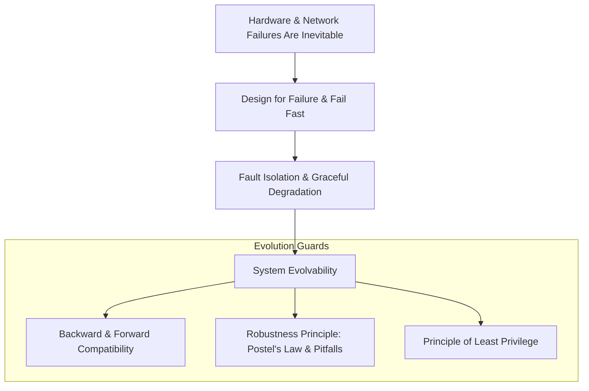
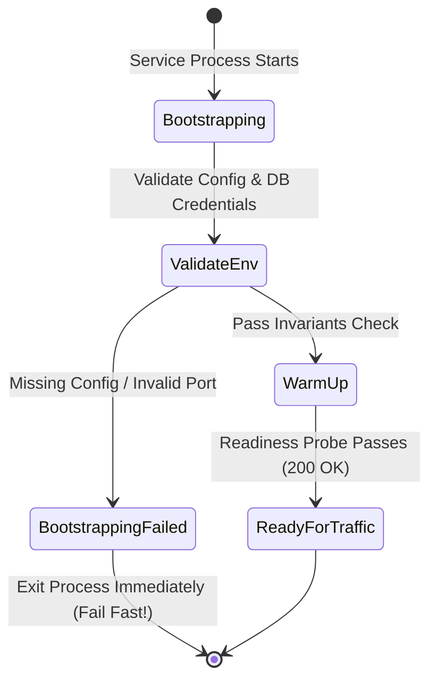
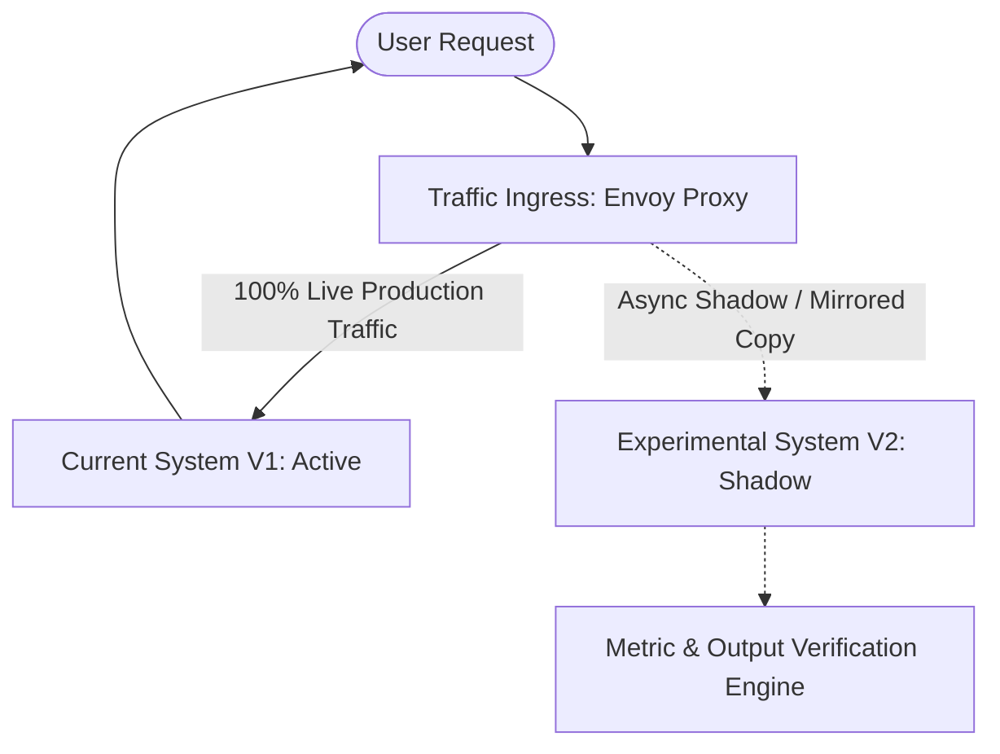
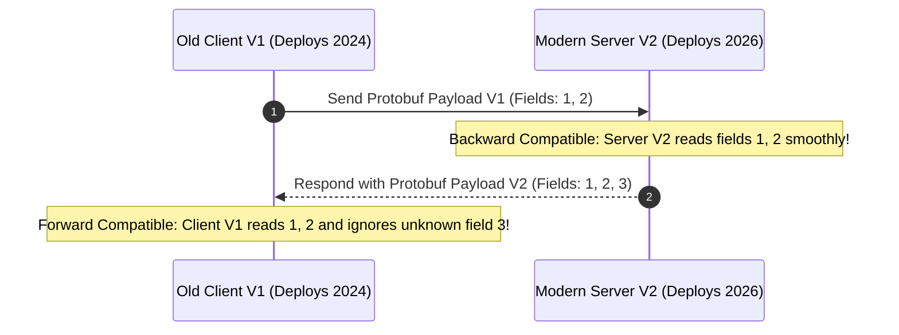
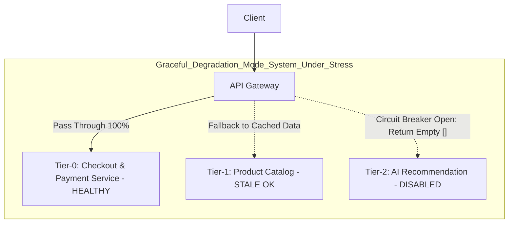
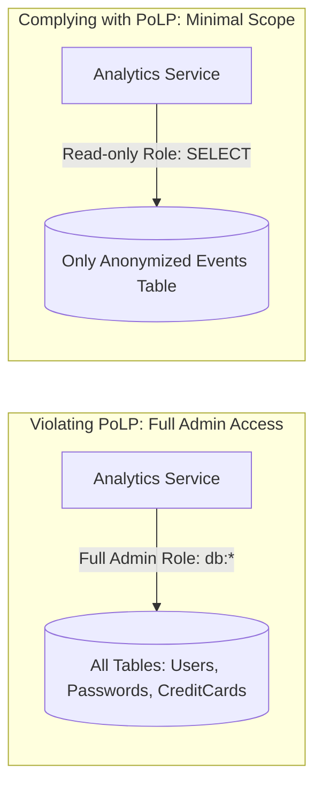
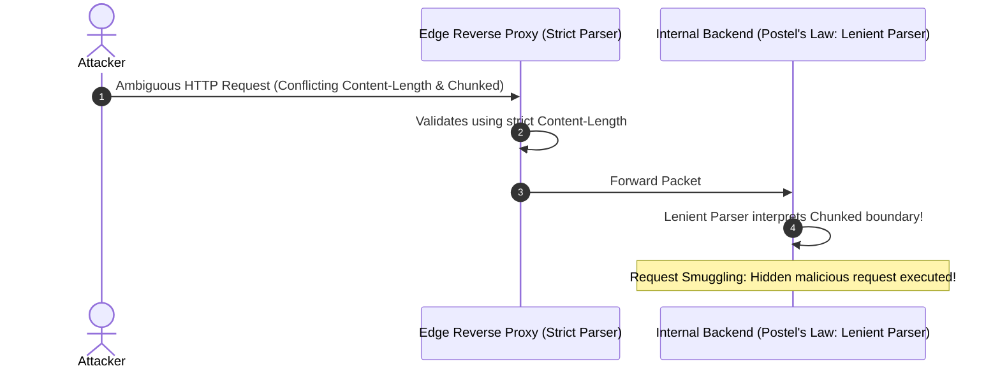

# 04.2. Resilience and Evolution Principles (Nguyên Lý Chống Chịu Sự Cố và Tiến Hóa Hệ Thống)

## Tổng quan về Nguyên Lý Chống Chịu Sự Cố và Tiến Hóa
Trong môi trường điện toán đám mây và hệ thống phân tán quy mô lớn, chân lý bất biến đầu tiên là: **Mọi thứ rồi sẽ sập (Everything fails all the time - Werner Vogels, CTO Amazon)**. Máy chủ có thể mất điện, ổ SSD có thể hỏng ngẫu nhiên, cáp quang biển có thể bị đứt, và lỗi phần mềm là điều không thể tránh khỏi.

Một hệ thống phân tán đẳng cấp thế giới không phải là hệ thống cố gắng ngăn chặn mọi lỗi lầm (điều bất khả thi), mà là hệ thống được xây dựng dựa trên triết lý **Thiết kế để Chấp nhận Thất bại (Design for Failure)**: tự động cách ly sự cố, hạ cấp dịch vụ một cách êm ái (**Graceful Degradation**), và bảo đảm khả năng tiến hóa liên tục (**Evolvability**) qua các phiên bản mà không làm gián đoạn người dùng.



---

## 2. Chi tiết từng Keyword (Under-the-Hood Deep Dive)

### 1. Fail Fast & Design for Failure (Thất Bại Sớm và Thiết Kế Để Chấp Nhận Thất Bại)

#### 1. Khái niệm bản chất (What & Why)
- **Fail Fast (Thất bại sớm)**: Một hệ thống hoặc thành phần phần mềm nên dừng ngay lập tức và báo lỗi rõ ràng khi phát hiện ra bất kỳ trạng thái bất thường hoặc điều kiện tiên quyết (Preconditions) không được thỏa mãn, thay vì cố gắng tiếp tục thực thi với dữ liệu hỏng.
- **Design for Failure**: Triết lý thiết kế coi sự cố của phần cứng, mạng và các dịch vụ phụ thuộc là trạng thái **bình thường (Normal State)** trong vòng đời vận hành. Hệ thống phải tự phục hồi (Self-healing) mà không cần sự can thiệp thủ công của con người.

#### 2. Cơ chế hoạt động sâu (Under the hood / Hardcore Internals)
Tại sao "Cố gắng chạy tiếp khi có lỗi" là thảm họa:
- Giả sử một cấu hình môi trường quan trọng (`DATABASE_URL`) bị thiếu.
- **Cách làm tồi (Silent Failure)**: Gán giá trị mặc định `localhost`, service tiếp tục khởi động. Đến 3 giờ sáng, khi có request đầu tiên, service cố kết nối vào `localhost`, ném exception, làm treo luồng và gây nghẽn hàng nghìn request tiếp theo.
- **Cách làm Fail Fast**: Kiểm tra biến môi trường ngay tại dòng code đầu tiên khi khởi động tiến trình. Nếu thiếu, gọi `std::abort()` hoặc thoát ngay với exit code khác 0. Kubernetes sẽ nhận diện container sập ngay trong pha khởi tạo (`CrashLoopBackOff`) và không bao giờ chuyển tiếp lưu lượng người dùng vào pod lỗi này!

Ở tầng dữ liệu:
Sử dụng các câu lệnh Assertions và Defensive Invariants để đảm bảo tính toàn vẹn của con trỏ bộ nhớ và cấu trúc dữ liệu trước khi đi vào vòng lặp tính toán.

#### 3. Sơ đồ minh họa


#### 4. Code ví dụ thực chiến (C++20 - Fail-Fast Configuration & State Invariant Guard)
```cpp
#include <iostream>
#include <cstdlib>
#include <string>
#include <stdexcept>

class ServerConfig {
public:
    std::string db_url;
    int port;

    static ServerConfig loadFromEnvironment() {
        const char* db_env = std::getenv("DATABASE_URL");
        const char* port_env = std::getenv("APP_PORT");

        // Nguyên lý Fail Fast: Phát hiện lỗi ngay lập tức khi khởi động, không chạy tiếp!
        if (!db_env || std::string(db_env).empty()) {
            std::cerr << "FATAL: DATABASE_URL environment variable is MISSING. Aborting.\n";
            std::exit(EXIT_FAILURE); // Dừng tiến trình ngay lập tức!
        }

        int port_val = port_env ? std::stoi(port_env) : 8080;
        if (port_val <= 1024 || port_val > 65535) {
            std::cerr << "FATAL: APP_PORT is out of privileged/valid range (1025-65535). Aborting.\n";
            std::exit(EXIT_FAILURE);
        }

        return ServerConfig{db_env, port_val};
    }
};

int main() {
    std::cout << "[Init Phase] Loading system configuration...\n";
    // Giả sử DATABASE_URL chưa được set trong terminal -> Sập ngay trong < 1ms
    ServerConfig cfg = ServerConfig::loadFromEnvironment();
    std::cout << "[Ready] Server starting on port " << cfg.port << "\n";
    return 0;
}
```

#### 5. Ưu / Nhược điểm, Pitfalls & Anti-patterns
- **Anti-pattern: Pokemon Exception Handling ("Catch 'em all")**: Bắt mọi ngoại lệ bằng `catch (...)` rồi ghi log một dòng vô hại và tiếp tục chạy. Dữ liệu bị hỏng âm thầm lan truyền vào cơ sở dữ liệu và chỉ bị phát hiện khi hệ thống tài chính bị thâm hụt tiền.

#### 6. Ứng dụng thực tế trong Backend / Systems
Erlang và Elixir nổi tiếng với triết lý thiết kế: *"Let it crash!"* (Hãy để tiến trình sập). Cơ chế Supervision Tree sẽ tự động tiêu hủy tiến trình lỗi và sinh ra một tiến trình mới trong trạng thái sạch sẽ hoàn toàn.

---

### 2. Design for Scalability, Reliability & Evolvability (Thiết Kế Mở Rộng, Độ Tin Cậy và Tiến Hóa)

#### 1. Khái niệm bản chất (What & Why)
- **Design for Scalability**: Khả năng của hệ thống duy trì hiệu năng ổn định (Latency, Throughput) khi khối lượng công việc (Workload) tăng lên bằng cách bổ sung thêm tài nguyên phần cứng.
- **Design for Reliability**: Khả năng của hệ thống tiếp tục hoạt động chính xác (Correctness) theo đúng kỳ vọng ngay cả khi các sự cố cục bộ xảy ra.
- **Design for Evolvability**: Mức độ dễ dàng mà hệ thống có thể thay đổi, bổ sung tính năng mới, hoặc tái cấu trúc mà không làm ảnh hưởng đến các chức năng hiện tại hoặc phá vỡ các hợp đồng API đã cam kết với khách hàng.

#### 2. Cơ chế hoạt động sâu (Under the hood / Hardcore Internals)
Kỹ thuật then chốt để đạt được Evolvability:
- **Loose Data Contracts**: Sử dụng các định dạng Serialization có hỗ trợ Schema Evolution (như Protocol Buffers hoặc Apache Avro). Mỗi trường dữ liệu được gán một mã số nguyên (Field Tag / Number) cố định thay vì dựa vào vị trí mảng hay tên trường.
- **Shadow Traffic (Traffic Mirroring)**: Khi phát triển phiên bản mới của một thuật toán tìm kiếm hoặc tính phí, ta không thay thế ngay mà cấu hình Load Balancer (Envoy Proxy) nhân bản (Mirror) 100% traffic thực tế từ production sang một cụm thử nghiệm chạy ngầm. Thuật toán mới xử lý traffic thật để kiểm chứng hiệu năng và tính đúng đắn mà kết quả không gửi về cho người dùng.

#### 3. Sơ đồ minh họa


#### 4. Code ví dụ thực chiến (TypeScript - Schema Evolution với Versioned Contract)
```typescript
// Sử dụng Union Type và Version Tag để đảm bảo Evolvability của Event Schema
interface OrderPlacedEventV1 {
  version: 1;
  orderId: string;
  totalAmountUSD: number;
}

interface OrderPlacedEventV2 {
  version: 2;
  orderId: string;
  totalAmountCents: number; // Đổi sang Cents để loại bỏ sai số số thực (Float)
  currency: string;         // Bổ sung hỗ trợ đa tiền tệ
}

type OrderPlacedEvent = OrderPlacedEventV1 | OrderPlacedEventV2;

export class OrderEventConsumer {
  public process(event: OrderPlacedEvent) {
    if (event.version === 1) {
      // Vẫn hỗ trợ trơn tru các event cũ phiên bản 1 (Evolvability & Backward Compatibility)
      console.log(`[V1 Legacy Consumer] Processing ${event.orderId}: $${event.totalAmountUSD}`);
    } else if (event.version === 2) {
      // Logic mới tối ưu hơn
      console.log(`[V2 Modern Consumer] Processing ${event.orderId}: ${event.totalAmountCents / 100} ${event.currency}`);
    }
  }
}
```

#### 5. Ưu / Nhược điểm, Pitfalls & Anti-patterns
- **Anti-pattern: Big Bang Release**: Viết lại toàn bộ hệ thống từ đầu trong 2 năm rồi chuyển đổi toàn bộ lưu lượng trong 1 đêm. Hầu hết các dự án Big Bang đều thất bại thảm hại do sự tích tụ của hàng nghìn giả định sai lệch không được kiểm chứng liên tục.

#### 6. Ứng dụng thực tế trong Backend / Systems
Nguyên tắc phát triển của Linux Kernel: *"Never break userspace!"* (Không bao giờ được phá vỡ tương thích ngược với các chương trình tầng người dùng). Một chương trình C biên dịch từ 25 năm trước vẫn có thể chạy trên Linux Kernel phiên bản mới nhất hôm nay.

---

### 3. Backward Compatibility vs Forward Compatibility (Tương Thích Ngược và Tương Thích Xuôi)

#### 1. Khái niệm bản chất (What & Why)
- **Backward Compatibility (Tương thích ngược)**: Mã nguồn mới hoặc phiên bản hệ thống mới (V2) có khả năng đọc và xử lý chính xác dữ liệu được tạo ra bởi phiên bản cũ (V1).
- **Forward Compatibility (Tương thích xuôi)**: Mã nguồn cũ hoặc phiên bản hệ thống cũ (V1) có khả năng chấp nhận và xử lý an toàn (hoặc bỏ qua một cách êm ái) dữ liệu được tạo ra bởi phiên bản mới hơn (V2) mà không bị crash.

#### 2. Cơ chế hoạt động sâu (Under the hood / Hardcore Internals)
Quy tắc vàng của **Protocol Buffers (Protobuf)** để đạt được cả Backward và Forward Compatibility:
1. **Không bao giờ được thay đổi số thứ tự (Field Number / Tag)** của một trường đã tồn tại.
2. Khi thêm trường mới, phải là trường tùy chọn (Optional). Các client phiên bản cũ (V1) khi nhận được payload chứa trường mới của V2 sẽ lưu trữ trường không nhận diện được này vào mục `unknownFields` và bỏ qua, không bị ném lỗi cú pháp (Forward Compatible).
3. Khi xóa một trường, không được xóa hẳn số Tag đó rồi gán cho một trường khác. Phải đánh dấu bằng từ khóa `reserved` để ngăn chặn việc tái sử dụng số Tag cũ trong tương lai.

#### 3. Sơ đồ minh họa


#### 4. Code ví dụ thực chiến (C++20 - Mô phỏng cơ chế Unknown Fields trong Forward Compatibility)
```cpp
#include <iostream>
#include <unordered_map>
#include <string>
#include <variant>

// Giả lập cơ chế nạp Tag-Value của Protocol Buffers
class MessageDecoderV1 {
private:
    std::unordered_map<int, std::string> known_fields_;
    std::unordered_map<int, std::string> unknown_fields_; // Bảo lưu trường mới để đảm bảo Forward Compatibility

public:
    void decodeField(int tag, const std::string& value) {
        if (tag == 1) {
            known_fields_[1] = value; // Tag 1: Username
        } else if (tag == 2) {
            known_fields_[2] = value; // Tag 2: Email
        } else {
            // Forward Compatibility: Gặp Tag mới từ V2 (ví dụ Tag 3: PhoneNumber)
            // Tuyệt đối không ném Exception, lưu lại an toàn!
            unknown_fields_[tag] = value;
            std::cout << "[Forward Compat] Safely ignored unknown tag #" << tag << "\n";
        }
    }

    void printState() {
        std::cout << "Username: " << known_fields_[1] << ", Email: " << known_fields_[2] 
                  << " | Unknown Fields Count: " << unknown_fields_.size() << "\n";
    }
};

int main() {
    MessageDecoderV1 old_client;
    // Server V2 gửi bản tin có cả Tag 1, Tag 2 và Tag 3 mới
    old_client.decodeField(1, "alice");
    old_client.decodeField(2, "alice@work.com");
    old_client.decodeField(3, "+84999999999"); // Tag mới

    old_client.printState();
    return 0;
}
```

#### 5. Ưu / Nhược điểm, Pitfalls & Anti-patterns
- **Anti-pattern: Breaking Schema Drift**: Tự ý đổi tên hoặc xóa cột trong cơ sở dữ liệu khi code phiên bản cũ vẫn đang chạy trong quá trình Rolling Deployment, làm cho các pod cũ crash hàng loạt.

#### 6. Ứng dụng thực tế trong Backend / Systems
Hạ tầng gRPC nội bộ của Google trao đổi hàng tỷ tin nhắn mỗi giây giữa hàng vạn microservices chạy các phiên bản release khác nhau mà không bao giờ gặp xung đột tương thích nhờ cơ chế này.

---

### 4. Graceful Degradation & Progressive Enhancement (Hạ Cấp Êm Ái và Nâng Cao Lũy Tiến)

#### 1. Khái niệm bản chất (What & Why)
- **Graceful Degradation (Hạ cấp êm ái)**: Khả năng của hệ thống tự động ngắt bỏ các tính năng phụ hoặc giảm chất lượng dịch vụ khi đang chịu tải cực đại hoặc khi một dịch vụ phụ thuộc bị lỗi, nhằm **bảo vệ các tính năng cốt lõi sống còn của hệ thống**.
- **Progressive Enhancement (Nâng cao lũy tiến)**: Xây dựng trải nghiệm cốt lõi cơ bản nhất có thể chạy trên mọi điều kiện mạng yếu hoặc phần cứng cũ, sau đó bổ sung thêm các tính năng cao cấp nếu thiết bị và đường truyền cho phép.

#### 2. Cơ chế hoạt động sâu (Under the hood / Hardcore Internals)
Phân loại tính năng sống còn (Tier-0) vs Tính năng bổ trợ (Tier-1, Tier-2) trong trang Thương mại Điện tử:
- **Tier-0 (Cốt lõi, KHÔNG BAO GIỜ ĐƯỢC CHẾT)**: Tìm kiếm sản phẩm, Xem giỏ hàng, Nhấn nút Thanh toán (`Checkout`).
- **Tier-1 (Quan trọng nhưng có thể suy giảm)**: Bảng giá cập nhật theo thời gian thực (có thể chuyển sang hiển thị giá được cache 10 phút trước).
- **Tier-2 (Phụ trợ, có thể tắt ngay lập tức khi quá tải)**: Hệ thống gợi ý sản phẩm thông minh bằng AI, Bảng nhận xét đánh giá của người dùng (Reviews), Banner quảng cáo động.

Khi CPU của cụm máy chủ vượt quá ngưỡng báo động $85\%$, API Gateway kích hoạt **Graceful Degradation Switch**: tự động trả về mảng rỗng `[]` cho các request gọi vào AI Recommendation Service và Review Service. Lưu lượng giải phóng được sẽ dành 100% tài nguyên CPU và RAM để phục vụ luồng Checkout!

#### 3. Sơ đồ minh họa


#### 4. Code ví dụ thực chiến (TypeScript - Fallback Degraded Behavior)
```typescript
interface RecommendationResult {
  productIds: string[];
  isFallback: boolean;
}

export class ProductPageService {
  private isSystemOverloaded: boolean = false;

  public setOverloadState(overloaded: boolean) {
    this.isSystemOverloaded = overloaded;
  }

  // Graceful Degradation: Hạ cấp thông minh thay vì quăng lỗi HTTP 500
  async getRecommendations(userId: string): Promise<RecommendationResult> {
    if (this.isSystemOverloaded) {
      // Khi quá tải: Bỏ qua mô hình Machine Learning đắt đỏ, trả về danh sách sản phẩm phổ biến tĩnh đã cache
      console.warn("[Degradation Active] System strained. Serving static top-selling fallbacks.");
      return { productIds: ["ITEM-1", "ITEM-2", "ITEM-3"], isFallback: true };
    }

    try {
      // Bình thường: Gọi cụm ML Service ngốn tài nguyên
      return { productIds: await this.callHeavyMLService(userId), isFallback: false };
    } catch (err) {
      // Nếu ML Service sập: Tự động hạ cấp êm ái
      return { productIds: ["ITEM-1", "ITEM-2"], isFallback: true };
    }
  }

  private async callHeavyMLService(userId: string): Promise<string[]> {
    return ["PERSONALIZED-99", "PERSONALIZED-100"];
  }
}
```

#### 5. Ưu / Nhược điểm, Pitfalls & Anti-patterns
- **Anti-pattern: All-or-Nothing Syndrome**: Một lỗi nhỏ ở service hiển thị avatar người dùng khiến cả trang thanh toán ném lỗi HTTP 500 trắng xóa, làm doanh nghiệp mất hàng triệu USD doanh thu.

#### 6. Ứng dụng thực tế trong Backend / Systems
Khi mạng 4G yếu hoặc máy chủ chập chờn, ứng dụng YouTube tự động giảm độ phân giải video từ 4K xuống 360p thay vì dừng video và hiện thông báo lỗi.

---

### 5. Principle of Least Privilege (Nguyên Lý Đặc Quyền Tối Thiểu)

#### 1. Khái niệm bản chất (What & Why)
Principle of Least Privilege (PoLP) quy định rằng: **Mỗi tiến trình, người dùng, chương trình hoặc dịch vụ trong hệ thống chỉ được cấp đúng những quyền truy cập tối thiểu cần thiết để hoàn thành nhiệm vụ của nó, và không được thừa bất kỳ một quyền nào khác**.

#### 2. Cơ chế hoạt động sâu (Under the hood / Hardcore Internals)
Ở tầng Hệ điều hành Linux Kernel và Cloud IAM:
- **Nghiêm cấm chạy container dưới quyền `root` (UID 0)**: Nếu hacker khai thác được một lỗ hổng thực thi mã từ xa (RCE) trong ứng dụng NodeJS hoặc Python chạy dưới user `root`, chúng có toàn quyền kiểm soát kernel, truy cập namespace `/proc`, và đánh cắp bộ nhớ của toàn bộ các container khác trên cùng một Node vật lý.
- **Microservices IAM Roles**:
  - Dịch vụ `BillingService` chỉ được phép có quyền `s3:GetObject` trên bucket hóa đơn `billing-invoices-bucket/`.
  - Nghiêm cấm cấp quyền `s3:*` (Full S3 Access) hoặc gán quyền ghi vào các bucket chứa mã nguồn.
- **Linux Capabilities**: Thay vì cấp full quyền root, chỉ cấp các capability cụ thể như `CAP_NET_BIND_SERVICE` để bind cổng dưới 1024.

#### 3. Sơ đồ minh họa


#### 4. Code ví dụ thực chiến (C++20 - Dropping Linux Capabilities & Privileges)
```cpp
#include <iostream>
#include <unistd.h>
#include <sys/types.h>

void dropPrivilegesToNobodyUser() {
    uid_t current_uid = getuid();
    std::cout << "[Init] Current Process UID: " << current_uid << "\n";

    if (current_uid == 0) { // Đang chạy dưới quyền root
        std::cout << "[Security Guard] Running as root is dangerous! Dropping privileges to unprivileged user (UID 65534)...\n";
        // Chuyển sang user 'nobody'
        if (setgid(65534) != 0 || setuid(65534) != 0) {
            std::cerr << "Failed to drop root privileges! Aborting process for safety.\n";
            std::exit(EXIT_FAILURE);
        }
        std::cout << "[Security Enforced] Privileges dropped successfully. New UID: " << getuid() << "\n";
    }
}

int main() {
    dropPrivilegesToNobodyUser();
    return 0;
}
```

#### 5. Ưu / Nhược điểm, Pitfalls & Anti-patterns
- **Anti-pattern: The Wildcard Policy `*.*`**: Cấp quyền `AdministratorAccess` hoặc policy `Resource: "*", Action: "*"` trong AWS IAM cho lập trình viên để "đỡ mất công cấu hình quyền cho từng microservice".

#### 6. Ứng dụng thực tế trong Backend / Systems
AWS Security Hub và Kubernetes Pod Security Standards tự động cảnh báo và ngăn chặn việc deploy các Pod không có cấu hình `securityContext: { runAsNonRoot: true }`.

---

### 6. Robustness Principle / Postel's Law & Its Security Limitations (Nguyên Lý Bền Vững / Định Luật Postel và Những Mặt Trái)

#### 1. Khái niệm bản chất (What & Why)
- **Robustness Principle (Postel's Law)** do Jon Postel phát biểu trong RFC 793 (giao thức TCP):
  $$\textbf{"Be conservative in what you send, be liberal in what you accept"}$$
  *(Hãy khắt khe trong những gì bạn gửi đi, nhưng hãy cởi mở/khoan dung trong những gì bạn chấp nhận nhận vào)*.
- **Ý định ban đầu**: Nếu gói tin từ một client gửi đến hơi sai lệch một chút so với chuẩn kỹ thuật (ví dụ: dư một dấu cách trong HTTP header, hoặc thứ tự trường không chuẩn), server nên cố gắng đoán ý định và xử lý gói tin thay vì thẳng tay từ chối để tối đa hóa khả năng tương thích liên mạng.

#### 2. Cơ chế hoạt động sâu (Under the hood / Hardcore Internals)
**SỰ NGUY HIỂM VÀ HẠN CHẾ CỦA ĐỊNH LUẬT POSTEL TRONG AN NINH MẠNG HIỆN ĐẠI**:
Việc quá cởi mở và khoan dung trong việc phân tích cú pháp (Permissive Parsing) là **nguồn gốc của những lỗ hổng bảo mật tồi tệ nhất thế giới**:

1. **HTTP Request Smuggling / Desync Attacks**:
   - Một Reverse Proxy (như NGINX) và một Backend Server (như Tomcat) đứng phía sau cùng xử lý một request có hai header xung đột: `Content-Length` và `Transfer-Encoding: chunked`.
   - Nếu áp dụng Định luật Postel, Proxy có thể ưu tiên `Content-Length` trong khi Backend lại dễ dãi ưu tiên `Transfer-Encoding`.
   - Kết quả: Sự khác biệt trong cách hiểu của 2 parser cho phép kẻ tấn công nhét (smuggle) một request độc hại thứ hai vào luồng HTTP mà không bị WAF phát hiện, đánh cắp session cookie của người dùng khác.
2. **Protocol Confusion & Injection Attacks**:
   - Nếu parser chấp nhận cả JSON có comment hay trailing commas, hoặc tự động ép kiểu chuỗi `"0123"` thành số nguyên, kẻ tấn công có thể qua mặt hệ thống kiểm tra chữ ký (Signature Verification Bypass).

**Quy chuẩn hiện đại (Strict Parsing)**:
Ngày nay, các chuyên gia an ninh hệ thống và IETF khuyến nghị chuyển từ Postel's Law sang **"Fail-Closed Strict Validation"**: Nếu dữ liệu đầu vào không tuân thủ chính xác 100% đặc tả kỹ thuật (Strict Specification), hãy từ chối ngay lập tức bằng mã lỗi HTTP 400 Bad Request!

#### 3. Sơ đồ minh họa (Lỗ hổng từ việc cởi mở chấp nhận theo Postel's Law)


#### 4. Code ví dụ thực chiến (TypeScript - So sánh Permissive Parser vs Strict Parser)
```typescript
import { z } from 'zod';

// 1. Phân tích kiểu Postel's Law (Khoan dung, nguy hiểm trong tài chính)
function permissiveParseAmount(input: any): number {
  // Dễ dãi: Chấp nhận cả chuỗi, số thực, bỏ qua khoảng trắng
  const parsed = parseFloat(String(input).trim());
  if (isNaN(parsed)) return 0; // Tự sửa sai bằng giá trị mặc định
  return parsed;
}

// 2. Phân tích kiểu Hiện đại: Strict Fail-Closed Validation (An toàn tuyệt đối)
const StrictPaymentContract = z.object({
  // Bắt buộc phải là số nguyên dương tính bằng Cents (không chấp nhận float, không auto-convert chuỗi)
  amountInCents: z.number().int().positive("Amount must be a strictly positive integer"),
  currency: z.literal("USD"),
});

function secureStrictParse(input: unknown) {
  const result = StrictPaymentContract.safeParse(input);
  if (!result.success) {
    // Không nhân nhượng: Bắt lỗi ngay lập tức!
    console.error("[Security Alert] Malformed request rejected:", result.error.issues);
    throw new Error("HTTP 400: Strict Schema Validation Failed");
  }
  return result.data;
}

console.log("--- Postel's Law Permissive Parsing ---");
console.log("Parsed:", permissiveParseAmount("  150.55abc  ")); // Trả về 150.55 (Che giấu dữ liệu bẩn!)

console.log("\n--- Modern Strict Parsing ---");
try {
  secureStrictParse({ amountInCents: "1000", currency: "USD" }); // Lỗi: truyền string thay vì int
} catch (e: any) {
  console.log("Safely blocked malicious/ambiguous payload.");
}
```

#### 5. Ưu / Nhược điểm, Pitfalls & Anti-patterns
- **Pitfall: Zombie Protocols**: Các giao thức mạng như HTML/CSS ban đầu áp dụng Postel's Law (trình duyệt cố vẽ giao diện dù code HTML sai chuẩn thẻ đóng). Hậu quả là sau 30 năm, các trình duyệt phải duy trì hàng triệu dòng code phức tạp chỉ để xử lý các mã HTML lỗi trong quá khứ.

#### 6. Ứng dụng thực tế trong Backend / Systems
Chuẩn HTTP/2 và HTTP/3 (QUIC) đã chính thức từ bỏ Postel's Law: chúng sử dụng Binary Framing cứng nhắc và định nghĩa bất kỳ sự sai lệch nào về frame size hoặc header format đều phải lập tức phát sinh lỗi `PROTOCOL_ERROR` và đóng kết nối TCP/QUIC ngay tức khắc.

---

## Tóm tắt liên kết hệ thống
Chương **11.4** đã trang bị một nền tảng nguyên lý vững như bàn thạch: từ các quy tắc viết code hướng module (SOLID, SoC, LoD, DI) đến các quy tắc vận hành sống còn trong môi trường phân tán (Design for Failure, Evolvability, Graceful Degradation và sự tỉnh táo trước mặt trái của Postel's Law).

Đầy đủ hành trang này, chúng ta sẽ bước sang **11.5: API Design & Communication Patterns** để thiết kế các giao diện giao tiếp chuẩn mực, hiệu năng cao và an toàn giữa các dịch vụ.
