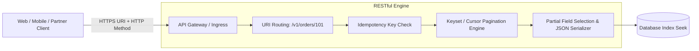
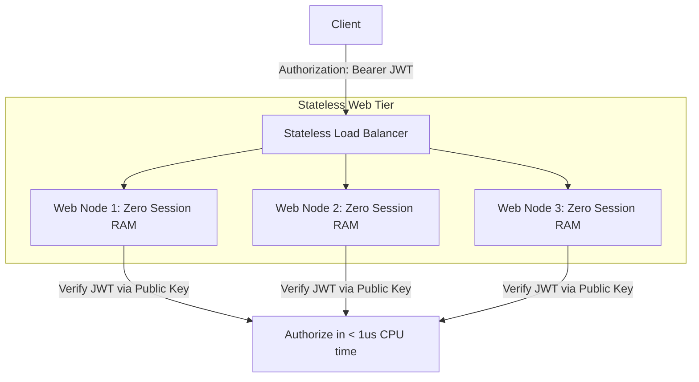
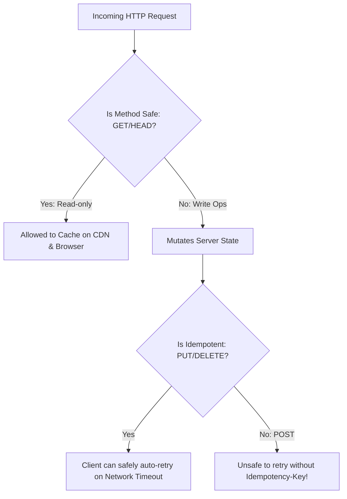
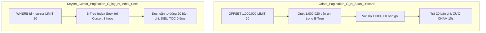
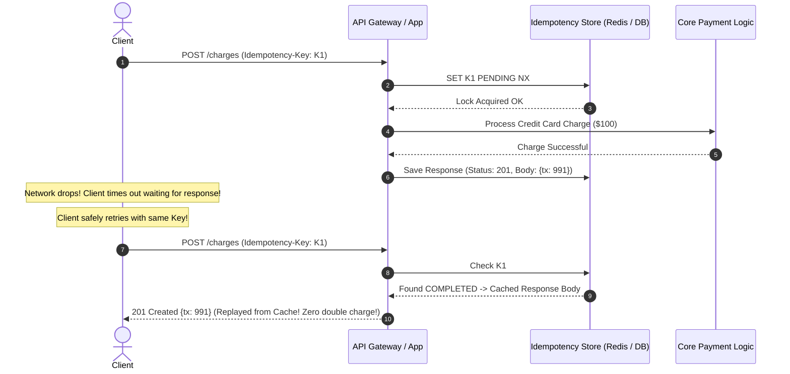
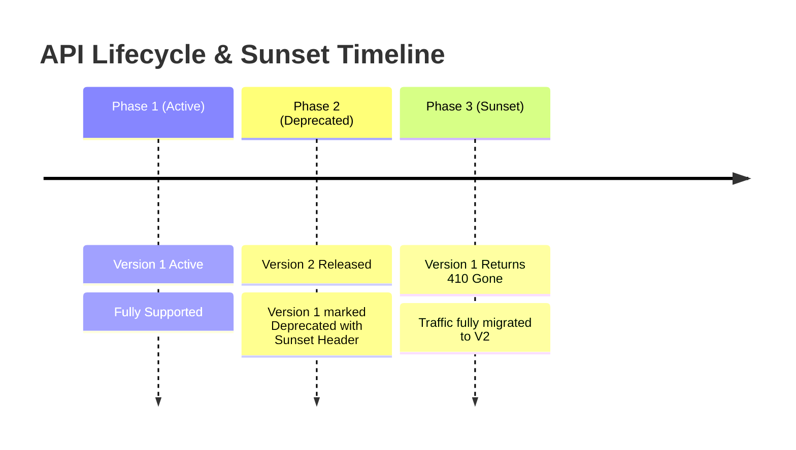

# 05.1. REST and Resource-Oriented API Design (Thiết Kế API Chuẩn REST và Hướng Tài Nguyên)

## Tổng quan về Thiết Kế API Chuẩn REST và Hướng Tài Nguyên
Trong kiến trúc phần mềm hiện đại, **Giao diện Lập trình Ứng dụng (API - Application Programming Interface)** đóng vai trò như một bản hợp đồng kỹ thuật (Contract) ràng buộc giữa Client và Server hoặc giữa các Microservices nội bộ. Một API được thiết kế tồi sẽ làm tăng chi phí tích hợp, rò rỉ cấu trúc dữ liệu cơ sở dữ liệu nội bộ ra ngoài, gây khó khăn cho việc bảo trì và tạo ra các nút thắt cổ chai về hiệu năng.

Thiết kế API hướng tài nguyên (Resource-Oriented Design) theo phong cách **REST (Representational State Transfer)** do Roy Fielding định nghĩa là tiêu chuẩn công nghiệp phổ biến nhất. Điểm cốt lõi là coi mọi thực thể nghiệp vụ là một **Tài nguyên (Resource)** được định danh bằng URI duy nhất, và sử dụng đúng ngữ nghĩa của giao thức HTTP (HTTP Semantics: Methods, Status Codes, Headers) để thao tác trên tài nguyên đó.



---

## 2. Chi tiết từng Keyword (Under-the-Hood Deep Dive)

### 1. REST Constraints & Resource-Oriented Design (Các Ràng Buộc Của REST và Thiết Kế Hướng Tài Nguyên)

#### 1. Khái niệm bản chất (What & Why)
- **REST (Representational State Transfer)**: Phong cách kiến trúc hướng tới việc xây dựng các hệ thống siêu phương tiện phân tán (Distributed Hypermedia Systems). Một hệ thống chỉ được coi là "RESTful" thực sự nếu tuân thủ đầy đủ **6 Ràng buộc Kiến trúc (Architectural Constraints)** của Roy Fielding:
  1. **Client-Server Architecture**: Tách biệt hoàn toàn giao diện người dùng (Client) khỏi phần lưu trữ và xử lý logic (Server).
  2. **Statelessness (Không trạng thái)**: Mỗi request từ client phải chứa đầy đủ mọi thông tin cần thiết để server hiểu và thực thi. Server tuyệt đối không lưu session state của client trong bộ nhớ giữa các request.
  3. **Cacheability (Có thể lưu đệm)**: Mọi phản hồi (Response) phải tự khai báo rõ ràng nó có được phép cache hay không (thông qua `Cache-Control`, `ETag`, `Expires`) để client hoặc trung gian (CDN/Proxy) tái sử dụng.
  4. **Layered System (Hệ thống phân tầng)**: Client không thể biết nó đang kết nối trực tiếp với server cuối cùng hay một proxy, load balancer, cache layer ở giữa.
  5. **Uniform Interface (Giao diện đồng nhất)**: Gồm 4 nguyên tắc con: Định danh tài nguyên qua URI, Thao tác trên tài nguyên qua biểu diễn (Representations: JSON/XML), Thông điệp tự mô tả (Self-descriptive messages), và HATEOAS (Hypermedia As The Engine Of Application State).
  6. **Code on Demand (Tùy chọn)**: Server có thể mở rộng tạm thời chức năng của client bằng cách truyền tải mã thực thi (ví dụ: JavaScript applet).
- **Resource-Oriented Design**: Lấy **Danh từ (Nouns)** làm trung tâm của URI thay vì Động từ (Verbs).
  - *Đúng chuẩn REST*: `GET /v1/users/42/orders` (Lấy đơn hàng của user 42).
  - *Sai chuẩn (RPC giả danh REST)*: `POST /v1/getUserOrders?userId=42`.

#### 2. Cơ chế hoạt động sâu (Under the hood / Hardcore Internals)
Tại sao **Statelessness** là chìa khóa vật lý để Scale-out:
- Nếu Server lưu `HttpSession` trên RAM cục bộ của máy chủ Web A:
  - Khi người dùng gửi request tiếp theo, bắt buộc Load Balancer phải định tuyến request đó về đúng máy chủ Web A (**Sticky Sessions / Session Affinity**).
  - Nếu máy chủ Web A bị cháy nguồn, session của người dùng biến mất $\rightarrow$ Người dùng bị đá văng ra khỏi hệ thống, mất giỏ hàng.
- Khi tuân thủ **REST Statelessness**:
  - Trạng thái xác thực được đóng gói trong **JWT Token** có chữ ký số (HMAC-SHA256 hoặc Ed25519) và gửi qua header `Authorization: Bearer <token>`.
  - Mọi máy chủ Web trong cụm từ Node 1 đến Node 1000 đều có thể xử lý request độc lập bằng cách xác minh chữ ký cryptographic bằng Public Key trong CPU RAM mà không cần truy vấn bất kỳ Database Session nào!

#### 3. Sơ đồ minh họa


#### 4. Code ví dụ thực chiến (C++20 - REST URI Resource Parser)
```cpp
#include <iostream>
#include <string>
#include <regex>
#include <optional>

struct ResourceRoute {
    std::string collection;
    std::string resource_id;
    std::optional<std::string> sub_collection;
};

// Phân tích URI chuẩn REST: /api/v1/{collection}/{id}/{sub_collection}
class RestUriParser {
public:
    static std::optional<ResourceRoute> parse(const std::string& path) {
        // Regex kiểm tra cấu trúc danh từ REST
        std::regex rest_pattern(R"(^/api/v1/([a-zA-Z0-9_-]+)/([a-zA-Z0-9_-]+)(?:/([a-zA-Z0-9_-]+))?$)");
        std::smatch matches;

        if (std::regex_match(path, matches, rest_pattern)) {
            ResourceRoute route;
            route.collection = matches[1].str();
            route.resource_id = matches[2].str();
            if (matches[3].matched) {
                route.sub_collection = matches[3].str();
            }
            return route;
        }
        return std::nullopt;
    }
};

int main() {
    std::string uri1 = "/api/v1/customers/cust_9981/invoices";
    std::string uri2 = "/api/v1/doPaymentNow"; // Anti-pattern RPC style

    auto res1 = RestUriParser::parse(uri1);
    if (res1) {
        std::cout << "[REST Valid] Collection: " << res1->collection 
                  << " | ID: " << res1->resource_id 
                  << " | Sub: " << res1->sub_collection.value_or("none") << "\n";
    }

    auto res2 = RestUriParser::parse(uri2);
    if (!res2) {
        std::cout << "[REST Rejected] '" << uri2 << "' violates Resource-Oriented noun conventions.\n";
    }
    return 0;
}
```

#### 5. Ưu / Nhược điểm, Pitfalls & Anti-patterns
- **Anti-pattern: Tunneling everything through POST**: Dùng `POST /api` cho mọi thao tác và nhét hành động vào body: `{"action": "deleteUser", "id": 123}`. Điều này biến API thành một RPC vụng về, vô hiệu hóa hoàn toàn khả năng caching của CDN và HTTP proxies.

#### 6. Ứng dụng thực tế trong Backend / Systems
GitHub REST API v3 và Stripe API là hai chuẩn mực kinh điển của thế giới về thiết kế RESTful hướng tài nguyên.

---

### 2. HTTP Semantics: Methods, Status Codes & Headers (Ngữ Nghĩa Giao Thức HTTP)

#### 1. Khái niệm bản chất (What & Why)
HTTP không chỉ là một giao thức truyền tải văn bản thô, nó là một giao thức tầng ứng dụng giàu ngữ nghĩa:
- **Tính An toàn (Safety)**: Một phương thức được gọi là Safe nếu nó **không làm thay đổi trạng thái của tài nguyên trên server** (`GET`, `HEAD`, `OPTIONS`).
- **Tính Bất biến / Lũy đẳng (Idempotency)**: Một phương thức được gọi là Idempotent nếu **thực thi nó $N$ lần liên tiếp ($N \ge 1$) đều tạo ra cùng một trạng thái hệ thống như thực thi 1 lần duy nhất** (`GET`, `PUT`, `DELETE`). `POST` không có tính lũy đẳng (gửi 2 lần tạo ra 2 đơn hàng mới). `PATCH` có thể không lũy đẳng (nếu payload chứa lệnh tăng giá trị `balance += 10`).

#### 2. Cơ chế hoạt động sâu (Under the hood / Hardcore Internals)
Bảng tổng hợp ngữ nghĩa chuẩn xác:

| HTTP Method | Safe? | Idempotent? | Thành công | Không tìm thấy | Mô tả kỹ thuật |
| :--- | :---: | :---: | :---: | :---: | :--- |
| **GET** | **Yes** | **Yes** | 200 OK | 404 Not Found | Truy xuất biểu diễn của tài nguyên. |
| **HEAD** | **Yes** | **Yes** | 200 OK | 404 Not Found | Giống GET nhưng Server KHÔNG trả về body (dùng để check `Content-Length` hoặc `ETag`). |
| **POST** | No | **No** | 201 Created | N/A | Tạo mới tài nguyên con phụ thuộc vào URI cha. |
| **PUT** | No | **Yes** | 200 / 204 No Content | 404 / 201 | Thay thế toàn bộ (Full Replace) trạng thái tài nguyên tại URI đã biết. |
| **PATCH** | No | Thường No | 200 / 204 No Content | 404 Not Found | Cập nhật một phần (Partial Update) trạng thái tài nguyên. |
| **DELETE** | No | **Yes** | 200 / 204 No Content | 404 / 200 OK | Xóa tài nguyên (gọi 1 lần hay 10 lần thì tài nguyên vẫn đã biến mất). |

Phân loại HTTP Status Codes chuẩn:
- **2xx (Thành công)**: `200 OK` (Thành công có body), `201 Created` (Tạo tài nguyên mới kèm header `Location`), `202 Accepted` (Đã nhận vào queue để xử lý bất đồng bộ, chưa xong ngay), `204 No Content` (Thành công, không có body trả về).
- **3xx (Chuyển hướng)**: `301 Moved Permanently` (Chuyển hẳn, trình duyệt cache vĩnh viễn), `304 Not Modified` (Dùng cache cục bộ dựa trên `If-None-Match: ETag`).
- **4xx (Lỗi từ phía Client)**: `400 Bad Request` (Sai cú pháp, schema validation fail), `401 Unauthorized` (Chưa xác thực danh tính), `403 Forbidden` (Đã xác thực nhưng không có quyền truy cập), `404 Not Found` (Tài nguyên không tồn tại), `409 Conflict` (Xung đột trạng thái, ví dụ phiên bản DB optimistic lock), `422 Unprocessable Entity` (Cú pháp đúng nhưng ngữ nghĩa sai), `429 Too Many Requests` (Bị rate limit).
- **5xx (Lỗi từ phía Server)**: `500 Internal Server Error` (Unhandled exception), `502 Bad Gateway` (Server upstream trả về lỗi), `503 Service Unavailable` (Server quá tải hoặc đang bảo trì), `504 Gateway Timeout` (Chờ upstream quá hạn).

#### 3. Sơ đồ minh họa


#### 4. Code ví dụ thực chiến (TypeScript - Express-style HTTP Semantic Response Handler)
```typescript
interface HttpResponse {
  status: number;
  headers?: Record<string, string>;
  body?: any;
}

export class OrderHttpController {
  // POST /v1/orders -> 201 Created kèm Location header
  public createOrder(req: { body: { sku: string; qty: number } }): HttpResponse {
    const newOrderId = "ord_" + Math.random().toString(36).substring(7);
    return {
      status: 201,
      headers: {
        "Location": `/v1/orders/${newOrderId}`,
        "Content-Type": "application/json"
      },
      body: { id: newOrderId, status: "PENDING" }
    };
  }

  // DELETE /v1/orders/:id -> 204 No Content (Lũy đẳng - Idempotent)
  public deleteOrder(orderId: string): HttpResponse {
    // Xóa trong DB...
    return {
      status: 204 // Không có body!
    };
  }
}
```

#### 5. Ưu / Nhược điểm, Pitfalls & Anti-patterns
- **Anti-pattern: Return 200 OK with `{"success": false, "error": "Internal Error"}`**: Trả về mã HTTP 200 cho tất cả mọi request kể cả khi sập database. Điều này làm cho tất cả các công cụ giám sát mạng (Prometheus, Cloudflare, Datadog) ghi nhận tỷ lệ lỗi bằng $0\%$ trong khi khách hàng đang phàn nàn sập hệ thống!

#### 6. Ứng dụng thực tế trong Backend / Systems
AWS S3 và Cloudflare CDN dựa hoàn toàn vào HTTP Headers (`If-None-Match`, `ETag`, `Content-Length`) để quyết định truyền tải dữ liệu hay trả về `304 Not Modified`, tiết kiệm hàng nghìn Petabyte băng thông mỗi năm.

---

### 3. Pagination Strategies: Offset vs Cursor vs Keyset Pagination (Các Chiến Lược Phân Trang)

#### 1. Khái niệm bản chất (What & Why)
Khi một câu truy vấn có thể trả về hàng triệu bản ghi, hệ thống bắt buộc phải **Phân trang (Pagination)** để bảo vệ bộ nhớ RAM của Server, tránh quá tải card mạng và giảm thời gian phản hồi. 

Ba cơ chế phân trang phổ biến:
1. **Offset-Based Pagination (`LIMIT x OFFSET y`)**: Nhảy qua $y$ bản ghi đầu và lấy $x$ bản ghi tiếp theo.
2. **Keyset Pagination (Seek Method)**: Sử dụng giá trị của cột chỉ mục được sắp xếp (ví dụ: `WHERE id > last_seen_id ORDER BY id ASC LIMIT x`).
3. **Cursor-Based Pagination**: Mã hóa trạng thái trỏ (thường là base64 của timestamp + id) thành một chuỗi token mờ (Opaque Cursor) trả về cho client.

#### 2. Cơ chế hoạt động sâu (Under the hood / Hardcore Internals)
Tại sao **Offset Pagination** bị coi là cấm kỵ đối với bảng dữ liệu lớn ($> 100,000$ rows):
- Câu lệnh: `SELECT * FROM orders ORDER BY created_at DESC LIMIT 20 OFFSET 1000000;`
- **Cơ chế tầng Database Engine (PostgreSQL / MySQL InnoDB)**:
  1. Storage Engine bắt buộc phải duyệt qua chỉ mục B-Tree và **quét đủ 1,000,020 bản ghi**.
  2. Nạp 1,000,020 trang dữ liệu từ đĩa hoặc Buffer Pool vào RAM.
  3. Sau đó vứt bỏ 1,000,000 bản ghi đầu tiên và chỉ giữ lại 20 bản ghi cuối cùng!
  $\rightarrow$ Độ phức tạp thời gian: **$O(N + M)$**, thời gian chạy có thể mất **5 đến 15 giây**, đốt sạch I/O đĩa.
  - Ngoài ra, Offset Pagination gặp lỗi **Window Drift**: Nếu có 2 bản ghi mới được chèn vào bảng trong lúc user đang lướt từ trang 1 sang trang 2, người dùng sẽ bị xem lại 2 bản ghi bị đẩy tụt xuống (Duplicate items).

- **Keyset / Cursor Pagination Engine**:
  - Câu lệnh: `SELECT * FROM orders WHERE id < 'last_seen_id' ORDER BY id DESC LIMIT 20;`
  - **Cơ chế vật lý**: Database sử dụng cấu trúc B-Tree Index để nhảy thẳng (B-Tree Index Seek) tới đúng node chứa `last_seen_id` trong độ phức tạp **$O(\log N)$** (chỉ tốn khoảng 3-4 phép đọc node trang), sau đó đọc tuần tự đúng 20 bản ghi tiếp theo.
  $\rightarrow$ Tốc độ luôn ổn định ở mức **$< 1\text{ ms}$** bất kể bảng có 100 triệu hay 10 tỷ dòng dữ liệu!

#### 3. Sơ đồ minh họa


#### 4. Code ví dụ thực chiến (TypeScript - Keyset Cursor Encoder / Decoder)
```typescript
interface CursorPayload {
  lastId: string;
  timestamp: number;
}

export class CursorPaginationService {
  // Mã hóa vị trí bản ghi cuối cùng thành opaque cursor token gửi cho client
  public static encodeCursor(lastId: string, timestamp: number): string {
    const payload: CursorPayload = { lastId, timestamp };
    return Buffer.from(JSON.stringify(payload)).toString('base64url');
  }

  // Giải mã cursor token từ client gửi lên trong query param (?cursor=...)
  public static decodeCursor(cursorStr: string): CursorPayload {
    try {
      const decoded = Buffer.from(cursorStr, 'base64url').toString('utf-8');
      return JSON.parse(decoded) as CursorPayload;
    } catch (e) {
      throw new Error("Invalid opaque cursor provided");
    }
  }

  // Tạo câu query SQL chuẩn Keyset tối ưu hóa B-Tree Seek
  public static buildSqlQuery(cursorStr?: string, limit: number = 20) {
    if (!cursorStr) {
      return {
        sql: `SELECT id, created_at, total FROM orders ORDER BY created_at DESC, id DESC LIMIT ?`,
        params: [limit]
      };
    }
    const { lastId, timestamp } = this.decodeCursor(cursorStr);
    return {
      // Tuple Comparison Keyset Seek (Tối ưu tuyệt đối trên multi-column index)
      sql: `SELECT id, created_at, total FROM orders 
            WHERE (created_at, id) < (?, ?) 
            ORDER BY created_at DESC, id DESC LIMIT ?`,
      params: [timestamp, lastId, limit]
    };
  }
}
```

#### 5. Ưu / Nhược điểm, Pitfalls & Anti-patterns
- **Offset Pagination**: Ưu điểm duy nhất là cho phép nhảy cóc tới trang tùy ý (`Trang 42`), nhưng chết ở bảng lớn.
- **Keyset / Cursor Pagination**: Ưu điểm là hiệu năng siêu tốc $O(\log N)$, loại bỏ Window Drift; nhược điểm là không hỗ trợ nhảy trang ngẫu nhiên (chỉ hỗ trợ cuộn vô tận - Infinite Scrolling / Next Page).

#### 6. Ứng dụng thực tế trong Backend / Systems
Slack, Instagram Feed, Twitter Timeline và Stripe API chỉ sử dụng duy nhất Cursor-Based Pagination trong toàn bộ hệ thống API công khai.

---

### 4. Idempotent APIs & Idempotency Keys (API Lũy Đẳng và Khóa Lũy Đẳng)

#### 1. Khái niệm bản chất (What & Why)
Trong mạng máy tính không đáng tin cậy, khi Client gửi một request thanh toán (`POST /v1/charges`), Client có thể gặp lỗi **Network Timeout** (mất kết nối trước khi nhận được phản hồi từ Server). 
Lúc này, Client rơi vào trạng thái bế tắc: *Server đã trừ tiền chưa? Nếu gửi lại, người dùng có bị trừ tiền 2 lần không?*

**Idempotent APIs** đảm bảo rằng một client có thể an toàn thử lại (Retry) cùng một request nhiều lần mà không tạo ra bất kỳ tác dụng phụ (Side Effect) trùng lặp nào. Kỹ thuật tiêu chuẩn công nghiệp là sử dụng **Khóa Lũy đẳng (Idempotency Key)** gửi qua HTTP Header (`Idempotency-Key: <UUID>`).

#### 2. Cơ chế hoạt động sâu (Under the hood / Hardcore Internals)
Quy trình thực thi Idempotency Key an toàn tuyệt đối với Distributed Mutex & Database:
1. Client sinh UUID v4 ngẫu nhiên: `Idempotency-Key: 9b1deb4d-3b7d-4bad-9bdd-2b0d7b3dcb6d`.
2. Khi request đến Server, Server kiểm tra khóa này trong Redis Cache / Database:
   - **Trường hợp 1 (Key chưa tồn tại)**:
     - Server giành quyền khóa (Distributed Lock: `SET key PENDING NX EX 120`).
     - Thực thi nghiệp vụ trừ tiền và tạo đơn hàng.
     - Lưu kết quả HTTP Response (Status code 201 + Response Body) vào bảng `idempotency_keys` vĩnh viễn.
     - Trả kết quả về cho Client.
   - **Trường hợp 2 (Key đang ở trạng thái PENDING)**:
     - Request trùng lặp đến trong khi request thứ nhất vẫn đang chạy $\rightarrow$ Trả về `409 Conflict` hoặc cho client chờ.
   - **Trường hợp 3 (Key đã hoàn tất - COMPLETED)**:
     - Server **hoàn toàn không thực thi lại logic trừ tiền**!
     - Server bốc thẳng HTTP Status Code và Response Body đã lưu từ trước trong cơ sở dữ liệu trả về ngay cho Client.

#### 3. Sơ đồ minh họa


#### 4. Code ví dụ thực chiến (C++20 - Idempotency Manager in-memory với Atomicity)
```cpp
#include <iostream>
#include <string>
#include <unordered_map>
#include <mutex>
#include <optional>

struct StoredResponse {
    int status_code;
    std::string response_body;
};

enum class KeyState { Pending, Completed };

struct IdempotencyRecord {
    KeyState state;
    StoredResponse response;
};

class IdempotencyManager {
private:
    std::unordered_map<std::string, IdempotencyRecord> store_;
    std::mutex mtx_;

public:
    // Trả về true nếu giành được quyền thực thi; false nếu đã được thực thi trước đó
    std::pair<bool, std::optional<StoredResponse>> acquireOrReplay(const std::string& key) {
        std::lock_guard<std::mutex> lock(mtx_);
        auto it = store_.find(key);
        if (it != store_.end()) {
            if (it->second.state == KeyState::Completed) {
                // Đã xử lý xong: Replay kết quả cũ!
                return {false, it->second.response};
            } else {
                // Đang xử lý: Xung đột concurrent
                return {false, std::nullopt};
            }
        }

        // Chưa tồn tại: Đánh dấu PENDING
        store_[key] = IdempotencyRecord{KeyState::Pending, {}};
        return {true, std::nullopt};
    }

    void complete(const std::string& key, int status, const std::string& body) {
        std::lock_guard<std::mutex> lock(mtx_);
        store_[key] = IdempotencyRecord{KeyState::Completed, {status, body}};
    }
};

int main() {
    IdempotencyManager manager;
    std::string idempotency_key = "req_uuid_12345";

    // 1. Request đầu tiên
    auto [can_execute, cached] = manager.acquireOrReplay(idempotency_key);
    if (can_execute) {
        std::cout << "[First Attempt] Processing business charge logic...\n";
        manager.complete(idempotency_key, 201, "{\"charge_id\": \"ch_9981\", \"amount\": 100}");
        std::cout << "[First Attempt] Executed & Stored.\n";
    }

    // 2. Client bị timeout và retry lại đúng request với key cũ
    auto [retry_can_execute, retry_cached] = manager.acquireOrReplay(idempotency_key);
    if (!retry_can_execute && retry_cached.has_value()) {
        std::cout << "[Retry Attempt] Intercepted! Replaying Cached HTTP " 
                  << retry_cached->status_code << " -> " << retry_cached->response_body << "\n";
    }

    return 0;
}
```

#### 5. Ưu / Nhược điểm, Pitfalls & Anti-patterns
- **Anti-pattern: Caching Payload Mismatch**: Client gửi Request B với nội dung khác hoàn toàn (ví dụ đổi số tiền từ $100 thành $500) nhưng tái sử dụng lại `Idempotency-Key` cũ. 
  - *Giải pháp*: Server phải băm (Hash SHA-256) toàn bộ Request Body và lưu kèm Idempotency-Key. Nếu Key trùng nhưng Hash khác nhau, lập tức ném lỗi `422 Unprocessable Entity: Idempotency Key Payload Conflict`.

#### 6. Ứng dụng thực tế trong Backend / Systems
Stripe, Square và PayPal bắt buộc sử dụng `Idempotency-Key` header cho toàn bộ các API liên quan đến thanh toán tiền tệ để đạt chuẩn an toàn giao dịch quốc tế.

---

### 5. API Contracts, OpenAPI, Deprecation & Evolution (Hợp Đồng API, Đặc Tả OpenAPI và Vòng Đời Tiến Hóa)

#### 1. Khái niệm bản chất (What & Why)
- **API Contracts**: Thỏa thuận chính thức giữa bên cung cấp API (Provider) và bên sử dụng API (Consumer) về cấu trúc dữ liệu, kiểu dữ liệu, các trường bắt buộc và mã trạng thái trả về.
- **OpenAPI Specification (OAS / Swagger)**: Tiêu chuẩn công nghiệp mô tả giao diện RESTful API bằng định dạng máy đọc được (Machine-readable: JSON hoặc YAML). Cho phép tự động sinh mã nguồn (Code Generation), sinh tài liệu tương tác và kiểm thử tự động.
- **API Deprecation**: Quy trình thông báo, giảm dần việc sử dụng và chính thức gỡ bỏ một endpoint hoặc phiên bản API cũ mà không làm gián đoạn các client hiện tại.

#### 2. Cơ chế hoạt động sâu (Under the hood / Hardcore Internals)
Quy chuẩn HTTP Header cho việc Deprecation (IETF Deprecation Header Draft):
Khi một API chuẩn bị bị xóa sổ, server phải gửi kèm các header chuẩn trong response:
- `Deprecation: @1735689600` (Thời điểm API bị coi là lỗi thời - Unix timestamp).
- `Sunset: Wed, 11 Nov 2026 00:00:00 GMT` (Thời điểm chính thức API sẽ bị tắt hoàn toàn và trả về HTTP 410 Gone).
- `Link: </api/v2/users>; rel="successor-version"` (Đường dẫn tới API thay thế).

Chiến lược Versioning:
1. **URI Versioning (Khuyên dùng cho External APIs)**: `/v1/orders` vs `/v2/orders`. Trực quan, dễ định tuyến trên CDN và API Gateway.
2. **Header Versioning**: `Accept: application/vnd.company.v2+json`. Giữ URI sạch sẽ nhưng khó debug qua trình duyệt.

#### 3. Sơ đồ minh họa (Vòng đời API Deprecation)


#### 4. Code ví dụ thực chiến (TypeScript - Middleware gắn Sunset & Deprecation Headers)
```typescript
interface RequestContext {
  path: string;
}

interface ResponseContext {
  setHeader(name: string, value: string): void;
}

export function apiDeprecationMiddleware(req: RequestContext, res: ResponseContext, next: () => void) {
  if (req.path.startsWith("/api/v1/legacy-reports")) {
    // Thông báo cho client theo chuẩn IETF Draft
    res.setHeader("Deprecation", "true");
    res.setHeader("Sunset", "Tue, 01 Dec 2026 00:00:00 GMT");
    res.setHeader("Link", '</api/v2/reports>; rel="successor-version"');
    console.warn(`[API Warning] Client accessed deprecated endpoint: ${req.path}`);
  }
  next();
}
```

#### 5. Ưu / Nhược điểm, Pitfalls & Anti-patterns
- **Anti-pattern: Breaking Changes without Minor Bump**: Đổi kiểu dữ liệu của một trường từ `int` thành `string` hoặc đổi tên trường `user_name` thành `username` trên một API đang chạy production mà không tăng version.

#### 6. Ứng dụng thực tế trong Backend / Systems
AWS và Stripe duy trì cam kết hỗ trợ tương thích ngược cho các API version cũ trong nhiều năm, gửi email cảnh báo tự động tới các lập trình viên dựa trên log phân tích Sunset header.

---

## Tóm tắt liên kết hệ thống
Nội dung **5.1** đã thiết lập toàn bộ quy chuẩn thiết kế RESTful API đẳng cấp thế giới: từ ngữ nghĩa HTTP, phân trang siêu tốc Keyset $O(\log N)$, xử lý lũy đẳng tài chính qua Idempotency Keys cho đến quản lý vòng đời API bằng OpenAPI và Sunset Headers.

Trong bài viết tiếp theo (**5.2: Communication Protocols and Patterns**), chúng ta sẽ rời khỏi tầng REST để khảo sát các giao thức hiệu năng cao hơn (gRPC, GraphQL, WebSocket, HTTP/3 QUIC) và các mẫu hình giao tiếp phân tán (Pub-Sub, Streaming, Fan-Out/Fan-In).
