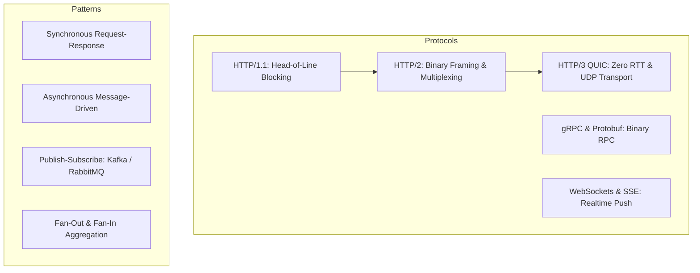
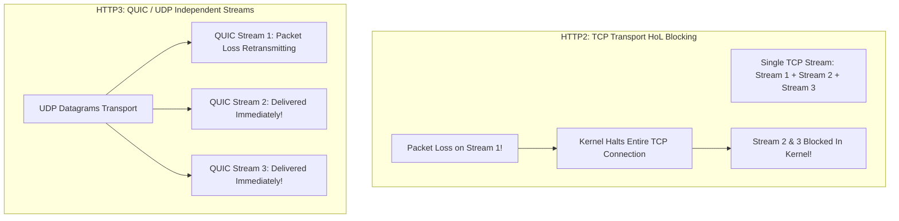
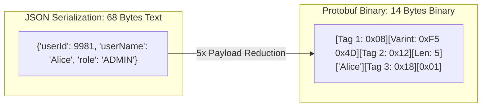
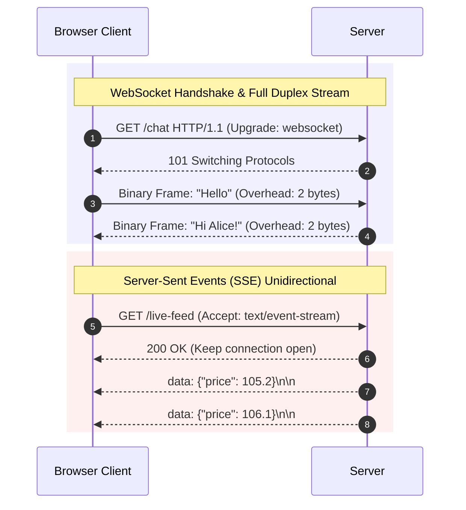
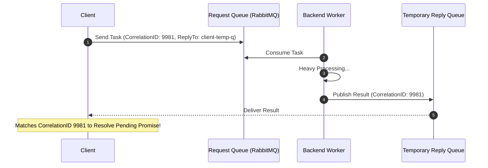
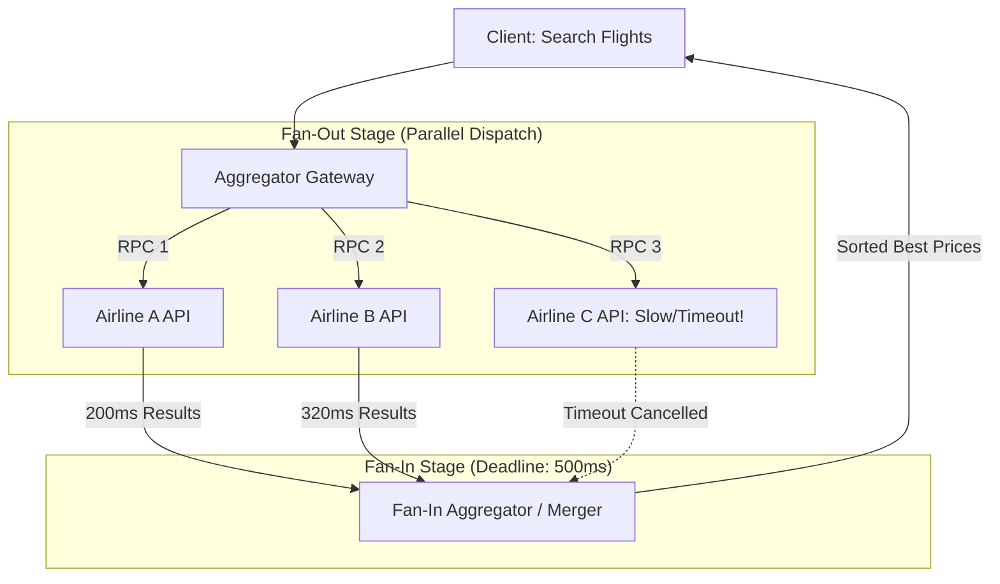

# 05.2. Communication Protocols and Patterns (Các Giao Thức và Mẫu Hình Giao Tiếp)

## Tổng quan về Giao Thức và Mẫu Hình Giao Tiếp
Trong kiến trúc phân tán hiện đại, một hệ thống không thể chỉ dựa vào một giao thức duy nhất. Việc lựa chọn sai giao thức giao tiếp là nguyên nhân hàng đầu dẫn đến sự lãng phí băng thông mạng, nghẽn hàng đợi kết nối (Connection Queues) và bùng nổ độ trễ (Latency Spikes).

Chuyên đề này đi sâu vào:
1. **Bản chất vật lý của các Giao thức truyền tải (Transport & Application Protocols)**: So sánh từ HTTP/1.1, HTTP/2 multiplexing, HTTP/3 trên nền tảng QUIC/UDP, WebSockets hai chiều, SSE, đến các giao thức nhị phân siêu tốc như gRPC / Protocol Buffers và Apache Thrift.
2. **Các Mẫu hình giao tiếp (Communication Patterns)**: Phân loại cơ chế đồng bộ (Synchronous) vs bất đồng bộ (Asynchronous), Request-Reply, Pub-Sub, Streaming hai chiều và các kỹ thuật Fan-Out / Fan-In quy mô lớn.



---

## 2. Chi tiết từng Keyword (Under-the-Hood Deep Dive)

### 1. Evolution of Web Protocols: HTTP/1.1, HTTP/2, HTTP/3 & QUIC (Sự Tiến Hóa Của Các Giao Thức Web)

#### 1. Khái niệm bản chất (What & Why)
- **HTTP/1.1**: Giao thức dựa trên văn bản thuần (Text-based). Mặc dù hỗ trợ Keep-Alive (tái sử dụng kết nối TCP), nó gặp phải vấn đề **Head-of-Line (HoL) Blocking ở tầng ứng dụng**: trên một kết nối TCP, request thứ hai bắt buộc phải chờ request thứ nhất nhận xong response mới được gửi đi. Để tăng tốc, các trình duyệt phải mở từ 6 đến 8 kết nối TCP song song tới mỗi domain.
- **HTTP/2**: Chuyển sang **Binary Framing Layer**. Dữ liệu được chia nhỏ thành các Frames nhị phân (HEADERS, DATA) và ghép kênh (**Multiplexing**) trên một kết nối TCP duy nhất. Khắc phục được HoL blocking ở tầng HTTP, hỗ trợ nén Header (**HPACK**) và Server Push.
- **HTTP/3 & QUIC**: Chuyển tầng truyền tải từ **TCP sang UDP**. Khắc phục hoàn toàn **Head-of-Line Blocking ở tầng TCP (Transport Layer)**. Hỗ trợ kết nối tức thì (**0-RTT Handshake**) và chuyển mạng mượt mà không rớt kết nối (**Connection Migration** khi chuyển từ Wifi sang 4G).

#### 2. Cơ chế hoạt động sâu (Under the hood / Hardcore Internals)
Tại sao HTTP/2 vẫn bị nghẽn mạng và HTTP/3 giải quyết triệt để như thế nào:
- **Hiện tượng TCP Head-of-Line Blocking trong HTTP/2**:
  Trong HTTP/2, tất cả các luồng (Streams: Stream 1 là ảnh, Stream 2 là CSS, Stream 3 là JSON) cùng chia sẻ **một kết nối TCP duy nhất**.
  - Nếu đường truyền mạng bị mất một gói tin TCP thuộc về Stream 1 (Packet Loss):
  - Giao thức TCP ở kernel máy tính bắt buộc phải dừng toàn bộ luồng truyền tải, giữ lại các gói tin đến sau trong bộ đệm và gửi yêu cầu truyền lại (TCP Retransmission).
  - Hậu quả: Stream 2 và Stream 3 dù dữ liệu đã tới nơi an toàn nhưng vẫn **bị Kernel giữ lại (Blocked)** không cho ứng dụng đọc! Khi tỷ lệ mất gói tin (Packet Loss) trên mạng $\ge 2\%$, hiệu năng của HTTP/2 tụt dốc thảm hại, thậm chí chậm hơn cả HTTP/1.1!
- **Cơ chế sửa lỗi của QUIC (HTTP/3) trên nền UDP**:
  QUIC tự triển khai cơ chế kiểm soát tắc nghẽn (Congestion Control) và mã hóa (TLS 1.3 tích hợp sẵn trong handshake) ngay trên tầng UDP trong User Space.
  - Các Stream trong QUIC hoàn toàn độc lập ở tầng vận chuyển: Nếu Stream 1 bị mất gói tin, chỉ duy nhất Stream 1 phải chờ; Stream 2 và Stream 3 vẫn được chuyển ngay lập tức lên ứng dụng!

#### 3. Sơ đồ minh họa


#### 4. Code ví dụ thực chiến (C++20 - Mô phỏng Binary Framing Parser của HTTP/2)
```cpp
#include <iostream>
#include <vector>
#include <cstdint>
#include <cstring>

// HTTP/2 Frame Header (Chuẩn 9 bytes RFC 7540)
#pragma pack(push, 1)
struct HTTP2FrameHeader {
    uint8_t length[3]; // 24-bit payload length
    uint8_t type;      // 8-bit frame type (0x0: DATA, 0x1: HEADERS)
    uint8_t flags;     // 8-bit flags (END_STREAM, etc.)
    uint32_t stream_id; // 1-bit reserved + 31-bit Stream Identifier
};
#pragma pack(pop)

class HTTP2FrameParser {
public:
    static void parseFrame(const uint8_t* buffer, size_t size) {
        if (size < sizeof(HTTP2FrameHeader)) return;

        HTTP2FrameHeader header;
        std::memcpy(&header, buffer, sizeof(HTTP2FrameHeader));

        // Giải mã 24-bit length (Big-endian)
        uint32_t payload_len = (header.length[0] << 16) | (header.length[1] << 8) | header.length[2];
        // Stream ID (Mask 31-bit, bỏ bit R đầu tiên)
        uint32_t stream_id = ntohl(header.stream_id) & 0x7FFFFFFF;

        std::cout << "[HTTP/2 Binary Frame Parsed]\n";
        std::cout << "Payload Length: " << payload_len << " bytes\n";
        std::cout << "Frame Type:     " << (header.type == 0x0 ? "DATA" : (header.type == 0x1 ? "HEADERS" : "OTHER")) << "\n";
        std::cout << "Stream ID:      " << stream_id << " (Multiplexed Channel)\n";
    }
};

int main() {
    // Giả lập 9 bytes frame header của một gói tin DATA trên Stream ID = 5
    uint8_t mock_frame[9] = {
        0x00, 0x00, 0x40, // Length = 64 bytes
        0x00,             // Type = 0x0 (DATA)
        0x01,             // Flags = END_STREAM
        0x00, 0x00, 0x00, 0x05 // Stream ID = 5
    };

    HTTP2FrameParser::parseFrame(mock_frame, sizeof(mock_frame));
    return 0;
}
```

#### 5. Ưu / Nhược điểm, Pitfalls & Anti-patterns
- **Anti-pattern: Domain Sharding & Image Sprites in HTTP/2/3**: Kỹ thuật gộp nhiều icon thành một tấm ảnh lớn (CSS Sprites) hoặc dùng nhiều tên miền (`cdn1.domain.com`, `cdn2.domain.com`) vốn được sinh ra để lách luật 6 kết nối của HTTP/1.1. Trong HTTP/2 và HTTP/3, việc này trở thành Anti-pattern vì nó làm mất tác dụng của TCP/QUIC Multiplexing và gây tốn thêm chi phí TLS Handshake.

#### 6. Ứng dụng thực tế trong Backend / Systems
Google Search và YouTube phục vụ hơn 85% lưu lượng toàn cầu thông qua giao thức QUIC (HTTP/3), giúp giảm đáng kể thời gian tải trang trên mạng di động chập chờn.

---

### 2. gRPC, Protocol Buffers & Apache Thrift (Giao Thức RPC Nhị Phân Hiệu Năng Cao)

#### 1. Khái niệm bản chất (What & Why)
- **gRPC (Google Remote Procedure Call)**: Framework RPC mã nguồn mở hiện đại chạy trên nền tảng **HTTP/2**, cho phép ứng dụng client gọi trực tiếp một phương thức trên máy chủ từ xa giống hệt như một hàm gọi cục bộ trong bộ nhớ.
- **Protocol Buffers (Protobuf)**: Cơ chế tuần tự hóa (Serialization) dữ liệu có cấu trúc dưới dạng **Nhị phân (Binary)** cực kỳ nhỏ gọn và siêu tốc, đi kèm với Interface Definition Language (IDL) để biên dịch ra mã nguồn của hơn 10 ngôn ngữ lập trình khác nhau (C++, Java, Go, Python, TypeScript).
- **Apache Thrift**: Framework RPC và IDL tương tự do Facebook phát triển, hỗ trợ nhiều giao thức đóng gói (Binary, Compact, JSON) và nhiều transport (Socket, Framed, Memory).

#### 2. Cơ chế hoạt động sâu (Under the hood / Hardcore Internals)
Tại sao Protobuf nhanh và nhỏ hơn JSON từ 5 đến 10 lần:
1. **JSON là Text-based**:
   Để lưu số nguyên `123456789`, JSON tốn 9 bytes (9 ký tự ASCII). Chuỗi khóa `"userId"` bị lặp lại trong hàng triệu bản ghi, tốn thêm 8 bytes.
2. **Protobuf sử dụng Varint & Wire Types**:
   - Sử dụng định dạng nhị phân **Tag-Length-Value (TLV)**. Tên trường `"userId"` không bao giờ được gửi qua mạng; thay vào đó, chỉ gửi **Field Number (Tag)** tốn đúng 1 byte!
   - Kỹ thuật **Varint (Variable-length Quantity)**: Sử dụng bit có trọng số cao nhất (MSB) của mỗi byte để báo hiệu còn byte tiếp theo hay không. Các số nguyên nhỏ ($< 128$) chỉ tốn đúng **1 byte duy nhất** thay vì 4 hoặc 8 bytes.
   - Kỹ thuật **ZigZag Encoding**: Biến các số nguyên có dấu âm thành số nguyên dương nhỏ ($-1 \rightarrow 1$, $1 \rightarrow 2$, $-2 \rightarrow 3$), cho phép nén số âm cực nhỏ bằng Varint.

#### 3. Sơ đồ minh họa


#### 4. Code ví dụ thực chiến (C++20 - Thuật toán giải mã Varint của Protocol Buffers)
```cpp
#include <iostream>
#include <vector>
#include <cstdint>

// Thuật toán nén Varint chuẩn Google Protobuf
std::vector<uint8_t> encodeVarint(uint64_t value) {
    std::vector<uint8_t> bytes;
    while (value >= 0x80) { // Lớn hơn 127
        bytes.push_back(static_cast<uint8_t>((value & 0x7F) | 0x80)); // Đặt bit MSB = 1
        value >>= 7;
    }
    bytes.push_back(static_cast<uint8_t>(value & 0x7F)); // Byte cuối cùng có MSB = 0
    return bytes;
}

uint64_t decodeVarint(const std::vector<uint8_t>& bytes) {
    uint64_t result = 0;
    int shift = 0;
    for (uint8_t b : bytes) {
        result |= static_cast<uint64_t>(b & 0x7F) << shift;
        if (!(b & 0x80)) { // Gặp MSB = 0 -> Đã giải mã xong!
            break;
        }
        shift += 7;
    }
    return result;
}

int main() {
    uint64_t original_id = 9981; // 0x26FD
    auto encoded = encodeVarint(original_id);

    std::cout << "[Protobuf Varint Benchmark]\n";
    std::cout << "Original Value: " << original_id << " (Takes 8 bytes in memory)\n";
    std::cout << "Encoded Bytes:  " << encoded.size() << " bytes (Saved 75% space!)\n";
    std::cout << "Decoded Value:  " << decodeVarint(encoded) << "\n";
    return 0;
}
```

#### 5. Ưu / Nhược điểm, Pitfalls & Anti-patterns
- **Ưu điểm**: Tốc độ parse siêu nhanh (không tốn CPU scan chuỗi ký tự), ép kiểu tĩnh chặt chẽ (Strict Contract), hỗ trợ Streaming tự nhiên trên HTTP/2.
- **Nhược điểm**: Không đọc được bằng mắt thường (Human-unreadable), khó debug bằng Postman/Curl nếu không nạp file `.proto`.

#### 6. Ứng dụng thực tế trong Backend / Systems
Tiêu chuẩn mặc định số một cho giao tiếp giữa các Microservices nội bộ tại Google, Netflix, Uber và Kubernetes Control Plane.

---

### 3. Realtime Push: WebSockets, Server-Sent Events (SSE) & Polling (Các Cơ Chế Đẩy Dữ Liệu Thời Gian Thực)

#### 1. Khái niệm bản chất (What & Why)
Khi server cần chủ động đẩy dữ liệu về cho client ngay khi có thay đổi:
- **Short Polling**: Client gửi HTTP request định kỳ mỗi 1-2 giây một lần để hỏi: *"Có tin nhắn mới không?"*. Server trả lời ngay (thường là rỗng).
- **Long Polling**: Client gửi HTTP request, server **giữ treo kết nối** (không trả về ngay) cho đến khi có dữ liệu mới hoặc hết hạn timeout (30s) mới phản hồi. Client nhận xong lập tức mở một kết nối Long Poll mới.
- **Server-Sent Events (SSE)**: Kết nối HTTP một chiều (Unidirectional: Server $\rightarrow$ Client) duy trì liên tục dựa trên MIME type `text/event-stream`. Trình duyệt tự động kết nối lại khi rớt mạng.
- **WebSockets**: Kết nối TCP **hai chiều toàn phần (Full-Duplex)**, bắt đầu từ một yêu cầu nâng cấp giao thức HTTP (`Upgrade: websocket`), sau đó trao đổi các khung dữ liệu nhị phân/văn bản với overhead siêu nhỏ (chỉ 2 đến 10 bytes header).

#### 2. Cơ chế hoạt động sâu (Under the hood / Hardcore Internals)
Bảng so sánh kỹ thuật tầng sâu:

| Tiêu chí | Short Polling | Long Polling | Server-Sent Events (SSE) | WebSockets |
| :--- | :---: | :---: | :---: | :---: |
| **Chiều truyền tải** | Client $\rightarrow$ Server | Client $\rightarrow$ Server | Server $\rightarrow$ Client | **Hai chiều (Full Duplex)** |
| **Giao thức** | HTTP/1.1 | HTTP/1.1 | HTTP/1.1 hoặc HTTP/2 | TCP WebSocket Framing |
| **Header Overhead** | Rất cao (~800B/req) | Cao (~800B/req) | Thấp (HTTP header 1 lần đầu) | **Cực thấp (2-6 bytes/frame)** |
| **Khả năng qua Proxy/Firewall**| Hoàn hảo | Hoàn hảo | Hoàn hảo (Chuẩn HTTP) | Có thể bị chặn bởi một số corporate proxy |
| **Hỗ trợ định dạng** | JSON/Text | JSON/Text | Chỉ UTF-8 Text | **Văn bản & Nhị phân (Binary Blob)** |
| **Tiêu tốn Socket Server** | Giải phóng ngay | Giữ socket liên tục | Giữ socket liên tục | Giữ socket liên tục |

#### 3. Sơ đồ minh họa


#### 4. Code ví dụ thực chiến (TypeScript - Server-Sent Events SSE Handler)
```typescript
interface HttpResponseStream {
  writeHead(status: number, headers: Record<string, string>): void;
  write(chunk: string): void;
  end(): void;
}

export class RealtimeTickerSSEController {
  public handlePriceStream(req: any, res: HttpResponseStream) {
    // 1. Thiết lập Header chuẩn SSE
    res.writeHead(200, {
      "Content-Type": "text/event-stream",
      "Cache-Control": "no-cache",
      "Connection": "keep-alive"
    });

    console.log("[SSE Connected] Starting real-time price updates stream...");

    // 2. Định kỳ đẩy dữ liệu về client mà không đóng kết nối
    const intervalId = setInterval(() => {
      const mockPrice = (100 + Math.random() * 5).toFixed(2);
      // Chuẩn SSE format: Bắt buộc bắt đầu bằng "data: " và kết thúc bằng hai dấu xuống dòng "\n\n"
      res.write(`id: ${Date.now()}\n`);
      res.write(`event: price-update\n`);
      res.write(`data: {"symbol": "BTC", "price": ${mockPrice}}\n\n`);
    }, 1000);

    // Dọn dẹp khi client ngắt kết nối
    req.on?.("close", () => {
      clearInterval(intervalId);
      console.log("[SSE Disconnected] Cleaned up ticker timer.");
    });
  }
}
```

#### 5. Ưu / Nhược điểm, Pitfalls & Anti-patterns
- **Anti-pattern: Using WebSockets for Simple Notification Badges**: Dùng WebSocket để hiển thị số lượng thông báo đỏ (chỉ cập nhật 1 lần mỗi giờ). Việc duy trì hàng triệu kết nối WebSocket nhàn rỗi (Idle TCP Sockets) ngốn sạch RAM và File Descriptors của server vô ích. Với trường hợp này, SSE hoặc Long Polling là sự lựa chọn hợp lý hơn nhiều.

#### 6. Ứng dụng thực tế trong Backend / Systems
- **WebSockets**: Ứng dụng chat (Discord, Slack), game online nhiều người chơi, sàn giao dịch tiền mã hóa thời gian thực.
- **SSE**: ChatGPT streaming từng từ (Tokens), cập nhật trạng thái đơn hàng Uber/Grab.

---

## 2. Chi tiết từng Keyword (Under-the-Hood Deep Dive)

### 4. Communication Patterns: Sync vs Async, Request-Reply, Pub-Sub & Fire-and-Forget

#### 1. Khái niệm bản chất (What & Why)
Các mẫu hình trao đổi thông tin định hình luồng di chuyển của dữ liệu:
- **Synchronous Request-Response (Đồng bộ)**: Client gửi yêu cầu và **bị chặn (Blocked / Waiting)** cho đến khi Server xử lý xong và gửi câu trả lời.
- **Asynchronous Message-Based (Bất đồng bộ)**: Client gửi thông điệp vào một hàng đợi hoặc kênh trung gian rồi quay trở lại làm việc khác ngay lập tức mà không chờ kết quả.
- **Fire-and-Forget**: Client gửi tin nhắn đi và hoàn toàn không quan tâm tin nhắn đó có được nhận hay xử lý thành công hay không (UDP telemetry, access logs).
- **Request-Reply (over Messaging)**: Hiện thực hóa mô hình hỏi-đáp trên nền tảng Message Broker bất đồng bộ thông qua trường `Correlation-ID` và `Reply-To-Queue`.
- **Publish-Subscribe (Pub-Sub)**: Một Producer phát tin nhắn tới một **Topic**. Nhiều Consumer độc lập cùng đăng ký nhận tin nhắn từ Topic đó và mỗi Consumer đều nhận được một bản sao riêng biệt.
- **Point-to-Point Messaging (Work Queue)**: Một Producer gửi tin nhắn vào một **Queue**. Trong số nhiều Consumer đang lắng nghe, **chỉ có duy nhất một Consumer** giành được quyền nhận và xử lý tin nhắn đó.

#### 2. Cơ chế hoạt động sâu (Under the hood / Hardcore Internals)
Cơ chế ghép cặp trong **Request-Reply over Message Queue (AMQP / RabbitMQ)**:
1. Client sinh một định danh duy nhất: `correlation_id = UUID()`.
2. Client tạo một Temporary Queue độc quyền cho riêng mình: `reply_to = amq.gen-JzLG234...`.
3. Client đóng gói message:
   `Message{ Payload: ..., CorrelationId: "c_101", ReplyTo: "amq.gen-JzLG234" }` và đẩy vào Request Queue.
4. Client lắng nghe trên queue `reply_to`.
5. Worker tiêu thụ request, xử lý nghiệp vụ, và đẩy response vào queue được chỉ định trong `ReplyTo`, gắn kèm `CorrelationId = "c_101"`.
6. Client nhận được response trên queue tạm, khớp `CorrelationId` với Promise đang chờ trong bộ nhớ RAM để trả kết quả về cho hàm gọi.

#### 3. Sơ đồ minh họa


#### 4. Code ví dụ thực chiến (C++20 - Mô phỏng Asynchronous Future/Promise Request-Reply)
```cpp
#include <iostream>
#include <future>
#include <thread>
#include <chrono>

// Minh họa cơ chế Asynchronous Request-Reply tách biệt luồng thực thi
std::future<int> asyncComputeOrderTotal(int order_id) {
    // std::async chạy logic trên một worker thread khác (Non-blocking cho main thread)
    return std::async(std::launch::async, [order_id]() {
        std::cout << "[Worker Thread] Fetching DB & calculating taxes for order " << order_id << "...\n";
        std::this_thread::sleep_for(std::chrono::milliseconds(500)); // Giả lập độ trễ I/O
        return order_id * 10 + 50; // Trả về tổng tiền
    });
}

int main() {
    std::cout << "[Main Thread] Initiating order calculation request...\n";
    std::future<int> pending_result = asyncComputeOrderTotal(42);

    std::cout << "[Main Thread] Not blocked! Doing other useful UI work...\n";
    // Kiểm tra xem kết quả đã sẵn sàng chưa (Non-blocking check)
    while (pending_result.wait_for(std::chrono::milliseconds(100)) != std::future_status::ready) {
        std::cout << "[Main Thread] Still waiting for worker reply...\n";
    }

    int total = pending_result.get(); // Lấy kết quả khi đã xong
    std::cout << "[Main Thread] Received Final Total: " << total << "$\n";
    return 0;
}
```

#### 5. Ưu / Nhược điểm, Pitfalls & Anti-patterns
- **Anti-pattern: Using Sync HTTP for Long-Running Batch Jobs**: Cho client gọi `POST /generate-annual-report` qua HTTP đồng bộ và giữ connection mở trong 5 phút. Sau 60 giây, AWS CloudFront hoặc NGINX tự động cắt kết nối và trả về lỗi `504 Gateway Timeout`! 
  - *Giải pháp*: Trả về ngay `202 Accepted` kèm `job_id`, xử lý ngầm trong hàng đợi và thông báo qua Webhook / Polling.

#### 6. Ứng dụng thực tế trong Backend / Systems
Mọi hệ thống thanh toán xử lý thẻ tín dụng (Stripe, VNPAY) đều dùng mô hình Asynchronous Webhook (Request-Callback) để thông báo cho đối tác khi ngân hàng duyệt tiền thành công.

---

### 5. Fan-Out & Fan-In Patterns (Mẫu Hình Tỏa Ra và Gom Lại)

#### 1. Khái niệm bản chất (What & Why)
- **Fan-Out (Tỏa ra)**: Nhận một yêu cầu hoặc một thông điệp đầu vào, sau đó nhân bản và phát tán nó đồng thời tới **nhiều tác vụ hoặc nhiều thành phần xử lý độc lập chạy song song** (Parallelism).
- **Fan-In (Gom lại / Aggregation)**: Chờ đợi và tổng hợp các kết quả trả về từ tất cả các tác vụ song song đã được Fan-Out ở trên thành **một kết quả duy nhất** để trả về cho người dùng.

#### 2. Cơ chế hoạt động sâu (Under the hood / Hardcore Internals)
Áp dụng Fan-Out / Fan-In trong **Trang tìm kiếm chuyến bay (Flight Aggregator: Skyscanner / Kayak)**:
1. Người dùng tìm vé máy bay từ Hà Nội đi Tokyo: `GET /flights?from=HAN&to=NRT`.
2. **Fan-Out**: Gateway phân rã request này thành 5 cuộc gọi song song tới 5 hãng hàng không khác nhau: Vietnam Airlines, VietJet, ANA, Japan Airlines, Bamboo Airways.
3. **Quản lý Concurrency & Latency Budget**:
   - Nếu gọi tuần tự (Sequential): $5 \times 300\text{ ms} = 1.5\text{ giây}$.
   - Nếu gọi Fan-Out song song: Thời gian chỉ bằng thời gian của **hãng phản hồi chậm nhất** ($\max(t_1, t_2, \dots, t_5) \approx 350\text{ ms}$).
4. **Deadline Propagation & Graceful Fan-In**:
   - Thiết lập một Deadline cứng (ví dụ: $500\text{ ms}$).
   - Nếu sau 500ms, hãng thứ 5 vẫn chưa phản hồi, cơ chế Fan-In tự động hủy bỏ (Cancel/Abort) kết nối tới hãng đó và gom kết quả của 4 hãng đã trả về để hiển thị cho người dùng thay vì chờ đợi vô hạn!

#### 3. Sơ đồ minh họa


#### 4. Code ví dụ thực chiến (TypeScript - Fan-Out / Fan-In với Promise.allSettled & Timeout)
```typescript
interface FlightQuote {
  airline: string;
  priceUSD: number;
}

async function fetchFromAirline(airline: string, delayMs: number, price: number): Promise<FlightQuote> {
  return new Promise((resolve, reject) => {
    setTimeout(() => {
      if (delayMs > 600) reject(new Error(`${airline} timed out!`));
      else resolve({ airline, priceUSD: price });
    }, delayMs);
  });
}

// Mẫu hình Fan-Out & Fan-In với Deadline Guard
export async function searchAllAirlinesFanOut(): Promise<FlightQuote[]> {
  console.log("[Aggregator] Fan-Out: Querying multiple airlines in parallel...");

  // Fan-Out: Gọi song song nhiều upstream
  const tasks = [
    fetchFromAirline("VietnamAirlines", 250, 450),
    fetchFromAirline("ANA", 300, 520),
    fetchFromAirline("SlowAirways", 1000, 390) // Hãng này sẽ bị rớt vì quá chậm
  ];

  // Fan-In: Gom lại an toàn bằng allSettled
  const results = await Promise.allSettled(tasks);

  const successfulQuotes: FlightQuote[] = [];
  results.forEach(res => {
    if (res.status === 'fulfilled') {
      successfulQuotes.push(res.value);
    } else {
      console.warn(`[Aggregator Fan-In] Dropped failed/slow provider: ${res.reason.message}`);
    }
  });

  // Sắp xếp kết quả giá tốt nhất
  return successfulQuotes.sort((a, b) => a.priceUSD - b.priceUSD);
}

// Chạy thử nghiệm
searchAllAirlinesFanOut().then(quotes => {
  console.log("[Fan-In Complete] Best available options:", quotes);
});
```

#### 5. Ưu / Nhược điểm, Pitfalls & Anti-patterns
- **Anti-pattern: Fan-Out Bomb (Bùng nổ cấp số nhân)**: Trong mạng xã hội, khi một người nổi tiếng có 80 triệu người theo dõi đăng một bài viết mới, nếu hệ thống chọn phương án "Fan-Out-on-Write" (nhân bản bài viết vào 80 triệu hàng đợi cá nhân của người theo dõi), cụm Kafka và Database sẽ bị nghẽn tức thì!
  - *Giải pháp*: Áp dụng mô hình **Hybrid Fan-Out**: User thường dùng Fan-Out-on-Write; User người nổi tiếng dùng **Fan-Out-on-Read** (khi người theo dõi mở app, họ mới chủ động truy vấn bài viết từ trang cá nhân của người nổi tiếng).

#### 6. Ứng dụng thực tế trong Backend / Systems
Kiến trúc cấp nguồn cấp tin (Newsfeed) của Twitter, Facebook và công cụ tìm kiếm phân tán Elasticsearch (phân tán câu query tới 100 shards và gom lại bằng Scatter-Gather / Fan-Out-In) đều dựa trên mẫu hình này.

---

## Tóm tắt liên kết hệ thống
Chương **11.5 (API Design & Communication Patterns)** đã hoàn thành việc khám phá toàn bộ các hình thái giao tiếp trong hệ thống: từ RESTful conventions, ngữ nghĩa HTTP, phân trang siêu tốc Keyset $O(\log N)$, đến HTTP/3 QUIC, gRPC Protobuf binary packing, WebSockets, SSE và các kiến trúc Fan-Out / Fan-In bất đồng bộ.

Tiếp theo, tại **11.6: Scalability & Load Distribution**, chúng ta sẽ nghiên cứu cách thức phân phối hàng triệu request này đồng đều trên các cụm máy chủ khổng lồ thông qua các thuật toán cân bằng tải tiên tiến (Consistent Hashing, Maglev, L4/L7 Load Balancing).
