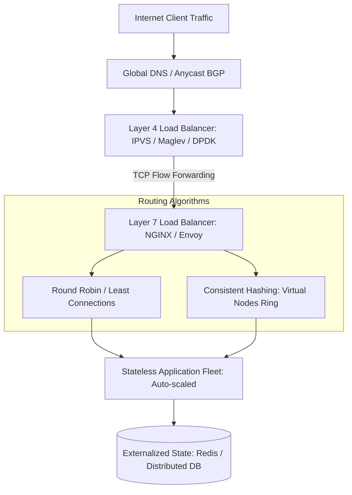
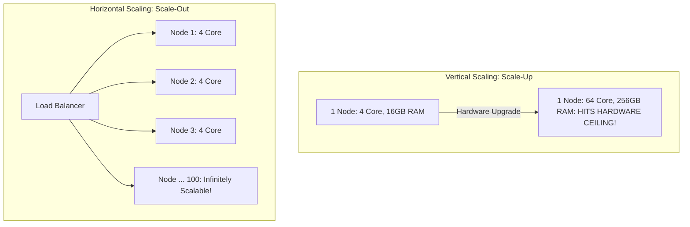
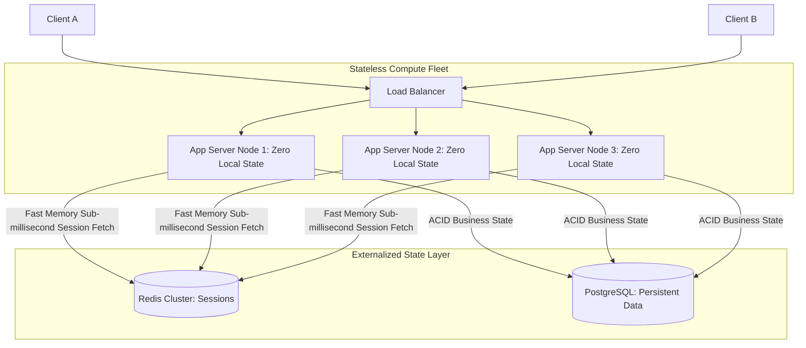
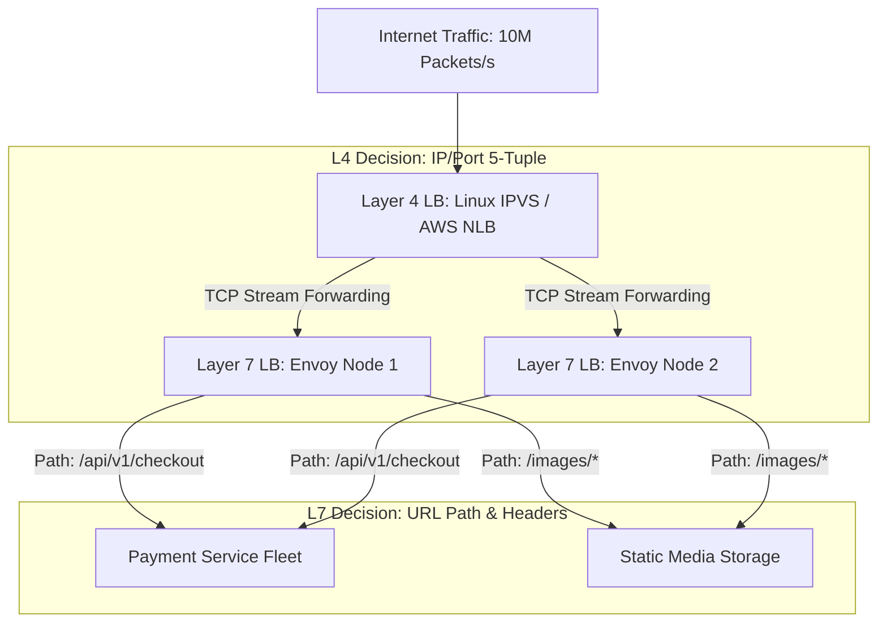
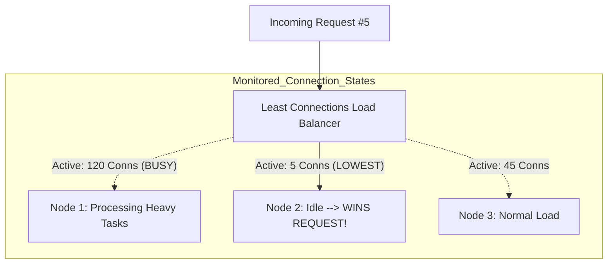
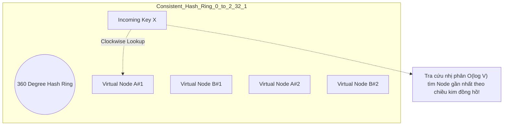

# 06.1. Scaling Paradigms and Load Balancing (Các Mô Hình Mở Rộng và Cân Bằng Tải)

## Tổng quan về Mở Rộng Hệ Thống và Cân Bằng Tải
Khi một hệ thống phát triển từ việc phục vụ vài nghìn người dùng lên đến hàng trăm triệu người dùng, không có một cỗ máy đơn lẻ nào (dù đắt tiền đến đâu) có thể chịu tải nổi. **Khả năng mở rộng (Scalability)** là năng lực của hệ thống duy trì hiệu năng không đổi khi tải công việc tăng lên, bằng cách bổ sung thêm tài nguyên phần cứng.

Trung tâm của bài toán mở rộng là **Cân bằng tải (Load Balancing)** — nghệ thuật phân phối lưu lượng truy cập mạng một cách thông minh và đồng đều trên một cụm máy chủ, ngăn ngừa tình trạng máy quá tải máy nhàn rỗi. Từ tầng vận chuyển **Layer 4 (L4 - TCP/UDP)** với thông lượng hàng chục triệu gói tin mỗi giây bằng công nghệ Kernel Bypass (DPDK/eBPF), cho đến tầng ứng dụng **Layer 7 (L7 - HTTP/gRPC)** với các thuật toán băm nhất quán tinh vi như **Consistent Hashing** và **Google Maglev Hashing**.



---

## 2. Chi tiết từng Keyword (Under-the-Hood Deep Dive)

### 1. Scaling Paradigms: Vertical, Horizontal, Diagonal & Elasticity (Các Mô Hình Mở Rộng)

#### 1. Khái niệm bản chất (What & Why)
- **Vertical Scaling (Scale-Up - Mở rộng dọc)**: Tăng cường sức mạnh cho một máy chủ duy nhất bằng cách nâng cấp CPU (nhiều cores hơn), cắm thêm RAM (từ 32GB lên 1TB), nâng cấp ổ đĩa SSD NVMe nhanh hơn và card mạng 40GbE.
- **Horizontal Scaling (Scale-Out - Mở rộng ngang)**: Bổ sung thêm nhiều máy chủ tiêu chuẩn (Commodity Servers) vào cụm và phân phối khối lượng công việc thông qua Load Balancer.
- **Diagonal Scaling (Mở rộng chéo)**: Sự kết hợp linh hoạt giữa Vertical và Horizontal. Nâng cấp máy chủ lên một cấu hình tối ưu chi phí/hiệu năng nhất (Sweet Spot), sau đó nhân bản máy chủ cấu hình đó theo chiều ngang.
- **Elasticity (Tính co giãn)**: Khả năng của hệ thống tự động **cấp phát thêm tài nguyên khi tải tăng cao và thu hồi tài nguyên khi tải giảm xuống** trong thời gian thực (Dynamic Autoscaling), giúp doanh nghiệp chỉ trả tiền cho tài nguyên thực sự sử dụng.

#### 2. Cơ chế hoạt động sâu (Under the hood / Hardcore Internals)
Tại sao Vertical Scaling luôn chạm trần vật lý (The Physical Ceiling):
1. **Định luật Amdahl (Amdahl's Law)**:
   $$S_{\text{latency}}(s) = \frac{1}{(1 - p) + \frac{p}{s}}$$
   - $p$: Tỷ lệ chương trình có thể chạy song song.
   - $s$: Số lượng nhân CPU bổ sung.
   - Nếu chương trình có $5\%$ phần code chạy tuần tự bắt buộc phải có khóa đồng bộ ($p = 0.95$), thì dù bạn có nâng cấp máy chủ lên **$1,000$ cores CPU**, tốc độ xử lý tối đa cũng **không bao giờ vượt quá $20\times$**!
2. **Chi phí phi tuyến tính (Non-linear Cost Curve)**: Một máy chủ 128 vCPU / 1TB RAM có giá thuê đám mây đắt gấp 20 lần một máy chủ 16 vCPU / 64GB RAM, nhưng chỉ đem lại hiệu năng gấp 5 lần do hiện tượng tranh chấp bộ nhớ bus (NUMA node latency).
3. **Giới hạn phần cứng**: Một mainboard chỉ cắm được số lượng khe RAM và số socket CPU nhất định. Đến một ngưỡng nào đó, bạn không thể mua được linh kiện mạnh hơn.

Trong khi đó, **Horizontal Scaling** gần như không có giới hạn lý thuyết, miễn là kiến trúc phần mềm được thiết kế theo mô hình **Stateless**.

#### 3. Sơ đồ minh họa


#### 4. Code ví dụ thực chiến (C++20 - Đo lường giới hạn Amdahl's Law trên Multi-threading)
```cpp
#include <iostream>
#include <vector>
#include <thread>
#include <chrono>
#include <mutex>

// Minh họa tác động của đoạn code tuần tự (Sequential Bottleneck) làm giảm hiệu quả Scale-Up
void runAmdahlExperiment(int num_threads, int total_work) {
    int work_per_thread = total_work / num_threads;
    std::mutex critical_section_mtx;
    volatile int shared_counter = 0;

    auto start = std::chrono::high_resolution_clock::now();
    std::vector<std::thread> threads;

    for (int t = 0; t < num_threads; ++t) {
        threads.emplace_back([&, work_per_thread]() {
            // 95% công việc song song (Parallel Work)
            int local_sum = 0;
            for (int i = 0; i < work_per_thread * 0.95; ++i) {
                local_sum += (i ^ 3);
            }

            // 5% công việc tuần tự dùng Mutex (Serial Bottleneck)
            {
                std::lock_guard<std::mutex> lock(critical_section_mtx);
                for (int i = 0; i < work_per_thread * 0.05; ++i) {
                    shared_counter += (local_sum & 1);
                }
            }
        });
    }

    for (auto& th : threads) th.join();
    auto end = std::chrono::high_resolution_clock::now();
    auto dur = std::chrono::duration_cast<std::chrono::milliseconds>(end - start).count();

    std::cout << "Threads: " << num_threads << " | Execution Time: " << dur << " ms\n";
}

int main() {
    std::cout << "--- Demonstrating Amdahl's Law in Scale-Up ---\n";
    runAmdahlExperiment(1, 10'000'000);
    runAmdahlExperiment(2, 10'000'000);
    runAmdahlExperiment(4, 10'000'000);
    runAmdahlExperiment(8, 10'000'000);
    // Thời gian không giảm tuyến tính theo số thread do tranh chấp khóa 5%
    return 0;
}
```

#### 5. Ưu / Nhược điểm, Pitfalls & Anti-patterns
- **Ưu điểm Scale-Out**: Không có giới hạn trần, chi phí tuyến tính rẻ, khả năng chịu lỗi cao (1 máy hỏng hệ thống vẫn chạy).
- **Nhược điểm Scale-Out**: Đòi hỏi ứng dụng phải hoàn toàn Stateless; tăng độ phức tạp mạng và quản trị hạ tầng.

#### 6. Ứng dụng thực tế trong Backend / Systems
Hầu hết các hệ thống phân tán lớn (Google Search, Facebook, TikTok) đều sử dụng hàng trăm nghìn máy chủ x86/ARM thông thường chạy Linux thay vì các siêu máy tính mainframe đắt tiền.

---

### 2. Stateless vs Stateful Architecture & State Externalization (Kiến Trúc Phi Trạng Thái và Ngoại Hóa Trạng Thái)

#### 1. Khái niệm bản chất (What & Why)
- **Stateful Architecture (Có trạng thái)**: Máy chủ lưu giữ trạng thái phiên làm việc của client (Client Session, Giỏ hàng, File đang upload dở) ngay trong bộ nhớ RAM cục bộ hoặc trên ổ đĩa cứng của chính máy chủ đó. Yêu cầu request tiếp theo của client bắt buộc phải quay lại đúng máy chủ cũ.
- **Stateless Architecture (Phi trạng thái)**: Mỗi request từ client là một thực thể độc lập, mang theo đầy đủ thông tin định danh và bối cảnh. Mọi máy chủ trong cụm đều có thể phục vụ bất kỳ request nào với kết quả giống hệt nhau.
- **State Externalization (Ngoại hóa trạng thái)**: Quá trình bóc tách toàn bộ trạng thái phiên ra khỏi Application Server và lưu trữ vào các cụm lưu trữ chuyên dụng chuyên nghiệp: **In-Memory Cache (Redis Cluster, Memcached)** hoặc **Distributed Database (PostgreSQL, Cassandra)**.

#### 2. Cơ chế hoạt động sâu (Under the hood / Hardcore Internals)
Tại sao Stateful phá hủy tính Co giãn (Elasticity):
- Nếu bạn có 5 máy chủ Stateful chứa session trên RAM của 100,000 người dùng:
  - Khi lưu lượng giảm vào ban đêm, bạn **không thể tắt bớt 3 máy chủ** để tiết kiệm chi phí! Tắt máy đồng nghĩa với việc tiêu hủy session của 60,000 người dùng đang đăng nhập.
  - Khi một máy chủ bị sập phần cứng, toàn bộ session trên máy đó biến mất vĩnh viễn.
- Khi áp dụng **State Externalization**:
  - Tầng Application Server trở thành **"Gia súc" (Cattle, not Pets)**: Các máy chủ có thể bị bật, tắt, thay thế ngẫu nhiên sau mỗi 5 phút mà không một người dùng nào bị mất phiên làm việc.
  - Tầng Web Server đạt được khả năng **Scale-out tức thì** từ 10 máy lên 500 máy trong vài phút khi có chiến dịch khuyến mãi.

#### 3. Sơ đồ minh họa


#### 4. Code ví dụ thực chiến (TypeScript - Middleware ngoại hóa Session sang Redis Cache)
```typescript
interface SessionData {
  userId: string;
  cartItems: string[];
  expiresAt: number;
}

// Interface ngoại hóa trạng thái ra ngoài RAM của App Server
interface ExternalSessionStore {
  get(sessionId: string): Promise<SessionData | null>;
  set(sessionId: string, data: SessionData, ttlSec: number): Promise<void>;
}

export class StatelessAppController {
  constructor(private sessionStore: ExternalSessionStore) {}

  public async handleAddItemToCart(sessionId: string, newItemId: string) {
    // 1. Kéo trạng thái từ kho ngoại hóa (Redis) về RAM tạm thời
    let session = await this.sessionStore.get(sessionId);
    if (!session) {
      session = { userId: "guest", cartItems: [], expiresAt: Date.now() + 3600 * 1000 };
    }

    // 2. Xử lý nghiệp vụ thuần túy
    session.cartItems.push(newItemId);

    // 3. Đẩy trạng thái mới trở lại Redis (State Externalization hoàn tất)
    await this.sessionStore.set(sessionId, session, 3600);

    // Bất kỳ máy chủ nào khác nhận request sau đó đều đọc được giỏ hàng cập nhật!
    return { status: 200, itemsCount: session.cartItems.length };
  }
}
```

#### 5. Ưu / Nhược điểm, Pitfalls & Anti-patterns
- **Anti-pattern: Local In-Memory Caching of Mutable Shared State**: Cache danh sách phòng khách sạn còn trống trong một `HashMap` trên RAM của Node A. Khi Node B nhận request đặt phòng, Node B không hề biết phòng đó đã hết, dẫn đến tình trạng bán trùng phòng (Double Booking).

#### 6. Ứng dụng thực tế trong Backend / Systems
Mô hình Twelve-Factor App quy định tại Yếu tố thứ 6: *"Processes: Execute the app as one or more stateless processes"*, là tiêu chuẩn bắt buộc cho mọi ứng dụng chạy trên Kubernetes.

---

### 3. Layer 4 vs Layer 7 Load Balancing (Cân Bằng Tải Tầng 4 và Tầng 7)

#### 1. Khái niệm bản chất (What & Why)
- **Layer 4 Load Balancing (L4 - Transport Layer)**: Hoạt động ở tầng Giao vận (TCP/UDP). L4 LB đưa ra quyết định định tuyến **chỉ dựa trên địa chỉ IP nguồn/đích và cổng (Port)**. Nó hoàn toàn không đọc và không biết gì về nội dung của gói tin ứng dụng (không giải mã TLS, không đọc HTTP headers, không xem URL path).
- **Layer 7 Load Balancing (L7 - Application Layer)**: Hoạt động ở tầng Ứng dụng (HTTP, HTTPS, gRPC, WebSocket). L7 LB kết thúc kết nối TCP/TLS, phân tích cú pháp toàn bộ nội dung HTTP (Headers, Cookies, Path, JSON payload) để đưa ra quyết định định tuyến thông minh.

#### 2. Cơ chế hoạt động sâu (Under the hood / Hardcore Internals)
Bảng so sánh chi tiết giữa L4 và L7:

| Đặc tính | Layer 4 Load Balancing | Layer 7 Load Balancing |
| :--- | :--- | :--- |
| **Giao thức hỗ trợ** | TCP, UDP, SCTP | HTTP, HTTPS, HTTP/2, gRPC, WebSocket |
| **Khả năng quan sát** | Chỉ nhìn thấy IP Packet và TCP Segment | Đọc được URI path, Cookies, Headers, Payload |
| **Giải mã TLS/SSL** | Thường Pass-through (chuyển tiếp nhị phân) | **TLS Termination** (tốn CPU giải mã khóa) |
| **Thông lượng (Throughput)** | **CỰC KỲ KHỦNG (Hàng triệu packets/s)** | Vừa phải (Hàng trăm nghìn requests/s) |
| **Tiêu tốn CPU & RAM** | Cực thấp (Zero-copy, kernel packet forwarding) | Cao (Cần parse HTTP framing, nén gzip) |
| **Tính năng định tuyến** | Chỉ Round Robin hoặc Hash theo 5-Tuple IP/Port | Path routing (`/api` vs `/static`), Header routing |
| **Công nghệ tiêu biểu** | Linux IPVS, AWS NLB, HAProxy TCP mode, F5 | NGINX, Envoy Proxy, AWS ALB, Traefik |

Kiến trúc phân tầng kết hợp (Two-Tier Load Balancing Architecture):
Các hệ thống quy mô lớn của Google, Netflix luôn kết hợp cả hai:
$$\text{Internet} \longrightarrow \textbf{L4 LB Cluster (Maglev / IPVS)} \xrightarrow{\text{Direct Server Return}} \textbf{L7 LB Cluster (Envoy / NGINX)} \longrightarrow \textbf{Backend Pods}$$
- Cụm L4 làm nhiệm vụ hứng hàng chục triệu kết nối TCP thô và giải tỏa tải cho các máy chủ L7.
- Cụm L7 thực hiện giải mã TLS, xác thực JWT token và định tuyến theo URL path.

#### 3. Sơ đồ minh họa


#### 4. Code ví dụ thực chiến (C++20 - Mô phỏng L4 5-Tuple Routing Hash vs L7 Path Routing)
```cpp
#include <iostream>
#include <string>
#include <functional>

// 1. Layer 4 Router: Chỉ dựa vào 5-Tuple (Src IP, Src Port, Dst IP, Dst Port, Protocol)
struct L4PacketHeader {
    std::string src_ip;
    uint16_t src_port;
    std::string dst_ip;
    uint16_t dst_port;
};

class L4Router {
public:
    int selectBackendServer(const L4PacketHeader& pkt, int total_backends) {
        // Băm 5-tuple trong < 10ns, không cần quan tâm nội dung HTTP bên trong
        std::string tuple_str = pkt.src_ip + std::to_string(pkt.src_port) + pkt.dst_ip;
        size_t hash_val = std::hash<std::string>{}(tuple_str);
        return static_cast<int>(hash_val % total_backends);
    }
};

// 2. Layer 7 Router: Đọc nội dung HTTP Path để định tuyến thông minh
class L7Router {
public:
    std::string routeByPath(const std::string& http_path) {
        if (http_path.rfind("/api/payments", 0) == 0) {
            return "Payments_Service_Cluster_v2";
        } else if (http_path.rfind("/static", 0) == 0) {
            return "CDN_Static_Storage_Cluster";
        }
        return "Default_Web_Fleet";
    }
};

int main() {
    // L4 Route
    L4PacketHeader pkt{"192.168.1.100", 54321, "10.0.0.1", 443};
    L4Router l4;
    std::cout << "[L4 Routing] Forwarded to Backend Server #" << l4.selectBackendServer(pkt, 8) << "\n";

    // L7 Route
    L7Router l7;
    std::cout << "[L7 Routing] '/api/payments/pay' routed to: " << l7.routeByPath("/api/payments/pay") << "\n";
    std::cout << "[L7 Routing] '/static/logo.png' routed to:  " << l7.routeByPath("/static/logo.png") << "\n";
    return 0;
}
```

#### 5. Ưu / Nhược điểm, Pitfalls & Anti-patterns
- **Anti-pattern: Using L7 for pure high-volume video/streaming raw packets**: Đưa luồng stream RTSP video dung lượng hàng trăm Gbps qua L7 Proxy để inspect HTTP. CPU của proxy sẽ bị thiêu rụi bởi thao tác copy bộ nhớ giữa User Space và Kernel Space.

#### 6. Ứng dụng thực tế trong Backend / Systems
AWS cung cấp Network Load Balancer (NLB - Layer 4 xử lý hàng triệu request/giây với độ trễ microsecond) và Application Load Balancer (ALB - Layer 7 hỗ trợ path-based routing và cookie sticky session).

---

### 4. Load Balancing Algorithms: Round Robin, Weighted, Least Connections & IP Hash (Các Thuật Toán Cân Bằng Tải Truyền Thống)

#### 1. Khái niệm bản chất (What & Why)
Các thuật toán cân bằng tải quyết định máy chủ nào trong cụm sẽ nhận request tiếp theo:
- **Round Robin (Vòng tròn)**: Phân phối tuần tự từng request tới từng máy chủ: Máy 1 $\rightarrow$ Máy 2 $\rightarrow$ Máy 3 $\rightarrow$ Máy 1. Giả định mọi máy chủ có cấu hình như nhau và mọi request tiêu tốn tài nguyên như nhau.
- **Weighted Round Robin**: Gán trọng số (Weight) cho từng máy chủ dựa trên năng lực phần cứng (Máy A 16 cores trọng số 3, Máy B 8 cores trọng số 1 $\implies$ Máy A nhận 3 request rồi mới tới Máy B nhận 1 request).
- **Least Connections**: Chuyển request mới đến máy chủ hiện đang có **ít kết nối hoạt động (Active Connections) nhất**. Cực kỳ phù hợp cho các tác vụ có thời gian xử lý không đồng đều (Long-lived connections, Database queries phức tạp).
- **Weighted Least Connections**: Kết hợp giữa số lượng kết nối đang mở và trọng số cấu hình của máy.
- **IP Hash**: Sử dụng mã băm của địa chỉ IP của Client để định tuyến. Đảm bảo cùng một client IP luôn luôn được kết nối tới cùng một máy chủ (dùng để duy trì session mà không cần cookie).

#### 2. Cơ chế hoạt động sâu (Under the hood / Hardcore Internals)
So sánh hiệu quả phân phối tải:
- **Điểm yếu của Round Robin**: Nếu Máy 1 nhận phải một request xuất báo cáo nặng mất 10 giây xử lý, trong khi Máy 2 nhận các request kiểm tra sức khỏe (Health check) chỉ mất 1ms. Theo quy luật Round Robin, Máy 1 vẫn tiếp tục phải nhận thêm request mới một cách mù quáng, dẫn đến việc Máy 1 bị sập do tràn hàng đợi trong khi Máy 2 đang hoàn toàn nhàn rỗi!
- **Sức mạnh của Least Connections**: Thuật toán liên tục theo dõi bảng trạng thái kết nối active trong bộ nhớ của Load Balancer. Khi Máy 1 đang bị kẹt xử lý tác vụ nặng, số lượng active connection của nó tăng cao, thuật toán tự động chuyển hướng toàn bộ các request mới sang Máy 2 và Máy 3 cho đến khi Máy 1 xử lý xong!

#### 3. Sơ đồ minh họa


#### 4. Code ví dụ thực chiến (C++20 - Thuật toán Smooth Weighted Round Robin của NGINX)
```cpp
#include <iostream>
#include <vector>
#include <string>
#include <algorithm>

struct BackendNode {
    std::string name;
    int weight;          // Trọng số cấu hình cố định
    int current_weight;  // Trọng số động biến thiên theo thuật toán Smooth NGINX
};

// Thuật toán NGINX Smooth Weighted Round-Robin
class SmoothWeightedRoundRobin {
private:
    std::vector<BackendNode> nodes_;

public:
    explicit SmoothWeightedRoundRobin(std::vector<BackendNode> nodes) 
        : nodes_(std::move(nodes)) {
        for (auto& n : nodes_) n.current_weight = 0;
    }

    std::string getNextNode() {
        int total_weight = 0;
        BackendNode* best_node = nullptr;

        for (auto& node : nodes_) {
            node.current_weight += node.weight;
            total_weight += node.weight;

            if (!best_node || node.current_weight > best_node->current_weight) {
                best_node = &node;
            }
        }

        if (best_node) {
            best_node->current_weight -= total_weight; // Giảm trọng số của node vừa trúng giải
            return best_node->name;
        }
        return "";
    }
};

int main() {
    // Máy A (Mạnh nhất, w=5), Máy B (Vừa, w=1), Máy C (Yếu, w=1)
    std::vector<BackendNode> cluster = {
        {"Server_A (w=5)", 5, 0},
        {"Server_B (w=1)", 1, 0},
        {"Server_C (w=1)", 1, 0}
    };

    SmoothWeightedRoundRobin balancer(cluster);
    std::cout << "[NGINX Smooth Weighted RR Distribution for 7 Requests]\n";
    for (int i = 1; i <= 7; ++i) {
        std::cout << "Request #" << i << " -> " << balancer.getNextNode() << "\n";
    }
    // Kết quả phân bố mượt mà xen kẽ: A, A, B, A, C, A, A (Không bị dồn cục A 5 lần liên tiếp!)
    return 0;
}
```

#### 5. Ưu / Nhược điểm, Pitfalls & Anti-patterns
- **Pitfall: IP Hash Behind Mega NAT**: Nếu 5,000 nhân viên trong cùng một tòa nhà văn phòng truy cập hệ thống qua cùng một địa chỉ Public IP công ty (NAT Gateway), thuật toán IP Hash sẽ định tuyến toàn bộ 5,000 người này vào duy nhất 1 máy chủ, đánh sập máy chủ đó ngay lập tức!

#### 6. Ứng dụng thực tế trong Backend / Systems
NGINX và HAProxy sử dụng Smooth Weighted Round-Robin làm thuật toán mặc định hàng đầu thế giới để điều phối tải.

---

### 5. Advanced Hashing: Consistent Hashing, Virtual Nodes, Rendezvous & Maglev Hashing (Các Thuật Toán Băm Nâng Cao)

#### 1. Khái niệm bản chất (What & Why)
Khi cân bằng tải cho các hệ thống có Caching (Distributed Cache, Database Sharding), thuật toán băm thông thường `server = hash(key) % N` gặp phải **thảm họa khi mở rộng**:
- Nếu cụm đang có $N = 4$ servers, khi thêm 1 server mới ($N = 5$), hầu như **toàn bộ các key đều bị đổi vị trí** (tỷ lệ xáo trộn cache lên tới $\frac{N-1}{N} = \frac{4}{5} = 80\%$). Toàn bộ cache bị mất (Cache Invalidation toàn cục), gây sập cơ sở dữ liệu.
- **Consistent Hashing (Băm nhất quán)**: Ánh xạ cả Server và Data Key lên cùng một **Vòng tròn băm (Hash Ring từ $0$ đến $2^{32}-1$)**. Khi thêm hoặc bớt một server, **chỉ có trung bình $1/N$ số lượng key phải di dời**, $99\%$ các key còn lại giữ nguyên vị trí cũ!
- **Virtual Nodes (Vnodes)**: Mỗi server vật lý được ánh xạ thành hàng trăm vị trí ảo (Tokens) trên vòng tròn băm để giải quyết triệt để vấn đề phân bố tải không đều (Hotspots).
- **Rendezvous Hashing (HRW - Highest Random Weight)**: Tính điểm trọng số băm cho từng cặp `(key, server)`. Server nào có điểm cao nhất sẽ nhận key đó.
- **Google Maglev Hashing**: Thuật toán của Google sử dụng bảng tra cứu kích thước cố định (Lookup Table kích thước nguyên tố $M$) kết hợp với hoán vị giả ngẫu nhiên (Permutations), đảm bảo cân bằng tải hoàn hảo và không phụ thuộc vào trạng thái kết nối.

#### 2. Cơ chế hoạt động sâu (Under the hood / Hardcore Internals)
Cơ chế tra cứu vòng tròn Consistent Hashing:
1. Chiều dài vòng tròn: Không gian số nguyên 32-bit: $[0, 2^{32}-1]$.
2. Mỗi Node vật lý (Node A, Node B) được nhân bản thành $K = 100$ Virtual Nodes (ví dụ: `NodeA#1`, `NodeA#2`, ..., `NodeA#100`) bằng thuật toán băm MurmurHash3 hoặc MD5.
3. Toàn bộ các Virtual Nodes được sắp xếp tăng dần trong một cây nhị phân cân bằng (Red-Black Tree hoặc `std::map` trong C++).
4. Khi có một request với `key = "user_9981"`:
   - Tính `hash = MurmurHash3("user_9981")`.
   - Thực hiện tìm kiếm nhị phân **Binary Search / `std::lower_bound`** để tìm node đầu tiên trên vòng tròn có giá trị $\ge hash$ trong thời gian **$O(\log(N \times K))$** (chỉ tốn khoảng vài chục nanosecond).
   - Nếu vượt quá cuối vòng tròn, quay vòng lại node đầu tiên (vòng tròn khép kín).

#### 3. Sơ đồ minh họa


#### 4. Code ví dụ thực chiến (C++20 - Triển khai Consistent Hash Ring với Virtual Nodes hoàn chỉnh)
```cpp
#include <iostream>
#include <string>
#include <map>
#include <vector>
#include <sstream>
#include <functional>

class ConsistentHashRing {
private:
    std::map<uint32_t, std::string> ring_; // Binary Search Tree (Red-Black Tree)
    int virtual_nodes_count_;

    uint32_t hash(const std::string& key) const {
        return static_cast<uint32_t>(std::hash<std::string>{}(key));
    }

public:
    explicit ConsistentHashRing(int vnodes = 100) : virtual_nodes_count_(vnodes) {}

    void addServer(const std::string& server_ip) {
        for (int i = 0; i < virtual_nodes_count_; ++i) {
            std::string vnode_key = server_ip + "#" + std::to_string(i);
            uint32_t ring_position = hash(vnode_key);
            ring_[ring_position] = server_ip;
        }
        std::cout << "[Cluster] Added Server: " << server_ip 
                  << " with " << virtual_nodes_count_ << " virtual nodes.\n";
    }

    void removeServer(const std::string& server_ip) {
        for (int i = 0; i < virtual_nodes_count_; ++i) {
            std::string vnode_key = server_ip + "#" + std::to_string(i);
            uint32_t ring_position = hash(vnode_key);
            ring_.erase(ring_position);
        }
        std::cout << "[Cluster] Removed Server: " << server_ip << " cleanly.\n";
    }

    std::string routeKey(const std::string& data_key) const {
        if (ring_.empty()) return "";

        uint32_t key_hash = hash(data_key);
        // std::lower_bound thực hiện tìm kiếm nhị phân O(log V) trên Red-Black Tree
        auto it = ring_.lower_bound(key_hash);

        if (it == ring_.end()) {
            // Đã đi hết vòng tròn -> Quay vòng về phần tử đầu tiên (Wrap around)
            it = ring_.begin();
        }

        return it->second;
    }
};

int main() {
    ConsistentHashRing hash_ring(150); // Mỗi node vật lý có 150 virtual nodes

    hash_ring.addServer("10.0.0.1 (Redis_Node_A)");
    hash_ring.addServer("10.0.0.2 (Redis_Node_B)");
    hash_ring.addServer("10.0.0.3 (Redis_Node_C)");

    std::vector<std::string> keys = {"user_101", "session_abc", "cart_9981", "token_jwt_xyz"};
    std::cout << "\n--- Initial Key Routing ---\n";
    for (const auto& k : keys) {
        std::cout << "Key '" << k << "' -> Routed to " << hash_ring.routeKey(k) << "\n";
    }

    // Giả sử Node B bị cháy phần cứng và bị gỡ khỏi cụm
    std::cout << "\n--- Node B Crashes! Removing Node B ---\n";
    hash_ring.removeServer("10.0.0.2 (Redis_Node_B)");

    std::cout << "\n--- Key Routing After Failure (Only affected keys are migrated!) ---\n";
    for (const auto& k : keys) {
        std::cout << "Key '" << k << "' -> Routed to " << hash_ring.routeKey(k) << "\n";
    }

    return 0;
}
```

#### 5. Ưu / Nhược điểm, Pitfalls & Anti-patterns
- **Pitfall: Insufficient Virtual Nodes**: Nếu cấu hình số lượng Virtual Nodes quá ít (ví dụ $K = 5$), phân bố các node trên vòng tròn băm sẽ bị lệch (Clustering), dẫn đến một node vật lý phải gánh $60\%$ tổng lượng dữ liệu của hệ thống. Khuyến cáo tối thiểu: $K \ge 100 - 250$ vnodes/server.

#### 6. Ứng dụng thực tế trong Backend / Systems
Amazon DynamoDB, Apache Cassandra, Discord (phân chia cụm bang hội Guilds) và cụm Redis Cluster đều dựa trên Consistent Hashing làm thuật toán phân tán dữ liệu nền tảng.

---

## Tóm tắt liên kết hệ thống
Nội dung **6.1** đã bao phủ toàn diện các phương thức mở rộng (Scale-Up vs Scale-Out), nguyên lý bóc tách trạng thái (Stateless & Externalization) và đào sâu chi tiết các cơ chế cân bằng tải từ L4 Kernel Bypass, L7 Reverse Proxy cho đến thuật toán băm nhất quán Consistent Hashing $O(\log V)$.

Trong bài tiếp theo (**6.2: Traffic Routing and Traffic Management**), chúng ta sẽ nghiên cứu cách thức điều phối giao thông nâng cao: Service Discovery, Health Checks chủ động/thụ động, Geo/Anycast Routing, và các cơ chế phòng vệ tự động (Load Shedding, Backpressure, Predictive Autoscaling).
