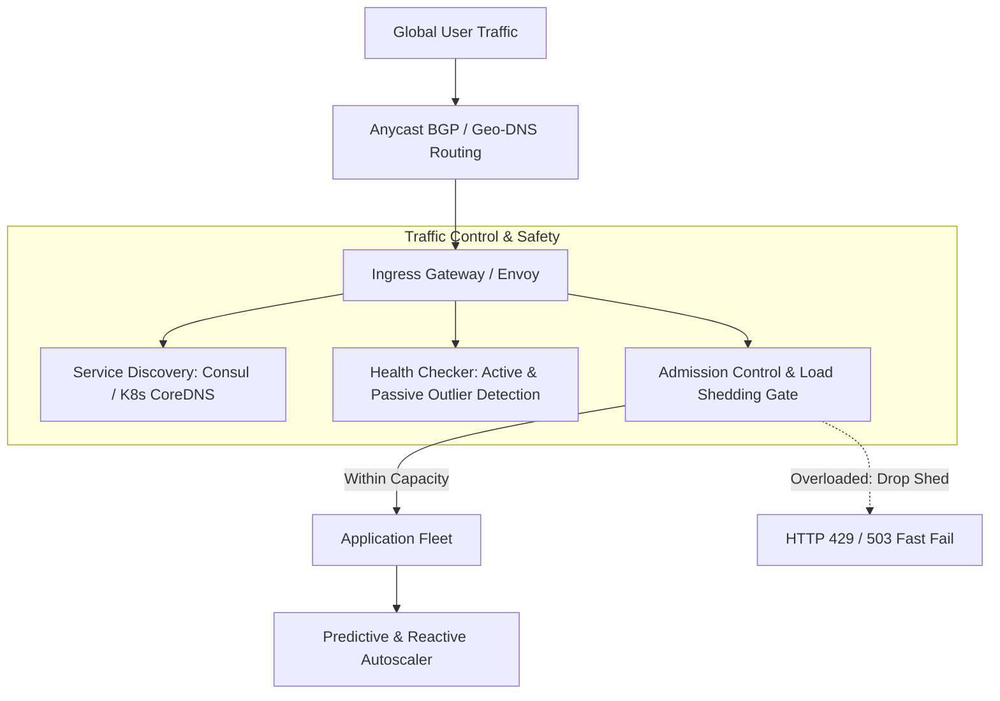
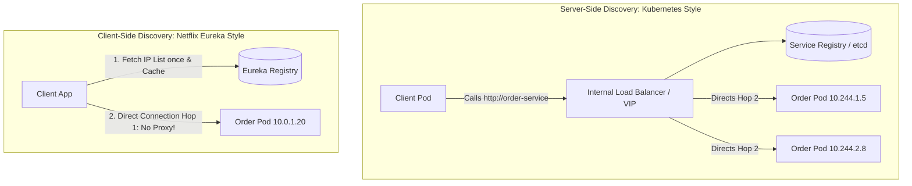
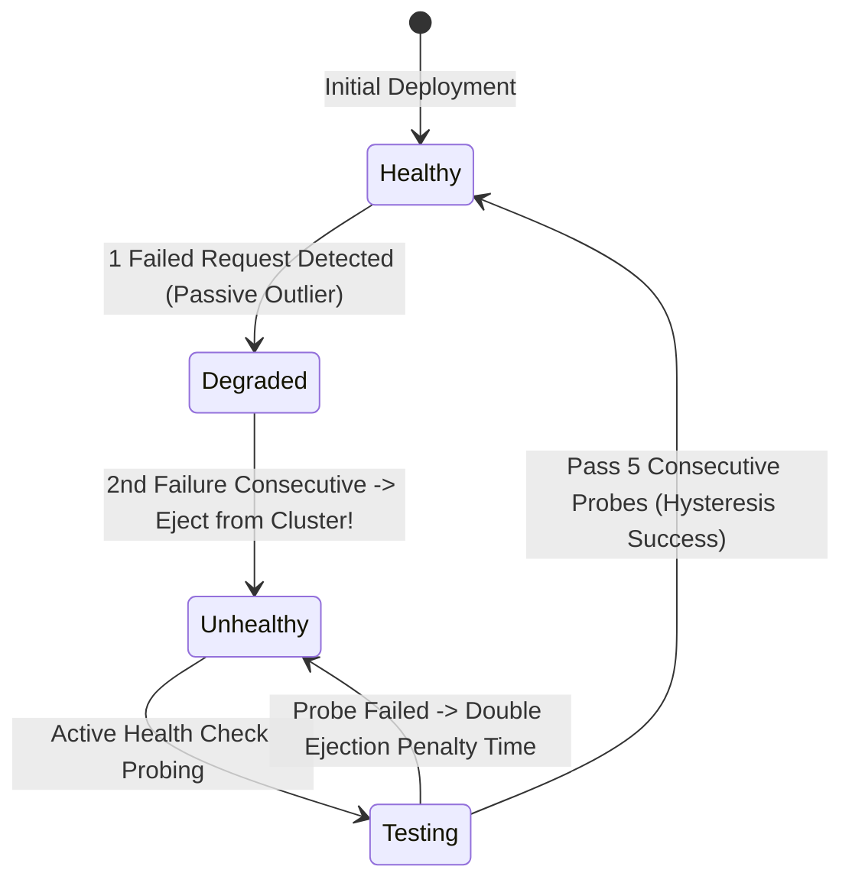
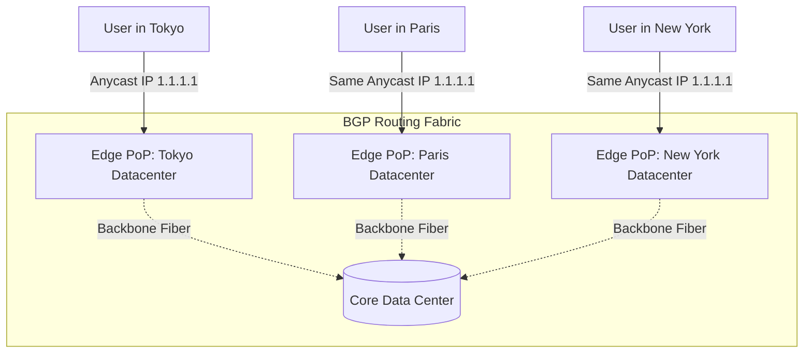
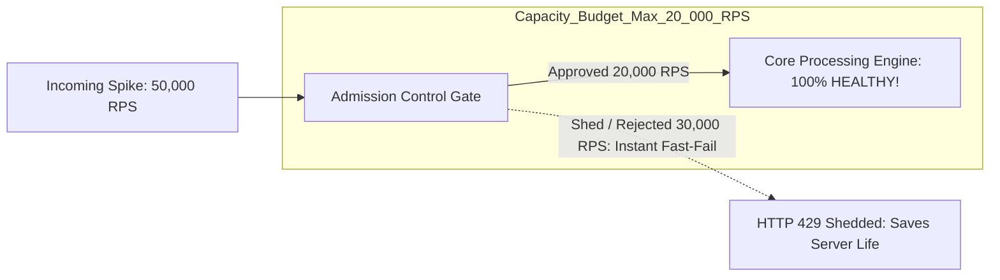
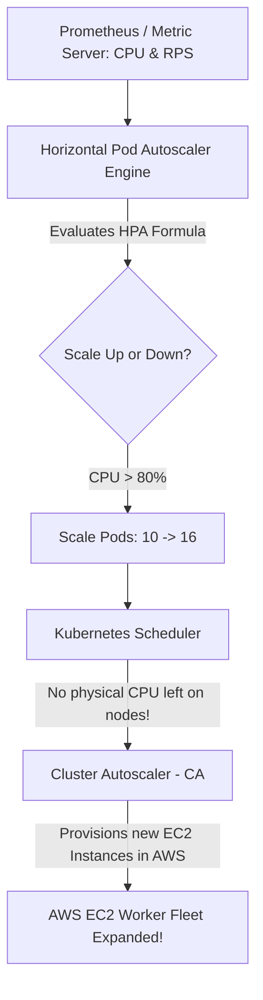

# 06.2. Traffic Routing and Traffic Management (Định Tuyến và Quản Lý Lưu Lượng Giao Thông Mạng)

## Tổng quan về Định Tuyến và Quản Lý Lưu Lượng
Trong một hệ thống phân tán quy mô lớn, việc chỉ có các máy chủ khỏe mạnh là chưa đủ. Hệ thống cần một "Bộ não Điều phối Giao thông" (Traffic Management Engine) để dẫn đường các gói tin từ khắp nơi trên thế giới đến đúng dịch vụ thích hợp nhất, nhận diện kịp thời các máy chủ bị lỗi để gạch tên (**Health Checks & Failover**), và tự động bảo vệ hệ thống trước sự cố nghẽn mạng bằng cách điều tiết áp lực (**Backpressure**) hoặc chủ động vứt bỏ các request quá tải (**Load Shedding & Admission Control**).

Chuyên đề này đi sâu vào:
1. **Khám phá dịch vụ (Service Discovery)**: Mô hình Client-side vs Server-side discovery.
2. **Kỹ thuật định tuyến toàn cầu (Global Traffic Routing)**: Geo-DNS, Anycast BGP và Failover tự động.
3. **Kiểm tra sức khỏe hệ thống (Active vs Passive Health Checks)**: Ngăn chặn hiện tượng giật cục (Flapping).
4. **Cơ chế tự bảo vệ và Kiểm soát tắc nghẽn**: Load Shedding, Admission Control, Backpressure và Tự động co giãn (Autoscaling: Reactive vs Predictive).



---

## 2. Chi tiết từng Keyword (Under-the-Hood Deep Dive)

### 1. Service Discovery: Client-Side vs Server-Side Discovery (Khám Phá Dịch Vụ)

#### 1. Khái niệm bản chất (What & Why)
Trong môi trường Cloud Native và container (Docker, Kubernetes), các máy chủ không còn mang địa chỉ IP tĩnh cố định (Static IP). Các Pod/Container liên tục được sinh ra, di chuyển giữa các máy chủ vật lý, hoặc bị tiêu hủy do Autoscaling hoặc lỗi phần cứng. 

**Service Discovery** là cơ chế tự động theo dõi, đăng ký và phát hiện địa chỉ mạng (IP và Port) của các instance dịch vụ đang hoạt động trong thời gian thực, đảm bảo Service A luôn tìm được địa chỉ của Service B mà không cần cấu hình thủ công bằng tay.

#### 2. Cơ chế hoạt động sâu (Under the hood / Hardcore Internals)
Hai kiến trúc Service Discovery kinh điển:
1. **Server-Side Service Discovery (Mô hình Kubernetes / AWS ALB)**:
   - Client gửi request đến một bộ định tuyến trung gian (Router / Load Balancer) thông qua một Virtual IP (VIP) hoặc DNS ổn định (ví dụ: `http://order-service`).
   - Router trung gian này tự truy vấn **Service Registry** nội bộ (như Kubernetes `kube-proxy` kết hợp `etcd`) để lấy danh sách IP của các Pod đang sống, sau đó cân bằng tải request tới một trong các IP đó.
   - *Ưu điểm*: Client cực kỳ đơn giản (không cần thư viện discovery phức tạp).
   - *Nhược điểm*: Thêm một network hop trung gian làm tăng độ trễ (Extra Network Hop).
2. **Client-Side Service Discovery (Mô hình Netflix Eureka / Consul)**:
   - Mỗi Service Instance khi khởi động sẽ tự gọi Service Registry để đăng ký IP/Port của mình (**Self-registration**).
   - Client trực tiếp truy vấn Service Registry, tải toàn bộ danh sách IP của Service đích về lưu vào bộ nhớ cache trên RAM của Client.
   - Client tự chạy thuật toán cân bằng tải (Round Robin, Least Connections) ngay trong mã nguồn của mình và kết nối trực tiếp đến IP đích.
   - *Ưu điểm*: Loại bỏ hoàn toàn network hop trung gian; độ trễ mạng tối thiểu.
   - *Nhược điểm*: Mã nguồn Client bị gắn kết với thư viện Discovery bằng ngôn ngữ cụ thể (Polyglot complexity).

#### 3. Sơ đồ minh họa


#### 4. Code ví dụ thực chiến (C++20 - Client-Side Service Discovery Registry Cache & Round Robin)
```cpp
#include <iostream>
#include <vector>
#include <string>
#include <shared_mutex>
#include <atomic>

struct ServiceInstance {
    std::string ip;
    int port;
    bool is_healthy;
};

// Client-Side Discovery Cache in-memory
class ClientSideServiceRegistry {
private:
    std::vector<ServiceInstance> instances_;
    mutable std::shared_mutex rw_mtx_;
    std::atomic<size_t> rr_counter_{0};

public:
    void updateInstances(std::vector<ServiceInstance> new_list) {
        std::unique_lock lock(rw_mtx_); // Khóa độc quyền khi cập nhật từ Registry server
        instances_ = std::move(new_list);
        std::cout << "[Client Discovery Cache] Updated list. Total active instances: " 
                  << instances_.size() << "\n";
    }

    std::string selectTargetInstance() {
        std::shared_lock lock(rw_mtx_); // Khóa chia sẻ đa luồng đọc không bị block
        if (instances_.empty()) return "";

        // Client tự chạy thuật toán cân bằng tải in-process
        size_t index = rr_counter_.fetch_add(1, std::memory_order_relaxed) % instances_.size();
        const auto& target = instances_[index];
        return target.ip + ":" + std::to_string(target.port);
    }
};

int main() {
    ClientSideServiceRegistry client_discovery;
    
    // Giả lập đồng bộ danh sách IP từ Consul/etcd về RAM
    client_discovery.updateInstances({
        {"10.244.0.15", 8080, true},
        {"10.244.1.88", 8080, true},
        {"10.244.3.42", 8080, true}
    });

    std::cout << "[Client Direct Calls - Zero Hop]\n";
    for (int i = 1; i <= 5; ++i) {
        std::cout << "Request #" << i << " -> Connecting directly to: " 
                  << client_discovery.selectTargetInstance() << "\n";
    }
    return 0;
}
```

#### 5. Ưu / Nhược điểm, Pitfalls & Anti-patterns
- **Anti-pattern: Stale Cache Zombie Calls**: Client cache danh sách IP trong RAM nhưng không lắng nghe sự kiện hủy đăng ký (Deregister Event). Khi Pod bị Kubernetes tiêu hủy, Client vẫn tiếp tục gửi 100 requests vào IP đã chết, gây ra hàng loạt lỗi `Connection Refused`.

#### 6. Ứng dụng thực tế trong Backend / Systems
Mô hình **Service Mesh (Istio / Envoy Proxy)** kết hợp ưu điểm của cả hai: Envoy chạy dưới dạng Sidecar container ngay cạnh Client, đảm nhiệm Client-Side Discovery siêu tốc bằng C++ mà không làm bẩn mã nguồn nghiệp vụ của ứng dụng.

---

### 2. Health Checks: Active vs Passive & Flapping Prevention (Kiểm Tra Sức Khỏe Máy Chủ)

#### 1. Khái niệm bản chất (What & Why)
- **Active Health Checks (Kiểm tra chủ động)**: Load Balancer định kỳ (ví dụ: mỗi 5 giây) chủ động gửi một request thăm dò (HTTP probe: `GET /healthz` hoặc TCP ping) đến từng máy chủ. Nếu máy chủ phản hồi `200 OK` trong vòng timeout (1s), máy chủ được coi là Healthy.
- **Passive Health Checks (Kiểm tra thụ động / Outlier Detection)**: Load Balancer không tự gửi probe, mà âm thầm giám sát **chất lượng của các request thực tế từ người dùng** đi qua nó. Nếu một máy chủ liên tiếp trả về 5 lỗi HTTP 5xx trong vòng 10 giây, Load Balancer tự động cô lập máy chủ đó ra khỏi danh sách định tuyến (Ejection).
- **Flapping Prevention (Chống lật trạng thái)**: Hiện tượng một máy chủ chập chờn liên tục nhảy qua lại giữa Healthy và Unhealthy trong vài giây, làm xáo trộn bảng định tuyến của toàn hệ thống.

#### 2. Cơ chế hoạt động sâu (Under the hood / Hardcore Internals)
Sự khác biệt giữa **Liveness Probe** và **Readiness Probe** trong Kubernetes:
- **Liveness Probe (Còn sống không?)**: Kiểm tra xem tiến trình có bị deadlock (treo luồng) hoặc crash không. Nếu thất bại $N$ lần liên tiếp, Kubernetes sẽ **tiêu hủy và khởi động lại container (Restart Container)**.
- **Readiness Probe (Đã sẵn sàng nhận khách chưa?)**: Kiểm tra xem tiến trình đã nạp xong dữ liệu khởi tạo, kết nối xong database pool chưa. Nếu thất bại, Kubernetes **KHÔNG restart container**, mà chỉ đơn giản là **tạm thời gỡ IP của Pod đó ra khỏi Load Balancer** để không chuyển tiếp traffic người dùng vào.

Cơ chế chống Flapping bằng **Ngưỡng trễ (Hysteresis)**:
- Để bị đánh dấu là **UNHEALTHY**: Chỉ cần thất bại **2 lần liên tiếp** ($Threshold_{\text{fail}} = 2$).
- Để được đánh dấu phục hồi lại là **HEALTHY**: Bắt buộc phải thành công liên tiếp **5 lần** ($Threshold_{\text{success}} = 5$).
- Thời gian trục xuất tăng dần theo cấp số nhân (Exponential Ejection Time): Lần 1 phạt cách ly 30 giây; nếu tái phạm cách ly 1 phút, 2 phút, 5 phút.

#### 3. Sơ đồ minh họa


#### 4. Code ví dụ thực chiến (C++20 - State Machine Health Checker với Hysteresis)
```cpp
#include <iostream>
#include <string>

enum class NodeHealthState { Healthy, Unhealthy };

class HealthCheckHysteresisTracker {
private:
    NodeHealthState state_ = NodeHealthState::Healthy;
    int consecutive_failures_ = 0;
    int consecutive_successes_ = 0;

    const int FAILURE_THRESHOLD = 2; // Chỉ cần 2 lần lỗi là trục xuất ngay
    const int SUCCESS_THRESHOLD = 5; // Cần 5 lần thành công liên tiếp mới được quay lại

public:
    void recordProbeResult(bool is_ok) {
        if (!is_ok) {
            consecutive_successes_ = 0;
            consecutive_failures_++;
            if (state_ == NodeHealthState::Healthy && consecutive_failures_ >= FAILURE_THRESHOLD) {
                state_ = NodeHealthState::Unhealthy;
                std::cout << "[HEALTH STATE CHANGE] Node marked UNHEALTHY! Ejected from LB.\n";
            }
        } else {
            consecutive_failures_ = 0;
            consecutive_successes_++;
            if (state_ == NodeHealthState::Unhealthy && consecutive_successes_ >= SUCCESS_THRESHOLD) {
                state_ = NodeHealthState::Healthy;
                std::cout << "[HEALTH STATE CHANGE] Node recovered and marked HEALTHY! Added back to LB.\n";
            }
        }
    }

    bool isRoutable() const { return state_ == NodeHealthState::Healthy; }
};

int main() {
    HealthCheckHysteresisTracker tracker;
    std::cout << "--- Simulating transient network blips ---\n";
    tracker.recordProbeResult(false); // Lỗi lần 1
    std::cout << "Is Routable: " << tracker.isRoutable() << "\n";
    tracker.recordProbeResult(false); // Lỗi lần 2 -> Đạt ngưỡng trục xuất!
    std::cout << "Is Routable: " << tracker.isRoutable() << "\n";

    std::cout << "\n--- Node attempts recovery ---\n";
    for (int i = 1; i <= 4; ++i) {
        tracker.recordProbeResult(true); // Thành công 4 lần
        std::cout << "Pass probe #" << i << " | Still Unhealthy: " << !tracker.isRoutable() << "\n";
    }
    tracker.recordProbeResult(true); // Thành công lần 5 -> Được khôi phục hoàn toàn!
    std::cout << "Final Routable: " << tracker.isRoutable() << "\n";
    return 0;
}
```

#### 5. Ưu / Nhược điểm, Pitfalls & Anti-patterns
- **Anti-pattern: Heavy Deep Health Checks**: Cài đặt endpoint `/healthz` chạy một câu query phức tạp quét 10 bảng trong cơ sở dữ liệu. Khi hệ thống hơi quá tải, 1,000 request health check đồng thời từ các Load Balancer sẽ dội thẳng vào database, kéo sập database và làm cho toàn bộ cụm máy chủ tự đánh dấu nhau là Unhealthy (Mass Suicide)!
  - *Quy chuẩn*: Health check endpoint phải cực nhẹ, chỉ kiểm tra in-memory boolean flag và trạng thái ping socket kết nối cơ bản.

#### 6. Ứng dụng thực tế trong Backend / Systems
Envoy Proxy Outlier Detection theo dõi tỷ lệ lỗi 5xx của các cụm Upstream và tự động cách ly các node lỗi trong thời gian thực mà không cần người trực can thiệp.

---

### 3. Global Traffic Management: Geo-Routing, Anycast BGP & Failover (Định Tuyến Toàn Cầu)

#### 1. Khái niệm bản chất (What & Why)
Khi phục vụ người dùng trên khắp các châu lục:
- **Geo-DNS (DNS-based Geographic Routing)**: Máy chủ DNS phân giải tên miền (như Amazon Route 53) dựa vào địa chỉ IP của Client để trả về địa chỉ IP của Data Center gần nhất về mặt địa lý (Client ở Tokyo nhận IP Tokyo; Client ở Frankfurt nhận IP Frankfurt).
- **Anycast BGP Routing**: Nhiều máy chủ đặt ở các lục địa khác nhau trên thế giới **cùng chia sẻ duy nhất một địa chỉ IP công khai (Single IP Address)**. Giao thức định tuyến cốt lõi của Internet (BGP - Border Gateway Protocol) sẽ tự động dẫn đường gói tin mạng tới Data Center có số bước nhảy mạng (AS Network Hops) ngắn nhất.
- **Global Failover Routing**: Khi toàn bộ Data Center ở khu vực Bắc Mỹ bị mất điện hoặc hỏa hoạn, hệ thống tự động chuyển toàn bộ lưu lượng sang Data Center ở Châu Âu trong vòng vài giây.

#### 2. Cơ chế hoạt động sâu (Under the hood / Hardcore Internals)
Bản chất vật lý của Anycast BGP:
- Thông thường (Unicast), một địa chỉ IP chỉ tồn tại ở một vị trí duy nhất trên Trái Đất.
- Với **Anycast**:
  - Cloudflare hoặc Google công bố (BGP Announce) cùng một dải IP (ví dụ: `1.1.1.1`) từ hơn 300 Data Centers trên toàn cầu tới các nhà mạng viễn thông (ISPs).
  - Các Router của Internet sử dụng thuật toán tìm đường ngắn nhất (Shortest Path First) để đẩy gói tin tới Data Center gần nhất.
  - **Khả năng triệt tiêu tấn công DDoS tự nhiên**: Nếu kẻ tấn công phát động một đòn tấn công từ chối dịch vụ phân tán 1 Terabit/giây từ các máy tính ma (Botnet) trên toàn cầu, lưu lượng tấn công sẽ bị **chia nhỏ và hấp thụ cục bộ (Localized Scrubbing)** tại 300 trạm biên (Edge Points of Presence) thay vì bị dồn cục vào một máy chủ trung tâm!

#### 3. Sơ đồ minh họa


#### 4. Code ví dụ thực chiến (TypeScript - Mô phỏng Geo-Distance Routing Resolver)
```typescript
interface DataCenterLocation {
  id: string;
  lat: number;
  lon: number;
  ip: string;
}

export class GeoDnsResolver {
  constructor(private datacenters: DataCenterLocation[]) {}

  // Công thức Haversine tính khoảng cách vật lý trên hình cầu Trái Đất
  private calculateDistanceKm(lat1: number, lon1: number, lat2: number, lon2: number): number {
    const R = 6371; // Bán kính Trái Đất (km)
    const dLat = (lat2 - lat1) * (Math.PI / 180);
    const dLon = (lon2 - lon1) * (Math.PI / 180);
    const a =
      Math.sin(dLat / 2) * Math.sin(dLat / 2) +
      Math.cos(lat1 * (Math.PI / 180)) * Math.cos(lat2 * (Math.PI / 180)) *
      Math.sin(dLon / 2) * Math.sin(dLon / 2);
    const c = 2 * Math.atan2(Math.sqrt(a), Math.sqrt(1 - a));
    return R * c;
  }

  public resolveNearestDatacenter(clientLat: number, clientLon: number): DataCenterLocation {
    let nearestDC = this.datacenters[0];
    let minDistance = Infinity;

    for (const dc of this.datacenters) {
      const distance = this.calculateDistanceKm(clientLat, clientLon, dc.lat, dc.lon);
      if (distance < minDistance) {
        minDistance = distance;
        nearestDC = dc;
      }
    }

    console.log(`[Geo-Routing] Client (${clientLat}, ${clientLon}) routed to ${nearestDC.id} (~${Math.round(minDistance)} km away)`);
    return nearestDC;
  }
}

// Chạy thử nghiệm
const cluster: DataCenterLocation[] = [
  { id: "DC-Tokyo", lat: 35.6762, lon: 139.6503, ip: "203.0.113.1" },
  { id: "DC-Frankfurt", lat: 50.1109, lon: 8.6821, ip: "198.51.100.1" },
  { id: "DC-SiliconValley", lat: 37.3875, lon: -122.0575, ip: "192.0.2.1" }
];

const resolver = new GeoDnsResolver(cluster);
// Client ở Hà Nội (21.0285, 105.8542) -> Sẽ được định tuyến tới Tokyo gần nhất!
resolver.resolveNearestDatacenter(21.0285, 105.8542);
```

#### 5. Ưu / Nhược điểm, Pitfalls & Anti-patterns
- **Pitfall: DNS Caching & Delayed Failover**: Các ISP và trình duyệt thường lưu cache bản ghi DNS A Record bỏ qua thời gian TTL (Time To Live). Khi bạn đổi IP để failover trên DNS, có thể mất từ 15 phút đến vài giờ thì toàn bộ người dùng mới cập nhật IP mới!
- **Giải pháp**: Anycast BGP không bị phụ thuộc vào DNS cache; BGP route update có thể hoàn tất trong vài giây trên toàn cầu.

#### 6. Ứng dụng thực tế trong Backend / Systems
Mọi dịch vụ DNS công cộng lớn (Google 8.8.8.8, Cloudflare 1.1.1.1) và các CDN hàng đầu (Fastly, Akamai) đều hoạt động dựa trên Anycast BGP.

---

### 4. Overload Protection: Load Shedding, Admission Control & Backpressure (Kiểm Soát Tắc Nghẽn và Bảo Vệ Quá Tải)

#### 1. Khái niệm bản chất (What & Why)
- **Load Shedding (Vứt bỏ tải quá tải)**: Khi hệ thống chạm ngưỡng năng lực tối đa, thay vì cố gắng nhận thêm request và để toàn bộ hệ thống bị sập (Crash / Out of Memory), máy chủ chủ động **từ chối ngay lập tức (Drop / Reject)** các request vượt mức với mã lỗi `429 Too Many Requests` hoặc `503 Service Unavailable`.
- **Admission Control (Kiểm soát tiếp nhận)**: Cổng kiểm tra nghiêm ngặt tại cửa ngõ trước khi cho phép request đi vào lõi xử lý. Đánh giá dựa trên: CPU hiện tại, dung lượng hàng đợi (Queue Depth) và mức độ ưu tiên của request.
- **Backpressure (Áp lực ngược)**: Cơ chế mà một thành phần xử lý chậm (Slow Consumer) phát tín hiệu cảnh báo ngược lại cho thành phần sản sinh dữ liệu nhanh (Fast Producer) để **hãm tốc độ gửi lại**, tránh tràn bộ đệm.

#### 2. Cơ chế hoạt động sâu (Under the hood / Hardcore Internals)
Định luật suy giảm hiệu năng khi quá tải (The Congestion Collapse Curve):
- Khi tải đạt từ $0\%$ đến $75\%$ công suất: Thông lượng (Throughput) tăng tuyến tính, độ trễ giữ ở mức thấp.
- Khi tải vượt quá $100\%$ công suất:
  - Nếu không có Load Shedding: Hàng đợi (Queue) phình to vô hạn $\implies$ Độ trễ tăng vọt từ $50\text{ ms}$ lên $30,000\text{ ms}$. 
  - Toàn bộ CPU bị tiêu tốn cho việc duy trì timeout socket và context switching $\implies$ **Thông lượng thực tế tụt về gần bằng 0 (Congestion Collapse)**.
- Khi áp dụng **CoDel (Controlled Delay) hoặc Load Shedding dựa trên Little's Law**:
  - Đo thời gian một request phải nằm chờ trong hàng đợi (Queue Wait Time).
  - Nếu một request vừa vào hàng đợi mà đã phải đợi quá $100\text{ ms}$ trước khi được worker thread nhấc lên xử lý, hệ thống **vứt bỏ luôn request đó ngay lập tức (Drop without processing)**!
  - Lý do: Đến khi xử lý xong thì Client ở bên ngoài cũng đã hết thời gian Timeout và đã ngắt kết nối từ lâu; việc tiếp tục xử lý chỉ là lãng phí vô ích chu kỳ CPU!

#### 3. Sơ đồ minh họa


#### 4. Code ví dụ thực chiến (C++20 - Concurrency-Limited Load Shedder)
```cpp
#include <iostream>
#include <atomic>
#include <chrono>

// Bộ điều khiển tiếp nhận bảo vệ chống sập hệ thống (Admission Control Load Shedder)
class LoadShedder {
private:
    const int max_concurrent_requests_;
    std::atomic<int> in_flight_requests_{0};

public:
    explicit LoadShedder(int max_concurrency) 
        : max_concurrent_requests_(max_concurrency) {}

    // Thử xin quyền tiếp nhận request
    bool tryAdmit() {
        int current = in_flight_requests_.load(std::memory_order_relaxed);
        while (current < max_concurrent_requests_) {
            if (in_flight_requests_.compare_exchange_weak(current, current + 1,
                                                          std::memory_order_acquire,
                                                          std::memory_order_relaxed)) {
                return true; // Tiếp nhận thành công!
            }
        }
        return false; // Quá tải: Vứt bỏ tải ngay lập tức (Load Shedding -> HTTP 429 / 503)
    }

    void release() {
        in_flight_requests_.fetch_sub(1, std::memory_order_release);
    }

    int getCurrentConcurrency() const {
        return in_flight_requests_.load(std::memory_order_relaxed);
    }
};

int main() {
    LoadShedder gatekeeper(3); // Giới hạn xử lý tối đa 3 tác vụ đồng thời

    std::cout << "[Admission Control Under Burst]\n";
    for (int i = 1; i <= 5; ++i) {
        if (gatekeeper.tryAdmit()) {
            std::cout << "Request #" << i << ": ADMITTED (In-flight: " 
                      << gatekeeper.getCurrentConcurrency() << ")\n";
        } else {
            std::cout << "Request #" << i << ": SHEDDED / REJECTED (HTTP 429 Fast Fail)\n";
        }
    }
    return 0;
}
```

#### 5. Ưu / Nhược điểm, Pitfalls & Anti-patterns
- **Anti-pattern: Retry Storm amplification**: Khi hệ thống bị quá tải và trả về lỗi, 100,000 client đồng loạt cấu hình retry ngay lập tức mà không có độ trễ ngẫu nhiên (Jitter). Lượng traffic retry đổ vào làm nhân đôi áp lực, khiến hệ thống đã quá tải lại càng chết sâu hơn!

#### 6. Ứng dụng thực tế trong Backend / Systems
TCP Flow Control (sử dụng trường `Window Size` trong header TCP) là hiện thân cấp thấp kinh điển của Backpressure: khi buffer của card mạng nhận bị đầy, nó gửi gói tin ép card mạng gửi phải giảm tốc độ truyền.

---

### 5. Autoscaling: Reactive, Predictive & Cluster Autoscaler (Tự Động Mở Rộng Hạ Tầng)

#### 1. Khái niệm bản chất (What & Why)
- **Reactive Autoscaling (Co giãn phản ứng)**: Mở rộng hạ tầng **sau khi** một chỉ số giám sát (Metric) vượt qua một ngưỡng định trước (ví dụ: trung bình CPU của cụm Pods vượt quá $75\%$ trong 3 phút liên tục $\implies$ tăng số lượng Pods từ 10 lên 20).
- **Predictive Autoscaling (Co giãn dự đoán)**: Sử dụng các mô hình học máy (Machine Learning) hoặc phân tích chuỗi thời gian (Time-series analysis) dựa trên dữ liệu lịch sử để **chủ động tăng tài nguyên trước khi tải đỉnh thực sự ập đến** (ví dụ: tự động bật thêm máy chủ vào lúc 11h45 trưa trước giờ cơm).
- **Cluster Autoscaler (CA)**: Tự động bổ sung hoặc thu hồi **các Node máy chủ vật lý / VM thật (EC2 instances)** của cụm Kubernetes khi tài nguyên của cụm không còn đủ chỗ để xếp lịch (Schedule) cho các Pod mới.

#### 2. Cơ chế hoạt động sâu (Under the hood / Hardcore Internals)
Thuật toán điều khiển của Kubernetes **Horizontal Pod Autoscaler (HPA)**:
$$\text{Desired Replicas} = \left\lceil \text{Current Replicas} \times \left( \frac{\text{Current Metric Value}}{\text{Target Metric Value}} \right) \right\rceil$$

Ví dụ:
- Đang có $10$ Pods running (`Current Replicas = 10`).
- CPU Target cấu hình là $50\%$.
- Tải đột ngột tăng làm CPU trung bình vọt lên $80\%$.
$$\text{Desired Replicas} = \left\lceil 10 \times \left( \frac{80}{50} \right) \right\rceil = \lceil 10 \times 1.6 \rceil = 16\ \text{Pods}$$
HPA sẽ gửi lệnh tới Kubernetes API Server để tăng ReplicaSet lên 16 Pods.

**Cooldown / Stabilization Window**:
Để ngăn hiện tượng co giãn giật cục liên tục (**Thrashing / Flapping** — vừa bật máy xong lại tắt ngay), HPA áp dụng cửa sổ ổn định (mặc định 5 phút cho việc Scale-down): Pod chỉ bị thu hồi nếu tải đã giảm ổn định liên tục trong 5 phút.

#### 3. Sơ đồ minh họa


#### 4. Code ví dụ thực chiến (TypeScript - Thuật toán HPA Controller Simulator)
```typescript
interface HPAConfig {
  minReplicas: number;
  maxReplicas: number;
  targetMetricValue: number; // vd: 50% CPU
  stabilizationWindowMinutes: number;
}

export class HPASimulator {
  private currentReplicas: number;

  constructor(private config: HPAConfig, initialReplicas: number) {
    this.currentReplicas = initialReplicas;
  }

  public evaluateReplicas(currentMetricAverage: number): number {
    // Công thức chuẩn Kubernetes HPA
    const rawRatio = currentMetricAverage / this.config.targetMetricValue;
    
    // Ngưỡng dung sai Tolerance: Nếu chênh lệch < 10%, không scale để chống flapping
    if (Math.abs(1.0 - rawRatio) <= 0.1) {
      console.log(`[HPA] Metric within 10% tolerance (${currentMetricAverage}% vs ${this.config.targetMetricValue}%). No action.`);
      return this.currentReplicas;
    }

    let desired = Math.ceil(this.currentReplicas * rawRatio);
    // Áp dụng giới hạn Min/Max
    desired = Math.max(this.config.minReplicas, Math.min(this.config.maxReplicas, desired));

    console.log(`[HPA Scale Event] Current: ${this.currentReplicas} Pods | Metric: ${currentMetricAverage}% -> Desired: ${desired} Pods`);
    this.currentReplicas = desired;
    return this.currentReplicas;
  }
}

// Chạy thử nghiệm
const hpa = new HPASimulator({
  minReplicas: 2,
  maxReplicas: 20,
  targetMetricValue: 50,
  stabilizationWindowMinutes: 5
}, 5);

hpa.evaluateReplicas(52); // Chênh lệch nhỏ -> Không scale
hpa.evaluateReplicas(85); // Tải cao -> Scale từ 5 lên 9 Pods!
```

#### 5. Ưu / Nhược điểm, Pitfalls & Anti-patterns
- **Pitfall: Autoscaling on Memory for Memory-Leaking Apps**: Cấu hình HPA scale theo RAM cho một ứng dụng Java bị lỗi rò rỉ bộ nhớ (Memory Leak). Kết quả là ứng dụng scale lên kịch trần (Max Replicas = 50 pods) và đốt sạch hàng nghìn USD tiền mây của công ty trong 2 giờ mà không giải quyết được vấn đề gốc rễ!

#### 6. Ứng dụng thực tế trong Backend / Systems
AWS Karpenter là công cụ Autoscaling hiện đại bậc nhất hiện nay trên Kubernetes, có khả năng phân tích trực tiếp cấu hình Pod để order máy chủ EC2 phù hợp nhất từ AWS trong vòng dưới 45 giây.

---

## Tóm tắt liên kết hệ thống
Toàn bộ chuyên mục **11.6 (Scalability & Load Distribution)** đã trang bị cho bạn kiến thức thực chiến sâu rộng nhất: từ cân bằng tải L4/L7, Consistent Hashing trên không gian $2^{32}-1$, Service Discovery Client/Server-side, đến Anycast BGP toàn cầu, Load Shedding cứu mạng hệ thống và tự động co giãn Kubernetes HPA.

Tiếp theo, tại **11.7: Caching Architecture**, chúng ta sẽ nghiên cứu giải pháp tối thượng để giảm tải cho toàn bộ hệ thống bằng nghệ thuật lưu trữ đệm: phân tầng Cache, các mẫu hình Cache-Aside/Write-Through, thuật toán đuổi dữ liệu LRU/LFU và cách khắc phục các thảm họa kinh điển như Cache Stampede, Avalanche và Penetration.
