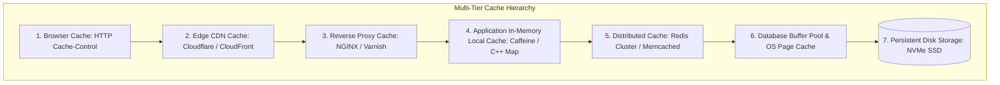
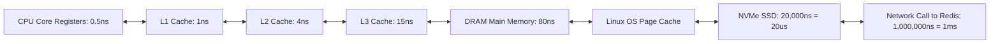
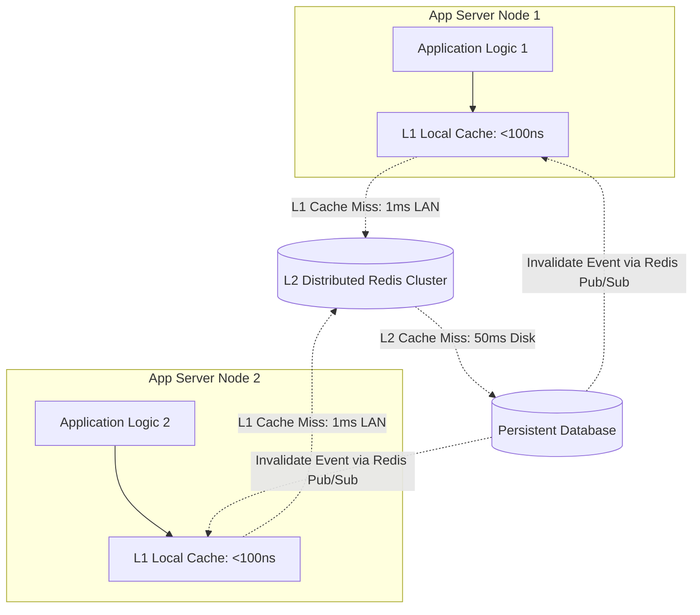
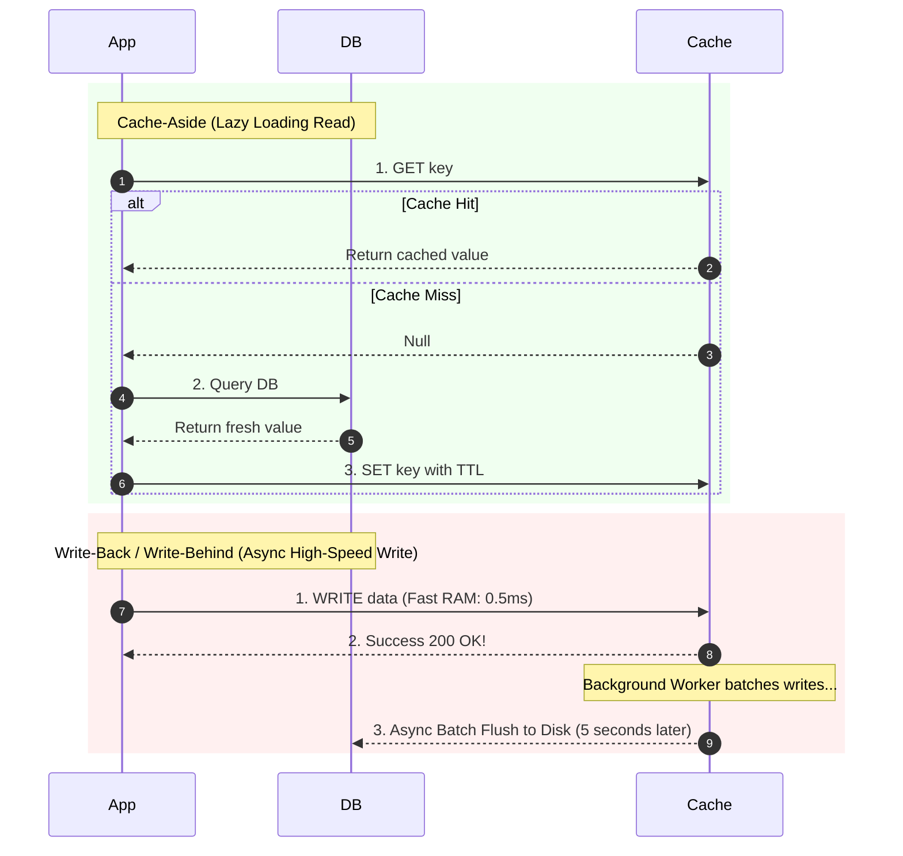

# 07.1. Cache Topologies and Caching Patterns (Cấu Trúc Phân Tầng và Các Mẫu Hình Lưu Đệm)

## Tổng quan về Cấu Trúc Phân Tầng và Mẫu Hình Lưu Đệm
Trong kiến trúc máy tính và kỹ thuật hệ thống phân tán, chân lý cơ bản là: **Tài nguyên lưu trữ càng nhanh thì dung lượng càng nhỏ và chi phí càng đắt đỏ**. CPU Registers và L1/L2 Cache có độ trễ dưới 1 nanosecond nhưng chỉ chứa được vài Megabyte; trong khi ổ đĩa SSD NVMe có dung lượng hàng chục Terabyte nhưng độ trễ truy xuất ngẫu nhiên lại chậm hơn hàng chục nghìn lần.

**Bộ nhớ đệm (Caching)** là kỹ thuật lưu trữ tạm thời các bản sao dữ liệu thường xuyên được truy cập trên một lớp lưu trữ tốc độ cao (thường là RAM hoặc Edge SSD), nhằm giảm tải cho các tầng lưu trữ phía dưới (Database, Disk I/O), triệt tiêu độ trễ mạng và tăng thông lượng hệ thống lên gấp hàng trăm lần.



---

## 2. Chi tiết từng Keyword (Under-the-Hood Deep Dive)

### 1. The Global Cache Hierarchy: From CPU to CDN (Hệ Thống Phân Tầng Bộ Nhớ Đệm)

#### 1. Khái niệm bản chất (What & Why)
Một request từ người dùng khi di chuyển từ ngoài Internet vào tận lõi CPU của máy chủ sẽ đi qua một chuỗi các tầng đệm liên tiếp:
1. **Browser Cache**: Nằm trên thiết bị người dùng (RAM/Disk của điện thoại/máy tính). Lưu trữ tài nguyên tĩnh (JS, CSS, hình ảnh) được điều khiển bởi HTTP Headers (`Cache-Control: max-age=31536000`). Độ trễ: **$0\text{ ms}$**.
2. **CDN Cache (Content Delivery Network)**: Đặt tại hàng trăm trạm biên (Edge PoPs) trên khắp thế giới. Giúp người dùng tại Việt Nam tải video lưu trữ từ Mỹ với độ trễ chỉ **$5 - 10\text{ ms}$** thay vì **$250\text{ ms}$**.
3. **Reverse Proxy Cache**: Đặt tại cửa ngõ Datacenter (NGINX, Varnish). Cache toàn bộ các HTTP API Responses để trả về ngay lập tức mà không cần chuyển tiếp vào Application Server.
4. **Application Local Cache (In-Process)**: Nằm ngay trong bộ nhớ tiến trình của ứng dụng (JVM Heap, Go runtime, C++ `unordered_map`). Độ trễ: **$< 100\text{ ns}$**.
5. **Distributed Cache (Remote)**: Cụm máy chủ độc lập chuyên dụng (Redis, Memcached). Được chia sẻ chung cho hàng trăm microservices. Độ trễ qua mạng LAN: **$0.5 - 2\text{ ms}$**.
6. **Database Cache & Buffer Pool**: Tầng đệm của chính DBMS (MySQL InnoDB Buffer Pool, PostgreSQL Shared Buffers, OS Page Cache). Giữ các trang dữ liệu (Pages 8KB/16KB) trên RAM máy chủ Database để tránh phải đọc đĩa vật lý.
7. **CPU Cache (L1, L2, L3)**: Nằm ngay trên silicon của con chip xử lý. Tự động nạp dữ liệu theo từng khối **Cache Line (64 bytes)**. Độ trễ: **$1 - 15\text{ ns}$**.

#### 2. Cơ chế hoạt động sâu (Under the hood / Hardcore Internals)
Phân tích bản chất vật lý của **CPU Cache Line & Spatial Locality**:
- CPU không bao giờ đọc 1 byte đơn lẻ từ RAM; mỗi lần nạp, CPU nạp trọn vẹn **1 Cache Line = 64 bytes**.
- Nếu bạn duyệt qua một mảng tuần tự `std::vector<int>` (Contiguous Memory Layout): Khi CPU đọc phần tử đầu tiên, 15 phần tử số nguyên tiếp theo đã được phần cứng tự động nạp sẵn vào L1 Cache (**Hardware Prefetching**) $\implies$ 15 lần truy cập sau đều đạt tốc độ $1\text{ ns}$!
- Nếu bạn duyệt qua một danh sách liên kết `LinkedList` (Node phân tán khắp nơi trên Heap): Mỗi lần nhảy con trỏ (`node = node->next`), địa chỉ RAM mới không nằm trong 64 bytes của cache line $\implies$ Gây ra **L1/L2 Cache Miss**, CPU phải dừng luồng (Stall) chờ 60-80ns để kéo dữ liệu từ thanh RAM vật lý!

#### 3. Sơ đồ minh họa


#### 4. Code ví dụ thực chiến (C++20 - So sánh chi phí Cache Locality trên CPU)
```cpp
#include <iostream>
#include <vector>
#include <chrono>

// Đo lường sức mạnh của Spatial Locality ở tầng CPU Cache Line
void benchmarkSpatialLocality(size_t size) {
    std::vector<int> data(size, 1);

    // 1. Stride 1: Truy cập tuần tự từng ô nhớ (Tận dụng trọn vẹn 64 bytes Cache Line)
    auto t1 = std::chrono::high_resolution_clock::now();
    volatile long long sum1 = 0;
    for (size_t i = 0; i < size; ++i) {
        sum1 += data[i];
    }
    auto t2 = std::chrono::high_resolution_clock::now();

    // 2. Stride 16: Mỗi lần nhảy 16 integers = 64 bytes (Cố tình làm hỏng Cache Line để ép CPU nạp lại liên tục)
    auto t3 = std::chrono::high_resolution_clock::now();
    volatile long long sum2 = 0;
    for (size_t i = 0; i < size; i += 16) {
        sum2 += data[i];
    }
    auto t4 = std::chrono::high_resolution_clock::now();

    auto time_stride1 = std::chrono::duration_cast<std::chrono::microseconds>(t2 - t1).count();
    auto time_stride16 = std::chrono::duration_cast<std::chrono::microseconds>(t4 - t3).count();

    std::cout << "[CPU Cache Line Benchmark (" << size << " elements)]\n";
    std::cout << "Sequential Stride 1:  " << time_stride1 << " us\n";
    std::cout << "Cache-skipping Stride 16: " << time_stride16 << " us (Doing 16x LESS work but time is comparable!)\n";
}

int main() {
    benchmarkSpatialLocality(20'000'000);
    return 0;
}
```

#### 5. Ưu / Nhược điểm, Pitfalls & Anti-patterns
- **Anti-pattern: False Sharing**: Hai biến độc lập trên hai thread khác nhau vô tình nằm chung trên cùng một Cache Line 64 bytes. Khi Core 1 sửa biến A, toàn bộ Cache Line bị đánh dấu Invalid trên Core 2, ép Core 2 phải nạp lại từ RAM dù biến B không hề bị sửa!
  - *Giải pháp*: Dùng `alignas(64)` trong C++ để tách các biến độc lập sang các cache line riêng biệt.

#### 6. Ứng dụng thực tế trong Backend / Systems
Linux Kernel sử dụng toàn bộ RAM chưa dùng để làm **Page Cache**. Khi một ứng dụng đọc file, lần thứ hai đọc lại sẽ có tốc độ tương đương đọc RAM nhờ tầng Page Cache này.

---

### 2. Local Cache vs Distributed Cache (Bộ Nhớ Đệm Cục Bộ và Bộ Nhớ Đệm Phân Tán)

#### 1. Khái niệm bản chất (What & Why)
- **Local Cache (In-Memory / In-Process)**: Dữ liệu được lưu trực tiếp trong không gian địa chỉ bộ nhớ (Address Space) của tiến trình ứng dụng (ví dụ: Caffeine trên Java, Node-cache, C++ `std::unordered_map`).
- **Distributed Cache (Remote Cache)**: Một dịch vụ lưu trữ đệm tập trung chạy trên cụm máy chủ chuyên dụng độc lập (Redis, Memcached), cho phép hàng trăm máy chủ ứng dụng cùng truy cập và chia sẻ chung một nguồn dữ liệu đệm nhất quán.

#### 2. Cơ chế hoạt động sâu (Under the hood / Hardcore Internals)
Bảng so sánh chi tiết:

| Tiêu chí | Local Cache (In-Process) | Distributed Cache (Redis / Memcached) |
| :--- | :--- | :--- |
| **Độ trễ truy xuất (Latency)** | **SIÊU TỐC: $< 100\text{ ns}$ (Truy cập RAM cục bộ)** | **$0.5 - 2\text{ ms}$ (Tốn Network Hop + TCP Socket)** |
| **Tính nhất quán (Consistency)**| **Rất kém (Mỗi node có dữ liệu khác nhau)** | **Rất cao (Tất cả các node cùng thấy 1 giá trị)** |
| **Dung lượng tối đa** | Bị giới hạn bởi RAM của 1 máy chủ (và JVM Heap) | **Khổng lồ (Hàng Terabyte nhờ Redis Cluster Sharding)** |
| **Tác động khi Restart App** | **Mất sạch (Cold Cache hoàn toàn)** | **Vẫn nguyên vẹn (Độc lập với vòng đời của App)** |
| **Chi phí Serialization** | **Bằng 0 (Truyền con trỏ bộ nhớ $O(1)$)** | Tốn CPU Serialize (thành JSON/Binary) qua mạng |
| **Tác động Garbage Collector** | Có thể gây Stop-The-World nếu lưu hàng triệu objects | Zero impact lên App GC (Chạy tiến trình C riêng) |

**Kiến trúc Caching 2 tầng (Two-Tier L1/L2 Caching)**:
Kết hợp ưu điểm của cả hai:
$$\text{Request} \longrightarrow \textbf{L1 Local Cache (Caffeine - 100ns)} \xrightarrow{\text{Miss}} \textbf{L2 Distributed Cache (Redis - 1ms)} \xrightarrow{\text{Miss}} \textbf{Database (50ms)}$$
- 90% các request cực nóng (như cấu hình hệ thống, thông tin danh mục) được giải quyết ngay trên RAM của App Server (L1).
- Nếu L1 miss, gọi sang Redis (L2).
- Khi có cập nhật dữ liệu, Redis Pub/Sub được dùng để phát tín hiệu vô hiệu hóa (Invalidate) tới toàn bộ L1 Cache của các App Server.

#### 3. Sơ đồ minh họa


#### 4. Code ví dụ thực chiến (TypeScript - Triển khai mô hình Multi-tier L1/L2 Cache)
```typescript
interface CacheStore {
  get(key: string): Promise<string | null>;
  set(key: string, value: string, ttlSec: number): Promise<void>;
}

export class TwoTierCacheManager {
  private l1LocalCache = new Map<string, { val: string; exp: number }>();

  constructor(
    private l2RemoteCache: CacheStore,
    private dbFetcher: (key: string) => Promise<string>
  ) {}

  public async get(key: string): Promise<string> {
    const now = Date.now();

    // 1. Kiểm tra L1 Local Cache (RAM cục bộ: < 1us)
    const l1Hit = this.l1LocalCache.get(key);
    if (l1Hit && l1Hit.exp > now) {
      console.log(`[L1 HIT] '${key}' returned from Local Process RAM`);
      return l1Hit.val;
    }

    // 2. Kiểm tra L2 Distributed Cache (Redis: ~1-2ms)
    const l2Hit = await this.l2RemoteCache.get(key);
    if (l2Hit) {
      console.log(`[L2 HIT] '${key}' returned from Distributed Redis`);
      // Nạp ngược lại vào L1 với TTL ngắn (ví dụ 10 giây)
      this.l1LocalCache.set(key, { val: l2Hit, exp: now + 10000 });
      return l2Hit;
    }

    // 3. Cache Miss hoàn toàn: Truy vấn Database (~50ms)
    console.log(`[CACHE MISS] Fetching '${key}' from Database...`);
    const dbValue = await this.dbFetcher(key);

    // Ghi vào cả L2 và L1
    await this.l2RemoteCache.set(key, dbValue, 3600);
    this.l1LocalCache.set(key, { val: dbValue, exp: now + 10000 });

    return dbValue;
  }
}
```

#### 5. Ưu / Nhược điểm, Pitfalls & Anti-patterns
- **Anti-pattern: Unbounded Local Cache Memory Leak**: Dùng `std::unordered_map` làm local cache mà không có giới hạn số lượng phần tử và không có cơ chế giải phóng (Eviction). Sau 3 ngày, ứng dụng bị sập vì lỗi `java.lang.OutOfMemoryError` hoặc OS OOM Killer do cache chiếm hết RAM máy chủ.

#### 6. Ứng dụng thực tế trong Backend / Systems
GitHub và Stack Overflow sử dụng mô hình L1 (In-memory) kết hợp L2 (Redis Cluster) để giữ thời gian render trang web luôn dưới 20ms.

---

## 2. Chi tiết từng Keyword (Under-the-Hood Deep Dive)

### 3. Caching Patterns: Cache-Aside, Read-Through, Write-Through, Write-Back & Write-Around (Các Mẫu Hình Đọc/Ghi Dữ Liệu Đệm)

#### 1. Khái niệm bản chất (What & Why)
Caching Patterns định nghĩa quy trình phối hợp giữa ba thực thể: **Application**, **Cache** và **Database** trong các thao tác Đọc và Ghi dữ liệu:
- **Cache-Aside (Lazy Loading)**: Ứng dụng tự chịu trách nhiệm điều phối. Khi đọc: hỏi Cache trước, nếu miss thì đọc Database rồi tự ghi vào Cache. Khi ghi: ghi thẳng vào Database rồi tự xóa key trong Cache.
- **Read-Through**: Ứng dụng coi Cache là kho lưu trữ duy nhất. Khi đọc: ứng dụng chỉ gọi Cache; nếu cache miss, chính **thư viện/hạ tầng Cache tự động truy vấn Database**, nạp vào cache và trả về cho ứng dụng.
- **Write-Through**: Ứng dụng ghi dữ liệu vào Cache. Cache **ngay lập tức ghi đồng bộ (Synchronous Write)** vào Database. Khi cả hai ghi xong, request mới trả về thành công.
- **Write-Back (Write-Behind)**: Ứng dụng ghi dữ liệu vào Cache và nhận phản hồi thành công ngay lập tức ($< 1\text{ ms}$). Cache gom cụm dữ liệu và **ghi bất đồng bộ (Asynchronous Batch Write)** xuống Database sau một khoảng thời gian (ví dụ: mỗi 10 giây).
- **Write-Around**: Dữ liệu ghi đi thẳng xuống Database, hoàn toàn **bỏ qua Cache**. Chỉ khi nào có ai đọc dữ liệu đó thì nó mới được nạp vào Cache (tiết kiệm bộ nhớ cho dữ liệu ít khi được đọc lại).
- **Refresh-Ahead**: Cache tự động dự đoán các key sắp hết hạn (TTL) và tự nạp mới dữ liệu từ Database trước khi key đó bị hết hạn, đảm bảo client luôn luôn đạt Cache Hit 100%.

#### 2. Cơ chế hoạt động sâu (Under the hood / Hardcore Internals)
So sánh sâu sắc giữa **Write-Through** và **Write-Back (Write-Behind)**:

1. **Write-Through (Ưu tiên An toàn Dữ liệu)**:
   - *Ưu điểm*: Tính nhất quán tuyệt đối, dữ liệu không bao giờ bị mất nếu máy chủ Cache bị sập.
   - *Nhược điểm*: Độ trễ ghi (Write Latency) cao vì phải chờ hai lần ghi (ghi Cache + ghi Database).
2. **Write-Back (Ưu tiên Hiệu năng Ghi Cực Hạn)**:
   - *Ưu điểm*: Tốc độ ghi siêu tốc ($O(1)$ in-memory). Cho phép gom cụm (Write Coalescing): nếu một người dùng cập nhật điểm số 100 lần trong 1 giây, Cache chỉ cần ghi bản ghi cuối cùng xuống Database 1 lần duy nhất, giảm 99% tải I/O đĩa!
   - *RỦI RO TỬ HUYỆT*: **Nguy cơ mất mát dữ liệu (Data Loss Risk)**! Nếu máy chủ Cache bị mất điện đột ngột trước khi kịp xả dữ liệu từ RAM xuống Database, toàn bộ các bản ghi chưa kịp đồng bộ (Dirty Pages) sẽ biến mất vĩnh viễn. Bắt buộc phải có pin dự phòng (BBU - Battery Backup Unit) hoặc ghi nhật ký Write-Ahead Log (WAL) xuống NVMe.

#### 3. Sơ đồ minh họa


#### 4. Code ví dụ thực chiến (C++20 - Write-Behind / Write-Back Async Cache Coalescing Engine)
```cpp
#include <iostream>
#include <unordered_map>
#include <string>
#include <vector>
#include <mutex>
#include <thread>
#include <chrono>

// Minh họa Write-Back Cache với kỹ thuật Write Coalescing (Gom nhiều lần ghi thành 1 lần)
class WriteBehindCache {
private:
    struct CacheEntry {
        std::string value;
        bool is_dirty; // Đánh dấu dữ liệu đã bị sửa trên RAM nhưng chưa ghi xuống DB
    };

    std::unordered_map<std::string, CacheEntry> cache_;
    std::mutex mtx_;
    std::atomic<bool> running_{true};
    std::thread flush_worker_;

public:
    WriteBehindCache() {
        // Luồng chạy ngầm xả dữ liệu từ RAM xuống Disk Database định kỳ
        flush_worker_ = std::thread(&WriteBehindCache::backgroundFlushLoop, this);
    }

    ~WriteBehindCache() {
        running_.store(false);
        if (flush_worker_.joinable()) flush_worker_.join();
    }

    void write(const std::string& key, const std::string& val) {
        std::lock_guard<std::mutex> lock(mtx_);
        // Ghi cực nhanh trên RAM trong < 1us và đánh dấu dirty = true
        cache_[key] = CacheEntry{val, true};
        std::cout << "[Write-Behind RAM] Key '" << key << "' updated in RAM. Instant Return!\n";
    }

private:
    void backgroundFlushLoop() {
        while (running_.load()) {
            std::this_thread::sleep_for(std::chrono::milliseconds(500));
            flushToDatabase();
        }
    }

    void flushToDatabase() {
        std::vector<std::pair<std::string, std::string>> dirty_batch;
        {
            std::lock_guard<std::mutex> lock(mtx_);
            for (auto& [key, entry] : cache_) {
                if (entry.is_dirty) {
                    dirty_batch.emplace_back(key, entry.value);
                    entry.is_dirty = false; // Đã xả xong
                }
            }
        }

        if (!dirty_batch.empty()) {
            std::cout << ">>> [FLUSH TO DISK DB] Batch writing " << dirty_batch.size() 
                      << " coalesced records to persistent storage...\n";
            for (const auto& [k, v] : dirty_batch) {
                std::cout << "    Persisted: " << k << " = " << v << "\n";
            }
        }
    }
};

int main() {
    WriteBehindCache cache;
    // Cùng một key "user_score" được ghi đè 3 lần liên tiếp trong vài mili-giây
    cache.write("user_score", "10");
    cache.write("user_score", "25");
    cache.write("user_score", "100"); // Giá trị cuối cùng

    std::cout << "Main thread continuing work without waiting for disk I/O...\n";
    std::this_thread::sleep_for(std::chrono::milliseconds(1200)); // Chờ worker xả dữ liệu
    return 0;
}
```

#### 5. Ưu / Nhược điểm, Pitfalls & Anti-patterns
- **Anti-pattern: Updating Cache instead of Invalidation in Cache-Aside**:
  Trong mô hình Cache-Aside, khi có thao tác ghi, nhiều lập trình viên chọn cách `cache.set(key, newValue)` thay vì `cache.delete(key)`.
  - **Hậu quả Race Condition**: Nếu 2 request ghi diễn ra đồng thời: Request A ghi Database trước, nhưng mạng bị lag; Request B ghi Database sau nhưng ghi đè Cache trước; cuối cùng Request A mới cập nhật Cache $\implies$ **Cache chứa dữ liệu cũ của Request A trong khi Database chứa dữ liệu mới của Request B**!
  - **Quy tắc vàng**: Khi ghi trong Cache-Aside, **luôn luôn XÓA key trong Cache (`cache.delete(key)`)** để ép lần đọc tiếp theo tự truy vấn lại từ Database!

#### 6. Ứng dụng thực tế trong Backend / Systems
Hệ điều hành Linux sử dụng cơ chế **Write-Back** cho toàn bộ file I/O: hàm `write()` trả về ngay khi dữ liệu vào Page Cache; tiến trình `pdflush` / `kswapd` của kernel sẽ gom dữ liệu và xả xuống đĩa SSD sau.

---

## Tóm tắt liên kết hệ thống
Nội dung **7.1** đã làm sáng tỏ toàn cảnh cấu trúc bộ nhớ đệm đa tầng (từ CPU Cache Line đến CDN Edge) và phân tích sâu các mẫu hình truy cập dữ liệu (Cache-Aside vs Write-Through vs Write-Back).

Trong bài tiếp theo (**7.2: Eviction, Invalidation, and Cache Phenomena**), chúng ta sẽ đối mặt với "Hai bài toán khó nhất trong Khoa học Máy tính": Vô hiệu hóa dữ liệu đệm (Cache Invalidation), các thuật toán đuổi dữ liệu (LRU, LFU) và các hiện tượng sập hệ thống kinh điển: **Cache Stampede, Cache Avalanche, Cache Penetration, và kỹ thuật Singleflight**.
