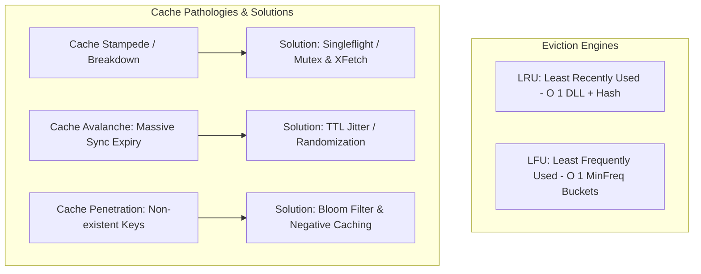
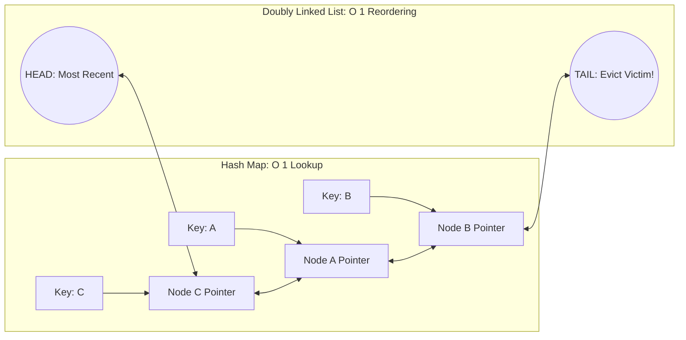
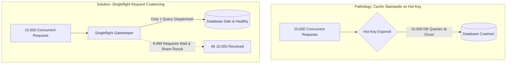
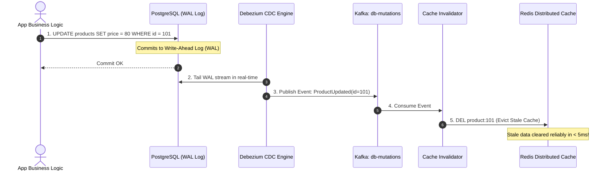

# 07.2. Eviction, Invalidation, and Cache Phenomena (Thuật Toán Đuổi Dữ Liệu, Vô Hiệu Hóa và Các Hiện Tượng Sập Cache)

## Tổng quan về Thuật Toán Đuổi Dữ Liệu và Các Hiện Tượng Sập Cache
Nhà khoa học máy tính Phil Karlton từng đưa ra câu nói bất hủ:
$$\textbf{"There are only two hard things in Computer Science: cache invalidation and naming things."}$$
*(Chỉ có hai bài toán khó nhất trong Khoa học Máy tính: vô hiệu hóa bộ nhớ đệm và đặt tên biến).*

Bộ nhớ RAM luôn là tài nguyên hữu hạn và đắt đỏ. Khi dung lượng cache đầy, hệ thống bắt buộc phải quyết định: *Vứt bỏ dữ liệu nào để lấy chỗ chứa dữ liệu mới? (Cache Eviction Policies)*. Quan trọng hơn, việc hiểu sai các hiện tượng bệnh lý của cache như **Cache Avalanche (Tuyết lở)**, **Cache Penetration (Xuyên thủng)**, **Cache Breakdown / Stampede (Bầy đàn dẫm đạp)** có thể biến một lớp đệm được kỳ vọng tăng tốc hệ thống trở thành nguyên nhân chính kéo sập toàn bộ cơ sở dữ liệu phía sau trong chớp mắt.



---

## 2. Chi tiết từng Keyword (Under-the-Hood Deep Dive)

### 1. Cache Eviction Policies: LRU, LFU, FIFO, MRU & Random (Các Thuật Toán Đuổi Dữ Liệu)

#### 1. Khái niệm bản chất (What & Why)
Khi một bộ nhớ đệm đạt đến ngưỡng dung lượng tối đa (Memory Limit, ví dụ 16GB trên Redis), một **Chính sách đuổi dữ liệu (Eviction Policy)** sẽ được kích hoạt để giải phóng các bản ghi cũ:
- **LRU (Least Recently Used)**: Đuổi phần tử **lâu nhất chưa được truy cập** (đọc hoặc ghi). Dựa trên giả định về tính cục bộ theo thời gian (Temporal Locality): phần tử vừa được truy cập sẽ có khả năng cao được truy cập lại trong tương lai gần.
- **LFU (Least Frequently Used)**: Đuổi phần tử có **tần suất truy cập ít nhất (Lowest Access Count)**. Phù hợp cho việc giữ lại các dữ liệu phổ biến toàn cục (Global Popularity).
- **FIFO (First-In, First-Out)**: Đuổi phần tử được nạp vào cache sớm nhất, bất kể nó được truy cập bao nhiêu lần.
- **MRU (Most Recently Used)**: Đuổi phần tử vừa mới được truy cập gần đây nhất. Hữu ích trong các tác vụ quét toàn bộ bảng một lần duy nhất (Full Table Scan), nơi dữ liệu cũ có giá trị hơn dữ liệu vừa đọc.
- **Random Replacement**: Chọn ngẫu nhiên một phần tử để xóa. Rất nhẹ về chi phí CPU nhưng tỷ lệ Cache Miss có thể cao.

#### 2. Cơ chế hoạt động sâu (Under the hood / Hardcore Internals)
Thiết kế cấu trúc dữ liệu đạt độ phức tạp **$O(1)$ cho cả `get()` và `put()` trong LRU**:
- Một mảng `std::vector` hoặc `std::list` đơn độc không thể đáp ứng vì tìm kiếm tốn $O(N)$.
- **Giải pháp kinh điển kết hợp hai cấu trúc**:
  1. **Doubly Linked List (Danh sách liên kết kép)**: Duy trì thứ tự sử dụng của các phần tử. Phần tử mới nhất (Most Recent) luôn nằm ở đầu (Head); phần tử cũ nhất (Least Recent) luôn nằm ở đuôi (Tail). Việc xóa một node đã biết con trỏ và đưa lên đầu danh sách chỉ tốn **$O(1)$**.
  2. **Hash Map (`std::unordered_map`)**: Lưu trữ cặp khóa `key` ánh xạ trực tiếp đến **con trỏ của Node trong Doubly Linked List**. Việc tra cứu địa chỉ node chỉ tốn **$O(1)$**.

Trong Redis (Redis Approximated LRU):
Redis không dùng Doubly Linked List vì mỗi con trỏ (Next/Prev) tốn thêm 16 bytes overhead trên mỗi key. Thay vào đó, Redis sử dụng **Thuật toán LRU xấp xỉ (Sampled LRU)**: Mỗi khi cần đuổi dữ liệu, Redis chọn ngẫu nhiên 5 key bất kỳ, kiểm tra timestamp truy cập cuối cùng và xóa key cũ nhất trong 5 key đó. Kết quả thực nghiệm cho thấy với $K = 10$, thuật toán xấp xỉ của Redis đạt độ chính xác tương đương 99% so với LRU thuần mà tiết kiệm hàng gigabyte RAM!

#### 3. Sơ đồ minh họa (Cấu trúc dữ liệu LRU Cache O(1))


#### 4. Code ví dụ thực chiến (C++20 - Triển khai LRU Cache hoàn chỉnh chuẩn O(1))
```cpp
#include <iostream>
#include <unordered_map>
#include <list>
#include <optional>
#include <string>

template<typename K, typename V>
class LRUCache {
private:
    struct CacheItem {
        K key;
        V value;
    };

    size_t capacity_;
    // Doubly linked list lưu các items: Phía trước là Mới nhất, phía sau là Cũ nhất
    std::list<CacheItem> items_list_;
    // Hash map ánh xạ Key sang Iterator của List để đạt O(1) Lookup
    std::unordered_map<K, typename std::list<CacheItem>::iterator> items_map_;

public:
    explicit LRUCache(size_t capacity) : capacity_(capacity) {
        if (capacity == 0) throw std::invalid_argument("Capacity must be > 0");
    }

    std::optional<V> get(const K& key) {
        auto it = items_map_.find(key);
        if (it == items_map_.end()) {
            return std::nullopt; // Cache Miss
        }

        // Cache Hit: Di chuyển node được truy cập lên đầu danh sách (Most Recently Used) - O(1)
        items_list_.splice(items_list_.begin(), items_list_, it->second);
        return it->second->value;
    }

    void put(const K& key, const V& value) {
        auto it = items_map_.find(key);
        if (it != items_map_.end()) {
            // Key đã tồn tại: Cập nhật giá trị và đưa lên đầu
            it->second->value = value;
            items_list_.splice(items_list_.begin(), items_list_, it->second);
            return;
        }

        // Nếu vượt quá dung lượng: Đuổi phần tử cũ nhất ở đuôi danh sách (Evict Tail) - O(1)
        if (items_map_.size() >= capacity_) {
            const auto& victim = items_list_.back();
            std::cout << "[LRU Evict] Capacity full! Removing oldest key: " << victim.key << "\n";
            items_map_.erase(victim.key);
            items_list_.pop_back();
        }

        // Thêm phần tử mới vào đầu danh sách
        items_list_.push_front(CacheItem{key, value});
        items_map_[key] = items_list_.begin();
    }
};

int main() {
    LRUCache<std::string, int> cache(3); // Dung lượng tối đa 3 keys

    cache.put("user_A", 100);
    cache.put("user_B", 200);
    cache.put("user_C", 300);

    // Truy cập user_A -> user_A trở thành Most Recently Used
    cache.get("user_A");

    // Thêm user_D -> user_B là phần tử cũ nhất chưa được sờ tới -> BỊ ĐUỔI!
    cache.put("user_D", 400);

    std::cout << "user_A exists: " << cache.get("user_A").has_value() << "\n";
    std::cout << "user_B exists: " << cache.get("user_B").has_value() << " (Evicted!)\n";
    return 0;
}
```

#### 5. Ưu / Nhược điểm, Pitfalls & Anti-patterns
- **Điểm yếu của LRU (Cache Pollution)**: Một tác vụ quét dữ liệu hàng loạt định kỳ (Batch Job quét qua 1 triệu người dùng để tính điểm thưởng một lần) sẽ đẩy sạch toàn bộ các key đang được hàng nghìn người dùng truy cập thường xuyên ra khỏi cache!
- **Giải pháp**: Sử dụng **LFU** hoặc **2Q (Two-Queue) / W-TinyLFU** (thuật toán được sử dụng trong thư viện Caffeine Cache).

#### 6. Ứng dụng thực tế trong Backend / Systems
Linux Kernel VFS Page Cache và Memcached áp dụng các biến thể của LRU làm thuật toán dọn dẹp bộ nhớ mặc định.

---

### 2. Cache Expiration: TTL vs TTI (Thời Gian Sống Của Dữ Liệu Đệm)

#### 1. Khái niệm bản chất (What & Why)
- **TTL (Time-To-Live)**: Khoảng thời gian tồn tại cố định của một bản ghi kể **từ thời điểm nó được tạo ra hoặc ghi đè lần đầu tiên**. Ví dụ: $TTL = 3600\text{ giây}$. Sau đúng 1 giờ, bản ghi sẽ hết hạn và bị vô hiệu hóa, bất kể nó được truy cập bao nhiêu lần.
- **TTI (Time-To-Idle)**: Khoảng thời gian bản ghi được phép tồn tại kể **từ lần truy cập cuối cùng**. Mỗi lần có một request đọc thành công bản ghi, đồng hồ đếm ngược của TTI sẽ được reset lại từ đầu. Nếu một bản ghi không có ai đoái hoài trong suốt khoảng thời gian TTI (ví dụ 15 phút), nó sẽ bị hủy để giải phóng bộ nhớ.

#### 2. Cơ chế hoạt động sâu (Under the hood / Hardcore Internals)
Cơ chế dọn dẹp Key hết hạn của Redis (Active vs Passive Expire):
1. **Passive Expire (Lazy Expiration - Lười biếng)**:
   - Khi một client gửi lệnh `GET key`: Redis kiểm tra timestamp hết hạn. Nếu đã quá hạn, Redis xóa key đó và trả về `nil`.
   - *Hạn chế*: Nếu một key hết hạn nhưng không bao giờ có client nào gọi lại nó, key đó sẽ nằm chiếm RAM vĩnh viễn!
2. **Active Expire (Chủ động quét ngầm)**:
   - Cứ mỗi $100\text{ ms}$ (10 lần/giây), Redis chạy một tác vụ ngầm:
   - Chọn ngẫu nhiên 20 keys có gắn hạn sử dụng (Expire list).
   - Xóa tất cả các keys đã hết hạn trong 20 keys đó.
   - Nếu tỷ lệ keys hết hạn trong mẫu vượt quá $25\%$, Redis lặp lại quy trình quét ngay lập tức để giải phóng RAM nhanh chóng!

#### 3. Sơ đồ minh họa


```mermaid
gantt
    title TTL vs TTI Comparison
    dateFormat X
    axisFormat %s
    
    section TTL (Fixed 10s from Creation)
    Created at 0s          :active, 0, 10
    Read at 3s             :crit, 3, 4
    Read at 7s             :crit, 7, 8
    EXPIRED at 10s         :milestone, 10, 10
    
    section TTI (10s Idle Reset on Access)
    Created at 0s          :active, 0, 10
    Read at 6s (Timer Reset!) :active, 6, 16
    Read at 12s (Timer Reset!):active, 12, 22
    EXPIRED at 22s         :milestone, 22, 22
```

#### 4. Code ví dụ thực chiến (TypeScript - TTI & TTL Cache Implementation)
```typescript
interface CacheEntry<T> {
  value: T;
  createdAt: number;
  lastAccessedAt: number;
  ttlMs?: number; // Time-to-Live
  ttiMs?: number; // Time-to-Idle
}

export class ExpirationCache<T> {
  private store = new Map<string, CacheEntry<T>>();

  public set(key: string, value: T, ttlMs?: number, ttiMs?: number) {
    const now = Date.now();
    this.store.set(key, { value, createdAt: now, lastAccessedAt: now, ttlMs, ttiMs });
  }

  public get(key: string): T | null {
    const entry = this.store.get(key);
    if (!entry) return null;

    const now = Date.now();

    // 1. Kiểm tra vi phạm TTL (Tính từ lúc tạo)
    if (entry.ttlMs && now - entry.createdAt > entry.ttlMs) {
      console.log(`[EXPIRED by TTL] Key '${key}' exceeded TTL`);
      this.store.delete(key);
      return null;
    }

    // 2. Kiểm tra vi phạm TTI (Tính từ lần truy cập cuối)
    if (entry.ttiMs && now - entry.lastAccessedAt > entry.ttiMs) {
      console.log(`[EXPIRED by TTI] Key '${key}' was idle too long`);
      this.store.delete(key);
      return null;
    }

    // Hợp lệ: Reset lại đồng hồ TTI
    entry.lastAccessedAt = now;
    return entry.value;
  }
}
```

#### 5. Ưu / Nhược điểm, Pitfalls & Anti-patterns
- **Anti-pattern: Infinite TTL (Không bao giờ set TTL)**: Lưu trữ các đối tượng tạm thời (Session, mã OTP, kết quả tính toán) vào Redis mà quên không cấu hình TTL. Cụm Redis sẽ phình to không kiểm soát, dẫn đến lỗi tràn RAM và sập toàn bộ dịch vụ.

#### 6. Ứng dụng thực tế trong Backend / Systems
Phiên đăng nhập người dùng (User Session) thường áp dụng **TTI**: nếu người dùng liên tục lướt web thì không bị đăng xuất; nhưng nếu để máy tính không dùng trong 30 phút, session tự động hết hạn vì lý do an ninh.

---

## 2. Chi tiết từng Keyword (Under-the-Hood Deep Dive)

### 3. The 4 Cache Disasters: Stampede, Avalanche, Penetration & Breakdown (Bốn Thảm Họa Sập Cache)

#### 1. Khái niệm bản chất (What & Why)
1. **Cache Stampede / Breakdown (Bầy đàn dẫm đạp / Đột thủng)**: Xảy ra khi một **Key cực kỳ nóng (Hotspot Key)** bị hết hạn TTL hoặc bị xóa đột ngột. Tại đúng thời điểm đó, có $10,000$ concurrent requests cùng truy vấn key này, cùng thấy Cache Miss, và **cùng lúc dội thẳng $10,000$ câu query nặng xuống Database**, làm sập Database ngay lập tức.
2. **Cache Avalanche (Tuyết lở)**: Xảy ra khi một số lượng khổng lồ các key trong cache **được cấu hình cùng một thời gian TTL và cùng hết hạn đồng loạt tại một thời điểm** (ví dụ: tất cả đều hết hạn sau 1 tiếng vào lúc 12:00:00). Toàn bộ lưu lượng đọc của hệ thống đồng loạt đổ ập xuống Database như một trận tuyết lở.
3. **Cache Penetration (Xuyên thủng)**: Xảy ra khi client (hoặc hacker tấn công) liên tục truy vấn các dữ liệu **hoàn toàn không tồn tại trong hệ thống** (ví dụ: `GET /users/-999999`). Vì dữ liệu không có trong Database nên nó không bao giờ được lưu vào Cache. Mọi request độc hại đều xuyên thủng lớp cache và đâm thẳng vào Database!
4. **Cache Thundering Herd**: Tương tự như Stampede, xảy ra khi nhiều tiến trình hoặc luồng cùng thức dậy đồng thời khi nhận được một tín hiệu giải phóng khóa hoặc sự kiện tài nguyên.

#### 2. Cơ chế hoạt động sâu (Under the hood / Hardcore Internals)
Các vũ khí kỹ thuật phòng vệ triệt để:

1. **Chống Cache Avalanche bằng TTL Jitter (Độ lệch ngẫu nhiên)**:
   Thay vì set cứng `TTL = 3600s`, ta cộng thêm một khoảng ngẫu nhiên:
   $$TTL_{\text{actual}} = TTL_{\text{base}} + \text{random}(0, \Delta_{\text{jitter}})$$
   Ví dụ: $TTL = 3600\text{s} + \text{rand}(0, 300\text{s})$. Các key sẽ hết hạn rải rác trong vòng 5 phút thay vì cùng một giây!

2. **Chống Cache Penetration bằng Bloom Filter & Negative Caching**:
   - **Negative Caching (Cache giá trị rỗng)**: Khi Database trả về `Not Found` (null), ta vẫn lưu vào Cache cặp khóa `key -> NULL` với TTL rất ngắn (ví dụ: 30-60 giây). Request tiếp theo hỏi key đó sẽ được trả về `404` ngay từ Cache!
   - **Bloom Filter**: Đặt một cấu trúc dữ liệu Bloom Filter xác suất ở cửa ngõ. Nếu Bloom Filter nói "Phần tử không tồn tại", chắc chắn $100\%$ không tồn tại trong Database $\implies$ Chặn đứng request ngay lập tức, không tốn dù chỉ 1 query Database!

3. **Chống Cache Stampede bằng Singleflight (Request Coalescing)**:
   Nếu có 1,000 requests cùng hỏi `user_9981` tại cùng một tích tắc:
   Thư viện **Singleflight** gom 1,000 requests đó lại, chỉ cho phép **DUY NHẤT 1 request** đại diện đi xuống Database để query; 999 requests còn lại bị treo luồng chờ. Khi request duy nhất nhận được kết quả, nó chia sẻ kết quả đó cho cả 999 requests kia cùng lúc!

4. **Probabilistic Early Expiration (Thuật toán XFetch)**:
   Để ngăn key bị hết hạn đột ngột, client tự động tính toán xác suất để làm mới key **trước khi nó hết hạn**:
   $$-\beta \times \delta \times \ln(\text{rand}(0, 1)) > TTL - \text{now}$$
   - $\delta$: Thời gian trung bình để tính toán lại giá trị từ Database.
   - $\beta > 0$: Hệ số hung hăng (Aggressiveness factor).
   Càng gần thời điểm hết hạn, xác suất một request ngẫu nhiên đứng ra tính toán trước giá trị mới và nạp đè vào cache càng tiến tới $100\%$, loại bỏ hoàn toàn hiện tượng Cache Miss đối với Hotspot Keys!

#### 3. Sơ đồ minh họa


#### 4. Code ví dụ thực chiến (C++20 - Triển khai Singleflight / Request Coalescing Engine)
```cpp
#include <iostream>
#include <string>
#include <unordered_map>
#include <mutex>
#include <future>
#include <memory>
#include <thread>

// Triển khai Singleflight pattern kinh điển của ngôn ngữ Go bằng C++20
class SingleflightGroup {
private:
    struct Call {
        std::shared_future<std::string> future;
        std::promise<std::string> promise;
    };

    std::unordered_map<std::string, std::shared_ptr<Call>> active_calls_;
    std::mutex mtx_;

public:
    template<typename Func>
    std::string Do(const std::string& key, Func db_query_fn) {
        std::shared_ptr<Call> call;
        bool is_first_caller = false;

        {
            std::lock_guard<std::mutex> lock(mtx_);
            auto it = active_calls_.find(key);
            if (it != active_calls_.end()) {
                // Đã có một request khác đang đi lấy dữ liệu cho key này -> Chờ chung!
                call = it->second;
            } else {
                // Là người đầu tiên: Tạo Call mới
                call = std::make_shared<Call>();
                call->future = call->promise.get_future().share();
                active_calls_[key] = call;
                is_first_caller = true;
            }
        }

        if (is_first_caller) {
            // Chỉ duy nhất luồng đầu tiên được phép gọi Database thực sự!
            std::cout << ">>> [Singleflight Leader] Executing heavy DB query for key: " << key << "...\n";
            std::string result = db_query_fn();
            call->promise.set_value(result);

            // Dọn dẹp sau khi đã hoàn tất
            std::lock_guard<std::mutex> lock(mtx_);
            active_calls_.erase(key);
            return result;
        }

        // Các luồng đến sau chỉ việc chờ future có kết quả (Zero DB Hit!)
        std::cout << "    [Singleflight Follower] Coalescing! Waiting for leader result...\n";
        return call->future.get();
    }
};

int main() {
    SingleflightGroup sf;
    std::string hot_key = "product_sale_iphone16";

    auto mock_heavy_db_query = []() {
        std::this_thread::sleep_for(std::chrono::milliseconds(300)); // DB mất 300ms
        return "PRICE_999_STOCK_50";
    };

    // Giả lập 4 threads cùng ập vào hỏi giá iPhone 16 khi cache vừa hết hạn
    std::vector<std::thread> threads;
    for (int i = 1; i <= 4; ++i) {
        threads.emplace_back([&sf, hot_key, mock_heavy_db_query, i]() {
            std::string res = sf.Do(hot_key, mock_heavy_db_query);
            std::cout << "Thread #" << i << " got result: " << res << "\n";
        });
    }

    for (auto& th : threads) th.join();
    return 0;
}
```

#### 5. Ưu / Nhược điểm, Pitfalls & Anti-patterns
- **Pitfall: Infinite Negative Caching**: Khi một sản phẩm chưa được mở bán, hệ thống cache lại giá trị `NULL`. Khi sản phẩm chính thức mở bán, người dùng vẫn liên tục nhận được thông báo "Sản phẩm không tồn tại" trong suốt 24 giờ vì thời gian TTL của negative cache cấu hình quá lâu!

#### 6. Ứng dụng thực tế trong Backend / Systems
Thư viện `singleflight` là gói thư viện chuẩn trong hệ sinh thái Go được Docker, Kubernetes và Grafana sử dụng ở mọi tầng truy vấn dữ liệu đệm.

---

### 4. Cache Consistency & Invalidation Strategies (Tính Nhất Quán và Chiến Lược Vô Hiệu Hóa Cache)

#### 1. Khái niệm bản chất (What & Why)
Khi một bản ghi trong Database bị cập nhật, bản sao của nó trong Cache trở thành **Dữ liệu thối (Stale Data)**. Nếu hệ thống tiếp tục phục vụ dữ liệu cũ này, người dùng sẽ thấy thông tin sai lệch (ví dụ: số dư tài khoản hiển thị sai).

**Tính nhất quán của Cache (Cache Consistency)** là bài toán đảm bảo dữ liệu trong Cache phản ánh chính xác trạng thái trong Database. Vì Cache và Database là hai hệ thống lưu trữ phân tán độc lập, việc đảm bảo tính nhất quán tuyệt đối (Strict Consistency) mà không làm suy giảm hiệu năng là bất khả thi (CAP Theorem). Do đó, hầu hết các hệ thống phân tán hướng tới **Eventual Consistency (Nhất quán cuối cùng)**.

#### 2. Cơ chế hoạt động sâu (Under the hood / Hardcore Internals)
Các chiến lược vô hiệu hóa cache (Invalidation Strategies):
1. **TTL-based Expiration (Thụ động)**: Dựa hoàn toàn vào thời gian hết hạn TTL. Đơn giản nhất nhưng chấp nhận dữ liệu bị cũ trong khoảng thời gian TTL.
2. **Application-level Invalidation (Chủ động xóa trong code)**:
   - Trong code nghiệp vụ: Cập nhật Database $\rightarrow$ Xóa key Cache.
   - Rủi ro: Nếu server bị crash ngay sau khi cập nhật DB nhưng trước khi kịp xóa Cache, cache sẽ chứa dữ liệu sai vĩnh viễn cho đến khi hết TTL!
3. **CDC-based Invalidation (Change Data Capture - Chuẩn mực công nghiệp tối tân)**:
   - Ứng dụng chỉ việc ghi vào Database.
   - Một công cụ CDC như **Debezium** lắng nghe trực tiếp Write-Ahead Log (WAL trên PostgreSQL hoặc Binlog trên MySQL).
   - Mỗi khi có bản ghi thay đổi, Debezium phát một Event vào Kafka.
   - Một Invalidation Worker tiêu thụ event từ Kafka và gửi lệnh `DEL key` tới cụm Redis.
   - *Ưu điểm*: Tách biệt hoàn toàn logic nghiệp vụ; đảm bảo **100% dữ liệu thay đổi trong DB đều được kích hoạt xóa cache**, không bao giờ bị bỏ sót do lỗi mạng của application!

#### 3. Sơ đồ minh họa (CDC-Based Event-Driven Cache Invalidation)


#### 4. Code ví dụ thực chiến (TypeScript - CDC Event Consumer Invalidator)
```typescript
interface CDCChangeEvent {
  table: string;
  operation: 'INSERT' | 'UPDATE' | 'DELETE';
  primaryKey: string;
}

export class CacheInvalidationWorker {
  constructor(private redisClient: { del: (key: string) => Promise<number> }) {}

  public async handleDatabaseMutationEvent(event: CDCChangeEvent) {
    if (event.table === 'products') {
      const cacheKey = `product:${event.primaryKey}`;
      // Vô hiệu hóa cache an toàn bằng cách xóa key
      await this.redisClient.del(cacheKey);
      console.log(`[CDC Invalidator] Successfully purged stale cache for key: ${cacheKey}`);
    } else if (event.table === 'users') {
      const cacheKey = `user_profile:${event.primaryKey}`;
      await this.redisClient.del(cacheKey);
      console.log(`[CDC Invalidator] Successfully purged stale cache for key: ${cacheKey}`);
    }
  }
}
```

#### 5. Ưu / Nhược điểm, Pitfalls & Anti-patterns
- **Anti-pattern: Dual-Write Rollback Failure**: Viết hàm cố gắng cập nhật đồng thời cả DB và Cache trong một hàm try-catch thông thường. Khi mạng chập chờn, một bên thành công một bên thất bại gây sai lệch dữ liệu trầm trọng.

#### 6. Ứng dụng thực tế trong Backend / Systems
LinkedIn và Uber sử dụng Change Data Capture (Debezium + Kafka) để vô hiệu hóa hàng triệu bản ghi cache mỗi giây mà không làm chậm các luồng ghi của ứng dụng chính.

---

## Tóm tắt liên kết hệ thống
Toàn bộ chuyên mục **11.7 (Caching Architecture)** đã cung cấp cho bạn bức tranh hoàn chỉnh nhất về thế giới bộ nhớ đệm: từ cấu trúc phân tầng CPU/RAM/CDN, các mẫu hình Cache-Aside/Write-Back, thuật toán LRU $O(1)$, đến việc tiêu diệt 4 thảm họa Cache (Stampede, Avalanche, Penetration, Breakdown) bằng Singleflight, Bloom Filter, TTL Jitter và CDC Invalidation.

Tiếp theo, tại **11.8: Database Architecture in System Design**, chúng ta sẽ đi sâu vào trái tim lưu trữ của hệ thống: Lựa chọn RDBMS vs NoSQL, kỹ thuật phân mảnh Sharding, Replication Master-Replica, Quorum Consistencies và Connection Pooling.
