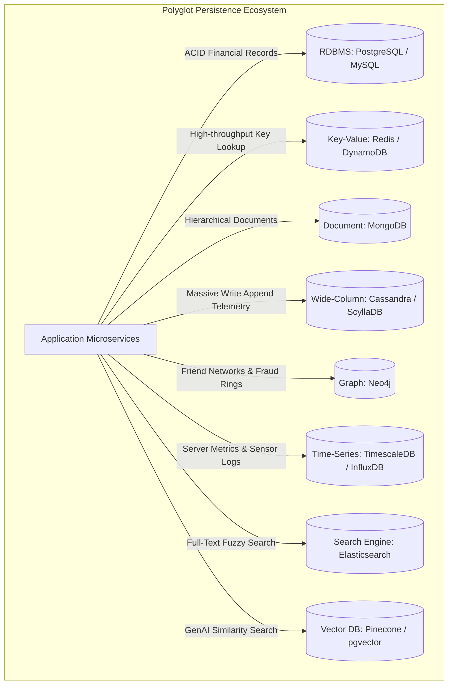
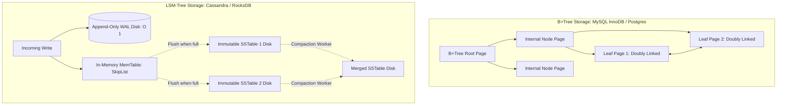
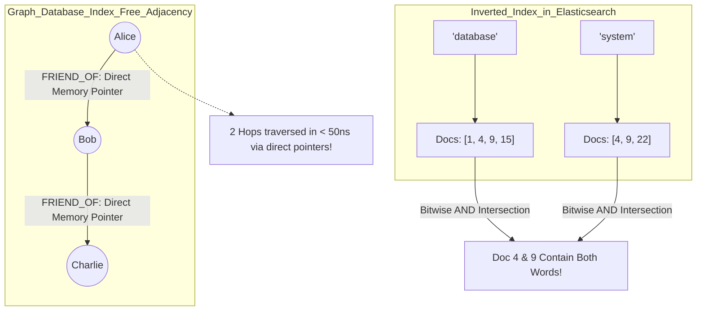
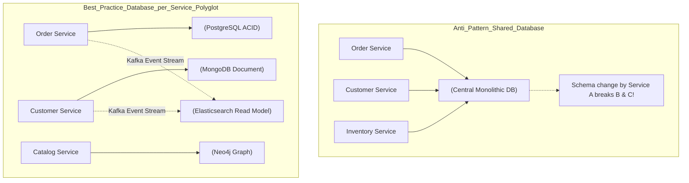

# 08.1. Database Selection and Polyglot Persistence (Lựa Chọn Cơ Sở Dữ Liệu và Lưu Trữ Đa Hình)

## Tổng quan về Lựa Chọn Cơ Sở Dữ Liệu và Lưu Trữ Đa Hình
Trong giai đoạn đầu của ngành công nghệ thông tin, một cơ sở dữ liệu quan hệ duy nhất (RDBMS như Oracle hoặc MySQL) thường được sử dụng để giải quyết mọi bài toán lưu trữ của doanh nghiệp. Tuy nhiên, khi quy mô dữ liệu bùng nổ đến hàng trăm Petabyte và các loại hình dữ liệu trở nên đa dạng (từ văn bản tìm kiếm, chuỗi thời gian IoT, đồ thị quan hệ xã hội đến vector nhúng AI), khái niệm **"Một giải pháp cho tất cả" (One Size Fits All)** đã chính thức sụp đổ.

Kiến trúc hiện đại áp dụng nguyên lý **Polyglot Persistence (Lưu trữ Đa hình)** — kết hợp nhiều công nghệ cơ sở dữ liệu khác nhau trong cùng một hệ sinh thái, trong đó mỗi loại cơ sở dữ liệu được lựa chọn chính xác dựa trên bản chất cấu trúc dữ liệu và mô hình truy cập (Access Pattern) tối ưu nhất của nó.



---

## 2. Chi tiết từng Keyword (Under-the-Hood Deep Dive)

### 1. Relational Database vs NoSQL: Fundamental Engines (RDBMS và Động Cơ NoSQL)

#### 1. Khái niệm bản chất (What & Why)
- **Relational Databases (RDBMS)**: Dữ liệu được tổ chức thành các bảng gồm hàng và cột với cấu trúc Schema cố định, tuân thủ nghiêm ngặt các dạng chuẩn hóa (Normalization 3NF) và đảm bảo các đặc tính giao dịch **ACID** (Atomicity, Consistency, Isolation, Durability). Truy vấn dữ liệu bằng ngôn ngữ SQL thông qua các phép nối quan hệ (`JOIN`).
- **NoSQL Databases (Not Only SQL)**: Tập hợp các hệ cơ sở dữ liệu phi quan hệ, từ bỏ một phần tính chất ACID (thường chuyển sang mô hình BASE: Basically Available, Soft state, Eventual consistency) và từ bỏ phép `JOIN` phức tạp để đổi lấy khả năng mở rộng quy mô theo chiều ngang không giới hạn (Horizontal Scalability) và hỗ trợ lược đồ linh hoạt (Schema-less / Flexible Schema).

#### 2. Cơ chế hoạt động sâu (Under the hood / Hardcore Internals)
Sự đối lập giữa hai cấu trúc động cơ lưu trữ cốt lõi:
1. **B+Tree Storage Engine (Đại diện tiêu biểu: PostgreSQL, MySQL InnoDB)**:
   - Dữ liệu được tổ chức thành các trang (Pages kích thước 8KB hoặc 16KB) trong một cây cân bằng.
   - Các nút lá (Leaf Nodes) chứa dữ liệu thực tế và được liên kết đôi với nhau để tối ưu hóa việc quét theo dải (`RANGE SCAN`).
   - *Tối ưu hóa*: Tốc độ đọc ngẫu nhiên đạt đỉnh cao $O(\log N)$ với độ sâu cây rất thấp (thường chỉ 3-4 tầng cho 1 tỷ bản ghi).
   - *Nhược điểm khi ghi*: Thao tác ghi ngẫu nhiên (Random Write) buộc phải tìm và sửa đổi các trang trên đĩa vật lý, gây ra hiện tượng phân mảnh trang (Page Splits) và tiêu tốn nhiều thao tác I/O ngẫu nhiên (Random Disk I/O).
2. **LSM-Tree Storage Engine (Log-Structured Merge-tree - Đại diện: Cassandra, RocksDB, ScyllaDB)**:
   - Mọi thao tác ghi được ghi tuần tự vào nhật ký **Write-Ahead Log (WAL)** trên đĩa và đồng thời nạp vào bộ đệm **MemTable** trên RAM.
   - Khi MemTable đầy, nó được xả tuần tự (Sequential Flush) xuống đĩa thành một file bất biến gọi là **SSTable (Sorted String Table)**.
   - Quá trình **Compaction** chạy ngầm gộp nhiều SSTables nhỏ thành SSTable lớn hơn và loại bỏ dữ liệu cũ/tombstones.
   - *Tối ưu hóa*: Biến mọi thao tác ghi thành **Ghi tuần tự (Sequential Write)** đạt tốc độ tối đa của phần cứng đĩa ($O(1)$ write append). Tốc độ ghi nhanh hơn B+Tree từ 5 đến 20 lần!

#### 3. Sơ đồ minh họa


#### 4. Code ví dụ thực chiến (C++20 - B+Tree Index Node Binary Search vs LSM MemTable SkipList Concept)
```cpp
#include <iostream>
#include <vector>
#include <algorithm>
#include <string>

// Mô phỏng cấu trúc tìm kiếm nhị phân trên 1 Page B+Tree 4KB
struct BTreePage {
    static constexpr size_t MAX_KEYS = 3;
    std::vector<int> keys;
    std::vector<std::string> values;

    bool lookup(int key, std::string& out_val) {
        // Tìm kiếm nhị phân nhị phân trong page trên RAM
        auto it = std::lower_bound(keys.begin(), keys.end(), key);
        if (it != keys.end() && *it == key) {
            size_t idx = std::distance(keys.begin(), it);
            out_val = values[idx];
            return true; // B+Tree Index Seek Hit!
        }
        return false;
    }

    void insert(int key, const std::string& val) {
        auto it = std::lower_bound(keys.begin(), keys.end(), key);
        size_t idx = std::distance(keys.begin(), it);
        keys.insert(it, key);
        values.insert(values.begin() + idx, val);
    }
};

int main() {
    BTreePage page;
    page.insert(10, "Record_User_10");
    page.insert(20, "Record_User_20");
    page.insert(30, "Record_User_30");

    std::string val;
    if (page.lookup(20, val)) {
        std::cout << "[B+Tree Page Seek] Found key 20: " << val << "\n";
    }
    return 0;
}
```

#### 5. Ưu / Nhược điểm, Pitfalls & Anti-patterns
- **Anti-pattern: Using MongoDB as an ACID Financial Ledger**: Cố gắng dùng MongoDB document để làm sổ cái chuyển tiền ngân hàng và tự viết các cơ chế Two-Phase Commit bằng tay thay vì dùng PostgreSQL. Rủi ro mất mát giao dịch và sai lệch số dư là cực kỳ cao.

#### 6. Ứng dụng thực tế trong Backend / Systems
Uber sử dụng MySQL InnoDB (B+Tree) cho dữ liệu tài khoản và giao dịch thẻ tín dụng; nhưng dùng Schemaless (xây dựng trên nền MySQL nhưng theo phong cách LSM Append-only) để lưu hàng tỷ tọa độ vị trí chuyến đi.

---

### 2. Specialized Database Families: Document, Key-Value, Wide-Column, Graph, Time-Series, Search & Vector (Các Họ Cơ Sở Dữ Liệu Chuyên Biệt)

#### 1. Khái niệm bản chất (What & Why)
1. **Document Database (MongoDB, Couchbase)**: Dữ liệu được lưu dưới dạng tài liệu bán cấu trúc (BSON, JSON). Tối ưu hóa cho các thực thể có quan hệ phân cấp lồng nhau (Embedded Documents), cho phép đọc toàn bộ một đối tượng phức tạp chỉ trong một câu truy vấn duy nhất mà không cần `JOIN`.
2. **Key-Value Database (Redis, Amazon DynamoDB)**: Mô hình đơn giản nhất: mỗi khóa (Key) trỏ tới một giá trị (Value). Tốc độ truy xuất $O(1)$, thông lượng hàng triệu QPS.
3. **Wide-Column Database (Cassandra, ScyllaDB, Google Bigtable)**: Dữ liệu được lưu trữ theo các họ cột (Column Families). Mỗi hàng có thể có số lượng cột và tên cột hoàn toàn khác nhau. Tối ưu hóa cho các hệ thống có quy mô ghi hàng trăm Terabyte với tính sẵn sàng cao (High Availability, Multi-datacenter Masterless).
4. **Graph Database (Neo4j, Amazon Neptune)**: Dữ liệu được lưu dưới dạng các **Đỉnh (Nodes)** và **Cạnh (Edges / Relationships)**. Tối ưu hóa cho việc duyệt qua các đồ thị quan hệ phức tạp nhiều tầng (**Index-Free Adjacency**).
5. **Time-Series Database (TimescaleDB, InfluxDB, Prometheus)**: Tối ưu hóa cho dữ liệu gắn liền với mốc thời gian (Timestamp), thường là dữ liệu ghi thêm liên tục (Append-only) từ cảm biến IoT hoặc máy chủ giám sát. Tự động chia nhỏ dữ liệu theo các phân vùng thời gian (Chunks) và nén dữ liệu cực cao.
6. **Search Engine Database (Elasticsearch, OpenSearch)**: Dữ liệu được lập chỉ mục dưới dạng **Chỉ mục đảo (Inverted Index)**. Tối ưu hóa cho việc tìm kiếm toàn văn bản (Full-text search), tìm kiếm mờ (Fuzzy search) và xếp hạng mức độ liên quan (BM25 Algorithm).
7. **Vector Database (Pinecone, Milvus, Qdrant, pgvector)**: Lưu trữ các vector nhúng nhiều chiều (High-dimensional Embeddings: 512, 1536 chiều) sinh ra từ các mô hình AI/LLM. Tối ưu hóa cho việc tìm kiếm vector láng giềng gần nhất (**Approximate Nearest Neighbor - ANN**) dựa trên thuật toán HNSW (Hierarchical Navigable Small World) để phục vụ hệ thống RAG (Retrieval-Augmented Generation).

#### 2. Cơ chế hoạt động sâu (Under the hood / Hardcore Internals)
So sánh bản chất thuật toán chuyên biệt:

1. **Graph Database - Index-Free Adjacency (So với RDBMS JOIN)**:
   - Trong RDBMS: Để tìm bạn của bạn của bạn (3 Hops: $A \rightarrow B \rightarrow C \rightarrow D$), RDBMS phải thực hiện 3 phép `JOIN` qua bảng trung gian `users_friends`. Độ phức tạp là **$O(N^3)$** phụ thuộc vào tổng số lượng bản ghi của toàn bộ bảng!
   - Trong Neo4j: Mỗi Node lưu trực tiếp con trỏ bộ nhớ (Memory Pointers) trỏ tới các Edge kề bên. Việc duyệt sang Node kế tiếp chỉ đơn giản là thao tác **Dereference con trỏ** trong độ phức tạp **$O(1)$ per hop**, hoàn toàn độc lập với kích thước toàn bộ đồ thị!
2. **Search Engine - Inverted Index (So với SQL `LIKE '%abc%'`)**:
   - `LIKE '%query%'` trong SQL bắt buộc phải quét toàn bộ bảng (Full Table Scan) với độ phức tạp $O(N \times L)$.
   - Inverted Index bóc tách toàn bộ từ vựng (Tokens) thành một bảng từ điển đã sắp xếp. Mỗi từ trỏ tới một danh sách ID các tài liệu chứa từ đó (Posting List). Khi tìm kiếm, thuật toán chỉ cần tìm kiếm nhị phân trên từ điển trong $O(\log M)$ và thực hiện phép giao tập hợp (Bitwise AND) trên các Roaring Bitmaps.

#### 3. Sơ đồ minh họa


#### 4. Code ví dụ thực chiến (C++20 - Triển khai Inverted Index Search Engine thu nhỏ)
```cpp
#include <iostream>
#include <string>
#include <vector>
#include <unordered_map>
#include <sstream>
#include <algorithm>

// Mô phỏng cấu trúc Inverted Index cốt lõi của Elasticsearch / Lucene
class MiniInvertedIndex {
private:
    // Từ khóa ánh xạ tới danh sách ID tài liệu đã sắp xếp (Posting List)
    std::unordered_map<std::string, std::vector<int>> index_;

public:
    void addDocument(int doc_id, const std::string& text) {
        std::stringstream ss(text);
        std::string token;
        while (ss >> token) {
            // Chuyển về chữ thường
            std::transform(token.begin(), token.end(), token.begin(), ::tolower);
            auto& postings = index_[token];
            if (postings.empty() || postings.back() != doc_id) {
                postings.push_back(doc_id); // Giữ danh sách tăng dần
            }
        }
    }

    std::vector<int> searchIntersection(const std::string& term1, const std::string& term2) {
        std::string t1 = term1, t2 = term2;
        std::transform(t1.begin(), t1.end(), t1.begin(), ::tolower);
        std::transform(t2.begin(), t2.end(), t2.begin(), ::tolower);

        if (!index_.count(t1) || !index_.count(t2)) return {};

        const auto& list1 = index_[t1];
        const auto& list2 = index_[t2];
        std::vector<int> result;

        // Phép giao hai danh sách đã sắp xếp trong O(M + N)
        size_t i = 0, j = 0;
        while (i < list1.size() && j < list2.size()) {
            if (list1[i] == list2[j]) {
                result.push_back(list1[i]);
                i++; j++;
            } else if (list1[i] < list2[j]) {
                i++;
            } else {
                j++;
            }
        }
        return result;
    }
};

int main() {
    MiniInvertedIndex engine;
    engine.addDocument(1, "PostgreSQL is a powerful relational database");
    engine.addDocument(2, "Elasticsearch is a distributed search engine");
    engine.addDocument(3, "Neo4j is a graph database system");
    engine.addDocument(4, "System design requires distributed database architecture");

    // Tìm kiếm các tài liệu chứa cả hai từ "database" và "distributed"
    auto hits = engine.searchIntersection("database", "distributed");

    std::cout << "[Inverted Index Query: 'database' AND 'distributed']\n";
    std::cout << "Matching Document IDs: ";
    for (int id : hits) std::cout << "#" << id << " ";
    std::cout << "\n"; // Kết quả: Doc #4
    return 0;
}
```

#### 5. Ưu / Nhược điểm, Pitfalls & Anti-patterns
- **Anti-pattern: Using Elasticsearch as Primary Source of Truth**: Sử dụng Elasticsearch làm cơ sở dữ liệu chính duy nhất và không lưu trữ bản gốc trong PostgreSQL. Elasticsearch có thể mất dữ liệu khi phân mảnh mạng (Split-Brain) hoặc khi Re-indexing lại toàn bộ cluster.

#### 6. Ứng dụng thực tế trong Backend / Systems
Netflix sử dụng: MySQL (thông tin người dùng và thanh toán), Cassandra (lịch sử xem phim đồ sộ), Elasticsearch (tìm kiếm phim theo tên diễn viên), EVCache/Redis (cache giao diện người dùng).

---

### 3. Polyglot Persistence & Database Per Service vs Shared Database (Lưu Trữ Đa Hình và Ranh Giới Cơ Sở Dữ Liệu)

#### 1. Khái niệm bản chất (What & Why)
- **Polyglot Persistence**: Ứng dụng sử dụng đồng thời nhiều công nghệ lưu trữ dữ liệu khác nhau, trong đó mỗi microservice chọn loại cơ sở dữ liệu phù hợp nhất với nhu cầu cụ thể của miền nghiệp vụ của mình.
- **Database-per-Service**: Mỗi Microservice sở hữu **độc quyền một cơ sở dữ liệu riêng**. Nghiêm cấm các service khác truy cập trực tiếp vào database này; mọi tương tác bắt buộc phải thông qua API hoặc Event Bus.
- **Shared Database (Anti-pattern trong Microservices)**: Nhiều service khác nhau cùng trỏ vào một instance cơ sở dữ liệu tập trung duy nhất và chia sẻ các bảng dữ liệu cho nhau.

#### 2. Cơ chế hoạt động sâu (Under the hood / Hardcore Internals)
So sánh ranh giới kỹ thuật:

| Tiêu chí | Shared Database Pattern | Database-per-Service Pattern |
| :--- | :--- | :--- |
| **Tính độc lập triển khai (Deployability)**| Rất kém (Sửa schema bảng làm gãy service khác)| Hoàn hảo (Mỗi service tự do migrate schema) |
| **Giao dịch (Transactions)** | Dễ dàng thực thi Local ACID Transaction | Phải dùng **Saga Pattern & Outbox Pattern** |
| **Độ trễ khi truy vấn phối hợp** | Rất nhanh (Dùng câu lệnh `JOIN` trong 1 query) | Chậm hơn (Phải gọi API hoặc dùng Read Projection) |
| **Khả năng mở rộng (Scalability)** | Trở thành Single Point of Failure & Bottleneck | Scale độc lập từng service theo đúng tải của nó |
| **Công nghệ lưu trữ** | Bị ép dùng chung 1 hệ thống (chỉ RDBMS) | Áp dụng triệt để **Polyglot Persistence** |

Cách giải quyết bài toán Data Aggregation trong Database-per-Service:
Khi trang web cần hiển thị thông tin đơn hàng kèm thông tin khách hàng:
- Thay vì `JOIN` bảng `orders` và `customers` trong SQL.
- Sử dụng mô hình **CQRS & Materialized View**: Order Service và Customer Service phát các Event `OrderPlaced` và `CustomerUpdated` lên Kafka.
- Một Reporting/View Service tiêu thụ hai event này, tự động ghép dữ liệu và lưu vào MongoDB hoặc Elasticsearch để phục vụ trang giao diện người dùng chỉ với $1$ lần đọc duy nhất!

#### 3. Sơ đồ minh họa


#### 4. Code ví dụ thực chiến (TypeScript - CQRS View Projection gộp dữ liệu từ nhiều Services)
```typescript
interface OrderCreatedPayload {
  orderId: string;
  customerId: string;
  amount: number;
}

interface CustomerUpdatedPayload {
  customerId: string;
  fullName: string;
  email: string;
}

// Bảng tổng hợp (Denormalized Materialized View) phục vụ giao diện người dùng
interface OrderSummaryView {
  orderId: string;
  amount: number;
  customerName: string;
  customerEmail: string;
  lastUpdated: Date;
}

export class OrderViewProjector {
  private viewDatabase = new Map<string, OrderSummaryView>();

  // Lắng nghe Event từ Order Service
  public handleOrderCreated(payload: OrderCreatedPayload) {
    const existing = this.viewDatabase.get(payload.orderId) || {
      orderId: payload.orderId,
      amount: payload.amount,
      customerName: "Pending...",
      customerEmail: "Pending...",
      lastUpdated: new Date()
    };
    existing.amount = payload.amount;
    existing.lastUpdated = new Date();
    this.viewDatabase.set(payload.orderId, existing);
    console.log(`[CQRS Projection] Updated Order #${payload.orderId} base data.`);
  }

  // Lắng nghe Event từ Customer Service để làm giàu dữ liệu (Enrichment)
  public handleCustomerEnriched(orderId: string, payload: CustomerUpdatedPayload) {
    const view = this.viewDatabase.get(orderId);
    if (view) {
      view.customerName = payload.fullName;
      view.customerEmail = payload.email;
      view.lastUpdated = new Date();
      console.log(`[CQRS Projection] Enriched Order #${orderId} with Customer details.`);
    }
  }

  // API đọc siêu tốc không cần JOIN qua mạng
  public getOrderSummary(orderId: string): OrderSummaryView | undefined {
    return this.viewDatabase.get(orderId);
  }
}
```

#### 5. Ưu / Nhược điểm, Pitfalls & Anti-patterns
- **Anti-pattern: Premature Polyglot Sprawl**: Một công ty khởi nghiệp có 5 lập trình viên nhưng sử dụng đồng thời 6 loại database khác nhau (Postgres, Mongo, Redis, Cassandra, Neo4j, Elasticsearch). Chi phí vận hành, bảo trì, sao lưu dự phòng và học hỏi công nghệ làm công ty kiệt quệ tài chính trước khi sản phẩm kịp tìm được thị trường.

#### 6. Ứng dụng thực tế trong Backend / Systems
Amazon đã hoàn tất việc bóc tách toàn bộ cơ sở dữ liệu Oracle khổng lồ dùng chung sang hàng nghìn microservices sử dụng DynamoDB và Aurora riêng biệt, loại bỏ hoàn toàn các vụ tắc nghẽn giao dịch vào các dịp Prime Day.

---

## Tóm tắt liên kết hệ thống
Nội dung **8.1** đã trang bị tư duy lựa chọn cơ sở dữ liệu hiện đại: hiểu rõ bản chất động cơ lưu trữ B+Tree vs LSM-Tree, đặc tính của 7 họ database chuyên biệt và phương pháp vận hành Polyglot Persistence an toàn.

Trong bài viết tiếp theo (**8.2: Sharding, Replication, and Scaling**), chúng ta sẽ giải quyết bài toán sống còn khi một cơ sở dữ liệu bị quá tải dung lượng và thông lượng: Sharding theo chiều ngang, sao chép dữ liệu Primary-Replica, Semi-Synchronous Replication, xử lý Hot Partition và quản trị Connection Pooling.
