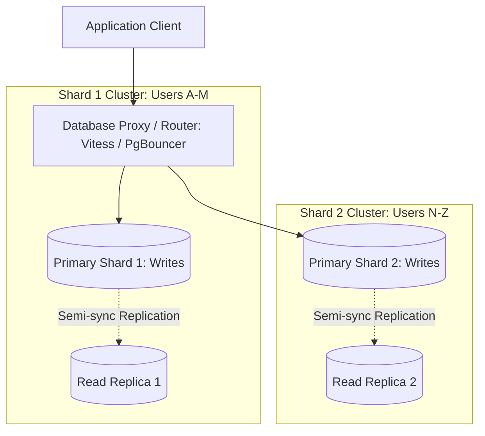
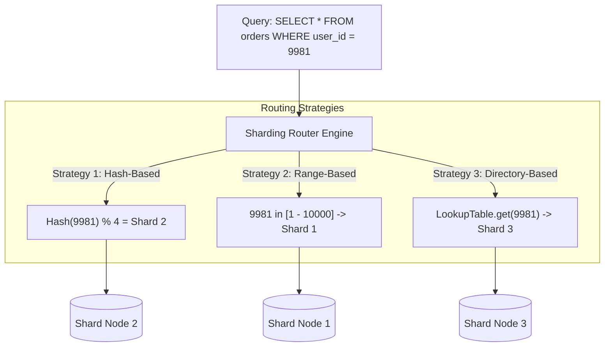
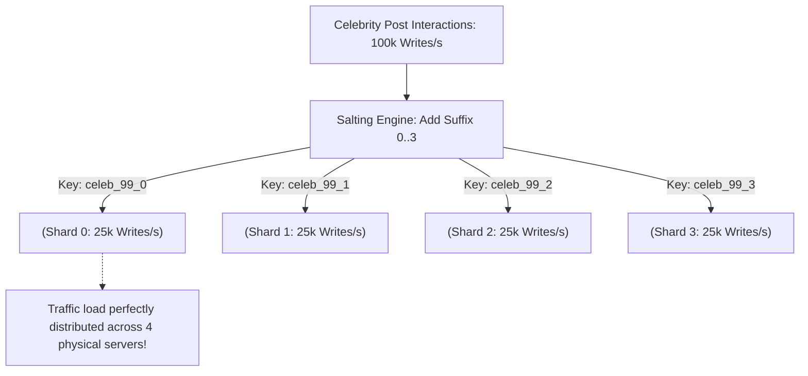
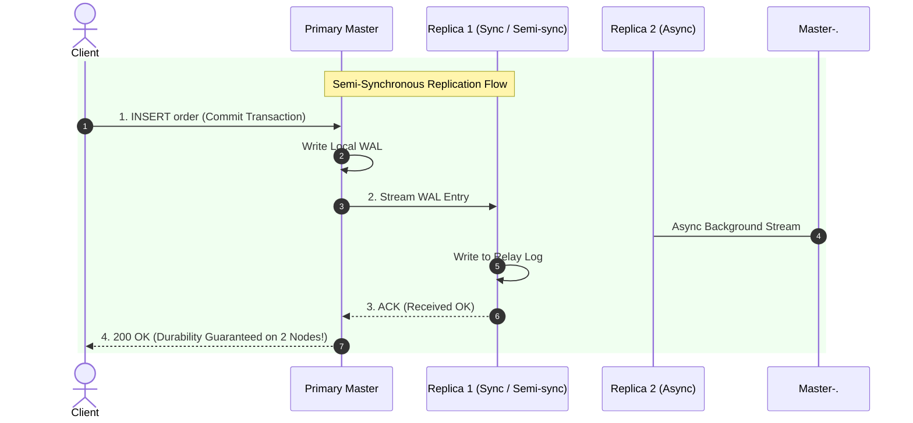
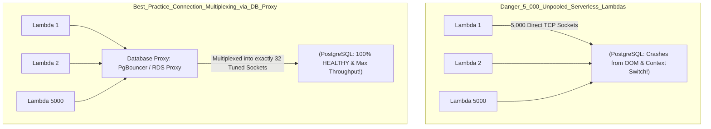

# 08.2. Sharding, Replication, and Scaling (Phân Mảnh, Sao Chép và Mở Rộng Cơ Sở Dữ Liệu)

## Tổng quan về Phân Mảnh, Sao Chép và Mở Rộng Cơ Sở Dữ Liệu
Khi một cơ sở dữ liệu duy nhất chạm đến các giới hạn phần cứng (hết dung lượng ổ đĩa, nghẽn I/O bus, hoặc vượt quá thông lượng kết nối mạng), việc nâng cấp phần cứng (Vertical Scaling) sẽ trở nên bất khả thi hoặc quá đắt đỏ. Để tiếp tục tăng trưởng, hệ thống bắt buộc phải áp dụng hai kỹ thuật cốt lõi:
1. **Database Replication (Sao chép dữ liệu)**: Tạo ra nhiều bản sao của cùng một tập dữ liệu trên nhiều máy chủ khác nhau nhằm tăng thông lượng đọc (**Read Scaling**) và đảm bảo khả năng chịu lỗi (**High Availability & Failover**).
2. **Database Sharding (Phân mảnh dữ liệu)**: Chia nhỏ một tập dữ liệu khổng lồ thành nhiều phần nhỏ độc lập (**Shards**) đặt trên các cụm máy chủ khác nhau nhằm mở rộng cả thông lượng đọc lẫn thông lượng ghi (**Write Scaling**).



---

## 2. Chi tiết từng Keyword (Under-the-Hood Deep Dive)

### 1. Database Sharding: Horizontal vs Vertical Partitioning & Sharding Strategies (Chiến Lược Phân Mảnh Dữ Liệu)

#### 1. Khái niệm bản chất (What & Why)
- **Vertical Partitioning (Phân vùng dọc)**: Chia tách các cột của một bảng thành nhiều bảng con. Các cột ít khi được truy cập hoặc các cột chứa dữ liệu lớn (`TEXT`, `BLOB`) được bóc tách ra một bảng riêng để tăng mật độ lưu trữ của các cột thường dùng trong RAM Buffer Pool.
- **Horizontal Partitioning (Phân vùng ngang)**: Chia tách các hàng của một bảng thành nhiều bảng con có cùng cấu trúc schema (thường được hỗ trợ sẵn trong PostgreSQL/MySQL thông qua Partitioning theo năm hoặc tháng).
- **Database Sharding**: Đưa Horizontal Partitioning lên tầm phân tán: mỗi phân vùng ngang được đặt trên **một máy chủ vật lý hoặc một cụm Database hoàn toàn độc lập (Shard)**.

Các chiến lược định tuyến Sharding:
1. **Range-Based Sharding (Dựa trên khoảng giá trị)**: Phân chia dữ liệu theo các dải giá trị liên tục của Shard Key (ví dụ: Shard 1 chứa ID từ 1 đến 1,000,000; Shard 2 chứa từ 1,000,001 đến 2,000,000; hoặc chia theo chữ cái đầu A-C, D-F).
   - *Ưu điểm*: Hỗ trợ truy vấn theo dải (`WHERE id BETWEEN x AND y`) rất dễ dàng trên một Shard duy nhất.
   - *Nhược điểm*: Dễ tạo ra **Hotspots**. Nếu ID tự tăng (Auto-increment), 100% các thao tác ghi mới sẽ dội vào Shard cuối cùng!
2. **Hash-Based Sharding (Dựa trên hàm băm)**: Sử dụng hàm băm của Shard Key: $\text{Shard ID} = \text{Hash}(\text{Shard Key}) \pmod N$.
   - *Ưu điểm*: Phân phối dữ liệu đồng đều tuyệt đối ngẫu nhiên trên toàn bộ các Shard.
   - *Nhược điểm*: Truy vấn theo dải bị vô hiệu hóa (phải gửi query tới tất cả các Shard - Scatter-Gather); việc thay đổi số lượng Shard $N$ rất tốn kém (phải dùng Consistent Hashing để giảm thiểu di dời dữ liệu).
3. **Directory-Based Sharding (Dựa trên bảng tra cứu)**: Sử dụng một dịch vụ tra cứu trung tâm (Lookup Service / Metadata Service) để lưu trữ ánh xạ: `Customer_ID -> Shard_ID`.
   - *Ưu điểm*: Cực kỳ linh hoạt, có thể di chuyển một khách hàng lớn (Enterprise Tenant) sang một Shard riêng mà không cần sửa công thức toán học.
   - *Nhược điểm*: Thêm một điểm nghẽn và Single Point of Failure tại Lookup Service.

#### 2. Cơ chế hoạt động sâu (Under the hood / Hardcore Internals)
Tiêu chí sống còn khi chọn **Shard Key (Khóa phân mảnh)**:
1. **Độ phân tán cao (High Cardinality)**: Khóa phải có số lượng giá trị duy nhất khổng lồ (ví dụ: `user_id` hoặc `uuid`). Tuyệt đối không chọn trường có độ phân tán thấp như `country_code` (chỉ có ~200 quốc gia) hoặc `gender`.
2. **Phân phối tần suất đều (Low Frequency Variance)**: Tránh chọn trường có phân phối Power-Law (ví dụ: `merchant_id` trong sàn thương mại điện tử, nơi cửa hàng Apple có thể tạo ra 50% số đơn hàng của toàn sàn).
3. **Co-location of Related Entities (Gom cụm thực thể liên quan)**:
   Nếu Shard theo `user_id`, hãy lưu trữ cả bảng `users`, bảng `orders` của user đó và bảng `order_items` vào **cùng một Shard vật lý**. Điều này cho phép thực hiện các phép `JOIN` và ACID Transaction cục bộ trên một máy chủ mà không bao giờ phải thực hiện **Cross-Shard Distributed Transactions (2PC)** vốn làm sụt giảm thông lượng nghiêm trọng!

#### 3. Sơ đồ minh họa


#### 4. Code ví dụ thực chiến (C++20 - Hash-Based Shard Router với MurmurHash3)
```cpp
#include <iostream>
#include <string>
#include <vector>
#include <cstdint>

// Giả lập hàm băm MurmurHash3 siêu tốc phân phối đều 32-bit
uint32_t murmur3_32(const char* key, size_t len, uint32_t seed = 42) {
    uint32_t h = seed;
    // Đơn giản hóa thuật toán minh họa cho core hashing
    for (size_t i = 0; i < len; ++i) {
        h ^= static_cast<uint8_t>(key[i]);
        h *= 0x5bd1e995;
        h ^= h >> 15;
    }
    return h;
}

class ShardRouter {
private:
    int total_shards_;

public:
    explicit ShardRouter(int num_shards) : total_shards_(num_shards) {
        if (num_shards <= 0) throw std::invalid_argument("Shards must be > 0");
    }

    int determineShard(const std::string& shard_key) const {
        uint32_t hash_val = murmur3_32(shard_key.data(), shard_key.size());
        // Phân phối vào đúng Shard ID: 0 đến total_shards - 1
        return static_cast<int>(hash_val % total_shards_);
    }
};

int main() {
    ShardRouter router(4); // Cụm có 4 Database Shards

    std::vector<std::string> user_ids = {"usr_1001", "usr_1002", "usr_1003", "usr_1004", "usr_1005"};

    std::cout << "[Database Shard Routing Decision]\n";
    for (const auto& uid : user_ids) {
        int shard_id = router.determineShard(uid);
        std::cout << "User '" << uid << "' -> Routed to Database Shard #" << shard_id << "\n";
    }
    return 0;
}
```

#### 5. Ưu / Nhược điểm, Pitfalls & Anti-patterns
- **Anti-pattern: Cross-Shard Joins**: Viết một câu truy vấn cần `JOIN` dữ liệu giữa bảng nằm trên Shard 1 và bảng nằm trên Shard 2. Application Server phải kéo toàn bộ dữ liệu thô của cả hai shard về RAM qua mạng và tự thực hiện phép Nested Loop Join, làm tê liệt hệ thống.

#### 6. Ứng dụng thực tế trong Backend / Systems
Vitess (công cụ sharding cho MySQL do YouTube phát triển) và Citus (extension sharding cho PostgreSQL) quản lý việc chia mảnh tự động cho các hệ thống chứa hàng chục nghìn Shards.

---

### 2. Hot Partitions, Celebrity Problem & Shard Rebalancing (Phân Vùng Nóng và Tái Cân Bằng Shard)

#### 1. Khái niệm bản chất (What & Why)
- **Hot Partitions (Phân vùng nóng / Điểm nghẽn cục bộ)**: Hiện tượng một Shard duy nhất phải hứng chịu $80\%$ lưu lượng truy cập hoặc lưu trữ của toàn hệ thống, khiến máy chủ đó bị sập do kiệt quệ CPU/Disk trong khi các Shard khác hoàn toàn nhàn rỗi.
- **The Celebrity Problem (Vấn đề người nổi tiếng)**: Trường hợp điển hình của Hot Partition trên mạng xã hội: Một tài khoản thông thường chỉ có 200 bạn bè, nhưng tài khoản của ca sĩ/ngôi sao có 80 triệu người theo dõi. Khi ngôi sao đăng một bài viết mới, Shard chứa tài khoản đó bị nghẽn tắc ngay lập tức.
- **Shard Rebalancing (Tái cân bằng Shard)**: Quá trình di chuyển dữ liệu giữa các Shard khi bổ sung thêm máy chủ mới hoặc khi một Shard bị phình to quá mức, đòi hỏi phải thực hiện trực tuyến mà không gây downtime (**Online Zero-Downtime Rebalancing**).

#### 2. Cơ chế hoạt động sâu (Under the hood / Hardcore Internals)
Kỹ thuật giải quyết Celebrity Problem bằng **Salted Shard Keys (Muối hóa khóa)**:
- Thay vì dùng `shard_key = user_id` (khiến toàn bộ dữ liệu của ngôi sao dồn vào 1 Shard):
- Hệ thống phát hiện tài khoản là Celebrity và tự động bổ sung một hậu tố ngẫu nhiên (Salt / Suffix):
  $$\text{Salted Key} = \text{Celebrity\_ID} + \text{"\_"} + \text{random}(0, S)$$
  với $S = 10$.
- Dữ liệu tương tác của ngôi sao sẽ được chia đều trên 10 Shards khác nhau.
- Khi cần đọc tổng số like hoặc comment: Hệ thống thực hiện Fan-Out truy vấn song song tới 10 Shards đó rồi cộng dồn lại (Scatter-Gather). Tải ghi được giải tỏa gấp 10 lần!

#### 3. Sơ đồ minh họa (Salted Shard Key Mitigation)


#### 4. Code ví dụ thực chiến (TypeScript - Salted Key Generator & Scatter-Gather Aggregator)
```typescript
export class CelebrityShardingManager {
  private static readonly CELEBRITY_THRESHOLD_FOLLOWERS = 1_000_000;
  private static readonly SALT_BUCKETS = 8; // Phân tán ra 8 Shards

  public static generateStorageShardKey(userId: string, followersCount: number): string {
    if (followersCount > this.CELEBRITY_THRESHOLD_FOLLOWERS) {
      // Tài khoản người nổi tiếng: Thêm Salt ngẫu nhiên để chia đều ra 8 Shards
      const randomBucket = Math.floor(Math.random() * this.SALT_BUCKETS);
      return `${userId}_salt_${randomBucket}`;
    }
    // Tài khoản thường: Giữ nguyên ID
    return userId;
  }

  // Scatter-Gather: Truy vấn song song 8 shards để gom tổng số tương tác
  public static async aggregateCelebrityMetrics(
    userId: string,
    queryShardFn: (saltedKey: string) => Promise<number>
  ): Promise<number> {
    console.log(`[Scatter-Gather] Querying ${this.SALT_BUCKETS} shards in parallel for celebrity ${userId}...`);
    
    const tasks: Promise<number>[] = [];
    for (let i = 0; i < this.SALT_BUCKETS; ++i) {
      tasks.push(queryShardFn(`${userId}_salt_${i}`));
    }

    const partialCounts = await Promise.all(tasks);
    const total = partialCounts.reduce((acc, curr) => acc + curr, 0);
    console.log(`[Scatter-Gather Complete] Total aggregated interactions: ${total}`);
    return total;
  }
}
```

#### 5. Ưu / Nhược điểm, Pitfalls & Anti-patterns
- **Anti-pattern: Naive Range Sharding on Timestamp**: Tạo Shard mới cho mỗi tháng: `orders_2026_01`, `orders_2026_02`. Toàn bộ 100% người dùng của tháng hiện tại chỉ ghi và đọc trên đúng 1 Shard duy nhất của tháng này, biến các Shard của các tháng trước thành "nghĩa địa dữ liệu lạnh" hoàn toàn lãng phí!

#### 6. Ứng dụng thực tế trong Backend / Systems
Instagram và Twitter áp dụng kỹ thuật Salting Key và Timeline Caching để vô hiệu hóa hoàn toàn hiện tượng sập server khi các ngôi sao giải trí đăng bài.

---

## 2. Chi tiết từng Keyword (Under-the-Hood Deep Dive)

### 3. Database Replication: Synchronous vs Asynchronous vs Semi-Synchronous (Các Mô Hình Sao Chép Dữ Liệu)

#### 1. Khái niệm bản chất (What & Why)
- **Primary-Replica Replication (Master-Slave)**: Một máy chủ đảm nhận vai trò **Primary (Master)** chịu trách nhiệm tiếp nhận toàn bộ các thao tác Ghi (Write). Các thay đổi dữ liệu được sao chép sang một hoặc nhiều máy chủ **Replicas (Slaves)** chuyên dùng để phục vụ các thao tác Đọc (Read Scaling).
- **Synchronous Replication (Sao chép đồng bộ)**: Thao tác ghi trên Primary chỉ được coi là thành công và trả về cho client sau khi **tất cả các bản sao (Replicas)** đã nhận và ghi xong dữ liệu vào đĩa của chúng.
- **Asynchronous Replication (Sao chép bất đồng bộ)**: Primary ghi xong vào đĩa cục bộ của mình là lập tức trả về thành công cho client ($< 1\text{ ms}$). Việc truyền dữ liệu sang các Replica diễn ra ngầm phía sau.
- **Semi-Synchronous Replication (Bán đồng bộ)**: Primary chỉ cần chờ **ít nhất một Replica** xác nhận đã nhận được bản ghi vào Relay Log là trả về thành công cho client.

#### 2. Cơ chế hoạt động sâu (Under the hood / Hardcore Internals)
Đánh đổi kỹ thuật giữa Tính nhất quán, Độ trễ và Khả năng chịu lỗi:

1. **Rủi ro của Asynchronous Replication - Hiện tượng Replication Lag**:
   - Nếu mạng giữa Master và Replica bị chậm, Replica có thể bị trễ 2 giây so với Master.
   - **Vấn đề "Read-Your-Own-Writes"**: Người dùng vừa cập nhật avatar mới, trình duyệt chuyển trang và đọc từ Read Replica $\implies$ Người dùng vẫn thấy avatar cũ của mình!
   - **Rủi ro mất dữ liệu (Data Loss on Failover)**: Nếu Master bị cháy ổ cứng đột ngột, một Replica được bầu lên làm Master mới. Toàn bộ các giao dịch xảy ra trong 2 giây Replication Lag chưa kịp truyền sang Replica sẽ bị **bốc hơi vĩnh viễn**!
2. **Cơ chế Semi-Synchronous (MySQL Semi-sync / Postgres `remote_write`)**:
   - Đạt được điểm cân bằng hoàn hảo: Đảm bảo dữ liệu đã tồn tại trên ít nhất 2 máy chủ vật lý độc lập trước khi báo thành công cho client $\implies$ **Loại bỏ hoàn toàn rủi ro mất dữ liệu khi Master sập (RPO = 0)**, trong khi độ trễ ghi chỉ tăng thêm đúng 1 Network Round-Trip Time (RTT $\approx 0.5\text{ ms}$ trong cùng Datacenter).

#### 3. Sơ đồ minh họa


#### 4. Code ví dụ thực chiến (C++20 - Mô phỏng Quorum / Semi-Synchronous Write Coordinator)
```cpp
#include <iostream>
#include <vector>
#include <future>
#include <chrono>

struct WriteResult {
    bool success;
    std::string node_id;
};

// Mô phỏng Primary Node điều phối ghi dữ liệu bán đồng bộ (Semi-Synchronous)
class PrimaryReplicationCoordinator {
public:
    bool executeSemiSyncWrite(const std::string& record) {
        std::cout << "[Primary Master] Ghi WAL cục bộ thành công: " << record << "\n";

        // Gửi bất đồng bộ sang 2 Replicas qua mạng
        auto replica1_task = std::async(std::launch::async, []() {
            std::this_thread::sleep_for(std::chrono::milliseconds(5)); // Mạng LAN 5ms
            return WriteResult{true, "Replica_1"};
        });

        auto replica2_task = std::async(std::launch::async, []() {
            std::this_thread::sleep_for(std::chrono::milliseconds(50)); // Replica 2 bị lag mạng 50ms
            return WriteResult{true, "Replica_2"};
        });

        // Semi-Sync Rule: Chỉ cần ÍT NHẤT 1 Replica xác nhận ACK là return ngay!
        if (replica1_task.wait_for(std::chrono::milliseconds(20)) == std::future_status::ready) {
            auto res = replica1_task.get();
            std::cout << "[Semi-Sync Confirmed] ACK received from " << res.node_id 
                      << "! Returning success to client in 5ms.\n";
            return true;
        }

        return false;
    }
};

int main() {
    PrimaryReplicationCoordinator coord;
    coord.executeSemiSyncWrite("TX_ID_9981: TRANSFER $500");
    return 0;
}
```

#### 5. Ưu / Nhược điểm, Pitfalls & Anti-patterns
- **Anti-pattern: Reading from Async Replicas immediately after Write**: Trong luồng đăng ký tài khoản, ghi user vào Master rồi redirect ngay sang trang Profile đọc từ Read Replica. Người dùng sẽ bị ném lỗi "Tài khoản không tồn tại" do Replication Lag!
  - *Giải pháp*: Với người dùng vừa thực hiện ghi, ép đọc từ Master trong 5 giây đầu tiên (**Sticky Master Read**), sau đó mới chuyển sang đọc từ Replica.

#### 6. Ứng dụng thực tế trong Backend / Systems
PostgreSQL hỗ trợ cấu hình `synchronous_commit = remote_apply` đảm bảo dữ liệu không chỉ nằm trong log mà đã được apply thực tế vào database của Replica trước khi commit.

---

### 4. Connection Pooling & Database Proxies (Bể Chứa Kết Nối và Proxy Cơ Sở Dữ Liệu)

#### 1. Khái niệm bản chất (What & Why)
- **Database Connection Pooling**: Một kỹ thuật duy trì sẵn một nhóm các kết nối mạng (Socket Connections) đã được mở và xác thực sẵn tới cơ sở dữ liệu. Thay vì mở một kết nối TCP mới cho mỗi HTTP request rồi đóng lại, ứng dụng **mượn (Borrow)** một kết nối có sẵn từ Pool, thực thi truy vấn, và **trả lại (Return)** vào Pool để các request khác tái sử dụng.
- **Database Proxy (PgBouncer, ProxySQL, AWS RDS Proxy)**: Một tầng trung gian độc lập đứng giữa hàng nghìn máy chủ ứng dụng (App Servers / Serverless Lambdas) và cụm Database nhằm quản lý tập trung hàng chục nghìn kết nối client và dồn kênh (**Connection Multiplexing**) vào một số lượng nhỏ kết nối thực tế tới Database.

#### 2. Cơ chế hoạt động sâu (Under the hood / Hardcore Internals)
Bản chất vật lý: **Tại sao 1,000 Connections sẽ giết chết Database RDBMS?**
1. **Tiêu tốn bộ nhớ RAM cố định**:
   - Trong PostgreSQL, mỗi kết nối là một **tiến trình OS riêng biệt (Process fork)** tiêu tốn ít nhất **$5 - 10\text{ MB}$ RAM** (`work_mem`, stack). $1,000$ kết nối ngốn sạch $10\text{ GB}$ RAM của máy chủ chỉ để duy trì trạng thái kết nối nhàn rỗi!
2. **CPU Context Switching & Lock Contention**:
   - Một máy chủ cơ sở dữ liệu thường chỉ có **16 hoặc 32 vCPU cores**.
   - Nếu có $1,000$ luồng cùng tranh chấp 32 cores để đọc đĩa và ghi WAL, CPU sẽ dành $85\%$ thời gian chỉ để hoán đổi thanh ghi và tranh chấp khóa hàng (`Spinlocks`, `Latches`) thay vì thực thi câu lệnh SQL.
   - **Thông lượng (Throughput) tụt dốc không phanh khi số kết nối vượt quá ngưỡng tối ưu!**

**Công thức vàng tính kích thước Connection Pool (Brett Wooldridge - Tác giả HikariCP)**:
$$\text{Pool Size} = (T_n \times 2) + S_n$$
- $T_n$: Số lượng CPU Cores của máy chủ Database.
- $S_n$: Số lượng ổ đĩa vật lý (Spindles / NVMe channels).
- **Thực tế bất ngờ**: Một máy chủ Database 16 cores chạy trên ổ SSD NVMe chỉ cần một Connection Pool khoảng **$32 - 40$ kết nối** là đạt thông lượng xử lý tối đa! Bất kỳ kết nối nào mở thêm đều làm giảm hiệu năng hệ thống!

#### 3. Sơ đồ minh họa


#### 4. Code ví dụ thực chiến (C++20 - Thread-Safe Generic Connection Pool)
```cpp
#include <iostream>
#include <vector>
#include <memory>
#include <mutex>
#include <condition_variable>
#include <string>

class MockDatabaseConnection {
public:
    int id;
    explicit MockDatabaseConnection(int conn_id) : id(conn_id) {
        std::cout << "[DB Driver] Opened physical TCP socket connection #" << id << "\n";
    }
    ~MockDatabaseConnection() {
        std::cout << "[DB Driver] Closed socket connection #" << id << "\n";
    }
    void executeQuery(const std::string& sql) {
        std::cout << "    [Conn #" << id << "] Executed: " << sql << "\n";
    }
};

class DBConnectionPool {
private:
    size_t capacity_;
    std::vector<std::unique_ptr<MockDatabaseConnection>> pool_;
    std::mutex mtx_;
    std::condition_variable cv_;

public:
    explicit DBConnectionPool(size_t capacity) : capacity_(capacity) {
        for (size_t i = 1; i <= capacity_; ++i) {
            pool_.push_back(std::make_unique<MockDatabaseConnection>(static_cast<int>(i)));
        }
    }

    // Mượn kết nối từ Pool (Blocking nếu pool tạm thời hết chỗ)
    std::unique_ptr<MockDatabaseConnection> acquire() {
        std::unique_lock<std::mutex> lock(mtx_);
        cv_.wait(lock, [this]() { return !pool_.empty(); });

        auto conn = std::move(pool_.back());
        pool_.pop_back();
        return conn;
    }

    // Trả kết nối lại vào Pool để tái sử dụng
    void release(std::unique_ptr<MockDatabaseConnection> conn) {
        std::lock_guard<std::mutex> lock(mtx_);
        pool_.push_back(std::move(conn));
        cv_.notify_one(); // Báo cho luồng đang chờ
    }
};

int main() {
    DBConnectionPool pool(2); // Giới hạn pool đúng 2 kết nối vật lý

    // Luồng 1 mượn kết nối
    auto conn1 = pool.acquire();
    conn1->executeQuery("SELECT balance FROM accounts WHERE id = 1");

    // Luồng 2 mượn kết nối
    auto conn2 = pool.acquire();
    conn2->executeQuery("UPDATE accounts SET balance = 500 WHERE id = 1");

    // Trả kết nối lại pool
    pool.release(std::move(conn1));
    pool.release(std::move(conn2));

    std::cout << "[Pool Status] All connections returned and preserved ready for next requests.\n";
    return 0;
}
```

#### 5. Ưu / Nhược điểm, Pitfalls & Anti-patterns
- **Anti-pattern: Connection Leak**: Mượn kết nối từ Connection Pool nhưng quên gọi `conn.close()` trong khối `finally`. Sau 100 requests bị lỗi, toàn bộ các kết nối trong pool bị "chiếm giữ ma", khiến toàn bộ ứng dụng bị đóng băng vĩnh viễn vì phải xếp hàng chờ kết nối trống!

#### 6. Ứng dụng thực tế trong Backend / Systems
HikariCP là thư viện Connection Pool mặc định trong Spring Boot với mã nguồn Java được tối ưu hóa đến từng lệnh Bytecode và CPU cache. PgBouncer là tiêu chuẩn công nghiệp bắt buộc phải có cho mọi hệ thống PostgreSQL quy mô lớn.

---

## Tóm tắt liên kết hệ thống
Chương **11.8 (Database Architecture in System Design)** đã giải mã toàn bộ tầng lưu trữ phân tán: từ việc lựa chọn 7 họ Database chuyên biệt, kiến trúc Polyglot Persistence, chia nhỏ cơ sở dữ liệu bằng Sharding (Range, Hash, Salted Keys), đảm bảo tính sẵn sàng bằng Semi-Sync Replication, cho đến tối ưu hóa tài nguyên phần cứng bằng Connection Pooling theo công thức HikariCP.

Tiếp theo, tại **11.9: Distributed Systems Design**, chúng ta sẽ bước vào lãnh địa phức tạp nhất của ngành Khoa học Máy tính: Định lý CAP & PACELC, các mô hình nhất quán dữ liệu (Linearizability, Causal Consistency), thuật toán đồng thuận (Raft, Paxos), phân tán giao dịch (2PC, Saga) và cơ chế Transactional Outbox Pattern.
