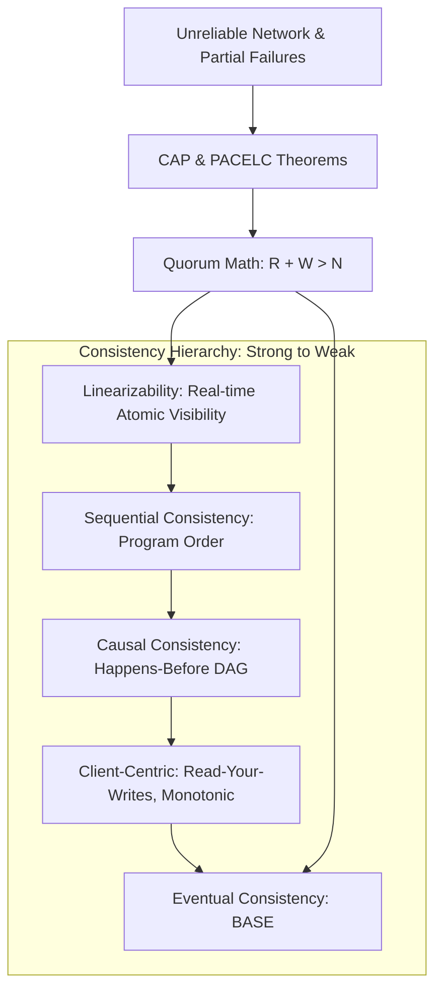
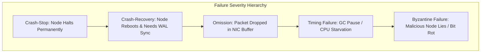
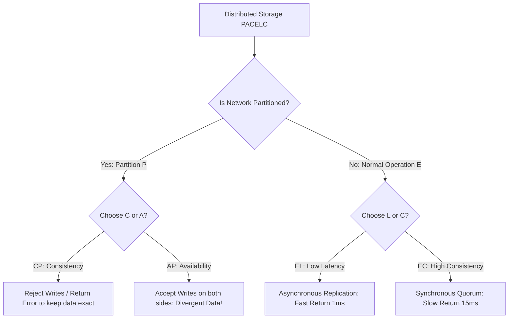
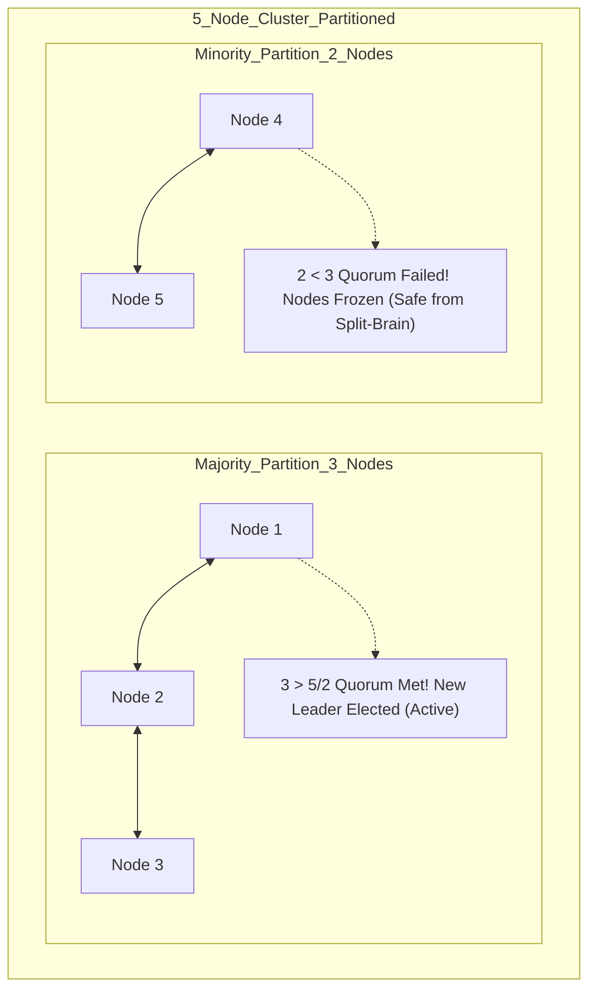
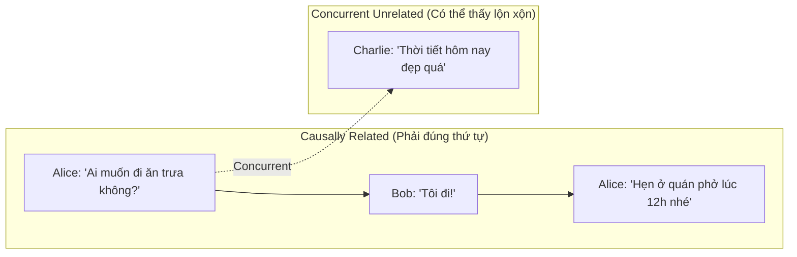

# 09.1. Distributed Fundamentals and Consistency Models (Nền Tảng Phân Tán và Các Mô Hình Nhất Quán Dữ Liệu)

## Tổng quan về Nền Tảng Phân Tán và Mô Hình Nhất Quán
Nhà khoa học máy tính Leslie Lamport (người đoạt giải Turing) từng đưa ra định nghĩa châm biếm nhưng vô cùng chuẩn xác:
$$\textbf{"A distributed system is one in which the failure of a computer you didn't even know existed can render your own computer unusable."}$$
*(Một hệ thống phân tán là một hệ thống mà sự cố của một chiếc máy tính bạn thậm chí còn không biết là có tồn tại lại có thể làm cho máy tính của chính bạn trở nên vô dụng).*

Trong một máy tính đơn lẻ, các lệnh được điều phối bởi một xung nhịp đồng hồ vật lý duy nhất (CPU Clock) và bộ nhớ RAM dùng chung. Nhưng trong một **Hệ thống phân tán (Distributed System)**, các nút (Nodes) giao tiếp với nhau qua một mạng máy tính không đáng tin cậy (Unreliable Network) chịu ảnh hưởng bởi độ trễ bất định, gói tin bị mất, và các sự cố một phần (**Partial Failures**).

Chuyên đề này phân tích sâu sắc các định luật vật lý và mô hình toán học chi phối hệ thống phân tán: 8 Sai lầm kinh điển (Fallacies of Distributed Computing), các mô hình lỗi (Failure Models), sự tiến hóa từ **CAP sang PACELC**, công thức tính **Quorum Reads/Writes ($R + W > N$)**, và phổ các mô hình nhất quán dữ liệu từ **Linearizability** khắt khe nhất đến **Eventual Consistency**.



---

## 2. Chi tiết từng Keyword (Under-the-Hood Deep Dive)

### 1. The 8 Fallacies of Distributed Computing & Partial Failures (8 Ảo Tưởng và Sự Cố Một Phần)

#### 1. Khái niệm bản chất (What & Why)
Năm 1994, L. Peter Deutsch và James Gosling tại Sun Microsystems đã tổng kết **8 Ảo tưởng sai lầm kinh điển của lập trình viên khi bước vào thế giới phân tán**:
1. *Mạng luôn luôn đáng tin cậy (The network is reliable).*
2. *Độ trễ bằng 0 (Latency is zero).*
3. *Băng thông là vô hạn (Bandwidth is infinite).*
4. *Mạng luôn an toàn tuyệt đối (The network is secure).*
5. *Cấu trúc liên kết mạng không bao giờ đổi (Topology doesn't change).*
6. *Chỉ có duy nhất một người quản trị mạng (There is one administrator).*
7. *Chi phí truyền tải mạng bằng 0 (Transport cost is zero).*
8. *Mạng đồng nhất 100% về phần cứng và hệ điều hành (The network is homogeneous).*

- **Partial Failure (Sự cố một phần)**: Điểm đặc trưng nguy hiểm nhất của hệ thống phân tán. Trong một ứng dụng đơn tiến trình, nếu một hàm bị lỗi, toàn bộ tiến trình sẽ crash (Toàn bộ hoặc Không có gì). Nhưng trong hệ thống phân tán gồm 1,000 nodes, tại bất kỳ giây phút nào cũng luôn có một vài node bị treo, một vài sợi cáp quang bị đứt, trong khi 99% hệ thống còn lại vẫn đang chạy!

#### 2. Cơ chế hoạt động sâu (Under the hood / Hardcore Internals)
Các mô hình lỗi (Failure Models) trong lý thuyết tính toán phân tán:
1. **Crash-Stop Failure (Fail-Stop)**: Một node bị sập đột ngột (cháy nguồn, kernel panic) và dừng hoạt động vĩnh viễn mà không gửi lại bất kỳ phản hồi nào. Mô hình dễ xử lý nhất.
2. **Crash-Recovery Failure**: Node bị sập, sau một khoảng thời gian tự khởi động lại và tham gia trở lại cụm. Node phải đọc lại nhật ký bền vững trên đĩa (WAL) để khôi phục lại trạng thái nhất quán trước khi nhận request.
3. **Omission Failure**: Node vẫn sống nhưng bị mất gói tin mạng (do tràn bộ đệm card mạng socket hoặc router drop gói tin).
4. **Timing / Performance Failure**: Node phản hồi đúng kết quả nhưng lại trả về quá muộn so với cam kết SLA (ví dụ: bị treo do Java Garbage Collection Stop-The-World kéo dài 30 giây).
5. **Byzantine Failure (Lỗi Byzantine / Hành vi độc hại)**: Mức độ nguy hiểm cao nhất. Node không những không sập mà còn gửi đi các thông tin giả mạo, sai lệch hoặc cố tình nói dối với các node khác (do bị hacker chiếm quyền điều khiển hoặc lỗi hỏng bit bộ nhớ RAM ECC). Đòi hỏi các thuật toán đồng thuận phức tạp như **PBFT (Practical Byzantine Fault Tolerance)**.

#### 3. Sơ đồ minh họa


#### 4. Code ví dụ thực chiến (C++20 - Xử lý Timing Failure bằng Timeout & Cancellation Token)
```cpp
#include <iostream>
#include <future>
#include <chrono>
#include <thread>

// Xử lý hiện tượng Timing Failure trong hệ thống phân tán
std::string callRemoteDistributedNode(int node_id) {
    if (node_id == 2) {
        // Giả lập Node 2 bị kẹt Full GC Pause mất 2000ms
        std::this_thread::sleep_for(std::chrono::milliseconds(2000));
    } else {
        std::this_thread::sleep_for(std::chrono::milliseconds(50));
    }
    return "SUCCESS_DATA_NODE_" + std::to_string(node_id);
}

int main() {
    std::cout << "[Distributed Client] Calling Node 2 with 200ms Hard SLA Deadline...\n";

    auto task = std::async(std::launch::async, []() {
        return callRemoteDistributedNode(2);
    });

    // Deadline Protection: Nếu sau 200ms node không phản hồi -> Coi như node đã lỗi!
    if (task.wait_for(std::chrono::milliseconds(200)) == std::future_status::ready) {
        std::cout << "Received: " << task.get() << "\n";
    } else {
        std::cerr << "[TIMING FAILURE DETECTED] Node 2 exceeded SLA! Tripping Circuit Breaker.\n";
    }
    return 0;
}
```

#### 5. Ưu / Nhược điểm, Pitfalls & Anti-patterns
- **Anti-pattern: Infinite Socket Timeout**: Gửi một HTTP/RPC request sang node khác mà không cấu hình `connectTimeout` và `readTimeout`. Khi node bên kia bị treo mạng (Silent Drop), thread của client sẽ bị treo vĩnh viễn cho đến khi cạn kiệt thread pool.

#### 6. Ứng dụng thực tế trong Backend / Systems
Mọi hệ thống lưu trữ phân tán hiện đại (Hadoop HDFS, Ceph, Kubernetes) đều coi phần cứng tiêu chuẩn là không đáng tin cậy và tự động bù đắp lỗi phần cứng bằng phần mềm.

---

### 2. CAP Theorem vs PACELC Theorem (Định Lý CAP và Định Lý PACELC)

#### 1. Khái niệm bản chất (What & Why)
- **Định lý CAP (Eric Brewer, chứng minh toán học bởi Gilbert & Lynch)**: Trong bất kỳ hệ thống dữ liệu phân tán nào, khi xảy ra **Phân mảnh mạng (Network Partition - P)**, hệ thống **chỉ có thể chọn 1 trong 2 thuộc tính: Tính nhất quán (Consistency - C) hoặc Tính sẵn sàng (Availability - A)**; không thể có cả hai cùng lúc!
  - *Network Partition (P)*: Không thể tránh khỏi (dây mạng đứt, router treo). Do đó, trong thực tế chỉ có sự lựa chọn giữa **CP** hoặc **AP**:
    - **CP Systems (Ưu tiên Nhất quán)**: Khi mạng bị chia cắt, từ chối phục vụ một phần client để tránh sai lệch dữ liệu (ví dụ: etcd, ZooKeeper, HBase).
    - **AP Systems (Ưu tiên Sẵn sàng)**: Chấp nhận phục vụ dữ liệu cũ cho client để hệ thống không bao giờ bị gián đoạn (ví dụ: Cassandra, DynamoDB, CouchDB).
- **Định lý PACELC (Daniel Abadi)**: Khắc phục nhược điểm của CAP (CAP chỉ nói về trường hợp mạng bị sập). PACELC mô tả bức tranh hoàn chỉnh:
  $$\textbf{IF Partition (P): choose Availability (A) OR Consistency (C)}$$
  $$\textbf{ELSE (E): choose Latency (L) OR Consistency (C)}$$
  *(Nếu có phân mảnh mạng, chọn A hay C; NẾU MẠNG BÌNH THƯỜNG, ta phải đánh đổi giữa Độ trễ (L) hay Tính nhất quán (C))*.

#### 2. Cơ chế hoạt động sâu (Under the hood / Hardcore Internals)
Phân loại các cơ sở dữ liệu phân tán theo PACELC:
- **PC/EC (ví dụ: Google Spanner, CockroachDB, Raft/etcd)**: Khi mạng lỗi, chọn Consistency. Khi mạng bình thường, chấp nhận độ trễ (Latency) cao hơn để thực hiện Synchronous Replication đảm bảo Consistency.
- **PA/EL (ví dụ: Amazon DynamoDB, Apache Cassandra, Riak)**: Khi mạng lỗi, chọn Availability. Khi mạng bình thường, chọn độ trễ cực thấp (Latency) bằng cách dùng Asynchronous Replication, chấp nhận dữ liệu có thể bị Eventual Consistency.
- **PA/EC (ví dụ: MongoDB khi cấu hình WriteConcern)**: Khi mạng lỗi chọn Availability; nhưng khi mạng bình thường bắt buộc phải ghi quorum để đảm bảo Consistency.

#### 3. Sơ đồ minh họa


#### 4. Code ví dụ thực chiến (TypeScript - Mô phỏng cơ chế PACELC Tunable Write)
```typescript
type ConsistencyLevel = 'ONE' | 'QUORUM' | 'ALL';

interface NodeStorage {
  id: string;
  isReachable: boolean;
  data: Map<string, string>;
}

export class PACELCStorageCoordinator {
  constructor(private clusterNodes: NodeStorage[]) {}

  // Minh họa sự đánh đổi giữa Latency (L) và Consistency (C) khi mạng bình thường
  public async write(key: string, value: string, level: ConsistencyLevel): Promise<boolean> {
    const reachableNodes = this.clusterNodes.filter(n => n.isReachable);
    const requiredAcks = level === 'ONE' ? 1 : (level === 'QUORUM' ? Math.floor(this.clusterNodes.length / 2) + 1 : this.clusterNodes.length);

    console.log(`[PACELC Write] Target Level: ${level} (Needs ${requiredAcks} ACKs out of ${this.clusterNodes.length} nodes)`);

    let acks = 0;
    for (const node of reachableNodes) {
      node.data.set(key, value);
      acks++;
      if (level === 'ONE' && acks === 1) {
        console.log(`>>> [Low Latency Mode (EL)] Returned instantly after 1 node ACK!`);
        return true;
      }
    }

    if (acks >= requiredAcks) {
      console.log(`>>> [High Consistency Mode (EC)] Committed with ${acks} ACKs!`);
      return true;
    }

    console.error(`[Write Failed] Could not achieve required quorum. System is CP!`);
    return false;
  }
}
```

#### 5. Ưu / Nhược điểm, Pitfalls & Anti-patterns
- **Anti-pattern: The "CA Database" Myth**: Tuyên bố xây dựng một cơ sở dữ liệu phân tán đạt "Cả Consistency và Availability mà không cần quan tâm Partition". Mạng máy tính vật lý không bao giờ đảm bảo độ tin cậy $100\%$, do đó một hệ thống "CA" thực chất chỉ là một hệ thống đơn node (Single-node RDBMS) không có khả năng phân tán!

#### 6. Ứng dụng thực tế trong Backend / Systems
AWS DynamoDB cho phép cấu hình theo từng câu query: `ConsistentRead = true` (chọn EC) hoặc `ConsistentRead = false` (chọn EL với chi phí rẻ hơn 50%).

---

### 3. Quorum Consensus: Tunable Quorum Math & Split-Brain (Toán Học Quorum và Hiện Tượng Phân Liệt Não)

#### 1. Khái niệm bản chất (What & Why)
- **Quorum (Đa số túc số)**: Số lượng tối thiểu các nút thành viên trong cụm bắt buộc phải xác nhận một thao tác (Đọc hoặc Ghi) thì thao tác đó mới được coi là hợp lệ.
- **Công thức Quorum Mạnh (Strong Consistency Quorum)**:
  $$R + W > N$$
  - $N$: Tổng số lượng bản sao (Replication Factor).
  - $W$: Số lượng bản sao bắt buộc phải ghi thành công (Write Quorum).
  - $R$: Số lượng bản sao bắt buộc phải đọc đồng thời (Read Quorum).
- **Split-Brain (Phân liệt não)**: Trạng thái thảm họa khi sự cố mạng chia cắt một cụm máy chủ thành hai nửa biệt lập ($A$ và $B$). Nếu cả hai nửa đều tự nhận mình là cụm chính thống và cùng bầu ra Leader riêng, cả hai nửa sẽ cùng ghi đè dữ liệu mâu thuẫn vào cơ sở dữ liệu!

#### 2. Cơ chế hoạt động sâu (Under the hood / Hardcore Internals)
Chứng minh toán học nguyên lý lồng nhau (Pigeonhole Principle) của Quorum:
- Giả sử $N = 5$ nodes. Ta cấu hình: $W = 3$ và $R = 3$.
- Ta có: $R + W = 3 + 3 = 6 > 5$.
- Theo nguyên lý chuồng bồ câu: Bất kỳ tập hợp 3 nodes nào được đọc ($R$) **chắc chắn bắt buộc phải chứa ít nhất 1 node** nằm trong tập hợp 3 nodes vừa được ghi ($W$)!
- Bằng cách so sánh Timestamp hoặc Phiên bản (Version Tag) giữa các node trong tập $R$, Client sẽ luôn luôn nhận được dữ liệu mới nhất, đạt được **Strong Consistency** mà không cần tới Distributed Lock!

Cách ngăn chặn Split-Brain:
1. **Quy tắc Số lượng Nút Lẻ và Quorum Tuyệt đối ($Q > N/2$)**:
   - Luôn luôn cấu hình số nút là số lẻ ($N = 3, 5, 7$).
   - Một nửa phân vùng chỉ được phép bầu Leader nếu nó tập hợp được **đa số tuyệt đối** ($> 50\%$).
   - Nếu cụm 5 nodes bị chia cắt thành $3$ nodes và $2$ nodes: Nửa có 3 nodes đạt đa số ($3 > 5/2$) sẽ tiếp tục hoạt động; nửa có 2 nodes tự động đóng băng và từ chối mọi thao tác ghi!
2. **Fencing Tokens (Mã rào chắn)**:
   Mỗi khi một Leader mới được bầu, một con số tăng dần (Monotonically Increasing Epoch / Generation ID) được phát ra. Bất kỳ lệnh ghi nào từ Leader cũ gửi tới storage server nếu mang Epoch nhỏ hơn sẽ bị từ chối ngay lập tức.

#### 3. Sơ đồ minh họa


#### 4. Code ví dụ thực chiến (C++20 - Quorum Consistency Verification Engine)
```cpp
#include <iostream>
#include <vector>
#include <algorithm>
#include <string>

struct NodeRecord {
    std::string value;
    uint64_t version; // Monotonically increasing version tag
};

class QuorumReader {
public:
    // Đọc từ R nodes và giải quyết xung đột bằng phiên bản cao nhất (Read Repair)
    static NodeRecord resolveLatestFromQuorum(const std::vector<NodeRecord>& quorum_responses) {
        if (quorum_responses.empty()) throw std::runtime_error("Empty quorum");

        // Tìm bản ghi có version lớn nhất
        auto latest = std::max_element(quorum_responses.begin(), quorum_responses.end(),
            [](const NodeRecord& a, const NodeRecord& b) {
                return a.version < b.version;
            });

        std::cout << "[Quorum Read] Resolved to latest Version #" << latest->version 
                  << " with value: '" << latest->value << "'\n";
        return *latest;
    }
};

int main() {
    // Giả lập đọc từ R = 3 nodes (Node 1 và 2 đã cập nhật, Node 3 bị lag mạng mang version cũ)
    std::vector<NodeRecord> sample_quorum = {
        {"Account_Balance: 500$", 4}, // Latest
        {"Account_Balance: 500$", 4}, // Latest
        {"Account_Balance: 350$", 3}  // Stale replica!
    };

    auto resolved = QuorumReader::resolveLatestFromQuorum(sample_quorum);
    std::cout << "Final Client Value: " << resolved.value << "\n";
    return 0;
}
```

#### 5. Ưu / Nhược điểm, Pitfalls & Anti-patterns
- **Anti-pattern: Deploying Even-Numbered Nodes (2 or 4 Nodes)**: Triển khai cụm ZooKeeper hoặc etcd gồm 2 nodes với suy nghĩ "2 máy thì tốt hơn 1 máy". Khi 2 máy bị mất kết nối mạng với nhau, mỗi bên chỉ có 1 node ($1 \le 2/2$), cả hai bên đều không đạt quá bán, làm cho toàn bộ cụm tê liệt $100\%$! Một cụm 2 máy thực tế có độ sẵn sàng kém hơn một cụm 1 máy!

#### 6. Ứng dụng thực tế trong Backend / Systems
Apache Cassandra và Amazon DynamoDB cho phép lập trình viên cấu hình Quorum linh hoạt trên từng câu lệnh: `LOCAL_QUORUM`, `EACH_QUORUM`, `ONE`, `ALL`.

---

## 2. Chi tiết từng Keyword (Under-the-Hood Deep Dive)

### 4. The Spectrum of Consistency Models: Linearizability, Sequential, Causal & Eventual (Phổ Các Mô Hình Nhất Quán)

#### 1. Khái niệm bản chất (What & Why)
Một **Mô hình nhất quán (Consistency Model)** là một bản hợp đồng kỹ thuật giữa lập trình viên và hệ thống lưu trữ phân tán, quy định các quy tắc về thứ tự và thời điểm mà các thao tác cập nhật dữ liệu của một tiến trình sẽ được nhìn thấy bởi các tiến trình khác trên toàn hệ thống.

Phổ nhất quán từ Chặt chẽ nhất (Strongest) đến Lỏng lẻo nhất (Weakest):
1. **Linearizability (Strong Consistency / External Consistency)**: Cấp độ nhất quán tối thượng. Hệ thống hoạt động như thể chỉ có **một bản sao duy nhất trong vũ trụ**, và mọi thao tác đọc/ghi diễn ra **ngay lập tức (Instantaneous)** tại một điểm thời gian thực toàn cầu. Nếu Thao tác A hoàn tất trước khi Thao tác B bắt đầu theo đồng hồ thời gian thực, Thao tác B bắt buộc phải nhìn thấy kết quả của Thao tác A.
2. **Sequential Consistency (Leslie Lamport)**: Yếu hơn Linearizability. Không ràng buộc thời gian thực toàn cầu, nhưng yêu cầu tất cả các nút phải nhìn thấy các thao tác thực thi theo **cùng một thứ tự tuần tự duy nhất**, và thứ tự đó phải tuân thủ thứ tự chương trình của từng tiến trình (Program Order).
3. **Causal Consistency (Nhất quán nhân quả)**: Chỉ các thao tác có **quan hệ nhân quả (Causally Related - quan hệ Happens-Before)** mới bắt buộc phải được nhìn thấy theo đúng thứ tự bởi tất cả các nút. Các thao tác đồng thời độc lập (Concurrent Operations) có thể được nhìn thấy theo thứ tự khác nhau.
4. **Client-Centric Consistency**:
   - **Read-Your-Writes**: Đảm bảo một client luôn nhìn thấy các cập nhật của chính mình.
   - **Monotonic Reads**: Nếu một client đã đọc được giá trị $V$, các lần đọc sau không bao giờ được nhìn thấy giá trị cũ hơn $V$ (không bị thụt lùi thời gian).
   - **Monotonic Writes**: Các thao tác ghi của một client được thực thi tuần tự theo đúng thứ tự gửi.
5. **Eventual Consistency (Nhất quán cuối cùng - Weakest)**: Nếu không có thêm thao tác ghi mới nào, sau một khoảng thời gian, tất cả các bản sao cuối cùng sẽ hội tụ về cùng một giá trị giống nhau.

#### 2. Cơ chế hoạt động sâu (Under the hood / Hardcore Internals)
Sự khác biệt cốt lõi giữa Linearizability và Sequential Consistency:
- Giả sử Alice đăng một bài viết lên mạng xã hội lúc 12:00:00 (Thao tác W).
- Bob ở cùng phòng nhận được thông báo lúc 12:00:01 và hỏi Charlie: *"Bạn thấy bài của Alice chưa?"*.
- Charlie gửi request đọc (Thao tác R) lúc 12:00:02.
  - Trong hệ thống **Linearizable**: Charlie **bắt buộc phải nhìn thấy bài viết** vì theo thời gian thực toàn cầu, thao tác đọc của Charlie diễn ra sau khi thao tác ghi của Alice đã kết thúc.
  - Trong hệ thống **Sequential Consistent**: Charlie **có thể chưa thấy bài viết**! Sequential consistency không quan tâm đến đồng hồ thực ngoài đời; nó chỉ đảm bảo nếu Charlie đọc được bài viết rồi thì không bao giờ bị thấy bài viết biến mất sau đó.

Chi phí vật lý của Linearizability:
Để đạt được Linearizability trên quy mô toàn cầu, Google Spanner phải trang bị **TrueTime API** gồm các thiết bị đồng hồ nguyên tử (Atomic Clocks) và ăng-ten GPS trong từng Datacenter để giới hạn độ sai lệch thời gian ($\epsilon \le 7\text{ ms}$), và bắt buộc các giao dịch phải chờ đợi (Wait out the uncertainty) trước khi commit!

#### 3. Sơ đồ minh họa (Mô hình Quan hệ Nhân quả Causal Order DAG)


#### 4. Code ví dụ thực chiến (TypeScript - Đảm bảo Monotonic Reads bằng Client Vector Clock)
```typescript
interface VersionedData {
  value: string;
  version: number;
}

export class MonotonicReadClient {
  private highestVersionSeen: number = 0;

  constructor(private fetchFromAnyReplica: () => Promise<VersionedData>) {}

  // Đảm bảo nguyên lý Monotonic Reads: Không bao giờ trả về dữ liệu cũ hơn lần đọc trước!
  public async readWithMonotonicGuarantee(): Promise<string> {
    const data = await this.fetchFromAnyReplica();

    if (data.version < this.highestVersionSeen) {
      console.warn(`[Monotonic Read Violation Prevented] Replica returned stale version #${data.version} while client already saw #${this.highestVersionSeen}. Retrying fresh replica!`);
      // Bỏ qua giá trị cũ này, ép truy vấn Primary hoặc chờ replica bắt kịp
      return "RETRYING_FOR_FRESH_VERSION";
    }

    this.highestVersionSeen = data.version;
    console.log(`[Monotonic Read Success] Read version #${data.version}: ${data.value}`);
    return data.value;
  }
}
```

#### 5. Ưu / Nhược điểm, Pitfalls & Anti-patterns
- **Anti-pattern: Assuming Eventual Consistency is Instant**: Thiết kế hệ thống phụ thuộc vào Eventual Consistency nhưng giả định rằng "sau vài mili-giây là dữ liệu đồng bộ xong". Khi có biến cố mạng hoặc lag GC, thời gian đồng bộ có thể kéo dài lên tới vài phút, phá vỡ logic giao dịch nghiệp vụ.

#### 6. Ứng dụng thực tế trong Backend / Systems
Hệ thống bình luận (Comments) của Facebook áp dụng **Causal Consistency**: đảm bảo bình luận trả lời (Reply) không bao giờ xuất hiện trước bình luận gốc, nhưng thứ tự giữa các luồng bình luận độc lập khác nhau có thể hiển thị ngẫu nhiên.

---

## Tóm tắt liên kết hệ thống
Nội dung **9.1** đã dựng nên bộ khung lý thuyết vững chắc nhất của hệ thống phân tán: hiểu rõ các mô hình lỗi, định lý CAP/PACELC, toán học Quorum $R+W > N$ và quang phổ các mô hình nhất quán dữ liệu từ Linearizability đến Eventual Consistency.

Trong bài viết tiếp theo (**9.2: Coordination, Consensus, and Distributed Transactions**), chúng ta sẽ bước sang các công cụ giải quyết mâu thuẫn thực chiến: Thuật toán đồng thuận Raft/Paxos, khóa phân tán Distributed Locks với Fencing Tokens, đồng hồ logic Lamport/Vector Clocks và các mẫu hình điều phối giao dịch phân tán: 2PC, Saga và Transactional Outbox Pattern.
