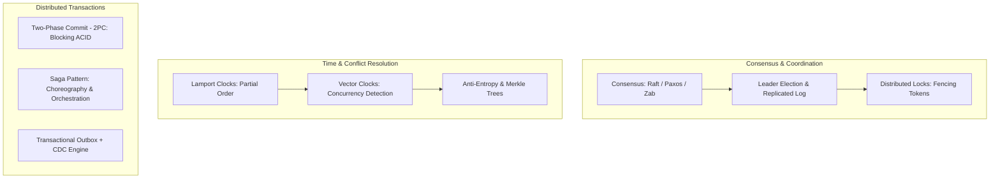
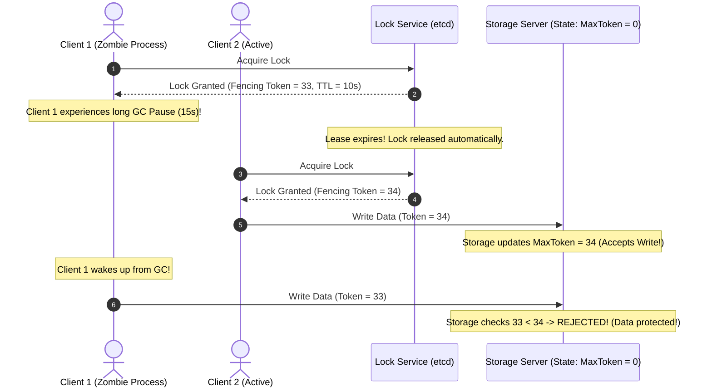
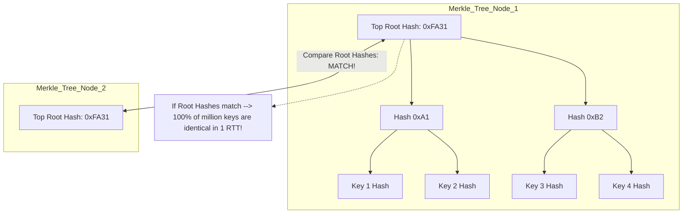
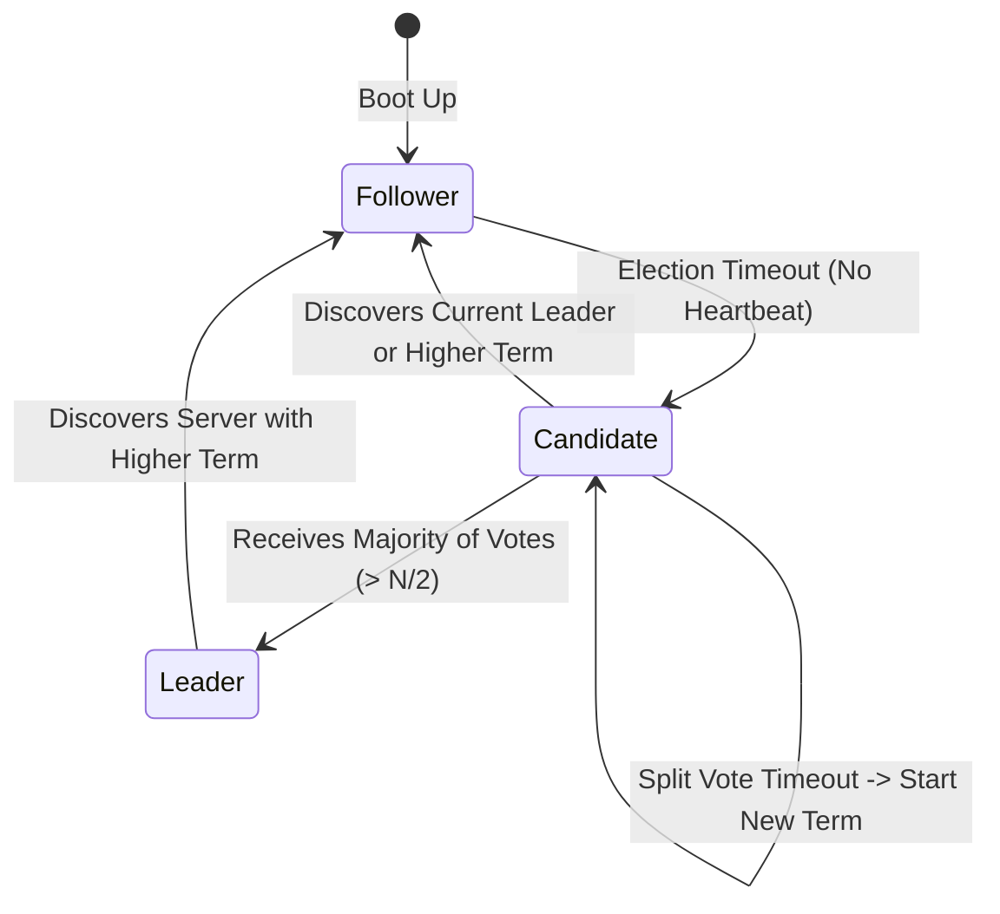
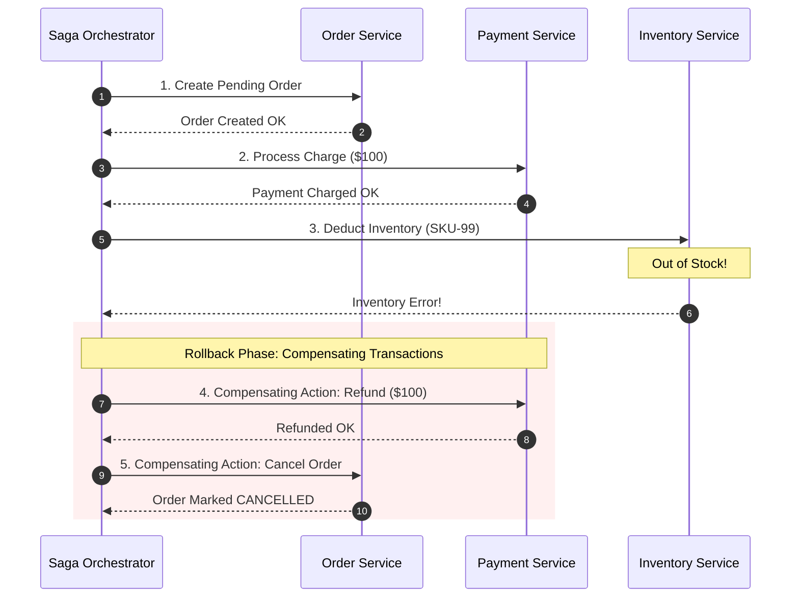
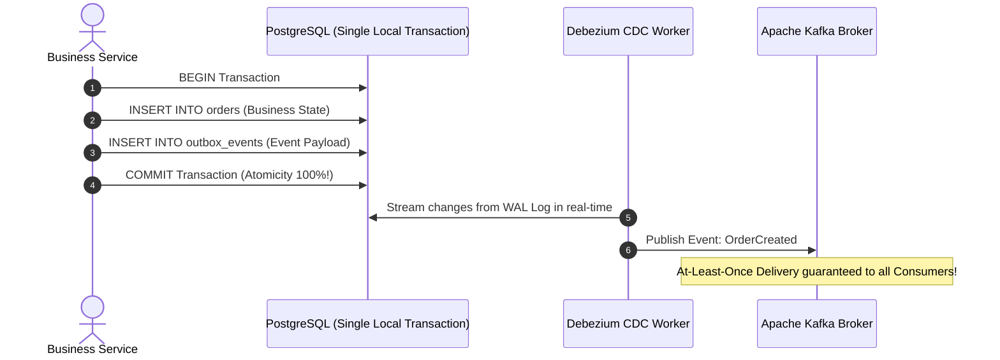

# 09.2. Coordination, Consensus, and Distributed Transactions (Điều Phối, Đồng Thuận và Giao Dịch Phân Tán)

## Tổng quan về Điều Phối, Đồng Thuận và Giao Dịch Phân Tán
Trong một hệ thống gồm nhiều nút độc lập không có bộ nhớ dùng chung và không có một đồng hồ vật lý toàn cục đáng tin cậy, làm thế nào để tất cả các nút cùng **đồng thuận (Consensus)** về một giá trị duy nhất (ví dụ: ai là Leader, hoặc một giao dịch tài chính có được commit hay không)?

Đây là đỉnh cao của kỹ thuật phân tán:
1. **Khóa phân tán và Điều phối (Distributed Locks & Coordination)**: Giải quyết sự cố tranh chấp tài nguyên bằng Lease và Fencing Tokens.
2. **Thời gian logic và Giải quyết xung đột (Logical Time & Conflict Resolution)**: Từ Lamport Clocks, Vector Clocks đến Hybrid Logical Clocks (HLC) và Merkle Trees.
3. **Các giao thức đồng thuận (Consensus Protocols)**: Raft, Paxos, Zab và Byzantine Fault Tolerance (BFT).
4. **Giao dịch phân tán (Distributed Transactions)**: Sự đánh đổi giữa Two-Phase Commit (2PC) đồng bộ nặng nề và **Saga Pattern** bất đồng bộ linh hoạt, kết hợp với **Transactional Outbox & Inbox Patterns** để đạt được ngữ nghĩa xử lý chính xác một lần (Effectively Exactly-Once Processing).



---

## 2. Chi tiết từng Keyword (Under-the-Hood Deep Dive)

### 1. Distributed Locks, Mutex, Leases & Fencing Tokens (Khóa Phân Tán và Mã Rào Chắn)

#### 1. Khái niệm bản chất (What & Why)
- **Distributed Lock (Khóa phân tán)**: Cơ chế đảm bảo tính loại trừ lẫn nhau (Mutual Exclusion) giữa các tiến trình độc lập chạy trên nhiều máy chủ khác nhau, ngăn ngừa việc hai tiến trình cùng sửa đổi một tài nguyên chia sẻ (ví dụ: cùng một đơn hàng hoặc một file trên S3) tại cùng một thời điểm.
- **Lease (Hợp đồng thuê có thời hạn)**: Khóa không bao giờ được cấp vô hạn; nó luôn gắn liền với một khoảng thời gian sống (TTL / Time-to-Live). Nếu tiến trình nắm giữ khóa bị crash, hợp đồng thuê sẽ tự động hết hạn để không làm hệ thống bị deadlock vĩnh viễn.
- **Fencing Tokens (Mã rào chắn)**: Một số nguyên đơn điệu tăng dần (Monotonically Increasing Token) do dịch vụ khóa cấp phát kèm theo mỗi lần giao khóa. Đây là **giải pháp bắt buộc** để ngăn chặn thảm họa tranh chấp dữ liệu khi tiến trình bị tạm dừng do Garbage Collection (Martin Kleppmann's Critique of Redlock).

#### 2. Cơ chế hoạt động sâu (Under the hood / Hardcore Internals)
Lỗ hổng chết người của Khóa phân tán thông thường và cách Fencing Token cứu vãn hệ thống:
1. **Kịch bản sự cố không có Fencing Token**:
   - Client 1 xin được khóa từ Redis với Lease 10 giây.
   - Client 1 bắt đầu xử lý ghi dữ liệu, nhưng bất ngờ bị **Linux Kernel tạm dừng luồng (GC Pause / Process Swapping)** trong suốt 15 giây!
   - Trong thời gian Client 1 bị "bất tỉnh", Lease 10 giây trên Redis hết hạn.
   - Client 2 vào xin khóa thành công, bắt đầu ghi dữ liệu vào Storage Server.
   - Client 1 tỉnh dậy sau 15 giây, tưởng rằng mình vẫn đang giữ khóa, tiếp tục gửi lệnh ghi dữ liệu vào Storage Server $\implies$ **Dữ liệu của Client 2 bị Client 1 ghi đè và làm hỏng hoàn toàn**!
2. **Cơ chế phòng vệ bằng Fencing Token**:
   - Dịch vụ khóa (như etcd hoặc ZooKeeper) cấp cho Client 1 mã `Token = 33`.
   - Khi Lease của Client 1 hết hạn, dịch vụ khóa cấp cho Client 2 mã `Token = 34`.
   - Client 2 gửi lệnh ghi kèm `Token = 34` tới Storage Server. Storage Server lưu lại số token cao nhất đã thấy là $34$.
   - Khi Client 1 tỉnh dậy và gửi lệnh ghi kèm `Token = 33`: Storage Server kiểm tra thấy $33 < 34$ $\implies$ **Lập tức từ chối lệnh ghi của Client 1!**

#### 3. Sơ đồ minh họa (Fencing Token Defense Against GC Pause)


#### 4. Code ví dụ thực chiến (C++20 - Storage Server xác thực Fencing Token)
```cpp
#include <iostream>
#include <string>
#include <cstdint>
#include <mutex>

class FencedStorageEngine {
private:
    uint64_t highest_token_seen_ = 0;
    std::string stored_data_;
    std::mutex mtx_;

public:
    // Chỉ chấp nhận ghi nếu token của client LỚN HƠN token cao nhất từng thấy
    bool writeWithFencingToken(uint64_t client_token, const std::string& new_data) {
        std::lock_guard<std::mutex> lock(mtx_);
        
        if (client_token <= highest_token_seen_) {
            std::cerr << "[SECURITY REJECTION] Stale Client Token #" << client_token 
                      << " is <= Current Highest Token #" << highest_token_seen_ 
                      << "! Operation blocked.\n";
            return false;
        }

        // Cập nhật token cao nhất và ghi dữ liệu an toàn
        highest_token_seen_ = client_token;
        stored_data_ = new_data;
        std::cout << "[SUCCESSFUL WRITE] Data updated to '" << stored_data_ 
                  << "' under Fencing Token #" << highest_token_seen_ << "\n";
        return true;
    }
};

int main() {
    FencedStorageEngine storage;

    // Client 2 (Token 34) ghi trước
    storage.writeWithFencingToken(34, "Client 2 Valid Payload");

    // Client 1 (Token 33) tỉnh dậy sau GC Pause và cố tình ghi đè
    bool ok = storage.writeWithFencingToken(33, "Client 1 Corrupted Zombie Payload");
    std::cout << "Client 1 Write Success: " << (ok ? "YES" : "NO") << "\n";
    return 0;
}
```

#### 5. Ưu / Nhược điểm, Pitfalls & Anti-patterns
- **Anti-pattern: Relying on Redis Redlock without Fencing Tokens**: Sử dụng thuật toán Redlock trên Redis nhưng tầng Storage bên dưới không hỗ trợ kiểm tra Fencing Token, khiến dữ liệu bị hỏng âm thầm khi có độ lệch đồng hồ vật lý (Clock Drift).

#### 6. Ứng dụng thực tế trong Backend / Systems
Google Chubby và Apache ZooKeeper (`zxid` / Ephemeral Sequential Nodes) bắt buộc sử dụng Fencing Tokens để bảo vệ các cụm Bigtable và HDFS NameNode.

---

## 2. Chi tiết từng Keyword (Under-the-Hood Deep Dive)

### 2. Logical Time & Conflict Resolution: Lamport, Vector Clocks, HLC & Merkle Trees (Thời Gian Logic và Cây Merkle)

#### 1. Khái niệm bản chất (What & Why)
Trong hệ thống phân tán, **Đồng hồ vật lý (Physical Wall-Clock - NTP)** không thể dùng để sắp xếp thứ tự các sự kiện vì hiện tượng **Độ lệch đồng hồ (Clock Skew / Drift)**. Hai máy chủ đặt cạnh nhau trong cùng một rack vẫn có thể lệch nhau vài mili-giây.
- **Lamport Timestamps**: Cơ chế đánh số thứ tự sự kiện bằng một bộ đếm số nguyên đơn điệu tăng dần dựa trên quan hệ **Xảy ra trước (Happens-Before $\rightarrow$)**. Thiết lập một thứ tự toàn phần (Total Order) nhưng **không thể phát hiện được hai sự kiện đồng thời (Concurrency)**.
- **Vector Clocks**: Mỗi node duy trì một vector gồm $N$ bộ đếm đại diện cho $N$ nodes trong cụm. Cho phép **phát hiện chính xác xem hai thao tác có quan hệ nhân quả hay xảy ra đồng thời xung đột (Concurrent Conflicts)**.
- **Hybrid Logical Clocks (HLC)**: Kết hợp ưu điểm của đồng hồ vật lý (gần gũi với giờ thực đời thường) và đồng hồ logic Lamport (đảm bảo tính nhân quả chặt chẽ). Được sử dụng trong CockroachDB và MongoDB.
- **Merkle Trees (Cây băm phân cấp)**: Cấu trúc cây nhị phân trong đó mỗi nút lá chứa giá trị băm (Hash) của một bản ghi dữ liệu, và mỗi nút cha chứa giá trị băm kết hợp của các con của nó. Dùng cho kỹ thuật **Anti-Entropy**: so sánh và đồng bộ hàng triệu bản ghi giữa hai Datacenter qua mạng chỉ bằng việc trao đổi một vài hash ở gốc cây trong vài mili-giây!

#### 2. Cơ chế hoạt động sâu (Under the hood / Hardcore Internals)
Quy tắc vận hành của **Vector Clocks**:
- Giả sử hệ thống có 3 nodes: $A, B, C$. Mỗi node có vector: $V = [v_A, v_B, v_C]$, khởi đầu bằng $[0, 0, 0]$.
1. Trước khi thực thi một sự kiện nội bộ, Node $i$ tăng phần tử của chính nó: $V[i] = V[i] + 1$.
2. Khi gửi tin nhắn sang Node khác, Node $i$ gửi kèm toàn bộ Vector $V$ của mình.
3. Khi nhận được tin nhắn mang vector $V_{\text{msg}}$, Node nhận cập nhật vector của mình:
   $$V_{\text{local}}[j] = \max(V_{\text{local}}[j], V_{\text{msg}}[j]) \quad \forall j$$
   sau đó tăng phần tử của chính mình lên 1.
- **Phát hiện Xung đột (Conflict Detection)**:
  - Vector $V_1$ xảy ra trước $V_2$ ($V_1 \rightarrow V_2$) khi và chỉ khi: Mọi phần tử $V_1[k] \le V_2[k]$ và có ít nhất một phần tử $V_1[k] < V_2[k]$.
  - Nếu tồn tại phần tử mà $V_1$ lớn hơn $V_2$ nhưng lại có phần tử khác mà $V_2$ lớn hơn $V_1$ $\implies$ **Hai sự kiện xảy ra đồng thời và xung đột (Concurrent Conflict)**! Hệ thống lưu cả hai nhánh dữ liệu (**Siblings**) để ứng dụng hoặc người dùng tự giải quyết.

#### 3. Sơ đồ minh họa (Merkle Tree Anti-Entropy Sync)


#### 4. Code ví dụ thực chiến (C++20 - Vector Clock Concurrency & Causality Engine)
```cpp
#include <iostream>
#include <vector>
#include <string>
#include <algorithm>

enum class Causality { Before, After, Concurrent };

class VectorClock {
public:
    std::vector<int> clock;

    explicit VectorClock(size_t num_nodes) : clock(num_nodes, 0) {}

    void tick(size_t node_index) {
        clock[node_index]++;
    }

    void merge(const VectorClock& other) {
        for (size_t i = 0; i < clock.size(); ++i) {
            clock[i] = std::max(clock[i], other.clock[i]);
        }
    }

    static Causality compare(const VectorClock& v1, const VectorClock& v2) {
        bool v1_has_greater = false;
        bool v2_has_greater = false;

        for (size_t i = 0; i < v1.clock.size(); ++i) {
            if (v1.clock[i] > v2.clock[i]) v1_has_greater = true;
            if (v2.clock[i] > v1.clock[i]) v2_has_greater = true;
        }

        if (v1_has_greater && !v2_has_greater) return Causality::After;
        if (v2_has_greater && !v1_has_greater) return Causality::Before;
        return Causality::Concurrent; // Xung đột đồng thời!
    }

    void print(const std::string& label) const {
        std::cout << label << ": [";
        for (size_t i = 0; i < clock.size(); ++i) {
            std::cout << clock[i] << (i + 1 < clock.size() ? ", " : "");
        }
        std::cout << "]\n";
    }
};

int main() {
    // Cụm gồm 3 nodes: Node 0, Node 1, Node 2
    VectorClock vA(3), vB(3);

    vA.clock = {2, 1, 0}; // Node 0 đã thấy 2 event, Node 1 thấy 1 event
    vB.clock = {1, 3, 0}; // Node 1 đã thấy 3 event, Node 0 thấy 1 event

    vA.print("Vector A");
    vB.print("Vector B");

    auto rel = VectorClock::compare(vA, vB);
    if (rel == Causality::Concurrent) {
        std::cout << ">>> RESULT: CONCURRENT CONFLICT DETECTED! (Siblings created for app to resolve)\n";
    }
    return 0;
}
```

#### 5. Ưu / Nhược điểm, Pitfalls & Anti-patterns
- **Anti-pattern: Last-Write-Wins (LWW) based on NTP**: Tự ý ghi đè dữ liệu dựa trên Wall-clock thời gian thực. Vì độ lệch đồng hồ giữa các máy chủ, một thay đổi diễn ra sau có thể mang timestamp nhỏ hơn và bị xóa sổ vĩnh viễn (Silent Data Loss).

#### 6. Ứng dụng thực tế trong Backend / Systems
Apache Cassandra sử dụng Merkle Trees trong tiến trình Anti-Entropy Repair chạy ngầm hàng tuần để đồng bộ hóa dữ liệu giữa các trung tâm dữ liệu. DynamoDB và Git sử dụng mô hình Vector Clocks / DAG để theo dõi lịch sử phân nhánh.

---

## 2. Chi tiết từng Keyword (Under-the-Hood Deep Dive)

### 3. Distributed Consensus: Paxos, Raft & Zab (Các Thuật Toán Đồng Thuận Phân Tán)

#### 1. Khái niệm bản chất (What & Why)
Bài toán Đồng thuận phân tán (Consensus Problem) yêu cầu một nhóm các máy chủ cùng đồng ý về một chuỗi các quyết định hoặc một nhật ký hành động (**Replicated State Machine**), ngay cả khi một số máy chủ bị sập hoặc mạng bị chập chờn (miễn là đa số quá bán $> N/2$ vẫn còn sống).
- **Paxos (Leslie Lamport)**: Thuật toán đồng thuận đầu tiên được chứng minh toán học đầy đủ. Rất khó hiểu và cực kỳ phức tạp để hiện thực hóa trong thực tế.
- **Raft (Ongaro & Ousterhout - Stanford)**: Thuật toán đồng thuận được thiết kế với mục tiêu tối thượng là **Dễ hiểu (Understandability)**. Chia bài toán đồng thuận thành 3 bài toán con độc lập: **Leader Election**, **Log Replication** và **Safety**.
- **Zab (ZooKeeper Atomic Broadcast)**: Giao thức truyền tin đồng thuận được thiết kế riêng cho Apache ZooKeeper, tối ưu hóa cho mô hình Primary-Backup có thứ tự nghiêm ngặt (FIFO client order).

#### 2. Cơ chế hoạt động sâu (Under the hood / Hardcore Internals)
Quy trình vận hành 3 pha của **Raft Protocol**:
1. **Leader Election (Bầu chọn Leader)**:
   - Một node có thể ở 1 trong 3 trạng thái: `Follower`, `Candidate`, `Leader`.
   - Mỗi chu kỳ bầu cử được định danh bằng một số nguyên **Term** tăng dần.
   - Nếu một Follower không nhận được Heartbeat từ Leader trong khoảng thời gian **Randomized Election Timeout (150ms - 300ms)**, nó chuyển thành Candidate, tăng Term lên, tự bỏ phiếu cho mình và gửi `RequestVote RPC` tới các node khác.
   - Node nào nhận được quá bán ($> N/2$) số phiếu bầu sẽ trở thành Leader mới.
2. **Log Replication (Sao chép nhật ký)**:
   - Mọi request ghi từ Client đều được gửi đến Leader.
   - Leader ghi lệnh vào log của mình và gửi `AppendEntries RPC` tới tất cả các Followers.
   - Khi đa số Followers xác nhận đã ghi vào log, lệnh được coi là **Committed**.
   - Leader áp dụng lệnh vào State Machine cục bộ và trả kết quả về cho Client.
3. **Safety Guarantee (Tính an toàn tuyệt đối)**:
   - Một Candidate **không bao giờ được bầu làm Leader** nếu log của nó không chứa đầy đủ tất cả các entry đã được commit trong các Term trước đó (Kiểm tra xem `lastLogTerm` và `lastLogIndex` có cập nhật bằng hoặc hơn node bầu hay không).

#### 3. Sơ đồ minh họa (Raft State Machine Transitions)


#### 4. Code ví dụ thực chiến (C++20 - Mô phỏng Raft Vote Request & Safety Rule)
```cpp
#include <iostream>
#include <cstdint>

struct RequestVoteArgs {
    uint64_t term;
    int candidate_id;
    uint64_t last_log_index;
    uint64_t last_log_term;
};

struct RequestVoteReply {
    uint64_t term;
    bool vote_granted;
};

class RaftFollowerNode {
private:
    uint64_t current_term_ = 1;
    int voted_for_ = -1;
    uint64_t local_last_log_index_ = 10;
    uint64_t local_last_log_term_ = 1;

public:
    RequestVoteReply handleRequestVote(const RequestVoteArgs& args) {
        // Quy tắc 1: Nếu term của ứng viên nhỏ hơn term cục bộ -> Từ chối ngay!
        if (args.term < current_term_) {
            return {current_term_, false};
        }

        if (args.term > current_term_) {
            current_term_ = args.term;
            voted_for_ = -1;
        }

        // Quy tắc 2 (Raft Safety): Ứng viên phải có log cập nhật bằng hoặc hơn node hiện tại!
        bool log_is_up_to_date = false;
        if (args.last_log_term > local_last_log_term_) {
            log_is_up_to_date = true;
        } else if (args.last_log_term == local_last_log_term_ && args.last_log_index >= local_last_log_index_) {
            log_is_up_to_date = true;
        }

        if ((voted_for_ == -1 || voted_for_ == args.candidate_id) && log_is_up_to_date) {
            voted_for_ = args.candidate_id;
            std::cout << "[Raft Node] Voted YES for Candidate #" << args.candidate_id 
                      << " in Term " << args.term << "\n";
            return {current_term_, true};
        }

        std::cout << "[Raft Node] Voted NO for Candidate #" << args.candidate_id 
                  << " (Log not up-to-date or already voted)\n";
        return {current_term_, false};
    }
};

int main() {
    RaftFollowerNode follower;
    // Candidate 2 xin phiếu với log index 12 (mới hơn index 10 của follower)
    RequestVoteArgs candidate_req{2, 2, 12, 1};
    auto reply = follower.handleRequestVote(candidate_req);
    std::cout << "Vote Granted: " << (reply.vote_granted ? "YES" : "NO") << "\n";
    return 0;
}
```

#### 5. Ưu / Nhược điểm, Pitfalls & Anti-patterns
- **Ưu điểm của Raft**: Cấu trúc rõ ràng, dễ viết unit test, an toàn tuyệt đối.
- **Hạn chế**: Toàn bộ lưu lượng ghi bắt buộc phải đi qua duy nhất một Leader (Write Bottleneck). Không phù hợp cho các hệ thống cần ghi phân tán hàng trăm nghìn TPS (như Cassandra).

#### 6. Ứng dụng thực tế trong Backend / Systems
`etcd` (trái tim lưu trữ toàn bộ trạng thái của Kubernetes cluster), CockroachDB, và TiKV đều sử dụng thuật toán Raft làm nhân đồng thuận cốt lõi.

---

## 2. Chi tiết từng Keyword (Under-the-Hood Deep Dive)

### 4. Distributed Transactions: Two-Phase Commit (2PC) vs Saga Pattern (Giao Dịch Phân Tán)

#### 1. Khái niệm bản chất (What & Why)
Khi một giao dịch nghiệp vụ trải rộng trên nhiều cơ sở dữ liệu hoặc nhiều microservices độc lập:
- **Two-Phase Commit (2PC)**: Giao thức giao dịch phân tán đảm bảo tính chất **ACID tuyệt đối** thông qua một bộ điều phối trung tâm (Transaction Coordinator). Gồm 2 pha: **Pha 1 (Prepare)** và **Pha 2 (Commit / Abort)**.
- **Saga Pattern**: Mô hình giao dịch hướng tới **BASE / Eventual Consistency**. Một giao dịch lớn được chia thành một chuỗi các **Giao dịch cục bộ (Local Transactions)** liên tiếp. Nếu một bước bị thất bại, hệ thống sẽ kích hoạt một chuỗi các **Giao dịch bù trừ (Compensating Transactions)** chạy ngược lại để hoàn tác những thay đổi đã thực hiện trước đó.

#### 2. Cơ chế hoạt động sâu (Under the hood / Hardcore Internals)
So sánh sâu sắc giữa 2PC và Saga:

1. **Tử huyệt của Two-Phase Commit (Blocking Protocol)**:
   - Trong Pha 1 (Prepare), tất cả các Database tham gia bắt buộc phải ghi dữ liệu và **giữ khóa hàng (Row Locks / Table Locks)**.
   - Nếu Coordinator gửi Prepare xong nhưng bị crash trước khi kịp gửi lệnh Commit trong Pha 2: Toàn bộ các Database tham gia **bị treo cứng (Blocked)**, tiếp tục giữ khóa dữ liệu vĩnh viễn không thể giải phóng, làm tê liệt toàn bộ các giao dịch khác trong hệ thống!
   - 2PC làm tăng độ trễ theo cấp số nhân và giảm tính sẵn sàng nghiêm trọng.
2. **Saga: Choreography vs Orchestration**:
   - **Choreography (Phi tập trung / Hướng sự kiện)**: Các dịch vụ giao tiếp qua Event Bus (Kafka). Service A làm xong phát event `OrderCreated`; Service B nghe thấy trừ tiền xong phát `PaymentCompleted`; Service C nghe thấy trừ kho... Nếu Service C hết hàng, nó phát event `InventoryFailed` $\implies$ Service B nghe thấy và hoàn tiền lại cho khách (**Compensating Transaction**).
   - **Orchestration (Tập trung)**: Một **Saga Orchestrator Service** làm nhạc trưởng, trực tiếp gửi lệnh RPC tới từng service và quản lý State Machine của toàn bộ quy trình. Rất dễ theo dõi, debug và quản lý timeout.

#### 3. Sơ đồ minh họa (Saga Pattern with Compensating Transaction)


#### 4. Code ví dụ thực chiến (TypeScript - Saga Orchestrator với Compensating Rollback)
```typescript
interface SagaStep {
  name: string;
  execute: () => Promise<void>;
  compensate: () => Promise<void>;
}

export class OrderSagaOrchestrator {
  private executedSteps: SagaStep[] = [];

  public async runSaga(steps: SagaStep[]): Promise<boolean> {
    for (const step of steps) {
      try {
        console.log(`[Saga Step: ${step.name}] Executing...`);
        await step.execute();
        this.executedSteps.push(step); // Ghi nhận bước đã thành công để bù trừ nếu lỗi
      } catch (err: any) {
        console.error(`[Saga FAILED at: ${step.name}] Error: ${err.message}. Starting Compensation Rollback!`);
        await this.rollback();
        return false;
      }
    }
    console.log("[Saga COMPLETE] All distributed transactions committed successfully.");
    return true;
  }

  private async rollback() {
    // Chạy ngược lại các bước bù trừ từ bước gần nhất về bước đầu tiên
    while (this.executedSteps.length > 0) {
      const step = this.executedSteps.pop()!;
      try {
        console.log(`[Compensating Step: ${step.name}] Reversing side-effects...`);
        await step.compensate();
      } catch (compensateErr: any) {
        console.error(`CRITICAL: Compensation failed for ${step.name}! Manual intervention required.`);
      }
    }
  }
}
```

#### 5. Ưu / Nhược điểm, Pitfalls & Anti-patterns
- **Hạn chế của Saga (Lack of Read Isolation)**: Vì các giao dịch cục bộ commit ngay lập tức, một người dùng khác có thể nhìn thấy dữ liệu trung gian (Dirty Read ở tầng nghiệp vụ) trước khi Saga thực hiện bù trừ (ví dụ: thấy tài khoản bị trừ tiền rồi lại được cộng lại).

#### 6. Ứng dụng thực tế trong Backend / Systems
Uber sử dụng Temporal / Cadence Orchestrator để quản lý toàn bộ Saga cho vòng đời chuyến đi: tìm tài xế, trừ tiền, điều hướng GPS và hoàn tiền nếu hủy chuyến.

---

### 5. Reliable Messaging: Transactional Outbox, Inbox & Exactly-Once Semantics (Mẫu Hình Outbox và Ngữ Nghĩa Phân Phối)

#### 1. Khái niệm bản chất (What & Why)
- **Vấn đề Dual-Write (Ghi kép)**: Khi một service cần vừa cập nhật Database vừa gửi Event lên Kafka. Nếu lưu DB thành công nhưng mạng tới Kafka bị lỗi, dữ liệu bị lệch. Nếu gửi Kafka trước nhưng DB lưu thất bại, consumer sẽ xử lý dữ liệu ma.
- **Transactional Outbox Pattern**: Lưu bản ghi sự kiện vào một bảng `outbox` nằm **trong cùng một Local ACID Transaction** với bảng dữ liệu nghiệp vụ. Một tiến trình nền (hoặc công cụ CDC Debezium) sẽ đọc bảng `outbox` và đẩy sang Message Broker một cách bất đồng bộ.
- **Inbox Pattern & Idempotent Consumer**: Phía nhận (Consumer) lưu các ID tin nhắn đã xử lý vào bảng `inbox`. Nếu nhận lại tin nhắn trùng lặp, nó bỏ qua ngay lập tức, đảm bảo tính lũy đẳng.
- **Các cấp độ phân phối tin nhắn (Delivery Semantics)**:
  - *At-Most-Once (Nhiều nhất một lần)*: Có thể mất tin nhắn, không bao giờ bị trùng lặp.
  - *At-Least-Once (Ít nhất một lần)*: Đảm bảo không bao giờ mất tin nhắn, nhưng **có thể bị trùng lặp (Duplicates)** khi có retry mạng.
  - *Exactly-Once (Chính xác một lần)*: Trạng thái lý tưởng nơi tin nhắn được xử lý đúng một lần duy nhất. Trong thực tế, đây là sự kết hợp giữa **At-Least-Once Delivery + Idempotent Consumer (Effectively-Once)**.

#### 2. Cơ chế hoạt động sâu (Under the hood / Hardcore Internals)
Quy trình Transactional Outbox kết hợp PostgreSQL Write-Ahead Log (WAL) và Debezium:
1. Application thực hiện SQL Transaction:
   ```sql
   BEGIN;
   INSERT INTO orders (id, total) VALUES ('ord_99', 150);
   INSERT INTO outbox_events (event_id, payload) VALUES ('ev_1', '{"order": "ord_99"}');
   COMMIT;
   ```
2. Cả hai bản ghi được ghi nguyên tử vào Write-Ahead Log (WAL) của PostgreSQL.
3. **Debezium CDC (Change Data Capture)** kết nối vào cổng Replication Stream của PostgreSQL, đọc tuần tự các byte nhị phân của bảng `outbox_events` từ WAL và đẩy trực tiếp vào Kafka.
4. **Không bao giờ xảy ra lỗi Dual-Write!**

#### 3. Sơ đồ minh họa (Transactional Outbox Pattern Architecture)


#### 4. Code ví dụ thực chiến (C++20 - Idempotent Consumer với Inbox Store)
```cpp
#include <iostream>
#include <unordered_set>
#include <string>
#include <mutex>

class IdempotentInboxConsumer {
private:
    std::unordered_set<std::string> processed_message_ids_; // Bảng Inbox
    std::mutex mtx_;

public:
    void processIncomingMessage(const std::string& message_id, const std::string& payload) {
        std::lock_guard<std::mutex> lock(mtx_);

        // Kiểm tra xem message_id này đã được xử lý thành công trước đó chưa
        if (processed_message_ids_.find(message_id) != processed_message_ids_.end()) {
            std::cout << "[Inbox Deduplication] Message ID '" << message_id 
                      << "' already processed! Silently ACKing duplicate.\n";
            return; // Loại bỏ trùng lặp (Deduplication) - Đạt chuẩn Effectively Exactly-Once!
        }

        // Thực thi nghiệp vụ thực sự
        std::cout << ">>> [Business Execution] Processing Message '" << message_id 
                  << "' -> Payload: " << payload << "\n";

        // Ghi nhận message_id vào Inbox Store
        processed_message_ids_.insert(message_id);
    }
};

int main() {
    IdempotentInboxConsumer consumer;

    // Tin nhắn đầu tiên đến
    consumer.processIncomingMessage("msg_uuid_001", "DEDUCT_POINTS_50");

    // Do mạng lag, Kafka gửi lại (Retry) đúng tin nhắn đó lần thứ 2
    consumer.processIncomingMessage("msg_uuid_001", "DEDUCT_POINTS_50");

    // Tin nhắn mới tiếp theo
    consumer.processIncomingMessage("msg_uuid_002", "ADD_POINTS_20");

    return 0;
}
```

#### 5. Ưu / Nhược điểm, Pitfalls & Anti-patterns
- **Anti-pattern: Polling Outbox Table with `SELECT ... FOR UPDATE`**: Dùng cron job cứ 1 giây chạy `SELECT * FROM outbox` để quét bản ghi mới. Câu query này gây khóa bảng và làm nghẽn I/O Database.
  - *Giải pháp*: Bắt buộc dùng **CDC (Change Data Capture / Debezium)** để đọc log WAL trực tiếp ở tầng kernel file stream.

#### 6. Ứng dụng thực tế trong Backend / Systems
Toàn bộ kiến trúc vi dịch vụ của Shopify, Airbnb và Netflix đều coi Transactional Outbox + Idempotent Consumer là tiêu chuẩn bắt buộc cho mọi luồng truyền thông điệp bất đồng bộ.

---

## Tóm tắt liên kết hệ thống
Chương **11.9 (Distributed Systems Design)** đã đưa bạn qua những vùng nước sâu nhất của hệ thống phân tán: giải quyết sự cố mạng bằng Fencing Tokens, đồng bộ dữ liệu bằng Merkle Trees, đạt được đồng thuận qua Raft Safety, và làm chủ các giao dịch phân tán bằng Saga Orchestrator kết hợp Transactional Outbox Pattern.

Tiếp theo, tại **11.10: Message Queue & Event-Driven System Design**, chúng ta sẽ đi sâu vào cấu trúc bên trong của các Message Brokers: Apache Kafka vs RabbitMQ vs Apache Pulsar, phân vùng partitions, quản lý Consumer Lag, Dead Letter Queues và Event Sourcing Engine.
