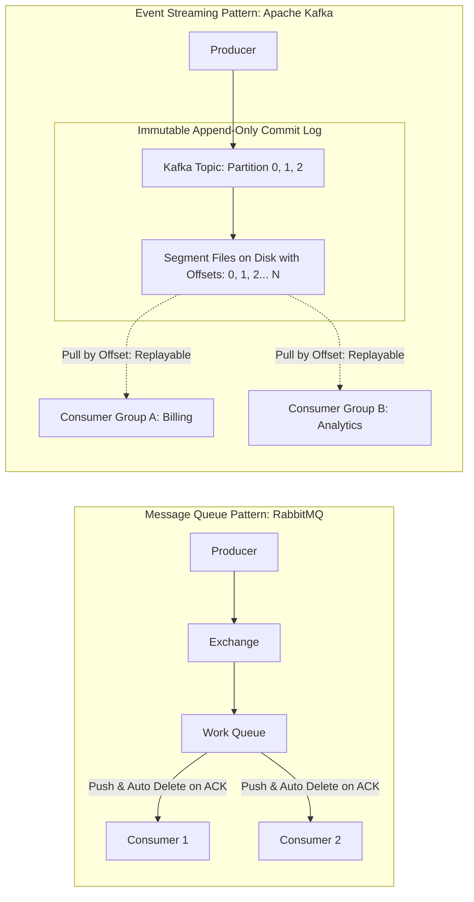
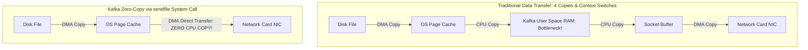
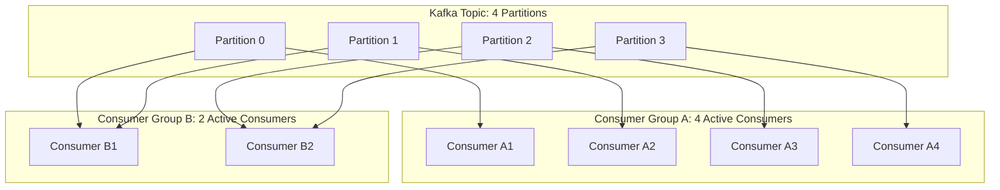
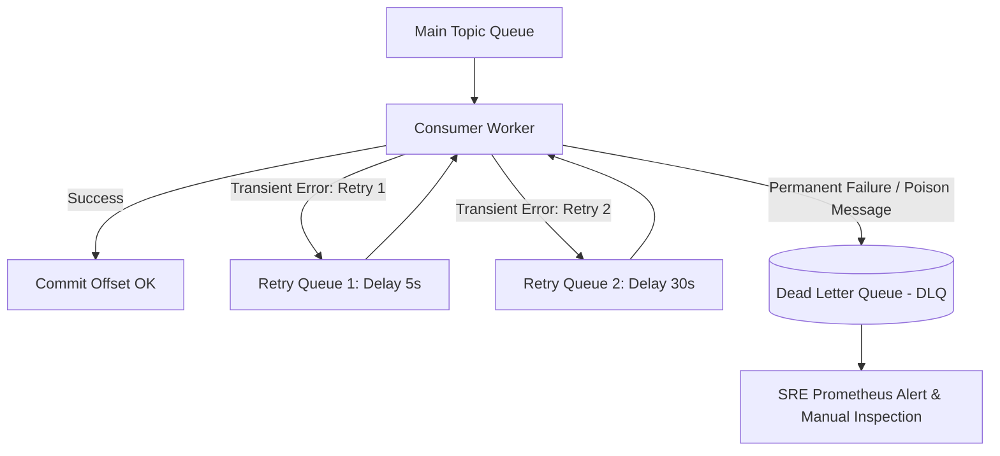

# 10.1. Message Brokers and Event Streaming Architectures (Kiến Trúc Bộ Môi Giới Thông Điệp và Luồng Sự Kiện)

## Tổng quan về Bộ Môi Giới Thông Điệp và Luồng Sự Kiện
Trong các hệ thống phân tán chịu tải cao, việc các dịch vụ giao tiếp trực tiếp với nhau thông qua HTTP/REST đồng bộ tạo ra sự gắn kết chặt chẽ (Tight Coupling), dễ gây tắc nghẽn dây chuyền và mất mát dữ liệu khi có sự cố. **Message Brokers (Bộ môi giới thông điệp)** và **Event Streaming Platforms (Nền tảng luồng sự kiện)** đóng vai trò là "Trục xương sống" (Backbone) bất đồng bộ, hấp thụ các đợt sóng tải bùng nổ (Traffic Buffering), tách biệt các thành phần sản sinh dữ liệu (Producers) khỏi các thành phần tiêu thụ (Consumers).

Sự khác biệt căn bản trong thế giới tin nhắn nằm ở hai trường phái:
1. **Truyền thống (Traditional Message Queues - RabbitMQ, ActiveMQ)**: Mô hình hộp thư thông minh (Smart Broker, Dumb Consumer). Tin nhắn được đẩy (Push) tới consumer và **bị xóa vĩnh viễn** khỏi broker ngay sau khi nhận được xác nhận (Acknowledgment).
2. **Hiện đại (Distributed Commit Log / Event Streaming - Apache Kafka, Apache Pulsar)**: Mô hình nhật ký bất biến (Dumb Broker, Smart Consumer). Tin nhắn được lưu tuần tự vào đĩa đệm theo thời gian lưu trữ (**Retention Policy**), cho phép nhiều nhóm consumer khác nhau cùng đọc độc lập và hỗ trợ phát lại dữ liệu (**Message Replay**).



---

## 2. Chi tiết từng Keyword (Under-the-Hood Deep Dive)

### 1. Message Queue vs Event Streaming: RabbitMQ vs Kafka vs Pulsar vs NATS vs Redis Streams (So Sánh Các Kiến Trúc)

#### 1. Khái niệm bản chất (What & Why)
- **Message Queue (RabbitMQ)**: Dựa trên chuẩn **AMQP**. Producer gửi tin nhắn tới **Exchange**; Exchange dùng các quy tắc định tuyến (**Routing Key**, Direct/Topic/Fanout) để đẩy tin nhắn vào các **Queues**. Tin nhắn là tạm thời (Ephemeral); khi Consumer gửi `basic_ack`, tin nhắn bị xóa khỏi bộ nhớ.
- **Event Streaming (Apache Kafka)**: Xây dựng xoay quanh mô hình **Distributed Append-Only Commit Log**. Dữ liệu được chia thành các **Topics**, mỗi Topic chia thành nhiều **Partitions**. Tin nhắn không bị xóa sau khi đọc; mỗi Consumer tự quản lý vị trí đọc của mình thông qua một con trỏ số nguyên gọi là **Offset**.
- **Apache Pulsar**: Kiến trúc thế hệ mới tách biệt tầng Tính toán (**Stateless Broker**) khỏi tầng Lưu trữ (**Apache BookKeeper**), hỗ trợ lưu trữ phân tầng (**Tiered Storage** đẩy dữ liệu cũ lên Amazon S3) và hỗ trợ cả hai mô hình Queueing và Streaming.
- **NATS (NATS JetStream)**: Hệ thống truyền tin siêu nhẹ bằng ngôn ngữ Go, độ trễ microsecond, tối ưu hóa cho hệ thống Cloud Native, Kubernetes và Edge Computing.
- **Redis Streams**: Cấu trúc dữ liệu log tích hợp sẵn trong Redis (từ bản 5.0), cho phép xây dựng Event Streaming nhẹ nhàng dựa trên bộ nhớ RAM mà không cần dựng cụm Kafka cồng kềnh.

#### 2. Cơ chế hoạt động sâu (Under the hood / Hardcore Internals)
Bảng so sánh chuyên sâu ở tầng kiến trúc động cơ:

| Tiêu chí | RabbitMQ (Message Queue) | Apache Kafka (Event Streaming) |
| :--- | :--- | :--- |
| **Mô hình truyền tải** | **Push Model** (Broker đẩy tin tới Consumer) | **Pull Model** (Consumer chủ động kéo tin theo nhịp độ) |
| **Vòng đời tin nhắn** | **Tạm thời** (Bị xóa ngay sau khi ACK) | **Bền vững** (Lưu trên đĩa theo Retention time: 7 ngày, 1 năm) |
| **Khả năng Replay** | **KHÔNG THỂ** (Đã đọc là mất vĩnh viễn) | **HOÀN HẢO** (Có thể tua lại Offset về 0 để đọc lại) |
| **Độ phức tạp định tuyến** | Cực kỳ linh hoạt (Topic, Fanout, Headers Exchanges)| Đơn giản (Chỉ định tuyến theo Topic và Partition Key) |
| **Thông lượng (Throughput)** | Hàng chục nghìn msg/sec (Bị giới hạn bởi Erlang RAM)| **HÀNG TRIỆU msg/sec (Zero-Copy & Sequential I/O)** |
| **Thứ tự tin nhắn** | Chỉ đảm bảo trên 1 consumer đơn luồng | **Đảm bảo thứ tự tuyệt đối trên từng Partition** |

Bí mật tốc độ siêu phàm của Kafka:
1. **Sequential Disk I/O (Ghi đĩa tuần tự)**:
   - Ghi đĩa ngẫu nhiên (Random I/O) trên ổ cứng rất chậm do phải di chuyển đầu đọc.
   - Nhưng **Ghi đĩa tuần tự (Sequential I/O)** đạt tốc độ tương đương với RAM ($600 - 800\text{ MB/s}$ trên SSD hoặc $100\text{ MB/s}$ trên HDD thông thường). Kafka chỉ ghi nối đuôi (Append-only) vào cuối file segment!
2. **Zero-Copy Network Transfer qua System Call `sendfile()`**:
   - Trong ứng dụng thông thường: Dữ liệu từ Đĩa $\rightarrow$ OS Page Cache $\rightarrow$ User Space App Buffer $\rightarrow$ Socket Buffer $\rightarrow$ Card mạng NIC (Tốn 4 lần context switch và 4 lần copy dữ liệu qua CPU RAM).
   - Trong Kafka: Sử dụng system call Linux `sendfile()`. Kernel truyền thẳng dữ liệu từ **OS Page Cache sang Card mạng NIC** mà **hoàn toàn không copy dữ liệu lên User Space CPU**! Tiết kiệm $100\%$ chu kỳ CPU cho việc truyền tin!

#### 3. Sơ đồ minh họa (Zero-Copy Kernel Optimization in Kafka)


#### 4. Code ví dụ thực chiến (C++20 - Mô phỏng Append-Only Log Engine của Kafka)
```cpp
#include <iostream>
#include <fstream>
#include <vector>
#include <string>
#include <cstdint>

struct LogEntry {
    uint64_t offset;
    std::string payload;
};

// Mô phỏng Append-Only Commit Log của một Kafka Partition
class MiniKafkaPartitionLog {
private:
    std::string file_path_;
    uint64_t next_offset_ = 0;
    std::vector<uint64_t> index_positions_; // Sparse Index ánh xạ Offset -> File Position

public:
    explicit MiniKafkaPartitionLog(std::string path) : file_path_(std::move(path)) {}

    // Ghi tuần tự Append-only O(1)
    uint64_t append(const std::string& message) {
        std::ofstream log_file(file_path_, std::ios::app | std::ios::binary);
        uint64_t current_offset = next_offset_++;

        // Ghi lại vị trí byte cho Sparse Index
        std::streampos pos = log_file.tellp();
        index_positions_.push_back(static_cast<uint64_t>(pos));

        // Ghi bản tin ra đĩa
        log_file << current_offset << ":" << message << "\n";
        std::cout << "[Kafka Log Engine] Appended Offset #" << current_offset 
                  << " at Byte Position " << pos << "\n";
        return current_offset;
    }

    void replayFromOffset(uint64_t start_offset) {
        std::cout << "\n>>> [Replaying Events from Offset #" << start_offset << "] <<<\n";
        std::ifstream log_file(file_path_);
        std::string line;
        while (std::getline(log_file, line)) {
            size_t delim = line.find(':');
            if (delim != std::string::npos) {
                uint64_t offset = std::stoull(line.substr(0, delim));
                if (offset >= start_offset) {
                    std::cout << "    Replayed: " << line.substr(delim + 1) << " (Offset: " << offset << ")\n";
                }
            }
        }
    }
};

int main() {
    std::string log_path = "/tmp/mini_kafka_partition_0.log";
    std::remove(log_path.c_str()); // Xóa sạch log cũ

    MiniKafkaPartitionLog partition(log_path);
    partition.append("ORDER_CREATED_#101");
    partition.append("PAYMENT_SUCCESS_#101");
    partition.append("ORDER_SHIPPED_#101");

    // Khả năng tái hiện sự kiện (Message Replay): Tua lại từ Offset #1
    partition.replayFromOffset(1);
    return 0;
}
```

#### 5. Ưu / Nhược điểm, Pitfalls & Anti-patterns
- **Anti-pattern: Using Kafka as a Job Queue for Individual Acknowledgments**: Sử dụng Kafka để làm hàng đợi tác vụ nơi mỗi tác vụ cần được ACK riêng lẻ hoặc cần cơ chế hoán đổi thứ tự ưu tiên (Priority Queue). Kafka không hỗ trợ ACK từng message đơn lẻ; việc ACK trong Kafka là commit một số nguyên Offset tăng dần. Nếu cần Work Queue linh hoạt với priority, hãy sử dụng RabbitMQ!

#### 6. Ứng dụng thực tế trong Backend / Systems
LinkedIn tạo ra Apache Kafka để xử lý hơn **7 nghìn tỷ tin nhắn mỗi ngày** cho toàn bộ hệ thống theo dõi hành vi người dùng, metrics và log telemetry.

---

### 2. Partitions, Message Ordering & Consumer Groups (Phân Vùng, Thứ Tự và Nhóm Tiêu Thụ)

#### 1. Khái niệm bản chất (What & Why)
- **Partitioning (Phân vùng)**: Một Topic trong Kafka được chia thành nhiều Partitions. Mỗi Partition là một chuỗi log độc lập được lưu trữ trên một máy chủ Kafka Broker khác nhau. Đây là **đơn vị song song hóa (Unit of Parallelism)** của Kafka.
- **Consumer Group (Nhóm người tiêu dùng)**: Một tập hợp các máy chủ/tiến trình cùng phối hợp để tiêu thụ dữ liệu từ một Topic. Mỗi Partition trong Topic **chỉ được phục vụ bởi DUY NHẤT MỘT Consumer** bên trong cùng một Consumer Group tại bất kỳ thời điểm nào!
- **Message Ordering Guarantee (Cam kết thứ tự)**: Kafka chỉ đảm bảo thứ tự nghiêm ngặt (Strict FIFO Ordering) **bên trong một Partition đơn lẻ**; Kafka **HOÀN TOÀN KHÔNG cam kết thứ tự giữa các Partition khác nhau** trong cùng một Topic!

#### 2. Cơ chế hoạt động sâu (Under the hood / Hardcore Internals)
Định tuyến tin nhắn vào Partition và Bài toán Thứ tự Nghiệp vụ:
1. **Partition Key Hashing**:
   $$\text{Partition ID} = \text{MurmurHash2}(\text{Partition Key}) \pmod{\text{Total Partitions}}$$
   - Nếu Producer gửi bản tin kèm `Key = "Customer_9981"`: Tất cả các sự kiện của khách hàng này (`CustomerCreated`, `CustomerUpdated`, `CustomerDeleted`) **chắc chắn $100\%$ sẽ luôn luôn rơi vào cùng một Partition duy nhất**!
   - Vì một Partition chỉ có đúng 1 Consumer trong nhóm đọc, Consumer đó sẽ nhận được các sự kiện của `Customer_9981` theo đúng thứ tự thời gian, loại bỏ hoàn toàn hiện tượng race condition!
2. **Quy tắc vàng về số lượng Consumer trong Consumer Group**:
   - Nếu Topic có **4 Partitions**:
     - Consumer Group có **2 Consumers**: Mỗi Consumer sẽ đọc 2 Partitions (Chia sẻ tải song song).
     - Consumer Group có **4 Consumers**: Mỗi Consumer đọc đúng 1 Partition (Tối ưu hóa tối đa).
     - Consumer Group có **6 Consumers**: **2 Consumers thừa sẽ hoàn toàn bị nhàn rỗi (Idle / Starvation)** vì không còn Partition nào trống để gán cho chúng!

#### 3. Sơ đồ minh họa (Consumer Group Partition Assignment)


#### 4. Code ví dụ thực chiến (TypeScript - Kafka Partition Key Router & Consumer Assignment)
```typescript
interface KafkaRecord {
  topic: string;
  partitionKey: string;
  payload: string;
}

export class KafkaProducerRouter {
  constructor(private totalPartitions: number) {}

  // Đảm bảo các message cùng Key luôn vào cùng một Partition
  public assignPartition(key: string): number {
    let hash = 0;
    for (let i = 0; i < key.length; i++) {
      hash = (hash << 5) - hash + key.charCodeAt(i);
      hash |= 0;
    }
    return Math.abs(hash) % this.totalPartitions;
  }

  public produce(topic: string, customerId: string, eventName: string): KafkaRecord {
    const partition = this.assignPartition(customerId);
    console.log(`[Kafka Producer] Event '${eventName}' for Customer ${customerId} -> Assigned to Partition #${partition}`);
    return { topic, partitionKey: customerId, payload: eventName };
  }
}

// Chạy thử nghiệm
const router = new KafkaProducerRouter(4); // Topic có 4 Partitions
// Toàn bộ các sự kiện của user_101 đều đảm bảo vào đúng 1 partition duy nhất!
router.produce("orders-topic", "user_101", "OrderCreated");
router.produce("orders-topic", "user_101", "OrderPaid");
router.produce("orders-topic", "user_999", "OrderCreated");
```

#### 5. Ưu / Nhược điểm, Pitfalls & Anti-patterns
- **Anti-pattern: Sending null Partition Key when Order Matters**: Không truyền Partition Key khi gửi tin nhắn liên quan đến đơn hàng. Kafka sẽ dùng thuật toán Round-Robin để rải đều các tin nhắn vào các Partition khác nhau $\implies$ Consumer đọc Partition 2 có thể nhận được sự kiện `OrderShipped` trước khi Consumer đọc Partition 1 nhận được sự kiện `OrderCreated`!

#### 6. Ứng dụng thực tế trong Backend / Systems
Hệ thống thanh toán của Grab định tuyến toàn bộ sự kiện của một cuốc xe dựa trên `booking_code` làm Partition Key, bảo đảm tiền cước chỉ được trừ sau khi chuyến đi đã kết thúc.

---

## 2. Chi tiết từng Keyword (Under-the-Hood Deep Dive)

### 3. Dead Letter Queues (DLQ), Poison Messages, Retry Queues & Consumer Lag (Quản Lý Lỗi và Độ Trễ Tiêu Thụ)

#### 1. Khái niệm bản chất (What & Why)
- **Poison Message (Thông điệp thuốc độc)**: Một bản tin bị lỗi cú pháp nghiêm trọng (ví dụ: JSON bị hỏng, thiếu trường bắt buộc) hoặc chứa dữ liệu gây ra ngoại lệ chết người (NullPointerException / Segfault) trong code của Consumer. Mỗi khi Consumer nhận bản tin này, nó bị crash $\rightarrow$ tin nhắn được trả lại hàng đợi $\rightarrow$ Consumer khởi động lại và nhận tiếp $\rightarrow$ tiếp tục crash vô tận (**CrashLoopBackOff**).
- **Dead Letter Queue (DLQ - Hàng đợi thư chết)**: Hàng đợi cách ly đặc biệt dành riêng để chứa các bản tin không thể xử lý sau một số lần thử lại tối đa (Max Retries). Giúp giải tỏa tắc nghẽn hàng đợi chính và cho phép kỹ sư kiểm tra, sửa lỗi thủ công.
- **Delayed & Retry Queues**: Các hàng đợi trung gian có cài đặt độ trễ (Delay) và thời gian chờ tăng dần (**Exponential Backoff**) trước khi cho phép bản tin được thử lại.
- **Consumer Lag (Độ trễ người tiêu dùng)**: Khoảng cách giữa **Offset mới nhất do Producer vừa ghi vào Partition (Log End Offset - LEO)** và **Offset hiện tại mà Consumer đã xử lý xong (Current Offset)**:
  $$\text{Consumer Lag} = \text{Log End Offset} - \text{Current Consumer Offset}$$
  Đây là **chỉ số quan trọng số một** để đo lường sức khỏe của hệ thống Event-Driven.

#### 2. Cơ chế hoạt động sâu (Under the hood / Hardcore Internals)
Kiến trúc xử lý lỗi nhiều tầng (Multi-tier Retry Architecture):
1. Khi Consumer gặp lỗi xử lý tạm thời (ví dụ: Database đích bị nghẽn mạng):
   - Bản tin được đẩy vào **Retry Queue 1 (Delay 5s)**.
   - Nếu vẫn lỗi, đẩy vào **Retry Queue 2 (Delay 30s)**.
   - Nếu vẫn lỗi, đẩy vào **Retry Queue 3 (Delay 5m)**.
2. Nếu sau 3 tầng Retry mà vẫn thất bại:
   - Bản tin được xác định là **Poison Message**.
   - Đẩy thẳng vào **Dead Letter Queue (DLQ)** kèm theo Header chứa toàn bộ Stack Trace lỗi và thời gian thất bại.
   - Consumer chính tiếp tục tăng Offset và xử lý các bản tin tiếp theo bình thường, **không bị tắc nghẽn toàn bộ đường ống**!

Cảnh báo và Giám sát Consumer Lag:
Nếu Consumer Lag tăng liên tục không ngừng:
- Tốc độ sản xuất của Producer vượt quá năng lực xử lý của Consumer ($Throughput_{\text{produce}} > Throughput_{\text{consume}}$).
- **Giải pháp**: Tăng số lượng Partition của Topic và tăng số lượng Pods của Consumer Group tương ứng để mở rộng song song; hoặc tối ưu hóa code xử lý nghiệp vụ của Consumer bằng cách Gom cụm truy vấn (Batch Database Inserts).

#### 3. Sơ đồ minh họa (Multi-Tier Retry & Dead Letter Queue Architecture)


#### 4. Code ví dụ thực chiến (TypeScript - DLQ & Exponential Backoff Router)
```typescript
interface QueueMessage {
  id: string;
  payload: any;
  retryCount: number;
}

export class ResilientMessageConsumer {
  private static readonly MAX_RETRIES = 3;

  constructor(
    private dlqSender: (msg: QueueMessage, reason: string) => Promise<void>,
    private retrySender: (msg: QueueMessage, delayMs: number) => Promise<void>
  ) {}

  public async consume(msg: QueueMessage) {
    try {
      // Giả lập xử lý nghiệp vụ có rủi ro
      this.executeBusinessLogic(msg.payload);
      console.log(`[Success] Message #${msg.id} processed successfully.`);
    } catch (err: any) {
      console.error(`[Processing Error] Message #${msg.id} failed: ${err.message}`);

      if (msg.retryCount < ResilientMessageConsumer.MAX_RETRIES) {
        msg.retryCount++;
        // Exponential Backoff: 1s, 2s, 4s...
        const delayMs = Math.pow(2, msg.retryCount) * 1000;
        console.warn(`[Retry Scheduled] Pushing #${msg.id} to Retry Queue (Attempt ${msg.retryCount}, Delay ${delayMs}ms)`);
        await this.retrySender(msg, delayMs);
      } else {
        // Vượt quá số lần thử lại tối đa -> Đẩy vào Dead Letter Queue (DLQ)
        console.error(`[POISON MESSAGE QUARANTINED] Message #${msg.id} moved to DLQ!`);
        await this.dlqSender(msg, err.message);
      }
    }
  }

  private executeBusinessLogic(payload: any) {
    if (!payload || payload.amount === undefined) {
      throw new Error("Invalid Payload: Missing mandatory 'amount' field (Poison)");
    }
  }
}
```

#### 5. Ưu / Nhược điểm, Pitfalls & Anti-patterns
- **Anti-pattern: DLQ without Alerting (Hố đen DLQ)**: Đẩy toàn bộ tin nhắn lỗi vào DLQ nhưng không cài đặt cảnh báo Prometheus/Grafana. Sau 6 tháng, DLQ chứa 500,000 đơn hàng bị thất bại mà không một ai trong công ty hay biết!

#### 6. Ứng dụng thực tế trong Backend / Systems
AWS SQS và Apache Kafka Connect hỗ trợ cấu hình chính sách Dead Letter Queue tự động để cách ly các bản ghi lỗi format Schema.

---

## Tóm tắt liên kết hệ thống
Nội dung **10.1** đã mổ xẻ tận gốc ranh giới giữa Message Queue và Event Streaming: giải mã cơ chế Zero-Copy `sendfile()` của Kafka, thuật toán phân vùng đảm bảo thứ tự bằng MurmurHash, cấu trúc Consumer Group song song hóa và chiến lược cách ly Poison Messages qua Dead Letter Queues (DLQ).

Trong bài tiếp theo (**10.2: Event Patterns, Reliability, and Sagas**), chúng ta sẽ khám phá các kiến trúc cao cấp xây dựng trên nền tảng sự kiện: **Event Sourcing**, **Event Store**, **Snapshotting**, quản lý tiến hóa hợp đồng bằng **Schema Registry** (Avro/Protobuf), và phân loại ranh giới giữa Domain Events và Integration Events.
