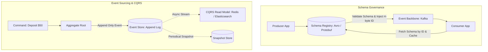
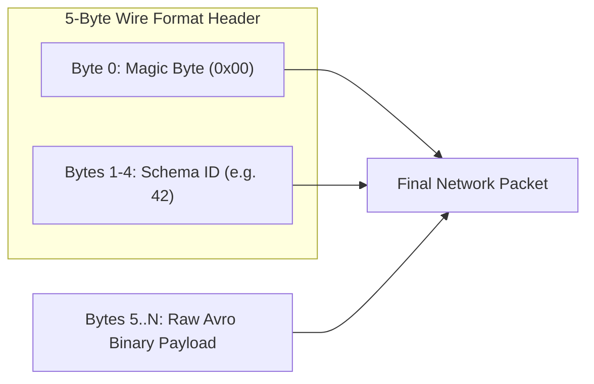
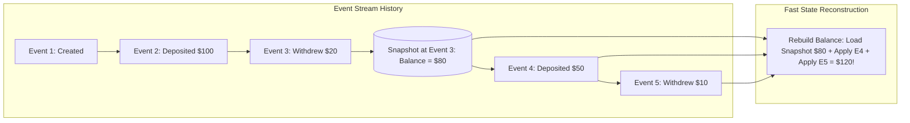
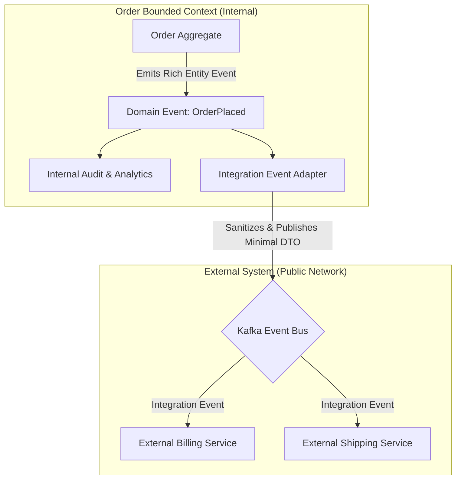
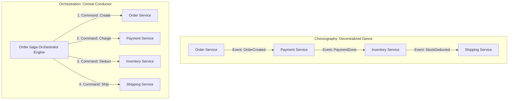

# 10.2. Event Patterns, Reliability, and Sagas (Các Mẫu Hình Sự Kiện, Độ Tin Cậy và Saga)

## Tổng quan về Các Mẫu Hình Sự Kiện, Độ Tin Cậy và Saga
Khi một tổ chức chuyển dịch hoàn toàn sang kiến trúc Hướng Sự Kiện (Event-Driven Architecture), các thách thức lớn nhất không còn nằm ở việc làm sao để truyền tải gói tin qua mạng, mà nằm ở:
1. **Quản trị vòng đời và tiến hóa cấu trúc dữ liệu (Event Schema Evolution)**: Làm sao để sửa đổi định dạng sự kiện mà không làm gãy các ứng dụng đang chạy phiên bản cũ (Schema Registry).
2. **Lưu trữ lịch sử sự kiện tuyệt đối (Event Sourcing & Event Store)**: Biến chuỗi sự kiện thành "Nguồn chân lý duy nhất" (Single Source of Truth) kết hợp kỹ thuật nén trạng thái (**Snapshotting**).
3. **Phân định ranh giới miền sự kiện**: Sự khác biệt cốt tử giữa **Domain Events** (nội bộ Bounded Context) và **Integration Events** (công khai ra toàn bộ hệ thống).
4. **Điều phối các quy trình nghiệp vụ phân tán**: Sự đánh đổi giữa **Choreography (Vũ đạo phi tập trung)** và **Orchestration (Nhạc trưởng điều phối)** trong mô hình **Saga Pattern**.



---

## 2. Chi tiết từng Keyword (Under-the-Hood Deep Dive)

### 1. Event Schema Evolution & Schema Registry (Tiến Hóa Cấu Trúc Sự Kiện và Kho Quản Lý Lược Đồ)

#### 1. Khái niệm bản chất (What & Why)
Trong hệ thống phân tán bất đồng bộ, Producer và Consumer phát triển độc lập và deploy vào các thời điểm hoàn toàn khác nhau. Nếu Producer đột ngột thay đổi cấu trúc dữ liệu sự kiện (ví dụ: đổi kiểu dữ liệu `amount` từ `number` thành `string` hoặc đổi tên trường `user_id` thành `customerId`), toàn bộ các Consumer đang chạy sẽ bị sập vì lỗi Deserialize!

- **Schema Registry (ví dụ: Confluent Schema Registry)**: Một dịch vụ tập trung đóng vai trò là "Trọng tài thẩm định lược đồ". Lưu trữ các phiên bản Schema (thường là Apache Avro, Protocol Buffers hoặc JSON Schema) và kiểm tra tính tương thích trước khi cho phép Producer phát tin nhắn.
- **Các chế độ tương thích (Compatibility Modes)**:
  - **BACKWARD**: Consumer chạy phiên bản mới (V2) có thể đọc được dữ liệu do Producer cũ (V1) phát ra.
  - **FORWARD**: Consumer chạy phiên bản cũ (V1) có thể đọc được dữ liệu do Producer mới (V2) phát ra.
  - **FULL**: Đạt cả hai điều kiện: Tương thích cả Ngược lẫn Xuôi.
  - **NONE**: Tắt kiểm tra tính tương thích (Cực kỳ nguy hiểm, không bao giờ dùng trên Production).

#### 2. Cơ chế hoạt động sâu (Under the hood / Hardcore Internals)
Cơ chế nén nhị phân kết hợp **Magic Byte & Schema ID trong Kafka Wire Format**:
Thay vì nhúng toàn bộ file Schema Avro/Protobuf (nặng vài KB) vào từng bản tin, Confluent Schema Registry định nghĩa một chuẩn đóng gói nhị phân siêu gọn nhẹ ở đầu mỗi payload (**Kafka Wire Format - 5 bytes overhead**):
- **Byte 0 (Magic Byte)**: Giá trị cố định `0x00` (báo hiệu định dạng Schema Registry).
- **Bytes 1-4 (Schema ID)**: Một số nguyên 32-bit (Big-Endian) đại diện cho mã định danh duy nhất của Schema trong Registry.
- **Bytes 5 trở đi**: Dữ liệu nhị phân thuần túy được nén bằng Avro/Protobuf.

Quy trình giải mã của Consumer:
1. Đọc 5 bytes đầu tiên, bóc tách `Schema ID = 42`.
2. Kiểm tra trong bộ nhớ RAM Cache xem đã có Schema #42 chưa.
3. Nếu chưa có (Cache Miss), gọi một HTTP request sang Schema Registry để tải Schema #42 về và lưu cache vĩnh viễn trên RAM.
4. Giải mã payload với tốc độ tối đa!

#### 3. Sơ đồ minh họa (Schema Registry Wire Format Serialization)


#### 4. Code ví dụ thực chiến (C++20 - Wire Format Header Parser của Schema Registry)
```cpp
#include <iostream>
#include <vector>
#include <cstdint>
#include <cstring>
#include <arpa/inet.h>

struct WireFormatHeader {
    uint8_t magic_byte;
    uint32_t schema_id;
};

class SchemaRegistryWireFormat {
public:
    static std::vector<uint8_t> serialize(uint32_t schema_id, const std::string& raw_payload) {
        std::vector<uint8_t> packet;
        packet.push_back(0x00); // Magic Byte

        // Ghi 4 bytes Schema ID theo định dạng Big-Endian (Network Byte Order)
        uint32_t net_id = htonl(schema_id);
        uint8_t id_bytes[4];
        std::memcpy(id_bytes, &net_id, 4);
        packet.insert(packet.end(), id_bytes, id_bytes + 4);

        // Chèn payload
        packet.insert(packet.end(), raw_payload.begin(), raw_payload.end());
        return packet;
    }

    static bool parse(const std::vector<uint8_t>& packet, uint32_t& out_schema_id, std::string& out_payload) {
        if (packet.size() < 5 || packet[0] != 0x00) {
            std::cerr << "[Schema Validation Failed] Invalid magic byte or packet too short!\n";
            return false;
        }

        uint32_t net_id;
        std::memcpy(&net_id, packet.data() + 1, 4);
        out_schema_id = ntohl(net_id);

        out_payload = std::string(packet.begin() + 5, packet.end());
        return true;
    }
};

int main() {
    // Producer đóng gói sự kiện với Schema ID = 105
    auto wire_data = SchemaRegistryWireFormat::serialize(105, "AVRO_BINARY_DATA_XYZ");

    // Consumer giải mã
    uint32_t schema_id;
    std::string payload;
    if (SchemaRegistryWireFormat::parse(wire_data, schema_id, payload)) {
        std::cout << "[Consumer Decoded]\n";
        std::cout << "Target Schema ID: " << schema_id << " (Fetch & Cache from Registry)\n";
        std::cout << "Extracted Payload: " << payload << "\n";
    }
    return 0;
}
```

#### 5. Ưu / Nhược điểm, Pitfalls & Anti-patterns
- **Anti-pattern: Breaking Compatibility by Adding Mandatory Fields**: Thêm một trường mới nhưng đánh dấu là bắt buộc (Required / Non-optional) mà không có giá trị mặc định (`default`). Toàn bộ các Producer cũ khi phát dữ liệu sẽ bị Schema Registry từ chối vì vi phạm tương thích!

#### 6. Ứng dụng thực tế trong Backend / Systems
Mọi hệ thống xử lý Big Data lớn (như Uber, Shopee, Netflix) bắt buộc đặt Confluent Schema Registry ở tầng cổng để kiểm soát tính toàn vẹn của dữ liệu đổ vào Data Lake.

---

## 2. Chi tiết từng Keyword (Under-the-Hood Deep Dive)

### 2. Event Sourcing, Event Store, Snapshotting & CQRS (Ghi Nhận Sự Kiện và Tạo Bản Chụp Nhanh)

#### 1. Khái niệm bản chất (What & Why)
- **Event Sourcing**: Thay vì chỉ cập nhật trạng thái hiện tại (State Mutation) bằng các lệnh `UPDATE` trong SQL, hệ thống **chỉ lưu trữ các sự kiện biến đổi trạng thái (Delta Events)** vào một **Event Store** bất biến (Append-Only Log). Trạng thái hiện tại của một thực thể (Aggregate Root) được tính toán bằng cách phát lại (Replay) chuỗi sự kiện từ điểm khởi đầu.
- **Event Store**: Cơ sở dữ liệu chuyên biệt tối ưu hóa cho việc đọc và ghi tuần tự các sự kiện (ví dụ: EventStoreDB, hoặc xây dựng trên nền PostgreSQL / DynamoDB).
- **Snapshotting (Tạo bản chụp nhanh)**: Lưu lại trạng thái của Aggregate tại một phiên bản sự kiện nhất định (ví dụ cứ mỗi 100 sự kiện tạo một Snapshot). Khi cần khôi phục trạng thái, ta nạp Snapshot gần nhất và chỉ phát lại các sự kiện sinh ra sau Snapshot đó.
- **CQRS (Command Query Responsibility Segregation)**: Bắt cặp hoàn hảo với Event Sourcing: Tầng Ghi (Write Side) append sự kiện vào Event Store; tầng Đọc (Read Side) lắng nghe luồng sự kiện để xây dựng các Materialized Views tối ưu hóa cho việc tra cứu hiển thị.

#### 2. Cơ chế hoạt động sâu (Under the hood / Hardcore Internals)
Kiểm soát tương tranh lạc quan (**Optimistic Concurrency Control - OCC**) trong Event Store:
- Hai tiến trình cùng muốn thay đổi trạng thái của tài khoản `ACC_101`:
  1. Tiến trình 1 và Tiến trình 2 cùng nạp tài khoản ở `Version = 5`.
  2. Tiến trình 1 gửi sự kiện mới `MoneyDepositedEvent` với kỳ vọng phiên bản hiện tại là $5$. Event Store ghi thành công và tăng phiên bản của tài khoản lên $6$.
  3. Tiến trình 2 gửi sự kiện `MoneyWithdrawnEvent` cũng với kỳ vọng phiên bản hiện tại là $5$.
  4. Event Store kiểm tra: Phiên bản thực tế trong DB hiện tại đã là $6 \ne 5$ $\implies$ **Lập tức ném lỗi `OptimisticLockException / ConcurrencyConflict`**!
  5. Tiến trình 2 phải nạp lại sự kiện mới nhất (Version 6), tính toán lại nghiệp vụ xem còn đủ tiền rút không, và thử ghi lại.

#### 3. Sơ đồ minh họa (Event Sourcing with Periodic Snapshotting)


#### 4. Code ví dụ thực chiến (C++20 - Event Sourcing Aggregate với Snapshotting Engine)
```cpp
#include <iostream>
#include <vector>
#include <string>
#include <memory>

struct DomainEvent {
    int version;
    std::string type;
    double amount;
};

struct AccountSnapshot {
    int version;
    double balance;
};

class BankAccountAggregate {
private:
    std::string id_;
    double balance_ = 0.0;
    int current_version_ = 0;

public:
    explicit BankAccountAggregate(std::string id) : id_(std::move(id)) {}

    void applyEvent(const DomainEvent& ev) {
        if (ev.type == "DEPOSITED") balance_ += ev.amount;
        else if (ev.type == "WITHDRAWN") balance_ -= ev.amount;
        current_version_ = ev.version;
    }

    // Nạp trạng thái từ Snapshot trong 1ns
    void restoreFromSnapshot(const AccountSnapshot& snap) {
        balance_ = snap.balance;
        current_version_ = snap.version;
        std::cout << "[Snapshot Loaded] Restored to Version #" << snap.version 
                  << " with Balance: $" << balance_ << "\n";
    }

    AccountSnapshot createSnapshot() const {
        return AccountSnapshot{current_version_, balance_};
    }

    double getBalance() const { return balance_; }
    int getVersion() const { return current_version_; }
};

int main() {
    BankAccountAggregate account("ACC-77");

    // 1. Giả lập hệ thống có Snapshot tại Version 1000 với số dư 5,000$
    AccountSnapshot snap{1000, 5000.0};
    account.restoreFromSnapshot(snap);

    // 2. Chỉ cần phát lại các sự kiện mới phát sinh sau Snapshot (Version 1001, 1002)
    std::vector<DomainEvent> recent_events = {
        {1001, "DEPOSITED", 200.0},
        {1002, "WITHDRAWN", 50.0}
    };

    for (const auto& ev : recent_events) {
        account.applyEvent(ev);
    }

    std::cout << "[Final Reconstructed State] Account Version: " << account.getVersion() 
              << " | Current Balance: $" << account.getBalance() << "\n"; // 5000 + 200 - 50 = 5150$
    return 0;
}
```

#### 5. Ưu / Nhược điểm, Pitfalls & Anti-patterns
- **Ưu điểm**: Khả năng kiểm toán (Audit Trail) hoàn hảo; xóa bỏ hoàn toàn các lỗi mất dữ liệu do `UPDATE` ghi đè; Time-travel debugging.
- **Nhược điểm**: Khó khăn trong việc thay đổi Schema của các Event cũ đã lưu 5 năm trước (Event Upcasting); tư duy phát triển phức tạp hơn CRUD truyền thống.

#### 6. Ứng dụng thực tế trong Backend / Systems
Toàn bộ hệ thống kiểm soát phiên bản Git, hệ thống số cái Bitcoin / Ethereum, và các sàn giao dịch chứng khoán đều là các biến thể thuần túy của Event Sourcing.

---

## 2. Chi tiết từng Keyword (Under-the-Hood Deep Dive)

### 3. Domain Events vs Integration Events (Sự Kiện Miền và Sự Kiện Tích Hợp)

#### 1. Khái niệm bản chất (What & Why)
Một sai lầm rất phổ biến là dùng chung một lớp sự kiện cho mọi mục đích. Trong kiến trúc phân tán hướng miền (DDD - Domain-Driven Design):
- **Domain Events (Sự kiện miền nội bộ)**: Các sự kiện xảy ra **bên trong ranh giới của một Bounded Context duy nhất**. Mang tính chi tiết, giàu ngữ nghĩa nghiệp vụ nội bộ, và thường được xử lý đồng bộ hoặc in-memory (ví dụ: `OrderAssignedToCourierDomainEvent`).
- **Integration Events (Sự kiện tích hợp công khai)**: Các sự kiện được phát tán qua Message Broker (Kafka) ra **bên ngoài Bounded Context** để các hệ thống khác cùng lắng nghe. Chỉ chứa các thông tin tối thiểu đã được làm sạch (Sanitized Minimal DTO), bảo vệ mô hình miền nội bộ không bị rò rỉ ra ngoài (Anti-Corruption).

#### 2. Cơ chế hoạt động sâu (Under the hood / Hardcore Internals)
Sự chuyển đổi từ Domain Event sang Integration Event:
- Trong nội bộ Order Service:
  - Khi người dùng đặt hàng, Domain Model sinh ra một `OrderPlacedDomainEvent` chứa đầy đủ các chi tiết nội bộ: Mã nhân viên ca trực, cấu trúc chiết khấu nội bộ, thuật toán tính điểm...
- Khi đưa ra ngoài mạng cho Billing Service và Shipping Service:
  - Một Adapter chuyển đổi Domain Event thành `OrderPlacedIntegrationEvent`: Chỉ gồm `orderId`, `customerId`, `finalAmount` và `timestamp`.
  - Điều này giúp Order Service có thể tự do tái cấu trúc (Refactoring) mã nguồn nội bộ mà **hoàn toàn không làm ảnh hưởng đến các service bên ngoài**!

#### 3. Sơ đồ minh họa


#### 4. Code ví dụ thực chiến (TypeScript - Chuyển đổi Domain Event thành Integration Event)
```typescript
// 1. Domain Event nội bộ: Chi tiết, gắn chặt với Domain Entities
class OrderPlacedDomainEvent {
  constructor(
    public readonly orderId: string,
    public readonly internalWarehouseCode: string,
    public readonly discountAlgorithmId: number,
    public readonly internalProfitMargin: number,
    public readonly totalChargeUSD: number,
    public readonly customerTaxId: string
  ) {}
}

// 2. Integration Event công khai: Tối giản, an toàn, không lộ bí mật kinh doanh
interface OrderPlacedIntegrationEvent {
  eventId: string;
  orderId: string;
  totalAmountUSD: number;
  occurredAt: string;
}

export class EventPublicationAdapter {
  public static toIntegrationEvent(domainEvent: OrderPlacedDomainEvent): OrderPlacedIntegrationEvent {
    return {
      eventId: "evt_" + Math.random().toString(36).substring(7),
      orderId: domainEvent.orderId,
      totalAmountUSD: domainEvent.totalChargeUSD,
      occurredAt: new Date().toISOString()
      // Loại bỏ hoàn toàn: internalProfitMargin, discountAlgorithmId!
    };
  }
}
```

#### 5. Ưu / Nhược điểm, Pitfalls & Anti-patterns
- **Anti-pattern: Leaking Internal Domain Entities over Kafka**: Bắn thẳng toàn bộ đối tượng Hibernate / ORM Entity lên Kafka Topic. Khi bạn sửa một cột trong database nội bộ, toàn bộ 20 microservices của các team khác bị gãy vỡ vì cấu trúc schema bị đổi!

#### 6. Ứng dụng thực tế trong Backend / Systems
Áp dụng rộng rãi trong các dự án Microservices quy mô lớn tại Spotify và Microsoft để duy trì tính độc lập giữa các nhóm kỹ sư độc lập.

---

### 4. Saga: Choreography vs Orchestration (Hai Trường Phái Saga Phân Tán)

#### 1. Khái niệm bản chất (What & Why)
Khi thực hiện một chuỗi giao dịch phân tán trải dài trên nhiều service (Saga Pattern):
- **Choreography (Vũ đạo phi tập trung)**: Không có người chỉ huy trung tâm. Mỗi service thực hiện xong công việc của mình thì tự phát đi một Event; các service khác tự lắng nghe Event đó để thực hiện bước tiếp theo. Giống như các vũ công trên sàn nhảy tự phối hợp nhịp nhàng theo tiếng nhạc.
- **Orchestration (Nhạc trưởng tập trung)**: Có một dịch vụ trung tâm đóng vai trò là **Saga Orchestrator**. Orchestrator chịu trách nhiệm gửi lệnh (Commands) trực tiếp tới từng service, chờ phản hồi, và quyết định bước tiếp theo hoặc kích hoạt luồng hoàn tiền bù trừ nếu có lỗi.

#### 2. Cơ chế hoạt động sâu (Under the hood / Hardcore Internals)
Bảng so sánh chuyên sâu giữa Choreography và Orchestration:

| Tiêu chí | Choreography-based Saga | Orchestration-based Saga |
| :--- | :--- | :--- |
| **Độ ghép nối (Coupling)** | Cực thấp (Chỉ phụ thuộc vào Event Bus) | Cao hơn (Phụ thuộc vào Saga Orchestrator) |
| **Độ phức tạp theo dõi (Visibility)**| **Rất khó quan sát** (Luồng sự kiện rải rác) | **Tuyệt vời** (Toàn bộ trạng thái nằm ở 1 chỗ)|
| **Rủi ro phụ thuộc vòng (Cyclic Dep)**| Dễ bị (Service A $\rightarrow$ B $\rightarrow$ C $\rightarrow$ A)| Không bị (Orchestrator điều phối 1 chiều) |
| **Điểm nghẽn đơn lẻ (SPOF)** | Không có | Cần đảm bảo Orchestrator có tính sẵn sàng cao |
| **Quy mô phù hợp** | Quy trình đơn giản (2-4 bước) | **Quy trình phức tạp (5-15 bước, nhiều nhánh rẽ)**|

#### 3. Sơ đồ minh họa


#### 4. Code ví dụ thực chiến (C++20 - State Machine điều phối Orchestrated Saga)
```cpp
#include <iostream>
#include <string>

enum class SagaState {
    Start,
    OrderCreated,
    PaymentAuthorized,
    InventoryAllocated,
    Success,
    CompensatingPayment,
    Failed
};

class OrderSagaStateMachine {
private:
    SagaState current_state_ = SagaState::Start;

public:
    void dispatchEvent(const std::string& event) {
        std::cout << "[Saga Orchestrator] Current State: " << static_cast<int>(current_state_) 
                  << " | Processing Event: " << event << "\n";

        switch (current_state_) {
            case SagaState::Start:
                if (event == "ORDER_INIT") current_state_ = SagaState::OrderCreated;
                break;
            case SagaState::OrderCreated:
                if (event == "PAYMENT_OK") current_state_ = SagaState::PaymentAuthorized;
                else if (event == "PAYMENT_FAIL") current_state_ = SagaState::Failed;
                break;
            case SagaState::PaymentAuthorized:
                if (event == "INVENTORY_OK") current_state_ = SagaState::Success;
                else if (event == "INVENTORY_OUT_OF_STOCK") {
                    std::cout << ">>> Triggering Compensating Refund Command!\n";
                    current_state_ = SagaState::CompensatingPayment;
                }
                break;
            case SagaState::CompensatingPayment:
                if (event == "REFUND_CONFIRMED") current_state_ = SagaState::Failed;
                break;
            default:
                break;
        }

        std::cout << "[Saga Orchestrator] New State: " << static_cast<int>(current_state_) << "\n\n";
    }

    bool isFinished() const {
        return current_state_ == SagaState::Success || current_state_ == SagaState::Failed;
    }
};

int main() {
    OrderSagaStateMachine saga;
    saga.dispatchEvent("ORDER_INIT");
    saga.dispatchEvent("PAYMENT_OK");
    // Giả lập kho hết hàng -> Kích hoạt hoàn tiền bù trừ
    saga.dispatchEvent("INVENTORY_OUT_OF_STOCK");
    saga.dispatchEvent("REFUND_CONFIRMED");

    std::cout << "Saga execution terminated cleanly.\n";
    return 0;
}
```

#### 5. Ưu / Nhược điểm, Pitfalls & Anti-patterns
- **Anti-pattern: Over-engineering with Orchestration for Simple 2-Step Workflows**: Dựng hẳn một cụm Temporal/Camunda chỉ để gửi một email chào mừng sau khi đăng ký tài khoản.

#### 6. Ứng dụng thực tế trong Backend / Systems
AWS Step Functions và Temporal.io là hai giải pháp hàng đầu thế giới được xây dựng chuyên biệt để vận hành Orchestrated Sagas cho hàng triệu giao dịch phức tạp mỗi ngày.

---

## Tóm tắt liên kết hệ thống
Toàn bộ chuyên mục **11.10 (Message Queue & Event-Driven System Design)** đã hoàn thành việc khảo sát kiến trúc hướng sự kiện: từ cấu trúc Commit Log và Zero-Copy của Kafka, phân vùng Partition Keys, xử lý Poison Messages qua DLQ, đến việc kiểm soát hợp đồng bằng Schema Registry, lưu trữ vĩnh cửu qua Event Sourcing & Snapshotting, và điều phối các giao dịch lớn bằng Saga Pattern.

Tiếp theo, tại **11.11: Reliability & Fault Tolerance**, chúng ta sẽ tìm hiểu cách thức giữ cho hệ thống luôn sống sót: Active-Active vs Active-Passive, Circuit Breaker, Exponential Backoff với Jitter, Bulkhead, Chaos Engineering và các chỉ số thảm họa RPO/RTO.
