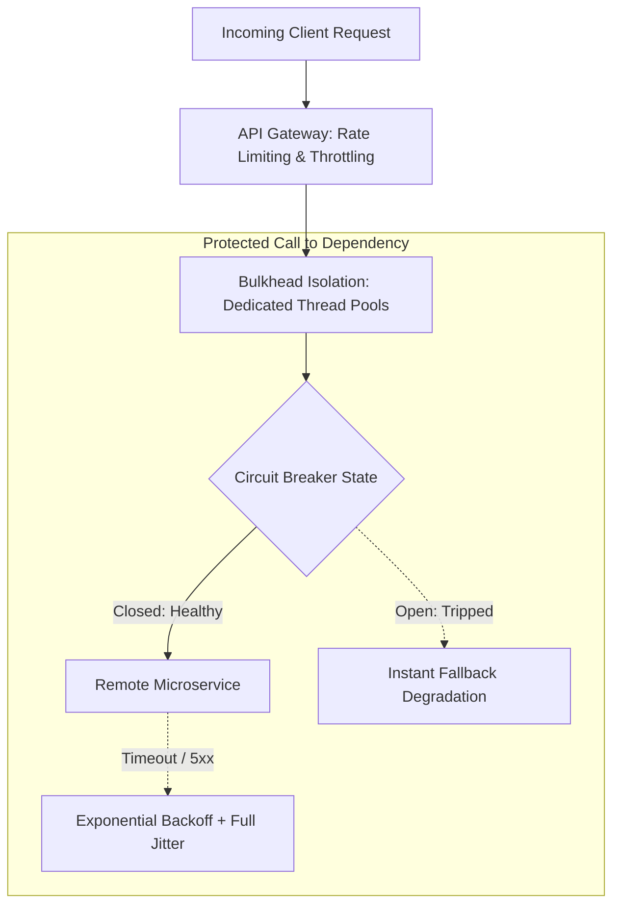
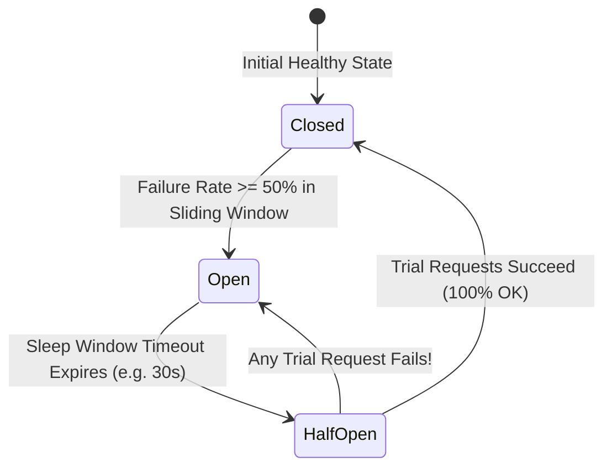
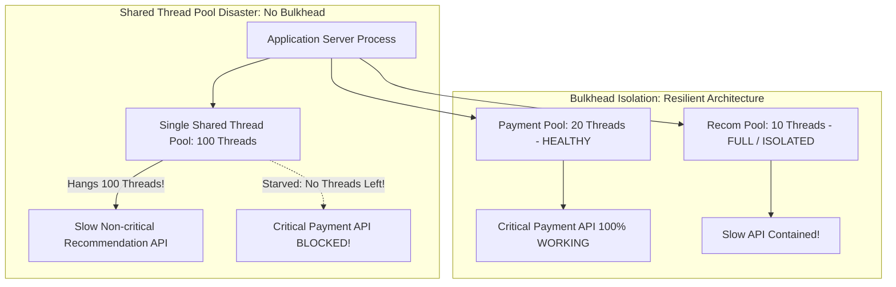
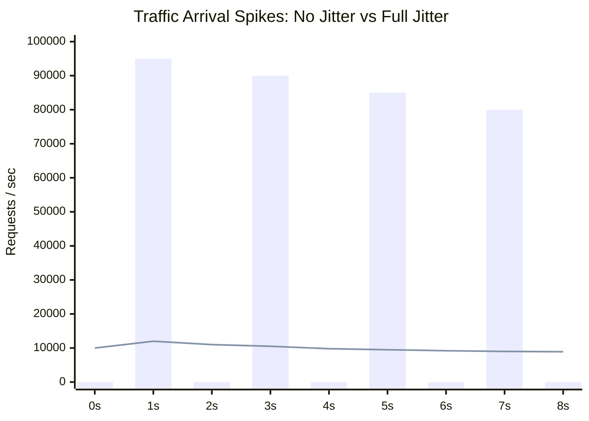
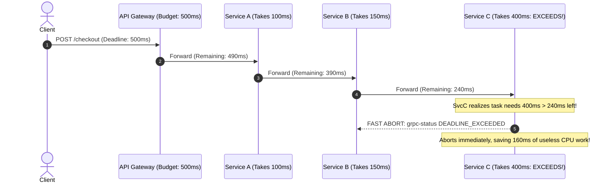
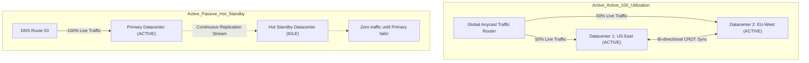

# 11.1. Resilience Patterns and Traffic Controls (Các Mẫu Hình Chống Chịu Sự Cố và Kiểm Soát Lưu Lượng)

## Tổng quan về Các Mẫu Hình Chống Chịu Sự Cố và Kiểm Soát Lưu Lượng
Trong một hệ thống phân tán bao gồm hàng trăm vi dịch vụ liên kết chặt chẽ qua mạng, một sự cố nhỏ ở một dịch vụ cấp thấp (Downstream Dependency) hoàn toàn có khả năng kích hoạt phản ứng dây chuyền làm sụp đổ toàn bộ hệ thống (**Cascading Failure**). 

**Kỹ thuật Khả năng Chống chịu (Resilience Engineering)** không tìm cách ngăn chặn các sự cố phần cứng hay mạng (điều bất khả thi), mà tập trung vào việc:
1. **Cô lập lỗi (Fault Isolation / Fault Containment)**: Giới hạn bán kính thiệt hại (**Blast Radius**) bằng các mẫu hình **Bulkhead** và **Circuit Breaker**.
2. **Kiểm soát lưu lượng thông minh**: Ngăn chặn thảm họa **Retry Storm** bằng **Exponential Backoff kết hợp Jitter**, và triệt tiêu công việc vô ích thông qua **Deadline Propagation**.
3. **Cấu trúc dự phòng (Redundancy Models)**: So sánh từ **Active-Active** toàn cầu cho đến **Active-Passive (Hot, Warm, Cold Standby)**.



---

## 2. Chi tiết từng Keyword (Under-the-Hood Deep Dive)

### 1. Circuit Breaker Pattern & State Machine (Mẫu Hình Cầu Dao Điện và Máy Trạng Thái)

#### 1. Khái niệm bản chất (What & Why)
Được lấy cảm hứng từ cầu dao điện trong các tòa nhà: khi dòng điện quá tải hoặc bị chập mạch, cầu dao tự động **ngắt mạch (Trip)** để bảo vệ toàn bộ mạng lưới điện không bị cháy nổ.

Trong phần mềm, **Circuit Breaker** bọc bên ngoài các cuộc gọi mạng tới dịch vụ bên ngoài (Remote Dependency). Nếu dịch vụ đó bắt đầu trả về lỗi liên tục hoặc bị chậm bất thường, Circuit Breaker sẽ tự động ngắt kết nối: **chuyển sang trả về lỗi hoặc kết quả Fallback ngay lập tức trong 0.1ms**, mà **hoàn toàn không gửi bất kỳ request nào qua mạng nữa**! Điều này giúp:
- Giải phóng ngay lập tức các Thread của dịch vụ gọi (Caller), ngăn ngừa tràn Thread Pool.
- Cho phép dịch vụ bị lỗi có "khoảng lặng thời gian" để tự phục hồi mà không bị dội thêm hàng nghìn request mới mỗi giây.

#### 2. Cơ chế hoạt động sâu (Under the hood / Hardcore Internals)
Máy trạng thái gồm 3 trạng thái chuẩn của Circuit Breaker:
1. **CLOSED (Đóng mạch - Bình thường)**:
   - Mọi request đều được chuyển tiếp bình thường tới dịch vụ đích.
   - Circuit Breaker theo dõi tỷ lệ lỗi thông qua một **Cửa sổ trượt thời gian (Sliding Window)** (ví dụ: trong 100 requests gần nhất hoặc trong 10 giây qua).
   - Nếu tỷ lệ lỗi vượt quá ngưỡng cấu hình (ví dụ: $\ge 50\%$ requests bị timeout hoặc 5xx), cầu dao tự động nhảy sang trạng thái **OPEN**!
2. **OPEN (Ngắt mạch - Cách ly sự cố)**:
   - $100\%$ các request gọi tới dịch vụ đích đều bị **từ chối ngay lập tức (Fail Fast)** với ngoại lệ `CallNotPermittedException` hoặc chuyển thẳng sang hàm `Fallback`.
   - Một đồng hồ đếm ngược được kích hoạt: **Wait Duration in Open State (ví dụ: 30 giây)**.
3. **HALF-OPEN (Nửa mở - Thử nghiệm phục hồi)**:
   - Sau khi hết thời gian 30 giây ở trạng thái OPEN, cầu dao chuyển sang **HALF-OPEN**.
   - Cầu dao cho phép một **số lượng nhỏ request thử nghiệm (Trial Requests, ví dụ: 5 requests)** đi qua mạng tới dịch vụ đích.
   - Nếu cả 5 requests này đều thành công: Cầu dao kết luận dịch vụ đã khỏe mạnh hoàn toàn $\implies$ Chuyển về **CLOSED**.
   - Nếu có dù chỉ 1 request bị lỗi: Cầu dao kết luận dịch vụ vẫn đang hấp hối $\implies$ Quay trở lại trạng thái **OPEN** thêm 60 giây nữa!

#### 3. Sơ đồ minh họa (Circuit Breaker State Machine)


#### 4. Code ví dụ thực chiến (C++20 - Triển khai Circuit Breaker State Machine hoàn chỉnh)
```cpp
#include <iostream>
#include <chrono>
#include <atomic>
#include <string>
#include <functional>

enum class BreakerState { Closed, Open, HalfOpen };

class SimpleCircuitBreaker {
private:
    std::atomic<BreakerState> state_{BreakerState::Closed};
    std::atomic<int> failure_count_{0};
    std::atomic<int> success_count_{0};
    std::chrono::steady_clock::time_point last_state_change_;

    const int FAILURE_THRESHOLD = 3; // 3 lỗi liên tiếp -> OPEN
    const std::chrono::milliseconds OPEN_TIMEOUT{1000}; // Chờ 1 giây trước khi sang Half-Open

public:
    SimpleCircuitBreaker() : last_state_change_(std::chrono::steady_clock::now()) {}

    bool allowExecution() {
        auto now = std::chrono::steady_clock::now();
        if (state_ == BreakerState::Open) {
            if (now - last_state_change_ > OPEN_TIMEOUT) {
                state_ = BreakerState::HalfOpen;
                last_state_change_ = now;
                std::cout << "[Circuit Breaker] Transitioned to HALF-OPEN (Testing upstream)...\n";
                return true; // Cho phép 1 request thử nghiệm
            }
            return false; // Vẫn đang OPEN -> Chặn đứng request ngay trong 0ns!
        }
        return true;
    }

    void recordSuccess() {
        if (state_ == BreakerState::HalfOpen) {
            state_ = BreakerState::Closed;
            failure_count_ = 0;
            std::cout << "[Circuit Breaker] RECOVERED! Transitioned back to CLOSED.\n";
        }
    }

    void recordFailure() {
        failure_count_++;
        last_state_change_ = std::chrono::steady_clock::now();
        if (state_ == BreakerState::HalfOpen || failure_count_ >= FAILURE_THRESHOLD) {
            state_ = BreakerState::Open;
            std::cout << "[Circuit Breaker] TRIPPED TO OPEN! Upstream is failing. Fast-Failing all calls.\n";
        }
    }
};

int main() {
    SimpleCircuitBreaker cb;

    // Giả lập 3 lần gọi mạng thất bại liên tiếp
    for (int i = 1; i <= 3; ++i) {
        if (cb.allowExecution()) {
            std::cout << "Attempt #" << i << ": Calling external service...\n";
            cb.recordFailure(); // Gặp lỗi
        }
    }

    // Lần gọi thứ 4: Cầu dao đã OPEN -> Bị chặn ngay lập tức, không tốn Network Hop!
    if (!cb.allowExecution()) {
        std::cout << "Attempt #4: BLOCKED BY CIRCUIT BREAKER! Serving local cached Fallback data.\n";
    }

    return 0;
}
```

#### 5. Ưu / Nhược điểm, Pitfalls & Anti-patterns
- **Anti-pattern: Setting Timeout Higher than Circuit Breaker Sleep Window**: Cấu hình thời gian timeout của một HTTP request là 60 giây trong khi thời gian Sleep của Circuit Breaker là 30 giây. Luồng thực thi sẽ bị treo trước khi cầu dao kịp phản ứng.

#### 6. Ứng dụng thực tế trong Backend / Systems
Netflix Hystrix, Resilience4j (Java), Envoy Proxy Outlier Detection và Polly (.NET) là các bộ khung chuẩn mực triển khai Circuit Breaker ở quy mô hàng triệu requests/giây.

---

### 2. Bulkhead Pattern (Mẫu Hình Vách Ngăn Khoang Tàu)

#### 1. Khái niệm bản chất (What & Why)
Mẫu hình Bulkhead được đặt tên theo **các vách ngăn kín nước chia thân tàu thủy thành nhiều khoang độc lập**. Nếu thân tàu bị thủng một lỗ, nước chỉ tràn vào duy nhất khoang đó; các khoang còn lại vẫn kín nước và tàu không bị chìm.

Trong kiến trúc phần mềm, **Bulkhead Pattern** phân chia tài nguyên hệ thống (Thread Pools, Memory, Connection Pools) thành **các vùng cách ly độc lập dành riêng cho từng dịch vụ phụ thuộc**. Một dịch vụ bên ngoài bị chậm hoặc treo sẽ **chỉ làm cạn kiệt tài nguyên của khoang dành riêng cho nó**, hoàn toàn không ảnh hưởng đến các tính năng khác của hệ thống.

#### 2. Cơ chế hoạt động sâu (Under the hood / Hardcore Internals)
Hai hình thức hiện thực hóa Bulkhead:
1. **Thread Pool Isolation (Cách ly theo Thread Pool - Tiêu chuẩn Netflix Hystrix)**:
   - Thay vì dùng chung một Thread Pool lớn gồm 200 threads cho toàn bộ ứng dụng:
   - Cấp phát riêng:
     - `Payment_ThreadPool`: 20 threads.
     - `Recommendation_ThreadPool`: 10 threads.
     - `Catalog_ThreadPool`: 50 threads.
   - Nếu dịch vụ Recommendation bị treo 30 giây, nó chỉ chiếm dụng tối đa 10 threads của khoang `Recommendation`. 190 threads còn lại của Payment và Catalog vẫn hoạt động với tốc độ tối đa!
2. **Semaphore Isolation (Cách ly theo biến đếm Semaphore)**:
   - Không tạo thêm thread mới (tiết kiệm chi phí context switch).
   - Sử dụng một biến đếm Atomic Semaphore để giới hạn số lượng request đồng thời tối đa cho một dependency (ví dụ: tối đa 20 concurrent calls). Nếu vượt quá 20, các request tiếp theo bị từ chối ngay lập tức.

#### 3. Sơ đồ minh họa


#### 4. Code ví dụ thực chiến (C++20 - Semaphore-Based Bulkhead Isolation)
```cpp
#include <iostream>
#include <atomic>
#include <string>

// Bulkhead cách ly tài nguyên bằng Semaphore giới hạn số lượng concurrency
class BulkheadIsolation {
private:
    std::string resource_name_;
    const int max_concurrent_calls_;
    std::atomic<int> current_calls_{0};

public:
    BulkheadIsolation(std::string name, int max_concurrency)
        : resource_name_(std::move(name)), max_concurrent_calls_(max_concurrency) {}

    bool tryEnter() {
        int current = current_calls_.load(std::memory_order_relaxed);
        while (current < max_concurrent_calls_) {
            if (current_calls_.compare_exchange_weak(current, current + 1,
                                                     std::memory_order_acquire,
                                                     std::memory_order_relaxed)) {
                return true; // Vào khoang an toàn!
            }
        }
        std::cerr << "[BULKHEAD REJECTION] Compartment for '" << resource_name_ 
                  << "' is FULL (" << max_concurrent_calls_ << "/" << max_concurrent_calls_ 
                  << ")! Rejecting to protect rest of system.\n";
        return false;
    }

    void leave() {
        current_calls_.fetch_sub(1, std::memory_order_release);
    }
};

int main() {
    // Khoang cho Recommendation API chỉ cho phép tối đa 2 calls đồng thời
    BulkheadIsolation recom_bulkhead("Recommendation_Service", 2);

    std::cout << "Call 1: " << recom_bulkhead.tryEnter() << "\n";
    std::cout << "Call 2: " << recom_bulkhead.tryEnter() << "\n";
    // Call 3 vượt quá dung lượng khoang -> Bị cách ly và từ chối ngay lập tức!
    std::cout << "Call 3: " << recom_bulkhead.tryEnter() << " (Safely rejected)\n";

    recom_bulkhead.leave();
    std::cout << "Call 4 (After 1 leaves): " << recom_bulkhead.tryEnter() << "\n";
    return 0;
}
```

#### 5. Ưu / Nhược điểm, Pitfalls & Anti-patterns
- **Anti-pattern: Thread Pool Overhead**: Tạo ra quá nhiều Thread Pool nhỏ (50 pools, mỗi pool 5 threads) làm tăng tổng số lượng thread của hệ điều hành lên hàng nghìn, tiêu tốn bộ nhớ RAM cho thread stacks và làm CPU nghẽn vì Context Switching.

#### 6. Ứng dụng thực tế trong Backend / Systems
Mọi tàu ngầm quân sự và tàu ngầm hạt nhân đều áp dụng Bulkhead cơ học; trong phần mềm, Netflix áp dụng triệt để trong thư viện Hystrix để cách ly các API gợi ý phim khỏi luồng phát video chính.

---

## 2. Chi tiết từng Keyword (Under-the-Hood Deep Dive)

### 3. Exponential Backoff, Jitter & Retry Storms (Lùi Bước Cấp Số Nhân và Hiện Tượng Bão Thử Lại)

#### 1. Khái niệm bản chất (What & Why)
Khi một client gọi mạng bị lỗi tạm thời (Transient Error), phản xạ tự nhiên của lập trình viên là **Thử lại (Retry)**. Tuy nhiên:
- **Nguy cơ Retry Storm (Cơn bão thử lại)**: Nếu $100,000$ client cùng bị lỗi và cùng thử lại **ngay lập tức** hoặc theo một chu kỳ cố định (ví dụ cứ đúng 1 giây thử lại 1 lần), toàn bộ $100,000$ request sẽ dội vào máy chủ đích cùng một tích tắc theo từng đợt sóng định kỳ, đánh sập hoàn toàn máy chủ đang cố gắng gượng dậy!
- **Exponential Backoff (Lùi bước theo cấp số nhân)**: Tăng gấp đôi thời gian chờ sau mỗi lần thử lại thất bại: $1\text{s} \rightarrow 2\text{s} \rightarrow 4\text{s} \rightarrow 8\text{s} \rightarrow 16\text{s}$.
- **Jitter (Độ lệch ngẫu nhiên)**: Bổ sung một giá trị ngẫu nhiên vào thời gian chờ để **phá vỡ sự đồng bộ hóa (Desynchronization)** của các client.

#### 2. Cơ chế hoạt động sâu (Under the hood / Hardcore Internals)
Nghiên cứu kinh điển của Marc Brooker (Kỹ sư trưởng AWS Architecture Blog):
Có 3 thuật toán Jitter phổ biến:
1. **Full Jitter (Khuyên dùng nhiều nhất trên thực tế)**:
   $$t_{\text{sleep}} = \text{random}(0, \min(T_{\text{max}}, T_{\text{base}} \times 2^{\text{attempt}}))$$
   - Giúp phân tán đều các request thử lại trên toàn bộ trục thời gian từ $0$ đến trần tối đa, triệt tiêu hoàn toàn các đỉnh sóng xung kích (Spikes).
2. **Equal Jitter**:
   $$t_{\text{half}} = \frac{1}{2} \times \min(T_{\text{max}}, T_{\text{base}} \times 2^{\text{attempt}})$$
   $$t_{\text{sleep}} = t_{\text{half}} + \text{random}(0, t_{\text{half}})$$
3. **Decorrelated Jitter**:
   $$t_{\text{sleep}} = \min(T_{\text{max}}, \text{random}(T_{\text{base}}, t_{\text{previous}} \times 3))$$

#### 3. Sơ đồ minh họa (Retry Storm vs Full Jitter Distribution)

*(Cột Bar: Bão thử lại dội sóng định kỳ gây sập server; Đường Line: Full Jitter làm phẳng tải mượt mà).*

#### 4. Code ví dụ thực chiến (C++20 - AWS Full Jitter Backoff Algorithm)
```cpp
#include <iostream>
#include <random>
#include <cmath>
#include <algorithm>

class ExponentialBackoffWithJitter {
private:
    double base_ms_;
    double max_ms_;
    std::mt19937 rng_;

public:
    ExponentialBackoffWithJitter(double base_ms, double max_ms)
        : base_ms_(base_ms), max_ms_(max_ms), rng_(std::random_device{}()) {}

    // Thuật toán AWS Full Jitter chuẩn xác
    double getSleepDurationMs(int attempt) {
        // Tính trần cấp số nhân: min(max_ms, base_ms * 2^attempt)
        double exponential_cap = std::min(max_ms_, base_ms_ * std::pow(2.0, attempt));

        // Phân phối ngẫu nhiên đều từ 0 đến exponential_cap
        std::uniform_real_distribution<double> dist(0.0, exponential_cap);
        return dist(rng_);
    }
};

int main() {
    // Base: 100ms, Max Cap: 3000ms
    ExponentialBackoffWithJitter backoff(100.0, 3000.0);

    std::cout << "[Simulating Full Jitter Sleep Durations Across 5 Retries]\n";
    for (int attempt = 0; attempt < 5; ++attempt) {
        double sleep_time = backoff.getSleepDurationMs(attempt);
        std::cout << "Attempt #" << attempt + 1 << ": Sleep for " << static_cast<int>(sleep_time) << " ms\n";
    }
    return 0;
}
```

#### 5. Ưu / Nhược điểm, Pitfalls & Anti-patterns
- **Anti-pattern: Retrying Non-transient Errors (4xx)**: Tự động retry khi nhận được mã lỗi `401 Unauthorized` hoặc `400 Bad Request`. Nếu token đã hết hạn hoặc dữ liệu đầu vào đã sai, việc retry 100 lần cũng sẽ chỉ nhận về cùng một lỗi và làm tốn tài nguyên hệ thống vô ích!

#### 6. Ứng dụng thực tế trong Backend / Systems
AWS SDK và Google Cloud Client Libraries tích hợp sẵn cơ chế Exponential Backoff với Full Jitter trong toàn bộ các lệnh gọi API.

---

### 4. Deadline Propagation & Cascading Failures (Lan Truyền Thời Hạn Chót và Sụp Đổ Dây Chuyền)

#### 1. Khái niệm bản chất (What & Why)
- **Cascading Failure (Sụp đổ dây chuyền)**: Hiện tượng một sự cố ở một node hoặc một dịch vụ nhỏ kích hoạt một chuỗi các sự cố tiếp theo, lan rộng khắp toàn bộ hệ thống cho đến khi toàn bộ nền tảng sụp đổ hoàn toàn.
- **Deadline Propagation (Lan truyền thời hạn chót)**: Khi một client gửi request tới Gateway với thời hạn chờ tối đa là $500\text{ ms}$ (Deadline), giá trị Deadline này được **đóng gói vào Header mạng và truyền xuyên suốt qua toàn bộ cây dịch vụ phụ thuộc phía sau**. Mỗi dịch vụ khi nhận được request sẽ trừ đi thời gian đã trôi qua; nếu phát hiện Deadline đã cạn kiệt, dịch vụ lập tức hủy bỏ (Cancel/Abort) việc xử lý để không lãng phí tài nguyên máy chủ!

#### 2. Cơ chế hoạt động sâu (Under the hood / Hardcore Internals)
Tại sao thiếu Deadline Propagation lại gây ra Cascading Failure:
1. Client gửi request tới Service A với Timeout $2\text{ giây}$.
2. Service A gọi Service B; Service B gọi Service C; Service C gọi Database.
3. Database bị nghẽn đĩa, câu query mất $5\text{ giây}$.
4. Sau $2\text{ giây}$, Client đã nản lòng và đóng trình duyệt (Ngắt kết nối HTTP).
5. **Thảm họa**: Vì không có Deadline Propagation, Service C và Database **hoàn toàn không biết Client đã ngắt kết nối**! Chúng vẫn tiếp tục miệt mài đốt chu kỳ CPU và khóa hàng trong suốt 3 giây tiếp theo để tính toán một kết quả mà **không một ai trên đời cần xem nữa**!
6. Khi có 10,000 request như vậy, cơ sở dữ liệu sập hoàn toàn vì làm những công việc vô nghĩa!

Cơ chế của **gRPC `grpc-timeout` Header**:
- Client khởi tạo: `grpc-timeout: 500m` (500 milliseconds).
- Service A mất 100ms, khi gọi Service B, gRPC Client tự động cập nhật header thành: `grpc-timeout: 400m`.
- Service B mất 350ms, khi gọi Service C, header chỉ còn: `grpc-timeout: 50m`.
- Service C thấy để query database cần 80ms trong khi chỉ còn 50ms $\implies$ **Service C hủy lệnh ngay lập tức và trả về mã lỗi `DEADLINE_EXCEEDED`**, giải phóng tài nguyên tức thì!

#### 3. Sơ đồ minh họa


#### 4. Code ví dụ thực chiến (TypeScript - Deadline Propagation Context Wrapper)
```typescript
interface DistributedContext {
  deadlineEpochMs: number;
}

export class DeadlineAwareService {
  public static async executeWithDeadline<T>(
    ctx: DistributedContext,
    operationName: string,
    taskFn: () => Promise<T>
  ): Promise<T> {
    const now = Date.now();
    const remainingTimeMs = ctx.deadlineEpochMs - now;

    // Kiểm tra xem Deadline đã hết hạn chưa trước khi bắt đầu công việc
    if (remainingTimeMs <= 0) {
      console.error(`[DEADLINE EXCEEDED] Aborting '${operationName}' before execution! (Budget expired by ${Math.abs(remainingTimeMs)}ms)`);
      throw new Error("HTTP 504: Gateway Timeout / Deadline Exceeded");
    }

    console.log(`[Executing: ${operationName}] Remaining time budget: ${remainingTimeMs}ms`);

    // Gắn Timeout Guard bao bọc task
    let timerId: NodeJS.Timeout;
    const timeoutPromise = new Promise<never>((_, reject) => {
      timerId = setTimeout(() => {
        reject(new Error(`Operation '${operationName}' cancelled: Deadline passed mid-flight`));
      }, remainingTimeMs);
    });

    try {
      const result = await Promise.race([taskFn(), timeoutPromise]);
      clearTimeout(timerId!);
      return result;
    } catch (e) {
      clearTimeout(timerId!);
      throw e;
    }
  }
}
```

#### 5. Ưu / Nhược điểm, Pitfalls & Anti-patterns
- **Anti-pattern: Setting Client Timeout Shorter than Server Deadline**: Cấu hình Client timeout 1 giây nhưng cấu hình NGINX và Server timeout 30 giây. Khi client ngắt kết nối, server vẫn chạy tiếp trong 29 giây vô ích.

#### 6. Ứng dụng thực tế trong Backend / Systems
Google coi Deadline Propagation là một trong những nguyên lý kiến trúc SRE sống còn, được tích hợp mặc định trong toàn bộ các thư viện RPC nội bộ (Stubby / gRPC).

---

## 2. Chi tiết từng Keyword (Under-the-Hood Deep Dive)

### 5. Redundancy Models: Active-Active vs Active-Passive & Standby Tiers (Các Mô Hình Dự Phòng Sẵn Sàng Cao)

#### 1. Khái niệm bản chất (What & Why)
- **Active-Active Architecture (Đa hoạt động)**: Tất cả các nút hoặc Datacenter đều cùng chạy và **đồng thời tiếp nhận lưu lượng thực tế của người dùng**. Nếu một node hoặc một Datacenter bị sập, tải sẽ tự động tràn sang các node còn lại mà không cần bất kỳ thao tác chuyển đổi (Failover) nào.
- **Active-Passive Architecture (Hoạt động - Bị động)**: Chỉ có một node/Datacenter chính (**Primary**) thực sự tiếp nhận traffic. Một hoặc nhiều node phụ (**Secondary / Standby**) đứng chờ sẵn và chỉ được kích hoạt lên làm việc khi node chính gặp sự cố (**Failover**).
- **Phân loại Standby Tiers (Cấp độ máy chủ dự phòng)**:
  - **Hot Standby**: Bản sao chạy song song, dữ liệu được đồng bộ hóa theo thời gian thực (Real-time). Sẵn sàng nhận traffic trong vòng **$< 1\text{ giây}$**.
  - **Warm Standby**: Máy chủ đã được cài đặt sẵn phần mềm, dữ liệu được đồng bộ định kỳ (ví dụ mỗi giờ). Cần từ **vài phút đến 15 phút** để kiểm tra và nạp dữ liệu mới nhất trước khi nhận traffic.
  - **Cold Standby**: Máy chủ ở trạng thái tắt nguồn (Powered off) hoặc chỉ là các bản backup dữ liệu lưu trên băng từ/S3 Glacier. Cần từ **vài giờ đến vài ngày** để mua máy chủ, cấu hình và khôi phục dữ liệu từ đầu.

#### 2. Cơ chế hoạt động sâu (Under the hood / Hardcore Internals)
Bảng so sánh chuyên sâu giữa Active-Active và Active-Passive:

| Tiêu chí | Active-Passive Architecture | Active-Active Architecture |
| :--- | :--- | :--- |
| **Chi phí lãng phí hạ tầng** | Rất cao (50% máy chủ bị bỏ không chỉ để dự phòng)| **Tối ưu 100% (Mọi máy chủ đều tham gia gánh tải)**|
| **Thời gian gián đoạn (RTO)**| Mất từ vài giây đến vài phút để kích hoạt Failover | **Bằng 0 (Zero Downtime Failover)** |
| **Độ phức tạp dữ liệu** | Đơn giản (Chỉ ghi vào duy nhất 1 Master) | **Rất phức tạp (Multi-Master Write Conflicts)** |
| **Khả năng kiểm chứng** | Rủi ro (Standby có thể bị lỗi ngầm mà không biết)| Hoàn hảo (Mọi node đều được kiểm chứng liên tục) |

Thách thức xung đột dữ liệu trong Active-Active Multi-Region:
Khi người dùng ở Mỹ cập nhật trạng thái đơn hàng trên Datacenter US-East, và cùng lúc đó người dùng ở Châu Âu cập nhật đơn hàng trên Datacenter EU-Central:
- Bắt buộc phải áp dụng **Conflict-Free Replicated Data Types (CRDTs)** hoặc phân chia quyền sở hữu dữ liệu (Tenant Partitioning) theo khu vực địa lý để tránh xung đột hai chiều (Split-Brain Writes).

#### 3. Sơ đồ minh họa


#### 4. Code ví dụ thực chiến (C++20 - Heartbeat Watchdog kích hoạt Automatic Failover)
```cpp
#include <iostream>
#include <chrono>
#include <atomic>
#include <thread>

class AutomaticFailoverWatchdog {
private:
    std::atomic<bool> is_primary_alive_{true};
    std::atomic<bool> is_standby_promoted_{false};
    std::chrono::steady_clock::time_point last_heartbeat_;
    const std::chrono::milliseconds HEARTBEAT_TIMEOUT{500};

public:
    AutomaticFailoverWatchdog() : last_heartbeat_(std::chrono::steady_clock::now()) {}

    void sendHeartbeatFromPrimary() {
        last_heartbeat_ = std::chrono::steady_clock::now();
    }

    void monitorLoopTick() {
        auto now = std::chrono::steady_clock::now();
        if (now - last_heartbeat_ > HEARTBEAT_TIMEOUT) {
            if (!is_standby_promoted_.load()) {
                is_primary_alive_.store(false);
                triggerFailoverPromotion();
            }
        }
    }

private:
    void triggerFailoverPromotion() {
        is_standby_promoted_.store(true);
        std::cout << "\n=======================================================\n";
        std::cout << "CRITICAL ALERT: Primary Heartbeat LOST for > 500ms!\n";
        std::cout << "AUTOMATIC FAILOVER INITIATED: Promoting Hot Standby to PRIMARY!\n";
        std::cout << "Traffic reassigned to new Master. System Operational.\n";
        std::cout << "=======================================================\n";
    }
};

int main() {
    AutomaticFailoverWatchdog watchdog;
    std::cout << "[Cluster Watchdog] Monitoring Primary Node health...\n";

    // Giả lập Primary gửi heartbeat bình thường
    watchdog.sendHeartbeatFromPrimary();
    watchdog.monitorLoopTick();

    // Giả lập Primary bị mất điện đột ngột (Ngừng gửi heartbeat trong 600ms)
    std::this_thread::sleep_for(std::chrono::milliseconds(600));
    watchdog.monitorLoopTick(); // Kích hoạt chuyển đổi tự động!

    return 0;
}
```

#### 5. Ưu / Nhược điểm, Pitfalls & Anti-patterns
- **Anti-pattern: Untested Standby Failover**: Duy trì một cụm Hot Standby đắt tiền trong 3 năm nhưng không bao giờ diễn tập chuyển đổi. Khi Primary sập thật vào lúc nửa đêm, kỹ sư kích hoạt Failover thì phát hiện ra mật khẩu database của Standby đã bị đổi từ 6 tháng trước, khiến hệ thống tê liệt hoàn toàn!

#### 6. Ứng dụng thực tế trong Backend / Systems
AWS Aurora Multi-AZ tự động thực hiện Failover từ Primary sang Read Replica trong vòng dưới 30 giây mà không làm mất mát dữ liệu nhờ lưu trữ dùng chung (Shared Storage Engine).

---

## Tóm tắt liên kết hệ thống
Nội dung **11.1** đã trang bị trọn vẹn bộ công cụ phòng vệ phân tán: ngắt mạch bằng Circuit Breaker State Machine, cách ly khoang tàu qua Bulkhead, dập tắt bão thử lại bằng Exponential Backoff + Full Jitter, chặn đứng công việc vô ích qua Deadline Propagation, và duy trì tính sẵn sàng cao qua kiến trúc Active-Active / Active-Passive.

Trong bài tiếp theo (**11.2: Disaster Recovery and Chaos Engineering**), chúng ta sẽ bước lên cấp độ cao nhất của Kỹ nghệ Độ tin cậy: Chủ động phá hủy hệ thống bằng **Chaos Engineering (Fault Injection)**, thiết lập kịch bản **Disaster Recovery**, và tính toán chuẩn xác hai chỉ số sống còn của doanh nghiệp: **RPO (Recovery Point Objective)** và **RTO (Recovery Time Objective)**.
