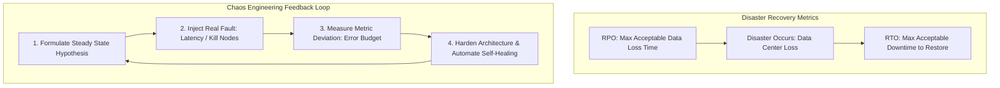
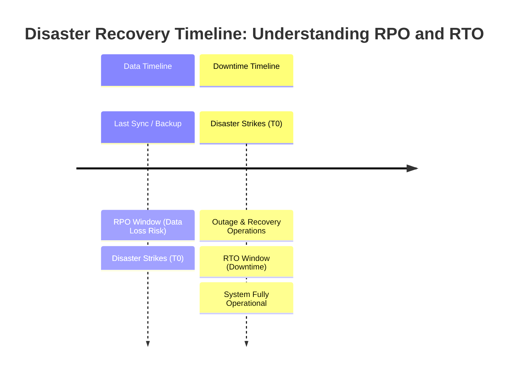
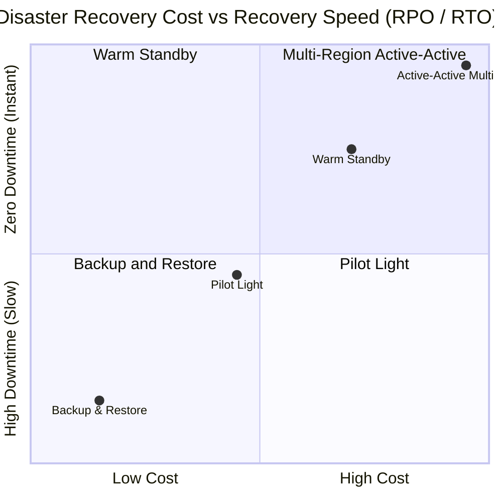
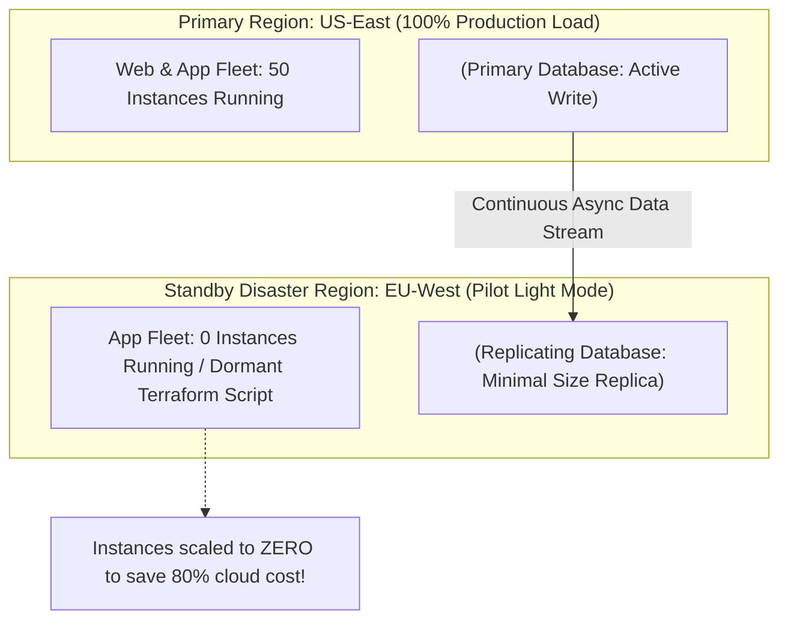
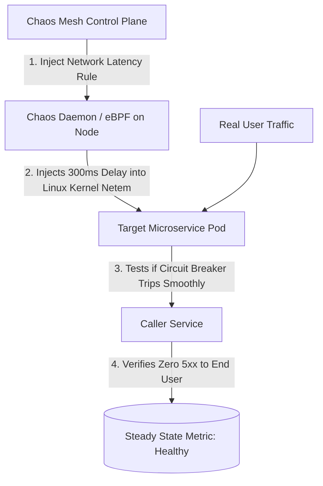

# 11.2. Disaster Recovery and Chaos Engineering (Phục Hồi Sau Thảm Họa và Kỹ Nghệ Hỗn Loạn)

## Tổng quan về Phục Hồi Sau Thảm Họa và Kỹ Nghệ Hỗn Loạn
Trong kỹ nghệ phần mềm cấp Enterprise, một hệ thống chỉ được coi là thực sự vững chắc khi nó đã được thử lửa trong các thảm họa thực tế. Thay vì thụ động ngồi chờ đợi một sự cố bất ngờ ập đến vào lúc nửa đêm, các kỹ sư SRE áp dụng hai phương pháp luận tiên tiến nhất:
1. **Khắc phục thảm họa (Disaster Recovery - DR)**: Tập hợp các chính sách, quy trình và kiến trúc hạ tầng nhằm khôi phục toàn bộ hệ thống sau các biến cố diện rộng (thiên tai, mất điện toàn bộ Data Center, tấn công Ransomware mã hóa dữ liệu). Trọng tâm là đáp ứng hai chỉ số cam kết sống còn: **RPO (Recovery Point Objective)** và **RTO (Recovery Time Objective)**.
2. **Kỹ nghệ Hỗn loạn (Chaos Engineering)**: Bộ môn khoa học chủ động **tiêm các lỗi thực tế (Fault Injection)** vào môi trường Production hoặc Staging để kiểm chứng tính bền vững của hệ thống và phát hiện các lỗ hổng kiến trúc tiềm ẩn trước khi chúng bộc phát thành sự cố thảm khốc.



---

## 2. Chi tiết từng Keyword (Under-the-Hood Deep Dive)

### 1. Business Continuity Metrics: RPO, RTO & Point-in-Time Recovery (Các Chỉ Số RPO, RTO và Khôi Phục Theo Điểm Thời Gian)

#### 1. Khái niệm bản chất (What & Why)
- **RPO (Recovery Point Objective - Mục tiêu điểm phục hồi)**: Khoảng thời gian dữ liệu tối đa mà doanh nghiệp **chấp nhận bị mất vĩnh viễn** khi có thảm họa xảy ra.
  - Ví dụ: Nếu hệ thống backup dữ liệu mỗi 24 giờ một lần vào nửa đêm, và thảm họa xảy ra lúc 23:00 tối: dữ liệu của 23 tiếng trong ngày hôm đó bị mất sạch $\implies RPO = 24\text{ giờ}$.
  - Với các hệ thống tài chính, ngân hàng: $RPO = 0$ (Không được phép mất dù chỉ 1 xu).
- **RTO (Recovery Time Objective - Mục tiêu thời gian phục hồi)**: Khoảng thời gian tối đa mà hệ thống **chấp nhận bị ngừng hoạt động (Downtime)** kể từ thời điểm thảm họa xảy ra cho đến khi toàn bộ dịch vụ được khôi phục trở lại bình thường.
  - Ví dụ: $RTO = 15\text{ phút}$ đồng nghĩa với việc toàn bộ quy trình Failover và dựng lại hạ tầng bắt buộc phải hoàn tất trong vòng 15 phút.
- **Point-in-Time Recovery (PITR)**: Khả năng khôi phục trạng thái của cơ sở dữ liệu về **chính xác từng giây cụ thể trong quá khứ** (ví dụ: khôi phục về đúng thời điểm 10:14:32 sáng — 1 giây trước khi một lập trình viên vô tình chạy nhầm lệnh `DROP TABLE users;` trên Production).

#### 2. Cơ chế hoạt động sâu (Under the hood / Hardcore Internals)
Cơ chế vật lý của **Point-in-Time Recovery (PITR)** trong PostgreSQL và MySQL:
PITR không bao giờ thực hiện bằng cách sao lưu toàn bộ database (Full Backup) mỗi giây (điều bất khả thi về dung lượng đĩa). Thay vào đó, nó kết hợp hai thành phần:
1. **Base Backup (Bản sao lưu nền)**: Một bản chụp toàn bộ file dữ liệu được thực hiện định kỳ (ví dụ vào Chủ Nhật hàng tuần).
2. **Continuous WAL Archiving (Lưu trữ nhật ký WAL liên tục)**: Mỗi khi một file Write-Ahead Log (WAL kích thước 16MB) được ghi đầy, một tiến trình ngầm tự động đẩy file nhị phân này lên vùng lưu trữ an toàn độc lập (Amazon S3 bucket có bật tính năng Object Lock / WORM - Write Once, Read Many).

Quy trình khôi phục PITR:
- Nạp Base Backup của Chủ Nhật vào máy chủ mới.
- Bắt đầu phát lại (Replay) tuần tự hàng nghìn file WAL log từ Chủ Nhật cho tới đúng bản ghi có timestamp `2026-11-09 10:14:32`.
- **Dừng lại ngay trước câu lệnh `DROP TABLE`**! Toàn bộ dữ liệu được cứu sống nguyên vẹn $100\%$!

#### 3. Sơ đồ minh họa (RPO vs RTO Timeline)


#### 4. Code ví dụ thực chiến (TypeScript - Công cụ phân tích vi phạm RPO / RTO SLA)
```typescript
interface DisasterEvent {
  disasterOccurredAt: Date;
  serviceRestoredAt: Date;
  lastSuccessfulDataSyncAt: Date;
}

interface SlaTarget {
  maxRpoMinutes: number;
  maxRtoMinutes: number;
}

export class DisasterRecoveryAuditor {
  public static auditDisasterImpact(event: DisasterEvent, sla: SlaTarget) {
    const rpoActualMinutes = (event.disasterOccurredAt.getTime() - event.lastSuccessfulDataSyncAt.getTime()) / (1000 * 60);
    const rtoActualMinutes = (event.serviceRestoredAt.getTime() - event.disasterOccurredAt.getTime()) / (1000 * 60);

    const rpoViolated = rpoActualMinutes > sla.maxRpoMinutes;
    const rtoViolated = rtoActualMinutes > sla.maxRtoMinutes;

    console.log("=== DISASTER RECOVERY SLA AUDIT REPORT ===");
    console.log(`Actual Data Loss (RPO): ${rpoActualMinutes.toFixed(1)} mins (SLA Target: <= ${sla.maxRpoMinutes} mins) -> ${rpoViolated ? "❌ VIOLATED" : "✅ COMPLIANT"}`);
    console.log(`Actual Downtime (RTO):  ${rtoActualMinutes.toFixed(1)} mins (SLA Target: <= ${sla.maxRtoMinutes} mins) -> ${rtoViolated ? "❌ VIOLATED" : "✅ COMPLIANT"}`);

    return { rpoActualMinutes, rtoActualMinutes, isCompliant: !rpoViolated && !rtoViolated };
  }
}

// Chạy thử nghiệm
DisasterRecoveryAuditor.auditDisasterImpact({
  lastSuccessfulDataSyncAt: new Date("2026-11-09T08:00:00Z"),
  disasterOccurredAt: new Date("2026-11-09T08:05:00Z"), // Mất 5 phút dữ liệu
  serviceRestoredAt: new Date("2026-11-09T08:20:00Z"),   // Mất 15 phút downtime
}, {
  maxRpoMinutes: 1,  // Cam kết RPO <= 1 phút
  maxRtoMinutes: 30  // Cam kết RTO <= 30 phút
});
```

#### 5. Ưu / Nhược điểm, Pitfalls & Anti-patterns
- **Anti-pattern: Schrodinger's Backup**: Tin tưởng rằng các bản backup đang chạy tốt chỉ vì thấy script backup trả về exit code 0. Thực tế: Một bản backup không được kiểm tra khôi phục định kỳ thì không phải là một bản backup! Rất nhiều công ty chỉ phát hiện ra file backup bị rỗng hoặc lỗi mã hóa khi thảm họa thực sự xảy ra.

#### 6. Ứng dụng thực tế trong Backend / Systems
AWS Backup và Google Cloud Spanner cung cấp tính năng Continuous PITR cho phép người dùng tua lại trạng thái dữ liệu về bất kỳ mili-giây nào trong vòng 35 ngày qua.

---

### 2. Cloud Disaster Recovery Strategies: From Backup to Active-Active (4 Chiến Lược Khắc Phục Thảm Họa Trên Đám Mây)

#### 1. Khái niệm bản chất (What & Why)
Theo chuẩn kiến trúc AWS Well-Architected Framework, có 4 chiến lược khôi phục thảm họa chính đại diện cho sự đánh đổi giữa **Chi phí đầu tư hạ tầng** và **Thời gian phục hồi (RPO / RTO)**:
1. **Backup and Restore (Sao lưu và Khôi phục)**: Rẻ nhất. Dữ liệu được backup định kỳ và lưu trữ trên S3 / Cold Storage. Khi thảm họa xảy ra, tạo máy chủ mới từ đầu và nạp lại dữ liệu. ($RPO$: vài giờ, $RTO$: 24h+).
2. **Pilot Light (Ngọn lửa mồi)**: Dữ liệu cơ sở dữ liệu cốt lõi được đồng bộ hóa liên tục sang Region phụ (Standby DB chạy cấu hình nhỏ). Toàn bộ tầng Application Server và Web Server ở Region phụ **ở trạng thái tắt (Zero EC2 running)**. Khi thảm họa xảy ra, mới kích hoạt script tự động (Terraform/CloudFormation) để bật máy chủ ứng dụng lên. ($RPO$: vài giây/phút, $RTO$: 10 - 30 phút).
3. **Warm Standby (Chờ ấm)**: Một phiên bản thu nhỏ (Scaled-down version, ví dụ bằng 20% công suất Production) của toàn bộ hệ thống luôn luôn chạy sẵn ở Region phụ. Khi thảm họa xảy ra, chỉ cần đổi DNS và scale-up cụm máy chủ lên 100%. ($RPO$: gần bằng 0, $RTO$: vài phút).
4. **Multi-Region Active-Active (Đa vùng đồng thời)**: Đắt nhất và mạnh mẽ nhất. Hệ thống chạy 100% công suất đồng thời ở cả hai Region trên toàn cầu và cùng chia sẻ tải thực tế. Nếu một Region sập, Region còn lại lập tức gánh toàn bộ tải mà **hoàn toàn không có bất kỳ thời gian gián đoạn nào**. ($RPO \approx 0$, $RTO = 0$).

#### 2. Cơ chế hoạt động sâu (Under the hood / Hardcore Internals)
Biểu đồ tương quan chi phí vs hiệu quả:



#### 3. Sơ đồ minh họa (The Pilot Light Strategy Architecture)


#### 4. Code ví dụ thực chiến (C++20 - Mô phỏng kịch bản tự động chuyển đổi Pilot Light sang Full Scale)
```cpp
#include <iostream>
#include <string>
#include <chrono>
#include <thread>

class PilotLightDisasterRecoveryManager {
private:
    bool is_standby_region_scaled_ = false;
    int current_app_instances_ = 0;

public:
    void initiateDisasterFailover() {
        std::cout << "[DR ALERT] Primary Datacenter Down! Initiating Pilot Light Activation...\n";

        // Bước 1: Nâng cấp Standby Database lên làm Primary (Promote Replica)
        promoteDatabaseReplica();

        // Bước 2: Kích hoạt hạ tầng Compute từ 0 lên 50 máy chủ qua Cloud API
        scaleComputeFleet(50);

        // Bước 3: Cập nhật bản ghi DNS Global để chuyển hướng người dùng
        updateGlobalDnsRoute("198.51.100.50");

        is_standby_region_scaled_ = true;
        std::cout << "[DR SUCCESS] Failover completed! Standby Region is now 100% ACTIVE.\n";
    }

private:
    void promoteDatabaseReplica() {
        std::cout << "1. Promoting Standby DB Replica to Master (Time: ~5s)...\n";
        std::this_thread::sleep_for(std::chrono::milliseconds(50));
    }

    void scaleComputeFleet(int target_instances) {
        std::cout << "2. Auto-scaling Compute Fleet from 0 to " << target_instances << " pods (Time: ~45s)...\n";
        current_app_instances_ = target_instances;
        std::this_thread::sleep_for(std::chrono::milliseconds(50));
    }

    void updateGlobalDnsRoute(const std::string& new_ip) {
        std::cout << "3. Switching Global Anycast DNS to " << new_ip << " (Time: ~10s)...\n";
        std::this_thread::sleep_for(std::chrono::milliseconds(50));
    }
};

int main() {
    PilotLightDisasterRecoveryManager dr_system;
    dr_system.initiateDisasterFailover();
    return 0;
}
```

#### 5. Ưu / Nhược điểm, Pitfalls & Anti-patterns
- **Anti-pattern: Multi-Region Active-Active for Small Startups**: Một startup nhỏ với 10,000 người dùng cố gắng xây dựng hệ thống Multi-Region Active-Active với cơ chế đồng bộ đa lục địa. Chi phí hạ tầng đám mây tăng vọt gấp 4 lần và đội ngũ kỹ thuật bị quá tải bởi việc xử lý các bài toán xung đột dữ liệu phân tán.

#### 6. Ứng dụng thực tế trong Backend / Systems
Phần lớn các doanh nghiệp tài chính hàng đầu áp dụng chiến lược **Warm Standby** hoặc **Pilot Light** để vừa bảo đảm tiêu chuẩn an toàn dữ liệu khắt khe của ngân hàng trung ương, vừa tối ưu hóa chi phí hàng triệu USD mỗi năm.

---

## 2. Chi tiết từng Keyword (Under-the-Hood Deep Dive)

### 3. Chaos Engineering, Fault Injection & Game Days (Kỹ Nghệ Hỗn Loạn và Tiêm Lỗi Thực Tế)

#### 1. Khái niệm bản chất (What & Why)
- **Chaos Engineering (Kỹ nghệ hỗn loạn)**: Môn khoa học thực nghiệm trên hệ thống phần mềm nhằm xây dựng niềm tin vào khả năng chống chịu của hệ thống trước các điều kiện khắc nghiệt bất ngờ trên môi trường thực tế (Principles of Chaos Engineering).
- **Fault Injection (Tiêm lỗi)**: Hành động chủ động và có chủ đích đưa các sự cố phần cứng, mạng hoặc phần mềm vào hệ thống:
  - *Tiêm lỗi mạng*: Tăng độ trễ ngẫu nhiên (Latency injection: +500ms), làm mất gói tin (Packet drop: 5%), làm sai lệch gói tin.
  - *Tiêm lỗi tài nguyên*: Thiêu rụi 100% CPU, chiếm dụng cạn kiệt RAM, lấp đầy 100% ổ đĩa SSD.
  - *Tiêm lỗi tiến trình*: Đột ngột tiêu diệt (`kill -9`) các tiến trình ngẫu nhiên, ngắt kết nối database.
- **Game Days (Ngày diễn tập thảm họa)**: Một sự kiện có tổ chức định kỳ nơi toàn bộ đội ngũ kỹ thuật (Kỹ sư phát triển, SRE, Bảo mật, Quản lý sản phẩm) cùng tập hợp để giả lập một kịch bản thảm họa quy mô lớn trên hệ thống (ví dụ: mất toàn bộ một vùng Availability Zone của AWS) để đánh giá năng lực ứng phó và quy trình phối hợp của con người.

#### 2. Cơ chế hoạt động sâu (Under the hood / Hardcore Internals)
Bốn bước thực nghiệm chuẩn mực của Chaos Engineering:
1. **Xác định trạng thái ổn định (Steady State Hypothesis)**:
   - Đo lường một chỉ số nghiệp vụ cốt lõi (chứ không chỉ nhìn CPU/RAM). Ví dụ: *"Tỷ lệ thanh toán đơn hàng thành công phải duy trì ở mức $\ge 99.9\%$ và P99 Latency $\le 150ms$"*.
2. **Hình thành giả thuyết (Formulate Hypothesis)**:
   - *"Nếu chúng ta đột ngột tắt ngẫu nhiên 2 trong số 5 máy chủ của cụm Payment Service, hệ thống sẽ tự động chuyển hướng traffic sang 3 máy còn lại và tỷ lệ thanh toán thành công của khách hàng vẫn duy trì $\ge 99.9\%$"*.
3. **Tiêm biến cố hỗn loạn vào thực tế (Inject Chaos)**:
   - Sử dụng các công cụ chuyên dụng như **Chaos Mesh** (trên Kubernetes), **Gremlin**, hoặc **Netflix Chaos Monkey** để tắt ngẫu nhiên 2 Pods.
4. **Phân tích độ lệch và Khắc phục (Analyze & Fix)**:
   - Nếu giả thuyết đúng: Hệ thống vững chắc.
   - Nếu giả thuyết sai (ví dụ: tỷ lệ lỗi 5xx vọt lên $40\%$ do cụm không tự scale kịp): **Một lỗ hổng kiến trúc nghiêm trọng vừa được phát hiện trong điều kiện kiểm soát an toàn**! Kỹ sư tiến hành sửa lỗi kiến trúc ngay lập tức.

#### 3. Sơ đồ minh họa (Chaos Mesh Fault Injection in Kubernetes)


#### 4. Code ví dụ thực chiến (C++20 - Fault Injection Middleware trong Mock Framework)
```cpp
#include <iostream>
#include <random>
#include <chrono>
#include <thread>
#include <string>

// Chaos Fault Injection Middleware để kiểm thử độ bền của Client
class ChaosFaultInjector {
private:
    std::mt19937 rng_;
    double failure_rate_;     // Tỷ lệ lỗi ngẫu nhiên (ví dụ: 0.2 = 20%)
    int latency_injection_ms_; // Bơm thêm độ trễ (ví dụ: 300ms)

public:
    ChaosFaultInjector(double fail_rate, int latency_ms)
        : rng_(std::random_device{}()), failure_rate_(fail_rate), latency_injection_ms_(latency_ms) {}

    template<typename Func>
    std::string executeWithChaos(Func real_service_call) {
        std::uniform_real_distribution<double> dist(0.0, 1.0);

        // 1. Tiêm độ trễ mạng (Latency Injection)
        if (latency_injection_ms_ > 0) {
            std::cout << "[CHAOS INJECTION] Injected " << latency_injection_ms_ << "ms synthetic network lag!\n";
            std::this_thread::sleep_for(std::chrono::milliseconds(latency_injection_ms_));
        }

        // 2. Tiêm sự cố sập kết nối (Fault Injection)
        if (dist(rng_) < failure_rate_) {
            std::cerr << "[CHAOS INJECTION] Simulated Network Socket Reset / 500 Internal Error!\n";
            throw std::runtime_error("CHAOS_SIMULATED_COMMUNICATION_FAILURE");
        }

        return real_service_call();
    }
};

int main() {
    ChaosFaultInjector chaos(0.4, 150); // 40% xác suất lỗi, bơm trễ 150ms

    auto real_database_call = []() {
        return "REAL_DATABASE_RECORD_DATA";
    };

    std::cout << "[Chaos Engineering Test Suite Running]\n";
    for (int i = 1; i <= 5; ++i) {
        std::cout << "\n--- Test Execution #" << i << " ---\n";
        try {
            std::string res = chaos.executeWithChaos(real_database_call);
            std::cout << "Result: " << res << "\n";
        } catch (const std::exception& e) {
            std::cout << "Handled Error Gracefully: " << e.what() << "\n";
        }
    }
    return 0;
}
```

#### 5. Ưu / Nhược điểm, Pitfalls & Anti-patterns
- **Anti-pattern: Chaos in Production without Stop Button (Blast Radius vỡ tầm kiểm soát)**: Chạy công cụ Chaos Monkey trực tiếp trên Production mà không có cơ chế **Emergency Stop (Nút dừng khẩn cấp)**. Khi sự cố hỗn loạn gây ảnh hưởng tiêu cực thực sự tới người dùng, kỹ sư không thể dừng công cụ lại kịp thời.

#### 6. Ứng dụng thực tế trong Backend / Systems
Netflix xây dựng bộ công cụ **Simian Army** huyền thoại (Chaos Monkey giết máy chủ, Chaos Gorilla tắt toàn bộ một AWS Availability Zone, Chaos Kong tắt toàn bộ một AWS Region) để bảo đảm hệ thống streaming phim không bao giờ bị gián đoạn.

---

## Tóm tắt liên kết hệ thống
Toàn bộ chuyên mục **11.11 (Reliability & Fault Tolerance)** đã cung cấp cho bạn bức tranh toàn cảnh về cách giữ cho hệ thống sống sót trước mọi nghịch cảnh: từ Circuit Breaker, Bulkhead, Full Jitter, Deadline Propagation ở cấp vi mô cho đến các chiến lược Disaster Recovery (Pilot Light, Warm Standby) và bộ môn khoa học chủ động thử lửa hệ thống bằng Chaos Engineering ở cấp vĩ mô.

Tiếp theo, tại **11.12: Performance & Latency Design**, chúng ta sẽ đi sâu vào việc vắt kiệt từng microsecond hiệu năng: Mô hình hóa độ trễ Tail Latency P99/P99.9, Định luật Amdahl, Định luật Little, định cỡ kích thước Connection & Thread Pools, kỹ thuật Zero-Copy, giải quyết triệt để vấn nạn N+1 Query và tối ưu hóa Hot Path.
