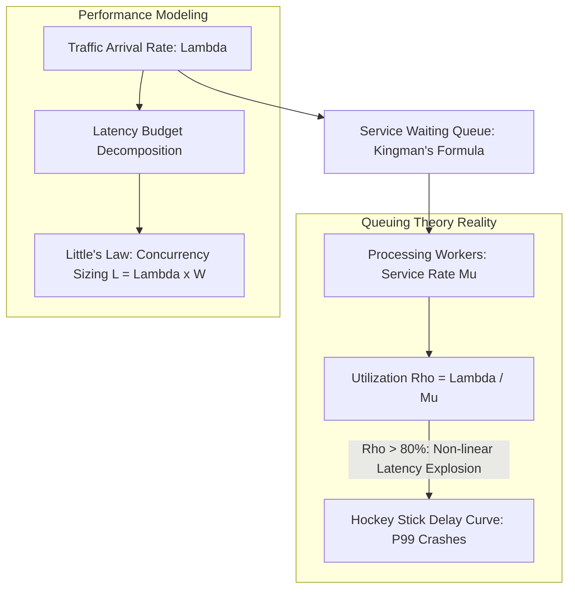
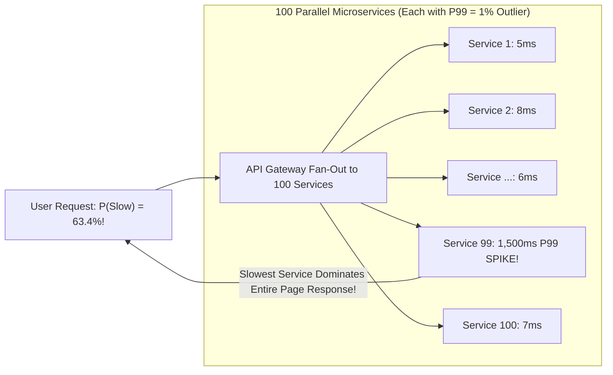
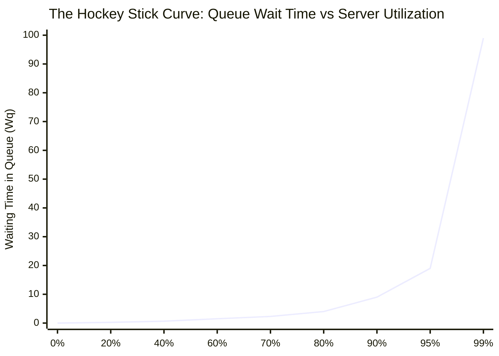

# 12.1. Performance Modeling and Queuing Theory (Mô Hình Hóa Hiệu Năng và Lý Thuyết Xếp Hàng)

## Tổng quan về Mô Hình Hóa Hiệu Năng và Lý Thuyết Xếp Hàng
Trong kỹ thuật phần mềm hiệu năng cao, **Hiệu năng (Performance)** không phải là kết quả của sự may rủi hay việc thử-sai ngẫu nhiên, mà là một **môn khoa học toán học có thể mô hình hóa, đo đạc và dự đoán chính xác**.

Khi hệ thống vận hành ở quy mô lớn, hai lầm tưởng kinh điển thường xuyên đánh lừa các kỹ sư thiếu kinh nghiệm:
1. **Ảo tưởng về Thời gian trung bình (The Myth of Average Latency)**: Chỉ số trung bình ($P50$) che giấu hoàn toàn các thảm họa ở đuôi phân phối (**Tail Latency: $P99, P99.9$**), nơi trải nghiệm của hàng triệu người dùng bị hủy hoại.
2. **Ảo tưởng về Sử dụng tài nguyên tối đa (The 100% Utilization Fallacy)**: Cố gắng vắt kiệt $95\% - 100\%$ CPU để "tiết kiệm chi phí" sẽ kích hoạt **Hiệu ứng gậy khúc côn cầu (Hockey Stick Curve)** trong **Lý thuyết Xếp hàng (Queuing Theory)**, đẩy thời gian chờ đợi trong hàng đợi tăng vọt lên vô hạn và làm sụp đổ toàn bộ hệ thống.



---

## 2. Chi tiết từng Keyword (Under-the-Hood Deep Dive)

### 1. Latency Percentiles (P50, P90, P99, P99.9) & The Tail Latency Trap (Các Bách Phân Vị Độ Trễ và Bẫy Độ Trễ Đuôi)

#### 1. Khái niệm bản chất (What & Why)
- **Độ trễ trung bình (Mean / Average Latency)**: Tổng thời gian của tất cả các request chia cho tổng số request. Đây là **chỉ số nguy hiểm và vô giá trị nhất** trong thiết kế hệ thống vì nó bị kéo lệch bởi phân phối không chuẩn (Non-normal / Long-tailed Distribution).
- **Các Bách Phân Vị (Percentiles)**:
  - **P50 (Median - Trung vị)**: $50\%$ số lượng request có thời gian phản hồi nhỏ hơn hoặc bằng giá trị này. Đại diện cho trải nghiệm của một người dùng thông thường.
  - **P90**: $90\%$ requests nhanh hơn giá trị này; $10\%$ còn lại bị chậm hơn.
  - **P99**: $99\%$ requests nhanh hơn; $1\%$ requests chậm nhất (Tail Latency).
  - **P99.9 ("Three Nines Tail")**: Chỉ $0.1\%$ requests (1 trong 1,000 requests) bị rơi vào ngưỡng chậm nhất này.
- **The Tail Latency Trap (Bẫy độ trễ đuôi)**: Khi một trang web hoặc API Gateway phải thực hiện song song $M$ cuộc gọi nội bộ (Fan-Out) tới các microservices khác để hiển thị một trang, thì **chỉ cần 1 dịch vụ con bị chậm ở ngưỡng $P99$ là toàn bộ trang web của người dùng sẽ bị chậm**!

#### 2. Cơ chế hoạt động sâu (Under the hood / Hardcore Internals)
Chứng minh toán học về sự bùng nổ của Tail Latency trong kiến trúc Microservices:
- Giả sử hệ thống có 100 microservices chạy nền.
- Mỗi microservice có xác suất bị rơi vào độ trễ đuôi $P99$ là $p = 1\% = 0.01$.
- Xác suất để một dịch vụ hoạt động bình thường (không bị trễ $P99$) là: $1 - p = 0.99$.
- Khi người dùng load trang chủ, API Gateway gọi đồng thời $M = 100$ dịch vụ song song:
  - Xác suất để **TẤT CẢ 100 dịch vụ** đều chạy nhanh (không dịch vụ nào bị trễ):
    $$P(\text{Tất cả nhanh}) = (1 - p)^M = 0.99^{100} \approx 0.366 \quad (36.6\%)$$
  - Xác suất để người dùng **PHẢI CHỊU ĐỰNG ÍT NHẤT 1 DỊCH VỤ BỊ TRỄ $P99$**:
    $$P(\text{Người dùng bị chậm}) = 1 - (1 - p)^M = 1 - 0.366 = \mathbf{63.4\%}$$
  - **Kết luận gây sốc**: Mặc dù từng service đơn lẻ cam kết "99% thời gian tôi chạy nhanh như gió", nhưng **gần 2/3 tổng số người dùng thực tế sẽ phải trải nghiệm trang web chậm chạp ở ngưỡng $P99$**!

#### 3. Sơ đồ minh họa


#### 4. Code ví dụ thực chiến (C++20 - Tính toán phân phối Percentiles P50, P90, P99, P99.9)
```cpp
#include <iostream>
#include <vector>
#include <algorithm>
#include <iomanip>

class LatencyDistributionHistogram {
private:
    std::vector<double> latencies_ms_;

public:
    void record(double latency_ms) {
        latencies_ms_.push_back(latency_ms);
    }

    double getPercentile(double percentile) {
        if (latencies_ms_.empty()) return 0.0;
        std::sort(latencies_ms_.begin(), latencies_ms_.end());
        size_t index = static_cast<size_t>(percentile * (latencies_ms_.size() - 1));
        return latencies_ms_[index];
    }

    double getAverage() {
        if (latencies_ms_.empty()) return 0.0;
        double sum = 0.0;
        for (double v : latencies_ms_) sum += v;
        return sum / latencies_ms_.size();
    }
};

int main() {
    LatencyDistributionHistogram hist;

    // Giả lập 990 requests chạy siêu nhanh (từ 5ms đến 15ms)
    for (int i = 1; i <= 990; ++i) {
        hist.record(5.0 + (i % 10));
    }
    // Giả lập 10 requests bị spike do Full GC hoặc Disk stall (từ 500ms đến 2,000ms)
    for (int i = 1; i <= 10; ++i) {
        hist.record(500.0 + i * 150.0);
    }

    std::cout << "[Latency Percentile vs Average Benchmark]\n";
    std::cout << "Mean (Average) Latency: " << std::fixed << std::setprecision(2) << hist.getAverage() << " ms (The Lie!)\n";
    std::cout << "P50 Latency (Median):   " << hist.getPercentile(0.50) << " ms\n";
    std::cout << "P90 Latency:            " << hist.getPercentile(0.90) << " ms\n";
    std::cout << "P99 Latency (Tail):     " << hist.getPercentile(0.99) << " ms (The Reality for Outliers!)\n";
    std::cout << "P99.9 Latency:          " << hist.getPercentile(0.999) << " ms\n";
    return 0;
}
```

#### 5. Ưu / Nhược điểm, Pitfalls & Anti-patterns
- **Anti-pattern: Averaging Percentiles Across Servers**: Lấy trung bình cộng của các chỉ số $P99$ giữa 10 máy chủ: $\frac{P99_1 + P99_2 + \dots + P99_{10}}{10}$. Về mặt toán học, **bách phân vị không có tính cộng tuyến tính**; việc lấy trung bình của bách phân vị là một phép toán sai lầm vô nghĩa!
  - *Giải pháp*: Sử dụng thuật toán **T-Digest** hoặc **HdrHistogram** để gộp các histogram thô.

#### 6. Ứng dụng thực tế trong Backend / Systems
Bài báo kinh điển *"The Tail at Scale"* của Jeff Dean và Luiz André Barroso mô tả toàn bộ kiến trúc tìm kiếm của Google được thiết kế chuyên biệt để triệt tiêu độ trễ đuôi bằng kỹ thuật **Hedged Requests** (gửi trùng lặp request thứ hai nếu request thứ nhất chưa phản hồi sau mốc $P95$).

---

### 2. Latency Budgeting & End-to-End Latency Breakdown (Phân Bổ Ngân Sách Độ Trễ)

#### 1. Khái niệm bản chất (What & Why)
- **End-to-End Latency (Độ trễ đầu-cuối)**: Tổng thời gian tính từ khi người dùng bấm nút trên trình duyệt/điện thoại cho đến khi dữ liệu hiển thị hoàn chỉnh trên màn hình.
- **Latency Budget (Ngân sách độ trễ)**: Giới hạn thời gian tối đa được cam kết bởi SLA (ví dụ: $200\text{ ms}$ cho toàn bộ luồng Checkout). Ngân sách này sau đó được chia nhỏ (Decomposed) cho từng phân đoạn hạ tầng và từng microservice con dọc theo đường đi của gói tin.

#### 2. Cơ chế hoạt động sâu (Under the hood / Hardcore Internals)
Bảng phân bổ ngân sách độ trễ cho một ứng dụng có cam kết $SLA \le 200\text{ ms}$:

| Phân đoạn xử lý | Ngân sách cho phép | Chi tiết kỹ thuật |
| :--- | :--- | :--- |
| **1. Client Network WAN RTT** | $40\text{ ms}$ | Mạng 4G/5G từ điện thoại tới trạm phát sóng nhà mạng |
| **2. Edge CDN & TLS Handshake** | $15\text{ ms}$ | TLS 1.3 0-RTT Termination tại Edge PoP |
| **3. WAF & API Gateway Routing** | $10\text{ ms}$ | Rate Limiting, JWT Verification, URI Parsing |
| **4. Service A (Auth / User)** | $15\text{ ms}$ | Kiểm tra quyền nội bộ qua gRPC |
| **5. Service B (Core Order)** | $30\text{ ms}$ | Thực thi logic nghiệp vụ |
| **6. Database Query (Postgres)** | $25\text{ ms}$ | Index Seek B+Tree, Lock acquisition, WAL write |
| **7. Distributed Cache (Redis)** | $5\text{ ms}$ | Network LAN hop + In-memory get |
| **8. JSON Serialization & Egress**| $10\text{ ms}$ | Đóng gói JSON payload và nén Gzip/Brotli |
| **9. Dự phòng an toàn (Safety Buffer)**| **$50\text{ ms}$** | Dành cho các biến động mạng và GC pause |
| **TỔNG CỘNG** | **$200\text{ ms}$** | **Đạt chuẩn cam kết SLA** |

Nếu một kỹ sư phát triển tính năng mới ở Service B mà làm tăng độ trễ thêm $40\text{ ms}$, ngân sách $200\text{ ms}$ sẽ bị phá vỡ ngay lập tức $\implies$ Pull Request phải bị chặn bởi CI Performance Fitness Function!

#### 3. Sơ đồ minh họa


```mermaid
gantt
    title End-to-End Latency Budget Breakdown (Total SLA: 200ms)
    dateFormat X
    axisFormat %s ms
    section Latency Allocation
    Client WAN (40ms)          :0, 40
    Edge TLS (15ms)            :40, 55
    API Gateway (10ms)         :55, 65
    Service Logic (45ms)       :65, 110
    Database Query (25ms)      :110, 135
    Serialization & Net (15ms) :135, 150
    Safety Headroom Buffer (50ms):150, 200
```

#### 4. Code ví dụ thực chiến (TypeScript - Latency Budget Tracker Middleware)
```typescript
interface RequestBudget {
  totalBudgetMs: number;
  startTime: number;
}

export class LatencyBudgetGuard {
  public static start(budgetMs: number): RequestBudget {
    return { totalBudgetMs: budgetMs, startTime: Date.now() };
  }

  public static checkpoint(budget: RequestBudget, stepName: string): number {
    const elapsed = Date.now() - budget.startTime;
    const remaining = budget.totalBudgetMs - elapsed;

    console.log(`[Budget Checkpoint: ${stepName}] Elapsed: ${elapsed}ms | Remaining: ${remaining}ms / ${budget.totalBudgetMs}ms`);

    if (remaining < 0) {
      console.error(`🚨 SLA BREACH: Step '${stepName}' violated latency budget by ${Math.abs(remaining)}ms!`);
    }
    return remaining;
  }
}

// Chạy thử nghiệm
const budget = LatencyBudgetGuard.start(150); // Ngân sách 150ms
setTimeout(() => LatencyBudgetGuard.checkpoint(budget, "Gateway_Auth"), 30);
setTimeout(() => LatencyBudgetGuard.checkpoint(budget, "Database_Fetch"), 90);
setTimeout(() => LatencyBudgetGuard.checkpoint(budget, "External_Partner_Call"), 180); // Vượt ngân sách!
```

#### 5. Ưu / Nhược điểm, Pitfalls & Anti-patterns
- **Anti-pattern: Serialization in Critical Path**: Dùng thư viện JSON parser chậm chạp trên một payload nặng 10MB ngay trên luồng xử lý chính, chiếm mất $80\%$ tổng ngân sách thời gian chỉ để parse chuỗi string thành object!

#### 6. Ứng dụng thực tế trong Backend / Systems
Amazon tính toán rằng **cứ mỗi $100\text{ ms}$ độ trễ tăng thêm trên website sẽ làm sụt giảm $1\%$ tổng doanh thu bán lẻ** (tương đương hàng tỷ USD mỗi năm).

---

## 2. Chi tiết từng Keyword (Under-the-Hood Deep Dive)

### 3. Queuing Theory: Kingman's Formula, The Hockey Stick Curve & Little's Law (Lý Thuyết Xếp Hàng và Đường Cong Khúc Côn Cầu)

#### 1. Khái niệm bản chất (What & Why)
- **Lý thuyết Xếp hàng (Queuing Theory)**: Ngành toán học nghiên cứu về sự hình thành của các hàng đợi (Queues) khi nhu cầu sử dụng dịch vụ vượt quá năng lực phục vụ tức thời.
- **Hệ số sử dụng tài nguyên ($\rho$ - Utilization)**:
  $$\rho = \frac{\lambda}{\mu}$$
  - $\lambda$ (Lambda): Tốc độ đến của request (Arrival Rate).
  - $\mu$ (Mu): Tốc độ xử lý của máy chủ (Service Rate).
- **The Hockey Stick Curve (Đường cong gậy khúc côn cầu)**: Khi $\rho < 70\%$, thời gian chờ trong hàng đợi rất thấp và tăng từ từ. Nhưng khi $\rho \to 1.0$ ($80\% \rightarrow 95\%$), **thời gian chờ trong hàng đợi bùng nổ phi tuyến tính theo đường tiệm cận đứng tiến tới vô hạn**!

#### 2. Cơ chế hoạt động sâu (Under the hood / Hardcore Internals)
Bản chất toán học của **Công thức Kingman (Kingman's Formula for G/G/1 Queue)**:
Thời gian chờ trung bình trong hàng đợi ($W_q$) được tính bởi:
$$W_q \approx \left( \frac{\rho}{1 - \rho} \right) \left( \frac{c_a^2 + c_s^2}{2} \right) \left( \frac{1}{\mu} \right)$$
- $c_a^2$: Hệ số biến thiên của khoảng cách thời gian request đến (Arrival variability).
- $c_s^2$: Hệ số biến thiên của thời gian xử lý dịch vụ (Service variability).
- Nhân tử bùng nổ: $\mathbf{\frac{\rho}{1 - \rho}}$:
  - Khi $\rho = 0.50$ (50% CPU): $\frac{0.5}{1 - 0.5} = \mathbf{1}$ (Thời gian chờ = 1 đơn vị).
  - Khi $\rho = 0.80$ (80% CPU): $\frac{0.8}{1 - 0.8} = \mathbf{4}$ (Thời gian chờ tăng gấp 4 lần).
  - Khi $\rho = 0.95$ (95% CPU): $\frac{0.95}{1 - 0.95} = \mathbf{19}$ (Thời gian chờ tăng vọt gấp 19 lần!).
  - Khi $\rho = 0.99$ (99% CPU): $\frac{0.99}{1 - 0.99} = \mathbf{99}$ (Thời gian chờ tăng gấp 99 lần!).

**Quy tắc vàng của Kỹ sư Hệ thống**: Tuyệt đối **không bao giờ thiết kế hệ thống chạy ở mức $> 70\% - 80\%$ công suất** trong điều kiện bình thường! Luôn giữ lại $20\% - 30\%$ năng lực dự phòng (Headroom) để ngăn chặn hàng đợi bị nổ!

#### 3. Sơ đồ minh họa (Kingman's Hockey Stick Curve)


#### 4. Code ví dụ thực chiến (C++20 - Mô phỏng Kingman's Queuing Explosion)
```cpp
#include <iostream>
#include <iomanip>

class QueuingTheoryCalculator {
public:
    static void printHockeyStickAnalysis() {
        std::cout << "[Queuing Theory: Kingman's Formula Explosion Analysis]\n";
        std::cout << "--------------------------------------------------------\n";
        std::cout << "Utilization (Rho) | Queue Factor (Rho / (1 - Rho)) | Delay Impact\n";
        std::cout << "--------------------------------------------------------\n";

        double utilizations[] = {0.10, 0.50, 0.70, 0.80, 0.90, 0.95, 0.98, 0.99};

        for (double rho : utilizations) {
            double queue_factor = rho / (1.0 - rho);
            std::cout << std::setw(15) << static_cast<int>(rho * 100) << "% | "
                      << std::setw(28) << std::fixed << std::setprecision(2) << queue_factor << " | ";
            if (rho <= 0.70) std::cout << "HEALTHY (Safe Headroom)\n";
            else if (rho <= 0.85) std::cout << "WARNING (Latency Creep)\n";
            else std::cout << "DANGER (Queue Collapse!)\n";
        }
    }
};

int main() {
    QueuingTheoryCalculator::printHockeyStickAnalysis();
    return 0;
}
```

#### 5. Ưu / Nhược điểm, Pitfalls & Anti-patterns
- **Anti-pattern: Sizing CPU at 95% target to save money**: Cố tình cấu hình Kubernetes HPA chỉ scale khi CPU vượt quá 95%. Hệ thống sẽ liên tục bị rớt vào phần dựng đứng của đường cong khúc côn cầu, khiến độ trễ $P99$ vọt từ $50\text{ ms}$ lên $10,000\text{ ms}$.

#### 6. Ứng dụng thực tế trong Backend / Systems
Phương pháp giám sát **USE Method (Utilization, Saturation, Errors)** của Brendan Gregg (chuyên gia hiệu năng tại Netflix) sử dụng việc đo lường độ dài hàng đợi (Saturation) để phát hiện sớm các nút thắt cổ chai phần cứng trước khi CPU chạm mốc $100\%$.

---

## Tóm tắt liên kết hệ thống
Chương **12.1 (Performance Modeling & Queuing Theory)** đã trang bị cho bạn con mắt nhìn thấu bản chất toán học của hiệu năng: tại sao chỉ số trung bình là lời nói dối, công thức phân bổ ngân sách độ trễ End-to-End, và định luật Kingman chứng minh tại sao hệ thống bị tê liệt khi tài nguyên vượt quá ngưỡng $80\%$.

Trong bài tiếp theo (**12.2: High-Throughput and Low-Latency Engineering**), chúng ta sẽ bước vào các kỹ thuật lập trình tối ưu hóa cực hạn ở tầng mã nguồn và hệ điều hành: Gom cụm Batching, triệt tiêu vấn nạn N+1 Query, tối ưu hóa Serialization, tận dụng Zero-Copy và tối ưu hóa Hot Path trên CPU.
