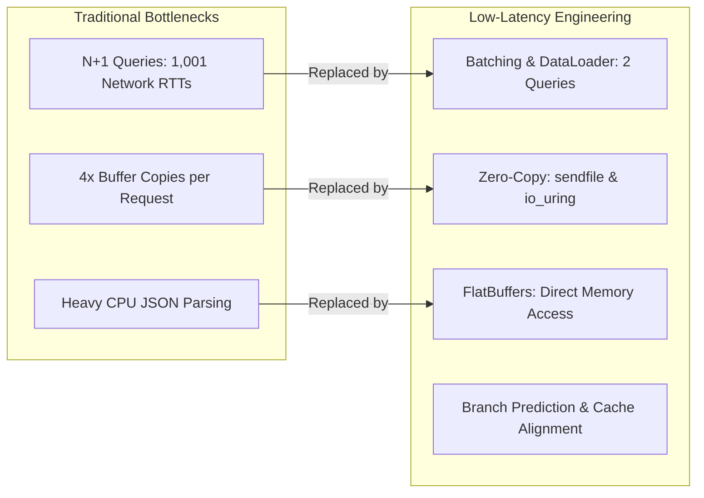
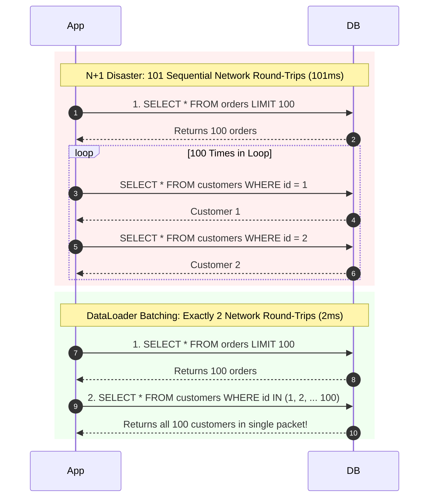
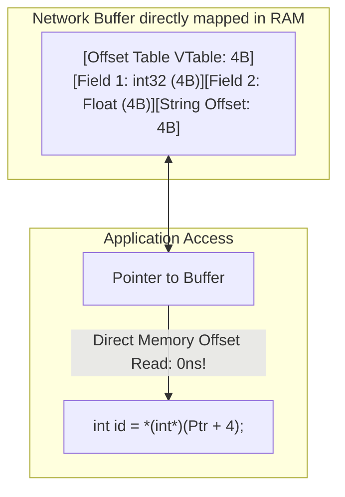
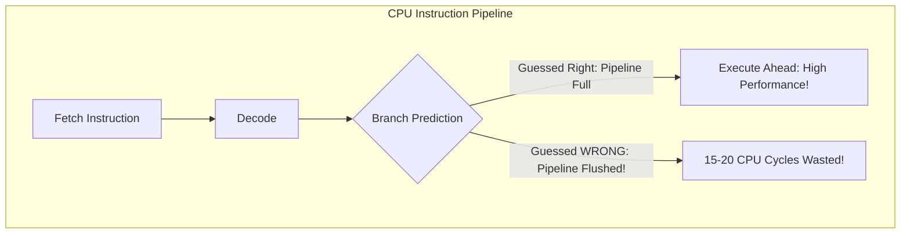

# 12.2. High-Throughput and Low-Latency Engineering (Kỹ Thuật Tối Ưu Thông Lượng Cao và Độ Trễ Thấp)

## Tổng quan về Kỹ Thuật Tối Ưu Thông Lượng Cao và Độ Trễ Thấp
Khi một hệ thống đã được phân bổ kiến trúc hợp lý nhưng vẫn chưa đạt được các chỉ số hiệu năng kỳ vọng (hàng trăm nghìn request/giây hoặc độ trễ dưới 1 mili-giây), kỹ sư bắt buộc phải chuyển trọng tâm từ kiến trúc vĩ mô xuống **kỹ thuật tối ưu hóa vi mô ở tầng mã nguồn, bộ nhớ và hệ điều hành (Low-Level Systems Engineering)**.

Mỗi microsecond độ trễ lãng phí trong hệ thống thường bắt nguồn từ 4 "tội đồ" kinh điển:
1. **Lãng phí thao tác I/O mạng (Network Round-Trip Waste)**: Vấn nạn **N+1 Query Problem** và việc liên tục mở/đóng kết nối TCP thay vì tái sử dụng (**Connection Keep-Alive**).
2. **Copy dữ liệu qua lại không cần thiết (Memory Copy Overhead)**: Lãng phí hàng triệu chu kỳ CPU chuyển dữ liệu giữa Kernel Space và User Space thay vì dùng kỹ thuật **Zero-Copy**.
3. **Chi phí phân tích dữ liệu (Serialization Bottleneck)**: Tốn CPU scan và format các chuỗi JSON cồng kềnh thay vì sử dụng **FlatBuffers / Protocol Buffers**.
4. **Bỏ lỡ tối ưu hóa phần cứng CPU**: Bỏ qua tính cục bộ dữ liệu (**Data Locality**), rẽ nhánh dự đoán sai (**Branch Misprediction**), và cấp phát bộ nhớ động tràn lan trên **Hot Path**.



---

## 2. Chi tiết từng Keyword (Under-the-Hood Deep Dive)

### 1. The N+1 Query Problem & DataLoader Batching (Vấn Nạn N+1 Truy Vấn và Gom Cụm Truy Vấn)

#### 1. Khái niệm bản chất (What & Why)
- **The N+1 Query Problem**: Vấn nạn kinh điển xảy ra khi sử dụng các công cụ ORM (Object-Relational Mapping như Hibernate, Prisma, TypeORM) với cơ chế Lazy Loading. Để lấy danh sách $N$ đơn hàng và tên khách hàng tương ứng:
  - Hệ thống thực thi **1 câu query** để lấy danh sách $N$ đơn hàng: `SELECT * FROM orders LIMIT 100;`.
  - Sau đó, trong một vòng lặp `for`, với mỗi đơn hàng trong số $N$ đơn hàng, ORM lại thực thi **thêm 1 câu query riêng biệt** để lấy tên khách hàng: `SELECT * FROM customers WHERE id = ?;`.
  - Kết quả: Hệ thống phải thực hiện tổng cộng **$N + 1$ câu truy vấn qua mạng** ($1 + 100 = 101$ Network Round Trips)!

#### 2. Cơ chế hoạt động sâu (Under the hood / Hardcore Internals)
Tác động vật lý tàn phá hiệu năng của N+1 Query:
- Giả sử độ trễ mạng LAN giữa App Server và Database là $1\text{ ms}$:
  - Với 101 câu query chạy tuần tự: Hệ thống mất ít nhất **$101 \times 1\text{ ms} = 101\text{ ms}$** chỉ riêng thời gian chờ gói tin bay qua bay lại trên sợi cáp mạng!
  - Cơ sở dữ liệu bị ép phải parse cú pháp SQL, kiểm tra quyền và cấp phát execution plan 101 lần liên tiếp!
- **Giải pháp 1: SQL Eager Loading (`JOIN`)**:
  - Gộp thành 1 câu query duy nhất: `SELECT o.*, c.name FROM orders o JOIN customers c ON o.customer_id = c.id LIMIT 100;`. Tốn đúng **1 Network Round Trip** ($1\text{ ms}$)!
- **Giải pháp 2: Batching qua In-Clause & DataLoader (Chuẩn mực trong GraphQL / Microservices)**:
  - Bước 1: Thu thập toàn bộ $N$ ID khách hàng vào một mảng trong bộ nhớ RAM: `[10, 15, 22, 99]`.
  - Bước 2: Bắn 1 câu query gom cụm duy nhất: `SELECT * FROM customers WHERE id IN (10, 15, 22, 99);`.
  - Chỉ tốn đúng **2 câu truy vấn ($2\text{ ms}$)** thay vì 101 câu!

#### 3. Sơ đồ minh họa


#### 4. Code ví dụ thực chiến (TypeScript - Thuật toán DataLoader Request Batching)
```typescript
interface Customer {
  id: string;
  name: string;
}

// Mô phỏng thư viện DataLoader kinh điển của Facebook
export class MiniDataLoader {
  private queue: string[] = [];
  private batchPromise: Promise<Map<string, Customer>> | null = null;

  constructor(private batchFetchFn: (keys: string[]) => Promise<Customer[]>) {}

  public async load(id: string): Promise<Customer | undefined> {
    this.queue.push(id);

    // Sử dụng process.nextTick / microtask queue để gom tất cả các lệnh load() trong cùng 1 tick event loop
    if (!this.batchPromise) {
      this.batchPromise = new Promise(resolve => {
        process.nextTick(async () => {
          const keysToFetch = [...new Set(this.queue)];
          this.queue = [];
          this.batchPromise = null;

          console.log(`>>> [DataLoader Batch Fired] Combining ${keysToFetch.length} individual queries into 1 SQL IN query!`);
          const customers = await this.batchFetchFn(keysToFetch);
          const map = new Map<string, Customer>();
          customers.forEach(c => map.set(c.id, c));
          resolve(map);
        });
      });
    }

    const customerMap = await this.batchPromise;
    return customerMap.get(id);
  }
}

// Chạy thử nghiệm
async function mockDbBatchQuery(ids: string[]): Promise<Customer[]> {
  // 1 câu SQL duy nhất: SELECT * FROM customers WHERE id IN (...)
  return ids.map(id => ({ id, name: `Customer_Name_${id}` }));
}

const loader = new MiniDataLoader(mockDbBatchQuery);
// Giả lập 3 component độc lập cùng cần nạp thông tin khách hàng trong 1 request
loader.load("CUST_1").then(c => console.log("Received:", c?.name));
loader.load("CUST_2").then(c => console.log("Received:", c?.name));
loader.load("CUST_1").then(c => console.log("Received:", c?.name)); // Tự động loại trùng lặp!
```

#### 5. Ưu / Nhược điểm, Pitfalls & Anti-patterns
- **Anti-pattern: Massive IN-Clause Overflow**: Gom 100,000 IDs vào một câu lệnh `WHERE id IN (...)`. Một số cơ sở dữ liệu (như Oracle giới hạn 1,000 phần tử trong `IN`, SQL Server giới hạn tham số câu query) sẽ ném lỗi crash. 
  - *Giải pháp*: Phải chia nhỏ thành từng mẻ (Chunking) gồm 500 - 1,000 phần tử mỗi mẻ.

#### 6. Ứng dụng thực tế trong Backend / Systems
Mọi máy chủ GraphQL chuẩn mực đều sử dụng thư viện `DataLoader` của Facebook để giải quyết triệt để vấn nạn N+1 khi phân giải các trường liên kết lồng nhau (Nested Resolvers).

---

## 2. Chi tiết từng Keyword (Under-the-Hood Deep Dive)

### 2. Zero-Copy Architecture: sendfile, mmap & io_uring (Kiến Trúc Sao Chép Bằng Không)

#### 1. Khái niệm bản chất (What & Why)
Trong mô hình I/O truyền thống, mỗi khi máy chủ đọc dữ liệu từ một file trên đĩa và gửi qua card mạng (Socket):
Dữ liệu phải trải qua **4 lần copy bộ nhớ** và **4 lần chuyển đổi ngữ cảnh (Context Switches)** giữa User Space và Kernel Space:
1. Đĩa $\xrightarrow{\text{DMA}}$ OS Page Cache (Kernel).
2. OS Page Cache $\xrightarrow{\text{CPU Copy}}$ Ứng dụng Buffer (User Space - System call `read()`).
3. Ứng dụng Buffer $\xrightarrow{\text{CPU Copy}}$ Socket Buffer (Kernel - System call `write()`).
4. Socket Buffer $\xrightarrow{\text{DMA}}$ Card mạng NIC.

- **Zero-Copy**: Kỹ thuật tầng hệ điều hành cho phép truyền tải dữ liệu trực tiếp từ nguồn (Đĩa/Page Cache) sang đích (Card mạng NIC) mà **hoàn toàn loại bỏ việc CPU phải copy dữ liệu lên User Space**. Tiết kiệm hàng tỷ chu kỳ xung nhịp CPU và loại bỏ hoàn toàn hiện tượng phân mảnh bộ nhớ RAM.

#### 2. Cơ chế hoạt động sâu (Under the hood / Hardcore Internals)
Các công nghệ Zero-Copy trên Linux Kernel:
1. **`mmap()` (Memory-mapped Files)**: Ánh xạ trực tiếp file trên đĩa vào không gian địa chỉ ảo của tiến trình. Ứng dụng có thể đọc/ghi vào file giống như thao tác trên một con trỏ mảng thông thường mà không cần gọi `read()` hay `write()`.
2. **`sendfile()`**: System call cho phép chuyển thẳng dữ liệu từ một File Descriptor (file đĩa) sang một File Descriptor khác (TCP Socket). CPU không chạm vào dữ liệu; chip DMA (Direct Memory Access) tự điều phối truyền dữ liệu.
3. **`splice()`**: Chuyển dữ liệu giữa hai file descriptors thông qua một Linux Pipe nội bộ trong Kernel mà không copy dữ liệu.
4. **`io_uring` (Linux Kernel 5.1+ - Đỉnh cao công nghệ I/O hiện đại)**:
   - Thay thế hoàn toàn `epoll` truyền thống.
   - Sử dụng hai hàng đợi vòng tròn dùng chung (**Shared Ring Buffers** giữa Kernel và User Space): **Submission Queue (SQ)** và **Completion Queue (CQ)**.
   - Ứng dụng chỉ cần ghi tác vụ I/O vào Submission Queue; Kernel tự động nhặt và xử lý bất đồng bộ.
   - **HOÀN TOÀN KHÔNG CẦN GỌI SYSTEM CALL (`Zero-Syscall overhead`)**! Một luồng CPU có thể xử lý hơn 1,700,000 IOPS trên một nhân đơn lẻ!

#### 3. Sơ đồ minh họa (Traditional I/O vs Zero-Copy sendfile)

```mermaid
graph TD
    subgraph Traditional Copying: High CPU Overhead
        D1[NVMe Disk] -->|1. DMA Copy| K1[Kernel Page Cache]
        K1 -->|2. CPU Copy: Syscall read| U1[User Space App Memory]
        U1 -->|3. CPU Copy: Syscall write| S1[Kernel Socket Buffer]
        S1 -->|4. DMA Copy| N1[Network Interface NIC]
    end
    
    subgraph Zero-Copy via sendfile: Zero CPU Overhead
        D2[NVMe Disk] -->|1. DMA Copy| K2[Kernel Page Cache]
        K2 -->|2. Direct DMA Transfer: ZERO CPU!| N2[Network Interface NIC]
    end
```


#### 4. Code ví dụ thực chiến (C++20 - Zero-Copy File Streaming qua Linux sendfile)
```cpp
#include <iostream>
#include <fcntl.h>
#include <unistd.h>
#include <sys/stat.h>
#include <sys/types.h>

#if defined(__linux__)
#include <sys/sendfile.h>
#elif defined(__APPLE__)
#include <sys/socket.h>
#include <sys/uio.h>
#endif

// Minh họa hàm truyền file Zero-Copy chuẩn cấp thấp
bool streamFileZeroCopy(int source_fd, int target_socket_fd, size_t file_size) {
    std::cout << "[Zero-Copy Engine] Transferring " << file_size 
              << " bytes directly via Kernel DMA bypass...\n";

#if defined(__linux__)
    off_t offset = 0;
    // sendfile(out_fd, in_fd, offset, count): Chuyển thẳng từ Page Cache sang Socket
    ssize_t sent = sendfile(target_socket_fd, source_fd, &offset, file_size);
    return sent == static_cast<ssize_t>(file_size);
#elif defined(__APPLE__)
    off_t len = file_size;
    // macOS tương đương: sendfile(fd, s, offset, &len, hdtr, flags)
    int res = sendfile(source_fd, target_socket_fd, 0, &len, nullptr, 0);
    return res == 0;
#else
    std::cerr << "Unsupported platform for native sendfile\n";
    return false;
#endif
}

int main() {
    std::cout << "Demonstration of Zero-Copy Kernel Transfer Concept (Linux sendfile / io_uring)\n";
    return 0;
}
```

#### 5. Ưu / Nhược điểm, Pitfalls & Anti-patterns
- **Ưu điểm**: Giảm tải CPU từ $80\%$ xuống dưới $5\%$ cho các tác vụ truyền file media lớn; thông lượng mạng đạt kịch trần băng thông card mạng.
- **Hạn chế**: Dữ liệu không đi qua User Space nên ứng dụng không thể can thiệp sửa đổi nội dung gói tin trên đường truyền (ví dụ không thể nén hoặc mã hóa dữ liệu tùy biến nếu card mạng không hỗ trợ phần cứng TLS offloading).

#### 6. Ứng dụng thực tế trong Backend / Systems
NGINX, Apache Kafka và HAProxy đạt được vị thế thống trị toàn cầu về tốc độ phân phối dữ liệu tĩnh và event log chính là nhờ tận dụng triệt để system call `sendfile()` của Linux.

---

### 3. Serialization Overhead: JSON vs Protocol Buffers vs FlatBuffers (Tối Ưu Hóa Tuần Tự Hóa Dữ Liệu)

#### 1. Khái niệm bản chất (What & Why)
Mỗi khi dữ liệu di chuyển giữa hai máy tính hoặc giữa bộ nhớ RAM và đĩa, nó bắt buộc phải trải qua quá trình **Tuần tự hóa (Serialization)** từ đối tượng trong bộ nhớ thành một chuỗi byte, và **Giải tuần tự hóa (Deserialization)** ở đầu nhận.
- **JSON (Text-based)**: Chuỗi ký tự ASCII/UTF-8. Dễ đọc bằng mắt người, nhưng rất chậm vì CPU phải quét từng ký tự, xử lý escape quotes và chuyển đổi chuỗi số (`"123.45"`) thành số thực dấu phẩy động (Float parsing tốn rất nhiều lệnh CPU).
- **Protocol Buffers (Binary TLV)**: Đóng gói nhị phân dạng Tag-Length-Value với nén Varint. Nhanh hơn JSON gấp 5 đến 10 lần, nhưng vẫn đòi hỏi bước giải mã (Decode) để xây dựng lại cấu trúc đối tượng trong bộ nhớ.
- **FlatBuffers (Google)**: Cơ chế tuần tự hóa nhị phân **Zero-Copy / In-place Access**. Dữ liệu được tổ chức sao cho cấu trúc nhị phân truyền trên mạng **trùng khớp hoàn toàn với cấu trúc bộ nhớ của CPU**. 
  $\implies$ **Thời gian giải mã (Deserialization Time) BẰNG 0 TUYỆT ĐỐI ($0\text{ ns}$)**! Ứng dụng chỉ việc ép kiểu con trỏ bộ nhớ (Pointer Cast) và đọc trực tiếp dữ liệu từ buffer mạng mà không cần cấp phát dù chỉ 1 byte trên Heap!

#### 2. Cơ chế hoạt động sâu (Under the hood / Hardcore Internals)
Bảng đối chiếu hiệu năng kinh điển giữa các định dạng:

| Tiêu chí | JSON | Protocol Buffers (Protobuf) | Google FlatBuffers |
| :--- | :--- | :--- | :--- |
| **Định dạng** | Văn bản thuần (Text) | Nhị phân nén (Binary TLV) | Nhị phân căn chỉnh bộ nhớ |
| **Kích thước Payload** | Lớn (100%) | Nhỏ gọn ($20\% - 30\%$) | Nhỏ gọn vừa phải ($35\% - 45\%$) |
| **Thời gian Parse** | **RẤT CHẬM (Vài chục microsec)**| Nhanh (Vài microsec) | **TỨC THỜI ($0\text{ ns}$ - Zero Parsing!)** |
| **Cấp phát RAM (Heap Alloc)**| Tạo hàng trăm con trỏ String/Obj| Tạo các đối tượng C++/Java | **ZERO Heap Allocations** |
| **Khả năng đọc mắt thường**| Hoàn hảo | Cần file `.proto` | Cần schema `.fbs` |

#### 3. Sơ đồ minh họa (FlatBuffers Zero-Parsing Memory Layout)


#### 4. Code ví dụ thực chiến (C++20 - FlatBuffers-style Direct Memory Offset Traversal)
```cpp
#include <iostream>
#include <vector>
#include <cstdint>
#include <cstring>

// Minh họa triết lý Zero-Copy FlatBuffers: Đọc trực tiếp từ byte buffer qua Memory Offset
#pragma pack(push, 1)
struct BinaryTradeOrder {
    uint32_t order_id;
    uint32_t user_id;
    double price;
    uint32_t quantity;
};
#pragma pack(pop)

int main() {
    // Giả lập một gói tin nhị phân 24 bytes nhận được từ Card mạng Socket
    std::vector<uint8_t> network_packet(sizeof(BinaryTradeOrder));
    
    BinaryTradeOrder raw_order{9981, 1004, 150.75, 500};
    std::memcpy(network_packet.data(), &raw_order, sizeof(BinaryTradeOrder));

    // ================= ZERO-DESERIALIZATION STEP =================
    // Không cần hàm parseJSON(), không cần cấp phát heap!
    // Ép kiểu con trỏ trực tiếp trên buffer mạng (O(1) trong 0 nanosecond):
    const auto* trade = reinterpret_cast<const BinaryTradeOrder*>(network_packet.data());

    std::cout << "[Zero-Copy Binary Traversal]\n";
    std::cout << "Order ID: " << trade->order_id << "\n";
    std::cout << "User ID:  " << trade->user_id << "\n";
    std::cout << "Price:    $" << trade->price << "\n";
    std::cout << "Quantity: " << trade->quantity << "\n";
    return 0;
}
```

#### 5. Ưu / Nhược điểm, Pitfalls & Anti-patterns
- **Ưu điểm FlatBuffers**: Tối ưu hóa cực hạn cho hệ thống giao dịch chứng khoán tần suất cao (High-Frequency Trading - HFT) và Game thời gian thực.
- **Hạn chế FlatBuffers**: Payload không được nén chặt bằng Protobuf (do phải chèn padding căn chỉnh bộ nhớ 4 hoặc 8 bytes cho CPU).

#### 6. Ứng dụng thực tế trong Backend / Systems
Facebook Messenger chuyển toàn bộ client sang FlatBuffers để loại bỏ hiện tượng giật lag khi mở app; TensorFlow Lite sử dụng FlatBuffers làm định dạng lưu trữ mô hình AI để nạp trực tiếp vào RAM thiết bị di động trong 0ms.

---

## 2. Chi tiết từng Keyword (Under-the-Hood Deep Dive)

### 4. Hot Path Optimization: Branch Prediction, Memory Alignment & Cache Locality (Tối Ưu Hóa Đường Dẫn Nóng Trên CPU)

#### 1. Khái niệm bản chất (What & Why)
- **Hot Path (Đường dẫn nóng)**: Chuỗi các câu lệnh mã nguồn được thực thi liên tục và lặp đi lặp lại nhiều nhất cho mỗi request của hệ thống (ví dụ: vòng lặp khớp lệnh mua/bán trên sàn chứng khoán, hoặc hàm băm định tuyến gói tin). 
  - Tối ưu hóa trên Hot Path mang lại giá trị gấp hàng triệu lần so với việc tối ưu hóa một hàm chỉ chạy 1 lần khi khởi động máy chủ.
- **Branch Prediction (Dự đoán rẽ nhánh của CPU)**: CPU hiện đại có đường ống thực thi lệnh sâu (**Instruction Pipeline** 14-20 tầng). Để không bị dừng chờ kết quả của câu lệnh `if (condition)`, CPU sử dụng một bộ dự đoán phần cứng (Branch Predictor) để đoán trước xem nhánh `if` có xảy ra hay không và thực thi trước các lệnh đó (**Speculative Execution**).
  - Nếu đoán đúng: Tốc độ tối đa.
  - Nếu đoán sai (**Branch Misprediction**): Toàn bộ pipeline bị xóa sạch (Pipeline Flush), CPU lãng phí từ **15 đến 20 chu kỳ xung nhịp** chỉ để quay đầu lại!

#### 2. Cơ chế hoạt động sâu (Under the hood / Hardcore Internals)
Kỹ thuật tối ưu hóa Hot Path trong C++20:
1. **Chỉ thị `[[likely]]` và `[[unlikely]]` (C++20 Attributes)**:
   - Hướng dẫn trình biên dịch (GCC/Clang) sắp xếp mã máy nhị phân sao cho nhánh thường xuyên xảy ra nhất được đặt liền kề nhau trong bộ nhớ (Fall-through branch), tối ưu hóa luồng nạp lệnh **L1 Instruction Cache (L1i)**.
2. **Loại bỏ cấp phát bộ nhớ động (`malloc` / `new`) trên Hot Path**:
   - Mỗi lệnh `malloc()` phải đi qua bộ cấp phát (ptmalloc, jemalloc), tranh chấp khóa bộ nhớ và có thể gây phân mảnh heap.
   - *Quy chuẩn*: Cấp phát sẵn bộ đệm tĩnh (**Arena Allocator / Ring Buffer**) khi khởi động tiến trình. Trên Hot Path: $100\%$ không được phép gọi `malloc`!
3. **Data Alignment & Padding (`alignas(64)`)**:
   - Căn chỉnh các biến trên Hot Path vừa khít với kích thước của một CPU Cache Line (64 bytes), tránh hiện tượng một biến nằm đè lên ranh giới giữa 2 cache line (làm tăng gấp đôi số lần truy xuất RAM).

#### 3. Sơ đồ minh họa


#### 4. Code ví dụ thực chiến (C++20 - Tối ưu hóa Hot Path với Branch Prediction & Arena Allocator)
```cpp
#include <iostream>
#include <chrono>
#include <vector>

// Tối ưu hóa nhánh rẽ bằng thuộc tính C++20 [[likely]] và [[unlikely]]
bool validateTransaction(int error_code) {
    // 99.99% trường hợp error_code == 0 (Thành công)
    if (error_code == 0) [[likely]] {
        return true; // Biên dịch thành mã máy tuần tự không nhảy branch
    } else [[unlikely]] {
        std::cerr << "Rare error condition occurred!\n";
        return false;
    }
}

// Cấu trúc dữ liệu căn chỉnh khít 64-byte Cache Line để tối ưu L1 Cache
struct alignas(64) HotPathTradingMetrics {
    uint64_t total_volume;
    uint64_t total_trades;
    double last_price;
    char padding[32]; // Padding đủ 64 bytes ngăn False Sharing tuyệt đối
};

int main() {
    HotPathTradingMetrics metrics{100000, 500, 150.25, {}};
    std::cout << "[Hot Path Memory Alignment] Struct Size: " << sizeof(metrics) << " bytes\n";
    std::cout << "Memory Address: " << &metrics << " (Aligned to 64: " 
              << (reinterpret_cast<uintptr_t>(&metrics) % 64 == 0 ? "YES" : "NO") << ")\n";

    bool is_valid = validateTransaction(0);
    std::cout << "Validation Result: " << (is_valid ? "OK" : "ERROR") << "\n";
    return 0;
}
```

#### 5. Ưu / Nhược điểm, Pitfalls & Anti-patterns
- **Anti-pattern: Premature Optimization on Cold Paths**: Dành hàng tuần để tối ưu hóa từng chu kỳ CPU của một đoạn code đọc file cấu hình chỉ chạy 1 lần duy nhất khi khởi động server, trong khi nút thắt cổ chai thực sự là câu truy vấn Database N+1 đang chạy 10,000 lần mỗi giây.

#### 6. Ứng dụng thực tế trong Backend / Systems
LMAX Disruptor (hạ tầng sàn giao dịch London) xử lý 6 triệu lệnh/giây trên một luồng CPU duy nhất nhờ kết hợp triệt để: Ring Buffer cấp phát sẵn, loại bỏ hoàn toàn khóa (Lock-free CAS), và căn chỉnh 64-byte Cache Line.

---

## Tóm tắt liên kết hệ thống
Toàn bộ chuyên mục **12.2 (High-Throughput & Low-Latency Engineering)** đã trang bị cho bạn những vũ khí tối thượng ở tầng máy tính cấp thấp: triệt tiêu N+1 Query bằng DataLoader, xóa bỏ gánh nặng CPU bằng Zero-Copy `sendfile()`, loại bỏ thời gian Deserialization về 0ns với FlatBuffers, và tối ưu hóa Instruction Pipeline trên Hot Path qua `[[likely]]` và căn chỉnh 64-byte Cache Line.

Tiếp theo, tại **11.13: Security Architecture**, chúng ta sẽ nghiên cứu cách thức bảo vệ pháo đài hệ thống: Kiến trúc Zero Trust, Defense in Depth, xác thực phân tán mTLS, quản lý Secrets, mã hóa Envelope Encryption và mô hình hóa mối đe dọa STRIDE.
