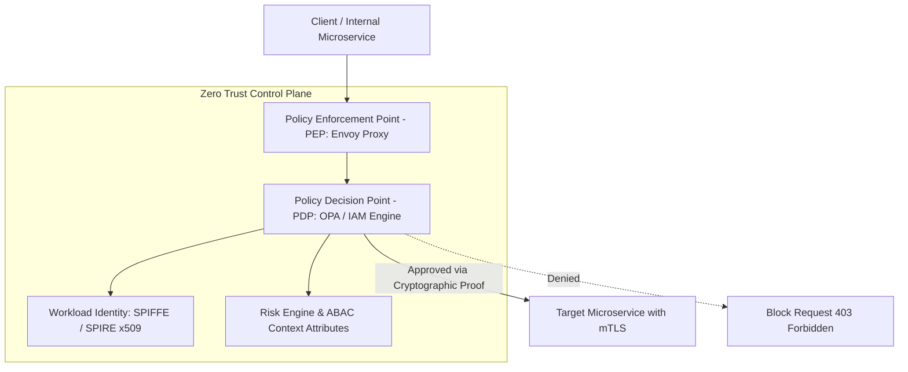
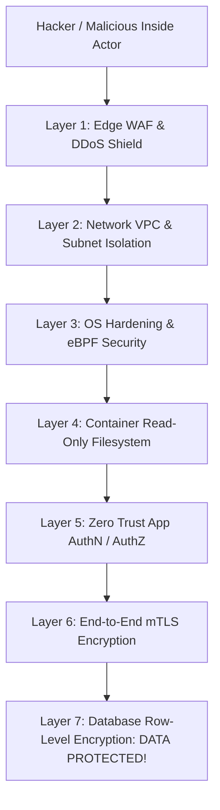
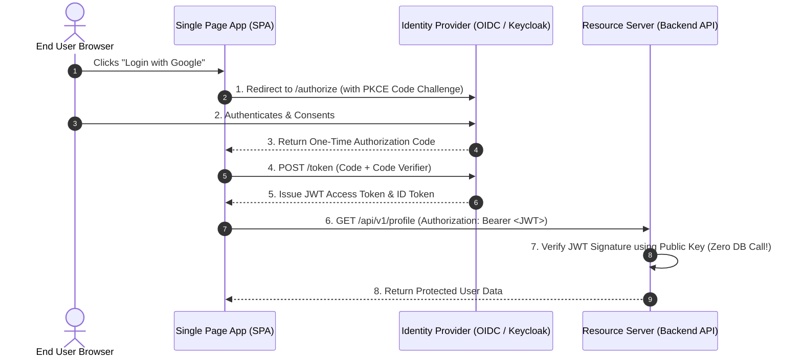
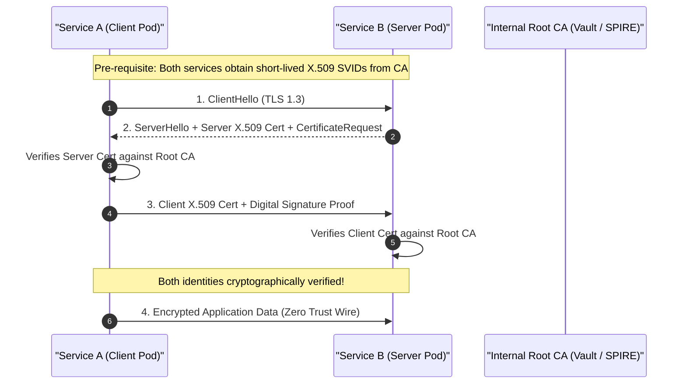

# 13.1. Zero Trust, IAM, and Network Security (Kiến Trúc Zero Trust, Quản Trị Định Danh và Bảo Mật Mạng)

## Tổng quan về Kiến Trúc Zero Trust và Bảo Mật Mạng
Trong mô hình bảo mật truyền thống kiểu "Lâu đài và Hào nước" (Castle-and-Moat), toàn bộ hệ thống dựa vào một bức tường lửa (Firewall) bảo vệ ở biên giới mạng (Perimeter). Bất kỳ ai hay dịch vụ nào đã lọt được vào bên trong mạng nội bộ (Internal Corporate Network / VPC) đều được mặc định coi là đáng tin cậy.

Mô hình này đã chính thức sụp đổ trong kỷ nguyên điện toán đám mây và làm việc từ xa. Khi một kẻ tấn công hoặc mã độc xâm nhập được vào một máy chủ nội bộ bất kỳ, chúng có thể tự do di chuyển ngang (**Lateral Movement**) và đánh cắp dữ liệu của toàn bộ các máy chủ khác.

**Kiến trúc Không Tin Cậy (Zero Trust Architecture)** do Google tiên phong (qua dự án BeyondCorp) và chuẩn hóa bởi NIST SP 800-207 dựa trên nguyên lý cốt tử:
$$\textbf{"Never Trust, Always Verify"}$$
*(Không bao giờ tin tưởng, luôn luôn xác thực mọi yêu cầu truy cập, bất kể yêu cầu đó đến từ bên ngoài Internet hay từ bên trong mạng nội bộ).*



---

## 2. Chi tiết từng Keyword (Under-the-Hood Deep Dive)

### 1. Zero Trust Architecture & Defense in Depth (Kiến Trúc Zero Trust và Phòng Thủ Theo Chiều Sâu)

#### 1. Khái niệm bản chất (What & Why)
- **Zero Trust Architecture (ZTA)**: Mô hình bảo mật không dựa vào vị trí mạng (Network Location) để cấp quyền truy cập. Mọi yêu cầu giao tiếp giữa người dùng với máy chủ, hoặc giữa máy chủ với máy chủ (Service-to-Service) đều bắt buộc phải được: **Xác thực danh tính (Authenticated)**, **Kiểm tra quyền hạn (Authorized)** và **Mã hóa đường truyền (Encrypted)** tại từng bước giao tiếp.
- **Defense in Depth (Phòng thủ theo chiều sâu)**: Chiến lược bảo mật nhiều lớp độc lập. Nếu một lớp bảo vệ bị kẻ tấn công phá vỡ (ví dụ WAF bị qua mặt), các lớp bảo vệ tiếp theo (mTLS, IAM role, Row-Level Security, Database Encryption) vẫn ngăn chặn không cho kẻ tấn công chạm tới dữ liệu cốt lõi.

#### 2. Cơ chế hoạt động sâu (Under the hood / Hardcore Internals)
Bảy lớp phòng thủ theo chiều sâu (The 7-Layer Defense in Depth Model):
1. **Perimeter Layer**: DDoS Protection (Cloudflare / AWS Shield), Web Application Firewall (WAF) lọc các cuộc tấn công SQL Injection và XSS.
2. **Network Layer**: Phân đoạn mạng (Network Segmentation), Private Subnets, Security Groups nghiêm ngặt (chỉ mở cổng tối thiểu).
3. **Host / OS Layer**: Tắt toàn bộ cổng không dùng, vô hiệu hóa tài khoản `root`, chạy các tiến trình dưới quyền Unprivileged User, giám sát kernel bằng Linux eBPF.
4. **Container Layer**: Container Image Scan quét lỗ hổng CVE, Read-only Root Filesystem, gỡ bỏ Linux Capabilities nguy hiểm (`CAP_SYS_ADMIN`).
5. **Application Layer**: Xác thực JWT token, phân quyền theo ngữ cảnh (ABAC), Rate Limiting, Input Validation nghiêm ngặt.
6. **Data Layer**: Mã hóa dữ liệu tĩnh (Encryption at Rest - AES-256), mã hóa dữ liệu động (mTLS).
7. **Audit & Monitoring Layer**: Ghi nhật ký bất biến (Audit Logs) đẩy vào SIEM (Splunk, Elastic SIEM) để phát hiện hành vi dị thường.

#### 3. Sơ đồ minh họa


#### 4. Code ví dụ thực chiến (C++20 - Security Invariant Validator trên từng Request)
```cpp
#include <iostream>
#include <string>
#include <vector>

struct SecurityContext {
    std::string client_identity;
    bool is_tls_verified;
    bool is_service_authenticated;
    std::vector<std::string> permissions;
};

// Zero Trust Gateway Gatekeeper: Không bao giờ tin tưởng vị trí mạng nội bộ!
class ZeroTrustPolicyEnforcer {
public:
    static bool evaluateRequestAccess(const SecurityContext& ctx, const std::string& required_scope) {
        // Nguyên tắc 1: Bắt buộc mã hóa mTLS
        if (!ctx.is_tls_verified) {
            std::cerr << "[ZERO TRUST DENIAL] Unencrypted or non-mTLS communication rejected!\n";
            return false;
        }

        // Nguyên tắc 2: Phải xác thực danh tính tường minh (Zero anonymous internal access)
        if (!ctx.is_service_authenticated || ctx.client_identity.empty()) {
            std::cerr << "[ZERO TRUST DENIAL] Anonymous workload identity rejected!\n";
            return false;
        }

        // Nguyên tắc 3: Kiểm tra quyền tối thiểu (Least Privilege Scope)
        for (const auto& scope : ctx.permissions) {
            if (scope == required_scope) {
                std::cout << "[ZERO TRUST ACCEPTED] Workload '" << ctx.client_identity 
                          << "' authorized for scope: " << required_scope << "\n";
                return true;
            }
        }

        std::cerr << "[ZERO TRUST DENIAL] Identity '" << ctx.client_identity 
                  << "' lacks required scope: " << required_scope << "\n";
        return false;
    }
};

int main() {
    SecurityContext internal_service_ctx{
        .client_identity = "spiffe://prod.cluster.local/ns/default/sa/billing-service",
        .is_tls_verified = true,
        .is_service_authenticated = true,
        .permissions = {"payments:charge", "invoices:read"}
    };

    // Kiểm tra quyền hợp lệ
    ZeroTrustPolicyEnforcer::evaluateRequestAccess(internal_service_ctx, "payments:charge");

    // Giả mạo quyền admin từ mạng nội bộ -> BỊ TỪ CHỐI NGAY LẬP TỨC!
    ZeroTrustPolicyEnforcer::evaluateRequestAccess(internal_service_ctx, "admin:drop_database");
    return 0;
}
```

#### 5. Ưu / Nhược điểm, Pitfalls & Anti-patterns
- **Anti-pattern: Internal IP Whitelisting (Tin tưởng địa chỉ IP nội bộ)**: Cho phép một microservice bỏ qua bước kiểm tra xác thực nếu request đến từ dải IP nội bộ `10.0.0.0/8`. Nếu một pod bị nhiễm mã độc, hacker sẽ dùng IP đó để tấn công toàn bộ hệ thống.

#### 6. Ứng dụng thực tế trong Backend / Systems
Google vận hành toàn bộ mạng lưới nội bộ toàn cầu theo chuẩn BeyondCorp: nhân viên và máy chủ không cần dùng VPN truyền thống mà mọi truy cập đều qua một Identity-Aware Proxy (IAP) kiểm tra danh tính và trạng thái thiết bị theo thời gian thực.

---

## 2. Chi tiết từng Keyword (Under-the-Hood Deep Dive)

### 2. IAM, Authentication & Authorization Architectures: OAuth 2.0, OIDC, RBAC & ABAC (Quản Trị Định Danh và Kiểm Soát Truy Cập)

#### 1. Khái niệm bản chất (What & Why)
- **Identity and Access Management (IAM)**: Hệ thống quản trị toàn diện về danh tính số của con người và máy móc trong doanh nghiệp.
- **Authentication (AuthN - Xác thực)**: Trả lời câu hỏi: *"Bạn là ai?"* (Chứng minh danh tính bằng Mật khẩu, Khóa bảo mật FIDO2/WebAuthn, Sinh trắc học, hoặc Chứng chỉ số X.509).
- **Authorization (AuthZ - Phân quyền)**: Trả lời câu hỏi: *"Bạn được phép làm những gì?"* (Quyết định xem danh tính đã xác thực có được phép thực hiện hành động trên một tài nguyên cụ thể hay không).
- **OAuth 2.0 & OpenID Connect (OIDC)**:
  - *OAuth 2.0*: Khung ủy quyền phân quyền (Delegated Authorization) cho phép bên thứ ba truy cập tài nguyên thay mặt người dùng mà không cần biết mật khẩu (trả về Access Token).
  - *OpenID Connect (OIDC)*: Tầng định danh (Identity Layer) xây dựng bên trên OAuth 2.0 để cung cấp tính năng Xác thực đăng nhập một lần (Single Sign-On - SSO), trả về **ID Token** chuẩn định dạng JWT.

#### 2. Cơ chế hoạt động sâu (Under the hood / Hardcore Internals)
So sánh giữa **RBAC (Role-Based Access Control)** và **ABAC (Attribute-Based Access Control)**:
1. **RBAC (Phân quyền theo vai trò)**:
   - Gán người dùng vào các vai trò cố định (`ADMIN`, `EDITOR`, `VIEWER`). Mỗi vai trò có một tập hợp các quyền (`create:user`, `read:report`).
   - *Hạn chế*: **Hiện tượng bùng nổ vai trò (Role Explosion)**. Khi nghiệp vụ đòi hỏi: *"Bác sĩ chỉ được xem hồ sơ bệnh án của bệnh nhân nếu bác sĩ đó đang trong ca trực tại đúng bệnh viện đó"*, RBAC bất lực vì không thể thể hiện các điều kiện thời gian và bối cảnh!
2. **ABAC (Phân quyền theo thuộc tính - Chuẩn XACML / Open Policy Agent)**:
   - Đưa ra quyết định dựa trên hàm đánh giá đa thuộc tính:
     $$\text{Decision} = f(\text{Subject}, \text{Action}, \text{Resource}, \text{Environment})$$
     - *Subject*: Vai trò, phòng ban, quốc gia của người dùng.
     - *Action*: `READ`, `WRITE`, `APPROVE`.
     - *Resource*: Loại tài liệu, mức độ bảo mật (`CONFIDENTIAL`), người sở hữu.
     - *Environment*: Thời gian trong ngày (giờ hành chính), vị trí địa lý (IP Việt Nam), trạng thái thiết bị (đã bật mã hóa BitLocker).
   - Đạt được mức độ kiểm soát bảo mật hạt mịn (Fine-Grained Authorization) tuyệt đối!

#### 3. Sơ đồ minh họa (OAuth 2.0 Authorization Code Flow with PKCE)


#### 4. Code ví dụ thực chiến (TypeScript - ABAC Policy Engine với Open Policy Agent Pattern)
```typescript
interface UserSubject {
  id: string;
  department: string;
  isTwoFactorVerified: boolean;
}

interface FinancialResource {
  id: string;
  amountUSD: number;
  assignedDepartment: string;
}

interface EnvironmentContext {
  currentHourUTC: number;
  clientIpCountry: string;
}

export class ABACPolicyEngine {
  // Đánh giá quyền truy cập dựa trên 4 chiều thuộc tính (Attribute-Based Access Control)
  public static evaluatePaymentApproval(
    subject: UserSubject,
    resource: FinancialResource,
    action: 'APPROVE_PAYMENT',
    env: EnvironmentContext
  ): { allowed: boolean; reason?: string } {

    // Quy tắc 1: Bắt buộc đã xác thực 2FA
    if (!subject.isTwoFactorVerified) {
      return { allowed: false, reason: "Two-factor authentication required for financial approvals" };
    }

    // Quy tắc 2: Phải cùng phòng ban
    if (subject.department !== resource.assignedDepartment) {
      return { allowed: false, reason: "Cross-department approval forbidden" };
    }

    // Quy tắc 3: Nếu số tiền > $50,000, chỉ cho phép duyệt trong giờ hành chính (08:00 - 17:00 UTC)
    if (resource.amountUSD > 50000) {
      if (env.currentHourUTC < 8 || env.currentHourUTC > 17) {
        return { allowed: false, reason: "High-value approvals only permitted during official business hours" };
      }
    }

    // Quy tắc 4: Chặn các truy cập từ các quốc gia bị cấm vận
    if (env.clientIpCountry === "EMBARGOED_COUNTRY") {
      return { allowed: false, reason: "Geographic restriction policy violation" };
    }

    return { allowed: true };
  }
}

// Chạy thử nghiệm
const user: UserSubject = { id: "USR_10", department: "FINANCE", isTwoFactorVerified: true };
const invoice: FinancialResource = { id: "INV_99", amountUSD: 75000, assignedDepartment: "FINANCE" };
const context: EnvironmentContext = { currentHourUTC: 22, clientIpCountry: "VN" }; // 22:00 đêm

const decision = ABACPolicyEngine.evaluatePaymentApproval(user, invoice, 'APPROVE_PAYMENT', context);
console.log(`[ABAC Decision] Allowed: ${decision.allowed} | Reason: ${decision.reason}`);
// Kết quả: Bị từ chối vì hóa đơn $75k duyệt ngoài giờ hành chính!
```

#### 5. Ưu / Nhược điểm, Pitfalls & Anti-patterns
- **Anti-pattern: Using Symmetric Keys (HS256) across Microservices**: Sử dụng chung một khóa bí mật `SharedSecretKey` để ký và xác minh JWT token giữa 50 microservices khác nhau. Nếu một microservice nhỏ của team thực tập sinh bị lộ mã nguồn, kẻ tấn công có được khóa bí mật và có thể tự tạo (Forge) JWT token của Admin cho toàn bộ hệ thống!
  - *Quy chuẩn*: Luôn luôn dùng **Asymmetric Keys (RS256 hoặc Ed25519)**: Auth Server giữ Private Key để ký token; toàn bộ các microservices chỉ giữ Public Key để xác minh chữ ký.

#### 6. Ứng dụng thực tế trong Backend / Systems
AWS IAM (dựa trên JSON Policy Statements đánh giá theo ABAC) và HashiCorp Vault là hai hệ thống quản trị định danh và phân quyền chuẩn mực toàn cầu.

---

## 2. Chi tiết từng Keyword (Under-the-Hood Deep Dive)

### 3. Mutual TLS (mTLS) & Workload Identity Federation (Xác Thực Lẫn Nhau và Định Danh Khối Công Việc)

#### 1. Khái niệm bản chất (What & Why)
- **Standard TLS (Một chiều)**: Trình duyệt kết nối tới trang web ngân hàng. Trình duyệt kiểm tra chứng chỉ X.509 của ngân hàng để chắc chắn không vào nhầm trang web giả mạo. Server **không kiểm tra chứng chỉ của client** ở tầng mã hóa mạng.
- **Mutual TLS (mTLS - Hai chiều)**: Cả Client và Server **đều phải xuất trình chứng chỉ số X.509 hợp lệ cho nhau** trong quá trình bắt tay kết nối TLS (TLS Handshake).
  - Server xác minh danh tính của Client.
  - Client xác minh danh tính của Server.
  - Mã hóa toàn bộ đường truyền dữ liệu bằng mật mã bất đối xứng kết hợp đối xứng (AES-GCM / ChaCha20-Poly1305).
- **Workload Identity (Chuẩn SPIFFE / SPIRE)**: Tiêu chuẩn công nghiệp cung cấp danh tính mật mã học duy nhất cho từng Container / Pod dưới dạng một chuỗi URI chuẩn (**SPIFFE ID**: ví dụ `spiffe://cluster.local/ns/prod/sa/order-service`) và tự động cấp phát chứng chỉ X.509 ngắn hạn (SVID) có vòng đời chỉ 1 giờ.

#### 2. Cơ chế hoạt động sâu (Under the hood / Hardcore Internals)
Quy trình bắt tay mTLS (mTLS Handshake Flow):
1. **Client Hello**: Client gửi danh sách các bộ mã hóa mật mã (Cipher Suites) được hỗ trợ.
2. **Server Hello & Certificate**: Server gửi chứng chỉ X.509 của Server kèm khóa công khai (Server Public Key).
3. **Certificate Request (Điểm khác biệt của mTLS)**: Server gửi thông điệp yêu cầu: *"Client hãy xuất trình chứng chỉ số của bạn!"*.
4. **Client Certificate & Certificate Verify**:
   - Client gửi chứng chỉ X.509 của Client.
   - Client sử dụng **Khóa riêng tư (Client Private Key)** để ký lên một chuỗi dữ liệu ngẫu nhiên của phiên làm việc và gửi chữ ký đó cho Server để chứng minh nó thực sự sở hữu Private Key tương ứng.
5. **Mutual Verification**:
   - Server kiểm tra chứng chỉ của Client dựa trên Certificate Authority (Root CA) nội bộ.
   - Client kiểm tra chứng chỉ của Server.
6. **Session Keys Generated**: Cả hai bên độc lập tính toán ra khóa phiên chung (Symmetric Session Key) và bắt đầu trao đổi dữ liệu an toàn $100\%$!

#### 3. Sơ đồ minh họa (mTLS Service-to-Service Handshake)


#### 4. Code ví dụ thực chiến (C++20 - Mô phỏng thẩm định mTLS Workload Identity URI)
```cpp
#include <iostream>
#include <string>
#include <regex>

struct MTLSConnectionContext {
    std::string peer_san_uri; // Subject Alternative Name (SAN) từ X.509 Certificate
    bool is_cert_signed_by_root_ca;
    bool is_cert_revoked;
};

class MTLSWorkloadValidator {
public:
    static bool validateClientIdentity(const MTLSConnectionContext& ctx, const std::string& allowed_service_name) {
        // 1. Kiểm tra tính hợp lệ của chữ ký Root CA
        if (!ctx.is_cert_signed_by_root_ca || ctx.is_cert_revoked) {
            std::cerr << "[mTLS Handshake Failed] Untrusted or Revoked Client Certificate!\n";
            return false;
        }

        // 2. Phân tích cú pháp SPIFFE ID trong SAN Extension của chứng chỉ
        // Định dạng chuẩn: spiffe://<trust-domain>/ns/<namespace>/sa/<service-account>
        std::regex spiffe_pattern(R"(^spiffe://([a-zA-Z0-9.-]+)/ns/([a-zA-Z0-9.-]+)/sa/([a-zA-Z0-9.-]+)$)");
        std::smatch matches;

        if (std::regex_match(ctx.peer_san_uri, matches, spiffe_pattern)) {
            std::string trust_domain = matches[1].str();
            std::string ns = matches[2].str();
            std::string service_account = matches[3].str();

            std::cout << "[mTLS Verified] Client Trust Domain: " << trust_domain 
                      << " | Namespace: " << ns << " | Workload: " << service_account << "\n";

            if (service_account == allowed_service_name) {
                return true;
            }
        }

        std::cerr << "[mTLS Forbidden] Workload identity does not match allowed authorization policy.\n";
        return false;
    }
};

int main() {
    MTLSConnectionContext client_ctx{
        .peer_san_uri = "spiffe://prod.company.internal/ns/core-banking/sa/ledger-worker",
        .is_cert_signed_by_root_ca = true,
        .is_cert_revoked = false
    };

    bool allowed = MTLSWorkloadValidator::validateClientIdentity(client_ctx, "ledger-worker");
    std::cout << "Handshake Result: " << (allowed ? "SECURE ENCRYPTED CHANNEL ESTABLISHED" : "DROPPED") << "\n";
    return 0;
}
```

#### 5. Ưu / Nhược điểm, Pitfalls & Anti-patterns
- **Ưu điểm**: Loại bỏ hoàn toàn việc lưu trữ mật khẩu tĩnh (Static API Keys / Passwords) giữa các microservices; mã hóa toàn bộ dữ liệu trên đường truyền nội bộ; chống nghe lén (Man-in-the-Middle) tuyệt đối.
- **Thách thức vận hành**: Quản trị vòng đời chứng chỉ số (Certificate Rotation). Nếu chứng chỉ nội bộ hết hạn mà hệ thống gia hạn tự động bị lỗi, toàn bộ cụm Microservices sẽ ngừng giao tiếp với nhau ngay lập tức!

#### 6. Ứng dụng thực tế trong Backend / Systems
Các nền tảng Service Mesh hàng đầu thế giới (Istio, Linkerd, Consul Connect) tự động cài đặt các Sidecar Envoy Proxy để thiết lập mã hóa mTLS tự động $100\%$ giữa các Pod trên Kubernetes mà lập trình viên không cần viết thêm một dòng code nào.

---

## Tóm tắt liên kết hệ thống
Chương **13.1 (Zero Trust, IAM, and Network Security)** đã trang bị cho bạn các trụ cột vững chắc nhất của nền an ninh mạng hiện đại: triết lý "Never Trust, Always Verify", mô hình 7 lớp Defense in Depth, xác thực OAuth 2.0 / OIDC với PKCE, phân quyền linh hoạt ABAC và cơ chế xác thực khối công việc phân tán mTLS với chuẩn SPIFFE/SPIRE.

Trong bài tiếp theo (**13.2: Data Protection and Threat Modeling**), chúng ta sẽ hoàn thiện bức tranh an ninh hệ thống: Quản lý bí mật (Secrets Management với HashiCorp Vault), mã hóa dữ liệu tĩnh và kỹ thuật Envelope Encryption, cách ly dữ liệu nhiều người thuê (Tenant Isolation), mô hình hóa hiểm họa tấn công **STRIDE** và an ninh chuỗi cung ứng phần mềm.
