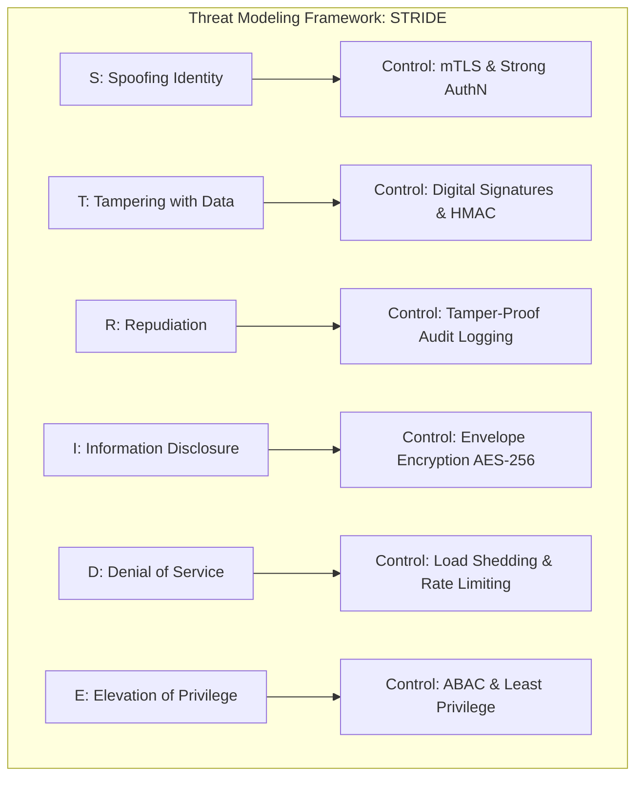
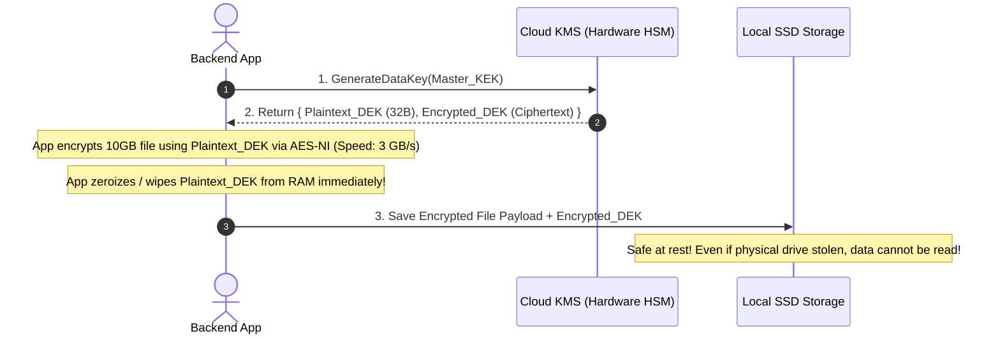
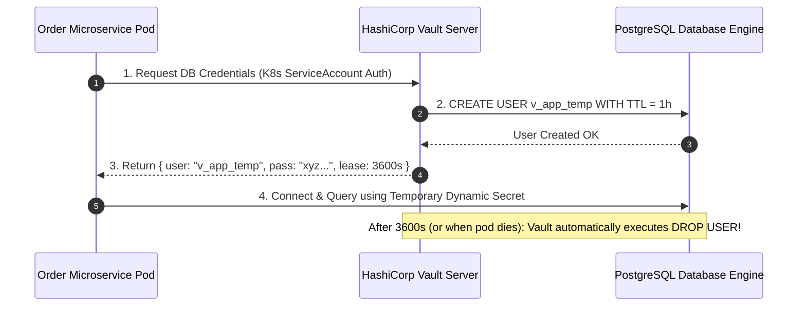
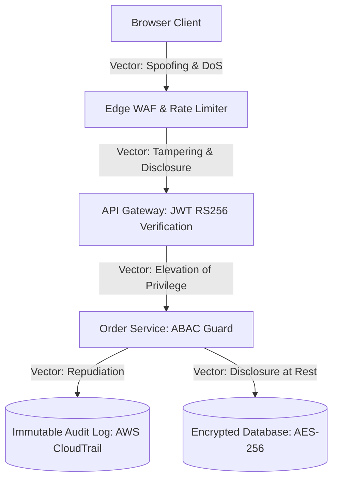
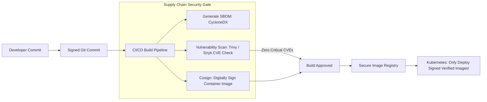

# 13.2. Data Protection and Threat Modeling (Bảo Vệ Dữ Liệu và Mô Hình Hóa Mối Đe Dọa)

## Tổng quan về Bảo Vệ Dữ Liệu và Mô Hình Hóa Mối Đe Dọa
Trong một thế giới mà các cuộc tấn công mạng diễn ra liên tục từng giây và các quy định pháp lý quốc tế (GDPR, HIPAA, PCI-DSS) áp đặt các mức phạt lên tới hàng trăm triệu USD cho các vụ rò rỉ dữ liệu, việc bảo vệ dữ liệu không thể chỉ là một tính năng phụ được thêm vào ở giai đoạn cuối dự án. 

Kiến trúc an ninh dữ liệu hiện đại tập trung vào hai trụ cột sống còn:
1. **Bảo vệ dữ liệu toàn diện (End-to-End Data Protection)**: Mã hóa dữ liệu tĩnh (**Encryption at Rest**) bằng kỹ thuật **Mã hóa Phong bì (Envelope Encryption)** kết hợp hệ thống phần cứng chuyên dụng (**Hardware Security Module - HSM / KMS**), và quản trị bí mật tự động (**Secrets Management**).
2. **Mô hình hóa mối đe dọa chủ động (Threat Modeling)**: Phân tích và triệt tiêu các vector tấn công tiềm tàng ngay từ trên bản vẽ thiết kế kiến trúc thông qua khung phân loại **STRIDE** của Microsoft, thu hẹp bề mặt tấn công (**Attack Surface Reduction**) và bảo vệ an ninh chuỗi cung ứng phần mềm (**Software Supply Chain Security**).



---

## 2. Chi tiết từng Keyword (Under-the-Hood Deep Dive)

### 1. Cryptographic Protection: Envelope Encryption, KMS & HSM (Mã Hóa Phong Bì và Quản Lý Khóa)

#### 1. Khái niệm bản chất (What & Why)
- **Encryption at Rest (Mã hóa dữ liệu tĩnh)**: Bảo vệ dữ liệu khi nó được lưu trữ trên các phương tiện vật lý (Ổ cứng SSD, Cơ sở dữ liệu, Object Storage S3, Băng từ backup). Nếu kẻ trộm đột nhập vào Datacenter tháo trộm ổ cứng, hoặc nhân viên cloud provider sao chép trái phép snapshot volume đĩa, chúng cũng không thể đọc được nội dung nếu không có khóa giải mã.
- **Envelope Encryption (Mã hóa phong bì)**: Mô hình mã hóa hai tầng phân cấp kết hợp:
  1. **Data Encryption Key (DEK - Khóa mã hóa dữ liệu)**: Một khóa đối xứng (AES-256) được sinh ra để mã hóa trực tiếp khối dữ liệu thực tế (file ảnh, bảng dữ liệu).
  2. **Key Encryption Key (KEK / Master Key - Khóa mã hóa khóa)**: Một khóa gốc có độ bảo mật tối cao được lưu trữ an toàn bên trong thiết bị phần cứng **HSM (Hardware Security Module)** của Cloud KMS (AWS KMS, Google Cloud KMS). KEK được dùng để **mã hóa chính chiếc khóa DEK**.
- Chiếc khóa DEK sau khi bị mã hóa (Encrypted DEK) được lưu trữ ngay cạnh khối dữ liệu mã hóa (Ciphertext) giống như một bức thư được bỏ vào trong một phong bì niêm phong!

#### 2. Cơ chế hoạt động sâu (Under the hood / Hardcore Internals)
Tại sao không gửi trực tiếp file dữ liệu 10GB lên Cloud KMS để mã hóa?
- **Giới hạn phần cứng HSM và Băng thông mạng**: Thiết bị phần cứng bảo mật HSM chỉ được thiết kế để xử lý các phép toán mật mã trên các khối dữ liệu cực nhỏ (tối đa vài Kilobytes). Việc gửi file 10GB qua mạng lên KMS sẽ gây nghẽn băng thông và làm sập trần hạn ngạch (Rate Limit Quota) của KMS API!
- **Quy trình chuẩn của Envelope Encryption**:
  1. **Tạo khóa DEK**: Ứng dụng gọi Cloud KMS API: `GenerateDataKey(KeyId="master_kek")`.
  2. KMS trả về hai giá trị:
     - `Plaintext DEK`: Chiếc khóa thô ở dạng rõ (ví dụ 32 bytes ngẫu nhiên).
     - `Encrypted DEK`: Chiếc khóa đã được mã hóa bằng Master KEK.
  3. **Mã hóa cục bộ siêu tốc**: Ứng dụng sử dụng `Plaintext DEK` kết hợp với tập lệnh tăng tốc phần cứng của CPU (**Intel AES-NI Instructions**) để mã hóa file 10GB trực tiếp trên RAM cục bộ với tốc độ vài Gigabyte/giây!
  4. **Tiêu hủy Plaintext DEK**: Ứng dụng **ngay lập tức xóa sạch `Plaintext DEK` khỏi bộ nhớ RAM** (ghi đè bằng số 0 bằng hàm `memset_s` hoặc `SecureZeroMemory`).
  5. **Lưu trữ**: Ứng dụng lưu `Encrypted DEK` kèm với file đã mã hóa xuống đĩa SSD. Kẻ trộm có được đĩa cũng không thể giải mã được nếu không có quyền truy cập vào Cloud KMS!

#### 3. Sơ đồ minh họa (Envelope Encryption Flow)


#### 4. Code ví dụ thực chiến (C++20 - Mô phỏng cơ chế Envelope Encryption & Memory Zeroization)
```cpp
#include <iostream>
#include <vector>
#include <string>
#include <cstring>
#include <random>

// Mô phỏng xóa sạch bộ nhớ nhạy cảm ngăn ngừa rò rỉ RAM (Zeroization)
void secureZeroizeMemory(void* ptr, size_t size) {
    volatile unsigned char* p = static_cast<volatile unsigned char*>(ptr);
    while (size--) {
        *p++ = 0;
    }
}

struct EncryptedEnvelope {
    std::string ciphertext_payload;
    std::string encrypted_dek_blob; // Khóa DEK đã bị mã hóa bởi KMS
};

class EnvelopeEncryptionEngine {
public:
    static EncryptedEnvelope encryptData(const std::string& plaintext_data) {
        std::cout << "[KMS API Call] Requesting new Data Encryption Key (DEK)...\n";
        
        // Giả lập nhận 32 bytes Plaintext DEK từ KMS
        char plaintext_dek[32];
        for (int i = 0; i < 32; ++i) plaintext_dek[i] = static_cast<char>('A' + (i % 26));
        std::string encrypted_dek = "KMS_ENCRYPTED_BLOB_FOR_DEK_9981";

        // Thực hiện mã hóa dữ liệu cục bộ bằng AES-NI (Minh họa bằng XOR giả lập)
        std::string ciphertext = plaintext_data;
        for (size_t i = 0; i < ciphertext.size(); ++i) {
            ciphertext[i] ^= plaintext_dek[i % 32];
        }
        std::cout << "[Local Crypto] Payload encrypted locally with High-Speed CPU instructions.\n";

        // BẮT BUỘC: Xóa sạch Plaintext DEK khỏi bộ nhớ RAM ngay lập tức!
        secureZeroizeMemory(plaintext_dek, sizeof(plaintext_dek));
        std::cout << "[Memory Hardening] Plaintext DEK safely wiped with zeroize.\n";

        return EncryptedEnvelope{ciphertext, encrypted_dek};
    }
};

int main() {
    std::string sensitive_ssn = "USER_CREDIT_CARD_4111_2222_3333_4444";
    auto envelope = EnvelopeEncryptionEngine::encryptData(sensitive_ssn);

    std::cout << "[Storage Output] Encrypted Blob Ready for S3 Disk:\n";
    std::cout << "Ciphertext Size:   " << envelope.ciphertext_payload.size() << " bytes\n";
    std::cout << "Encrypted DEK Tag: " << envelope.encrypted_dek_blob << "\n";
    return 0;
}
```

#### 5. Ưu / Nhược điểm, Pitfalls & Anti-patterns
- **Anti-pattern: Hardcoded Master Keys**: Lưu khóa mã hóa trong file cấu hình `.env` hoặc nhúng trực tiếp trong mã nguồn. Khi repo git bị rò rỉ hoặc hacker đọc được file cấu hình qua lỗ hổng LFI (Local File Inclusion), toàn bộ cơ chế mã hóa bị phá sản!

#### 6. Ứng dụng thực tế trong Backend / Systems
AWS S3 Server-Side Encryption (SSE-KMS), Google Cloud Storage Default Encryption và Google Tink Cryptographic Library đều hoạt động dựa trên Envelope Encryption.

---

### 2. Secrets Management & Dynamic Secrets: Vault Architecture (Quản Trị Bí Mật và Khóa Động)

#### 1. Khái niệm bản chất (What & Why)
- **Secrets Management**: Quản trị vòng đời an toàn của tất cả các dữ liệu nhạy cảm kỹ thuật: Database Passwords, API Keys, SSH Keys, Chứng chỉ số TLS và Token dịch vụ.
- **Nguyên tắc "Zero Hardcoded Secrets"**: Nghiêm cấm tuyệt đối việc lưu mật khẩu tĩnh trong mã nguồn, file cấu hình hay biến môi trường tĩnh của Container image.
- **Dynamic Secrets (Bí mật động - Tiêu chuẩn HashiCorp Vault)**: Thay vì cấp cho microservice một mật khẩu database tĩnh dùng chung suốt 5 năm, dịch vụ Secrets Management sẽ **tự động sinh ra một tài khoản Database mới toanh theo yêu cầu (Just-in-Time)** với quyền tối thiểu và có **Hạn sử dụng ngắn hạn (Lease Time, ví dụ: 1 giờ)**. Sau 1 giờ, Vault tự động tiêu hủy tài khoản đó khỏi cơ sở dữ liệu.

#### 2. Cơ chế hoạt động sâu (Under the hood / Hardcore Internals)
Quy trình vận hành Dynamic Secrets của HashiCorp Vault:
1. Microservice khi khởi động sử dụng danh tính ngắn hạn (Kubernetes Service Account JWT) để xác thực vào Vault.
2. Microservice gửi yêu cầu: `GET /v1/database/creds/readonly-role`.
3. Vault kết nối trực tiếp vào PostgreSQL với quyền admin và thực thi câu lệnh SQL:
   ```sql
   CREATE USER v_user_77a9 WITH PASSWORD 'random_super_secret_password' VALID UNTIL '2026-11-09 23:30:00';
   GRANT SELECT ON orders TO v_user_77a9;
   ```
4. Vault trả tài khoản `v_user_77a9` về cho Microservice kèm một `Lease ID` có hạn 1 giờ.
5. Microservice dùng tài khoản này để kết nối cơ sở dữ liệu.
6. Nếu Microservice bị hacker xâm nhập và đánh cắp thông tin tài khoản: Tài khoản này cũng sẽ **tự động biến mất và vô hiệu hóa sau 1 giờ**, làm giảm thiểu tối đa cửa sổ thời gian tấn công của kẻ gian!

#### 3. Sơ đồ minh họa (HashiCorp Vault Dynamic Secrets Lifecycle)


#### 4. Code ví dụ thực chiến (TypeScript - Dynamic Secret Lease Renewal & Rotation Engine)
```typescript
interface VaultSecretLease {
  username: string;
  password: string;
  leaseId: string;
  leaseDurationSeconds: number;
  obtainedAt: number;
}

export class VaultSecretsClient {
  private currentLease: VaultSecretLease | null = null;

  constructor(private vaultServerUrl: string) {}

  public async getDatabaseCredentials(): Promise<{ user: string; pass: string }> {
    const now = Date.now();

    // Nếu chưa có secret hoặc secret sắp hết hạn (trước 5 phút): Yêu cầu cấp mới
    if (!this.currentLease || now > (this.currentLease.obtainedAt + (this.currentLease.leaseDurationSeconds - 300) * 1000)) {
      console.log("[Vault Client] Requesting new Just-In-Time Dynamic Secret from Vault...");
      this.currentLease = await this.fetchDynamicSecretFromVault();
    }

    return {
      user: this.currentLease.username,
      pass: this.currentLease.password
    };
  }

  private async fetchDynamicSecretFromVault(): Promise<VaultSecretLease> {
    // Giả lập gọi API Vault /v1/database/creds/order-role
    return {
      username: "v_dynamic_user_" + Math.random().toString(36).substring(7),
      password: "s3cur3_p4ssword_" + Math.random().toString(36),
      leaseId: "database/creds/order-role/" + Math.random().toString(36),
      leaseDurationSeconds: 3600, // Sống trong 1 giờ
      obtainedAt: Date.now()
    };
  }
}
```

#### 5. Ưu / Nhược điểm, Pitfalls & Anti-patterns
- **Anti-pattern: Storing Secrets in Docker Images**: Đặt mật khẩu trong file `Dockerfile` (`ENV DB_PASS=secret123`). Bất kỳ ai có quyền kéo (pull) container image từ Registry hoặc chạy lệnh `docker history` đều có thể trích xuất mật khẩu ở dạng rõ!

#### 6. Ứng dụng thực tế trong Backend / Systems
HashiCorp Vault, AWS Secrets Manager và CyberArk là nền tảng quản trị bí mật bắt buộc trong mọi hạ tầng đám mây của khối Ngân hàng và Chính phủ.

---

## 2. Chi tiết từng Keyword (Under-the-Hood Deep Dive)

### 3. Threat Modeling: The STRIDE Framework & Attack Surface Reduction (Mô Hình Hóa Mối Đe Dọa STRIDE)

#### 1. Khái niệm bản chất (What & Why)
- **Threat Modeling (Mô hình hóa mối đe dọa)**: Phương pháp tiếp cận có cấu trúc nhằm phân tích sơ đồ kiến trúc hệ thống, xác định các rủi ro bảo mật tiềm tàng, các vector tấn công khả dĩ, và thiết kế các biện pháp kiểm soát giảm thiểu rủi ro (Mitigations) ngay từ giai đoạn thiết kế trên giấy.
- **Khung STRIDE (Do Loren Kohnfelder và Praerit Garg phát triển tại Microsoft)**: Bảng phân loại 6 mối đe dọa an ninh mạng kinh điển:
  1. **S - Spoofing Identity (Mạo danh danh tính)**: Kẻ tấn công giả vờ là một người dùng hợp pháp hoặc một microservice khác.
  2. **T - Tampering with Data (Làm sai lệch dữ liệu)**: Can thiệp sửa đổi trái phép dữ liệu trên đường truyền hoặc trong cơ sở dữ liệu.
  3. **R - Repudiation (Chối bỏ trách nhiệm)**: Kẻ gian thực hiện hành động gian lận nhưng hệ thống không có bằng chứng để truy cứu trách nhiệm (thiếu nhật ký kiểm toán).
  4. **I - Information Disclosure (Rò rỉ thông tin)**: Để lộ dữ liệu mật cho những người không có thẩm quyền.
  5. **D - Denial of Service (Từ chối dịch vụ - DoS)**: Làm tê liệt hệ thống, ngăn cản người dùng hợp pháp truy cập dịch vụ.
  6. **E - Elevation of Privilege (Leo thang đặc quyền)**: Một người dùng thường chiếm đoạt được quyền quản trị viên tối cao (Admin/Root).
- **Attack Surface Reduction (Thu hẹp bề mặt tấn công)**: Loại bỏ các tính năng không dùng, tắt các cổng mạng không cần thiết, thu hẹp quyền truy cập để giảm thiểu tối đa các điểm mà hacker có thể nhắm vào.

#### 2. Cơ chế hoạt động sâu (Under the hood / Hardcore Internals)
Bảng ánh xạ chuẩn hóa giữa Hiểm họa STRIDE và Biện pháp Kiến trúc:

| Hiểm họa STRIDE | Mục tiêu bảo mật bị đe dọa | Biện pháp Kiến trúc & Kỹ thuật khắc phục |
| :--- | :--- | :--- |
| **S - Spoofing** | Tính xác thực (Authenticity) | **mTLS**, Xác thực đa yếu tố (MFA / FIDO2), Chữ ký số JWT (RS256). |
| **T - Tampering** | Tính toàn vẹn (Integrity) | Mã hóa TLS 1.3, Hàm băm mật mã **HMAC-SHA256**, Chữ ký số bất đối xứng. |
| **R - Repudiation** | Tính không thể chối bỏ (Non-repudiation) | **Append-only Audit Logging** với cơ chế WORM (Write Once Read Many), SIEM. |
| **I - Disclosure** | Tính bí mật (Confidentiality) | **Envelope Encryption (AES-256)**, Masking dữ liệu nhạy cảm trong Log. |
| **D - DoS** | Tính sẵn sàng (Availability) | **Rate Limiting (Token Bucket)**, Load Shedding, Anycast DDoS Scrubbing. |
| **E - Elevation** | Tính ủy quyền (Authorization) | **Nguyên tắc Đặc quyền tối thiểu (Least Privilege)**, ABAC, Rootless Containers. |

#### 3. Sơ đồ minh họa (STRIDE Analysis on E-Commerce Checkout Architecture)


#### 4. Code ví dụ thực chiến (C++20 - Tamper-Proof HMAC-SHA256 Payload Verification Engine)
```cpp
#include <iostream>
#include <string>
#include <sstream>
#include <iomanip>

// Giả lập hàm băm kiểm tra tính toàn vẹn (Chống Tampering trong STRIDE)
class IntegrityGuard {
public:
    static std::string calculateHMAC(const std::string& key, const std::string& message) {
        // Minh họa logic băm HMAC bảo vệ gói tin không bị sửa đổi trên đường truyền
        uint64_t hash = 14695981039346656037ULL;
        for (char c : key) hash = (hash ^ static_cast<uint8_t>(c)) * 1099511628211ULL;
        for (char c : message) hash = (hash ^ static_cast<uint8_t>(c)) * 1099511628211ULL;

        std::stringstream ss;
        ss << std::hex << std::setw(16) << std::setfill('0') << hash;
        return ss.str();
    }

    static bool verifyMessageIntegrity(const std::string& secret_key, const std::string& message, const std::string& expected_signature) {
        std::string actual_signature = calculateHMAC(secret_key, message);
        // So sánh chuỗi với thời gian cố định (Constant-time Comparison) để chống Timing Attacks!
        if (actual_signature.size() != expected_signature.size()) return false;
        
        volatile int result = 0;
        for (size_t i = 0; i < actual_signature.size(); ++i) {
            result |= (actual_signature[i] ^ expected_signature[i]);
        }
        return result == 0;
    }
};

int main() {
    std::string secret = "SUPER_SECURE_HMAC_SHARED_SECRET_KEY";
    std::string valid_order_payload = "ORDER_ID=9981&AMOUNT=150.00&FROM=ACC_A";

    std::string signature = IntegrityGuard::calculateHMAC(secret, valid_order_payload);
    std::cout << "[Sender] Payload Signature Generated: " << signature << "\n";

    // 1. Kiểm tra gói tin nguyên vẹn
    bool valid = IntegrityGuard::verifyMessageIntegrity(secret, valid_order_payload, signature);
    std::cout << "Original Payload Tamper-Check: " << (valid ? "PASSED (Integrity OK)" : "FAILED") << "\n";

    // 2. Kẻ tấn công can thiệp sửa đổi số tiền thành $50,000 (Tampering)
    std::string tampered_payload = "ORDER_ID=9981&AMOUNT=50000.00&FROM=ACC_A";
    bool tampered_check = IntegrityGuard::verifyMessageIntegrity(secret, tampered_payload, signature);
    std::cout << "Tampered Payload Tamper-Check: " << (tampered_check ? "PASSED" : "BLOCKED! (Tampering Detected)") << "\n";

    return 0;
}
```

#### 5. Ưu / Nhược điểm, Pitfalls & Anti-patterns
- **Anti-pattern: String Comparison Vulnerable to Timing Attacks**: Sử dụng toán tử so sánh chuỗi thông thường `if (userSignature == calculatedSignature)`. Trình biên dịch sẽ dừng ngay ở ký tự sai đầu tiên, cho phép hacker đo lường thời gian phản hồi ở mức nano-giây để dò tìm từng ký tự của chữ ký số (Timing Attack)! Luôn luôn sử dụng **Constant-Time Comparison**!

#### 6. Ứng dụng thực tế trong Backend / Systems
Mọi bản thiết kế kiến trúc hệ thống tại Google, Microsoft và AWS đều bắt buộc phải trải qua phiên đánh giá **Threat Model Review** theo chuẩn STRIDE trước khi được cấp phép viết mã nguồn.

---

### 4. Software Supply Chain Security & SBOM (An Ninh Chuỗi Cung Ứng Phần Mềm)

#### 1. Khái niệm bản chất (What & Why)
Trong phát triển phần mềm hiện đại, hơn **$80\% - 90\%$ mã nguồn của một ứng dụng thực chất được cấu thành từ các thư viện mã nguồn mở bên thứ ba (Third-party Open-Source Dependencies)** (như npm packages, PyPI modules, Maven jars, C++ vcpkg).
- **Supply Chain Attacks (Tấn công chuỗi cung ứng)**: Kẻ tấn công không tấn công trực tiếp vào máy chủ của bạn, mà tấn công vào một thư viện mã nguồn mở mà ứng dụng của bạn đang phụ thuộc vào (ví dụ: lỗ hổng kinh hoàng **Log4Shell trong Apache Log4j** năm 2021, hoặc sự kiện backdoor trong công cụ nén `xz/liblzma` năm 2024).
- **SBOM (Software Bill of Materials - Danh mục thành phần phần mềm)**: Bản kê khai chi tiết toàn bộ các thành phần, thư viện, phiên bản và giấy phép bản quyền cấu thành nên phần mềm (được chuẩn hóa theo định dạng SPDX hoặc CycloneDX).
- **Khung SLSA (Supply-chain Levels for Software Artifacts)**: Tiêu chuẩn của Google nhằm bảo đảm tính toàn vẹn của mã nguồn từ lúc lập trình viên commit code cho đến khi build ra container image cuối cùng.

#### 2. Cơ chế hoạt động sâu (Under the hood / Hardcore Internals)
Bốn rào chắn bảo vệ chuỗi cung ứng tự động trong CI/CD:
1. **Dependency Pinning & Hash Locking**: Khóa chặt phiên bản thư viện kèm mã băm SHA-256 của file nhị phân trong file lock (`package-lock.json`, `poetry.lock`, `Cargo.lock`). Ngăn chặn hacker đẩy phiên bản mới độc hại mang cùng số hiệu.
2. **Automated Vulnerability Scanning**: Công cụ quét (Trivy, Snyk, Grype) tự động đối chiếu các thư viện trong SBOM với cơ sở dữ liệu các lỗ hổng đã biết toàn cầu (**CVE - Common Vulnerabilities and Exposures**). Nếu phát hiện lỗ hổng mức độ `CRITICAL` (CVSS $\ge 9.0$), CI Pipeline tự động đánh rớt build!
3. **Cryptographic Artifact Signing (Sigstore / Cosign)**: Ký số nhị phân vào Container Image bằng khóa mật mã trước khi đẩy lên Docker Registry. Kubernetes Cluster chỉ cho phép chạy các Image có chữ ký số hợp lệ của tổ chức (**Admission Controller Policy Enforcement**).

#### 3. Sơ đồ minh họa (Secure Software Supply Chain Pipeline)


#### 4. Code ví dụ thực chiến (TypeScript - Automated Dependency Vulnerability Gate)
```typescript
interface DependencyItem {
  name: string;
  version: string;
  cvssScore: number; // Điểm mức độ nguy hiểm của lỗ hổng (0.0 đến 10.0)
  cveId?: string;
}

export class SupplyChainSecurityGate {
  private static readonly MAX_ALLOWED_CVSS = 7.0; // Chặn mọi lỗ hổng mức High / Critical

  public static auditSoftwareBillOfMaterials(sbom: DependencyItem[]): boolean {
    console.log(`[SBOM Security Audit] Scanning ${sbom.length} third-party dependencies...`);
    let hasViolations = false;

    for (const dep of sbom) {
      if (dep.cvssScore >= this.MAX_ALLOWED_CVSS) {
        console.error(`🚨 SUPPLY CHAIN VULNERABILITY DETECTED: Package '${dep.name}@${dep.version}' has CVSS ${dep.cvssScore} (${dep.cveId || "Known CVE"})!`);
        hasViolations = true;
      }
    }

    if (hasViolations) {
      console.error("❌ CI/CD BUILD BLOCKED: Insecure supply chain dependencies found. Remediate immediately!");
      return false;
    }

    console.log("✅ Supply Chain Audit Passed: All dependencies compliant with security policies.");
    return true;
  }
}

// Chạy thử nghiệm
const mockSbom: DependencyItem[] = [
  { name: "express", version: "4.18.2", cvssScore: 0.0 },
  { name: "jsonwebtoken", version: "8.5.1", cvssScore: 3.2 },
  { name: "vulnerable-lib", version: "1.0.0", cvssScore: 9.8, cveId: "CVE-2026-9999" } // Lỗ hổng Critical!
];

SupplyChainSecurityGate.auditSoftwareBillOfMaterials(mockSbom);
```

#### 5. Ưu / Nhược điểm, Pitfalls & Anti-patterns
- **Anti-pattern: Using `:latest` tag for Docker base images**: Khai báo `FROM node:latest` hoặc `FROM alpine:latest`. Mỗi lần build, một phiên bản image mới ngoài tầm kiểm soát có thể được tải về và kéo theo mã độc hoặc breaking changes vào hệ thống. Luôn luôn ghim mã băm SHA-256 cụ thể: `FROM node:20.11-alpine@sha256:abcd...`.

#### 6. Ứng dụng thực tế trong Backend / Systems
Chính phủ Mỹ đã ban hành Sắc lệnh Hành pháp 14028 (Executive Order on Improving the Nation's Cybersecurity) bắt buộc tất cả các nhà cung cấp phần mềm cho chính phủ liên bang phải cung cấp SBOM và chứng nhận an ninh chuỗi cung ứng theo chuẩn SLSA.

---

## Tóm tắt liên kết hệ thống
Toàn bộ chuyên mục **11.13 (Security Architecture)** đã trang bị cho bạn một pháo đài phòng thủ bất khả xâm phạm: từ triết lý Zero Trust "Never Trust, Always Verify", Defense in Depth 7 lớp, mã hóa mTLS SPIFFE/SPIRE, kỹ thuật Envelope Encryption với Cloud KMS, quản lý khóa động với Vault, cho đến mô hình hóa mối đe dọa STRIDE và bảo vệ chuỗi cung ứng phần mềm với SBOM.

Tiếp theo, tại **11.14: Multi-Tenancy & Data Isolation**, chúng ta sẽ đi sâu vào kiến trúc phục vụ nền tảng phần mềm dịch vụ (SaaS): Cách ly dữ liệu khách hàng (Database/Schema/Row-Level Security), lan truyền ngữ cảnh Tenant, giải quyết vấn nạn Noisy Neighbor và quản trị hạn ngạch tài nguyên.
