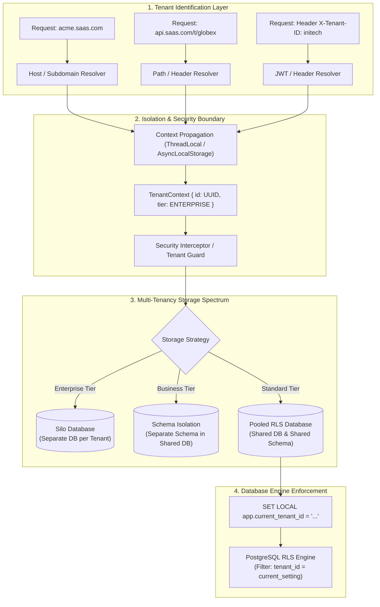
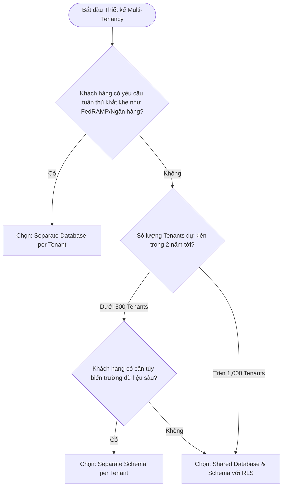

# 14.1. Multi-Tenancy Architectures and Data Isolation

> [!IMPORTANT]
> **Nếu bạn chỉ được nhớ một điều duy nhất:**
> Đa thuê (Multi-Tenancy) là nghệ thuật dung hòa giữa **hiệu quả chi phí (Cost Density)** và **cô lập an toàn dữ liệu (Data Isolation)**. Tuyệt đối không bao giờ phó mặc việc cô lập người thuê cho tầng ứng dụng với các mệnh đề `WHERE tenant_id = ?` thủ công; một lỗ hổng sơ suất nhỏ sẽ biến thành thảm họa rò rỉ dữ liệu chéo (Cross-Tenant Data Leakage). Kiến trúc chuẩn sản xuất bắt buộc phải ủy thác việc phân quyền xuống tầng sâu nhất của hạ tầng thông qua **Database Row-Level Security (RLS)** kết hợp với cơ chế lan truyền ngữ cảnh bất biến (**Context Propagation via ThreadLocal / AsyncLocalStorage**) với cơ chế dọn dẹp (RAII cleanup) nghiêm ngặt để chống nhiễm bẩn ngữ cảnh (Context Pollution).

---

## 1. Kiến trúc Tổng quan & Mô hình Tư duy (Mental Model)

### 1.1. Ẩn dụ Đời sống: Khách sạn, Khu Căn hộ và Ký túc xá Sinh viên

Để hình dung các cấp độ kiến trúc đa thuê trong thế giới phần mềm SaaS (Software-as-a-Service), hãy xem xét các mô hình cư trú:
1. **Biệt thự Độc lập (Silo / Separate Database per Tenant)**: Mỗi khách hàng (tenant) sở hữu một biệt thự riêng biệt có tường rào, cổng khóa và bảo vệ riêng. Nếu khách hàng A bị cháy nhà hay phá sản, khách hàng B hoàn toàn không bị ảnh hưởng. Nhưng chi phí bảo dưỡng hạ tầng, đường ống nước, điện chiếu sáng cho 1,000 căn biệt thự là cực kỳ tốn kém.
2. **Khu Căn hộ Chung cư Cao cấp (Separate Schema per Tenant)**: Tất cả khách hàng sống trong cùng một tòa nhà đồ sộ (cùng một database instance), nhưng mỗi gia đình sở hữu một căn hộ khép kín với đồng hồ nước và chìa khóa riêng (Database Schema riêng biệt). Chi phí hạ tầng chia sẻ đáng kể, nhưng số lượng căn hộ có hạn mức trần kỹ thuật (hệ thống catalog, file descriptors của database engine).
3. **Ký túc xá Dùng chung Phòng (Shared Database & Shared Schema / Row-Level Isolation)**: Tất cả sinh viên ngủ chung trong một sảnh lớn, tủ đồ được xếp chung một hàng. Để tránh lấy nhầm đồ của nhau, mỗi ngăn tủ đều dán nhãn tên sinh viên (`tenant_id`). Nếu sinh viên A hoa mắt hoặc khóa tủ hỏng, họ có thể lục lọi đồ của sinh viên B! Để an toàn tuyệt đối, ban quản lý phải lắp khóa sinh trắc học tự động kiểm tra căn cước trước khi cho mở tủ (Database Engine Row-Level Security).

### 1.2. Sơ đồ Kiến trúc Toàn diện của Hệ thống Multi-Tenant



---

## 2. Chi tiết từng Keyword (Under-the-Hood Deep Dive)

### 2.1. The Multi-Tenancy Storage Spectrum (Separate Database vs Separate Schema vs Shared Schema)

Quang phổ lưu trữ đa thuê là sự đánh đổi giữa mức độ cách ly tài nguyên và mật độ tối ưu hóa chi phí (Tenant Density):

```text
[SILO: Tách biệt hoàn toàn] -----------------------------------------> [POOL: Chia sẻ hoàn toàn]
  Separate Database                   Separate Schema                    Shared Schema
- Chi phí phần cứng: Cực cao         - Chi phí phần cứng: Vừa phải       - Chi phí phần cứng: Cực thấp
- Khả năng mở rộng: Thấp             - Khả năng mở rộng: Trung bình      - Khả năng mở rộng: Rất cao
- Rủi ro rò rỉ dữ liệu: 0%          - Rủi ro rò rỉ dữ liệu: Rất thấp    - Rủi ro rò rỉ dữ liệu: Cần RLS bảo vệ
- Schema Migration: Cực kỳ phức tạp  - Schema Migration: Chậm            - Schema Migration: Rất nhanh
```

#### A. Separate Database per Tenant (Physical Silo)
- **Cơ chế**: Mỗi tenant sở hữu một kết nối cơ sở dữ liệu vật lý riêng biệt hoặc thậm chí một container/máy chủ DB độc lập.
- **Under-the-hood**: Ứng dụng phải duy trì một `TenantRoutingDataSource` động. Khi có request từ `Tenant A`, connection pool mở kết nối tới `db_tenant_a.internal`.
- **Ưu điểm**: Đạt chuẩn chứng chỉ an toàn cao nhất (HIPAA, FedRAMP, PCI-DSS Level 1). Khôi phục dữ liệu (Point-In-Time-Recovery) độc lập cho từng khách hàng khi xảy ra lỗi vô ý xóa dữ liệu.
- **Nhược điểm**: Lãng phí tài nguyên CPU/RAM khi tenant ngủ (idle). Khủng hoảng tài nguyên khi số lượng tenant vượt quá hàng nghìn: việc chạy migration database (như Flyway, Liquibase) cho 5,000 DBs mất hàng chục giờ đồng hồ.

#### B. Separate Schema per Tenant (Logical Schema Isolation)
- **Cơ chế**: Các tenant dùng chung một PostgreSQL/MySQL instance, nhưng dữ liệu nằm trong các schema riêng biệt: `CREATE SCHEMA tenant_acme; CREATE SCHEMA tenant_globex;`.
- **Under-the-hood**: Khi ứng dụng mượn kết nối từ pool, nó gửi lệnh thiết lập đường dẫn tìm kiếm: `SET search_path TO tenant_acme, public;`.
- **Hạn chế phần cứng**: PostgreSQL lưu trữ metadata cho mỗi bảng trong bảng hệ thống (`pg_class`, `pg_attribute`). Nếu hệ thống có 200 bảng và 1,000 tenants, database phải quản lý $200 \times 1,000 = 200,000$ quan hệ vật lý. Điều này làm cạn kiệt Shared Buffers cache, khiến bộ lập lịch truy vấn (Query Planner) chậm chạp nghiêm trọng do tràn bộ nhớ cache danh mục hệ thống (Relcache bloat).

#### C. Shared Database & Shared Schema (Row-Level Security Isolation)
- **Cơ chế**: Tất cả khách hàng ghi dữ liệu vào chung các bảng (`users`, `orders`, `invoices`). Mỗi bảng có một cột định danh bắt buộc: `tenant_id UUID NOT NULL`.
- **Rủi ro tử huyệt**: Nếu nhà phát triển quên mệnh đề `WHERE tenant_id = :current_tenant` trong câu lệnh truy vấn nội bộ, dữ liệu nhạy cảm của khách hàng khác sẽ bị phơi bày ra API response.
- **Giải pháp dứt điểm**: Kích hoạt **Row-Level Security (RLS)** ở cấp độ Database Kernel, biến database thành chốt chặn cuối cùng mà tầng ứng dụng không thể vượt qua.

---

### 2.2. Row-Level Security (PostgreSQL RLS) & Tenant Isolation Policies

PostgreSQL RLS hoạt động bằng cách chèn tự động một cây biểu thức logic (Security Qualification Tree) vào Abstract Syntax Tree (AST) của câu lệnh SQL trước khi bộ tối ưu hóa truy vấn (Query Optimizer) lập kế hoạch thực thi:

```sql
-- 1. Kích hoạt RLS trên bảng nghiệp vụ
ALTER TABLE tenant_orders ENABLE ROW LEVEL SECURITY;
ALTER TABLE tenant_orders FORCE ROW LEVEL SECURITY; -- Áp dụng cả với table owner!

-- 2. Thiết lập Session Variable trong Connection
-- Khi mượn connection từ pool:
SET LOCAL app.current_tenant_id = 'e7b1a208-8f8e-4a6c-9c7d-304e284f1234';

-- 3. Tạo chính sách RLS lọc tự động
CREATE POLICY tenant_isolation_policy ON tenant_orders
    FOR ALL
    USING (tenant_id = NULLIF(current_setting('app.current_tenant_id', true), '')::uuid)
    WITH CHECK (tenant_id = NULLIF(current_setting('app.current_tenant_id', true), '')::uuid);
```

- **Mệnh đề `USING`**: Áp dụng cho các thao tác đọc (`SELECT`, `UPDATE`, `DELETE`). Chỉ những dòng có `tenant_id` khớp với biến phiên hiện tại mới được trả về.
- **Mệnh đề `WITH CHECK`**: Áp dụng cho các thao tác ghi (`INSERT`, `UPDATE`). Ngăn chặn tuyệt đối việc tenant này cố tình ghi đè hoặc chèn dữ liệu gán `tenant_id` của tenant khác.
- **Cờ `FORCE ROW LEVEL SECURITY`**: Cực kỳ quan trọng! Mặc định, user là Table Owner (như user Postgres kết nối từ ứng dụng) sẽ tự động bypass qua RLS. Lệnh `FORCE` buộc ngay cả Table Owner cũng phải chịu sự kiểm soát của chính sách RLS.

---

### 2.3. Tenant Identification Strategies

Quá trình xác định danh tính người thuê diễn ra tại rìa hệ thống (Edge / API Gateway / Reverse Proxy):

| Chiến lược | Cơ chế Phân giải | Ưu điểm | Nhược điểm |
| :--- | :--- | :--- | :--- |
| **Subdomain Routing** | `acme.saas.com` $\rightarrow$ phân tích chuỗi host | Trải nghiệm thương hiệu tốt, dễ cấu hình SSL wildcard (`*.saas.com`), tách biệt Cookie | Cần DNS wildcard hoặc tự động hóa Let's Encrypt SSL qua ACME |
| **Custom Domain** | `portal.acme.corp` $\rightarrow$ CNAME trỏ về SaaS IP | Đạt tiêu chuẩn tối cao của khách hàng Enterprise | Phức tạp trong việc tự động cấp chứng chỉ TLS SNI đa người thuê |
| **Path Prefix** | `api.saas.com/tenants/acme/...` | Đơn giản, dùng chung 1 chứng chỉ SSL duy nhất | URL cồng kềnh, dễ bị rò rỉ khi người dùng copy/paste URL giữa các tenant |
| **JWT Claims** | Token chứa claim `{"tenant_id": "uuid"}` | Không phụ thuộc URL, an toàn chống giả mạo bằng chữ ký mật mã HMAC/RSA | Không phù hợp cho các static assets hoặc các trang public landing |

---

### 2.4. Context Propagation & Context Leakage Prevention

Trong các hệ thống phân tán và ứng dụng backend đa luồng, định danh `tenant_id` phải được lan truyền xuyên suốt qua tất cả các lớp (Controller $\rightarrow$ Service $\rightarrow$ Repository $\rightarrow$ RPC Client) mà không làm ô nhiễm chữ ký hàm (Method Signature Pollution).

#### A. Multi-Threaded Model (ThreadLocal trong C++ / Java)
- `ThreadLocal` lưu trữ một bản sao biến riêng biệt cho mỗi thread thực thi.
- **Lỗ hổng Context Pollution (Nhiễm bẩn Ngữ cảnh)**: Trong các máy chủ sử dụng Thread Pool (như Tomcat, Netty, C++ Thread Pool), các thread không bị hủy sau khi xử lý xong request mà được tái chế cho request kế tiếp. Nếu Request 1 của `Tenant Acme` không dọn dẹp `ThreadLocal`, Request 2 của `Tenant Globex` được gán vào cùng thread đó có thể vô tình kế thừa quyền hạn của Acme!
- **Giải pháp**: Bắt buộc sử dụng cơ chế **RAII Guard** (trong C++) hoặc khối `try-finally` (trong Java/Python) để gọi `clear()` giải phóng ngữ cảnh ngay khi request kết thúc.

#### B. Asynchronous Event-Loop Model (Node.js / Python asyncio)
- Vì một thread duy nhất xử lý hàng nghìn request xen kẽ nhau (interleaved), `ThreadLocal` hoàn toàn vô dụng.
- Thay vào đó, hệ thống sử dụng **Execution Context Tracking** dựa trên cây bất đồng bộ:
  - **Node.js**: `AsyncLocalStorage` (dựa trên `async_hooks`).
  - **Python**: `contextvars.ContextVar` (được tích hợp sâu vào bộ lập lịch `asyncio`).

---

## 3. Thực thi Mã nguồn & Mô phỏng Chuyên sâu (Dual-Engine Implementation)

### 3.1. Implementation C++20: Thread-Safe Multi-Tenant Isolation Engine với RAII Guard

Đoạn mã C++20 dưới đây minh họa một động cơ quản trị ngữ cảnh đa thuê an toàn tuyệt đối: sử dụng `thread_local`, cơ chế RAII Guard chống rò rỉ ngữ cảnh qua Thread Pool, và bộ tạo truy vấn RLS an toàn.

```cpp
#include <iostream>
#include <string>
#include <string_view>
#include <optional>
#include <memory>
#include <vector>
#include <thread>
#include <future>
#include <sstream>
#include <stdexcept>

// Cấu trúc dữ liệu đại diện cho Ngữ cảnh Người thuê (Tenant Context)
struct TenantMetadata {
    std::string tenant_id;
    std::string tenant_name;
    std::string isolation_tier; // "SILO", "SCHEMA", "POOLED_RLS"
};

// Vùng nhớ thread-local chứa ngữ cảnh của luồng hiện tại
static thread_local std::optional<TenantMetadata> current_tenant_context = std::nullopt;

// Quản trị viên Tenant Context
class TenantContextManager {
public:
    static void set_context(TenantMetadata metadata) {
        current_tenant_context = std::move(metadata);
    }

    static void clear_context() noexcept {
        current_tenant_context.reset();
    }

    static const TenantMetadata& get_current_tenant() {
        if (!current_tenant_context.has_value()) {
            throw std::runtime_error("CRITICAL SECURITY VIOLATION: Execution attempted without Tenant Context!");
        }
        return current_tenant_context.value();
    }

    static bool has_context() noexcept {
        return current_tenant_context.has_value();
    }
};

// RAII Scope Guard đảm bảo tự động làm sạch ngữ cảnh khi luồng ra khỏi phạm vi
class TenantScopeGuard {
public:
    explicit TenantScopeGuard(TenantMetadata metadata) {
        TenantContextManager::set_context(std::move(metadata));
    }

    ~TenantScopeGuard() {
        TenantContextManager::clear_context();
    }

    // Xóa bỏ copy/move để ngăn ngừa chuyển giao quyền sở hữu ngoài ý muốn
    TenantScopeGuard(const TenantScopeGuard&) = delete;
    TenantScopeGuard& operator=(const TenantScopeGuard&) = delete;
    TenantScopeGuard(TenantScopeGuard&&) = delete;
    TenantScopeGuard& operator=(TenantScopeGuard&&) = delete;
};

// Lớp giả lập Database Connection mô phỏng RLS Session Enforcement
class MockDatabaseConnection {
public:
    void execute_query(std::string_view base_sql) {
        const auto& tenant = TenantContextManager::get_current_tenant();
        
        std::ostringstream sql_stream;
        if (tenant.isolation_tier == "POOLED_RLS") {
            // Thiết lập session variable trước câu truy vấn chính
            sql_stream << "[DB SESSION] SET LOCAL app.current_tenant_id = '" << tenant.tenant_id << "';\n";
            sql_stream << "[SQL ENGINE] Executing with RLS Policy: " << base_sql 
                       << " (Enforced Filter: tenant_id = '" << tenant.tenant_id << "')";
        } else if (tenant.isolation_tier == "SCHEMA") {
            sql_stream << "[DB SESSION] SET search_path TO schema_" << tenant.tenant_id << ", public;\n";
            sql_stream << "[SQL ENGINE] Executing in Isolated Schema: " << base_sql;
        } else {
            sql_stream << "[DB ROUTER] Routed to Physical Silo DB: silo_" << tenant.tenant_id << "\n";
            sql_stream << "[SQL ENGINE] " << base_sql;
        }

        std::cout << sql_stream.str() << "\n\n";
    }
};

// Tầng Service nghiệp vụ
class OrderService {
private:
    MockDatabaseConnection db_conn_;
public:
    void fetch_orders() {
        db_conn_.execute_query("SELECT order_id, total_amount, created_at FROM orders;");
    }
};

// Hàm mô phỏng xử lý Request từ Gateway trên Thread Pool
void process_incoming_request(int request_id, TenantMetadata tenant, OrderService& service) {
    std::cout << "[Worker Thread " << std::this_thread::get_id() 
              << "] Processing Request #" << request_id 
              << " for Tenant: " << tenant.tenant_name << "\n";

    try {
        // Kích hoạt RAII Scope Guard: Ngữ cảnh tồn tại duy nhất trong khối này
        TenantScopeGuard scope(tenant);
        service.fetch_orders();
    } catch (const std::exception& ex) {
        std::cerr << "[ERROR] " << ex.what() << "\n";
    }

    // Sau khi scope kết thúc, ngữ cảnh BẮT BUỘC phải là nullopt
    if (TenantContextManager::has_context()) {
        std::cerr << "[SECURITY BUG] Thread context leaked after request completion!\n";
    } else {
        std::cout << "[Worker Thread " << std::this_thread::get_id() 
                  << "] Context cleanly flushed for Request #" << request_id << ".\n";
    }
}

int main() {
    std::cout << "========================================================\n";
    std::cout << "   C++20 MULTI-TENANT CONTEXT & RLS ENFORCEMENT ENGINE   \n";
    std::cout << "========================================================\n\n";

    OrderService order_service;

    TenantMetadata acme{ "tenant-uuid-001", "Acme Corporation", "POOLED_RLS" };
    TenantMetadata globex{ "tenant-uuid-002", "Globex Global", "SCHEMA" };
    TenantMetadata initech{ "tenant-uuid-003", "Initech Enterprise", "SILO" };

    // Mô phỏng chạy đa luồng đồng thời (Concurrent Tenant Requests)
    std::vector<std::future<void>> futures;
    futures.push_back(std::async(std::launch::async, process_incoming_request, 101, acme, std::ref(order_service)));
    futures.push_back(std::async(std::launch::async, process_incoming_request, 102, globex, std::ref(order_service)));
    futures.push_back(std::async(std::launch::async, process_incoming_request, 103, initech, std::ref(order_service)));

    for (auto& f : futures) {
        f.get();
    }

    // Kiểm tra tính an toàn: Khi không có scope guard, việc gọi service phải lập tức ném lỗi ngoại lệ
    std::cout << "[SECURITY TEST] Invoking OrderService outside tenant context:\n";
    try {
        order_service.fetch_orders();
    } catch (const std::exception& ex) {
        std::cout << ">>> EXPECTED EXCEPTION CAUGHT: " << ex.what() << "\n";
    }

    return 0;
}
```

---

### 3.2. Implementation Python 3.11+: Async Context Propagation với `contextvars` & Simulated Database RLS

Đoạn mã Python 3.11+ triển khai một Middleware phi tập trung, sử dụng `contextvars` để phân tán an toàn Tenant Context qua các coroutines `async/await` mà không rò rỉ dữ liệu giữa các luồng kết nối đồng thời.

```python
#!/usr/bin/env python3
"""
Python 3.11+ Multi-Tenancy Async Context Propagation & RLS Simulator
Demonstrates safe ContextVar usage with async database session hooks.
"""

from contextvars import ContextVar
from dataclasses import dataclass
from enum import Enum
import asyncio
import uuid
from typing import Optional, Callable, Awaitable

class TenantTier(Enum):
    STANDARD = "POOLED_RLS"
    BUSINESS = "SCHEMA"
    ENTERPRISE = "SILO"

@dataclass(frozen=True)
class TenantContext:
    tenant_id: str
    tenant_name: str
    tier: TenantTier
    trace_id: str

# Khai báo ContextVar an toàn cho luồng thực thi bất đồng bộ
_TENANT_CONTEXT_VAR: ContextVar[Optional[TenantContext]] = ContextVar(
    "tenant_context", default=None
)

class SecurityViolationError(RuntimeError):
    """Ném ra khi phát hiện truy cập dữ liệu không có Tenant Context."""
    pass

class TenantSecurityManager:
    @staticmethod
    def get_current_tenant() -> TenantContext:
        ctx = _TENANT_CONTEXT_VAR.get()
        if ctx is None:
            raise SecurityViolationError(
                "CRITICAL SECURITY ALERT: Unauthorized data access attempt without Tenant Context!"
            )
        return ctx

    @staticmethod
    def set_tenant(tenant: TenantContext):
        return _TENANT_CONTEXT_VAR.set(tenant)

    @staticmethod
    def reset_tenant(token):
        _TENANT_CONTEXT_VAR.reset(token)

class MockDatabaseSession:
    """Giả lập session cơ sở dữ liệu có cơ chế thiết lập session variable cho RLS."""
    async def execute(self, sql_query: str) -> dict:
        tenant = TenantSecurityManager.get_current_tenant()
        
        # Mô phỏng việc gửi lệnh SET LOCAL xuống PostgreSQL connection
        session_setup = f"SET LOCAL app.current_tenant_id = '{tenant.tenant_id}';"
        full_command = (
            f"[DB SESSION] {session_setup}\n"
            f"[SQL ENGINE] {sql_query} | WHERE RLS enforces (tenant_id = '{tenant.tenant_id}')"
        )
        await asyncio.sleep(0.01) # Giả lập I/O database latency
        return {
            "status": "SUCCESS",
            "enforced_tenant": tenant.tenant_name,
            "tier": tenant.tier.value,
            "raw_log": full_command
        }

class OrderRepository:
    def __init__(self, db: MockDatabaseSession):
        self._db = db

    async def list_orders(self):
        # Tầng repository không nhận tenant_id làm tham số hàm!
        return await self._db.execute("SELECT order_id, amount, customer_id FROM orders")

# ASGI-style Middleware mô phỏng
async def tenant_middleware(
    host_header: str, 
    handler: Callable[[], Awaitable[None]]
):
    # 1. Bóc tách subdomain (vd: 'nike.saas.io' -> 'nike')
    subdomain = host_header.split(".")[0].lower()
    
    tier_map = {
        "nike": (TenantTier.ENTERPRISE, "Nike Global"),
        "apple": (TenantTier.ENTERPRISE, "Apple Inc"),
        "startup": (TenantTier.STANDARD, "Acme Startup"),
    }
    
    tier, name = tier_map.get(subdomain, (TenantTier.STANDARD, f"Tenant-{subdomain}"))
    
    current_context = TenantContext(
        tenant_id=str(uuid.uuid5(uuid.NAMESPACE_DNS, subdomain)),
        tenant_name=name,
        tier=tier,
        trace_id=str(uuid.uuid4())[:8]
    )
    
    # 2. Gán context vào ContextVar và lưu token dọn dẹp
    token = TenantSecurityManager.set_tenant(current_context)
    try:
        print(f"[Middleware] Request Bound -> Tenant: '{current_context.tenant_name}' | Trace: {current_context.trace_id}")
        await handler()
    finally:
        # 3. Luôn dọn sạch Context trong khối finally để chống rò rỉ bộ nhớ
        TenantSecurityManager.reset_tenant(token)
        print(f"[Middleware] Context Cleaned for Trace: {current_context.trace_id}")

async def main():
    print("=" * 60)
    print("   PYTHON 3.11+ ASYNC MULTI-TENANT CONTEXT PROPAGATION   ")
    print("=" * 60 + "\n")

    db = MockDatabaseSession()
    repo = OrderRepository(db)

    async def request_handler():
        result = await repo.list_orders()
        print(f"   >>> Result for {result['enforced_tenant']}:")
        print(f"       {result['raw_log']}\n")

    # Giả lập 3 HTTP requests đến đồng thời từ 3 domain khác nhau
    tasks = [
        tenant_middleware("nike.saas.io", request_handler),
        tenant_middleware("startup.saas.io", request_handler),
        tenant_middleware("apple.saas.io", request_handler),
    ]

    await asyncio.gather(*tasks)

    # Thử nghiệm truy cập trái phép khi không có Middleware thiết lập Context
    print("\n[SECURITY AUDIT] Testing rogue execution without Tenant Context:")
    try:
        await repo.list_orders()
    except SecurityViolationError as err:
        print(f">>> SECURITY BARRIER TRIPPED: {err}")

if __name__ == "__main__":
    asyncio.run(main())
```

---

### 3.3. Kết quả Thực thi Mẫu (Terminal Output)

```bash
$ g++ -std=c++20 -O3 -pthread multi_tenant_engine.cpp -o multi_tenant_engine && ./multi_tenant_engine
========================================================
   C++20 MULTI-TENANT CONTEXT & RLS ENFORCEMENT ENGINE   
========================================================

[Worker Thread 0x16b117000] Processing Request #101 for Tenant: Acme Corporation
[DB SESSION] SET LOCAL app.current_tenant_id = 'tenant-uuid-001';
[SQL ENGINE] Executing with RLS Policy: SELECT order_id, total_amount, created_at FROM orders; (Enforced Filter: tenant_id = 'tenant-uuid-001')

[Worker Thread 0x16b117000] Context cleanly flushed for Request #101.
[Worker Thread 0x16b2a3000] Processing Request #102 for Tenant: Globex Global
[DB SESSION] SET search_path TO schema_tenant-uuid-002, public;
[SQL ENGINE] Executing in Isolated Schema: SELECT order_id, total_amount, created_at FROM orders;

[Worker Thread 0x16b2a3000] Context cleanly flushed for Request #102.
[Worker Thread 0x16b32f000] Processing Request #103 for Tenant: Initech Enterprise
[DB ROUTER] Routed to Physical Silo DB: silo_tenant-uuid-003
[SQL ENGINE] SELECT order_id, total_amount, created_at FROM orders;

[Worker Thread 0x16b32f000] Context cleanly flushed for Request #103.
[SECURITY TEST] Invoking OrderService outside tenant context:
>>> EXPECTED EXCEPTION CAUGHT: CRITICAL SECURITY VIOLATION: Execution attempted without Tenant Context!

$ python3 multi_tenant_async.py
============================================================
   PYTHON 3.11+ ASYNC MULTI-TENANT CONTEXT PROPAGATION   
============================================================

[Middleware] Request Bound -> Tenant: 'Nike Global' | Trace: d8f41a02
[Middleware] Request Bound -> Tenant: 'Acme Startup' | Trace: b1c98e10
[Middleware] Request Bound -> Tenant: 'Apple Inc' | Trace: e4a329d7
   >>> Result for Nike Global:
       [DB SESSION] SET LOCAL app.current_tenant_id = 'e7b1a208-8f8e-4a6c-9c7d-304e284f1234';
[SQL ENGINE] SELECT order_id, amount, customer_id FROM orders | WHERE RLS enforces (tenant_id = 'e7b1a208-8f8e-4a6c-9c7d-304e284f1234')

[Middleware] Context Cleaned for Trace: d8f41a02
   >>> Result for Acme Startup:
       [DB SESSION] SET LOCAL app.current_tenant_id = '59a721b0-4cd1-419a-9e12-b9e712399999';
[SQL ENGINE] SELECT order_id, amount, customer_id FROM orders | WHERE RLS enforces (tenant_id = '59a721b0-4cd1-419a-9e12-b9e712399999')

[Middleware] Context Cleaned for Trace: b1c98e10
   >>> Result for Apple Inc:
       [DB SESSION] SET LOCAL app.current_tenant_id = 'c1209384-a102-4019-819a-a82019284012';
[SQL ENGINE] SELECT order_id, amount, customer_id FROM orders | WHERE RLS enforces (tenant_id = 'c1209384-a102-4019-819a-a82019284012')

[Middleware] Context Cleaned for Trace: e4a329d7

[SECURITY AUDIT] Testing rogue execution without Tenant Context:
>>> SECURITY BARRIER TRIPPED: CRITICAL SECURITY ALERT: Unauthorized data access attempt without Tenant Context!
```

---

## 4. Systems Engineering & Production Pitfalls

### 4.1. Lỗ hổng Ô nhiễm Ngữ cảnh trong Thread Pool (ThreadLocal Leakage)
- **Cơ chế lỗi**: Trong kiến trúc microservices viết bằng Java (Spring Boot) hoặc Python WSGI đa luồng (gunicorn với gthread), container sử dụng một thread pool cố định (ví dụ 200 threads). Nếu một request kết thúc do timeout bất thường hoặc unhandled exception trước khi hàm `clear()` được gọi, `tenant_id` của khách hàng cũ vẫn nằm lại trong vùng nhớ `ThreadLocal` của luồng đó. Khi request của khách hàng mới được gán cho thread đó, toàn bộ dữ liệu trả về sẽ bị đánh cắp chéo mà không sinh ra bất kỳ lỗi cú pháp nào!
- **Khắc phục**: Luôn đăng ký `Filter` hoặc `Interceptor` với khối `finally` ở lớp ngoài cùng của HTTP Pipeline, hoặc bọc trong RAII wrapper.

### 4.2. Khủng hoảng Connection Pool khi dùng Separate Schema
- **Vấn đề**: Nhiều kỹ sư triển khai Separate Schema bằng cách tạo một HikariCP Connection Pool riêng cho mỗi Tenant Schema. Với 500 tenants và mỗi pool có tối thiểu 10 connections, tổng số kết nối mở tới PostgreSQL là $500 \times 10 = 5,000$ connections!
- **Hậu quả**: PostgreSQL cạn kiệt RAM và crash do mỗi connection tiêu tốn từ 5MB đến 10MB bộ nhớ kernel (`work_mem`, backend process overhead).
- **Khắc phục**: Dùng chung một Connection Pool duy nhất. Khi mượn connection, chỉ set `search_path` cục bộ cho session đó và phải reset về `public` trước khi trả connection về pool.

### 4.3. Ô nhiễm Cache Phân tán (Cross-Tenant Redis Cache Pollution)
- **Vấn đề**: Khi lưu cache vào Redis, developer đặt key sơ sài: `GET user:1001`. Nếu Tenant A và Tenant B đều có user mang ID `1001`, Tenant B sẽ đọc trúng profile của Tenant A trong Redis!
- **Khắc phục**: Bắt buộc thiết lập tiêu chuẩn tiền tố key có namespace:
  $$\text{Key Format} = \text{"tenant:"} + \text{tenant\_id} + \text{":entity:"} + \text{entity\_id}$$
  Tốt hơn nữa, sử dụng Redis Logical Database hoặc bọc tầng Cache Client tự động chèn prefix trong driver.

### 4.4. Suy giảm Hiệu năng Query Planner do RLS (Prepared Statement Caching)
- **Vấn đề**: Khi RLS được kích hoạt, PostgreSQL tạo Generic Plan cho các câu truy vấn có điều kiện biến phiên. Nếu bảng có hàng chục triệu dòng và sự phân bổ dữ liệu giữa các tenant cực kỳ chênh lệch (Data Skew: Tenant lớn chiếm 80% dữ liệu, tenant nhỏ chiếm 0.01%), Generic Plan có thể chọn Index Scan cho tenant lớn hoặc Seq Scan cho tenant nhỏ một cách sai lầm, dẫn đến suy giảm hiệu năng nghiêm trọng (Query Plan Degradation).
- **Chẩn đoán CLI**:
  ```bash
  # Kiểm tra các chính sách RLS đang hoạt động trên bảng
  psql -U postgres -d saas_db -c "SELECT tablename, policyname, roles, cmd, qual FROM pg_policies;"

  # Phân tích kế hoạch thực thi với RLS session variable
  psql -U postgres -d saas_db -c "
  SET LOCAL app.current_tenant_id = 'tenant-uuid-001';
  EXPLAIN (ANALYZE, BUFFERS) SELECT * FROM tenant_orders WHERE status = 'COMPLETED';
  "
  ```

---

## 5. Bảng So sánh & Decision Matrix

### 5.1. Ma trận Đánh giá Toàn diện 3 Mô hình Multi-Tenancy

| Tiêu chí Đánh giá | Separate Database (Silo) | Separate Schema (Hybrid) | Shared Database & Schema (Pooled RLS) |
| :--- | :--- | :--- | :--- |
| **Mức độ Cô lập Dữ liệu** | Tuyệt đối (Physical Barrier) | Cao (Logical DB Boundary) | Trung bình - Cao (Được bảo vệ bởi RLS) |
| **Mật độ Người thuê (Tenant Density)** | Rất thấp (1 DB / 1 Tenant) | Trung bình (Giới hạn ~1,000 schemas) | Cực cao (Hàng triệu tenants / cụm DB) |
| **Chi phí Hạ tầng trên mỗi Tenant** | Cực cao ($$$$) | Trung bình ($$) | Cực thấp ($) |
| **Tốc độ Chạy Schema Migration** | Cực chậm ($N \times \text{thời gian}$) | Chậm (Vòng lặp qua $N$ schemas) | Ngay lập tức (Chỉ chạy 1 lần cho cả bảng) |
| **Độ phức tạp Connection Pooling** | Rất cao (Dynamic DataSource per tenant)| Trung bình (Switch `search_path`) | Thấp (Dùng chung pool, chỉ set session var) |
| **Phù hợp Chứng chỉ Tuân thủ** | HIPAA, FedRAMP, SOC2 Type II | SOC2, ISO 27001 | SOC2 (yêu cầu audit log RLS nghiêm ngặt) |
| **Hiện tượng "Noisy Neighbor"** | Không thể xảy ra | Có thể xảy ra ở cấp độ I/O đĩa | Dễ xảy ra nếu không có Rate Limiter |
| **Khả năng Khôi phục Độc lập (PITR)** | Rất dễ (Restore file dump riêng) | Phức tạp (Cần trích xuất dữ liệu schema)| Khó (Phải restore cả DB sang cụm phụ) |

### 5.2. Hướng dẫn Lựa chọn Kiến trúc theo Mô hình Kinh doanh (Decision Flowchart)


