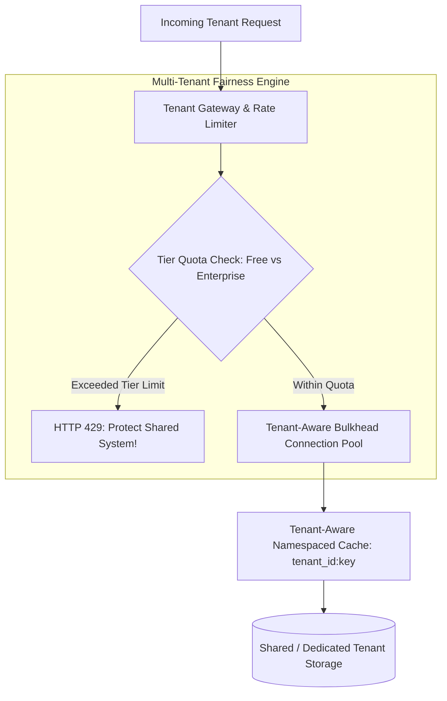
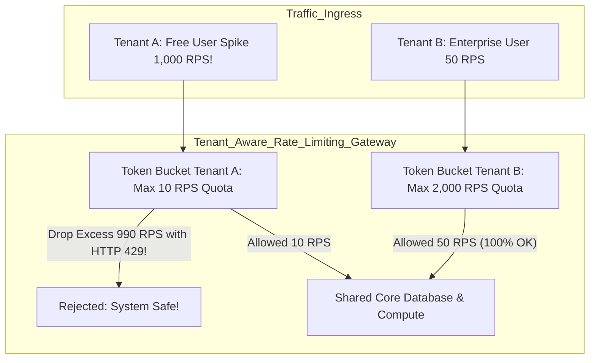
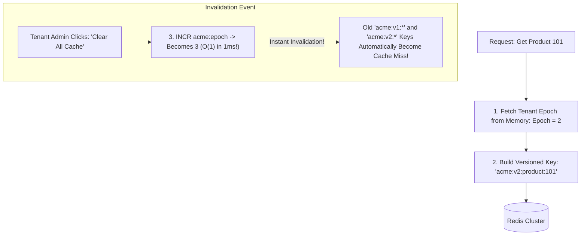
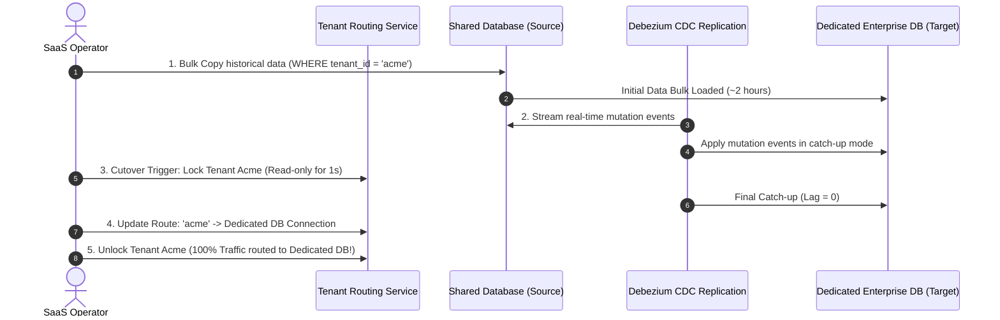

# 14.2. Tenant Operations and Resource Quotas (Vận Hành Người Thuê và Hạn Ngạch Tài Nguyên)

## Tổng quan về Vận Hành Người Thuê và Hạn Ngạch Tài Nguyên
Trong một nền tảng SaaS phục vụ hàng chục nghìn khách hàng trên cùng một hạ tầng chia sẻ, việc đảm bảo cách ly dữ liệu (ở phần 14.1) mới chỉ giải quyết được một nửa bài toán. Nửa còn lại — và thường là nguyên nhân gây ra nhiều sự cố sập hệ thống nhất — là bài toán **Quản trị vận hành và Phân bổ tài nguyên công bằng (Operational Fairness)**.

Nếu không có cơ chế kiểm soát chặt chẽ, hệ thống sẽ rơi vào thảm họa **Vấn nạn Người hàng xóm ồn ào (The Noisy Neighbor Problem)**: Một khách hàng lớn bất ngờ chạy tác vụ xuất báo cáo nặng hoặc gặp một đợt tấn công traffic, chiếm dụng toàn bộ $99\%$ CPU, Disk I/O và Connection Pool của cụm máy chủ, khiến hàng nghìn khách hàng vô tội khác cùng chịu cảnh tê liệt!

Chuyên đề này đi sâu vào:
1. **Kiểm soát tài nguyên thông minh (Resource Quotas & Tenant-Aware Rate Limiting)**: Phân tầng hạn ngạch (Tiered Quotas) theo gói cước (Free vs Pro vs Enterprise).
2. **Bộ nhớ đệm nhận biết người thuê (Tenant-Aware Caching)**: Phân vùng Key an toàn và chống nhiễm bẩn cache.
3. **Vòng đời khách hàng SaaS (Tenant Lifecycle)**: Từ quy trình khởi tạo tự động (**Tenant Provisioning**), di chuyển nâng cấp (**Tenant Migration**) từ cụm dùng chung sang cụm chuyên dụng, đến tiêu hủy dữ liệu theo chuẩn GDPR (**Cryptographic Erasure**).



---

## 2. Chi tiết từng Keyword (Under-the-Hood Deep Dive)

### 1. The Noisy Neighbor Problem & Tenant-Aware Rate Limiting (Vấn Nạn Người Hàng Xóm Ồn Ào và Giới Hạn Tốc Độ Đa Thuê)

#### 1. Khái niệm bản chất (What & Why)
- **The Noisy Neighbor Problem (Vấn nạn người hàng xóm ồn ào)**: Hiện tượng xảy ra khi một Tenant trong cụm đa thuê tiêu tốn lượng tài nguyên phần cứng bất thường (CPU, RAM, Băng thông mạng, I/O đĩa, Connection Pool), làm suy giảm nghiêm trọng hiệu năng của các Tenant khác đang chia sẻ chung hạ tầng đó.
- **Tenant-Aware Rate Limiting (Giới hạn tốc độ nhận biết người thuê)**: Thay vì áp dụng một ngưỡng rate limit chung theo IP của người dùng, hệ thống áp dụng thuật toán Rate Limiting (ví dụ: Token Bucket) độc lập cho từng **`tenant_id`**, với hạn ngạch tỷ lệ thuận với cấp độ gói cước đăng ký:
  - *Free Tier*: Tối đa $10\text{ RPS}$, Burst tối đa $20\text{ requests}$.
  - *Pro Tier*: Tối đa $100\text{ RPS}$, Burst tối đa $200\text{ requests}$.
  - *Enterprise Tier*: Tối đa $2,000\text{ RPS}$, có cụm tài nguyên chuyên dụng độc lập.

#### 2. Cơ chế hoạt động sâu (Under the hood / Hardcore Internals)
Tại sao Rate Limiting theo IP truyền thống hoàn toàn vô dụng trong SaaS:
- Một khách hàng Enterprise có $5,000$ nhân viên cùng truy cập SaaS từ trụ sở chính thông qua một địa chỉ Corporate NAT IP duy nhất.
- Nếu rate limit theo IP (ví dụ: tối đa 50 requests/IP/giây), $5,000$ nhân viên này sẽ liên tục bị chặn lỗi `429 Too Many Requests`!
- Ngược lại, một kẻ gian có thể thuê mạng botnet gồm 10,000 IP khác nhau để gửi request vào cùng một Tenant, hút cạn toàn bộ tài nguyên của Tenant đó mà bộ lọc IP không hề phát hiện!
- **Giải pháp**: Khóa Rate Limiting bắt buộc phải được tính toán dựa trên **Tuple: `(tenant_id, user_tier)`** lưu trữ trong cụm Redis phân tán.

#### 3. Sơ đồ minh họa (Noisy Neighbor Mitigation via Tiered Token Buckets)


#### 4. Code ví dụ thực chiến (C++20 - Multi-Tenant Token Bucket Rate Limiter)
```cpp
#include <iostream>
#include <unordered_map>
#include <string>
#include <chrono>
#include <mutex>
#include <algorithm>

struct TenantQuotaConfig {
    double capacity;
    double refill_rate_per_sec;
};

class MultiTenantRateLimiter {
private:
    struct TokenBucket {
        double tokens;
        std::chrono::steady_clock::time_point last_refill;
    };

    std::unordered_map<std::string, TokenBucket> tenant_buckets_;
    std::unordered_map<std::string, TenantQuotaConfig> tier_configs_;
    std::mutex mtx_;

public:
    MultiTenantRateLimiter() {
        // Cấu hình hạn ngạch theo gói dịch vụ
        tier_configs_["FREE"] = TenantQuotaConfig{10.0, 5.0};        // Max 10 tokens, nạp 5 tokens/s
        tier_configs_["ENTERPRISE"] = TenantQuotaConfig{500.0, 200.0}; // Max 500 tokens, nạp 200 tokens/s
    }

    bool allowRequest(const std::string& tenant_id, const std::string& tier) {
        std::lock_guard<std::mutex> lock(mtx_);
        auto now = std::chrono::steady_clock::now();

        auto cfg_it = tier_configs_.find(tier);
        if (cfg_it == tier_configs_.end()) return false;
        const auto& config = cfg_it->second;

        auto& bucket = tenant_buckets_[tenant_id];
        if (bucket.last_refill.time_since_epoch().count() == 0) {
            bucket.tokens = config.capacity;
            bucket.last_refill = now;
        } else {
            // Nạp lại token theo thời gian trôi qua
            auto elapsed_ms = std::chrono::duration_cast<std::chrono::milliseconds>(now - bucket.last_refill).count();
            double new_tokens = (elapsed_ms / 1000.0) * config.refill_rate_per_sec;
            bucket.tokens = std::min(config.capacity, bucket.tokens + new_tokens);
            bucket.last_refill = now;
        }

        if (bucket.tokens >= 1.0) {
            bucket.tokens -= 1.0;
            return true; // Cho phép request đi qua
        }

        std::cerr << "[RATE LIMIT EXCEEDED] Tenant '" << tenant_id << "' (" << tier 
                  << " tier) exceeded quota! Dropping request to protect shared fleet.\n";
        return false;
    }
};

int main() {
    MultiTenantRateLimiter limiter;

    std::cout << "--- Simulating Free Tenant Burst (Max 10 Tokens) ---\n";
    for (int i = 1; i <= 12; ++i) {
        bool ok = limiter.allowRequest("tenant_free_user", "FREE");
        if (ok) std::cout << "Request #" << i << ": 200 OK\n";
    }

    std::cout << "\n--- Simulating Enterprise Tenant (High Capacity) ---\n";
    for (int i = 1; i <= 3; ++i) {
        bool ok = limiter.allowRequest("tenant_enterprise_corp", "ENTERPRISE");
        if (ok) std::cout << "Enterprise Request #" << i << ": 200 OK\n";
    }

    return 0;
}
```

#### 5. Ưu / Nhược điểm, Pitfalls & Anti-patterns
- **Anti-pattern: Single Database Connection Pool for All Tenants**: Cho phép mọi Tenant cùng chia sẻ một Connection Pool gồm 50 kết nối. Khi Tenant A chạy một câu query nặng quét toàn bộ bảng mất 20 giây, 50 kết nối bị chiếm dụng sạch sẽ, khiến toàn bộ Tenant B, C, D bị treo cứng dù họ chỉ gọi API đọc 1 bản ghi đơn giản!
  - *Giải pháp*: Áp dụng **Tenant-Aware Bulkhead Connection Pooling**: Giới hạn mỗi Tenant chỉ được chiếm tối đa $20\%$ số kết nối của Pool.

#### 6. Ứng dụng thực tế trong Backend / Systems
Shopify và Slack vận hành các bộ điều phối luồng dựa trên Token Bucket cho từng App và từng Workspace khách hàng để bảo vệ cơ sở dữ liệu MySQL và Cassandra không bị quá tải.

---

## 2. Chi tiết từng Keyword (Under-the-Hood Deep Dive)

### 2. Tenant-Aware Caching & Key Isolation (Lưu Đệm Nhận Biết Người Thuê và Cách Ly Khóa)

#### 1. Khái niệm bản chất (What & Why)
Trong một cụm Redis dùng chung cho toàn bộ nền tảng SaaS, nếu không có quy chuẩn thiết kế khóa đệm, hệ thống đối mặt với nguy cơ rò rỉ dữ liệu hoặc xung đột nghiêm trọng:
- Khách hàng Acme lưu sản phẩm có ID = 101 vào cache với key: `product:101`.
- Khách hàng Globex cũng có sản phẩm có ID = 101 và đọc key: `product:101` $\implies$ **Globex nhìn thấy sản phẩm và giá tiền của Acme**!
- **Tenant-Aware Caching**: Mọi khóa lưu đệm (Cache Keys) bắt buộc phải được gắn tiền tố không gian tên (**Namespacing**) mang định danh người thuê:
  $$\text{Cache Key} = \text{Tenant\_ID} + \text{":"} + \text{Entity\_Type} + \text{":"} + \text{Entity\_ID}$$
  Ví dụ: `tenant_acme:product:101` và `tenant_globex:product:101`.

#### 2. Cơ chế hoạt động sâu (Under the hood / Hardcore Internals)
Kỹ thuật vô hiệu hóa toàn bộ Cache của một Tenant (Tenant Cache Purge):
- Khi một khách hàng muốn xóa sạch toàn bộ dữ liệu đệm của họ (ví dụ sau khi thay đổi cấu hình thuế toàn hệ thống):
- **Cách làm tồi**: Chạy lệnh `KEYS tenant_acme:*` trên Redis. Lệnh `KEYS` là thao tác $O(N)$ chạy đồng bộ (Single-threaded blocking), sẽ làm đóng băng toàn bộ cụm Redis trong 10 giây nếu cụm có hàng chục triệu keys!
- **Cách làm chuẩn mực (Tenant Cache Epoch / Version Tag)**:
  - Lưu một biến số nguyên đại diện cho phiên bản cache của Tenant: `tenant_acme:epoch = 1`.
  - Mọi key lưu vào cache đều gắn Epoch hiện tại: `tenant_acme:v1:product:101`.
  - Khi cần xóa sạch cache của Acme: Chỉ cần tăng Epoch lên một đơn vị:
    `INCR tenant_acme:epoch` (trở thành $2$).
  - Toàn bộ hàng triệu key `v1` cũ tự động bị coi là Cache Miss ngay lập tức trong độ phức tạp **$O(1)$ trong đúng $1\text{ ms}$**! Bộ nhớ cũ sẽ được Redis tự động dọn dẹp dần thông qua cơ chế TTL hoặc LRU Eviction!

#### 3. Sơ đồ minh họa (Tenant Cache Epoch Invalidation O(1))


#### 4. Code ví dụ thực chiến (TypeScript - Tenant Cache Key Generator với Epoch Invalidation)
```typescript
interface CacheStorage {
  get(key: string): Promise<string | null>;
  set(key: string, val: string, ttlSec: number): Promise<void>;
  incr(key: string): Promise<number>;
}

export class TenantAwareCacheManager {
  constructor(private redis: CacheStorage) {}

  private async getTenantEpoch(tenantId: string): Promise<string> {
    const epochKey = `tenant:${tenantId}:epoch`;
    let epoch = await this.redis.get(epochKey);
    if (!epoch) {
      await this.redis.set(epochKey, "1", 365 * 86400); // Mặc định v1
      epoch = "1";
    }
    return epoch;
  }

  // Tạo khóa đệm an toàn có tiền tố Tenant và Version Epoch
  public async buildKey(tenantId: string, entity: string, id: string): Promise<string> {
    const epoch = await this.getTenantEpoch(tenantId);
    return `tenant:${tenantId}:v${epoch}:${entity}:${id}`;
  }

  // Vô hiệu hóa toàn bộ cache của Tenant trong O(1)
  public async purgeAllTenantCache(tenantId: string): Promise<void> {
    const epochKey = `tenant:${tenantId}:epoch`;
    const newEpoch = await this.redis.incr(epochKey);
    console.log(`[Cache Invalidation O(1)] Purged all cache for tenant '${tenantId}'. Advanced to Epoch v${newEpoch}`);
  }
}
```

#### 5. Ưu / Nhược điểm, Pitfalls & Anti-patterns
- **Anti-pattern: Cache Pollution by Large Tenant**: Một khách hàng chạy chiến dịch marketing đẩy hàng trăm triệu keys vào Redis, chiếm sạch $90\%$ RAM của cụm cache và làm đuổi sạch (evict) toàn bộ cache của các khách hàng khác. 
  - *Giải pháp*: Thiết lập **Tenant Memory Quota** hoặc chia Shard cụm Redis theo từng nhóm khách hàng (Tenant Pods).

#### 6. Ứng dụng thực tế trong Backend / Systems
Salesforce và Workday áp dụng chặt chẽ cơ chế Tenant Namespacing kết hợp Epoch Versioning cho toàn bộ hạ tầng lưu trữ đệm phân tán.

---

### 3. Tenant Provisioning, Migration & Data Lifecycle (Vòng Đời Người Thuê và Di Chuyển Dữ Liệu)

#### 1. Khái niệm bản chất (What & Why)
- **Tenant Provisioning (Khởi tạo người thuê tự động)**: Quy trình tự động hóa hoàn toàn việc thiết lập môi trường mới cho khách hàng ngay sau khi họ đăng ký: cấp phát Tenant ID, chạy database migrations, khởi tạo S3 Bucket riêng, phân quyền IAM role và cấu hình DNS Subdomain.
- **Tenant Migration (Di chuyển người thuê)**: Quá trình chuyển đổi dữ liệu của một khách hàng từ mô hình **Cơ sở dữ liệu dùng chung (Shared Database)** sang một **Cơ sở dữ liệu chuyên dụng riêng biệt (Dedicated Database)** khi khách hàng đó phát triển quy mô và nâng cấp lên gói Enterprise cấp cao.
- **Tenant Data Lifecycle & Cryptographic Erasure (Vòng đời dữ liệu và Tiêu hủy mật mã)**: Quản trị dữ liệu từ lúc sinh ra đến khi xóa bỏ theo các quy định quyền được lãng quên (**GDPR Right to be Forgotten**).

#### 2. Cơ chế hoạt động sâu (Under the hood / Hardcore Internals)
Quy trình **Online Zero-Downtime Tenant Migration**:
Làm sao để di chuyển 500GB dữ liệu của khách hàng Acme từ Database dùng chung sang Database chuyên dụng mà không làm gián đoạn dịch vụ?
1. **Pha 1 (Bulk Copy - Sao chép nền)**:
   - Sử dụng công cụ sao chép dữ liệu (như pg_dump hoặc CDC) để copy toàn bộ các bản ghi có `tenant_id = 'acme'` từ Shared DB sang Dedicated DB. Quá trình này mất khoảng 2 giờ.
2. **Pha 2 (Change Data Capture Stream - Bắt kịp thay đổi)**:
   - Trong 2 giờ đó, các thao tác ghi mới của Acme vẫn tiếp tục diễn ra trên Shared DB.
   - Debezium CDC lắng nghe WAL của Shared DB và stream toàn bộ các thay đổi mới nhất của Acme sang Dedicated DB để bù đắp khoảng cách (Catch-up phase).
3. **Pha 3 (Cutover Switch - Chuyển đổi trạng thái trong 1 giây)**:
   - Đặt cờ tạm dừng ghi (Read-only mode) cho duy nhất Tenant Acme trong vòng $1 - 2\text{ giây}$.
   - Chờ CDC đồng bộ xong những bản ghi cuối cùng (Replication Lag = 0).
   - Cập nhật bảng định tuyến Tenant Routing Table: Trỏ `acme` sang kết nối của Dedicated DB mới.
   - Mở khóa ghi bình thường. **Quá trình di chuyển hoàn tất trơn tru không có downtime!**

**Tiêu hủy dữ liệu bằng Cryptographic Erasure (Crypto-Shredding)**:
Khi một khách hàng hủy hợp đồng dịch vụ và yêu cầu xóa vĩnh viễn dữ liệu (tuân thủ luật GDPR):
- Dữ liệu của khách hàng nằm rải rác trên hàng nghìn bản sao lưu backup (Database, S3, Tape Drive). Việc mở từng file backup của 5 năm trước để tìm và xóa từng dòng dữ liệu của khách hàng là điều bất khả thi về mặt kỹ thuật.
- **Giải pháp Crypto-Shredding**:
  - Dữ liệu của Tenant Acme ngay từ đầu được mã hóa bằng một chiếc khóa chuyên biệt: `Tenant_DEK_Acme`.
  - Khi cần xóa vĩnh viễn dữ liệu của Acme: Hệ thống **chỉ cần tiêu hủy vĩnh viễn chiếc khóa `Tenant_DEK_Acme` khỏi Cloud KMS**!
  - Toàn bộ dữ liệu của Acme nằm trên tất cả các ổ cứng, đĩa backup, băng từ lập tức trở thành **Rác nhị phân ngẫu nhiên không thể giải mã được** (Mathematically Unrecoverable Ciphertext). Đáp ứng hoàn hảo $100\%$ các tiêu chuẩn pháp lý xóa dữ liệu của GDPR!

#### 3. Sơ đồ minh họa (Zero-Downtime Tenant Migration Flow)


#### 4. Code ví dụ thực chiến (C++20 - Mô phỏng Tenant Crypto-Shredding Engine)
```cpp
#include <iostream>
#include <unordered_map>
#include <string>

// Mô phỏng kỹ thuật tiêu hủy dữ liệu theo chuẩn GDPR bằng Crypto-Shredding
class TenantKeyManagementService {
private:
    std::unordered_map<std::string, std::string> tenant_keys_;

public:
    void registerTenantKey(const std::string& tenant_id, const std::string& secret_key) {
        tenant_keys_[tenant_id] = secret_key;
        std::cout << "[KMS] Provisioned cryptographic key for tenant: " << tenant_id << "\n";
    }

    std::string decryptTenantData(const std::string& tenant_id, const std::string& encrypted_blob) {
        auto it = tenant_keys_.find(tenant_id);
        if (it == tenant_keys_.end()) {
            std::cerr << "🚨 [CRYPTO-SHREDDED] Decryption Key for Tenant '" << tenant_id 
                      << "' HAS BEEN DESTROYED! Data is permanently unreadable.\n";
            return ""; // Không thể giải mã!
        }
        return "DECRYPTED_PLAINTEXT_DATA_FOR_" + tenant_id;
    }

    // Tiêu hủy khóa vĩnh viễn (Crypto-Shredding)
    void shredTenantKey(const std::string& tenant_id) {
        tenant_keys_.erase(tenant_id);
        std::cout << ">>> [GDPR COMPLIANCE] Cryptographic Erasure Executed: Destroyed Master Key for '" 
                  << tenant_id << "'. All historical backups mathematically obliterated!\n";
    }
};

int main() {
    TenantKeyManagementService kms;
    kms.registerTenantKey("tenant_acme", "KEY_AES256_ACME_SECRET");

    // Đọc dữ liệu bình thường khi còn khóa
    std::string data1 = kms.decryptTenantData("tenant_acme", "ENCRYPTED_BLOB_XYZ");
    std::cout << "Result: " << data1 << "\n\n";

    // Khách hàng Acme hủy hợp đồng và yêu cầu thực thi quyền GDPR Right to be Forgotten
    kms.shredTenantKey("tenant_acme");

    // Cố gắng đọc lại dữ liệu trên các bản sao lưu cũ
    std::string data2 = kms.decryptTenantData("tenant_acme", "ENCRYPTED_BLOB_XYZ");
    return 0;
}
```

#### 5. Ưu / Nhược điểm, Pitfalls & Anti-patterns
- **Anti-pattern: Physical Database Deletion on Live Clusters**: Chạy lệnh `DROP DATABASE tenant_db;` trực tiếp trên cluster production mà không có bản snapshot dự phòng. Nếu thao tác nhầm vào tenant đang trả tiền triệu đô, doanh nghiệp sẽ đối mặt với các vụ kiện tụng pháp lý lớn.

#### 6. Ứng dụng thực tế trong Backend / Systems
AWS SaaS Factory Blueprint và Microsoft Azure SaaS Architecture Guide coi Crypto-Shredding là phương pháp duy nhất khả thi để đảm bảo tuân thủ GDPR trên các hệ thống lưu trữ phân tán quy mô Petabyte.

---

## Tóm tắt liên kết hệ thống
Chương **14.2 (Tenant Operations and Resource Quotas)** đã hoàn thiện trọn vẹn bức tranh vận hành SaaS đa thuê: triệt tiêu vấn nạn Noisy Neighbor bằng Token Bucket phân tầng, cách ly bộ nhớ đệm an toàn bằng Epoch Versioning $O(1)$, thực hiện di chuyển dữ liệu Online Zero-Downtime Migration bằng CDC, và tuân thủ triệt để quyền riêng tư GDPR thông qua kỹ thuật tiêu hủy mật mã Crypto-Shredding.

Tiếp theo, tại **11.15: Deployment & Evolutionary Architecture**, chúng ta sẽ tìm hiểu cách triển khai phần mềm an toàn vào môi trường Production: Blue-Green Deployment, Canary Releases, Feature Flags, Database Expand-and-Contract Migrations và Strangler Fig Pattern.
