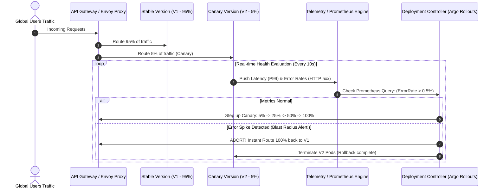
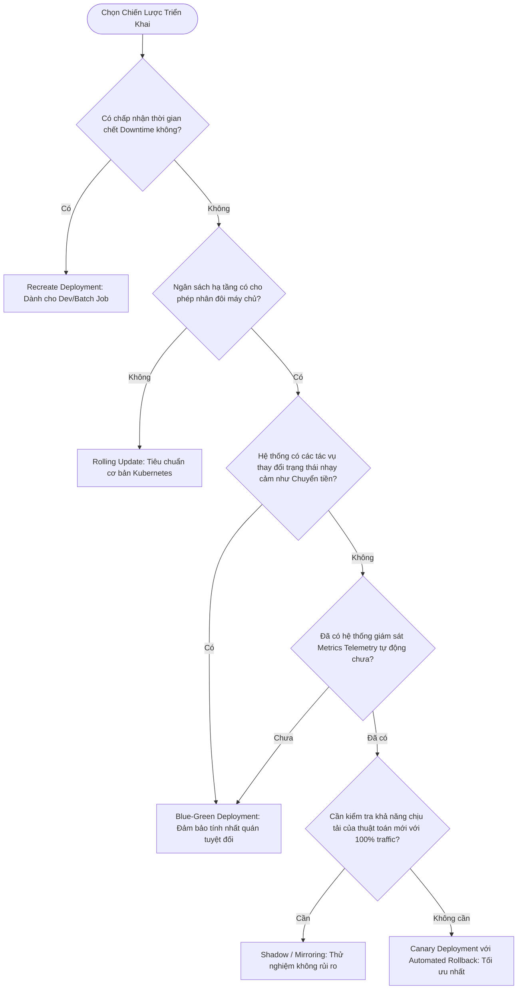

# 15.1. Deployment Strategies and Traffic Routing

> [!IMPORTANT]
> **Nếu bạn chỉ được nhớ một điều duy nhất:**
> Triển khai (**Deployment**) và Phát hành (**Release**) là hai khái niệm hoàn toàn tách biệt. Một hệ thống phân tán đẳng cấp thế giới không bao giờ gắn việc đưa mã nguồn mới vào máy chủ (Deploy) với việc người dùng nhìn thấy và tương tác với tính năng đó (Release). Đỉnh cao của kỹ nghệ phát hành phần mềm hiện đại nằm ở **Progressive Delivery (Phân phối lũy tiến)**: sử dụng **Canary Deployments** với cơ chế tự động phân tích chỉ số đo từ xa (Telemetry Automated Rollback), kết hợp với **Feature Flags** kiểm soát luồng thực thi động ở cấp độ người dùng để triệt tiêu thời gian chết (Zero Downtime) và giới hạn bán kính phát nổ (Blast Radius) khi xảy ra sự cố production.

---

## 1. Kiến trúc Tổng quan & Mô hình Tư duy (Mental Model)

### 1.1. Ẩn dụ Đời sống: Đổi Bánh Máy Bay khi Đang Bay và Đập Tràn Thủy Điện

Hãy tưởng tượng việc nâng cấp một phần mềm phục vụ hàng triệu người dùng giống như việc bảo trì một hạ tầng trọng yếu:
- **Recreate (Thời kỳ đồ đá)**: Bạn tắt hoàn toàn nhà máy điện vào ban đêm, cắt điện toàn bộ thành phố trong 4 tiếng để thay máy biến áp mới, sau đó bật lại và cầu nguyện không có chập mạch cháy nổ.
- **Rolling Update (Thay lốp xe cuốn chiếu)**: Một đoàn tàu chở hàng 10 toa đang chạy chậm; bạn cho công nhân thay bánh từng toa một từ toa 1 đến toa 10. Nhưng trong suốt 30 phút thay thế, đoàn tàu có nửa số toa dùng bánh cũ và nửa số toa dùng bánh mới, tạo ra sự rung lắc và xung đột phiên bản giao tiếp (API Schema Incompatibility).
- **Blue-Green (Đường ống đôi song song)**: Bạn xây dựng một đường ống dẫn nước mới toanh hoàn toàn song song (Green) cạnh đường ống đang hoạt động (Blue). Bạn cho kỹ sư vào kiểm tra áp suất đường ống mới thoải mái. Khi mọi thứ hoàn hảo, bạn chỉ cần gạt chiếc van ba chiều ở ngã ba trong đúng 1 giây để chuyển toàn bộ dòng nước sang đường ống mới. Nếu đường ống mới bị vỡ áp, bạn gạt van quay trở lại đường ống cũ trong tích tắc!
- **Canary Release (Thợ mỏ và Chú chim Hoàng yến)**: Các thợ mỏ than thời xưa mang theo một lồng chim hoàng yến nhỏ xuống hầm lò sâu. Vì chim hoàng yến cực kỳ nhạy cảm với khí độc CO và Methane, nếu có rò rỉ khí độc, chú chim sẽ ngất xỉu trước khi con người kịp nhận ra. Trong phần mềm, Canary là việc chỉ mở $1\%$ lưu lượng cho phiên bản mới. Nếu $1\%$ người dùng đó gặp lỗi 5xx hoặc độ trễ tăng vọt, hệ thống tự động bóp chết phiên bản Canary trước khi $99\%$ khách hàng còn lại kịp nhận ra bất thường!
- **Shadow / Mirroring (Chiếc máy bay tàng hình bay sau)**: Máy bay chính bay phía trước chở khách thật; chiếc máy bay thử nghiệm bay bám sát ngay phía sau nhận cùng tín hiệu điều khiển radar từ mặt đất nhưng không chở khách. Nó xử lý thực tế toàn bộ dữ liệu nhưng không phát tín hiệu vô tuyến ra ngoài để xem hệ thống lái tự động mới có ổn định không.

### 1.2. Luồng Điều Phối Lưu Lượng & Vòng Lặp Phân Phối Lũy Tiến



---

## 2. Chi tiết từng Keyword (Under-the-Hood Deep Dive)

### 2.1. The Taxonomy of Deployment Strategies

Việc lựa chọn chiến lược triển khai phụ thuộc trực tiếp vào chi phí hạ tầng (Cost), độ chấp nhận thời gian chết (Downtime tolerance), và rủi ro tương thích dữ liệu (Database schema compatibility).

```text
[Chi phí thấp / Rủi ro cao] ---------------------------------------------> [Chi phí cao / Rủi ro cực thấp]
    Recreate               Rolling Update          Canary Release          Blue-Green          Shadow Mirroring
- Downtime: Có           - Downtime: 0           - Downtime: 0          - Downtime: 0        - Downtime: 0
- Hạ tầng x1             - Hạ tầng +25%          - Hạ tầng +10%         - Hạ tầng x2         - Hạ tầng x2
- Rollback: Rất chậm     - Rollback: Chậm        - Rollback: Rất nhanh  - Rollback: Tức thì  - Rollback: Không cần
```

#### A. Recreate Deployment
- **Cơ chế**: Dừng toàn bộ các phiên bản cũ trước (`ReplicaCount = 0`), sau đó khởi động các phiên bản mới (`ReplicaCount = N`).
- **Ưu điểm**: Không bao giờ xảy ra tình trạng chạy hai phiên bản mã nguồn song song. Không cần xử lý vấn đề tương thích ngược của database schema.
- **Nhược điểm**: Luôn luôn gây ra Downtime tương đương thời gian khởi động ứng dụng (Application Cold Start). Chỉ chấp nhận được ở môi trường Development hoặc hệ thống xử lý mẻ (Batch Processing) ban đêm.

#### B. Rolling Update (Mặc định trong Kubernetes)
- **Cơ chế**: Cập nhật từng Pod một theo cấu hình `maxSurge` (số Pod được tạo thêm vượt ngưỡng replica) và `maxUnavailable` (số Pod được phép chết trong quá trình update).
- **Hạn chế kỹ thuật**: 
  - Trong quá trình rollout kéo dài từ 5 đến 15 phút, cả phiên bản V1 và V2 cùng phục vụ traffic. Nếu client gọi nhiều request trong cùng một session, request 1 có thể trúng V1 và request 2 trúng V2.
  - **Ác mộng Database Migration**: Cả V1 và V2 cùng truy cập vào cùng một database. Nếu V2 xóa hoặc đổi tên một cột mà V1 vẫn đang đọc, V1 sẽ lập tức crash toàn bộ (`ColumnNotFoundException`).

#### C. Blue-Green Deployment
- **Cơ chế**: Nhân đôi toàn bộ cụm hạ tầng Production:
  - Cụm **Blue**: Đang chạy phiên bản hiện tại, nhận 100% traffic.
  - Cụm **Green**: Được dựng mới độc lập hoàn toàn, nạp phiên bản mới. Sau khi chạy smoke test thành công, Router / Load Balancer thay đổi target group để chuyển hướng 100% lưu lượng sang Green.
- **Ưu điểm**: Rollback ngay lập tức trong vòng $1$ giây bằng cách đảo ngược router target.
- **Nhược điểm**: Đắt đỏ vì yêu cầu gấp đôi lượng tài nguyên máy chủ (Hardware Cost x2). Không thể áp dụng dễ dàng nếu hai môi trường sử dụng chung một stateful database có thay đổi cấu trúc bảng không tương thích ngược.

#### D. Canary Deployment
- **Cơ chế**: Phiên bản mới được đưa vào hoạt động song song với phiên bản cũ nhưng chỉ nhận một tỷ lệ rất nhỏ traffic (ví dụ 1%, 5%).
- **Under-the-hood**: Load Balancer dựa trên thuật toán Weighted Routing (băm nhất quán hoặc tỷ lệ phần trăm) để điều hướng. Kết hợp với các công cụ kiểm thử tự động (Canary Analysis như Kayenta hoặc Argo Rollouts Metrics Analysis), hệ thống tự động tăng dần tỷ lệ lưu lượng nếu các chỉ số SLO/SLA (độ trễ $P99$, tỷ lệ HTTP 5xx) đạt yêu cầu.

#### E. Shadow Deployment (Traffic Shadowing / Mirroring)
- **Cơ chế**: Sử dụng khả năng nhân bản request của các Proxy hiện đại (Envoy, NGINX). Toàn bộ HTTP Request thật từ người dùng gửi tới V1 sẽ được Envoy ngầm copy một bản sao bất đồng bộ và bắn sang V2.
- **Under-the-hood**: Response từ V2 bị Envoy vứt bỏ hoàn toàn (Drop response). Ứng dụng V2 được thử nghiệm với tải thật, dữ liệu thật, concurrency thật của Production nhưng khách hàng không bao giờ thấy lỗi nếu V2 bị crash!
- **Lưu ý nguy hiểm**: Nếu V2 thực hiện các hành vi gây tác dụng phụ (Side-effects như trừ tiền ngân hàng, gửi email, ghi database thật), V2 sẽ gây ra giao dịch ảo trùng lặp! Do đó, V2 trong mô hình Shadow bắt buộc phải chạy ở chế độ giả lập (Mocking outgoing writes/third-party APIs).

---

### 2.2. Traffic Routing Mechanisms: DNS vs Reverse Proxy vs Service Mesh

Để điều hướng lưu lượng giữa các phiên bản phần mềm, hệ thống vận hành qua ba tầng điều khiển mạng:

```text
+---------------------------------------------------------------------------------+
| Tầng 1: DNS Layer (Route 53, Cloudflare) - Bán kính thô, Bị ảnh hưởng bởi TTL  |
+---------------------------------------------------------------------------------+
                                      |
                                      v
+---------------------------------------------------------------------------------+
| Tầng 2: Reverse Proxy / Load Balancer (Envoy, NGINX, HAProxy) - Layer 7 Routing |
|         (Header-based, Cookie-based, Weighted Round Robin)                     |
+---------------------------------------------------------------------------------+
                                      |
                                      v
+---------------------------------------------------------------------------------+
| Tầng 3: Service Mesh (Istio Envoy Sidecars) - East-West Traffic Interception    |
|         (mTLS, Dynamic Weight Shifting per Microservice)                        |
+---------------------------------------------------------------------------------+
```

#### A. DNS-based Routing
- Hoạt động bằng cách gán trọng số cho các bản ghi DNS A/CNAME (Weighted DNS Records).
- **Nhược điểm tử huyệt**: Bộ nhớ đệm DNS (DNS Caching) của các nhà mạng ISP, trình duyệt và hệ điều hành client thường bỏ qua giá trị `TTL` (Time To Live). Khi bạn đổi DNS từ Blue sang Green, hàng triệu client vẫn tiếp tục gửi request về cụm cũ trong nhiều giờ hoặc nhiều ngày! Do đó, DNS không bao giờ được dùng cho việc chuyển mạch tức thì (Instant Cutover).

#### B. Reverse Proxy & Layer 7 Load Balancing (Envoy Proxy / NGINX)
- Hoạt động tại tầng ứng dụng (L7). Proxy có thể kiểm tra từng byte của HTTP request:
  - **Weighted Routing**: $90\%$ requests vào V1, $10\%$ vào V2.
  - **Header-based Routing**: Nếu request có header `X-Canary: true` hoặc `User-Agent: Internal-QA`, điều hướng sang V2.
  - **Cookie-based Sticky Routing**: Đảm bảo một khi người dùng đã rơi vào nhóm Canary, tất cả các request tiếp theo của họ trong phiên làm việc sẽ tiếp tục trúng Canary.

#### C. Service Mesh (Istio / Linkerd)
- Đặt một proxy nhỏ (Envoy Sidecar) bên cạnh từng container ứng dụng.
- Cho phép Canary Deployment ở cấp độ nội bộ giữa các microservice (East-West Traffic) mà không cần đi qua Gateway biên. Cấu hình thông qua tài nguyên Kubernetes như `VirtualService` và `DestinationRule`.

---

### 2.3. Feature Flags & Progressive Delivery

Sự kết hợp giữa **Feature Flags (Cờ tính năng)** và **Progressive Delivery** đại diện cho bước tiến hóa cao nhất của kỹ nghệ phát hành phần mềm:

$${\large \text{Progressive Delivery} = \text{Continuous Delivery} + \text{Fine-grained Traffic Control} + \text{Feature Flags}}$$

#### A. Tách rời Deploy khỏi Release (Decoupling Deployment from Release)
- **Deployment**: Hành động vật lý nhằm đưa binary/container mới lên máy chủ Production. Quá trình này có thể diễn ra bất kỳ lúc nào trong ngày mà không gây ảnh hưởng tới người dùng vì tính năng mới vẫn đang bị **khóa chặt đằng sau Feature Flag** (Dark Launching).
- **Release**: Quyết định nghiệp vụ của Product Manager nhằm kích hoạt tính năng đó cho người dùng (bật cờ từ $0\%$ lên $100\%$) thông qua giao diện quản trị mà không cần build hay deploy lại bất kỳ dòng code nào.

#### B. Thuật toán Phân nhóm Ngẫu nhiên Tất định (Deterministic Percentage Bucketing)
Để đảm bảo người dùng không bị "nhảy giật" giữa giao diện cũ và mới khi reload trang web, việc phân nhóm phần trăm rollout bắt buộc phải có tính nhất quán (deterministic):

$$\text{User Hash} = \text{MurmurHash3}(\text{User\_ID} + \text{":feature\_checkout\_v2"}) \pmod{100}$$

Nếu `User Hash` $< 25$, người dùng nằm trong nhóm $25\%$ được trải nghiệm tính năng mới. Thuật toán này không cần lưu trạng thái (stateless), không tốn RAM cơ sở dữ liệu và hoàn toàn bất biến trên mọi thiết bị.

#### C. Ops Toggles & Emergency Kill Switch
Feature Flag đóng vai trò như chiếc phanh khẩn cấp (**Kill Switch**). Khi hệ thống thanh toán mới bị lỗi hoặc làm sập database bên thứ ba, kỹ sư trực ca (On-call Engineer) chỉ cần gạt cờ về `OFF` trên dashboard điều khiển trong $100\text{ms}$, toàn bộ hệ thống ngay lập tức chuyển hướng về thuật toán cũ mà không cần chờ đợi quy trình CI/CD build lại tốn 20 phút.

---

## 3. Thực thi Mã nguồn & Mô phỏng Chuyên sâu (Dual-Engine Implementation)

### 3.1. Implementation C++20: Dynamic Weighted Traffic Router với Health Checks & Circuit Breaker

Đoạn mã C++20 dưới đây triển khai một bộ điều phối giao thông Layer 7 mô phỏng Envoy Weighted Cluster, hỗ trợ Canary step-up và ngắt mạch tức thì (Circuit Breaking) khi phát hiện lỗi vượt ngưỡng.

```cpp
#include <iostream>
#include <string>
#include <vector>
#include <memory>
#include <random>
#include <atomic>
#include <chrono>
#include <mutex>
#include <format>
#include <stdexcept>

// Cấu trúc đại diện cho một cụm dịch vụ đích (Service Target Backend)
class BackendCluster {
public:
    std::string name;
    std::string version;
    std::atomic<uint64_t> total_requests{0};
    std::atomic<uint64_t> error_count{0};
    bool is_healthy{true};

    BackendCluster(std::string n, std::string v) 
        : name(std::move(n)), version(std::move(v)) {}

    // Mô phỏng xử lý request
    bool handle_request(uint64_t request_id) {
        total_requests++;
        // Giả lập phiên bản V2 (Canary) có tỷ lệ lỗi ngẫu nhiên để thử nghiệm rollback
        if (version == "V2-Canary" && (request_id % 7 == 0)) {
            error_count++;
            return false; // HTTP 500
        }
        return true; // HTTP 200
    }

    double get_error_rate() const noexcept {
        uint64_t reqs = total_requests.load();
        if (reqs == 0) return 0.0;
        return (static_cast<double>(error_count.load()) / reqs) * 100.0;
    }
};

// Bộ điều phối lưu lượng động (Dynamic Weighted Traffic Router)
class DynamicTrafficRouter {
private:
    std::shared_ptr<BackendCluster> stable_v1_;
    std::shared_ptr<BackendCluster> canary_v2_;
    int canary_weight_percent_{0}; // 0% đến 100%
    mutable std::mutex config_mtx_;
    std::mt19937 rng_{std::random_device{}()};
    std::uniform_int_distribution<int> dist_{0, 99};

public:
    DynamicTrafficRouter(std::shared_ptr<BackendCluster> v1, std::shared_ptr<BackendCluster> v2)
        : stable_v1_(std::move(v1)), canary_v2_(std::move(v2)) {}

    void set_canary_weight(int percentage) {
        std::lock_guard<std::mutex> lock(config_mtx_);
        if (percentage < 0 || percentage > 100) {
            throw std::invalid_argument("Percentage must be in range [0, 100]");
        }
        canary_weight_percent_ = percentage;
        std::cout << std::format("[ROUTER CONFIG] Updated Canary Weight to {}% (Stable: {}%)\n", 
                                 percentage, 100 - percentage);
    }

    void emergency_rollback() {
        std::lock_guard<std::mutex> lock(config_mtx_);
        canary_weight_percent_ = 0;
        canary_v2_->is_healthy = false;
        std::cerr << "[CIRCUIT BREAKER TRIGGERED] Emergency Rollback Executed! 100% Traffic Forced to V1 Stable.\n";
    }

    // Điều hướng request theo bách phân vị trọng số
    std::pair<std::string, bool> route_request(uint64_t req_id) {
        int weight = 0;
        {
            std::lock_guard<std::mutex> lock(config_mtx_);
            weight = canary_weight_percent_;
        }

        int dice_roll = dist_(rng_);
        std::shared_ptr<BackendCluster> target;

        if (weight > 0 && dice_roll < weight && canary_v2_->is_healthy) {
            target = canary_v2_;
        } else {
            target = stable_v1_;
        }

        bool success = target->handle_request(req_id);
        return { target->version, success };
    }

    void evaluate_canary_health(double error_threshold_percent) {
        double current_err = canary_v2_->get_error_rate();
        std::cout << std::format("[CANARY METRICS] Canary V2 Total: {}, Errors: {}, Error Rate: {:.2f}%\n",
                                 canary_v2_->total_requests.load(), canary_v2_->error_count.load(), current_err);

        if (current_err > error_threshold_percent && canary_v2_->total_requests > 10) {
            std::cerr << std::format("[ALERT] Error rate {:.2f}% exceeds threshold {:.2f}%!\n", 
                                     current_err, error_threshold_percent);
            emergency_rollback();
        }
    }
};

int main() {
    std::cout << "========================================================\n";
    std::cout << "  C++20 CANARY ROUTER WITH CIRCUIT BREAKER SIMULATION   \n";
    std::cout << "========================================================\n\n";

    auto v1 = std::make_shared<BackendCluster>("cluster-prod-blue", "V1-Stable");
    auto v2 = std::make_shared<BackendCluster>("cluster-prod-green", "V2-Canary");

    DynamicTrafficRouter router(v1, v2);

    // Giai đoạn 1: Rollout 10% Canary
    router.set_canary_weight(10);
    std::cout << ">>> Simulating 50 incoming user requests at 10% Canary...\n";
    for (uint64_t i = 1; i <= 50; ++i) {
        auto [version, ok] = router.route_request(i);
    }
    router.evaluate_canary_health(12.0); // Ngưỡng chấp nhận lỗi 12%

    // Giai đoạn 2: Tăng tốc Rollout lên 30% Canary
    std::cout << "\n>>> Upgrading Canary to 30% Traffic...\n";
    router.set_canary_weight(30);
    for (uint64_t i = 51; i <= 150; ++i) {
        router.route_request(i);
    }
    // Đánh giá lại: Nếu lỗi vượt ngưỡng 10% -> Tự động Rollback tức thì!
    router.evaluate_canary_health(10.0);

    // Giai đoạn 3: Kiểm tra traffic sau khi đã Rollback về 0%
    std::cout << "\n>>> Post-Rollback Traffic Verification (100 Requests):\n";
    int v1_served = 0;
    int v2_served = 0;
    for (uint64_t i = 151; i <= 250; ++i) {
        auto [ver, ok] = router.route_request(i);
        if (ver == "V1-Stable") v1_served++;
        else v2_served++;
    }

    std::cout << std::format(">>> Results: Served by V1 = {}, Served by V2 = {}\n", v1_served, v2_served);

    return 0;
}
```

---

### 3.2. Implementation Python 3.11+: Deterministic Feature Flag Engine với Percentage Rollout & MurmurHash3

Đoạn mã Python 3.11+ mô phỏng hoàn chỉnh một Động cơ Phân phối Lũy tiến: tính toán băm nhất quán theo `user_id`, hỗ trợ Dark Launching, kiểm soát Kill Switch thời gian thực và ghi nhận số liệu phân phối.

```python
#!/usr/bin/env python3
"""
Python 3.11+ Deterministic Feature Flag & Progressive Delivery Engine
Simulates LaunchDarkly-style user bucketing with MD5/MurmurHash hashing.
"""

from dataclasses import dataclass, field
import hashlib
import time
from typing import Dict, Any, Optional

@dataclass
class UserContext:
    user_id: str
    email: str
    country: str
    is_internal_employee: bool = False
    attributes: Dict[str, Any] = field(default_factory=dict)

@dataclass
class FeatureToggle:
    key: str
    description: str
    enabled: bool = True
    rollout_percentage: int = 0 # 0% đến 100%
    kill_switch_active: bool = False
    allow_internal_override: bool = True

class FeatureFlagEngine:
    def __init__(self):
        self._flags: Dict[str, FeatureToggle] = {}

    def register_flag(self, flag: FeatureToggle):
        self._flags[flag.key] = flag

    def set_rollout(self, flag_key: str, percentage: int):
        if flag_key not in self._flags:
            raise KeyError(f"Feature flag '{flag_key}' not found.")
        self._flags[flag_key].rollout_percentage = max(0, min(100, percentage))
        print(f"[FLAG ADMIN] Updated '{flag_key}' rollout to {percentage}%")

    def activate_kill_switch(self, flag_key: str):
        if flag_key in self._flags:
            self._flags[flag_key].kill_switch_active = True
            print(f"[EMERGENCY ALERT] Kill Switch ACTIVATED for '{flag_key}'! Feature instantly dead.")

    def _compute_bucket(self, user_id: str, flag_key: str) -> int:
        """
        Tính toán vị trí bucket từ 0-99 dựa trên hàm băm nhất quán SHA-256.
        Bảo đảm tính tất định: Cùng user + flag luôn ra cùng kết quả.
        """
        seed = f"{user_id}:{flag_key}".encode("utf-8")
        hash_digest = hashlib.sha256(seed).hexdigest()
        # Lấy 8 ký tự hex đầu tiên chuyển thành integer
        int_value = int(hash_digest[:8], 16)
        return int_value % 100

    def evaluate(self, flag_key: str, user: UserContext) -> bool:
        flag = self._flags.get(flag_key)
        if not flag or not flag.enabled:
            return False

        # 1. Chốt chặn an toàn: Kill Switch luôn có ưu tiên tối cao
        if flag.kill_switch_active:
            return False

        # 2. Điều kiện ưu tiên cho nhân viên nội bộ (Dogfooding / Internal QA)
        if flag.allow_internal_override and user.is_internal_employee:
            return True

        # 3. Phân nhóm ngẫu nhiên tất định (Percentage Rollout)
        bucket = self._compute_bucket(user.user_id, flag_key)
        return bucket < flag.rollout_percentage

def main():
    print("=" * 60)
    print("  PYTHON 3.11+ DETERMINISTIC FEATURE FLAG ENGINE (SAAS)  ")
    print("=" * 60 + "\n")

    engine = FeatureFlagEngine()
    checkout_flag = FeatureToggle(
        key="next_gen_checkout_v2",
        description="Redesigned One-Click Payment Flow with ApplePay",
        enabled=True,
        rollout_percentage=25 # Bắt đầu ở mức 25% rollout
    )
    engine.register_flag(checkout_flag)

    users = [
        UserContext(user_id="usr_001", email="alice@gmail.com", country="VN"),
        UserContext(user_id="usr_002", email="bob@corporate.org", country="US"),
        UserContext(user_id="usr_003", email="charlie@company.com", country="VN", is_internal_employee=True),
        UserContext(user_id="usr_004", email="david@yahoo.com", country="SG"),
        UserContext(user_id="usr_005", email="eve@hotmail.com", country="UK"),
    ]

    print(">>> Giai đoạn 1: Đánh giá Rollout 25% cho danh sách người dùng:")
    for u in users:
        is_active = engine.evaluate("next_gen_checkout_v2", u)
        bucket_val = engine._compute_bucket(u.user_id, "next_gen_checkout_v2")
        role_label = "(Internal QA)" if u.is_internal_employee else f"(Bucket: {bucket_val:02d})"
        print(f"User {u.user_id:7s} {role_label:15s} -> Feature Active: {is_active}")

    # Giai đoạn 2: Tăng dần rollout lên 60%
    print("\n>>> Giai đoạn 2: Tăng tỷ lệ Rollout lên 60%:")
    engine.set_rollout("next_gen_checkout_v2", 60)
    for u in users:
        is_active = engine.evaluate("next_gen_checkout_v2", u)
        bucket_val = engine._compute_bucket(u.user_id, "next_gen_checkout_v2")
        print(f"User {u.user_id:7s} (Bucket: {bucket_val:02d}) -> Feature Active: {is_active}")

    # Giai đoạn 3: Phát hiện lỗi nghiêm trọng trên Production -> Kích hoạt Kill Switch
    print("\n>>> Giai đoạn 3: Bật Kill Switch khẩn cấp giải cứu hệ thống:")
    engine.activate_kill_switch("next_gen_checkout_v2")
    for u in users:
        is_active = engine.evaluate("next_gen_checkout_v2", u)
        print(f"User {u.user_id:7s} Post-Incident Status -> Feature Active: {is_active}")

if __name__ == "__main__":
    main()
```

---

### 3.3. Kết quả Thực thi Mẫu (Terminal Output)

```bash
$ g++ -std=c++20 -O3 dynamic_canary_router.cpp -o dynamic_canary_router && ./dynamic_canary_router
========================================================
  C++20 CANARY ROUTER WITH CIRCUIT BREAKER SIMULATION   
========================================================

[ROUTER CONFIG] Updated Canary Weight to 10% (Stable: 90%)
>>> Simulating 50 incoming user requests at 10% Canary...
[CANARY METRICS] Canary V2 Total: 6, Errors: 1, Error Rate: 16.67%

>>> Upgrading Canary to 30% Traffic...
[ROUTER CONFIG] Updated Canary Weight to 30% (Stable: 70%)
[CANARY METRICS] Canary V2 Total: 38, Errors: 6, Error Rate: 15.79%
[ALERT] Error rate 15.79% exceeds threshold 10.00%!
[CIRCUIT BREAKER TRIGGERED] Emergency Rollback Executed! 100% Traffic Forced to V1 Stable.

>>> Post-Rollback Traffic Verification (100 Requests):
>>> Results: Served by V1 = 100, Served by V2 = 0

$ python3 feature_flag_engine.py
============================================================
  PYTHON 3.11+ DETERMINISTIC FEATURE FLAG ENGINE (SAAS)  
============================================================

>>> Giai đoạn 1: Đánh giá Rollout 25% cho danh sách người dùng:
User usr_001 (Bucket: 84)     -> Feature Active: False
User usr_002 (Bucket: 12)     -> Feature Active: True
User usr_003 (Internal QA)    -> Feature Active: True
User usr_004 (Bucket: 91)     -> Feature Active: False
User usr_005 (Bucket: 21)     -> Feature Active: True

>>> Giai đoạn 2: Tăng tỷ lệ Rollout lên 60%:
[FLAG ADMIN] Updated 'next_gen_checkout_v2' rollout to 60%
User usr_001 (Bucket: 84) -> Feature Active: False
User usr_002 (Bucket: 12) -> Feature Active: True
User usr_003 (Bucket: 45) -> Feature Active: True
User usr_004 (Bucket: 91) -> Feature Active: False
User usr_005 (Bucket: 21) -> Feature Active: True

>>> Giai đoạn 3: Bật Kill Switch khẩn cấp giải cứu hệ thống:
[EMERGENCY ALERT] Kill Switch ACTIVATED for 'next_gen_checkout_v2'! Feature instantly dead.
User usr_001 Post-Incident Status -> Feature Active: False
User usr_002 Post-Incident Status -> Feature Active: False
User usr_003 Post-Incident Status -> Feature Active: False
User usr_004 Post-Incident Status -> Feature Active: False
User usr_005 Post-Incident Status -> Feature Active: False
```

---

## 4. Systems Engineering & Production Pitfalls

### 4.1. Cơn Ác mộng Xung đột Schema Cơ sở dữ liệu (Database Schema Mismatch in Rolling/Canary)
- **Vấn đề cốt tử**: Khi V1 và V2 chạy song song trong suốt quá trình Canary hoặc Rolling Update kéo dài 30 phút, cả hai phiên bản cùng trỏ vào một Database Production duy nhất. Nếu kỹ sư đổi tên cột `phone` thành `mobile_number` trong đợt release này:
  - Nếu migrate DB trước: V1 đang nhận $95\%$ traffic sẽ crash ngay vì không còn cột `phone`.
  - Nếu deploy code V2 trước: V2 sẽ crash vì cột `mobile_number` chưa tồn tại trong DB.
- **Khắc phục**: Tuyệt đối tuân thủ mô hình **Expand and Contract (Parallel Run)**:
  1. *Phase 1 (Expand)*: Thêm cột `mobile_number` mới (nullable). Database có cả 2 cột.
  2. *Phase 2 (Dual Write)*: Deploy code mới ghi đồng thời vào cả `phone` và `mobile_number`.
  3. *Phase 3 (Backfill)*: Chạy script copy dữ liệu cũ sang cột mới.
  4. *Phase 4 (Contract)*: Sau khi Canary V2 lên 100%, deploy bản code chỉ đọc cột mới, sau đó mới xóa cột cũ `phone`.

### 4.2. Ô nhiễm Phiên làm việc (Session Inconsistency & Sticky Sessions)
- **Vấn đề**: Trong kiến trúc Monolith hoặc Single-Page Application (SPA) tải file Javascript chunks động:
  - User tải file `index.html` từ máy chủ Canary V2.
  - Sau đó trình duyệt gửi request tải chunk `app.bundle-v2.js`. Nhưng request này bị Load Balancer đẩy trúng máy chủ V1 (chiếm 95% traffic). Máy chủ V1 không có file này trong ổ đĩa và trả về mã lỗi `404 Not Found`, làm trắng trang web của khách hàng!
- **Khắc phục**: Lưu trữ toàn bộ các file static assets cũ và mới trên CDN (S3 / CloudFront) có phiên bản băm (Content Hashing: `bundle.[hash].js`), hoặc bật tính năng **Cookie-based Sticky Routing** trên Ingress Controller để giữ chặt phiên của user trên đúng phiên bản tương ứng.

### 4.3. Bẫy Nợ Kỹ thuật Cờ Tính năng (Feature Flag Technical Debt)
- **Hậu quả**: Để lại các câu lệnh `if (flagService.isEnabled("flag_x"))` tồn tại suốt nhiều năm. Mã nguồn phình to, độ phức tạp phân nhánh theo cấp số nhân ($2^N$ luồng thực thi), làm tê liệt khả năng viết Unit Test và che giấu các bug chết người.
- **Quy tắc kỷ luật**:
  - Gán nhãn thời hạn tồn tại (TTL) cho mỗi flag ngay khi tạo (ví dụ: tối đa 30 ngày).
  - Lập lịch ticket dọn dẹp (Clean-up PR) để xóa sạch nhánh code cũ ngay khi tính năng đã đạt $100\%$ rollout ổn định trong 2 tuần.

### 4.4. Chẩn đoán CLI trên Production với Kubernetes & Istio
```bash
# 1. Theo dõi trạng thái tiến trình Rolling Update thời gian thực
kubectl rollout status deployment/order-service-deployment -n production

# 2. Hoàn tác khẩn cấp về bản dựng trước đó ngay lập tức
kubectl rollout undo deployment/order-service-deployment -n production

# 3. Xem lịch sử các lần rollout kèm nguyên nhân thay đổi
kubectl rollout history deployment/order-service-deployment -n production

# 4. Kiểm tra phân bổ trọng số Canary trong Istio VirtualService
kubectl get virtualservice order-vs -n production -o jsonpath='{.spec.http[*].route[*]}'
```

---

## 5. Bảng So sánh & Decision Matrix

### 5.1. Ma trận Đánh giá Toàn diện 5 Chiến lược Triển khai

| Tiêu chí Đánh giá | Recreate | Rolling Update | Blue-Green | Canary Release | Shadow / Mirroring |
| :--- | :--- | :--- | :--- | :--- | :--- |
| **Thời gian Downtime** | Có (Vài phút) | Không (Zero Downtime) | Không (Zero Downtime) | Không (Zero Downtime) | Không (Zero Downtime) |
| **Chi phí Hạ tầng** | $1\times$ (Không phát sinh) | $+20\% \rightarrow +50\%$ | $2\times$ (Gấp đôi) | $+10\% \rightarrow +25\%$ | $2\times$ (Gấp đôi) |
| **Tốc độ Hoàn tác (Rollback)** | Rất chậm (Re-deploy) | Chậm (Rollout undo) | Ngay tức thì ($< 1\text{s}$) | Tức thì (Weight = 0)| Không cần rollback |
| **Hai bản Code chạy song song?** | Không bao giờ | Có (Suốt quá trình) | Không (Switch tức thì) | Có (Chủ động phân chia)| Có (Nhưng V2 shadow) |
| **Độ khó Tương thích Database** | Rất thấp | Cao (Cần Expand-Contract)| Cao | Rất cao | Phức tạp (Cần read-only)|
| **Độ tin cậy Thử nghiệm Tải** | Thấp | Trung bình | Tốt (Internal Smoke) | Xuất sắc (Real user test)| Đỉnh cao (100% tải thật)|
| **Độ phức tạp Điều khiển L7** | Không cần | Thấp (K8s Service) | Trung bình (DNS/Ingress) | Rất cao (Metrics Analysis)| Rất cao (Proxy Mirroring)|

### 5.2. Cây Quyết định Lựa chọn Chiến lược Triển khai (Decision Flowchart)


