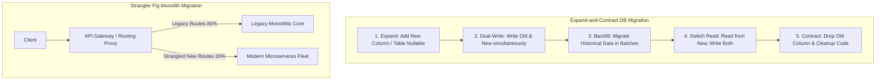
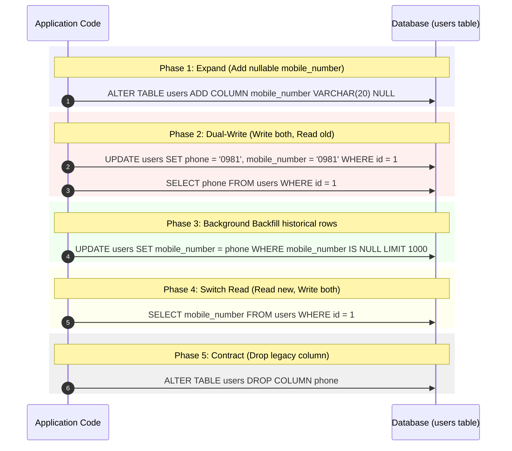
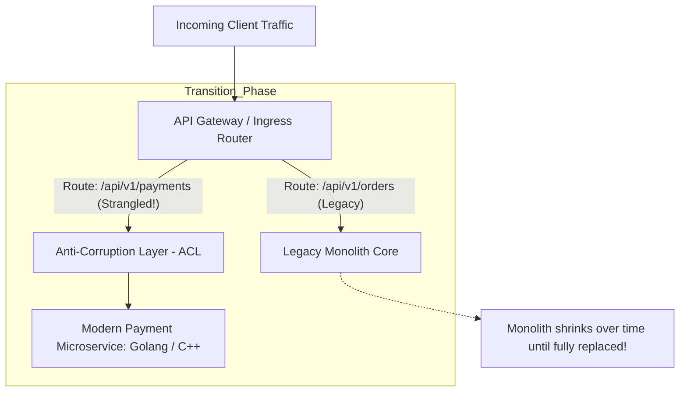
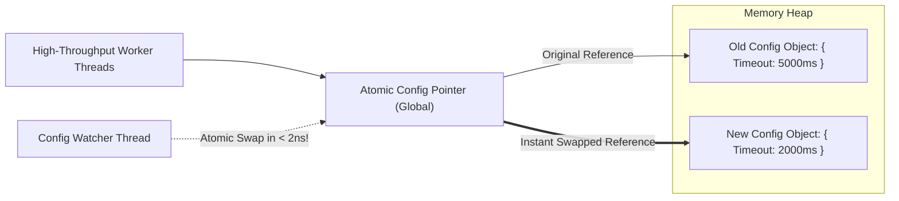

# 15.2. Zero-Downtime Migrations and Evolution (Chuyển Đổi Không Gián Đoạn và Kiến Trúc Tiến Hóa)

## Tổng quan về Chuyển Đổi Không Gián Đoạn và Kiến Trúc Tiến Hóa
Một trong những thử thách khắc nghiệt nhất đối với kỹ sư phần mềm cao cấp là: **Làm thế nào để thay thế động cơ của một chiếc máy bay phản lực khi nó đang bay ở độ cao 10,000 mét?**

Trong thực tế doanh nghiệp, một hệ thống phục vụ hàng triệu người dùng không bao giờ có thể dừng lại để "viết lại từ đầu" (Rewrite from scratch). Việc thay đổi cấu trúc bảng cơ sở dữ liệu hàng trăm triệu bản ghi, chuyển dịch từ Monolith sang Microservices, hay nâng cấp phiên bản API bắt buộc phải diễn ra liên tục mà **không gây ra một giây gián đoạn dịch vụ nào (Zero-Downtime)**.

Chuyên đề này đi sâu vào:
1. **Quy trình chuyển dịch cơ sở dữ liệu không khóa bảng**: Mô hình 5 pha **Expand-and-Contract Pattern (Parallel Run)**.
2. **Kỹ thuật chuyển dịch kiến trúc lớn**: **Strangler Fig Pattern (Cây đa siết)** kết hợp **Lớp chống tha hóa (Anti-Corruption Layer - ACL)**.
3. **Quản trị cấu hình động (Dynamic Runtime Configuration)**: Cập nhật biến cấu hình tức thì trong thời gian thực mà không cần khởi động lại tiến trình.



---

## 2. Chi tiết từng Keyword (Under-the-Hood Deep Dive)

### 1. The Expand-and-Contract Pattern & Zero-Downtime Database Migrations (Mẫu Hình Mở Rộng và Thu Hẹp)

#### 1. Khái niệm bản chất (What & Why)
Trong cơ sở dữ liệu quan hệ (PostgreSQL, MySQL), một thao tác tưởng chừng đơn giản như:
`ALTER TABLE users RENAME COLUMN phone TO mobile_number;`
sẽ ngay lập tức **làm sập toàn bộ hệ thống**! 
Lý do: Trong quá trình Rolling Deployment, các máy chủ phiên bản cũ (V1) vẫn đang chạy và liên tục gửi câu query `SELECT phone FROM users`, chúng sẽ ném lỗi `ColumnNotFoundException` ngay tức khắc!

**Expand-and-Contract Pattern (còn gọi là Parallel Run)** là kỹ thuật phân tách một thay đổi đột ngột (Breaking Change) thành một chuỗi các **bước chuyển đổi tương thích ngược (Backward-Compatible Steps)**, bảo đảm hệ thống luôn hoạt động bình thường trong suốt quá trình chuyển giao.

#### 2. Cơ chế hoạt động sâu (Under the hood / Hardcore Internals)
Quy trình 5 pha chuẩn mực chuyển đổi cột `phone` sang `mobile_number`:

1. **Pha 1: Mở rộng (Expand)**:
   - Thêm cột mới `mobile_number` vào bảng nhưng đánh dấu là **`NULLABLE`** (chấp nhận giá trị rỗng).
   - *Lưu ý kỹ thuật*: Không bao giờ thêm cột mới có giá trị `NOT NULL DEFAULT 'xyz'` trên bảng lớn mà không kiểm tra phiên bản Database, vì thao tác này có thể khóa độc quyền toàn bộ bảng (Access Exclusive Lock) để ghi lại từng trang dữ liệu trên đĩa!
2. **Pha 2: Ghi kép (Dual-Write)**:
   - Deploy phiên bản code mới.
   - Khi có người dùng cập nhật số điện thoại: Code ứng dụng **ghi đồng thời vào cả 2 cột**: `phone` và `mobile_number`.
   - Các thao tác Đọc vẫn tiếp tục đọc từ cột cũ `phone`.
3. **Pha 3: Nạp bù dữ liệu lịch sử (Backfill Phase)**:
   - Chạy một Background Worker ngầm quét và copy dữ liệu lịch sử từ `phone` sang `mobile_number` cho các bản ghi cũ.
   - *Quy chuẩn*: Phải chia nhỏ thành từng mẻ (Batches, ví dụ: 1,000 dòng mỗi mẻ kèm thời gian nghỉ 100ms) để không làm nghẽn Write-Ahead Log (WAL) và không làm tăng Replication Lag của Read Replicas!
4. **Pha 4: Chuyển hướng Đọc (Switch Read)**:
   - Chuyển code đọc dữ liệu sang cột mới: `SELECT mobile_number FROM users`.
   - Code vẫn duy trì ghi kép (Dual-Write) vào cả 2 cột để phòng trường hợp khẩn cấp cần Rollback.
5. **Pha 5: Thu hẹp (Contract / Cleanup)**:
   - Xóa bỏ đoạn code ghi vào cột cũ `phone`.
   - Thực thi lệnh SQL: `ALTER TABLE users DROP COLUMN phone;` an toàn $100\%$!

#### 3. Sơ đồ minh họa (The 5 Phases of Expand-and-Contract Migration)


#### 4. Code ví dụ thực chiến (TypeScript - Dual-Write Application Layer Implementation)
```typescript
interface DatabaseClient {
  query(sql: string, params: any[]): Promise<any>;
}

export class UserMigrationRepository {
  constructor(private db: DatabaseClient) {}

  // Pha 2 & 4: Dual-Write ghi vào cả 2 cột để bảo đảm tương thích ngược
  public async updateUserPhone(userId: string, newPhone: string, phase: 'PHASE_2_READ_OLD' | 'PHASE_4_READ_NEW') {
    console.log(`[Dual-Write Active] Syncing phone number to both 'phone' and 'mobile_number' columns...`);
    
    // Ghi đồng thời cả cột cũ và cột mới
    await this.db.query(
      `UPDATE users SET phone = ?, mobile_number = ? WHERE id = ?`,
      [newPhone, newPhone, userId]
    );

    // Quyết định đọc theo từng giai đoạn chuyển đổi
    if (phase === 'PHASE_2_READ_OLD') {
      const res = await this.db.query(`SELECT phone FROM users WHERE id = ?`, [userId]);
      return res[0]?.phone;
    } else {
      const res = await this.db.query(`SELECT mobile_number FROM users WHERE id = ?`, [userId]);
      return res[0]?.mobile_number;
    }
  }
}
```

#### 5. Ưu / Nhược điểm, Pitfalls & Anti-patterns
- **Anti-pattern: Creating Indexes without CONCURRENTLY in PostgreSQL**: Chạy lệnh `CREATE INDEX idx_user_email ON users(email);` trên bảng có 50 triệu dòng. Lệnh này sẽ giữ khóa `ShareLock` trên toàn bộ bảng, chặn đứng tất cả các câu lệnh `INSERT`, `UPDATE`, `DELETE` của người dùng trong suốt 15 phút, gây sập dịch vụ!
  - *Quy chuẩn*: Bắt buộc phải dùng `CREATE INDEX CONCURRENTLY idx_user_email ON users(email);` (chạy ngầm không khóa ghi).

#### 6. Ứng dụng thực tế trong Backend / Systems
GitHub và Stripe vận hành công cụ `gh-ost` (GitHub's Online Schema Migrations for MySQL) áp dụng triệt để mô hình Expand-and-Contract kết hợp Binlog Stream để thay đổi schema hàng nghìn bảng dữ liệu mỗi tháng mà không gây downtime.

---

## 2. Chi tiết từng Keyword (Under-the-Hood Deep Dive)

### 2. The Strangler Fig Pattern & Anti-Corruption Layer (Mẫu Hình Cây Đa Siết và Lớp Chống Tha Hóa)

#### 1. Khái niệm bản chất (What & Why)
- **Strangler Fig Pattern (Cây đa siết - Do Martin Fowler đặt tên)**: Được lấy cảm hứng từ loài cây đa trong rừng nhiệt đới: hạt của cây đa nảy mầm trên ngọn của một thân cây cổ thụ, rễ của nó mọc dần xuống đất, bao bọc và hút dinh dưỡng từ thân cây chủ; qua nhiều năm, cây đa phát triển to lớn và thân cây cổ thụ bên trong dần mục nát và biến mất hoàn toàn.
  - Trong kỹ thuật phần mềm: Thay vì viết lại toàn bộ hệ thống Monolith cũ từ đầu (Big Bang Rewrite - thường $80\%$ dự án thất bại), ta **xây dựng các Microservice mới xung quanh rìa của Monolith**. Từng tính năng cũ được bóc tách dần và chuyển hướng qua API Gateway sang Microservice mới, cho đến khi Monolith cũ bị "siết chết" và có thể gỡ bỏ an toàn!
- **Anti-Corruption Layer (ACL - Lớp chống tha hóa)**: Một lớp phiên dịch trung gian (Facade / Adapter) đặt giữa hệ thống mới và hệ thống cũ (Legacy System). Giúp đảm bảo mô hình miền sạch sẽ (Clean Domain Model) của hệ thống mới **không bị "tha hóa" hay vấy bẩn bởi các cấu trúc dữ liệu lỗi thời, luộm thuộm của hệ thống cũ**.

#### 2. Cơ chế hoạt động sâu (Under the hood / Hardcore Internals)
Bốn giai đoạn di chuyển bằng Strangler Fig Pattern:
1. **Giai đoạn 1 (Chặn bắt - Intercept)**: Đặt một **API Gateway hoặc Reverse Proxy (Envoy / NGINX)** đứng trước toàn bộ hệ thống. Toàn bộ $100\%$ traffic từ người dùng đều đi qua Gateway này và ban đầu được chuyển tiếp nguyên vẹn vào Monolith cũ.
2. **Giai đoạn 2 (Bóc tách tính năng đầu tiên - Squeeze)**:
   - Chọn một tính năng biên ít phụ thuộc nhất (ví dụ: `Notification Service` hoặc `Search Service`).
   - Xây dựng Microservice mới hoàn toàn bằng công nghệ hiện đại.
   - Sử dụng **Anti-Corruption Layer (ACL)** để dịch các cấu trúc dữ liệu XML/SOAP cũ của Monolith thành JSON/Protobuf chuẩn mực của Service mới.
3. **Giai đoạn 3 (Chuyển hướng định tuyến - Strangle)**:
   - Cấu hình API Gateway chuyển hướng route `/api/v1/notifications` sang Microservice mới.
   - Các route còn lại vẫn tiếp tục đi vào Monolith.
4. **Giai đoạn 4 (Tiêu hủy - Decommission)**:
   - Lặp lại quy trình trên cho từng tính năng. Khi chức năng cuối cùng của Monolith được chuyển đổi xong, tắt máy chủ Monolith cũ vĩnh viễn!

#### 3. Sơ đồ minh họa (Strangler Fig Migration Architecture)


#### 4. Code ví dụ thực chiến (C++20 - Anti-Corruption Layer Domain Model Adapter)
```cpp
#include <iostream>
#include <string>

// 1. Cấu trúc dữ liệu cũ kỹ, lộn xộn của Legacy Monolith (XML-style spaghetti)
struct LegacyCustomerRecord {
    std::string CUST_ID;
    std::string FULL_NAME_CSV; // Định dạng cũ: "Nguyen, Van A"
    int STATUS_INT;            // 1: Active, 2: Suspended, 99: Deleted
    double BALANCE_PENCE;      // Lưu bằng xu lẻ tiền bảng Anh
};

// 2. Mô hình Domain sạch sẽ của Microservice hiện đại
struct ModernCustomerProfile {
    std::string id;
    std::string firstName;
    std::string lastName;
    bool isActive;
    double balanceGBP;
};

// Anti-Corruption Layer (ACL): Bảo vệ Domain mới khỏi bị tha hóa bởi logic cũ!
class CustomerAntiCorruptionLayer {
public:
    static ModernCustomerProfile translateToCleanDomain(const LegacyCustomerRecord& legacy) {
        ModernCustomerProfile clean;
        clean.id = legacy.CUST_ID;

        // Phân tích và làm sạch chuỗi CSV cũ
        size_t comma_pos = legacy.FULL_NAME_CSV.find(',');
        if (comma_pos != std::string::npos) {
            clean.lastName = legacy.FULL_NAME_CSV.substr(0, comma_pos);
            clean.firstName = legacy.FULL_NAME_CSV.substr(comma_pos + 2); // Bỏ qua dấu phẩy và khoảng trắng
        }

        clean.isActive = (legacy.STATUS_INT == 1);
        clean.balanceGBP = legacy.BALANCE_PENCE / 100.0; // Đổi từ xu sang Bảng Anh

        std::cout << "[ACL Translated] Clean Domain Entity created for User: " 
                  << clean.firstName << " " << clean.lastName << " (Balance: " << clean.balanceGBP << " GBP)\n";
        return clean;
    }
};

int main() {
    LegacyCustomerRecord old_data{"LEGACY_101", "Tran, Van Nam", 1, 45050};
    // Đi qua lớp chống tha hóa ACL
    auto modern_user = CustomerAntiCorruptionLayer::translateToCleanDomain(old_data);
    return 0;
}
```

#### 5. Ưu / Nhược điểm, Pitfalls & Anti-patterns
- **Ưu điểm**: Giảm thiểu rủi ro kinh doanh về mức gần bằng 0; doanh nghiệp liên tục nhận được giá trị sau mỗi tính năng được bóc tách thay vì chờ đợi 2 năm cho một dự án viết lại từ đầu.
- **Thách thức**: Đòi hỏi duy trì tính nhất quán dữ liệu giữa Monolith và Microservices trong suốt thời gian chuyển giao kéo dài (thường cần CDC Event Sync hai chiều).

#### 6. Ứng dụng thực tế trong Backend / Systems
Amazon đã áp dụng Strangler Fig Pattern để chuyển đổi toàn bộ trang web bán lẻ khổng lồ từ một ứng dụng C++ đơn khối (Obidos Monolith) sang hàng nghìn vi dịch vụ Java/AWS hiện nay.

---

## 2. Chi tiết từng Keyword (Under-the-Hood Deep Dive)

### 3. Dynamic Runtime Configuration & Hot-Reloading (Quản Trị Cấu Hình Động Không Khởi Động Lại)

#### 1. Khái niệm bản chất (What & Why)
- **Static Configuration**: Cấu hình được nạp từ biến môi trường hoặc file YAML/JSON một lần duy nhất khi tiến trình khởi động. Muốn thay đổi (ví dụ: đổi Timeout từ 5s sang 2s), bắt buộc phải khởi động lại tiến trình (Restart / Rolling Update).
- **Dynamic Runtime Configuration (Cấu hình động)**: Khả năng thay đổi các tham số vận hành của hệ thống (Connection Pool size, Cache TTL, Log Level, Feature Flags, Rate Limit quotas) ngay tại thời điểm chạy trong vòng vài mili-giây mà **hoàn toàn không cần khởi động lại tiến trình và không làm rơi bất kỳ kết nối mạng nào của khách hàng**.

#### 2. Cơ chế hoạt động sâu (Under the hood / Hardcore Internals)
Hai kiến trúc phân phối cấu hình động:
1. **Event Watcher / Push Model (etcd / Consul Watches)**:
   - Tiến trình ứng dụng mở một kết nối HTTP/2 gRPC Stream duy nhất tới cụm lưu trữ cấu hình tập trung (etcd, Consul).
   - Sử dụng cơ chế **Long-lived Watcher**: Khi kỹ sư thay đổi giá trị trên UI quản trị, etcd đẩy trực tiếp một sự kiện (Push Event) tới toàn bộ hàng nghìn Pods trong vòng **$< 50\text{ ms}$**.
2. **Kỹ thuật Hot-Reloading an toàn trên RAM bằng Atomic Pointer Swapping (C++ / Go)**:
   - Làm thế nào để thay thế một đối tượng cấu hình phức tạp (chứa 100 trường) trong môi trường đa luồng (Multi-threading) mà không gây Race Condition và không cần dùng Mutex làm chậm luồng chính?
   - **Giải pháp `std::atomic<std::shared_ptr<Config>>`**:
     - Luồng đọc (Worker Threads) chỉ cần đọc con trỏ hiện tại qua atomic load trong thời gian **$< 2\text{ ns}$**.
     - Khi nhận được cấu hình mới: Luồng cấu hình khởi tạo một đối tượng `Config` mới hoàn toàn trên Heap, sau đó thực hiện **Atomic Pointer Swap** để trỏ sang đối tượng mới!
     - Các request cũ vẫn đọc an toàn trên đối tượng cũ; các request mới lập tức nhận cấu hình mới mà **không có dù chỉ 1 nanosecond bị Blocked**!

#### 3. Sơ đồ minh họa (Atomic Pointer Swap Hot-Reloading)


#### 4. Code ví dụ thực chiến (C++20 - Atomic Pointer Swap Configuration Hot-Reloader)
```cpp
#include <iostream>
#include <memory>
#include <atomic>
#include <string>
#include <thread>
#include <chrono>

struct AppRuntimeConfig {
    int max_connection_pool_size;
    int api_timeout_ms;
    std::string log_level;
};

// Động cơ Hot-Reloading phi khóa (Lock-Free) sử dụng std::atomic<std::shared_ptr>
class DynamicConfigManager {
private:
    std::atomic<std::shared_ptr<AppRuntimeConfig>> active_config_;

public:
    explicit DynamicConfigManager(AppRuntimeConfig initial_cfg) {
        active_config_.store(std::make_shared<AppRuntimeConfig>(initial_cfg));
    }

    // Luồng đọc (Hot Path): Không bao giờ bị khóa (Zero Lock Contention) - < 2ns
    std::shared_ptr<AppRuntimeConfig> getConfig() const {
        return active_config_.load(std::memory_order_acquire);
    }

    // Luồng cập nhật cấu hình: Khởi tạo đối tượng mới và hoán đổi con trỏ nguyên tử
    void updateConfig(AppRuntimeConfig new_cfg) {
        auto new_ptr = std::make_shared<AppRuntimeConfig>(new_cfg);
        active_config_.store(new_ptr, std::memory_order_release);
        std::cout << "\n>>> [HOT-RELOAD SUCCESS] Configuration atomically swapped in RAM!\n";
        std::cout << "    New Timeout: " << new_ptr->api_timeout_ms 
                  << "ms | New Log Level: " << new_ptr->log_level << "\n";
    }
};

int main() {
    DynamicConfigManager manager({20, 5000, "INFO"});

    // Worker thread đọc cấu hình ban đầu
    auto cfg1 = manager.getConfig();
    std::cout << "Worker reading: Timeout = " << cfg1->api_timeout_ms << "ms\n";

    // Kỹ sư SRE cập nhật cấu hình động tại thời điểm chạy
    manager.updateConfig({50, 1500, "DEBUG"});

    // Worker thread tiếp theo tự động nhận cấu hình mới mà không cần restart server!
    auto cfg2 = manager.getConfig();
    std::cout << "Worker reading: Timeout = " << cfg2->api_timeout_ms << "ms\n";

    return 0;
}
```

#### 5. Ưu / Nhược điểm, Pitfalls & Anti-patterns
- **Anti-pattern: Bad Config Crashing All Pods Simultaneously**: Đẩy một cấu hình sai cú pháp (Syntax error) hoặc giá trị không hợp lệ (`timeout = -1`) lên etcd/Consul. Vì cơ chế Watcher đẩy tức thì tới 100% các Pod trong cụm, toàn bộ hệ thống sẽ bị crash đồng loạt trong vòng 1 giây!
  - *Quy chuẩn*: Cấu hình động bắt buộc phải có **Schema Validation khắt khe** và áp dụng cơ chế **Canary Configuration Rollout** (chỉ đẩy cấu hình mới cho 5% máy chủ thử nghiệm trước).

#### 6. Ứng dụng thực tế trong Backend / Systems
Envoy Proxy sử dụng Dynamic Configuration APIs (xDS: LDS, RDS, CDS, EDS) để cập nhật toàn bộ bảng định tuyến, chứng chỉ TLS và danh sách IP backend trong thời gian thực mà không bao giờ làm rớt một kết nối TCP nào của khách hàng.

---

## Tóm tắt liên kết hệ thống
Chương **15.2 (Zero-Downtime Migrations and Evolution)** đã giải mã toàn bộ nghệ thuật tiến hóa hệ thống liên tục: từ việc thay đổi cấu trúc bảng cơ sở dữ liệu lớn không khóa bảng bằng Expand-and-Contract Pattern, chuyển dịch di sản Monolith an toàn qua Strangler Fig và Anti-Corruption Layer, cho đến cơ chế Hot-Reloading cấu hình động bằng Atomic Pointer Swapping.

Tiếp theo, tại **11.16: Observability & System Monitoring**, chúng ta sẽ tìm hiểu cách thức thắp sáng toàn bộ không gian tối bên trong hệ thống phân tán: Ba trụ cột Observability (Metrics, Logs, Distributed Tracing với OpenTelemetry), phương pháp RED/USE, bốn tín hiệu vàng (Golden Signals), và quy trình điều tra nguyên nhân gốc rễ (Root Cause Analysis - RCA) với Blameless Postmortem.
