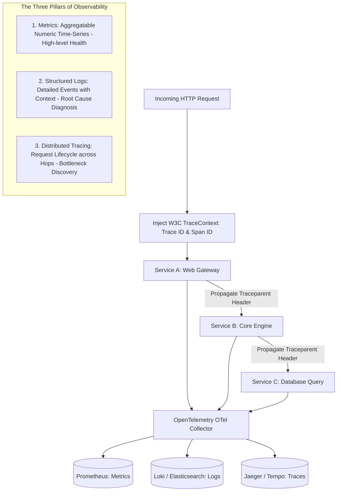
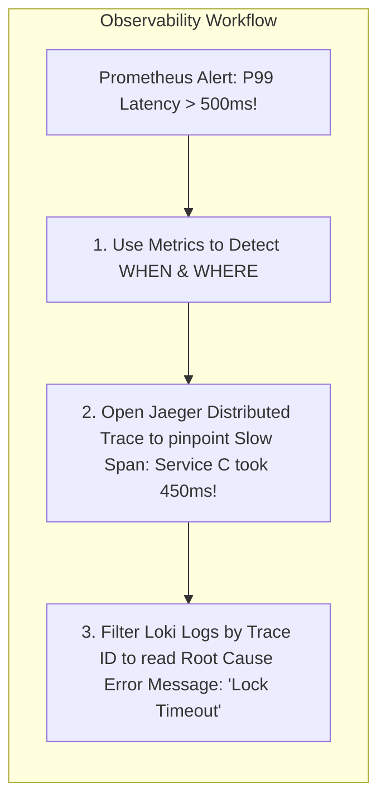
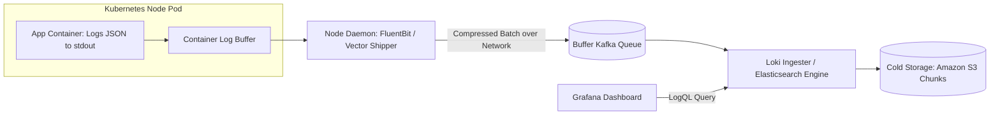

# 16.1. Telemetry, Metrics, Logging, and Distributed Tracing (Đo Lường Từ Xa, Số Liệu, Nhật Ký và Truy Vết Phân Tán)

## Tổng quan về Khả Năng Quan Sát và Đo Lường Từ Xa
Trong các hệ thống phân tán bao gồm hàng trăm vi dịch vụ chạy trên hàng nghìn container, một request đơn lẻ từ người dùng có thể kích hoạt một mạng lưới phức tạp gồm hàng chục cuộc gọi API, message queue và database queries. Khi có sự cố xảy ra (ví dụ: một tỷ lệ nhỏ người dùng bị trễ 5 giây hoặc ném lỗi 500 ngẫu nhiên), các phương pháp kiểm tra truyền thống (như SSH vào từng server để đọc file log) trở nên hoàn toàn bất lực.

Khái niệm **Khả năng quan sát (Observability)** bắt nguồn từ lý thuyết điều khiển tự động của Rudolf E. Kálmán:
$$\textbf{"A system is observable if its internal state can be inferred solely from knowledge of its external outputs."}$$
*(Một hệ thống được coi là có khả năng quan sát nếu trạng thái nội tại bên trong của nó có thể được suy luận hoàn toàn chính xác chỉ dựa vào các tín hiệu đầu ra bên ngoài).*

Chuyên đề này đi sâu vào **Ba trụ cột của Khả năng quan sát (The Three Pillars of Observability)**: **Số liệu (Metrics)**, **Nhật ký có cấu trúc (Structured Logging)** và **Truy vết phân tán (Distributed Tracing)** theo tiêu chuẩn công nghiệp toàn cầu **OpenTelemetry (OTel)** và chuẩn **W3C TraceContext**.



---

## 2. Chi tiết từng Keyword (Under-the-Hood Deep Dive)

### 1. Monitoring vs Observability & The Three Pillars (Giám Sát vs Khả Năng Quan Sát)

#### 1. Khái niệm bản chất (What & Why)
- **Monitoring (Giám sát)**: Cho bạn biết **KHI NÀO** một hệ thống bị lỗi (Tell you WHEN something is broken). Dựa trên các triệu chứng đã biết từ trước (Known Unknowns): Kiểm tra xem CPU có vượt $85\%$ không, tỷ lệ lỗi 5xx có vượt $1\%$ không, máy chủ có còn ping được không.
- **Observability (Khả năng quan sát)**: Cho bạn biết **TẠI SAO** hệ thống lại bị lỗi (Tell you WHY it broke), đặc biệt là trong các tình huống lỗi chưa từng xảy ra trong tiền lệ (Unknown Unknowns). Cho phép kỹ sư đặt các câu hỏi mới toanh mà không cần phải deploy thêm code mới.
- **Ba trụ cột truyền thống (The Three Pillars)**:
  1. **Metrics (Số liệu)**: Các giá trị số được tổng hợp theo thời gian (Counters, Gauges, Histograms). Rất nhẹ, tốn ít dung lượng lưu trữ, lý tưởng để vẽ biểu đồ và kích hoạt cảnh báo (Alerting).
  2. **Logs (Nhật ký sự kiện)**: Bản ghi chi tiết mang dấu thời gian (Timestamp) mô tả một sự kiện riêng biệt đã xảy ra. Rất giàu ngữ nghĩa, nhưng tốn dung lượng lưu trữ khổng lồ.
  3. **Distributed Tracing (Truy vết phân tán)**: Bản đồ tái hiện toàn bộ hành trình của một request khi nó di chuyển qua đồ thị các vi dịch vụ phân tán. Giúp xác định chính xác nút nào gây ra nút thắt cổ chai độ trễ.

#### 2. Cơ chế hoạt động sâu (Under the hood / Hardcore Internals)
Bốn loại dữ liệu số liệu chuẩn của **Prometheus Metric Types**:
1. **Counter (Bộ đếm)**: Giá trị số nguyên chỉ có thể **tăng lên hoặc reset về 0 khi khởi động lại tiến trình** (ví dụ: `http_requests_total`). Được dùng kết hợp với hàm `rate()` để tính RPS.
2. **Gauge (Đồng hồ đo)**: Giá trị số có thể **tăng hoặc giảm bất kỳ lúc nào** (ví dụ: `current_memory_usage_bytes`, `active_connections_count`).
3. **Histogram (Biểu đồ tần suất)**: Đếm số lượng quan sát rơi vào các khoảng cấu hình sẵn (**Buckets**, ví dụ: $\le 10ms, \le 50ms, \le 200ms, \le 1000ms$) và tính tổng giá trị (`sum`). Cho phép tính toán chính xác các bách phân vị $P90, P99$ ở phía máy chủ giám sát.
4. **Summary**: Tương tự Histogram nhưng tính toán bách phân vị trực tiếp ngay trên máy khách (Client-side quantiles). Tốn CPU của ứng dụng hơn.

#### 3. Sơ đồ minh họa


#### 4. Code ví dụ thực chiến (C++20 - Prometheus Counter & Histogram Engine thu nhỏ)
```cpp
#include <iostream>
#include <vector>
#include <string>
#include <atomic>
#include <algorithm>

// Mô phỏng cấu trúc dữ liệu Prometheus Histogram Buckets
class PrometheusHistogram {
private:
    std::string metric_name_;
    std::vector<double> buckets_;       // Các mốc bucket: vd 10ms, 50ms, 200ms
    std::vector<std::atomic<uint64_t>> bucket_counts_;
    std::atomic<uint64_t> total_count_{0};
    std::atomic<double> total_sum_{0.0};

public:
    PrometheusHistogram(std::string name, std::vector<double> buckets)
        : metric_name_(std::move(name)), buckets_(std::move(buckets)), bucket_counts_(buckets_.size() + 1) {}

    void observe(double duration_ms) {
        total_count_.fetch_add(1, std::memory_order_relaxed);
        
        // Cộng dồn vào sum (dùng CAS cho số thực)
        double cur_sum = total_sum_.load(std::memory_order_relaxed);
        while (!total_sum_.compare_exchange_weak(cur_sum, cur_sum + duration_ms,
                                                 std::memory_order_relaxed));

        // Tăng giá trị cho tất cả các bucket có giới hạn >= duration_ms (Cumulative Buckets)
        for (size_t i = 0; i < buckets_.size(); ++i) {
            if (duration_ms <= buckets_[i]) {
                bucket_counts_[i].fetch_add(1, std::memory_order_relaxed);
            }
        }
        // Bucket +Inf (chứa tất cả)
        bucket_counts_.back().fetch_add(1, std::memory_order_relaxed);
    }

    void exportMetricsTextFormat() {
        std::cout << "# HELP " << metric_name_ << " Request duration in ms.\n";
        std::cout << "# TYPE " << metric_name_ << " histogram\n";
        for (size_t i = 0; i < buckets_.size(); ++i) {
            std::cout << metric_name_ << "_bucket{le=\"" << buckets_[i] << "\"} " 
                      << bucket_counts_[i].load() << "\n";
        }
        std::cout << metric_name_ << "_bucket{le=\"+Inf\"} " << bucket_counts_.back().load() << "\n";
        std::cout << metric_name_ << "_sum " << total_sum_.load() << "\n";
        std::cout << metric_name_ << "_count " << total_count_.load() << "\n";
    }
};

int main() {
    PrometheusHistogram http_latency("http_request_duration_ms", {10.0, 50.0, 200.0});

    http_latency.observe(5.2);  // Rơi vào bucket <= 10, <= 50, <= 200
    http_latency.observe(35.0); // Rơi vào bucket <= 50, <= 200
    http_latency.observe(450.0);// Rơi vào bucket +Inf

    http_latency.exportMetricsTextFormat();
    return 0;
}
```

#### 5. Ưu / Nhược điểm, Pitfalls & Anti-patterns
- **Anti-pattern: High-Cardinality Metrics Explosion**: Nhét địa chỉ email của người dùng hoặc UUID của đơn hàng vào nhãn (Label) của Prometheus Metric: `http_requests_total{user_id="user_9981"}`. Một triệu người dùng sẽ tạo ra một triệu chuỗi thời gian (Time-series) độc lập, làm tràn RAM và kéo sập máy chủ Prometheus ngay lập tức!
  - *Quy chuẩn*: **Chỉ đặt các trường có độ phân tán thấp (Low Cardinality)** vào Metric Label (`http_status`, `method`, `route`). Đưa UUID vào Trace ID hoặc Logs!

#### 6. Ứng dụng thực tế trong Backend / Systems
Prometheus và Grafana là tiêu chuẩn công nghiệp mặc định số một để thu thập và hiển thị số liệu giám sát trên toàn bộ hệ sinh thái Cloud Native và Kubernetes.

---

## 2. Chi tiết từng Keyword (Under-the-Hood Deep Dive)

### 2. Structured Logging & Centralized Log Aggregation (Nhật Ký Có Cấu Trúc và Thu Gom Nhật Ký Tập Trung)

#### 1. Khái niệm bản chất (What & Why)
- **Unstructured Logging (Nhật ký không cấu trúc - Text thô)**: Dòng log chỉ là một chuỗi ký tự tự do:
  `2026-11-09 22:30:00 [ERROR] User 9981 checkout failed on order 105 due to timeout`
  Máy tính không thể tự động lọc hoặc lập chỉ mục chuỗi văn bản này mà phải dùng các câu lệnh Regex tốn CPU và dễ sai sót.
- **Structured Logging (Nhật ký có cấu trúc - JSON chuẩn)**: Mọi thông tin được định dạng thành các cặp Khóa-Giá trị (**Key-Value JSON**) máy đọc được:
  ```json
  {
    "timestamp": "2026-11-09T22:30:00Z",
    "level": "ERROR",
    "message": "Checkout transaction failed",
    "user_id": "9981",
    "order_id": "105",
    "error_code": "LOCK_TIMEOUT",
    "trace_id": "4bf92f3577b34da6a3ce929d0e0e4736"
  }
  ```
  Cho phép các hệ thống tìm kiếm (Elasticsearch, Grafana Loki, ClickHouse) lập chỉ mục siêu tốc và lọc chính xác trong 1ms: `WHERE user_id = 9981 AND level = 'ERROR'`.

#### 2. Cơ chế hoạt động sâu (Under the hood / Hardcore Internals)
Kiến trúc đường ống thu gom nhật ký tập trung (Centralized Logging Pipeline):
1. **Ghi nhật ký không bị chặn (Non-blocking Asynchronous Logging)**:
   - Nghiêm cấm ứng dụng ghi file log trực tiếp bằng các lệnh đồng bộ (`fsync` trên đĩa).
   - Ứng dụng chỉ ghi log ra luồng chuẩn **`stdout` / `stderr`** (chuẩn Twelve-Factor App) hoặc đẩy vào một hàng đợi vòng tròn in-memory (**Lock-free Ring Buffer**).
2. **Log Shipper Daemon (Vector / FluentBit / Filebeat)**:
   - Một tiến trình thu gom chuyên dụng chạy dưới dạng DaemonSet trên từng máy chủ vật lý, đọc các dòng log từ container socket hoặc log file của kernel.
   - Nén log bằng Gzip và gửi theo từng mẻ (Batches) tới cụm lưu trữ tập trung qua mạng.
3. **Log Storage & Indexing**:
   - **Elasticsearch**: Lập chỉ mục toàn văn bản (Inverted Index) trên mọi trường. Tìm kiếm cực mạnh nhưng ngốn rất nhiều RAM và dung lượng đĩa.
   - **Grafana Loki**: Không lập chỉ mục nội dung log thô mà chỉ lập chỉ mục các nhãn (Labels: Pod, Namespace, Service) và nén chuỗi log thành các khối chunks. Tiết kiệm tới $90\%$ chi phí lưu trữ so với Elasticsearch!

#### 3. Sơ đồ minh họa (Centralized Logging Pipeline)


#### 4. Code ví dụ thực chiến (TypeScript - Structured JSON Logger với Diagnostic Context)
```typescript
interface LogContext {
  userId?: string;
  orderId?: string;
  traceId?: string;
  [key: string]: any;
}

export class StructuredLogger {
  constructor(private serviceName: string) {}

  private emitLog(level: 'INFO' | 'WARN' | 'ERROR', message: string, ctx?: LogContext, err?: Error) {
    const logPayload = {
      timestamp: new Date().toISOString(),
      service: this.serviceName,
      level,
      message,
      context: ctx || {},
      error: err ? { name: err.name, message: err.message, stack: err.stack } : undefined
    };

    // Ghi ra stdout dưới dạng JSON 1 dòng duy nhất (Single-line JSON for log shippers)
    process.stdout.write(JSON.stringify(logPayload) + "\n");
  }

  public info(msg: string, ctx?: LogContext) { this.emitLog('INFO', msg, ctx); }
  public error(msg: string, err: Error, ctx?: LogContext) { this.emitLog('ERROR', msg, ctx, err); }
}

// Chạy thử nghiệm
const logger = new StructuredLogger("order-service");
logger.info("Order processed successfully", { orderId: "ORD-99", amount: 150.0, traceId: "4bf92f3577b34da6" });
logger.error("Database connection timeout", new Error("Connection refused to 10.0.0.5:5432"), { orderId: "ORD-99" });
```

#### 5. Ưu / Nhược điểm, Pitfalls & Anti-patterns
- **Anti-pattern: PII Leakage in Logs**: Ghi mật khẩu của người dùng, số thẻ tín dụng hoặc token JWT vào log: `logger.info("User login attempt with pass: " + password)`. Bất kỳ ai có quyền đọc log hoặc khi file log bị sao lưu đều có thể đánh cắp thông tin nhạy cảm của khách hàng (Vi phạm hình sự luật GDPR và PCI-DSS).

#### 6. Ứng dụng thực tế trong Backend / Systems
Mọi công ty công nghệ lớn đều bắt buộc áp dụng **Masking Filter** ở tầng Log Shipper để tự động che giấu các số thẻ tín dụng (`4111-XXXX-XXXX-1111`) trước khi log được đẩy về trung tâm.

---

### 3. Distributed Tracing & W3C TraceContext Propagation (Truy Vết Phân Tán và Lan Truyền Ngữ Cảnh W3C)

#### 1. Khái niệm bản chất (What & Why)
Trong kiến trúc Microservices, một request từ người dùng đi qua 10 dịch vụ khác nhau. Nếu chỉ nhìn vào file log của từng dịch vụ riêng biệt, ta không thể nào biết được dòng log nào ở Service 1 liên quan đến dòng log nào ở Service 10.

- **Distributed Tracing (Truy vết phân tán)**: Kỹ thuật gắn một định danh duy nhất cho một request ngay khi nó bước vào cửa ngõ hệ thống và truyền định danh này xuyên suốt toàn bộ các cuộc gọi mạng tiếp theo.
- **Các thuật ngữ cốt lõi**:
  - **Trace**: Đại diện cho toàn bộ hành trình của một request (từ lúc bắt đầu đến khi kết thúc). Mỗi Trace được định danh bằng một **Trace ID (16 bytes = 32 ký tự hex)** duy nhất.
  - **Span**: Đơn vị công việc nhỏ nhất bên trong một Trace (ví dụ: thời gian thực thi của một hàm, một câu query SQL, hoặc một cuộc gọi HTTP sang service khác). Mỗi Span có một **Span ID (8 bytes = 16 ký tự hex)**, tên hành động, thời điểm bắt đầu và thời lượng (Duration).
  - **Parent Span ID**: Thiết lập mối quan hệ cha-con giữa các Span, tạo thành một đồ thị có hướng không chu trình (**Directed Acyclic Graph - DAG**).

#### 2. Cơ chế hoạt động sâu (Under the hood / Hardcore Internals)
Tiêu chuẩn toàn cầu **W3C TraceContext Specification**:
Để đảm bảo tất cả các ngôn ngữ và dịch vụ (từ Envoy Proxy, NGINX, Java, Go, C++, Python) đều hiểu được nhau, tổ chức W3C định nghĩa một HTTP Header chuẩn hóa: **`traceparent`**:
$$\textbf{traceparent: 00-4bf92f3577b34da6a3ce929d0e0e4736-00f067aa0ba902b7-01}$$
Cấu trúc 4 trường phân cách bằng dấu gạch nối:
1. **Version (2 hex)**: `00` (Phiên bản đặc tả hiện tại của W3C).
2. **Trace ID (32 hex - 16 bytes)**: `4bf92f3577b34da6a3ce929d0e0e4736` (Định danh toàn cầu cho toàn bộ chuỗi request).
3. **Parent Span ID (16 hex - 8 bytes)**: `00f067aa0ba902b7` (Định danh của Span cha vừa gửi request này).
4. **Trace Flags (2 hex - 8 bits)**: `01` (Bit cuối cùng `01` báo hiệu request này **đã được chọn để lấy mẫu - Sampled = true**, bắt buộc các service phía sau phải tiếp tục ghi nhận trace).

Quy trình lan truyền (Context Propagation):
- Service A nhận request $\rightarrow$ Bóc tách `traceparent` header.
- Tạo một Span mới cho Service A với ID riêng `span_A`.
- Khi Service A gọi sang Service B qua HTTP hoặc gRPC: Service A tự động tiêm (Inject) header `traceparent` mới mang cùng `Trace ID`, nhưng cập nhật trường Parent Span ID thành `span_A`!

#### 3. Sơ đồ minh họa (Distributed Trace DAG and Span Hierarchy)

```mermaid
gantt
    title Distributed Trace Waterfall Visualization (Total: 120ms)
    dateFormat X
    axisFormat %s ms
    section Gateway
    API Gateway Ingress Span [00-4bf9...] :0, 120
    section Microservices
    Auth Service Verify Token            :5, 25
    Order Service Business Logic         :25, 115
    section Database & External
    Inventory DB SELECT Stock            :35, 60
    Payment Gateway External POST        :65, 105
```


#### 4. Code ví dụ thực chiến (C++20 - W3C TraceContext Parser & Injector)
```cpp
#include <iostream>
#include <string>
#include <sstream>
#include <iomanip>
#include <vector>

struct W3CTraceContext {
    std::string version;
    std::string trace_id;
    std::string parent_span_id;
    std::string trace_flags;
};

class TraceContextPropagator {
public:
    static bool parseTraceParent(const std::string& header_val, W3CTraceContext& out_ctx) {
        // Cấu trúc chuẩn W3C: 00-4bf92f3577b34da6a3ce929d0e0e4736-00f067aa0ba902b7-01
        if (header_val.size() != 55 || header_val[2] != '-' || header_val[35] != '-' || header_val[52] != '-') {
            std::cerr << "[TraceContext Error] Malformed W3C traceparent header format!\n";
            return false;
        }

        out_ctx.version = header_val.substr(0, 2);
        out_ctx.trace_id = header_val.substr(3, 32);
        out_ctx.parent_span_id = header_val.substr(36, 16);
        out_ctx.trace_flags = header_val.substr(53, 2);
        return true;
    }

    static std::string injectTraceParent(const std::string& trace_id, const std::string& new_span_id, bool sampled = true) {
        std::stringstream ss;
        ss << "00-" << trace_id << "-" << new_span_id << "-" << (sampled ? "01" : "00");
        return ss.str();
    }
};

int main() {
    std::string incoming_header = "00-4bf92f3577b34da6a3ce929d0e0e4736-00f067aa0ba902b7-01";
    W3CTraceContext ctx;

    if (TraceContextPropagator::parseTraceParent(incoming_header, ctx)) {
        std::cout << "[TraceContext Parsed Successfully]\n";
        std::cout << "Global Trace ID: " << ctx.trace_id << "\n";
        std::cout << "Caller Span ID:  " << ctx.parent_span_id << "\n";
        std::cout << "Sampled Bit:     " << ctx.trace_flags << "\n";

        // Service hiện tại sinh ra một Span ID mới cho mình: "a1b2c3d4e5f60718"
        // và lan truyền tiếp sang downstream dependency
        std::string outgoing_header = TraceContextPropagator::injectTraceParent(ctx.trace_id, "a1b2c3d4e5f60718", true);
        std::cout << "\nOutbound Propagated Header for Next Service Hop:\n";
        std::cout << "traceparent: " << outgoing_header << "\n";
    }

    return 0;
}
```

#### 5. Ưu / Nhược điểm, Pitfalls & Anti-patterns
- **Anti-pattern: 100% Head-based Sampling at High Volume**: Cấu hình lấy mẫu $100\%$ các traces trong một hệ thống nhận $100,000\ \text{RPS}$. Lượng dữ liệu trace sinh ra sẽ lên tới hàng chục Terabyte mỗi ngày, làm nghẽn card mạng và tốn kém hàng chục nghìn USD tiền lưu trữ!
  - *Giải pháp*: Áp dụng **Adaptive Sampling (Lấy mẫu thích ứng $1\%$)** hoặc **Tail-based Sampling** (chỉ lưu trữ toàn bộ các traces có thời gian chạy chậm $> 500ms$ hoặc có chứa mã lỗi 5xx).

#### 6. Ứng dụng thực tế trong Backend / Systems
OpenTelemetry (OTel) là dự án mã nguồn mở lớn thứ hai của tổ chức CNCF (chỉ sau Kubernetes), cung cấp SDK thống nhất cho mọi ngôn ngữ để đẩy trace sang Jaeger, Datadog và AWS X-Ray.

---

## Tóm tắt liên kết hệ thống
Chương **16.1 (Telemetry, Metrics, Logging, and Tracing)** đã thiết lập toàn bộ hệ thống thần kinh cảm giác cho hệ thống phân tán: hiểu rõ sự khác biệt giữa Monitoring và Observability, 4 loại số liệu chuẩn Prometheus, cấu trúc JSON Structured Logging, và kỹ thuật lan truyền ngữ cảnh W3C TraceContext không mất dấu vết.

Trong bài viết tiếp theo (**16.2: Reliability Signals, Alerting, and Incident Response**), chúng ta sẽ chuyển các tín hiệu đo lường này thành hành động vận hành thực tế: Bộ chỉ số vàng **RED / USE / Golden Signals**, thiết lập cam kết **SLI / SLO / SLA**, quản lý **Error Budget & Burn Rate**, chống chai sạn cảnh báo (Alert Fatigue), và quy trình điều tra sự cố **Blameless Postmortem**.
