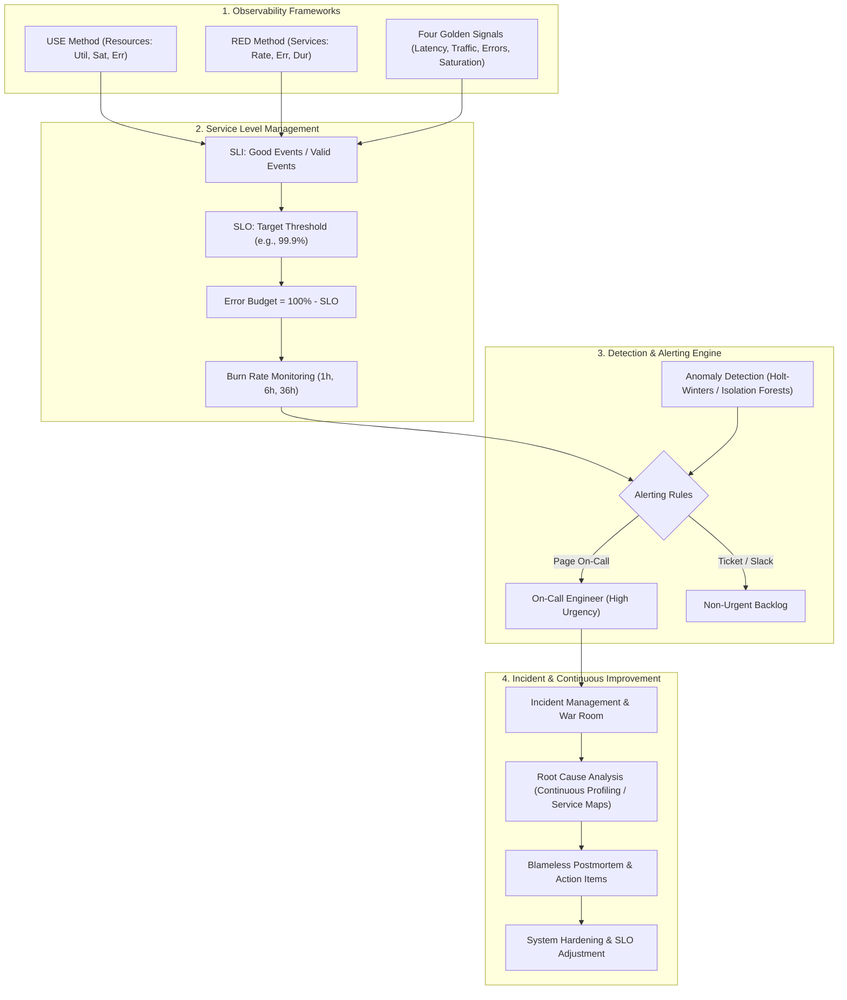
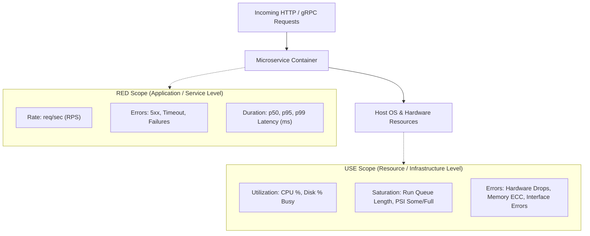
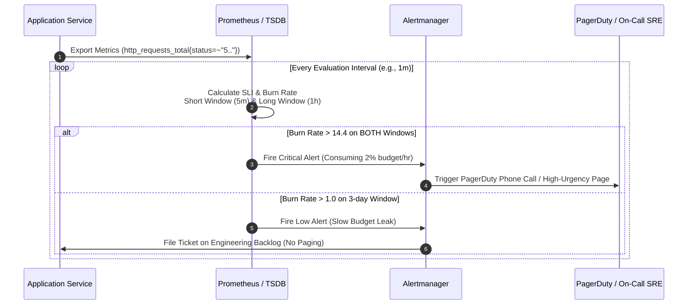
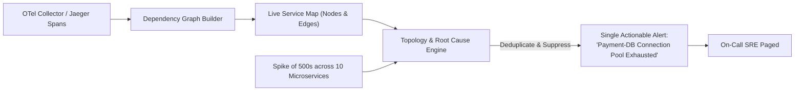
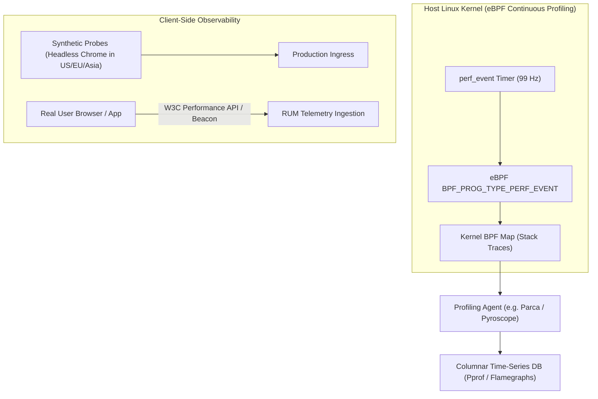
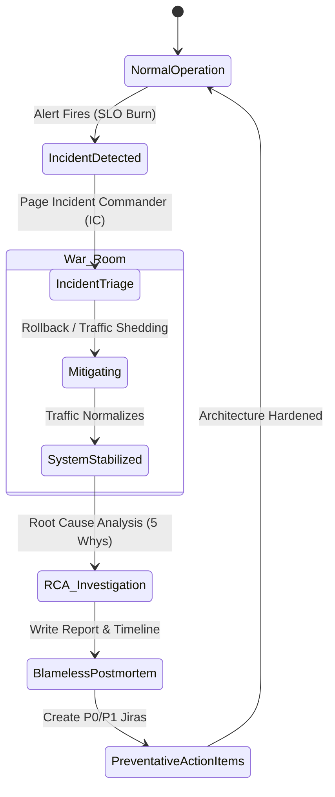

# 16.2. Reliability Signals, Alerting & Incident Response (Tín hiệu độ tin cậy, Cảnh báo & Ứng phó sự cố)

---

## Tổng quan về Reliability Signals, Alerting & Incident Response

Trong kiến trúc phân tán quy mô lớn, việc thu thập dữ liệu viễn trắc (telemetry) chỉ là bước khởi đầu. Để duy trì tính sẵn sàng cao (High Availability) và bảo vệ trải nghiệm người dùng, hệ thống cần các khung phân tích định lượng (Quantitative Reliability Frameworks) như **Google SRE Golden Signals**, **Brendan Gregg's USE Method**, và **Tom Wilkie's RED Method**. Các phương pháp này chuyển hóa hàng triệu metrics thành các chỉ số vận hành cốt lõi: **SLI (Service Level Indicator)**, **SLO (Service Level Objective)**, và **Error Budget**.

Hệ thống cảnh báo (Alerting) hiện đại không còn dựa trên ngưỡng tĩnh (static threshold) cho CPU hay Memory, mà chuyển dịch sang cảnh báo dựa trên **Multi-Window Multi-Burn-Rate** nhằm triệt tiêu hoàn toàn **Alert Fatigue** trong khi vẫn bảo đảm phát hiện sớm các sự cố nghiêm trọng. Khi sự cố xảy ra, quy trình **Incident Management**, điều tra nguyên nhân gốc rễ (**Root Cause Analysis - RCA**), kết hợp với kỹ thuật **Continuous Profiling**, **Synthetic Monitoring**, và văn hóa **Blameless Postmortem** tạo nên vòng lặp tự hoàn thiện giúp hệ thống ngày càng kiên cố.



---

## 2. Chi tiết từng Keyword (Under-the-Hood Deep Dive)

---

### 1. Observability Frameworks: USE, RED, and Google's Four Golden Signals

#### 1. Khái niệm bản chất (What & Why)
- **USE Method (Utilization, Saturation, Errors)**: Do Brendan Gregg xây dựng nhằm phân tích hiệu năng của **Tài nguyên phần cứng / HĐH (Resources)** như CPU, Memory, Disk I/O, Network interfaces, Bus bandwidth.
  - *Utilization*: Tỷ lệ thời gian tài nguyên đang bận xử lý công việc (ví dụ: CPU % busy, Disk active time).
  - *Saturation*: Khối lượng công việc bị xếp hàng chờ xử lý do tài nguyên quá tải (ví dụ: CPU run queue length, Linux disk queue depth).
  - *Errors*: Số lượng lỗi phần cứng hoặc tầng driver (ví dụ: Network interface packet drops, ECC memory errors).
- **RED Method (Rate, Errors, Duration)**: Do Tom Wilkie phát triển dành riêng cho **Dịch vụ hướng yêu cầu (Request-driven / Microservices)**.
  - *Rate*: Tần suất request gửi tới service (requests per second - RPS).
  - *Errors*: Tần suất request thất bại (HTTP 5xx, gRPC status errors).
  - *Duration*: Thời gian hoàn thành request (Latency distribution: p50, p90, p99).
- **Google's Four Golden Signals**: Bộ quy chuẩn SRE của Google gồm:
  - *Latency*: Thời gian xử lý request (cần phân biệt latency của request thành công vs request thất bại).
  - *Traffic*: Khối lượng nhu cầu đặt lên hệ thống (RPS, network I/O bits/s, transactions/s).
  - *Errors*: Tỷ lệ lỗi (lỗi tường minh như 500, hoặc lỗi ngầm như sai payload, empty response).
  - *Saturation*: Mức độ đầy của tài nguyên bị nghẽn (bottleneck resource) trong hệ thống (ví dụ: dung lượng connection pool, thread pool queue depth).

#### 2. Cơ chế hoạt động sâu (Under the hood / Hardcore Internals)
- **Sự khác biệt bản chất giữa USE và RED**:
  - USE tập trung vào **Resource-centric**: Trả lời câu hỏi *"Phần cứng nào đang kiệt quệ?"*. Tài nguyên có thể có Utilization 100% nhưng Saturation = 0 nếu không có tác vụ nào bị xếp hàng chờ. Ngược lại, Saturation $> 0$ là chỉ báo chắc chắn của tình trạng suy giảm hiệu năng (latency tăng đột biến do hàng đợi).
  - RED tập trung vào **Workload-centric / User-experience**: Trả lời câu hỏi *"Trải nghiệm người dùng có đang bị suy giảm không?"*. Một service có thể có CPU 30% (USE bình thường) nhưng Duration p99 nhảy vọt lên 5s do Database lock contention (RED phát hiện tức thì).
- **Trích xuất thông số cấp Kernel cho USE**:
  - CPU Utilization: Đọc `/proc/stat` (`cpu` user, nice, system, idle, iowait).
  - CPU Saturation: Đọc `/proc/loadavg` hoặc kiểm tra `PSI` (Pressure Stall Information) tại `/proc/pressure/cpu` (some/full stalls).
  - Disk Saturation: Đọc `/proc/diskstats` (trường `inflight` I/Os hoặc `weighted_time_spent_doing_io`).
  - Network Errors: Đọc `/proc/net/dev` (`rx_dropped`, `tx_dropped`, `rx_errors`).

#### 3. Sơ đồ minh họa (Architecture & Flow)



#### 4. Code ví dụ thực chiến (C++20: Prometheus-Style Sliding Window Latency & Metric Tracker)

```cpp
#include <iostream>
#include <vector>
#include <chrono>
#include <atomic>
#include <algorithm>
#include <cmath>
#include <mutex>

class REDMetricsCollector {
private:
    struct LatencySample {
        std::chrono::steady_clock::time_point timestamp;
        uint64_t duration_us;
    };

    std::atomic<uint64_t> total_requests_{0};
    std::atomic<uint64_t> total_errors_{0};

    std::mutex samples_mutex_;
    std::vector<LatencySample> samples_;
    const std::chrono::seconds window_duration_{60};

    void purgeOldSamples(std::chrono::steady_clock::time_point now) {
        auto cutoff = now - window_duration_;
        samples_.erase(
            std::remove_if(samples_.begin(), samples_.end(),
                [cutoff](const LatencySample& s) { return s.timestamp < cutoff; }),
            samples_.end()
        );
    }

public:
    void recordRequest(uint64_t duration_us, bool is_error) {
        total_requests_.fetch_add(1, std::memory_order_relaxed);
        if (is_error) {
            total_errors_.fetch_add(1, std::memory_order_relaxed);
        }

        auto now = std::chrono::steady_clock::now();
        std::lock_guard<std::mutex> lock(samples_mutex_);
        samples_.push_back({now, duration_us});
        if (samples_.size() % 1000 == 0) {
            purgeOldSamples(now);
        }
    }

    struct REDSnapshot {
        double rps;
        double error_rate_percent;
        uint64_t p50_duration_us;
        uint64_t p99_duration_us;
    };

    REDSnapshot captureSnapshot() {
        auto now = std::chrono::steady_clock::now();
        std::lock_guard<std::mutex> lock(samples_mutex_);
        purgeOldSamples(now);

        REDSnapshot snap{};
        size_t count = samples_.size();
        snap.rps = static_cast<double>(count) / window_duration_.count();

        uint64_t total_req = total_requests_.load(std::memory_order_relaxed);
        uint64_t total_err = total_errors_.load(std::memory_order_relaxed);
        snap.error_rate_percent = (total_req > 0) ? (static_cast<double>(total_err) * 100.0 / total_req) : 0.0;

        if (count == 0) return snap;

        std::vector<uint64_t> durations;
        durations.reserve(count);
        for (const auto& s : samples_) durations.push_back(s.duration_us);
        std::sort(durations.begin(), durations.end());

        snap.p50_duration_us = durations[static_cast<size_t>(count * 0.50)];
        snap.p99_duration_us = durations[std::min(static_cast<size_t>(count * 0.99), count - 1)];

        return snap;
    }
};

int main() {
    REDMetricsCollector collector;
    for (int i = 0; i < 980; ++i) collector.recordRequest(2000 + (i % 500), false);
    for (int i = 0; i < 20; ++i) collector.recordRequest(150000, true); // 2% errors, latency cao

    auto snap = collector.captureSnapshot();
    std::cout << "[RED Report - 60s Window]\n"
              << "Throughput : " << snap.rps << " RPS\n"
              << "Error Rate : " << snap.error_rate_percent << " %\n"
              << "p50 Latency: " << snap.p50_duration_us / 1000.0 << " ms\n"
              << "p99 Latency: " << snap.p99_duration_us / 1000.0 << " ms\n";
    return 0;
}
```

#### 5. Ưu / Nhược điểm, Pitfalls & Anti-patterns
- **Anti-pattern: Chỉ theo dõi trung bình (Average Latency)**: Latency trung bình che giấu hoàn toàn các spike gây khó chịu cho người dùng. 1% người dùng chịu 10 giây độ trễ có thể phá hủy danh tiếng dịch vụ mà mức trung bình chỉ tăng 20ms. Bắt buộc phải đo `p95`, `p99`, `p99.9`.
- **Anti-pattern: Sử dụng CPU Utilization để đánh giá độ bận rộn**: Trên kiến trúc đa nhân hiện đại, luồng CPU có thể ở trạng thái Memory Stall (đợi bus RAM) nhưng HĐH vẫn tính là 100% busy. Hãy đo kèm CPU Saturation thông qua Linux PSI (`/proc/pressure`).

#### 6. Ứng dụng thực tế trong Backend / Systems
- **Khởi tạo Dashboard chuẩn SRE**: Mỗi tầng microservice hiển thị bảng RED làm màn hình chính (Overview). Khi phát hiện lỗi hoặc độ trễ tăng cao, drill-down xuống tầng Infrastructure/Host hiển thị bảng USE để xác định tài nguyên bị nghẽn (CPU, Disk I/O, Network saturation).

---

### 2. Service Level Management: SLI, SLO, SLA, Error Budget & Burn Rate

#### 1. Khái niệm bản chất (What & Why)
- **SLI (Service Level Indicator)**: Chỉ số định lượng theo thời gian thực về chất lượng dịch vụ:
  $$\text{SLI} = \frac{\text{Số lượng sự kiện tốt (Good Events)}}{\text{Tổng số sự kiện hợp lệ (Valid Events)}} \times 100\%$$
- **SLO (Service Level Objective)**: Mục tiêu độ tin cậy nội bộ do team kỹ thuật và Product Manager thỏa thuận trong một khoảng thời gian (Rolling Window, e.g., 30 ngày), ví dụ: $99.9\%$ requests có latency $< 200\text{ms}$.
- **SLA (Service Level Agreement)**: Cam kết pháp lý/thương mại với khách hàng bên ngoài kèm theo chế tài bồi thường tài chính (service credits) nếu vi phạm. Thường SLA sẽ lỏng hơn SLO (ví dụ: SLO = 99.9%, SLA = 99.5%).
- **Error Budget**: Lượng không khả dụng cho phép trước khi vi phạm SLO:
  $$\text{Error Budget} = 100\% - \text{SLO}$$
  Đối với SLO $99.9\%$, Error Budget là $0.1\%$. Đây là "đồng tiền" để team Engineering tiêu dùng cho việc deploy tính năng mới, thử nghiệm kiến trúc hoặc refactoring.
- **Burn Rate**: Tốc độ tiêu thụ Error Budget so với tốc độ danh định. Burn Rate = 1 nghĩa là hệ thống sẽ tiêu thụ sạch 100% Error Budget đúng vào ngày cuối cùng của chu kỳ (30 ngày). Burn Rate = 14.4 nghĩa là hệ thống tiêu sạch toàn bộ ngân sách 30 ngày chỉ trong 2 ngày (khoảng 5% chu kỳ).

#### 2. Cơ chế hoạt động sâu (Under the hood / Hardcore Internals)
- **Multi-Window Multi-Burn-Rate Alerting (Google SRE Standard)**:
  - Cảnh báo dựa trên ngưỡng tĩnh (static threshold) như *"Error Rate > 1% trong 5 phút"* thường gặp lỗi: hoặc spam cảnh báo giả khi có burst traffic nhỏ, hoặc báo động quá trễ khi lỗi âm ỉ kéo dài làm cạn sạch Error Budget.
  - Multi-window multi-burn-rate dùng hai cửa sổ thời gian đồng thời (Short window & Long window):
    - Cửa sổ dài (Long Window, e.g., 1 giờ): Xác nhận rằng tình trạng tiêu thụ ngân sách thực sự đang diễn ra nghiêm trọng.
    - Cửa sổ ngắn (Short Window, e.g., 5 phút): Xác nhận rằng sự cố vẫn đang tiếp diễn và chưa tự phục hồi (tránh alert khi spike đã kết thúc).

| Severity | Burn Rate | % Budget Consumed | Long Window | Short Window | Action |
| :--- | :--- | :--- | :--- | :--- | :--- |
| **Paging (Critical)** | 14.4x | 2% trong 1h | 1 giờ | 5 phút | Page On-Call ngay lập tức |
| **Paging (High)** | 6.0x | 5% trong 6h | 6 giờ | 30 phút | Page On-Call |
| **Ticket (Medium)** | 1.0x | 10% trong 3 ngày | 3 ngày | 6 giờ | Tạo Jira Ticket giờ hành chính |

- **Toán học tính toán Burn Rate**:
  Nếu SLO là $99.9\%$, $B = 0.001$. Trong chu kỳ $T = 30 \text{ ngày} = 720 \text{ giờ}$.
  Tỷ lệ lỗi cho phép ở Burn Rate = 1 là $0.1\%$.
  Nếu trong cửa sổ $w = 1\text{h}$, hệ thống tiêu thụ $2\%$ tổng ngân sách:
  $$\text{Burn Rate} = \frac{2\% \times 720\text{h}}{1\text{h}} = 14.4$$
  Ngưỡng Error Rate kích hoạt cảnh báo trong cửa sổ 1h sẽ là:
  $$\text{Threshold} = 14.4 \times (1 - \text{SLO}) = 14.4 \times 0.001 = 0.0144 = 1.44\%$$

#### 3. Sơ đồ minh họa (Architecture & Flow)



#### 4. Code ví dụ thực chiến (PromQL & Prometheus Rules)

```yaml
# Prometheus Alerting Rule: Multi-Window Multi-Burn-Rate (SLO: 99.9% trên 30 ngày)
groups:
  - name: service_slo_alerts
    rules:
      # P1: Burn Rate = 14.4 (Tiêu thụ 2% budget trong 1 giờ) -> PAGE
      - alert: HighErrorBudgetBurnRate_1h
        expr: |
          (
            sum(rate(http_requests_total{status=~"5.."}[1h]))
            /
            sum(rate(http_requests_total[1h]))
          ) > (14.4 * (1 - 0.999))
          and
          (
            sum(rate(http_requests_total{status=~"5.."}[5m]))
            /
            sum(rate(http_requests_total[5m]))
          ) > (14.4 * (1 - 0.999))
        for: 2m
        labels:
          severity: page
          tier: p1
        annotations:
          summary: "Error budget is burning at 14.4x rate (2% lost in 1h)"
          description: "Service checkout is dropping > 1.44% requests over the last 1h and 5m."

      # P2: Burn Rate = 6.0 (Tiêu thụ 5% budget trong 6 giờ) -> PAGE
      - alert: HighErrorBudgetBurnRate_6h
        expr: |
          (
            sum(rate(http_requests_total{status=~"5.."}[6h]))
            /
            sum(rate(http_requests_total[6h]))
          ) > (6.0 * (1 - 0.999))
          and
          (
            sum(rate(http_requests_total{status=~"5.."}[30m]))
            /
            sum(rate(http_requests_total[30m]))
          ) > (6.0 * (1 - 0.999))
        for: 5m
        labels:
          severity: page
          tier: p2

      # P3: Burn Rate = 1.0 (Tiêu thụ 10% budget trong 3 ngày) -> TICKET
      - alert: SlowErrorBudgetBurnRate_3d
        expr: |
          (
            sum(rate(http_requests_total{status=~"5.."}[3d]))
            /
            sum(rate(http_requests_total[3d]))
          ) > (1.0 * (1 - 0.999))
          and
          (
            sum(rate(http_requests_total{status=~"5.."}[6h]))
            /
            sum(rate(http_requests_total[6h]))
          ) > (1.0 * (1 - 0.999))
        for: 15m
        labels:
          severity: ticket
          tier: p3
```

#### 5. Ưu / Nhược điểm, Pitfalls & Anti-patterns
- **Anti-pattern: Đặt SLO 100%**: 100% availability là mục tiêu phi thực tế và cực kỳ tốn kém. Không có hệ thống máy chủ, mạng hay đĩa cứng nào đạt 100%. Đặt 100% làm tê liệt hoàn toàn quy trình release tính năng vì không có Error Budget để chấp nhận rủi ro.
- **Error Budget Policy không có hiệu lực thi hành**: Nếu Error Budget cạn kiệt mà ban quản trị vẫn ép deploy tính năng mới thay vì đóng băng release (Code Freeze) để tập trung vá lỗi độ ổn định, hệ thống sẽ sụp đổ dây chuyền.

#### 6. Ứng dụng thực tế trong Backend / Systems
- **Error Budget Policy**: Khi Error Budget còn $> 20\%$, team tự do release tính năng. Khi Error Budget $< 0\%$, CI/CD chặn mọi feature deployments mới; sprint tiếp theo chỉ tập trung 100% nguồn lực vào refactoring, fix bug, cải thiện unit/integration test và resilience engineering.

---

### 3. Alerting & Noise Reduction: Alert Fatigue, Anomaly Detection & Service Maps

#### 1. Khái niệm bản chất (What & Why)
- **Alert Fatigue (Kiệt sức vì cảnh báo)**: Hiện tượng kỹ sư trực on-call nhận quá nhiều thông báo không quan trọng (false positives, non-actionable alerts) dẫn đến việc phớt lờ hoặc tắt âm thanh cảnh báo, khiến các sự cố nghiêm trọng thực sự bị bỏ sót.
- **Actionable Alerts**: Nguyên tắc cốt lõi: *"Mỗi cảnh báo đánh thức kỹ sư dậy lúc nửa đêm phải đòi hỏi một hành động khẩn cấp tức thời (Actionable)"*. Nếu một alert reo lên mà người trực chỉ cần nhìn vào rồi bỏ qua, alert đó phải bị xóa hoặc chuyển thành ticket.
- **Anomaly Detection**: Ứng dụng thống kê học (Holt-Winters Seasonal, Z-Score) hoặc Machine Learning (Isolation Forests, Autoencoders) để phát hiện sự biến thiên bất thường mà không phụ thuộc vào ngưỡng cứng cố định.
- **Dependency Mapping & Service Maps**: Đồ thị trực quan hóa cấu trúc gọi chéo (call-graphs) và các phụ thuộc giữa microservices dựa trên distributed traces.

#### 2. Cơ chế hoạt động sâu (Under the hood / Hardcore Internals)
- **Cơ chế Anomaly Detection với Holt-Winters (Exponential Smoothing)**:
  - Dự báo giá trị metric $\hat{y}_{t+h}$ dựa trên 3 thành phần: Mức độ (Level $\ell_t$), Xu hướng (Trend $b_t$), và Tính chu kỳ mùa (Seasonality $s_t$ theo ngày hoặc tuần):
    $$\hat{y}_{t+h} = \ell_t + h b_t + s_{t+h-m}$$
  - Khi giá trị thực tế vượt ra ngoài dải dải tin cậy: $|y_t - \hat{y}_t| > k \cdot \sigma_t$, hệ thống kích hoạt cảnh báo bất thường. Phương pháp này đặc biệt hiệu quả để phát hiện sụt giảm traffic bất ngờ vào ban đêm (thời điểm mà ngưỡng tĩnh min-traffic không thể bắt được).
- **Service Dependency Graph Engine (e.g., OpenTelemetry / Jaeger)**:
  - Bộ thu thập xử lý Span data, gom nhóm theo `SpanContext` và `ParentSpanId`.
  - Một đồ thị có hướng $G = (V, E)$ được hình thành trong đó đỉnh $V$ là Microservice/Database/Cache, cạnh $E = (u, v)$ đại diện cho RPC call kèm theo trọng số (Call rate, Error rate, Latency p99).
  - Khi một nút hạ nguồn (downstream, ví dụ: MySQL) chậm, đồ thị tự động suy luận quan hệ nhân quả (Causality Analysis) để chỉ ra nút gốc đang nghẽn thay vì kích hoạt hàng chục alert trên tất cả các dịch vụ thượng nguồn (upstream).

#### 3. Sơ đồ minh họa (Architecture & Flow)



#### 4. Code ví dụ thực chiến (TypeScript: Z-Score Realtime Anomaly Detector)

```typescript
class AnomalyDetector {
  private history: number[] = [];
  private readonly windowSize: number;
  private readonly zScoreThreshold: number;

  constructor(windowSize: number = 60, zScoreThreshold: number = 3.0) {
    this.windowSize = windowSize;
    this.zScoreThreshold = zScoreThreshold;
  }

  public recordValue(value: number): { isAnomaly: boolean; zScore: number; mean: number } {
    if (this.history.length < 10) {
      this.history.push(value);
      return { isAnomaly: false, zScore: 0, mean: value };
    }

    const n = this.history.length;
    const mean = this.history.reduce((acc, v) => acc + v, 0) / n;
    const variance = this.history.reduce((acc, v) => acc + Math.pow(v - mean, 2), 0) / n;
    const stdDev = Math.sqrt(variance);

    // Tính Z-Score: Số độ lệch chuẩn cách xa giá trị trung bình
    const zScore = stdDev === 0 ? 0 : (value - mean) / stdDev;
    const isAnomaly = Math.abs(zScore) >= this.zScoreThreshold;

    this.history.push(value);
    if (this.history.length > this.windowSize) {
      this.history.shift(); // Giữ rolling window cố định
    }

    return { isAnomaly, zScore, mean };
  }
}

// Chạy thử nghiệm
const detector = new AnomalyDetector(30, 3.0);
for (let i = 0; i < 25; i++) {
  // Baseline ổn định quanh 100 RPS
  detector.recordValue(100 + (Math.random() * 6 - 3));
}

// Bất ngờ có spike lên 250 RPS
const res = detector.recordValue(250);
console.log(`Input: 250 | Is Anomaly: ${res.isAnomaly} | Z-Score: ${res.zScore.toFixed(2)} | Baseline Mean: ${res.mean.toFixed(2)}`);
```

#### 5. Ưu / Nhược điểm, Pitfalls & Anti-patterns
- **Pitfall: Anomaly Detection cho các metrics biến động ngẫu nhiên**: Áp dụng machine learning lên các metrics có độ phương sai lớn (low traffic API, CPU jitter) dẫn đến hàng loạt false alarms. Chỉ nên dùng Anomaly Detection cho các luồng dữ liệu có tính mùa vụ cao (Gross Traffic, User Signups, Checkout Volume).

#### 6. Ứng dụng thực tế trong Backend / Systems
- **Alert Suppression & Deduplication (PagerDuty / Opsgenie)**: Khi datacenter mất điện hoặc switch mạng hỏng, hàng trăm microservices sẽ đồng loạt bắn cảnh báo timeout. Cơ chế Dependency-aware alert grouping dựa trên Service Map sẽ tự động gom tất cả vào một incident duy nhất: *"Network Switch failure in AZ-1"*, cứu kỹ sư khỏi cơn bão hàng trăm tin nhắn vô nghĩa.

---

### 4. Advanced Profiling & Monitoring: Continuous Profiling, Synthetic & RUM

#### 1. Khái niệm bản chất (What & Why)
- **Continuous Profiling**: Kỹ thuật thu thập hồ sơ thực thi mã nguồn (CPU stack traces, Memory allocation, Mutex contention, Goroutine/Thread leaks) liên tục 24/7 trên môi trường Production với overhead cực thấp ($< 1-2\%$).
- **Synthetic Monitoring**: Kiểm thử chủ động (Proactive) bằng cách mô phỏng hành vi người dùng định kỳ (ví dụ: mỗi 1 phút chạy một script headless browser thực hiện đăng nhập và checkout) từ nhiều vùng địa lý toàn cầu.
- **Real User Monitoring (RUM)**: Giám sát thụ động (Passive) thu thập trực tiếp số liệu trải nghiệm của người dùng thực từ trình duyệt web hoặc mobile app (Core Web Vitals, API response latency, JS errors).

#### 2. Cơ chế hoạt động sâu (Under the hood / Hardcore Internals)
- **Continuous Profiling Internals (e.g., Parca, Pyroscope, Linux eBPF)**:
  - Profiler truyền thống sử dụng `SIGPROF` hoặc code instrumentation gây chậm hệ thống nghiêm trọng.
  - Continuous profiler hiện đại nạp chương trình **eBPF (Extended Berkeley Packet Filter)** vào Linux Kernel:
    1. Thiết lập Kernel Timer (e.g., `perf_event_open` tại tần số 19Hz hoặc 99Hz để tránh trùng với nhịp CPU tick 100Hz).
    2. Tại mỗi ngắt timer, eBPF thu thập Stack Pointer (`$rsp`) và Instruction Pointer (`$rip`) của thread đang active.
    3. Tra cứu bảng biểu tượng (Symbol Table / DWARF debug info) trong user-space để ánh xạ con trỏ bộ nhớ thành tên hàm (`class::method`).
    4. Gom nhóm dữ liệu thành cây phân cấp và trực quan hóa bằng **Flame Graph** (hoặc Icicle Graph).
- **Synthetic vs RUM**:
  - Synthetic giám sát tính sẵn sàng của hạ tầng độc lập với người dùng (phát hiện lỗi ngay cả lúc nửa đêm khi traffic bằng 0).
  - RUM phản ánh chính xác tác động mạng của khách hàng thực tế (độ trễ 4G, router Wi-Fi chậm, thiết bị cấu hình yếu).

#### 3. Sơ đồ minh họa (Architecture & Flow)



#### 4. Code ví dụ thực chiến (C++20: RAII Contention Profiler)

```cpp
#include <iostream>
#include <chrono>
#include <string>
#include <mutex>
#include <thread>
#include <vector>

class ContentionProfiler {
private:
    std::string section_name_;
    std::chrono::steady_clock::time_point start_time_;
    static inline std::atomic<uint64_t> total_blocked_time_ns_{0};

public:
    explicit ContentionProfiler(std::string section)
        : section_name_(std::move(section)), start_time_(std::chrono::steady_clock::now()) {}

    ~ContentionProfiler() {
        auto elapsed = std::chrono::duration_cast<std::chrono::nanoseconds>(
            std::chrono::steady_clock::now() - start_time_
        ).count();

        // Nếu block vượt quá 5ms (5,000,000 ns), ghi log cảnh báo Lock Contention
        if (elapsed > 5'000'000) {
            total_blocked_time_ns_.fetch_add(elapsed, std::memory_order_relaxed);
            std::cerr << "[Contention Alert] Thread " << std::this_thread::get_id()
                      << " blocked on [" << section_name_ << "] for "
                      << elapsed / 1'000'000.0 << " ms\n";
        }
    }

    static uint64_t getTotalBlockedNs() {
        return total_blocked_time_ns_.load(std::memory_order_relaxed);
    }
};

std::mutex shared_resource_mutex;

void workerTask(int id) {
    for (int i = 0; i < 3; ++i) {
        {
            ContentionProfiler profiler("SharedResourceMutexLock");
            std::lock_guard<std::mutex> lock(shared_resource_mutex);
            // Giả lập xử lý tác vụ chiếm giữ lock
            std::this_thread::sleep_for(std::chrono::milliseconds(10));
        }
        std::this_thread::sleep_for(std::chrono::milliseconds(1));
    }
}

int main() {
    std::vector<std::thread> threads;
    for (int i = 0; i < 4; ++i) {
        threads.emplace_back(workerTask, i);
    }
    for (auto& t : threads) t.join();

    std::cout << "Profiling Complete. Total Contention Time: "
              << ContentionProfiler::getTotalBlockedNs() / 1'000'000.0 << " ms\n";
    return 0;
}
```

#### 5. Ưu / Nhược điểm, Pitfalls & Anti-patterns
- **Anti-pattern: Chạy Synthetic tests làm ô nhiễm dữ liệu thật**: Bot synthetic chạy flow mua hàng và tạo ra các đơn hàng giả mạo trong Database Production, làm sai lệch báo cáo doanh thu tài chính. Cần có cờ nhận diện kiểm thử (`X-Synthetic-Test: true`) để downstream services mock quá trình thanh toán và tự động xóa dữ liệu rác.

#### 6. Ứng dụng thực tế trong Backend / Systems
- **Tối ưu hóa chi phí điện toán bằng Flame Graphs**: Một công ty fintech dùng Continuous Profiling phát hiện ra 25% CPU toàn hệ thống bị lãng phí chỉ vì việc serialize JSON bằng thư viện mặc định. Chuyển sang `simdjson` giúp giảm 200 node Kubernetes và tiết kiệm hàng trăm ngàn USD tiền hạ tầng cloud mỗi năm.

---

### 5. Incident Management & Postmortem: RCA, Blameless Culture & Action Items

#### 1. Khái niệm bản chất (What & Why)
- **Incident Management**: Quy trình bài bản để ứng phó, kiểm soát và phục hồi hệ thống khi có sự cố nghiêm trọng (SEV-1 / P1, SEV-2 / P2).
- **Incident Commander (IC)**: Người giữ quyền chỉ huy cao nhất trong quá trình xử lý sự cố. IC không trực tiếp fix bug mà phân bổ công việc, điều phối kỹ sư, quản lý kênh giao tiếp (War Room), và đưa ra quyết định rollback/failover.
- **RCA (Root Cause Analysis)**: Phương pháp xác định nguyên nhân kỹ thuật cơ bản nhất dẫn đến sự cố (thường dùng kỹ thuật *5 Whys* hoặc Fishbone Diagram).
- **Blameless Postmortem (Kiểm điểm không đổ lỗi)**: Văn hóa SRE giả định rằng: *"Mọi kỹ sư đều có ý định tốt và làm việc hết trách nhiệm với lượng thông tin họ có tại thời điểm đó"*. Khi hệ thống hỏng, lỗi thuộc về quy trình kiểm soát, công cụ và thiết kế kiến trúc, không phải do cá nhân.

#### 2. Cơ chế hoạt động sâu (Under the hood / Hardcore Internals)
- **Vòng đời chuẩn của một Incident (Incident Lifecycle)**:
  1. **Detection (TTR - Time to Detect)**: Bắt đầu từ khi bug xuất hiện đến khi Alert kích hoạt.
  2. **Triage & Escalation**: Phân loại mức độ nghiêm trọng (Severity) và thành lập War Room (Slack/Google Meet).
  3. **Mitigation (TTM - Time to Mitigate)**: Mục tiêu số 1 là **dừng chảy máu (Stop the Bleeding)**, không phải tìm bug! (Hành động: Rollback deployment, bật Circuit Breaker, chuyển hướng traffic sang Secondary Region, hoặc kích hoạt Feature Flag tắt tính năng lỗi).
  4. **Resolution**: Khôi phục trạng thái hoạt động bình thường cho toàn bộ người dùng.
  5. **Postmortem & Continuous Hardening**: Biên soạn tài liệu phân tích nguyên nhân và theo dõi các hành động khắc phục (Action Items).



#### 3. Bảng phân loại mức độ nghiêm trọng (Incident Severity Matrix)

| Level | Định nghĩa | Tiêu chí kinh doanh / Kỹ thuật | Response Time (SLA) |
| :--- | :--- | :--- | :--- |
| **SEV-1 (Critical)** | Thảm họa hệ thống toàn cầu | Dịch vụ cốt lõi ngừng hoạt động $> 50\%$ người dùng; mất mát dữ liệu; rò rỉ bảo mật. | $< 5$ phút (24/7 Page) |
| **SEV-2 (Major)** | Suy giảm dịch vụ diện rộng | Một tính năng quan trọng bị hỏng (e.g., checkout lỗi nhưng browsing bình thường); mất redundacy. | $< 15$ phút |
| **SEV-3 (Moderate)** | Tác động cục bộ | Khách hàng đơn lẻ gặp lỗi; giao diện hiển thị sai; có giải pháp thay thế tạm thời. | Trong giờ hành chính |

#### 4. Cấu trúc tiêu chuẩn của một Blameless Postmortem Template

```markdown
# Incident Postmortem: [SEV-1] Payment Service Outage - 2026-03-31

## Tóm tắt (Executive Summary)
Vào lúc 14:15 UTC, dịch vụ Payment Gateway gặp lỗi timeout diện rộng kéo dài 42 phút. 
Tổng cộng có 18,200 giao dịch bị hủy, ước tính ảnh hưởng $140,000 USD doanh thu. 
Hệ thống được phục hồi bằng cách rollback bản release v2.4.1 và scale-up connection pool.

## Các chỉ số thời gian (Key Metrics)
- **Time to Detect (TTD)**: 2 phút (qua Prometheus Burn Rate alert).
- **Time to Mitigate (TTM)**: 42 phút (Rollback hoàn tất lúc 14:57 UTC).
- **Total Downtime**: 42 phút.

## Dòng thời gian chi tiết (Timeline - UTC)
- 14:10 - Deploy version v2.4.1 chứa thay đổi ORM query mới.
- 14:15 - Prometheus kích hoạt P1 Alert: Payment Error Budget Burn Rate = 14.4x.
- 14:17 - Incident Commander (IC) lập War Room và tập hợp team On-call.
- 14:25 - Điều tra Grafana dashboard phát hiện PostgreSQL connection pool bị cạn kiệt (100% saturation).
- 14:38 - IC ra lệnh thực thi Rollback về phiên bản ổn định v2.4.0.
- 14:52 - Pod rollout hoàn tất; connection pool giảm về mức 35%.
- 14:57 - SLI trở lại ngưỡng xanh (> 99.95%), tuyên bố sự cố đã được kiểm soát.

## Phân tích nguyên nhân gốc rễ (5 Whys Root Cause Analysis)
1. **Tại sao dịch vụ Payment bị timeout?** -> Connection pool tới Database chính bị cạn kiệt.
2. **Tại sao Connection pool bị cạn kiệt?** -> Các truy vấn SQL bị nghẽn và chiếm giữ connection quá lâu (từ 5ms lên 4500ms).
3. **Tại sao truy vấn SQL lại bị chậm?** -> Một câu lệnh query lịch sử giao dịch mới thiếu Database Index khiến Postgres phải quét toàn bộ bảng (Seq Scan 80 triệu dòng).
4. **Tại sao câu query thiếu Index lại lên được Production?** -> Database migration tạo index chạy ngầm (`CREATE INDEX CONCURRENTLY`) chưa hoàn thành trước khi code mới được deploy.
5. **Tại sao pipeline CI/CD lại cho phép deploy code trước khi migration xong?** -> Pipeline thiếu bước kiểm tra trạng thái hoàn tất của migration job.

## Bài học kinh nghiệm & Hành động khắc phục (Action Items)
| Loại hành động | Mô tả công việc | Người phụ trách | Priority | Ticket |
| :--- | :--- | :--- | :--- | :--- |
| **Prevent** | Thêm gate check trong CD pipeline: Chỉ deploy pod mới khi migration đã xác nhận hoàn thành. | Backend Lead | P0 | JIRA-8812 |
| **Mitigate** | Cấu hình `statement_timeout = 2000ms` cho toàn bộ connection pool ứng dụng để tránh nghẽn thread. | DBA Team | P1 | JIRA-8815 |
| **Detect** | Bổ sung Alert cảnh báo các truy vấn chậm dạng Seq Scan trên tables lớn. | SRE Team | P2 | JIRA-8820 |
```

#### 5. Ưu / Nhược điểm, Pitfalls & Anti-patterns
- **Anti-pattern: "Finger-pointing" (Đổ lỗi cho cá nhân)**: Tìm một "vật tế thần" (ví dụ: sa thải hoặc khiển trách kỹ sư ấn nhầm nút deploy) sẽ tạo ra môi trường làm việc sợ hãi. Nhân viên sẽ giấu nhẹm lỗi lầm, không báo cáo sự cố sớm, và hệ thống sẽ tiếp tục sụp đổ lần nữa với cùng nguyên nhân.
- **Action items không bao giờ được thực hiện**: Viết postmortem rất hay nhưng các ticket JIRA phòng ngừa bị xếp xó dưới đáy backlog. Cần quy định: Vé P0 từ postmortem phải được xử lý ngay trong sprint kế tiếp.

#### 6. Ứng dụng thực tế trong Backend / Systems
- **Quy trình Disaster Preparedness (Game Days / Chaos Days)**: Thực hành diễn tập ngắt kết nối database hoặc kill ngẫu nhiên các node master vào ban ngày để toàn bộ đội ngũ thuần thục vai trò Incident Commander và quy trình rollback trước khi sự cố thật xảy ra.
