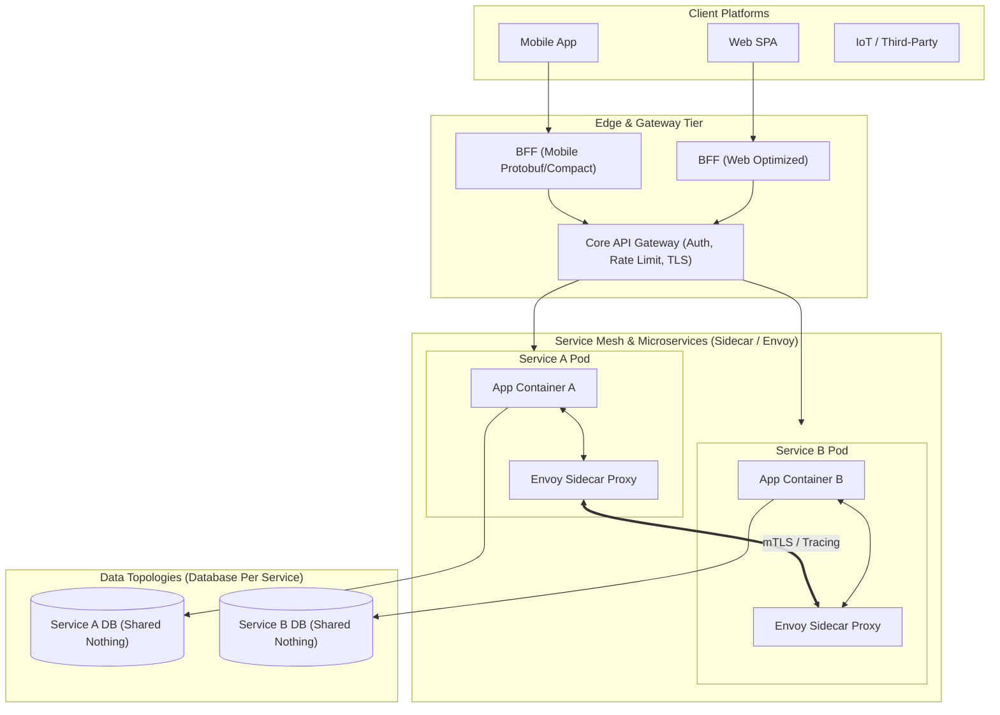
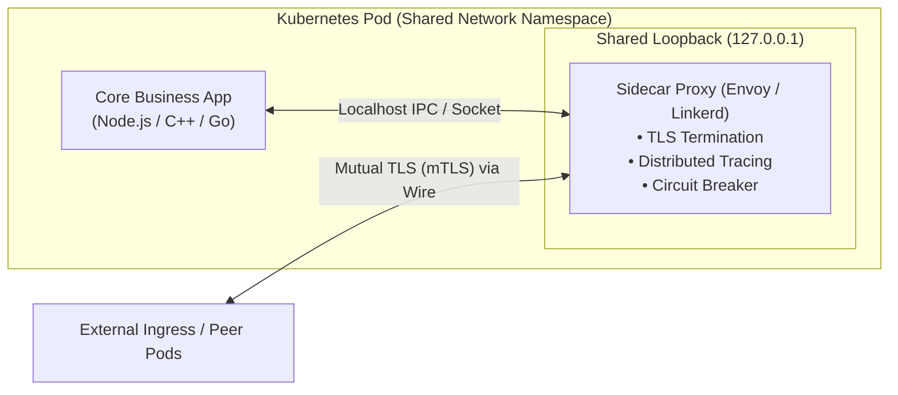
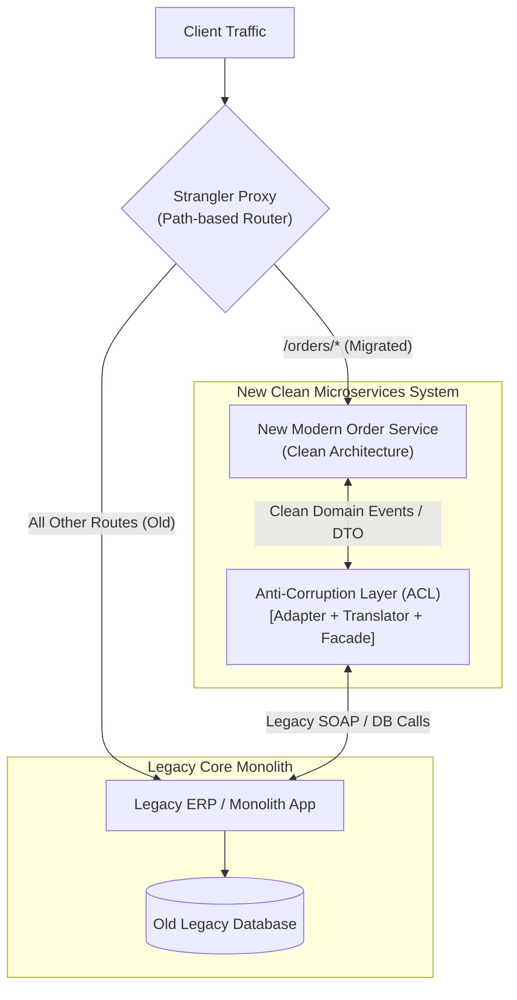
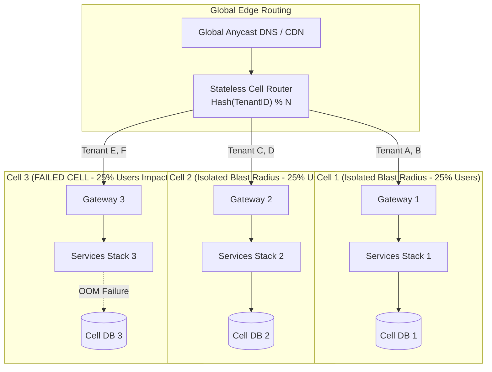
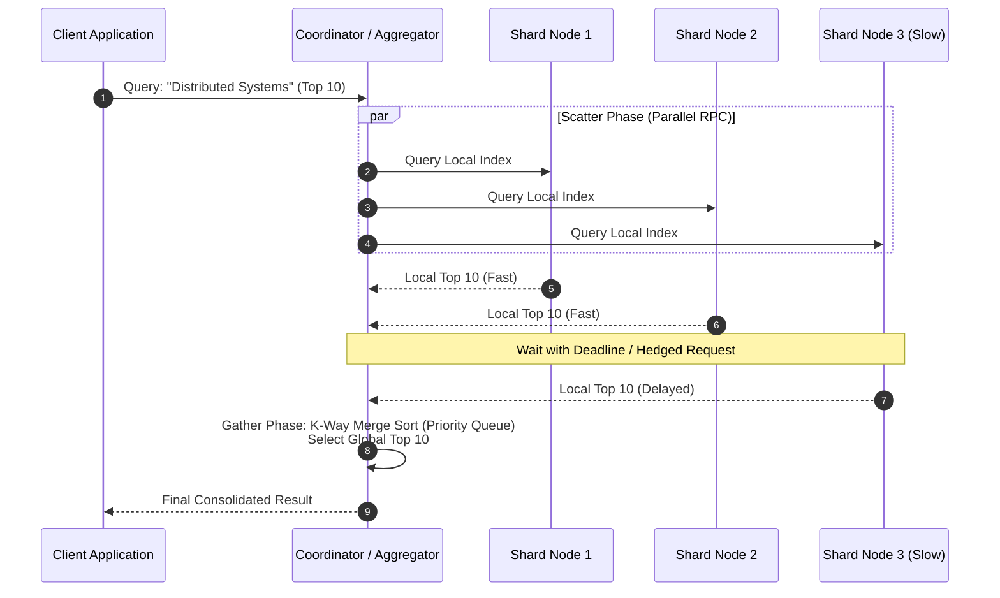

# 17.1. Gateway, Distributed & Data Patterns (Mẫu Cổng giao tiếp, Phân tán & Dữ liệu)

---

## Tổng quan về Gateway, Distributed & Data Patterns

Trong thiết kế hệ thống phân tán, các **System Design Patterns** đóng vai trò là những khuôn mẫu kiến trúc (architectural blueprints) đã được chứng minh qua thực tiễn nhằm giải quyết các thách thức cố hữu về tính kết nối lỏng lẻo (loose coupling), phân vùng dữ liệu (data partitioning), mở rộng độc lập (independent scaling) và phân rã các hệ thống nguyên khối đồ sộ (monolith decomposition).

Tập mẫu thiết kế đầu tiên tập trung vào ba trụ cột:
1. **Gateway & Edge Patterns**: Điều phối lưu lượng biên, chuyển đổi giao thức, định tuyến và tối ưu hóa trải nghiệm khách hàng thông qua **API Gateway**, **Backend for Frontend (BFF)**, **Ambassador**, **Sidecar**, và **Service Mesh**.
2. **Migration & Evolution Patterns**: Giảm thiểu rủi ro khi hiện đại hóa hệ thống kế thừa (legacy systems) mà không gây gián đoạn kinh doanh với **Strangler Fig Pattern** và **Anti-Corruption Layer (ACL)**.
3. **Data & Compute Topology**: Cấu trúc ranh giới dữ liệu và phân chia tài nguyên điện toán từ mức cơ sở dữ liệu (**Database Per Service**, **Shared Nothing** vs **Shared Disk**) đến quy mô trung tâm dữ liệu cô lập (**Cell-Based Architecture**), cùng các cơ chế tổng hợp phân tán (**Scatter-Gather**, **Fan-Out/Fan-In**, **Aggregator**).



---

## 2. Chi tiết từng Keyword (Under-the-Hood Deep Dive)

---

### 1. Gateway & Edge Patterns: API Gateway, BFF, Sidecar, Ambassador & Service Mesh

#### 1. Khái niệm bản chất (What & Why)
- **API Gateway Pattern**: Đóng vai trò là điểm vào duy nhất (Single Entry Point) cho toàn bộ traffic bên ngoài hướng vào hệ thống microservices. Đảm nhiệm các tính năng phi chức năng xuyên suốt (cross-cutting concerns): TLS Termination, Authentication/Authorization, Rate Limiting, Request Routing, Load Balancing, và Telemetry collection.
- **Backend for Frontend (BFF)**: Biến thể chuyên biệt hóa của API Gateway. Thay vì dùng một Gateway duy nhất cho tất cả client, mỗi loại giao diện người dùng (iOS App, Android App, Desktop Web, Smart Watch) sở hữu một backend gateway riêng được thiết kế để phục vụ chính xác định dạng dữ liệu và giới hạn băng thông của client đó.
- **Sidecar Pattern**: Triển khai một tiến trình phụ trợ (auxiliary process/container) chạy song song ngay bên cạnh tiến trình ứng dụng chính trong cùng một ranh giới cách ly (như chung một Kubernetes Pod, chia sẻ chung Localhost Network Namespace và Storage Volume) để đảm nhiệm logging, mTLS, hoặc proxying.
- **Ambassador Pattern**: Một biến thể của Sidecar hoạt động như một out-of-process proxy chuyên xử lý các kết nối đi ra ngoài (outbound traffic), bao gồm retry logic, circuit breaking, và service discovery thay cho ứng dụng chính.
- **Service Mesh Pattern**: Tầng cơ sở hạ tầng chuyên dụng (Infrastructure Layer) quản lý việc giao tiếp an toàn, tin cậy và có thể quan sát được giữa các dịch vụ nội bộ (East-West traffic). Kiến trúc gồm hai phần: **Data Plane** (các sidecar proxy siêu nhẹ như Envoy/Linkerd gắn kèm mỗi pod) và **Control Plane** (như Istio control plane, quản lý và phân phối chính sách bảo mật, route rules).

#### 2. Cơ chế hoạt động sâu (Under the hood / Hardcore Internals)
- **Kernel Namespace Sharing trong Sidecar/Ambassador**:
  - Trong Linux Container/Kubernetes Pod, ứng dụng chính và Sidecar container chia sẻ chung **Network Namespace** (`CLONE_NEWNET`) và **IPC Namespace** (`CLONE_NEWIPC`).
  - Do đó, việc ứng dụng chính giao tiếp với Sidecar qua `127.0.0.1:port` thực chất chỉ là việc ghi nhận dữ liệu qua Kernel Loopback Interface (`lo`), không đi qua card mạng vật lý, đạt độ trễ sub-millisecond (thường $< 0.1\text{ms}$).
  - Gần đây, các công nghệ như **eBPF (sockops hook)** cho phép bypass hoàn toàn network stack của Linux loopback, copy trực tiếp socket buffer từ socket file descriptor của app sang proxy socket buffer mà không cần đi qua TCP/IP IP stack của kernel.
- **Service Mesh Traffic Interception**:
  - Dùng `iptables` (hoặc `nftables` / eBPF) thiết lập các rule `PREROUTING` và `OUTPUT` tại bảng `nat` hoặc `mangle` để bắt giữ tất cả traffic TCP vào/ra khỏi Pod và chuyển hướng (redirect) vào cổng lắng nghe nội bộ của Envoy sidecar (thường là port `15001`/`15006`).

#### 3. Sơ đồ minh họa (Architecture & Flow)



#### 4. Code ví dụ thực chiến (TypeScript: Minimalistic BFF Aggregation Layer)

```typescript
// BFF Implementation for Mobile Client (Aggregating User Profile + Orders)
import http from 'http';

interface UserProfile {
  id: string;
  name: string;
  tier: string;
}

interface OrderSummary {
  orderId: string;
  totalUsd: number;
  status: string;
}

class MobileBFFServer {
  private async fetchService<T>(url: string): Promise<T> {
    // Giả lập network call tới microservices nội bộ
    return new Promise((resolve) => {
      setTimeout(() => {
        if (url.includes('/users/')) {
          resolve({ id: "u123", name: "Nguyen Van A", tier: "VIP" } as unknown as T);
        } else {
          resolve([
            { orderId: "ord_99", totalUsd: 145.5, status: "SHIPPED" },
            { orderId: "ord_98", totalUsd: 32.0, status: "DELIVERED" }
          ] as unknown as T);
        }
      }, 20);
    });
  }

  public async handleMobileDashboard(userId: string) {
    // Chạy song song Fan-out requests tới các downstream microservices
    const [userProfile, orders] = await Promise.all([
      this.fetchService<UserProfile>(`http://user-service/users/${userId}`),
      this.fetchService<OrderSummary[]>(`http://order-service/users/${userId}/orders`)
    ]);

    // Lọc và tinh giản payload chuyên biệt cho thiết bị di động (tiết kiệm băng thông)
    return {
      user: {
        id: userProfile.id,
        displayName: userProfile.name,
        isVip: userProfile.tier === "VIP"
      },
      recentOrders: orders.slice(0, 5).map(o => ({
        id: o.orderId,
        amount: `$${o.totalUsd.toFixed(2)}`,
        status: o.status
      })),
      timestamp: Date.now()
    };
  }
}

// Chạy test BFF
const bff = new MobileBFFServer();
bff.handleMobileDashboard("u123").then(payload => {
  console.log("Optimized Mobile Payload:", JSON.stringify(payload, null, 2));
});
```

#### 5. Ưu / Nhược điểm, Pitfalls & Anti-patterns
- **Anti-pattern: "Smart Gateway, Dumb Services"**: Đưa logic nghiệp vụ phức tạp (domain logic, direct database access) vào API Gateway. API Gateway phải giữ vai trò mỏng (thin gateway), chỉ đảm nhiệm routing, security và protocol translation; nếu không, nó sẽ biến thành một Distributed Monolith và là nút thắt cổ chai lớn nhất hệ thống.
- **Sidecar Resource Overhead**: Việc gắn mỗi Pod một Envoy sidecar tiêu tốn từ 20MB đến 100MB RAM và thêm 1-3ms latency do context switch và iptables redirects. Với các cụm có hàng nghìn pod, chi phí tài nguyên là rất lớn. Giải pháp hiện đại là chuyển sang **Ambient Mesh** (Sidecarless architecture sử dụng DaemonSet node proxy + eBPF).

#### 6. Ứng dụng thực tế trong Backend / Systems
- **Netflix Zuul & Spring Cloud Gateway**: Sử dụng API Gateway để xác thực OAuth2 token và phân giải dynamic routing.
- **Istio / Envoy Service Mesh**: Triển khai chính sách Zero-Trust Network mTLS tự động xoay vòng chứng chỉ số X.509 giữa hàng ngàn microservices mà không cần lập trình viên sửa một dòng code nào trong ứng dụng.

---

### 2. Migration & Boundary Patterns: Strangler Fig & Anti-Corruption Layer (ACL)

#### 1. Khái niệm bản chất (What & Why)
- **Strangler Fig Pattern (Cây bàng bóp cổ)**: Chiến lược hiện đại hóa hệ thống phần mềm nguyên khối (Legacy Monolith) bằng cách thay thế dần dần từng chức năng nhỏ bằng microservice mới. Hệ thống mới mọc bao quanh hệ thống cũ giống như dây bàng bóp cổ quấn quanh thân cây cổ thụ, cho đến khi toàn bộ cây cũ chết đi và có thể tháo gỡ hoàn toàn mà không cần viết lại toàn bộ một lần (Big Bang rewrite).
- **Anti-Corruption Layer (ACL - Lớp chống tha hóa)**: Một tầng phiên dịch trung gian (Translation / Adapter Layer) nằm giữa hệ thống mới (Domain-Driven Design model sạch) và hệ thống cũ (Legacy messy model). ACL ngăn chặn các khái niệm, cấu trúc bảng lộn xộn hoặc dirty state của hệ thống cũ làm ô nhiễm (pollute/corrupt) thiết kế miền kiến trúc sạch của hệ thống mới.

#### 2. Cơ chế hoạt động sâu (Under the hood / Hardcore Internals)
- **Cơ chế phân luồng của Strangler Fig**:
  1. Đặt một Reverse Proxy (Nginx, Traefik, AWS ALB) phía trước hệ thống cũ. Ban đầu, 100% traffic trỏ về Monolith.
  2. Xây dựng Microservice đầu tiên (ví dụ: `PaymentService`).
  3. Cập nhật route trên Proxy: Nếu URL là `/api/v1/payments/*`, proxy chuyển hướng request tới microservice mới; các route còn lại vẫn trỏ về Monolith.
  4. Đồng bộ hóa dữ liệu ngầm (CDC - Change Data Capture) giữa Monolith DB và Microservice DB để đảm bảo tính nhất quán.
  5. Lặp lại quá trình cho đến khi Monolith không còn nhận traffic nào, sau đó decommission server cũ.
- **Bên trong Anti-Corruption Layer**:
  - Bao gồm 3 thành phần kỹ thuật:
    - **Adapters**: Giao tiếp trực tiếp với giao thức hoặc database của hệ thống cũ (SOAP, RPC cổ, direct SQL).
    - **Translators / Transformers**: Chuyển đổi Data Transfer Objects (DTO) của legacy sang Domain Entities / Value Objects chuẩn của hệ thống mới và ngược lại.
    - **Facades**: Cung cấp interface đơn giản, hiện đại để hệ thống mới gọi vào mà không cần quan tâm đến sự phức tạp bên dưới của legacy.

#### 3. Sơ đồ minh họa (Architecture & Flow)



#### 4. Code ví dụ thực chiến (C++20: Anti-Corruption Layer Translator & Adapter)

```cpp
#include <iostream>
#include <string>
#include <memory>
#include <chrono>

// 1. Hệ thống Legacy: Cấu trúc dữ liệu cổ hủ, trường mơ hồ, kiểu dữ liệu thô
struct LegacyUserRecord {
    long CUST_ID;
    char F_NAME[50];
    char L_NAME[50];
    int ACC_STAT; // 1: Active, 0: Disabled, 99: Banned
    char CREATED_STR[20]; // Format: "DD/MM/YYYY"
};

// 2. Hệ thống mới: Domain Model chuẩn mực, Strong Typing, Clean Enums
enum class AccountStatus { Active, Disabled, Suspended };

struct ModernCustomer {
    uint64_t id;
    std::string fullName;
    AccountStatus status;
};

// 3. Anti-Corruption Layer: Adapter & Translator
class LegacyAccountAdapter {
public:
    virtual ~LegacyAccountAdapter() = default;
    virtual LegacyUserRecord fetchLegacyCustomerRaw(long id) = 0;
};

class MockLegacyDatabaseAdapter : public LegacyAccountAdapter {
public:
    LegacyUserRecord fetchLegacyCustomerRaw(long id) override {
        LegacyUserRecord raw{};
        raw.CUST_ID = id;
        std::snprintf(raw.F_NAME, sizeof(raw.F_NAME), "John");
        std::snprintf(raw.L_NAME, sizeof(raw.L_NAME), "Doe");
        raw.ACC_STAT = 1;
        return raw;
    }
};

class CustomerAntiCorruptionLayer {
private:
    std::shared_ptr<LegacyAccountAdapter> adapter_;

public:
    explicit CustomerAntiCorruptionLayer(std::shared_ptr<LegacyAccountAdapter> adapter)
        : adapter_(std::move(adapter)) {}

    // Dịch thuật và bảo vệ Domain mới khỏi cấu trúc Legacy
    ModernCustomer getCustomerClean(uint64_t customerId) {
        LegacyUserRecord raw = adapter_->fetchLegacyCustomerRaw(static_cast<long>(customerId));

        ModernCustomer clean;
        clean.id = static_cast<uint64_t>(raw.CUST_ID);
        clean.fullName = std::string(raw.F_NAME) + " " + std::string(raw.L_NAME);

        switch (raw.ACC_STAT) {
            case 1: clean.status = AccountStatus::Active; break;
            case 0: clean.status = AccountStatus::Disabled; break;
            default: clean.status = AccountStatus::Suspended; break;
        }
        return clean;
    }
};

int main() {
    auto legacyAdapter = std::make_shared<MockLegacyDatabaseAdapter>();
    CustomerAntiCorruptionLayer acl(legacyAdapter);

    ModernCustomer customer = acl.getCustomerClean(100542);
    std::cout << "ACL Translated - ID: " << customer.id 
              << ", Name: " << customer.fullName 
              << ", Active: " << (customer.status == AccountStatus::Active ? "YES" : "NO") << "\n";
    return 0;
}
```

#### 5. Ưu / Nhược điểm, Pitfalls & Anti-patterns
- **Ưu điểm**: Giảm rủi ro kinh doanh về mức tối thiểu. Thay vì một đợt release "sống còn" (big-bang deployment), doanh nghiệp có thể kiểm thử từng phần nhỏ, rollback tức thì nếu có lỗi.
- **Pitfall: Rơi vào trạng thái "Half-migrated" vĩnh viễn**: Dự án chạy được 50% thì thiếu nhân lực hoặc hết ngân sách, dẫn đến việc phải duy trì cả hệ thống mới lẫn hệ thống cũ song song suốt nhiều năm. Chi phí bảo trì đội lên gấp đôi. Phải có cam kết hoàn thành việc tháo dỡ monolith dứt điểm.

#### 6. Ứng dụng thực tế trong Backend / Systems
- **Hiện đại hóa hệ thống Core Banking / Viễn thông**: Các ngân hàng chuyển đổi từ hệ thống Core trên máy tính lớn (Mainframe COBOL) sang Microservices trên Kubernetes sử dụng Strangler Fig kết hợp ACL để dịch các giao thức ISO-8583 / AS400 sang REST / gRPC JSON.

---

### 3. Compute & Data Topology: Database Per Service, Shared Nothing, Shared Disk & Cell-Based Architecture

#### 1. Khái niệm bản chất (What & Why)
- **Database Per Service**: Mỗi microservice sở hữu toàn quyền một cơ sở dữ liệu riêng biệt. Không một dịch vụ nào khác được phép truy cập trực tiếp vào DB này ngoại trừ thông qua các API công khai của dịch vụ chủ quản. Đảm bảo tính đóng gói cao độ (loose coupling) và cho phép lựa chọn công nghệ lưu trữ linh hoạt (Polyglot Persistence).
- **Shared Disk Architecture**: Nhiều node tính toán (compute nodes) độc lập cùng truy cập vào một hệ thống đĩa lưu trữ chung (ví dụ: SAN, NAS, hoặc AWS Aurora distributed storage engine). Tách rời tầng tính toán (Stateless Compute) khỏi tầng lưu trữ (Stateful Storage).
- **Shared Nothing Architecture (SN)**: Mỗi node là một thực thể hoàn toàn độc lập, sở hữu CPU, RAM và Disk riêng biệt. Các node không chia sẻ bất kỳ tài nguyên phần cứng nào và chỉ liên lạc với nhau qua mạng (network messages). Mô hình này có khả năng mở rộng quy mô tuyến tính (linear scalability) cao nhất (điển hình: Cassandra, ScyllaDB, ClickHouse, Hadoop).
- **Cell-Based Architecture**: Phân tách toàn bộ hệ thống lớn thành nhiều "Tế bào" (Cells) hoàn toàn độc lập và khép kín. Mỗi Cell là một bản sao hoàn chỉnh của toàn bộ stack ứng dụng (Frontend, Gateway, Services, Databases) phục vụ một tập khách hàng nhất định (ví dụ: 100,000 users hoặc 1 Enterprise tenant).

#### 2. Cơ chế hoạt động sâu (Under the hood / Hardcore Internals)
- **Cell-Based Architecture & Blast Radius Reduction**:
  - Trong kiến trúc truyền thống tập trung, khi Database chính bị treo hoặc có lỗi code nghiêm trọng, 100% người dùng toàn cầu sẽ bị sập.
  - Trong Cell-Based Architecture, một router định tuyến cấp cao (Cell Router) băm UserId hoặc TenantId để chuyển hướng traffic vào Cell tương ứng:
    $$\text{Cell ID} = \text{Hash}(\text{UserId}) \pmod{\text{Total Cells}}$$
  - Nếu Cell 3 gặp sự cố thảm họa (Database hỏng, memory leak), chỉ có người dùng thuộc Cell 3 bị ảnh hưởng. 95% người dùng ở các Cells khác vẫn hoạt động hoàn hảo. Vùng ảnh hưởng thảm họa (Blast Radius) bị cô lập tuyệt đối.
- **Shared Nothing Partitioning & Inter-node Communication**:
  - Dữ liệu được phân mảnh (sharded) theo Partition Key. Mọi thao tác ghi và đọc đều được hash trực tiếp tới node sở hữu dữ liệu.
  - Không có hiện tượng Hardware Bus Contention hay Distributed Lock trên tầng storage volume.

#### 3. Sơ đồ minh họa (Architecture & Flow)



#### 4. Code ví dụ thực chiến (C++20: Cell Router with Consistent Hashing)

```cpp
#include <iostream>
#include <string>
#include <vector>
#include <map>
#include <sstream>

class CellRouter {
private:
    std::map<uint32_t, std::string> ring_;
    const int virtual_nodes_ = 100;

    // FNV-1a Hash 32-bit
    static uint32_t fnv1a(const std::string& key) {
        uint32_t hash = 2166136261u;
        for (char c : key) {
            hash ^= static_cast<uint8_t>(c);
            hash *= 16777619u;
        }
        return hash;
    }

public:
    void addCell(const std::string& cell_id) {
        for (int i = 0; i < virtual_nodes_; ++i) {
            std::string vnode_key = cell_id + "#vnode_" + std::to_string(i);
            uint32_t hash = fnv1a(vnode_key);
            ring_[hash] = cell_id;
        }
    }

    std::string routeTenant(const std::string& tenant_id) const {
        if (ring_.empty()) return "";
        uint32_t hash = fnv1a(tenant_id);

        auto it = ring_.lower_bound(hash);
        if (it == ring_.end()) {
            it = ring_.begin();
        }
        return it->second;
    }
};

int main() {
    CellRouter router;
    router.addCell("Cell-US-East-1");
    router.addCell("Cell-US-East-2");
    router.addCell("Cell-EU-West-1");

    std::vector<std::string> tenants = {"Enterprise_CorpA", "Startup_XYZ", "Fintech_Global", "Retail_Alpha"};
    for (const auto& tenant : tenants) {
        std::cout << "Tenant [" << tenant << "] routed to -> " 
                  << router.routeTenant(tenant) << "\n";
    }
    return 0;
}
```

#### 5. Ưu / Nhược điểm, Pitfalls & Anti-patterns
- **Nhược điểm của Database Per Service**: Rất khó khăn để thực hiện các truy vấn tham chiếu chéo (Cross-service JOINs) hoặc các thao tác giao dịch nguyên tử (Atomic ACID transactions) giữa nhiều service. Bắt buộc phải áp dụng kiến trúc Event-Driven (Sagas) hoặc Data Aggregation (CQRS).
- **Chi phí của Cell-Based Architecture**: Cực kỳ tốn kém về mặt tài nguyên cơ sở hạ tầng vì phải nhân bản toàn bộ stack (kể cả các service ít tải) sang nhiều cell. Thường chỉ phù hợp với các tập đoàn công nghệ quy mô lớn (Amazon AWS, Slack, Salesforce).

#### 6. Ứng dụng thực tế trong Backend / Systems
- **Amazon Web Services (AWS)**: Toàn bộ hạ tầng cốt lõi của AWS (như IAM, DynamoDB, S3) được xây dựng theo kiến trúc Cell-Based để ngăn chặn lỗi tại một vùng làm tê liệt toàn cầu.
- **Slack**: Di chuyển hệ thống nhắn tin từ Monolith sang Cell-Based Architecture để cô lập dữ liệu và tải của các khách hàng doanh nghiệp lớn vào các "chùm cell" chuyên biệt.

---

### 4. Distributed Query & Aggregation: Scatter-Gather, Fan-Out/Fan-In, Aggregator & Gateway Aggregation

#### 1. Khái niệm bản chất (What & Why)
- **Scatter-Gather Pattern**: Mẫu xử lý phân tán trong đó một Coordinator node nhận yêu cầu từ client, "rải" (Scatter) các yêu cầu con song song tới nhiều worker nodes/shards độc lập, sau đó "gom" (Gather) tất cả các kết quả trả về, thực hiện gộp dữ liệu, sắp xếp hoặc lọc trước khi trả về cho client.
- **Fan-Out / Fan-In Pattern**:
  - *Fan-Out*: Phân phối một tác vụ hoặc message duy nhất tới nhiều consumer/worker thực thi song song để đẩy nhanh tốc độ xử lý hoặc thông báo đồng loạt.
  - *Fan-In*: Tập hợp các luồng dữ liệu song song từ các worker sau khi hoàn thành về một kênh xử lý duy nhất (Single sync point).
- **Aggregator / Gateway Aggregation Pattern**: Một dịch vụ tổng hợp đóng vai trò gom nhiều lời gọi RPC riêng lẻ của các microservices lại thành một luồng xử lý duy nhất. Client chỉ cần gửi 1 HTTP request lên Gateway, Gateway sẽ tự động phát sinh nhiều cuộc gọi nội bộ (thông qua gRPC tốc độ cao), tổng hợp payload và trả lời client trong một lần duy nhất.

#### 2. Cơ chế hoạt động sâu (Under the hood / Hardcore Internals)
- **Scatter-Gather trong Distributed Search Engines (Elasticsearch / Lucene)**:
  1. Khi client tìm kiếm một từ khóa kèm phân trang: `size=10, from=0`.
  2. Coordinator node gửi Scatter request tới **tất cả** $N$ shards của index.
  3. Mỗi shard tìm kiếm trên cấu trúc Inverted Index cục bộ, trích xuất Top 10 documents có điểm relevance cao nhất (chỉ trả về Document ID và Score, chưa đọc dữ liệu gốc trên đĩa).
  4. Coordinator node thực hiện Gather $10 \times N$ cặp ID-Score, tiến hành giải thuật **K-way Merge Sort** bằng Min-Heap/Priority Queue để chọn ra Top 10 toàn cục (Global Top 10).
  5. Coordinator gửi đợt request thứ hai (Fetch Phase) chỉ tới các Shards chứa Top 10 document này để lấy toàn bộ trường dữ liệu (Document Source JSON).
- **Vấn đề Tail Latency (Straggler Problem)**:
  - Trong Scatter-Gather, thời gian hoàn thành của toàn bộ tác vụ phụ thuộc vào node chậm nhất:
    $$\text{Latency}_{\text{Total}} = \max(\text{Latency}_1, \text{Latency}_2, \dots, \text{Latency}_N)$$
  - Nếu xác suất một node bị chậm (GC pause, disk stall) là $1\%$, thì với một truy vấn rải qua $100$ shards, xác suất truy vấn bị chậm là:
    $$P(\text{Slow}) = 1 - (1 - 0.01)^{100} = 1 - 0.366 = 63.4\%$$
  - Giải pháp SRE của Google (*The Tail at Scale*): Sử dụng **Hedged Requests** (gửi trùng lặp request tới bản sao thứ hai nếu sau $p95$ ms chưa nhận được phản hồi).

#### 3. Sơ đồ minh họa (Architecture & Flow)



#### 4. Code ví dụ thực chiến (C++20: Scatter-Gather K-Way Merge with Priority Queue)

```cpp
#include <iostream>
#include <vector>
#include <queue>
#include <future>
#include <algorithm>

struct SearchResult {
    uint64_t doc_id;
    double score;

    // Sắp xếp giảm dần theo Score
    bool operator<(const SearchResult& other) const {
        return score < other.score; // Dùng cho Max-Heap
    }
};

// Giả lập worker tìm kiếm trên từng Shard cục bộ
std::vector<SearchResult> searchShard(int shard_id) {
    if (shard_id == 1) return {{101, 9.8}, {102, 7.5}, {103, 5.2}};
    if (shard_id == 2) return {{201, 9.9}, {202, 8.4}, {203, 4.1}};
    return {{301, 8.9}, {302, 8.8}, {303, 6.0}};
}

std::vector<SearchResult> executeScatterGather(int top_k) {
    const int num_shards = 3;
    std::vector<std::future<std::vector<SearchResult>>> futures;

    // 1. Scatter: Bắn tác vụ tìm kiếm song song tới tất cả Shards
    for (int i = 1; i <= num_shards; ++i) {
        futures.push_back(std::async(std::launch::async, searchShard, i));
    }

    // 2. Gather: Đợi và thu thập kết quả
    std::priority_queue<SearchResult> max_heap;
    for (auto& fut : futures) {
        auto shard_results = fut.get();
        for (const auto& item : shard_results) {
            max_heap.push(item);
        }
    }

    // 3. Merge: Lấy Top K toàn cục
    std::vector<SearchResult> global_top;
    while (!max_heap.empty() && global_top.size() < static_cast<size_t>(top_k)) {
        global_top.push_back(max_heap.top());
        max_heap.pop();
    }

    return global_top;
}

int main() {
    auto top_results = executeScatterGather(4);
    std::cout << "[Global Top 4 Search Results across all Shards]\n";
    for (const auto& r : top_results) {
        std::cout << "DocID: " << r.doc_id << " | Score: " << r.score << "\n";
    }
    return 0;
}
```

#### 5. Ưu / Nhược điểm, Pitfalls & Anti-patterns
- **Ưu điểm**: Cho phép khai thác sức mạnh của hàng ngàn máy chủ để thực hiện các truy vấn dữ liệu khổng lồ (Petabytes) với độ trễ cực thấp.
- **Pitfall: Deep Pagination Trap (Vấn đề phân trang sâu)**: Nếu client yêu cầu `from=1,000,000, size=10`, mỗi shard buộc phải quét và trả về $1,000,010$ bản ghi. Coordinator phải Gather và sắp xếp hàng triệu bản ghi trong RAM, gây cạn kiệt bộ nhớ (OOM crash). Giải pháp: Nghiêm cấm deep offset pagination trong distributed search; bắt buộc dùng **Search After (Keyset cursor)**.

#### 6. Ứng dụng thực tế trong Backend / Systems
- **Search Engine & E-Commerce (Elasticsearch, Amazon Search)**: Phân phối truy vấn tìm kiếm sản phẩm qua hàng trăm shards và tổng hợp danh sách mặt hàng liên quan nhất.
- **Flight & Hotel Aggregators (Kayak, Skyscanner)**: Scatter yêu cầu tìm vé máy bay tới 50 hãng hàng không khác nhau song song, sau đó Gather và sắp xếp theo giá thấp nhất hiển thị cho người dùng.
