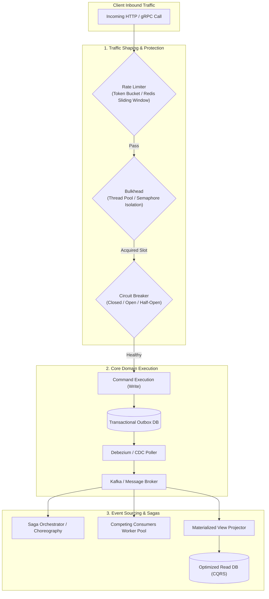
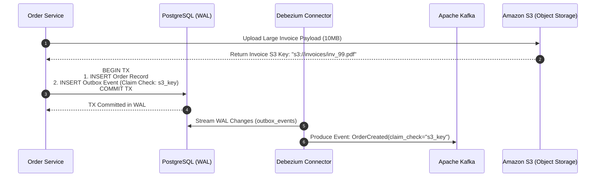
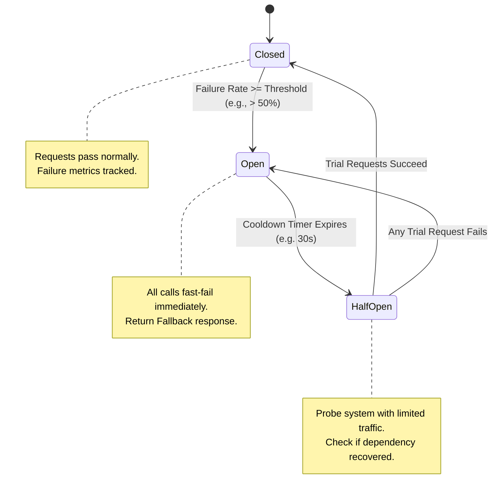
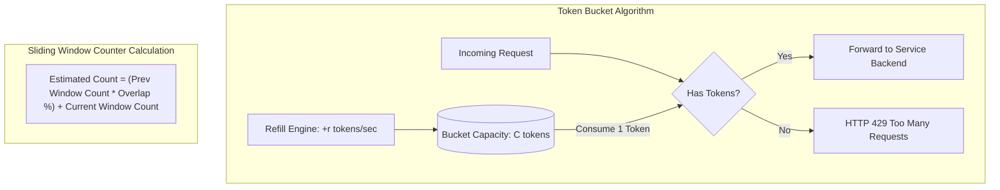

# 17.2. Event, Resilience & Rate Limiting Patterns (Mẫu Sự kiện, Phục hồi sự cố & Điều phối tải)

---

## Tổng quan về Event, Resilience & Rate Limiting Patterns

Hệ thống phân tán hoạt động trong môi trường mạng không đáng tin cậy (unreliable network), độ trễ biến thiên và các lỗi phần cứng/phần mềm không thể tránh khỏi. Để duy trì tính sẵn sàng (High Availability) và tính toàn vẹn dữ liệu (Data Integrity), kiến trúc hiện đại dựa trên ba nhóm mẫu thiết kế cốt lõi:

1. **Event & Consistency Patterns**: Xử lý tính nhất quán cuối cùng (Eventual Consistency), phân tách luồng đọc/ghi và điều phối giao dịch phân tán không dùng khóa hai pha (2PC) với **CQRS**, **Event Sourcing**, **Saga Pattern**, **Transactional Outbox**, **Claim Check**, và **Materialized View**.
2. **Resilience & Fault-Tolerance Patterns**: Ngăn chặn lỗi dây chuyền (Cascading Failures) và bảo vệ dịch vụ khỏi tình trạng cạn kiệt tài nguyên với **Circuit Breaker**, **Bulkhead**, **Retry with Exponential Backoff**, **Competing Consumers**, và **Backpressure**.
3. **Rate Limiting & Traffic Shaping Algorithms**: Kiểm soát lưu lượng, bảo vệ hạ tầng khỏi tấn công DDoS và spike traffic bằng các thuật toán kinh điển: **Token Bucket**, **Leaky Bucket**, **Fixed Window**, **Sliding Window Log**, và **Sliding Window Counter**.



---

## 2. Chi tiết từng Keyword (Under-the-Hood Deep Dive)

---

### 1. Event & Consistency Patterns: CQRS, Event Sourcing, Saga, Outbox, Claim Check & Materialized View

#### 1. Khái niệm bản chất (What & Why)
- **CQRS (Command Query Responsibility Segregation)**: Tách rời hoàn toàn mô hình xử lý ghi dữ liệu (Command: tạo mới, cập nhật, xóa - tập trung vào tính đúng đắn và business rules) khỏi mô hình đọc dữ liệu (Query: tìm kiếm, hiển thị - tối ưu hóa tốc độ truy vấn và denormalization).
- **Event Sourcing Pattern**: Thay vì lưu trữ trạng thái hiện tại (Current State) của thực thể (ví dụ: `Balance = $500`), hệ thống lưu trữ toàn bộ chuỗi các sự kiện nghiệp vụ bất biến đã xảy ra trong quá khứ (Append-only Event Log: `AccountCreated`, `Deposited $600`, `Withdrawn $100`). Trạng thái hiện tại được tái tạo bằng cách phát lại (Replay) các sự kiện này.
- **Saga Pattern**: Mẫu điều phối các giao dịch phân tán kéo dài trên nhiều microservices độc lập thông qua một chuỗi các giao dịch cục bộ (Local Transactions). Nếu một bước thất bại, Saga kích hoạt các giao dịch bù trừ (**Compensating Transactions**) để hoàn tác các bước trước đó.
- **Transactional Outbox Pattern**: Đảm bảo việc cập nhật Database và xuất bản Event lên Message Broker (như Kafka) diễn ra hoàn toàn nguyên tử (Atomicity) mà không cần 2-Phase Commit (2PC). Dữ liệu nghiệp vụ và Event được ghi đồng thời vào cùng một Database vật lý trong cùng một Local Transaction (ghi vào bảng `outbox`). Một tiến trình trung gian (CDC/Debezium) sẽ đọc bảng outbox và publish lên broker.
- **Claim Check Pattern**: Khi cần gửi các tin nhắn có kích thước payload lớn (vài chục MB tới GB, ví dụ file âm thanh, ảnh chụp y tế) qua Message Broker vốn chỉ tối ưu cho payload nhỏ ($< 1\text{MB}$). Dữ liệu payload thực tế được upload lên Object Storage (S3/GCS), và chỉ có mã tham chiếu (Claim Check / URL token) được gửi qua message queue.
- **Materialized View Pattern**: Tạo và duy trì liên tục một bảng dữ liệu tổng hợp sẵn (pre-computed/denormalized view) từ một hoặc nhiều bảng nguồn nhằm tăng tốc độ truy vấn đọc từ hàng giây xuống mili-giây.

#### 2. Cơ chế hoạt động sâu (Under the hood / Hardcore Internals)
- **Bản chất Transactional Outbox với Change Data Capture (CDC)**:
  1. Ứng dụng thực hiện:
     ```sql
     BEGIN TRANSACTION;
       INSERT INTO orders (id, amount, status) VALUES ('ord_123', 500, 'PENDING');
       INSERT INTO outbox_events (id, aggregate_type, aggregate_id, payload) 
       VALUES ('evt_01', 'Order', 'ord_123', '{"amount":500}');
     COMMIT;
     ```
  2. Transaction được commit an toàn vào WAL (Write-Ahead Log) của database (PostgreSQL WAL / MySQL Binlog).
  3. Debezium / CDC Engine đọc trực tiếp streaming WAL của cơ sở dữ liệu ở tầng low-level, trích xuất bản ghi trong bảng `outbox_events` và publish vào Kafka topic với ngữ nghĩa **At-least-once**.
  4. Cơ chế này loại bỏ hoàn toàn tình trạng "Dual-Write Problem" (khi DB commit thành công nhưng network tới Kafka bị đứt khiến event bị mất, hoặc ngược lại).

#### 3. Sơ đồ minh họa (Architecture & Flow)



#### 4. Code ví dụ thực chiến (C++20: Event Sourced Aggregate Root)

```cpp
#include <iostream>
#include <vector>
#include <string>
#include <memory>
#include <variant>

// 1. Immutable Domain Events
struct AccountCreatedEvent { std::string account_id; double initial_balance; };
struct MoneyDepositedEvent { double amount; };
struct MoneyWithdrawnEvent { double amount; };

using DomainEvent = std::variant<AccountCreatedEvent, MoneyDepositedEvent, MoneyWithdrawnEvent>;

// 2. Event-Sourced Bank Account Aggregate
class BankAccountAggregate {
private:
    std::string account_id_;
    double balance_ = 0.0;
    uint64_t version_ = 0;
    std::vector<DomainEvent> uncommitted_events_;

    // Tái tạo trạng thái nội tại từ sự kiện (State Mutation)
    void apply(const AccountCreatedEvent& e) {
        account_id_ = e.account_id;
        balance_ = e.initial_balance;
    }
    void apply(const MoneyDepositedEvent& e) {
        balance_ += e.amount;
    }
    void apply(const MoneyWithdrawnEvent& e) {
        balance_ -= e.amount;
    }

public:
    BankAccountAggregate() = default;

    // Dispatcher áp dụng event
    void mutate(const DomainEvent& event) {
        std::visit([this](const auto& e) { this->apply(e); }, event);
        version_++;
    }

    // Business Command 1: Tạo tài khoản
    static BankAccountAggregate create(const std::string& id, double initial_deposit) {
        BankAccountAggregate acc;
        AccountCreatedEvent evt{id, initial_deposit};
        acc.mutate(evt);
        acc.uncommitted_events_.push_back(evt);
        return acc;
    }

    // Business Command 2: Rút tiền (Kiểm tra invariants)
    void withdraw(double amount) {
        if (amount <= 0) throw std::invalid_argument("Amount must be positive");
        if (balance_ < amount) throw std::runtime_error("Insufficient funds");

        MoneyWithdrawnEvent evt{amount};
        mutate(evt);
        uncommitted_events_.push_back(evt);
    }

    double getBalance() const { return balance_; }
    uint64_t getVersion() const { return version_; }
    const std::vector<DomainEvent>& getUncommittedEvents() const { return uncommitted_events_; }
};

int main() {
    auto acc = BankAccountAggregate::create("ACC-9988", 1000.0);
    acc.withdraw(250.0);
    acc.withdraw(100.0);

    std::cout << "Account State Rebuilt: Balance = $" << acc.getBalance()
              << " | Aggregate Version = " << acc.getVersion()
              << " | Uncommitted Events = " << acc.getUncommittedEvents().size() << "\n";
    return 0;
}
```

#### 5. Ưu / Nhược điểm, Pitfalls & Anti-patterns
- **Ưu điểm**: Event Sourcing cung cấp bản ghi kiểm toán hoàn hảo (100% Audit Trail), hỗ trợ Time-travel debugging và tính toán phân tích kinh doanh bất kỳ lúc nào mà không cần chuẩn bị schema trước.
- **Pitfall: Event Schema Evolution Hell**: Khi sự kiện v1 đã lưu hàng triệu bản ghi trong Event Store, việc thay đổi cấu trúc nghiệp vụ (thêm trường bắt buộc, đổi tên type) đòi hỏi kỹ thuật **Event Upcasting** rất phức tạp.
- **CQRS Eventual Consistency Lag**: Khách hàng vừa gửi Command đặt hàng thành công nhưng khi tải lại trang web (Query) thì không thấy đơn hàng đâu vì luồng đồng bộ sang Read DB bị chậm vài giây. Cần thiết kế UI bất đồng bộ (Optimistic UI) để tránh hiểu lầm.

#### 6. Ứng dụng thực tế trong Backend / Systems
- **Core Banking & E-Commerce Wallets**: Tuyệt đối không lưu số dư bằng một cột duy nhất `UPDATE users SET balance = balance - 100`. Toàn bộ giao dịch đều dùng Event Sourcing để đảm bảo tuân thủ pháp lý và phát hiện gian lận.

---

### 2. Resilience Patterns: Circuit Breaker, Bulkhead, Retry & Backpressure

#### 1. Khái niệm bản chất (What & Why)
- **Circuit Breaker Pattern (Cầu dao ngắt mạch)**: Ngăn chặn một dịch vụ liên tục gọi sang một dịch vụ phụ thuộc đang bị lỗi hoặc quá tải. Cầu dao có 3 trạng thái:
  - *Closed*: Mọi request đi qua bình thường. Đếm tỷ lệ lỗi.
  - *Open*: Khi tỷ lệ lỗi vượt ngưỡng, cầu dao ngắt hoàn toàn. Mọi request bị chặn ngay lập tức và trả về fallback error (Fast-Fail) mà không thực hiện network call.
  - *Half-Open*: Sau thời gian cooldown, cho phép một lượng nhỏ request thử nghiệm đi qua. Nếu thành công, đóng mạch lại (*Closed*); nếu tiếp tục lỗi, mở mạch trở lại (*Open*).
- **Bulkhead Pattern (Vách ngăn khoang tàu)**: Lấy cảm hứng từ thiết kế vách ngăn chống chìm của tàu thủy. Cách ly tài nguyên (Thread pools, Connection pools, Memory buffers, CPU cores) giữa các dịch vụ hoặc nhóm khách hàng khác nhau. Nếu một dịch vụ phụ thuộc (e.g., Recommendation Service) bị treo và nuốt sạch thread pool của nó, các dịch vụ cốt lõi khác (e.g., Checkout Service) vẫn hoạt động hoàn toàn bình thường vì dùng thread pool riêng biệt.
- **Retry Pattern with Exponential Backoff & Jitter**: Tự động thử lại khi gặp lỗi tạm thời (transient errors như mạng rớt chớp nhoáng). Khoảng cách giữa các lần thử tăng theo cấp số nhân ($t = 2^k \cdot t_0$) kèm theo độ lệch ngẫu nhiên (Jitter) để tránh bão thử lại đồng thời (**Retry Storm**).
- **Backpressure Pattern (Áp lực ngược)**: Cơ chế phản hồi từ Consumer báo cho Producer biết rằng tốc độ tiêu thụ đang chậm hơn tốc độ sản sinh dữ liệu, yêu cầu Producer giảm tốc độ gửi hoặc tạm dừng stream thay vì làm tràn bộ đệm (Buffer Overflow / OOM).

#### 2. Cơ chế hoạt động sâu (Under the hood / Hardcore Internals)
- **Máy trạng thái Circuit Breaker (State Machine)**:
  - Sử dụng Sliding Time Window hoặc Ring Buffer để tính toán tỷ lệ thất bại:
    $$\text{Failure Rate} = \frac{\text{Failed Calls}}{\text{Total Calls in Window}} \times 100\%$$
  - Nếu $\text{Failure Rate} \ge \text{FailureThreshold}$ (ví dụ: $50\%$ trong 10 giây gần nhất): Chuyển sang `OPEN`. Khởi động Timer `CooldownDuration` (e.g., 30s).
  - Khi hết cooldown: Chuyển sang `HALF-OPEN`. Cho phép $N$ requests (e.g., $N = 5$) đi qua.
    - Nếu cả $N$ requests thành công: Reset counters, chuyển về `CLOSED`.
    - Chỉ cần 1 request lỗi: Quay lại `OPEN`, nhân đôi cooldown (Exponential Backoff Cooldown).

#### 3. Sơ đồ minh họa (Architecture & Flow)



#### 4. Code ví dụ thực chiến (C++20: Thread-Safe Circuit Breaker State Machine)

```cpp
#include <iostream>
#include <chrono>
#include <mutex>
#include <stdexcept>
#include <string>

enum class CircuitState { CLOSED, OPEN, HALF_OPEN };

class CircuitBreaker {
private:
    std::mutex mtx_;
    CircuitState state_ = CircuitState::CLOSED;
    
    const uint32_t failure_threshold_ = 3;
    const std::chrono::milliseconds cooldown_period_{2000};
    
    uint32_t consecutive_failures_ = 0;
    std::chrono::steady_clock::time_point last_failure_time_;

public:
    CircuitBreaker() : last_failure_time_(std::chrono::steady_clock::now()) {}

    bool allowRequest() {
        std::lock_guard<std::mutex> lock(mtx_);
        auto now = std::chrono::steady_clock::now();

        if (state_ == CircuitState::OPEN) {
            if (now - last_failure_time_ >= cooldown_period_) {
                state_ = CircuitState::HALF_OPEN;
                std::cout << "[CircuitBreaker] Transitioned to HALF_OPEN. Probing...\n";
                return true;
            }
            return false; // Fast-fail
        }
        return true; // CLOSED or HALF_OPEN probing
    }

    void recordSuccess() {
        std::lock_guard<std::mutex> lock(mtx_);
        consecutive_failures_ = 0;
        if (state_ == CircuitState::HALF_OPEN) {
            state_ = CircuitState::CLOSED;
            std::cout << "[CircuitBreaker] Service Healthy. Transitioned to CLOSED.\n";
        }
    }

    void recordFailure() {
        std::lock_guard<std::mutex> lock(mtx_);
        consecutive_failures_++;
        last_failure_time_ = std::chrono::steady_clock::now();

        if (state_ == CircuitState::HALF_OPEN || consecutive_failures_ >= failure_threshold_) {
            state_ = CircuitState::OPEN;
            std::cout << "[CircuitBreaker] Failure Threshold Reached! Transitioned to OPEN.\n";
        }
    }

    CircuitState getState() {
        std::lock_guard<std::mutex> lock(mtx_);
        return state_;
    }
};

int main() {
    CircuitBreaker cb;

    // Mô phỏng 3 lần gọi mạng lỗi liên tiếp
    for (int i = 0; i < 3; ++i) {
        if (cb.allowRequest()) {
            std::cout << "Call " << i + 1 << ": Fails\n";
            cb.recordFailure();
        }
    }

    // Cuộc gọi tiếp theo bị chặn ngay lập tức
    if (!cb.allowRequest()) {
        std::cout << "Call 4: Blocked by Circuit Breaker (Fast-fail Fallback Triggered)\n";
    }

    return 0;
}
```

#### 5. Ưu / Nhược điểm, Pitfalls & Anti-patterns
- **Anti-pattern: Retry bừa bãi không phân loại mã lỗi**: Retry các lỗi logic của client (e.g., HTTP 400 Bad Request, 401 Unauthorized, 404 Not Found). Retry các lỗi này 100 lần vẫn thất bại, chỉ làm lãng phí CPU và network. Chỉ retry các lỗi tạm thời (HTTP 503 Service Unavailable, 504 Gateway Timeout, Socket Timeout).
- **Thiếu Fallback Graceful**: Khi Circuit Breaker Open, nếu không cung cấp dữ liệu Fallback (e.g., trả về danh sách sản phẩm cached hoặc tin nhắn thông báo thân thiện) mà ném lỗi 500 ra ngoài, trải nghiệm người dùng vẫn bị phá vỡ.

#### 6. Ứng dụng thực tế trong Backend / Systems
- **Netflix Hystrix / Resilience4j**: Cung cấp các thư viện chuẩn cho hệ sinh thái JVM để cài đặt Bulkhead (Thread Isolation) và Circuit Breaker trên các remote HTTP/gRPC clients.

---

### 3. Rate Limiter Patterns & Algorithms: Token Bucket, Leaky Bucket, Sliding Window

#### 1. Khái niệm bản chất (What & Why)
- **Rate Limiting**: Kỹ thuật giới hạn số lượng request mà một client (dựa trên IP, API Key, User ID) có thể gửi tới hệ thống trong một khung thời gian cụ thể (ví dụ: tối đa 100 req/phút).
- **Mục tiêu**:
  1. Bảo vệ dịch vụ khỏi bị quá tải, sập máy chủ.
  2. Ngăn chặn các cuộc tấn công DoS/DDoS, brute-force password, credential stuffing.
  3. Kiểm soát chi phí hạ tầng (ngăn chặn một tenant ngốn hết quota tài nguyên).
  4. Triển khai mô hình kinh doanh phân tầng (Tiered API Monetization: Free 1,000 req/day, Pro 100,000 req/day).

#### 2. Cơ chế hoạt động sâu của 5 thuật toán kinh điển

| Thuật toán | Cơ chế hoạt động | Cho phép Burst Traffic? | Tiêu thụ bộ nhớ | Nhược điểm chính |
| :--- | :--- | :--- | :--- | :--- |
| **Token Bucket** | Thùng chứa tối đa $C$ tokens. Tokens được nạp đều đặn theo tốc độ $r$ token/s. Mỗi request lấy 1 token. Nếu hết token thì bị drop. | **Có** (đến tối đa $C$ requests đồng thời) | Rất thấp ($O(1)$) | Khó xác định tham số tối ưu cho môi trường đa luồng không lock |
| **Leaky Bucket** | Request đi vào một hàng đợi (Queue) dung lượng $C$ và rỉ ra (xử lý) với tốc độ cố định đều đặn $r$ req/s. | **Không** (Lưu lượng ra luôn phẳng lì) | Trung bình (tùy kích thước queue) | Request bị trễ thêm (added latency) do phải xếp hàng |
| **Fixed Window** | Chia trục thời gian thành các khung cố định (e.g., 00:00-01:00). Bộ đếm tăng dần cho đến khi chạm Limit. Reset về 0 ở đầu khung tiếp theo. | **Không** | Cực thấp ($O(1)$) | **Bị lỗ hổng ranh giới (Boundary Spike)**: Lưu lượng gấp 2 lần limit tại điểm giao giữa 2 cửa sổ |
| **Sliding Window Log** | Lưu dấu thời gian (Timestamp) của mọi request vào Sorted Set (Redis ZSET). Khi có request mới: xóa các log cũ hơn $t - W$, đếm số lượng còn lại. | **Có** | **Rất cao ($O(N)$)** theo số request | Tốn bộ nhớ khủng khiếp nếu traffic cao |
| **Sliding Window Counter** | Kết hợp trọng số giữa cửa sổ trước (Previous Window) và cửa sổ hiện tại (Current Window) theo tỷ lệ trôi qua của thời gian. | **Có** | Cực thấp ($O(1)$) | Chỉ là giá trị ước lượng xấp xỉ (sai số $< 5\%$) |

#### 3. Sơ đồ minh họa (Architecture & Flow)



#### 4. Code ví dụ thực chiến (C++20: Production-Grade Token Bucket Rate Limiter)

```cpp
#include <iostream>
#include <chrono>
#include <atomic>
#include <algorithm>
#include <thread>

class TokenBucketRateLimiter {
private:
    const double capacity_;       // Dung lượng tối đa của bucket (Burst Limit)
    const double refill_rate_;    // Tốc độ nạp tokens mỗi giây

    std::atomic<double> tokens_;
    std::atomic<std::chrono::steady_clock::time_point> last_refill_time_;

    void refill() {
        auto now = std::chrono::steady_clock::now();
        auto last = last_refill_time_.load(std::memory_order_relaxed);

        std::chrono::duration<double> elapsed = now - last;
        double elapsed_sec = elapsed.count();

        if (elapsed_sec > 0.0) {
            double current_tokens = tokens_.load(std::memory_order_relaxed);
            double new_tokens = std::min(capacity_, current_tokens + (elapsed_sec * refill_rate_));

            // Cập nhật nguyên tử với CAS loop
            while (!tokens_.compare_exchange_weak(current_tokens, new_tokens,
                                                 std::memory_order_release,
                                                 std::memory_order_relaxed)) {
                new_tokens = std::min(capacity_, current_tokens + (elapsed_sec * refill_rate_));
            }
            last_refill_time_.store(now, std::memory_order_relaxed);
        }
    }

public:
    TokenBucketRateLimiter(double capacity, double refill_rate)
        : capacity_(capacity), refill_rate_(refill_rate),
          tokens_(capacity), last_refill_time_(std::chrono::steady_clock::now()) {}

    bool tryAcquire(double tokens_requested = 1.0) {
        refill();

        double current_tokens = tokens_.load(std::memory_order_relaxed);
        while (current_tokens >= tokens_requested) {
            double remaining = current_tokens - tokens_requested;
            if (tokens_.compare_exchange_weak(current_tokens, remaining,
                                             std::memory_order_acquire,
                                             std::memory_order_relaxed)) {
                return true; // Cho phép request đi qua
            }
        }
        return false; // Bị giới hạn (Rate Limited)
    }
};

int main() {
    // Dung tích 5 tokens, nạp 2 tokens / giây
    TokenBucketRateLimiter limiter(5.0, 2.0);

    std::cout << "[Burst Test: Consuming 5 tokens instantly]\n";
    for (int i = 1; i <= 6; ++i) {
        bool allowed = limiter.tryAcquire();
        std::cout << "Request " << i << ": " << (allowed ? "ALLOWED (200 OK)" : "DROPPED (429 Too Many Requests)") << "\n";
    }

    std::cout << "\nWaiting 1 second for refilling 2 tokens...\n";
    std::this_thread::sleep_for(std::chrono::milliseconds(1100));

    std::cout << "Request 7: " << (limiter.tryAcquire() ? "ALLOWED" : "DROPPED") << "\n";
    std::cout << "Request 8: " << (limiter.tryAcquire() ? "ALLOWED" : "DROPPED") << "\n";
    std::cout << "Request 9: " << (limiter.tryAcquire() ? "ALLOWED" : "DROPPED") << "\n";
    return 0;
}
```

#### 5. Code ví dụ thực chiến (Redis Sliding Window Counter Lua Script)

```lua
-- Thư viện Redis Lua Script thực thi Sliding Window Counter nguyên tử
-- KEYS[1]: Redis Key (e.g. "rate_limit:user_123:minute")
-- ARGV[1]: Current Timestamp in seconds
-- ARGV[2]: Window Size in seconds (e.g. 60)
-- ARGV[3]: Max Limit (e.g. 100)

local key = KEYS[1]
local now = tonumber(ARGV[1])
local window = tonumber(ARGV[2])
local limit = tonumber(ARGV[3])

local clear_before = now - window

-- 1. Xóa các timestamps đã quá hạn khỏi Sorted Set
redis.call('ZREMRANGEBYSCORE', key, 0, clear_before)

-- 2. Đếm số lượng request còn lại trong cửa sổ hiện tại
local current_requests = redis.call('ZCARD', key)

if current_requests < limit then
    -- 3. Ghi nhận timestamp của request mới
    redis.call('ZADD', key, now, now .. '-' .. math.random(100000))
    redis.call('EXPIRE', key, window)
    return 1 -- Cho phép (Allowed)
else
    return 0 -- Chặn (Rejected)
end
```

#### 6. Ưu / Nhược điểm, Pitfalls & Anti-patterns
- **Lỗ hổng phân tán: Race Conditions khi đếm Rate Limit**: Nếu lưu biến đếm trên Redis bằng `GET` và `SET` thông thường, hai request đến song song từ hai instance server khác nhau sẽ đọc cùng một số đếm cũ, dẫn đến việc cho phép vượt quota. **Bắt buộc** phải dùng lệnh nguyên tử `INCR` hoặc chạy **Lua Script** trực tiếp trên Redis server.
- **Header phản hồi Rate Limit chuẩn HTTP**: Luôn trả về các response header chuẩn để client tự điều tiết:
  - `X-RateLimit-Limit`: Tổng quota cho phép trong window.
  - `X-RateLimit-Remaining`: Số lượng còn lại.
  - `Retry-After`: Số giây client cần ngủ trước khi thử lại khi nhận mã `429 Too Many Requests`.

#### 7. Ứng dụng thực tế trong Backend / Systems
- **Stripe / GitHub API Rate Limiting**: Triển khai thuật toán Token Bucket ở tầng API Gateway để ngăn chặn bot cào dữ liệu và bảo đảm SLA cho các đối tác trả phí.
