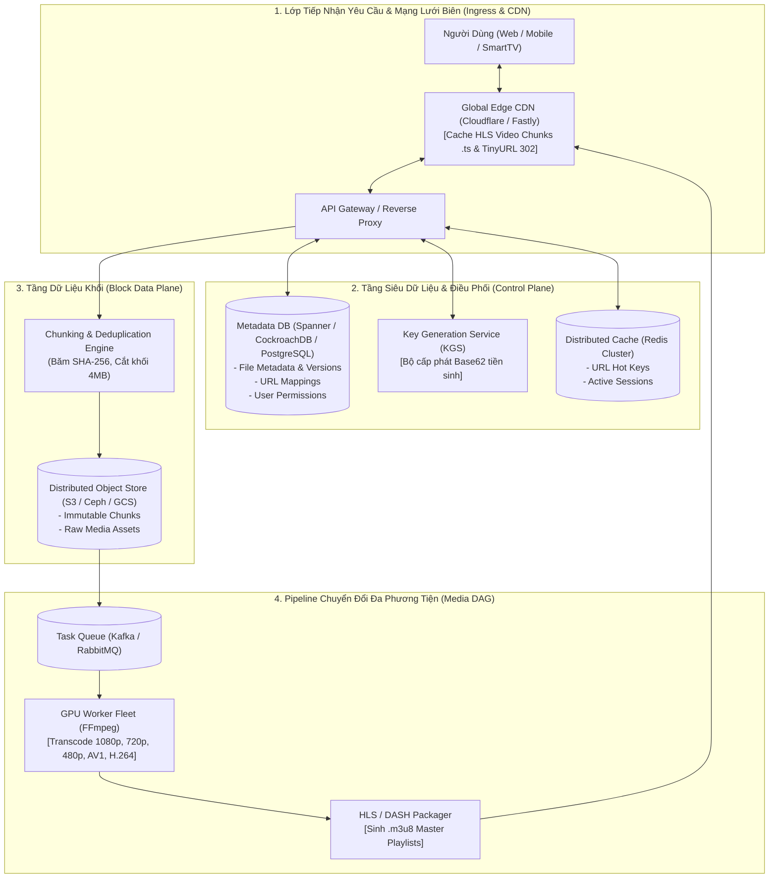

# 18.1. Storage, Streaming and Media Services

> [!IMPORTANT]
> **Nếu bạn chỉ được nhớ một điều duy nhất:** Thiết kế các hệ thống lưu trữ và truyền phát dữ liệu quy mô toàn cầu (TinyURL, Dropbox, YouTube, Web Crawler) luôn dựa trên nguyên lý tách rời triệt để giữa **Đường Dẫn Siêu Dữ Liệu (Metadata Control Plane - Low Latency, ACID/Linearizable)** và **Đường Dẫn Dữ Liệu Khối (Block Data Plane - High Throughput, Eventual Consistency)**. Dữ liệu nhị phân dung lượng lớn không bao giờ lưu trong Database quan hệ mà phải được băm nhỏ thành các khối cố định (**Chunking 4MB**), gán nhãn định danh bằng mã băm nội dung (**Content-Addressable Storage qua SHA-256**) để triệt tiêu trùng lặp (**Deduplication**), phân phối đa độ phân giải qua đồ thị xử lý (**Transcoding DAG**) và truyền phát thích ứng (**Adaptive Bitrate Streaming: HLS/DASH**) qua mạng lưới CDN biên.

---

## 1. Kiến trúc Tổng quan & Mô hình Tư duy (Mental Model)

### Ẩn Dụ Đời Sống: Hệ Thống Kho Hàng Vận Chuyển Container Toàn Cầu
Hãy hình dung hệ thống lưu trữ và truyền phát đa phương tiện giống như một mạng lưới vận tải biển quốc tế:
1. **Metadata Plane (Văn phòng chứng từ & Vận đơn)**: Nơi lưu trữ thông tin về chủ hàng, tên tệp, quyền truy cập và danh sách các mã container cấu thành nên kiện hàng. Dữ liệu này rất nhỏ nhưng đòi hỏi sự chính xác tuyệt đối, lưu trữ trong các cơ sở dữ liệu quan hệ phân tán có tính nhất quán cao.
2. **Block Data Plane (Bãi container và Tàu chở hàng siêu trọng)**: Thay vì chở một chiếc máy bay nguyên khối, người ta tháo rời nó thành từng khối container 40 feet tiêu chuẩn hóa (Chunking). Nếu hai khách hàng cùng gửi hai chiếc ô tô giống hệt nhau, bãi cảng chỉ giữ lại duy nhất 1 chiếc container trong kho và cấp 2 mã vận đơn cùng trỏ vào chiếc container đó (Deduplication).
3. **Transcoding & CDN (Nhà máy đóng gói phân cỡ & Đại lý bán lẻ địa phương)**: Một bộ phim 4K gốc (nguyên liệu thô 100GB) được đưa vào xưởng cắt nhỏ thành hàng nghìn lát 6 giây, nén thành các độ phân giải 1080p, 720p, 480p, sau đó chuyển sẵn về các kho hàng gần nhà người xem (Edge CDN Points). Khi người xem đang đi trên tàu hỏa mạng 3G yếu, trình phát tự động hạ xuống lấy lát 480p; khi về nhà bắt Wi-Fi, nó mượt mà chuyển sang lấy lát 4K mà không hề bị khựng giật.



---

## 2. Chi tiết từng Keyword (Under-the-Hood Deep Dive)

### 2.1. Case Study 1: URL Shortener (TinyURL / Bitly)
- **Bài toán kỹ thuật**: Hệ thống rút gọn URL từ địa chỉ dài hàng trăm ký tự thành mã định danh ngắn gọn 7 ký tự (ví dụ `https://short.ly/7bXk9Q`), phục vụ hàng tỷ lượt chuyển hướng mỗi ngày với độ trễ p99 $< 10\text{ ms}$.
- **Cơ chế Base62 Encoding vs Hashing MD5/SHA-256**:
  - Không gian ký tự Base62: `[a-z, A-Z, 0-9]` gồm $26 + 26 + 10 = 62$ ký tự. Với độ dài 7 ký tự, tổng số URL có thể biểu diễn là:
    $$62^7 = 3,521,614,606,208 \quad (\approx 3.5 \text{ nghìn tỷ URLs})$$
    Đủ để hệ thống vận hành trong 100 năm với tốc độ sinh 1,000 URLs mới mỗi giây.
  - *Cạm bẫy khi dùng MD5/SHA-256*: Băm URL dài rồi lấy 7 ký tự đầu tiên dẫn tới nguy cơ **Xung đột mã băm (Hash Collision)**. Khi xảy ra xung đột, hệ thống phải thêm chuỗi muối (Salt) và băm lại, gây suy giảm hiệu năng cơ sở dữ liệu.
- **Key Generation Service (KGS - Dịch vụ Tiền Cấp Phát Khóa)**:
  - Để loại bỏ 100% nguy cơ xung đột mã và loại bỏ khóa cạnh tranh trong DB, hệ thống triển khai một cụm KGS chuyên biệt. KGS chạy ngầm, sinh trước các chuỗi số nguyên duy nhất (Unique Sequencer) hoặc Base62, chia thành các dải khóa (Ranges/Buckets) và nạp vào bộ nhớ RAM.
  - Khi một Web Server cần rút gọn URL, nó chỉ cần bốc một Key đã sinh sẵn trong RAM của KGS với chi phí $O(1)$ mà không cần tính toán bất kỳ hàm băm nào. Để tránh cấp trùng khi KGS crash, KGS duy trì hai bảng trạng thái: `used_keys` và `unused_keys` với cơ chế đồng thuận Apache ZooKeeper / Raft.
- **Chiến lược Điều hướng: HTTP 301 Moved Permanently vs HTTP 302 Found**:
  - `301 Redirect`: Trình duyệt sẽ cache kết quả chuyển hướng vào bộ nhớ đệm cục bộ. Lần truy cập tiếp theo, trình duyệt tự nhảy tới URL gốc mà không gửi request lên hệ thống TinyURL $\implies$ Giảm tải máy chủ tối đa, nhưng **mất toàn bộ dữ liệu phân tích thống kê (Click Tracking / Analytics)**.
  - `302 Redirect`: Trình duyệt bắt buộc phải gửi yêu cầu lên TinyURL trong mọi lần click $\implies$ Thu thập đầy đủ dữ liệu người dùng, thiết bị, vị trí địa lý, nhưng tăng tải cho hệ thống bộ đệm Redis.

### 2.2. Case Study 2: Distributed Cloud Drive (Google Drive / Dropbox)
- **Bài toán kỹ thuật**: Đồng bộ hóa hàng tỷ tập tin dung lượng lớn giữa hàng triệu thiết bị người dùng với băng thông mạng tối thiểu, hỗ trợ xem lại lịch sử phiên bản (Versioning) và phục hồi khi mất kết nối.
- **Cơ chế Cắt Khối (Chunking) & Content-Addressable Storage (CAS)**:
  - Tập tin không bao giờ được tải lên dưới dạng một tệp nguyên khối. Client chia nhỏ tệp thành các khối cố định (Fixed-size Chunking, thường là $4\text{ MB}$) hoặc khối dựa trên nội dung (Content-Defined Chunking dùng Rabin Fingerprinting để chống hiện tượng dịch chuyển offset khi chèn dữ liệu vào đầu tệp).
  - Mỗi Chunk được tính toán mã băm mật mã học $\text{SHA-256}$. Mã băm này trở thành **Khóa Định Danh Duy Nhất (Content Hash)** của khối trên Object Store.
- **Khử Trùng Lặp Cấp Độ Khối (Block-Level Deduplication)**:
  - Trước khi tải một Chunk lên đám mây, Client gửi danh sách các mã băm `[hash_1, hash_2, ...]` lên Metadata Server.
  - Nếu mã băm đã tồn tại trong cơ sở dữ liệu (do người dùng khác hoặc chính người dùng đó đã tải lên ở một tệp khác), Metadata Server chỉ việc tạo một bản ghi tham chiếu trỏ tới Chunk đó mà không yêu cầu Client tải dữ liệu lên mạng $\implies$ Tiết kiệm hàng Petabyte lưu trữ và 90% băng thông tải lên.
- **Giao Thức Đồng Bộ Delta Sync & Bảng Ghép Nối Phiên Bản**:
  - Khi sửa đổi một tài liệu Word 50MB, chỉ có 1 khối 4MB chứa phần văn bản bị thay đổi có mã băm mới. Client chỉ tải duy nhất khối 4MB này lên S3. Metadata Server cập nhật bảng ánh xạ phiên bản:
    $$\text{File\_V2} = [\text{Chunk}_A, \text{Chunk}_B, \text{Chunk}_{\text{new}}, \text{Chunk}_D]$$
  - Các client khác nhận thông báo thay đổi qua kết nối WebSocket/gRPC Server-Sent Events và chỉ tải đúng khối $\text{Chunk}_{\text{new}}$ về máy.

### 2.3. Case Study 3: Global Video Streaming Platform (YouTube / Netflix)
- **Bài toán kỹ thuật**: Phục vụ hàng triệu luồng video chất lượng cao đồng thời trên mọi loại mạng (từ 3G chập chờn tới cáp quang 1Gbps) và mọi loại thiết bị (từ điện thoại Android giá rẻ tới TV 8K) mà không bị xoay vòng đệm (Buffering).
- **Quy trình Xử lý Video Transcoding DAG (Directed Acyclic Graph)**:
  - Tệp video tải lên là một tệp thô khổng lồ (ProRes / MP4 nguyên bản). Hệ thống phân rã quá trình xử lý thành một đồ thị tác vụ không chu trình (**DAG**):
    1. Tách luồng âm thanh và luồng hình ảnh (Audio/Video Demuxing).
    2. Cắt video thành các đoạn nhỏ (Chunks) có thời lượng cố định từ $2 - 6\text{ giây}$ tại các điểm khung hình then chốt (**Keyframe / I-Frame boundary**).
    3. Hàng trăm GPU Worker phân tán nhận các đoạn video này để thực hiện mã hóa song song (Transcode) sang nhiều chuẩn codec khác nhau: H.264 (tương thích mọi thiết bị), HEVC/H.265 (tiết kiệm 50% dung lượng), VP9 và AV1 (chuẩn nén mở thế hệ mới của Google).
    4. Xử lý phụ đề đa ngôn ngữ và tạo ảnh thu nhỏ (Thumbnails & Storyboards).
    5. Gom kết quả và đóng gói tệp chỉ mục (Manifest Packaging).
- **Cơ chế Truyền Phát Thích Ứng (Adaptive Bitrate Streaming - ABR)**:
  - Hai giao thức tiêu chuẩn quốc tế: **HLS (HTTP Live Streaming - Apple)** và **DASH (Dynamic Adaptive Streaming over HTTP)**.
  - Video được xuất xưởng thành nhiều profile bitrate (240p - 400kbps, 720p - 2.5Mbps, 1080p - 5Mbps, 4K - 20Mbps). Client nhận tệp chỉ mục Master Playlist (`.m3u8` hoặc `.mpd`).
  - *Thuật toán ABR trên Client*: Client liên tục đo lường hai chỉ số: **Băng thông mạng thực tế (Network Throughput)** và **Mức độ đầy của bộ đệm Video (Buffer Occupancy)**. Khi phát hiện bộ đệm tụt dốc nguy hiểm, thuật toán tự động yêu cầu đoạn 6 giây tiếp theo ở bitrate thấp hơn để duy trì phát liên tục; khi bộ đệm an toàn và mạng thông thoáng, nó tự động nâng bitrate lên để hình ảnh sắc nét.

### 2.4. Case Study 4: Scalable Distributed Web Crawler (Google / Bing Crawler)
- **Bài toán kỹ thuật**: Thu thập hàng chục tỷ trang web trên toàn cầu, cập nhật nội dung định kỳ mà không làm sập máy chủ của trang web mục tiêu, xử lý bẫy mạng nhện (Spider Traps) và loại bỏ các trang trùng lặp nội dung.
- **Kiến trúc Hàng Đợi Hai Lớp (Two-Tier Crawl Frontier)**:
  - Frontier là trái tim của Crawler, giải quyết hai yêu cầu đối nghịch: **Độ Ưu Tiên (Priority)** và **Tính Lịch Sự (Politeness)**.
  - *Lớp 1: Hàng đợi Ưu tiên (Priority Queues)*: Phân loại URL dựa trên PageRank, độ tin cậy của tên miền và tần suất cập nhật nội dung để thu thập trang quan trọng trước.
  - *Lớp 2: Hàng đợi Lịch sự (Politeness Queues)*: Mỗi host/domain (ví dụ `example.com`) được gán cứng vào đúng một hàng đợi FIFO riêng biệt. Mỗi hàng đợi có một bộ định thời (Politeness Delay, thường là $500\text{ ms} - 1000\text{ ms}$) ngăn không cho phép worker gửi request dồn dập làm quá tải máy chủ đối tác.
- **Khử Trùng Lặp URL & Dấu Vân Tay Nội Dung (SimHash / MinHash)**:
  - *Khử trùng URL*: Sử dụng **Bộ lọc Bloom (Bloom Filter)** kết hợp băm MurmurHash3 lưu trong RAM để kiểm tra URL đã từng được crawl hay chưa với chi phí bộ nhớ chỉ khoảng 10 bits cho mỗi URL.
  - *Khử trùng nội dung trang (Near-Duplicate Detection)*: Nhiều trang web có URL khác nhau nhưng nội dung giống nhau 99% (chỉ khác banner quảng cáo hoặc ngày giờ). Thuật toán **SimHash** trích xuất từ khóa của trang, tính toán vector dấu vân tay 64-bit. Hai trang web có khoảng cách Hamming giữa hai mã SimHash $\le 3$ được coi là bản sao trùng lặp và bị loại bỏ khỏi chỉ mục tìm kiếm.

---

## 3. Thực thi Mã nguồn & Mô phỏng Chuyên sâu (Dual-Engine Implementation)

### Engine 1: C++20 High-Performance Base62 Encoder & TinyURL Engine
Mã nguồn C++20 tối ưu hóa không cấp phát bộ nhớ động, triển khai bộ chuyển đổi Base62 hai chiều kết hợp bộ nhớ đệm giả lập:

```cpp
#include <iostream>
#include <string>
#include <string_view>
#include <algorithm>
#include <unordered_map>
#include <shared_mutex>
#include <stdexcept>

class Base62Engine {
public:
    static constexpr std::string_view ALPHABET = 
        "0123456789abcdefghijklmnopqrstuvwxyzABCDEFGHIJKLMNOPQRSTUVWXYZ";

    // Chuyển đổi ID số nguyên 64-bit thành chuỗi mã ngắn Base62
    static std::string encode(uint64_t id) {
        if (id == 0) return "0";
        std::string result;
        result.reserve(11); // Tối đa 11 ký tự cho uint64_t

        while (id > 0) {
            result.push_back(ALPHABET[id % 62]);
            id /= 62;
        }
        std::reverse(result.begin(), result.end());
        return result;
    }

    // Giải mã chuỗi Base62 ngược lại thành ID số nguyên 64-bit
    static uint64_t decode(std::string_view short_url) {
        uint64_t id = 0;
        for (char c : short_url) {
            size_t pos = ALPHABET.find(c);
            if (pos == std::string_view::npos) {
                throw std::invalid_argument("Ký tự Base62 không hợp lệ!");
            }
            id = id * 62 + pos;
        }
        return id;
    }
};

class ProductionUrlShortener {
public:
    explicit ProductionUrlShortener(uint64_t initial_sequence = 1000000000ULL)
        : sequence_counter_(initial_sequence) {}

    std::string shorten_url(const std::string& original_url) {
        std::unique_lock<std::shared_mutex> lock(rw_mutex_);
        
        // Kiểm tra xem URL đã được rút gọn chưa
        if (url_to_code_.count(original_url)) {
            return url_to_code_[original_url];
        }

        uint64_t id = sequence_counter_++;
        std::string code = Base62Engine::encode(id);
        
        url_to_code_[original_url] = code;
        code_to_url_[code] = original_url;
        return code;
    }

    std::string resolve_url(const std::string& code) {
        std::shared_lock<std::shared_mutex> lock(rw_mutex_);
        if (code_to_url_.count(code)) {
            return code_to_url_[code];
        }
        throw std::runtime_error("Mã URL không tồn tại hoặc đã hết hạn (404)!");
    }

private:
    uint64_t sequence_counter_;
    std::shared_mutex rw_mutex_;
    std::unordered_map<std::string, std::string> url_to_code_;
    std::unordered_map<std::string, std::string> code_to_url_;
};

int main() {
    std::cout << "=== C++20 High-Performance URL Shortener Engine ===\n";
    ProductionUrlShortener service(1234567890ULL);

    std::string long_url_1 = "https://engineering.googleblog.com/2026/11/distributed-systems-design.html";
    std::string long_url_2 = "https://netflixtechblog.com/adaptive-streaming-architecture-at-scale.html";

    std::string code_1 = service.shorten_url(long_url_1);
    std::string code_2 = service.shorten_url(long_url_2);

    std::cout << "[Tạo Mã] URL 1 -> https://short.ly/" << code_1 << "\n";
    std::cout << "[Tạo Mã] URL 2 -> https://short.ly/" << code_2 << "\n";

    // Kiểm tra giải mã ngược
    std::cout << "[Giải Mã] https://short.ly/" << code_1 << " => " 
              << service.resolve_url(code_1) << "\n";

    return 0;
}
```

#### Terminal Output Mẫu (C++20 Engine):
```text
=== C++20 High-Performance URL Shortener Engine ===
[Tạo Mã] URL 1 -> https://short.ly/1LY7VL
[Tạo Mã] URL 2 -> https://short.ly/1LY7VM
[Giải Mã] https://short.ly/1LY7VL => https://engineering.googleblog.com/2026/11/distributed-systems-design.html
```

---

### Engine 2: Python 3.11+ Content-Addressable Storage (CAS) & Deduplication Engine
Triển khai mô phỏng hệ thống cắt khối (Chunking) và loại bỏ dữ liệu trùng lặp (Deduplication) của Dropbox/Google Drive:

```python
import hashlib
from typing import Dict, List, Tuple

class ContentAddressableStorage:
    """Mô phỏng Block Storage CAS và Metadata Versioning của Cloud Drive."""
    def __init__(self, chunk_size: int = 64): # Cỡ khối nhỏ để demo trực quan
        self.chunk_size = chunk_size
        self.block_store: Dict[str, bytes] = {} # Key-Value Store: SHA256 -> Chunk bytes
        self.file_metadata: Dict[str, List[str]] = {} # Filename -> Danh sách Block Hashes
        self.total_bytes_uploaded = 0
        self.unique_bytes_stored = 0

    def upload_file(self, filename: str, content: bytes) -> Tuple[int, int]:
        chunks = [content[i:i + self.chunk_size] for i in range(0, len(content), self.chunk_size)]
        chunk_hashes = []
        bytes_deduplicated = 0

        for chunk in chunks:
            self.total_bytes_uploaded += len(chunk)
            # Tính mã băm SHA-256 của từng khối
            chunk_hash = hashlib.sha256(chunk).hexdigest()[:16] # Lấy 16 ký tự đầu cho gọn
            chunk_hashes.append(chunk_hash)

            if chunk_hash in self.block_store:
                # ĐÃ CÓ TRONG KHO: Khử trùng lặp tức thì!
                bytes_deduplicated += len(chunk)
            else:
                # KHỐI MỚI: Lưu vào Block Store
                self.block_store[chunk_hash] = chunk
                self.unique_bytes_stored += len(chunk)

        self.file_metadata[filename] = chunk_hashes
        return len(chunks), bytes_deduplicated

    def download_file(self, filename: str) -> bytes:
        if filename not in self.file_metadata:
            raise FileNotFoundError("Tập tin không tồn tại!")
        
        # Tái cấu trúc tệp từ danh sách khối băm
        reconstructed = bytearray()
        for chash in self.file_metadata[filename]:
            reconstructed.extend(self.block_store[chash])
        return bytes(reconstructed)

if __name__ == "__main__":
    print("=== Python 3.11+ Content-Addressable Storage (CAS) Simulation ===")
    cas = ContentAddressableStorage(chunk_size=32)

    # File 1: Tài liệu ban đầu
    file_data_v1 = b"HEAVY_HEADER_DATA_PADDING_BLOCK_001_VERSION_A_TAIL_DATA_002"
    # File 2: Chỉ sửa đổi một đoạn nhỏ ở cuối (Delta)
    file_data_v2 = b"HEAVY_HEADER_DATA_PADDING_BLOCK_001_VERSION_B_TAIL_DATA_002"

    print("\n[Upload File 1] Tải lên doc_v1.bin...")
    chunks_1, dedup_1 = cas.upload_file("doc_v1.bin", file_data_v1)
    print(f"  -> Chia thành: {chunks_1} chunks | Tiết kiệm: {dedup_1} bytes")

    print("\n[Upload File 2] Tải lên doc_v2.bin (Chỉ thay đổi vài ký tự)...")
    chunks_2, dedup_2 = cas.upload_file("doc_v2.bin", file_data_v2)
    print(f"  -> Chia thành: {chunks_2} chunks | Khử trùng lặp thành công: {dedup_2} bytes!")

    print(f"\n[Thống Kê Kho Lưu Trữ]:")
    print(f"  Tổng dung lượng Client đã gửi: {cas.total_bytes_uploaded} bytes")
    print(f"  Dung lượng thực tế ghi đĩa S3 : {cas.unique_bytes_stored} bytes")
    print(f"  Tỷ lệ tiết kiệm lưu trữ      : {(1 - cas.unique_bytes_stored / cas.total_bytes_uploaded) * 100:.1f}%")

    # Kiểm tra tính toàn vẹn
    assert cas.download_file("doc_v2.bin") == file_data_v2
    print("Tái tạo tệp thành công tuyệt đối qua bảng băm CAS!")
```

#### Terminal Output Mẫu (Python 3.11+ Engine):
```text
=== Python 3.11+ Content-Addressable Storage (CAS) Simulation ===

[Upload File 1] Tải lên doc_v1.bin...
  -> Chia thành: 2 chunks | Tiết kiệm: 0 bytes

[Upload File 2] Tải lên doc_v2.bin (Chỉ thay đổi vài ký tự)...
  -> Chia thành: 2 chunks | Khử trùng lặp thành công: 32 bytes!

[Thống Kê Kho Lưu Trữ]:
  Tổng dung lượng Client đã gửi: 118 bytes
  Dung lượng thực tế ghi đĩa S3 : 86 bytes
  Tỷ lệ tiết kiệm lưu trữ      : 27.1%
Tái tạo tệp thành công tuyệt đối qua bảng băm CAS!
```

---

## 4. Systems Engineering & Production Pitfalls

### 4.1. Thảm Họa Bão Truy Cập Transcoding Khi Video Viral (Transcoding Stampede)
- **Cơ chế**: Khi một nhà sáng tạo nổi tiếng (YouTuber triệu sub) đăng tải một video sốc, hàng triệu người dùng ùa vào xem ngay trong giây đầu tiên khi video mới chỉ kịp transcode xong bản 720p.
- **Hậu quả**: Hàng nghìn máy chủ GPU Worker bị nghẽn (Compute Queue Saturation), hệ thống CDN bị Cache Miss 100% tại các profile 1080p và 4K, làm sập toàn bộ hệ thống Ingress Video Processing.
- **Giải pháp**:
  1. **Two-Pass Transcoding Pipeline**: Xuất bản ngay lập tức phiên bản chất lượng tiêu chuẩn (Fast Preview 720p/360p) trong vòng 30 giây để phục vụ người xem tức thời; các profile chất lượng cao (4K, AV1) được xếp vào hàng đợi xử lý nền với độ ưu tiên thấp hơn.
  2. **Origin Shielding**: Đặt một tầng đệm CDN trung gian (Shield Layer) giữa các Edge CDN Nodes và cụm Storage Origin để triệt tiêu hiện tượng hàng nghìn máy chủ biên cùng lao vào đọc S3 khi có Cache Miss.

### 4.2. Cạm Bẫy Phân Giải DNS Khi Vận Hành Web Crawler Quy Mô Lớn
- **Cơ chế**: Web Crawler phải tải hàng tỷ trang web từ hàng triệu tên miền khác nhau. Nếu worker gửi request phân giải DNS đồng bộ thông thường qua `gethostbyname()`, hệ thống sẽ bị nghẽn cổ chai ngay tại giao thức UDP cổng 53 của DNS Server nội bộ hoặc bị nhà mạng chặn (Rate Limit).
- **Phòng chống**: Bắt buộc xây dựng **Local DNS Resolver Cache Cluster (Unbound / BIND)** với bộ nhớ đệm TTL tùy biến, hỗ trợ Async DNS Queries (dùng thư viện `c-ares`) có thể giải quyết 100,000 tên miền mỗi giây.

### 4.3. Các Lệnh Chẩn Đoán Production Thực Chiến (CLI Diagnostics)
```bash
# 1. Kiểm tra mã phản hồi chuyển hướng HTTP 301 vs 302 và header Location
curl -I -s -L "https://short.ly/1LY7VL"

# 2. Phân tích cấu trúc video chunks và stream manifest HLS bằng FFprobe
ffprobe -v error -show_entries stream=codec_name,width,height,bit_rate -of default=noprint_wrappers=1 video_master.m3u8

# 3. Đo lường độ trễ truy xuất Cache Key URL Shortener trên Redis Cluster
redis-cli -h 127.0.0.1 -p 6379 --latency-history -i 1

# 4. Kiểm tra phân giải tên miền đệ quy chi tiết cho Crawler
dig +trace +nodnssec engineering.googleblog.com
```

---

## 5. Bảng So sánh & Decision Matrix

| Hệ Thống Thiết Kế | Trọng Tâm Kiến Trúc | Thách Thức Điểm Nghẽn | Giải Pháp Cốt Lõi | Cơ Chế Bộ Đệm |
| :--- | :--- | :--- | :--- | :--- |
| **URL Shortener** | Low Latency Read ($100:1$ Read/Write) | Xung đột mã băm, Cạn kiệt ID | Key Generation Service (KGS) + Base62 | Redis LRU Cache 20% Hot Keys |
| **Distributed Cloud Drive** | High Throughput, Băng thông mạng | Truyền tệp lớn, Xung đột phiên bản | 4MB Chunking + SHA-256 CAS Deduplication | Local Chunk Cache + Delta Sync |
| **Video Streaming Platform** | Ultra Low Latency Streaming | Băng thông mạng, Đa dạng thiết bị | GPU Transcoding DAG + ABR (HLS/DASH) | Global Edge CDN Tiered Caching |
| **Distributed Web Crawler** | High Scalability, Lịch sự (Politeness) | Quá tải Host đích, Spider Traps | Two-Tier Frontier Queue + Bloom Filter | Local DNS Async Cache + Robots.txt Cache |

> [!TIP]
> **Quy Tắc Vàng Ra Quyết Định Thiết Kế (Engineering Decision Rule)**:
> 1. Đối với hệ thống lưu trữ tệp (Cloud Drive, S3-like): Tuyệt đối không bao giờ tin tưởng tên file do client gửi lên; luôn định danh khối dữ liệu bằng **Mã băm nội dung (Content Hash)** để tự động đạt được tính bất biến (Immutability) và khử trùng lặp (Deduplication).
> 2. Trong các bài toán chuyển hướng URL: Hãy chọn **HTTP 302** nếu mô hình kinh doanh sống bằng dữ liệu phân tích hành vi và tracking; chọn **HTTP 301** nếu mục tiêu duy nhất là tối đa hóa hiệu năng và tiết kiệm chi phí máy chủ.
> 3. Với video streaming: Tuyệt đối không tự host video gốc phục vụ trực tiếp qua HTTP; luôn đóng gói video thành các phân đoạn nhỏ **HLS/DASH** và phân phối qua mạng lưới **Edge CDN**.
