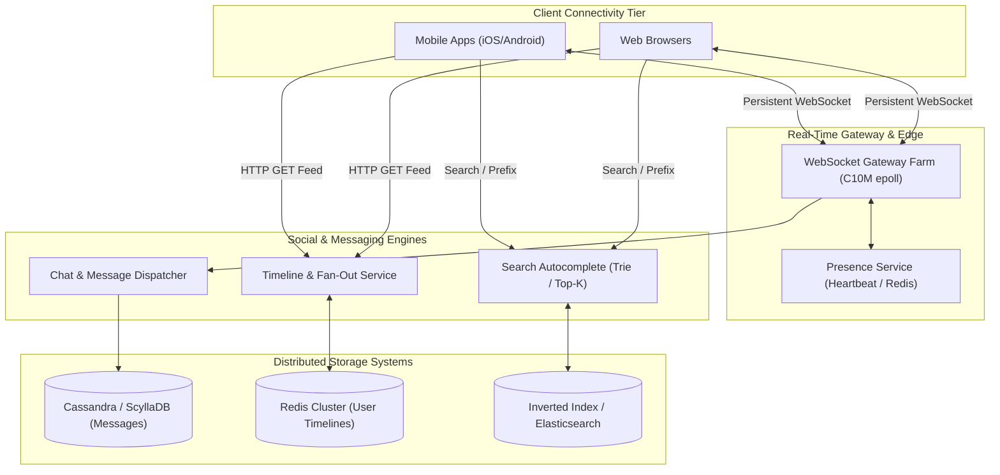
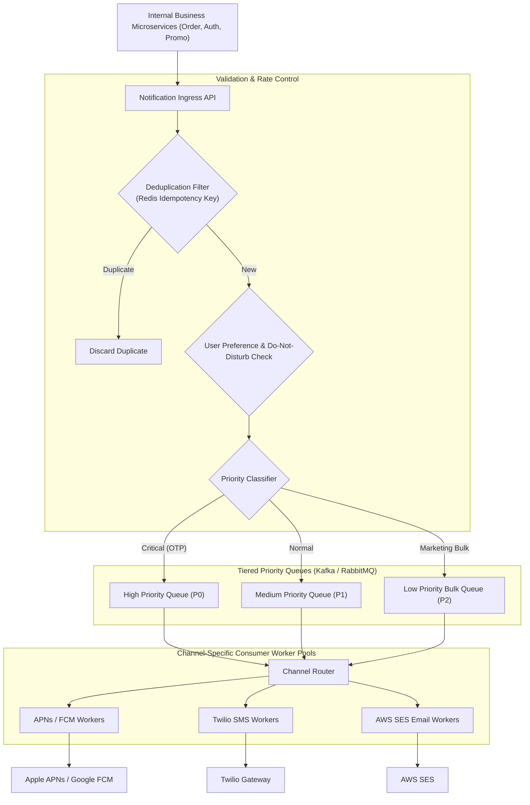
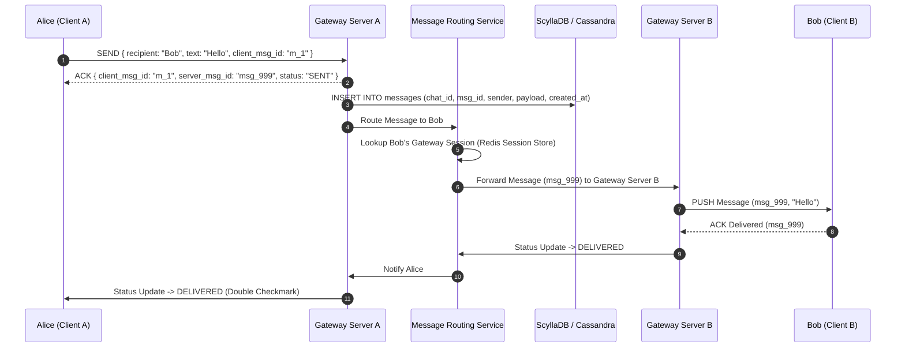
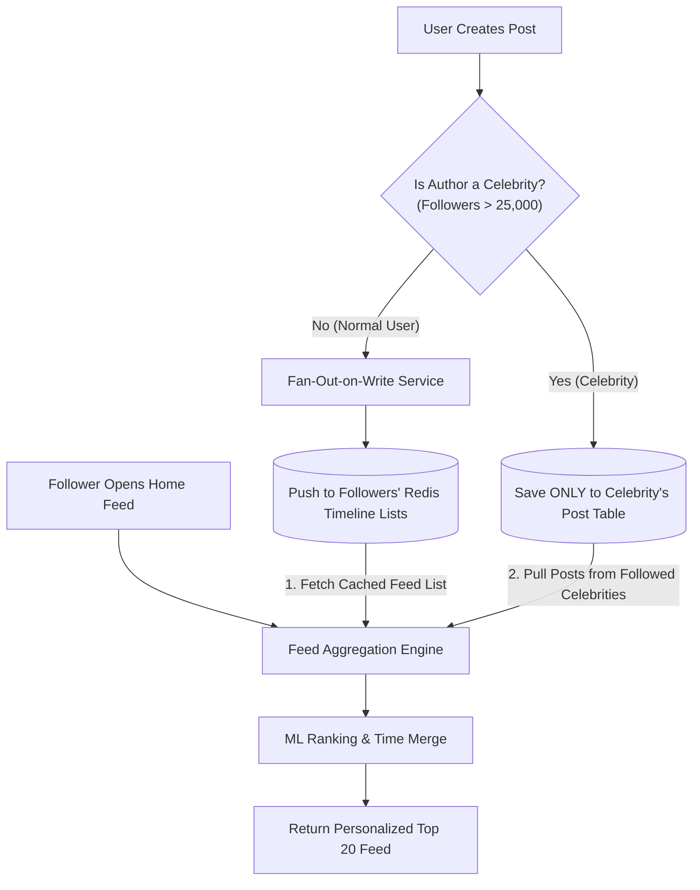
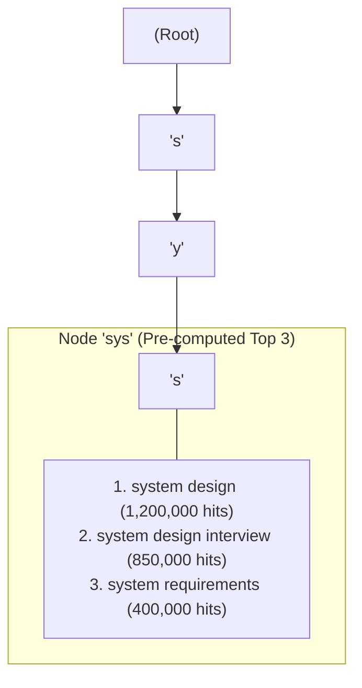

# 18.2. Case Studies: Messaging, Social & Search Platforms (Nghiên cứu điển hình: Nền tảng Nhắn tin, Mạng xã hội & Tìm kiếm)

---

## Tổng quan về Messaging, Social & Search Platforms

Các hệ thống truyền thông điệp, mạng xã hội và công cụ tìm kiếm đại diện cho những bài toán kinh điển của kiến trúc phần mềm hướng người dùng (User-Facing Systems) với các đặc thù:
- **Giao tiếp hai chiều thời gian thực (Bidirectional Real-Time Communication)**: Hàng chục triệu kết nối TCP/WebSocket đồng thời (Concurrent Connections), yêu cầu tối ưu hóa I/O cấp hệ điều hành (`epoll`, `kqueue`) và quản lý trạng thái trực tuyến (Presence State) với độ trễ sub-second.
- **Mô hình quạt dữ liệu (Data Fan-Out)**: Bài toán bảng tin (News Feed / Social Timeline) xử lý sự bất đối xứng giữa đọc và ghi (Read/Write Asymmetry), cân bằng giữa mô hình **Push (Fan-out-on-write)** và **Pull (Fan-out-on-read)** đối với các tài khoản người nổi tiếng (Celebrity Problem).
- **Gợi ý và truy vấn toàn văn độ trễ thấp (Sub-50ms Typeahead & Search)**: Sử dụng cấu trúc cây tiền tố (**Trie**), bảng chỉ mục ngược (**Inverted Index**) và các giải thuật xếp hạng độ liên quan (**BM25 / TF-IDF**) để trả lời truy vấn trong chớp mắt.



---

## 2. Chi tiết từng Keyword (Under-the-Hood Deep Dive): Các Case Studies Cốt Lõi

---

### Case Study 1: Notification & Email Delivery System (Hệ thống Thông báo Đa kênh)

#### 1. Yêu cầu & Thách thức kỹ thuật
- **Functional Requirements**:
  - Gửi thông báo tức thời tới hàng trăm triệu người dùng qua 4 kênh chính:
    1. **Mobile Push Notification**: Apple Push Notification service (APNs) và Firebase Cloud Messaging (FCM).
    2. **SMS**: Twilio, Vonage.
    3. **Email**: SendGrid, AWS SES, Mailgun.
    4. **In-App Notification**: WebSocket / In-App Notification Center.
  - Hỗ trợ ưu tiên (Priority Levels): Khẩn cấp (OTP SMS, Security Alert) gửi ngay $< 1$ giây; Thông báo tiếp thị (Marketing campaign) gửi ngầm dạng batch.
  - Ngăn chặn Spam và trùng lặp thông báo (Deduplication & Rate Limiting).

#### 2. Kiến trúc tổng thể & Sơ đồ luồng (Architecture & Flow)



#### 3. Deep Dive: Chống trùng lặp (Deduplication) & Rate Limiting người dùng
- **Idempotency Key**:
  - Mỗi thông báo được gán một mã băm duy nhất:
    $$\text{DedupKey} = \text{SHA256}(\text{UserId} + \text{EventType} + \text{EntityId})$$
  - Ví dụ: Khi đơn hàng `ord_888` cập nhật trạng thái `SHIPPED`, key là `SHA256("user_1#OrderShipped#ord_888")`.
  - Worker ghi key này vào Redis với lệnh `SET dedup_key 1 NX EX 86400`. Nếu Redis trả về `NIL` (key đã tồn tại trong 24 giờ), tin nhắn bị hủy ngay lập tức, ngăn chặn việc người dùng nhận 2 email giống nhau khi upstream retry.
- **User Fatigue Prevention (Kiểm soát tần suất nhận tin)**:
  - Thiết lập luật: Tối đa 3 push notifications và 1 email tiếp thị mỗi ngày cho một user. Sử dụng Redis Sliding Window Counter để theo dõi và hoãn gửi các tin nhắn không khẩn cấp.

---

### Case Study 2: Real-Time Chat & Instant Messaging (WhatsApp / Slack / Discord)

#### 1. Yêu cầu & Kiến trúc Kết nối C10M
- **Functional Requirements**:
  - Nhắn tin 1-1 (Direct Messaging) và Nhắn tin nhóm (Group Chat lên đến 1,000 thành viên).
  - Trạng thái tin nhắn thời gian thực: Đã gửi (Sent $\checkmark$), Đã nhận (Delivered $\checkmark\checkmark$), Đã đọc (Read $\checkmark\checkmark$ blue).
  - Trạng thái trực tuyến (Online Presence) và "Đang soạn tin..." (Typing indicator).
  - Đồng bộ hóa lịch sử chat trên nhiều thiết bị (Multi-device Sync).
- **Thách thức C10M (10 triệu kết nối đồng thời)**:
  - Một server 64GB RAM không thể tạo 10 triệu thread hệ điều hành (mỗi thread tốn 8MB stack $\implies$ OOM).
  - Bắt buộc dùng kiến trúc **Non-blocking Event-Driven I/O (Linux `epoll` / FreeBSD `kqueue`)** kết hợp ngôn ngữ nhẹ như Erlang/Elixir BEAM process hoặc Go Goroutines (mỗi goroutine chỉ tốn 2KB stack ban đầu).

#### 2. Sơ đồ kiến trúc Chat Server Farm & Presence Tracking



#### 3. Deep Dive: Message Storage Model (Tại sao chọn Cassandra / ScyllaDB?)
- Tần suất ghi (Write Traffic) trong chat cực cao, vượt trội hoàn toàn so với tần suất đọc (người dùng chỉ đọc lịch sử khi mở app hoặc scroll lên).
- Cấu trúc bảng tối ưu cho Time-series truy vấn theo phạm vi (Range Query):
  ```sql
  CREATE TABLE messages (
      conversation_id UUID,
      message_id BIGINT, -- Snowflake ID (Sắp xếp theo thời gian chính xác)
      sender_id UUID,
      content TEXT,
      media_url TEXT,
      created_at TIMESTAMP,
      PRIMARY KEY ((conversation_id), message_id)
  ) WITH CLUSTERING ORDER BY (message_id DESC);
  ```
  - `conversation_id` làm **Partition Key**: Toàn bộ lịch sử trò chuyện của một cuộc hội thoại nằm trọn vẹn trên một node vật lý, giúp việc query 50 tin nhắn mới nhất chỉ tốn một thao tác đọc tuần tự trên ổ đĩa SSD (**Sequential Disk I/O**).
  - `message_id` làm **Clustering Key**: Tự động sắp xếp tin nhắn theo thứ tự thời gian giảm dần mà không cần câu lệnh `ORDER BY` tốn CPU.

---

### Case Study 3: News Feed & Social Timeline (Facebook News Feed / Twitter Timeline)

#### 1. Yêu cầu & Cân nhắc kiến trúc
- **Scale**: 500 triệu Daily Active Users (DAU). Mỗi người dùng có trung bình 200 bạn bè / followers.
- **Thách thức cốt lõi**:
  - Người dùng đăng bài (Post creation): Cần xuất hiện trên bảng tin của tất cả followers.
  - Người dùng tải trang chủ (Feed retrieval): Phải tải 20 bài viết mới nhất trong vòng $< 100\text{ms}$.

#### 2. Fan-out-on-write (Push Model) vs Fan-out-on-read (Pull Model)

| Tiêu chí | Fan-out-on-write (Push Model) | Fan-out-on-read (Pull Model) |
| :--- | :--- | :--- |
| **Cơ chế** | Khi tác giả đăng bài, hệ thống chủ động đẩy bài viết vào hộp thư/timeline cache của từng follower. | Khi follower mở app, hệ thống mới query bài viết của toàn bộ bạn bè, gộp lại và sắp xếp theo thời gian. |
| **Tốc độ đọc (Feed Read)** | **Cực nhanh ($O(1)$)**: Chỉ việc đọc trực tiếp danh sách IDs từ Redis list của user. | **Chậm ($O(N \log N)$)**: Phải query $N$ bạn bè và merge sort hàng ngàn bài viết khi đọc. |
| **Tốc độ ghi (Post Write)** | **Chậm**: Nếu tác giả có 1 triệu followers, hệ thống phải thực hiện 1 triệu thao tác ghi vào Redis cache. | **Cực nhanh ($O(1)$)**: Chỉ ghi đúng 1 bản ghi vào bảng bài viết của tác giả. |
| **Điểm yếu chí mạng** | **The Celebrity Problem**: Một ngôi sao (e.g., Elon Musk) có 150 triệu followers. Đăng 1 tweet gây bão ghi (Write Storm) làm sập hệ thống. | Tải đọc (Read Latency) quá cao, gây nghẽn CPU và database khi hàng triệu người mở app cùng lúc. |

#### 3. Giải pháp thực chiến: Hybrid Model (Mô hình kết hợp của Twitter/Instagram)
- Đối với người dùng thông thường ($< 25,000$ followers): Dùng **Fan-out-on-write (Push)**. Khi họ đăng bài, đẩy ngay vào timeline cache của bạn bè.
- Đối với người nổi tiếng (Celebrities / VIPs $> 25,000$ followers): Không thực hiện Fan-out khi ghi.
- Khi một follower mở trang chủ: Hệ thống lấy timeline cá nhân từ Redis Cache (đã chứa sẵn bài viết của bạn bè bình thường), sau đó thực hiện **Fan-out-on-read (Pull)** chỉ đối với các VIP mà người đó đang theo dõi, rồi hòa trộn (Merge) hai luồng lại trước khi trả về client.



---

### Case Study 4: Search Autocomplete & Typeahead Suggestions (Google Search Box)

#### 1. Yêu cầu & Cấu trúc dữ liệu
- **Functional Requirements**:
  - Khi người dùng gõ từng ký tự vào ô tìm kiếm (ví dụ: `sys...`), hệ thống hiển thị Top 5 từ khóa gợi ý phổ biến nhất (e.g., `system design`, `system design interview`, `system of a down`).
  - Độ trễ cực đại cho phép: $< 30\text{ms}$ (để theo kịp tốc độ gõ phím của con người).
- **Lựa chọn cấu trúc dữ liệu**:
  - Không thể dùng `SELECT * FROM queries WHERE keyword LIKE 'sys%' ORDER BY frequency DESC` trong RDBMS vì sẽ quét hàng tỷ dòng và làm nghẽn Database.
  - Sử dụng cấu trúc **Trie (Cây tiền tố - Prefix Tree)** kết hợp với việc lưu trữ sẵn Top K từ khóa ngay tại từng node.

#### 2. Thiết kế cấu trúc Trie tối ưu bộ nhớ
- Mỗi node trên cây Trie lưu trữ:
  1. Ký tự đại diện.
  2. Bảng băm hoặc mảng trỏ tới các con cháu (`children`).
  3. **Pre-computed Top K list**: Một danh sách lưu sẵn 5 chuỗi từ khóa có tần suất tìm kiếm cao nhất từ node này trở xuống.
  - Nhờ tối ưu hóa này, khi người dùng gõ tiền tố, hệ thống chỉ việc duyệt từ gốc cây xuống node đại diện cho ký tự cuối cùng và trả về danh sách Top K với độ phức tạp **$O(L)$** (với $L$ là độ dài từ khóa, $L \le 20$), hoàn toàn độc lập với tổng số lượng từ khóa trong hệ thống!



#### 3. Code ví dụ thực chiến (C++20: In-Memory Prefix Trie with Top-K Caching)

```cpp
#include <iostream>
#include <string>
#include <vector>
#include <memory>
#include <algorithm>
#include <unordered_map>

struct Suggestion {
    std::string term;
    uint64_t score;

    bool operator>(const Suggestion& other) const {
        return score > other.score;
    }
};

class AutocompleteTrie {
private:
    struct TrieNode {
        std::unordered_map<char, std::shared_ptr<TrieNode>> children;
        std::vector<Suggestion> top_k; // Cache sẵn Top 5 gợi ý tại mỗi node
        bool is_word_end = false;
    };

    std::shared_ptr<TrieNode> root_;
    const size_t kMaxTopK = 5;

    void updateTopK(std::vector<Suggestion>& list, const Suggestion& item) {
        auto it = std::find_if(list.begin(), list.end(), [&](const Suggestion& s) {
            return s.term == item.term;
        });

        if (it != list.end()) {
            it->score = item.score;
        } else {
            list.push_back(item);
        }

        std::sort(list.begin(), list.end(), std::greater<Suggestion>());
        if (list.size() > kMaxTopK) {
            list.resize(kMaxTopK);
        }
    }

public:
    AutocompleteTrie() : root_(std::make_shared<TrieNode>()) {}

    void insert(const std::string& word, uint64_t score) {
        auto current = root_;
        Suggestion item{word, score};

        for (char c : word) {
            if (current->children.find(c) == current->children.end()) {
                current->children[c] = std::make_shared<TrieNode>();
            }
            current = current->children[c];
            // Cập nhật Top-K dọc theo đường đi của cây
            updateTopK(current->top_k, item);
        }
        current->is_word_end = true;
    }

    std::vector<Suggestion> getTopSuggestions(const std::string& prefix) {
        auto current = root_;
        for (char c : prefix) {
            if (current->children.find(c) == current->children.end()) {
                return {}; // Không tìm thấy tiền tố
            }
            current = current->children[c];
        }
        return current->top_k; // Trả về O(1) kết quả đã tính sẵn
    }
};

int main() {
    AutocompleteTrie trie;
    trie.insert("system design", 15000);
    trie.insert("system design interview", 20000);
    trie.insert("system architecture", 8000);
    trie.insert("syntax error", 3000);

    std::cout << "[Query Suggestions for Prefix: 'sys']\n";
    auto suggestions = trie.getTopSuggestions("sys");
    for (const auto& s : suggestions) {
        std::cout << "-> " << s.term << " (Score: " << s.score << ")\n";
    }
    return 0;
}
```
