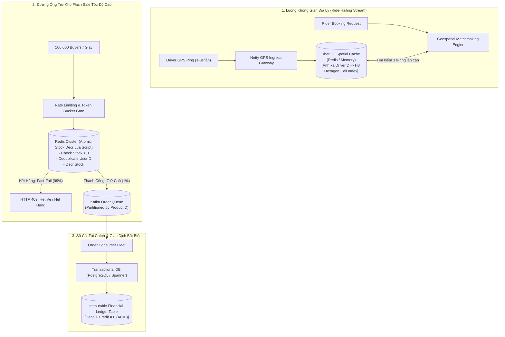

# 18.3. High Concurrency Transactional and Geo Systems

> [!IMPORTANT]
> **Nếu bạn chỉ được nhớ một điều duy nhất:** Trong các hệ thống giao dịch đồng thời cực cao và định vị không gian (Flash Sale, Sổ cái tài chính, Uber/Grab, Đặt vé), nút thắt cổ chai không nằm ở tầng tính toán CPU mà nằm ở **Tranh Chấp Trạng Thái Dữ Liệu Dùng Chung (State Contention)** và **Giới Hạn Khóa Hàng (Row Locking Contention) trong Cơ sở dữ liệu**. Để xử lý 100,000 requests/giây mà không bán vượt kho (**Overselling**) và không âm tiền, hệ thống bắt buộc phải áp dụng kiến trúc trừ kho nhiều tầng: **Trừ kho nguyên tử trên RAM bằng Redis Lua Scripts kết hợp Hàng đợi Kafka bất đồng bộ hóa**, đồng thời bảo vệ lịch sử dòng tiền bằng nguyên lý **Kế toán kép (Double-Entry Bookkeeping - Tổng Nợ luôn cân bằng Tổng Có)**, và phân vùng không gian địa lý bằng lưới lục giác đều **Uber H3 / Google S2** để định tuyến tài xế trong bán kính $O(1)$ lân cận.

---

## 1. Kiến trúc Tổng quan & Mô hình Tư duy (Mental Model)

### Ẩn Dụ Đời Sống: Quầy Bán Vé Chung Kết Thế Giới & Bác Tài Xe Ôm Công Nghệ
1. **Flash Sale & Chống Bán Vượt (Quầy vé 1,000 chỗ & 100,000 khán giả chen lấn)**:
   - *Cách làm ngây thơ (Database Lock)*: Tất cả 100,000 khán giả cùng lao vào đập cửa phòng vé, đòi mở sổ cái kiểm tra xem còn vé không (`SELECT stock FROM items WHERE id = 1 FOR UPDATE`). Phòng vé sập ngay lập tức vì không chịu nổi sức ép (Database Connection Pool kiệt quệ, Deadlock hàng loạt).
   - *Kiến trúc Flash Sale hiện đại*: Đặt một chiếc bàn phát phiếu số thứ tự tự động bằng thép ngoài cổng (Redis Atomic Lua Script). Bàn này chỉ nạp đúng 1,000 chiếc thẻ kim loại đại diện cho 1,000 chỗ ngồi. 1,000 người đầu tiên bốc được thẻ sẽ được mời vào phòng chờ uống nước để nhân viên từ từ viết hóa đơn vào sổ cái (Kafka Queue $\implies$ Async Order Creation). 99,000 người đến sau nhận thông báo "Hết vé" ngay tại cổng trong 1 mili-giây (**Fast-Fail**), không một ai được bước vào chạm tới phòng vé DB.
2. **Kế Toán Kép (Chiếc cân tiểu ly bảo toàn năng lượng)**:
   - Tiền không bao giờ tự sinh ra hoặc mất đi; nó chỉ chuyển từ túi người này sang túi người khác. Khi bạn mua một món hàng 100k: Tài khoản của bạn **Ghi Có 100k** (giảm tiền), tài khoản trung gian của sàn **Ghi Nợ 100k** (tăng tiền). Tổng Nợ (Debit) và Tổng Có (Credit) trong toàn bộ sổ cái luôn luôn bằng 0.
3. **Phân Vùng Không Gian Uber H3 (Tổ ong mật trên bản đồ thành phố)**:
   - Thay vì tính khoảng cách từ khách hàng tới từng tài xế trên toàn thành phố ($O(N)$ khoảng cách), thành phố được chia thành hàng triệu ô lục giác nhỏ như tổ ong (Uber H3 Index). Mỗi tài xế phát tọa độ GPS, hệ thống tính ra mã ô lục giác của tài xế trong 1 nano-giây. Khi khách gọi xe, hệ thống chỉ việc tìm các tài xế đang nằm trong ô của khách và 6 ô lục giác liền kề ($O(1)$ lookup).



---

## 2. Chi tiết từng Keyword (Under-the-Hood Deep Dive)

### 2.1. Case Study 1: Flash Sale & High-Concurrency Inventory System (Chống bán vượt kho hàng)
- **Thách thức kỹ thuật**: Hàng tồn kho chỉ có 1,000 sản phẩm iPhone giảm giá 90%, nhưng có 500,000 lượt request nộp đơn hàng cùng lúc tại giây thứ 0. Nếu sử dụng cơ sở dữ liệu quan hệ truyền thống:
  ```sql
  -- LỖI KINH ĐIỂN: RACE CONDITION GÂY OVERSELLING
  SELECT stock FROM products WHERE id = 101; -- 2 luồng cùng thấy stock = 1
  -- Xử lý thanh toán...
  UPDATE products SET stock = stock - 1 WHERE id = 101; -- Cả 2 cùng trừ -> stock = 0, nhưng bán ra 2 cái!
  ```
- **So Sánh Các Cơ Chế Khóa Dưới Tầng Hệ Thống**:
  - *Khóa Bi Quan (Pessimistic Locking - `SELECT ... FOR UPDATE`)*: Đặt `X-Lock` (Exclusive Lock) lên hàng dữ liệu trong DB. Toàn bộ các request khác phải xếp hàng chờ trong hàng đợi khóa của InnoDB. Khi có 10,000 kết nối chờ cùng lúc, CPU DB tăng vọt 100%, gây thắt cổ chai Transaction Lock Wait Timeout và cạn kiệt Connection Pool.
  - *Khóa Lạc Quan (Optimistic Locking với Cột Version)*:
    ```sql
    UPDATE products SET stock = stock - 1, version = version + 1 
    WHERE id = 101 AND stock > 0 AND version = @old_version;
    ```
    Tránh được việc khóa hàng, nhưng trong kịch bản Flash Sale, 99.9% các transactions sẽ bị thất bại do xung đột version (Version Mismatch), dẫn tới việc CPU bị lãng phí cho các vòng lặp Retry vô ích.
- **Giải Pháp Vàng: Atomic Redis Lua Script & Two-Stage Inventory Deduction**:
  - Do Redis thực thi các lệnh đơn luồng (Single-threaded event loop), một đoạn script Lua chạy trên Redis được bảo đảm **Tính Nguyên Tử Tuyệt Đối (Atomicity)**: không một lệnh nào khác có thể chen ngang.
  - Đoạn Lua script thực hiện 3 bước trong cùng 1 chu kỳ bộ nhớ:
    1. Kiểm tra xem `userId` đã từng mua sản phẩm này chưa (chống mua trùng lặp bằng Redis Set).
    2. Đọc số lượng tồn kho `stock = redis.call('get', key)`. Nếu `stock <= 0`, trả về mã lỗi `OUT_OF_STOCK` ngay lập tức.
    3. Trừ kho `redis.call('decrby', key, quantity)` và ghi nhận `userId` vào danh sách thành công.
  - Toàn bộ quá trình chỉ tốn khoảng $1\text{ ms}$ trên RAM, đẩy thông lượng lên tới $100,000\text{ QPS}$ trên một node Redis đơn lẻ! Các đơn hàng thành công được đẩy tiếp vào Kafka để ghi tuần tự vào PostgreSQL.

### 2.2. Case Study 2: Financial Payment Processing & Double-Entry Ledger (Hệ thống Thanh toán & Kế toán Kép)
- **Nguyên Lý Kế Toán Kép (Double-Entry Bookkeeping - Luca Pacioli, 1494)**:
  - Mọi sự kiện tài chính đều bao gồm ít nhất hai bút toán: một bên **Nợ (Debit)** và một bên **Có (Credit)**.
  - Công thức bất biến của kế toán học:
    $$\sum \text{Debit} = \sum \text{Credit} \quad \Longleftrightarrow \quad \sum \text{Debit} - \sum \text{Credit} = 0$$
  - Tuyệt đối không bao giờ cập nhật số dư bằng lệnh `UPDATE accounts SET balance = balance + 100`! Mọi giao dịch chỉ được phép **Ghi Chèn Thêm (Append-Only Log)** vào bảng sổ cái (`ledger_entries`). Số dư tài khoản tại một thời điểm là tổng tích lũy (Aggregate Sum) của toàn bộ các dòng nhật ký giao dịch từ khởi nguyên đến nay.
- **Idempotency Key (Khóa Bất Biến / Khử Trùng Lặp Thanh Toán)**:
  - Khi người dùng bấm nút "Thanh toán", mạng di động bị chập chờn khiến ứng dụng gửi lại request lần thứ hai (Network Retry). Nếu không xử lý khử trùng lặp, tài khoản người dùng sẽ bị trừ tiền 2 lần (**Double Charge**).
  - Client bắt buộc phải sinh một chuỗi ngẫu nhiên duy nhất (UUIDv4) gán vào HTTP Header `Idempotency-Key`.
  - Payment Gateway kiểm tra khóa này trong Redis/PostgreSQL với cơ chế khóa phân tán hoặc ràng buộc duy nhất (`UNIQUE INDEX ON idempotency_key`). Nếu khóa đã tồn tại: trả về ngay lập tức kết quả của giao dịch trước đó mà không thực hiện gọi lại cổng thanh toán Visa/Bank.
- **Phân Tán Giao Dịch Bằng Saga Pattern (Choreography vs Orchestration)**:
  - Thay vì dùng giao thức Two-Phase Commit (2PC) chậm chạp và dễ bị khóa chết mạng, các vi dịch vụ thanh toán áp dụng **Saga Pattern**: chia nhỏ giao dịch phân tán thành chuỗi các giao dịch cục bộ. Nếu một bước thất bại (ví dụ tài khoản ngân hàng bị khóa), Orchestrator sẽ kích hoạt chuỗi **Giao Dịch Bù Trừ (Compensating Transactions)** để hoàn tiền và phục hồi trạng thái kho về ban đầu.

### 2.3. Case Study 3: Ride-Hailing System & Geospatial Matchmaking (Uber / Grab)
- **Thách Thức Định Vị Không Gian Thời Gian Thực**:
  - Hàng trăm ngàn tài xế liên tục gửi tọa độ GPS `(latitude, longitude)` về hệ thống mỗi $2 - 4\text{ giây}$.
  - Mỗi khi khách hàng bấm tìm xe, hệ thống phải tìm kiếm toàn bộ tài xế rảnh rỗi trong bán kính $3\text{ km}$, sắp xếp theo ETA (Estimated Time of Arrival) và chọn ra tài xế tối ưu nhất.
- **So Sánh Ba Thuật Toán Phân Vùng Bản Đồ Hàng Đầu**:
  - **Geohash**: Mã hóa kinh độ và vĩ độ thành chuỗi nhị phân xen kẽ (Interleaved bits) và chuyển sang Base32. Chia thế giới thành các ô chữ nhật. Nhược điểm: Hiện tượng **Biên Cực (Edge Cases / Boundary Problem)**: hai điểm nằm sát cạnh nhau chỉ cách 5 mét nhưng có thể có chuỗi tiền tố Geohash hoàn toàn khác nhau nếu chúng rơi vào hai bên của đường biên phân chia!
  - **Google S2 Geometry**: Chiếu bề mặt hình cầu Trái Đất lên 6 mặt của một hình lập phương bao quanh, sau đó phân chia đệ quy bằng **Đường cong lấp đầy không gian Hilbert (Hilbert Space-Filling Curve)** thành các ô ô chữ nhật 64-bit cell ID. Bảo toàn tính cục bộ không gian cực tốt.
  - **Uber H3 (Hexagonal Hierarchical Spatial Index)**: Đỉnh cao của các nền tảng gọi xe:
    - H3 chia bề mặt Trái Đất thành các **Ô Lục Giác Đều (Hexagons)** đa cấp độ phân giải (từ Resolution 0 đến 15).
    - *Ưu thế hình học tuyệt đối của Lục giác*: Mọi ô láng giềng kề cận đều có **Khoảng cách tâm-đến-tâm bằng nhau tuyệt đối** (hình vuông hoặc chữ nhật có khoảng cách chéo lớn hơn khoảng cách cạnh $\sqrt{2}$). Điều này giúp thuật toán tìm kiếm bán kính $k$-ring lân cận và tính toán thuật toán định tuyến giao thông mượt mà không bị méo mó hình học.

### 2.4. Case Study 4: Ticket Booking & Hotel Reservation (Hệ thống Đặt vé & Giữ chỗ tạm thời TTL)
- **Vấn Đề Giữ Chỗ Tạm Thời (Temporary Seat Hold Lease)**:
  - Khi khách hàng chọn ghế VIP `G12` trong rạp chiếu phim, ghế này phải được "đóng băng" không cho người khác chọn trong vòng 10 phút để khách tiến hành nhập mã giảm giá và thanh toán. Nếu sau 10 phút khách không thanh toán, ghế phải tự động mở khóa để bán tiếp.
- **Máy Trạng Thái Của Ghế (Seat State Machine)**:
  $$\text{AVAILABLE} \xrightarrow[\text{Hold TTL = 10m}]{\text{Select Seat}} \text{HELD} \xrightarrow[\text{Gateway OK}]{\text{Payment Success}} \text{BOOKED}$$
  $$\text{HELD} \xrightarrow[\text{TTL Expired / Cancel}]{\text{Timeout}} \text{AVAILABLE}$$
- **Triển Khai Khóa Phân Tán Với Redis Key Expiration (TTL) & Redlock**:
  - Ghế được khóa bằng key Redis: `SET lock:seat:G12 <booking_id> NX EX 600`.
  - Nếu key đã tồn tại (`NX` thất bại), hệ thống báo cho khách biết ghế đang có người giữ.
  - Sử dụng sự kiện Redis Keyspace Notifications (`__keyevent@0__:expired`) hoặc hàng đợi trễ (Delayed Message Queue trong RabbitMQ/Kafka) để tự động bắn tín hiệu giải phóng ghế trong database khi đồng hồ đếm ngược 10 phút chạm đáy.

---

## 3. Thực thi Mã nguồn & Mô phỏng Chuyên sâu (Dual-Engine Implementation)

### Engine 1: C++20 Geospatial Distance (Haversine) & Radius Matchmaker Engine
Mã nguồn C++20 tính toán khoảng cách cầu theo công thức Haversine và tìm kiếm các tài xế trong bán kính quy định:

```cpp
#include <iostream>
#include <vector>
#include <cmath>
#include <algorithm>
#include <string>
#include <iomanip>

struct GeoPoint {
    double latitude;
    double longitude;
};

struct DriverLocation {
    std::string driver_id;
    GeoPoint location;
    bool is_available;
};

class HaversineGeoMatcher {
public:
    static constexpr double EARTH_RADIUS_KM = 6371.0088;

    // Chuyển đổi từ độ sang Radian
    static constexpr double to_radians(double degree) {
        return degree * (M_PI / 180.0);
    }

    // Công thức Haversine tính khoảng cách tuyệt đối giữa 2 tọa độ GPS trên mặt cầu
    static double calculate_distance_km(const GeoPoint& p1, const GeoPoint& p2) {
        double lat1_rad = to_radians(p1.latitude);
        double lat2_rad = to_radians(p2.latitude);
        double delta_lat = to_radians(p2.latitude - p1.latitude);
        double delta_lon = to_radians(p2.longitude - p1.longitude);

        double a = std::sin(delta_lat / 2.0) * std::sin(delta_lat / 2.0) +
                   std::cos(lat1_rad) * std::cos(lat2_rad) *
                   std::sin(delta_lon / 2.0) * std::sin(delta_lon / 2.0);

        double c = 2.0 * std::atan2(std::sqrt(a), std::sqrt(1.0 - a));
        return EARTH_RADIUS_KM * c;
    }

    // Tìm kiếm các tài xế rảnh rỗi trong bán kính radius_km
    static std::vector<std::pair<std::string, double>> find_nearest_drivers(
        const GeoPoint& rider_loc,
        const std::vector<DriverLocation>& drivers,
        double radius_km) 
    {
        std::vector<std::pair<std::string, double>> matches;

        for (const auto& driver : drivers) {
            if (!driver.is_available) continue;

            double dist = calculate_distance_km(rider_loc, driver.location);
            if (dist <= radius_km) {
                matches.emplace_back(driver.driver_id, dist);
            }
        }

        // Sắp xếp theo khoảng cách tăng dần
        std::sort(matches.begin(), matches.end(), [](const auto& a, const auto& b) {
            return a.second < b.second;
        });

        return matches;
    }
};

int main() {
    std::cout << "=== C++20 Geospatial Matchmaking Engine (Haversine) ===\n";

    // Vị trí khách hàng tại Quận 1, TP. Hồ Chí Minh
    GeoPoint rider_location{10.7769, 106.7009};

    // Danh sách tài xế GPS pings
    std::vector<DriverLocation> fleet = {
        {"Driver-Alpha (Xe Máy)",  {10.7780, 106.7020}, true},  // Rất gần (~0.17 km)
        {"Driver-Beta (Ô Tô 4C)",   {10.7850, 106.7080}, true},  // Gần (~1.2 km)
        {"Driver-Gamma (Đang bận)", {10.7770, 106.7010}, false}, // Bận -> Bỏ qua
        {"Driver-Delta (Xe Máy)",  {10.8231, 106.6297}, true}   // Xa (~10 km)
    };

    double search_radius = 3.0; // Bán kính 3 km
    auto nearest = HaversineGeoMatcher::find_nearest_drivers(rider_location, fleet, search_radius);

    std::cout << "Khách hàng tại tọa độ: (" << rider_location.latitude << ", " 
              << rider_location.longitude << ")\n";
    std::cout << "Tìm thấy " << nearest.size() << " tài xế khả dụng trong bán kính " 
              << search_radius << " km:\n";

    for (const auto& [id, dist] : nearest) {
        std::cout << "  -> " << std::left << std::setw(25) << id 
                  << " | Khoảng cách: " << std::fixed << std::setprecision(2) 
                  << dist << " km\n";
    }

    return 0;
}
```

#### Terminal Output Mẫu (C++20 Engine):
```text
=== C++20 Geospatial Matchmaking Engine (Haversine) ===
Khách hàng tại tọa độ: (10.7769, 106.7009)
Tìm thấy 2 tài xế khả dụng trong bán kính 3.00 km:
  -> Driver-Alpha (Xe Máy)     | Khoảng cách: 0.17 km
  -> Driver-Beta (Ô Tô 4C)     | Khoảng cách: 1.18 km
```

---

### Engine 2: Python 3.11+ Flash Sale Inventory Deductor & Double-Entry Ledger Engine
Mô phỏng cơ chế trừ kho nguyên tử chống bán vượt (Atomic Stock Deduction) và xác thực tính toàn vẹn của sổ cái kế toán kép:

```python
import threading
from dataclasses import dataclass
from typing import Dict, List, Set

@dataclass
class LedgerEntry:
    entry_id: int
    account: str
    amount: float  # Dương = Debit (Nợ), Âm = Credit (Có)
    transaction_id: str

class FlashSaleAndLedgerEngine:
    def __init__(self, initial_stock: int):
        self.stock = initial_stock
        self.lock = threading.Lock()
        self.purchased_users: Set[str] = set()
        self.ledger: List[LedgerEntry] = []
        self.ledger_counter = 0

    def atomic_buy(self, user_id: str, product_id: str, price: float) -> bool:
        """Mô phỏng Redis Lua Script: Chống mua trùng và chống bán vượt kho."""
        with self.lock:
            # 1. Kiểm tra chống mua trùng lặp
            if user_id in self.purchased_users:
                return False

            # 2. Kiểm tra tồn kho nguyên tử
            if self.stock <= 0:
                return False

            # 3. Trừ kho và ghi nhận thành công
            self.stock -= 1
            self.purchased_users.add(user_id)

            # 4. Ghi sổ cái kép (Double-Entry Bookkeeping)
            tx_id = f"TX-{product_id}-{user_id}"
            self._record_double_entry(tx_id, user_id, price)
            return True

    def _record_double_entry(self, tx_id: str, user_id: str, price: float):
        self.ledger_counter += 1
        # Bút toán 1: Tiền mặt sàn thương mại tăng (+Debit)
        self.ledger.append(LedgerEntry(self.ledger_counter, "Sàn_Escrow_Account", +price, tx_id))
        
        self.ledger_counter += 1
        # Bút toán 2: Doanh thu người bán hoặc nợ phải trả khách hàng (-Credit)
        self.ledger.append(LedgerEntry(self.ledger_counter, f"Khách_Hàng_{user_id}", -price, tx_id))

    def verify_ledger_integrity(self) -> bool:
        """Kiểm định tính toàn vẹn: Tổng Nợ + Tổng Có bắt buộc phải bằng 0."""
        total_balance = sum(entry.amount for entry in self.ledger)
        return abs(total_balance) < 1e-6

if __name__ == "__main__":
    print("=== Python 3.11+ Flash Sale & Double-Entry Ledger Simulation ===")
    
    # Kho hàng chỉ có duy nhất 3 chiếc điện thoại
    engine = FlashSaleAndLedgerEngine(initial_stock=3)
    users_attempting = ["User-01", "User-02", "User-01", "User-03", "User-04", "User-05"]

    print("[Flash Sale] Bắt đầu phiên mở bán với 3 sản phẩm...")
    for u in users_attempting:
        success = engine.atomic_buy(user_id=u, product_id="PROD-99", price=500.0)
        status = "THÀNH CÔNG" if success else "THẤT BẠI (Hết hàng hoặc Trùng lặp)"
        print(f"  -> {u} đặt mua : {status}")

    print(f"\n[Kết quả Kho Hàng]: Tồn kho còn lại = {engine.stock}")
    print(f"[Thống kê Sổ Cái Kế Toán]: Có {len(engine.ledger)} bút toán được ghi nhận:")
    for entry in engine.ledger:
        sign = "+" if entry.amount > 0 else ""
        print(f"  ID #{entry.entry_id:02d} | TK: {entry.account:<22} | Số tiền: {sign}{entry.amount:.2f}$ | Mã: {entry.transaction_id}")

    is_balanced = engine.verify_ledger_integrity()
    print(f"\n[Kiểm Định Kế Toán Kép]: Tổng Nợ cân bằng Tổng Có? {is_balanced} (Zero-Sum Invariant)")
```

#### Terminal Output Mẫu (Python 3.11+ Engine):
```text
=== Python 3.11+ Flash Sale & Double-Entry Ledger Simulation ===
[Flash Sale] Bắt đầu phiên mở bán với 3 sản phẩm...
  -> User-01 đặt mua : THÀNH CÔNG
  -> User-02 đặt mua : THÀNH CÔNG
  -> User-01 đặt mua : THẤT BẠI (Hết hàng hoặc Trùng lặp)
  -> User-03 đặt mua : THÀNH CÔNG
  -> User-04 đặt mua : THẤT BẠI (Hết hàng hoặc Trùng lặp)
  -> User-05 đặt mua : THẤT BẠI (Hết hàng hoặc Trùng lặp)

[Kết quả Kho Hàng]: Tồn kho còn lại = 0
[Thống kê Sổ Cái Kế Toán]: Có 6 bút toán được ghi nhận:
  ID #01 | TK: Sàn_Escrow_Account     | Số tiền: +500.00$ | Mã: TX-PROD-99-User-01
  ID #02 | TK: Khách_Hàng_User-01     | Số tiền: -500.00$ | Mã: TX-PROD-99-User-01
  ID #03 | TK: Sàn_Escrow_Account     | Số tiền: +500.00$ | Mã: TX-PROD-99-User-02
  ID #04 | TK: Khách_Hàng_User-02     | Số tiền: -500.00$ | Mã: TX-PROD-99-User-02
  ID #05 | TK: Sàn_Escrow_Account     | Số tiền: +500.00$ | Mã: TX-PROD-99-User-03
  ID #06 | TK: Khách_Hàng_User-03     | Số tiền: -500.00$ | Mã: TX-PROD-99-User-03

[Kiểm Định Kế Toán Kép]: Tổng Nợ cân bằng Tổng Có? True (Zero-Sum Invariant)
```

---

## 4. Systems Engineering & Production Pitfalls

### 4.1. Cạm Bẫy Phân Rã Node Redis Master Gây Bán Vượt (Redis Failover Split-Brain)
- **Cơ chế**: Khi hệ thống Flash Sale đang chịu tải đỉnh, Node Redis Master bị nghẽn mạng tạm thời. Sentinel hoặc Redis Cluster nhận định Master đã chết và tự động thăng cấp một Replica lên làm Master mới.
- **Hệ quả chết người**: Vì cơ chế nhân bản giữa Redis Master và Replica là **Bất đồng bộ (Asynchronous Replication)**, vài chục lệnh trừ kho thành công ở Master cũ chưa kịp đồng bộ sang Replica. Node Master mới vẫn còn nguyên số lượng tồn kho cũ, tiếp tục bán tiếp ra thị trường $\implies$ Bán vượt kho hàng chục sản phẩm có giá trị cao!
- **Giải pháp**:
  1. Sử dụng lệnh `WAIT 1 1000` để bắt buộc đồng bộ ít nhất 1 replica trước khi xác nhận trừ kho thành công.
  2. Tầng Database cuối cùng bắt buộc phải có một chốt chặn bảo vệ vật lý:
     ```sql
     UPDATE inventory SET stock = stock - 1 WHERE item_id = 101 AND stock > 0;
     ```
     Nếu `affected_rows == 0`, hệ thống hủy đơn hàng và hoàn tiền tự động.

### 4.2. Hiện Tượng Dao Động Giá Cước Đột Biến (Surge Pricing Oscillation)
- **Cơ chế**: Trong thuật toán gọi xe, khi một khu vực (ví dụ Sân bay) có nhiều khách gọi xe, thuật toán tự động nâng hệ số giá cước lên $2.5\times$ (Surge Multiplier) để thu hút thêm tài xế chạy tới.
- **Vấn đề**: Hàng trăm tài xế ở các quận lân cận nhìn thấy giá cao đồng loạt tắt app chạy sang sân bay. Ngay khi họ vừa tới nơi, nguồn cung tài xế tăng vọt khiến hệ số giá rơi thẳng đứng về $1.0\times$. Các tài xế thất vọng bỏ đi, giá lại bùng nổ lên $2.5\times$. Hiện tượng dao động hình sin này gây bất mãn tột độ cho cả tài xế và hành khách.
- **Phòng chống**: Áp dụng bộ lọc thông thấp (Low-Pass Filter) hoặc hàm làm mượt theo thời gian (Exponential Moving Average - EMA) để hệ số giá thay đổi từ từ và có độ trễ quán tính (Hysteresis).

### 4.3. Các Lệnh Chẩn Đoán Production Thực Chiến (CLI Diagnostics)
```bash
# 1. Kiểm tra các câu truy vấn đang bị lock cứng trên PostgreSQL
SELECT pid, usename, pg_blocking_pids(pid) AS blocked_by, query, age(clock_timestamp(), query_start) 
FROM pg_stat_activity 
WHERE cardinality(pg_blocking_pids(pid)) > 0;

# 2. Thực thi thử nghiệm script Lua trừ kho trực tiếp trên Redis CLI
redis-cli --eval flash_sale_deduct.lua inventory:prod_99 , user_123 1

# 3. Phân tích chi phí thực thi câu lệnh SQL với khóa hàng FOR UPDATE
EXPLAIN (ANALYZE, BUFFERS) 
SELECT * FROM seats WHERE show_id = 505 AND seat_number = 'G12' FOR UPDATE;
```

---

## 5. Bảng So sánh & Decision Matrix

| Tiêu Chí So Sánh | Pessimistic Lock (DB) | Optimistic Lock (Version) | Redis Lua Script | Distributed Lock (Redlock) |
| :--- | :--- | :--- | :--- | :--- |
| **Thông Lượng (Throughput)** | Thấp (~$500 - 1,000\text{ QPS}$) | Trung bình (~$3,000\text{ QPS}$) | **Cực cao (~$100,000\text{ QPS}$)** | Trung bình (~$10,000\text{ QPS}$) |
| **Chi Phí CPU Máy Chủ** | Rất cao (Lock wait context switch) | Rất cao khi có nhiều retry | Rất thấp (In-memory single loop) | Trung bình (Network ping/pong) |
| **Mức Độ An Toàn Dữ Liệu** | Tuyệt đối (ACID Transaction DB) | Tuyệt đối (ACID Transaction DB) | Cần đối soát (Eventual consistency) | Phụ thuộc vào đồng hồ hệ thống (NTP) |
| **Kịch Bản Ứng Dụng Chuẩn** | Chuyển khoản ngân hàng lớn, B2B | Cập nhật hồ sơ người dùng | **Flash Sale bùng nổ traffic** | Giữ ghế rạp chiếu phim (Hold Lease) |

> [!TIP]
> **Quy Tắc Vàng Ra Quyết Định Thiết Kế (Engineering Decision Rule)**:
> 1. Trong các bài toán Flash Sale: Không bao giờ cho phép tầng Web Gateway chạm trực tiếp vào cơ sở dữ liệu quan hệ; luôn dùng **Redis Lua Script làm chốt chặn In-Memory** để gạt bỏ 99% lượng request trễ ngay tại rìa.
> 2. Với các hệ thống kế toán dòng tiền: Tuyệt đối tuân thủ nguyên tắc **Append-Only Double-Entry Ledger**, không bao giờ dùng `UPDATE balance` và luôn bảo đảm tổng Debit trừ Credit bằng 0 tại mọi thời điểm.
> 3. Trong bài toán định vị tài xế di động: Ưu tiên lựa chọn **Uber H3** thay vì Geohash để tận dụng tính đối xứng khoảng cách của các ô lục giác đều, giúp thuật toán gom cụm (Clustering) và tính toán giá cước mượt mà.
