# 18.4. Infrastructure Telemetry and Enterprise SaaS

> [!IMPORTANT]
> **Nếu bạn chỉ được nhớ một điều duy nhất:** Xây dựng hạ tầng cốt lõi cho các nền tảng quy mô lớn (ID phân tán, Lập lịch tác vụ, Hệ thống đo đạc viễn trắc TSDB và Nền tảng Feature Flags) đòi hỏi sự tối ưu hóa đến từng bit nhị phân và triệt tiêu phụ thuộc mạng. Không bao giờ dùng Auto-Increment Database ID cho hệ thống phân tán vì tạo điểm nghẽn khóa tập trung; hãy dùng **Twitter Snowflake 64-bit** (Thời gian + NodeID + Bộ đếm) để đạt tính sắp xếp theo thời gian (**Time-sortable**) tự nhiên. Trong đo đạc viễn trắc (Prometheus / Gorilla TSDB), lưu trữ hàng triệu mẫu metrics mỗi giây chỉ khả thi nhờ thuật toán nén đỉnh cao: **Delta-of-Delta** nén timestamp giảm từ 64 bits xuống còn 1-2 bits, và **XOR Float Compression** triệt tiêu các bit dấu giống nhau. Với Feature Flags cấp doanh nghiệp, quyết định bật/tắt tính năng luôn được **Đánh giá Cục bộ (Local Evaluation SDK)** trong bộ nhớ ứng dụng với độ trễ 0 mili-giây, nhận cập nhật cấu hình qua luồng **Server-Sent Events (SSE)** một chiều.

---

## 1. Kiến trúc Tổng quan & Mô hình Tư duy (Mental Model)

### Ẩn Dụ Đời Sống: Thẻ Căn Cước Công Dân & Trạm Khí Tượng Tự Động
1. **Twitter Snowflake (Căn cước công dân gắn mã thời gian)**: Thay vì mỗi lần một em bé sinh ra phải gọi điện về trụ sở Bộ Công an trung ương xin một số thứ tự (Database Ticket Server), mỗi bệnh viện địa phương được cấp một mã viện (Machine ID 10-bit). Khi em bé ra đời, số định danh được ghép ngay tại chỗ: `[Timestamp mili-giây khi sinh] + [Mã bệnh viện] + [Số thứ tự ca sinh trong mili-giây đó]`. Không cần mạng, không cần khóa tập trung, mỗi giây sinh hàng triệu số ID toàn cầu mà không bao giờ trùng nhau và luôn tự động xếp theo thứ tự năm tháng.
2. **Gorilla Time-Series Compression (Sổ nhật ký trạm khí tượng)**: Một trạm khí tượng đo nhiệt độ cứ 10 giây một lần: $25.01^\circ\text{C}, 25.02^\circ\text{C}, 25.01^\circ\text{C}$. Nếu ghi đầy đủ số thực 8 bytes cho mỗi lần đo, cuốn sổ sẽ dày hàng nghìn trang. Người quan sát thông minh chỉ ghi: "Thời gian: cứ đều đặn +10s (Delta-of-delta = 0, ghi 1 bit '0'); Nhiệt độ: giống số trước đến từng số nguyên, chỉ khác 2 bit cuối (Phép XOR hai số thực triệt tiêu 90% các số 0 giống nhau)". Cuốn sổ thu nhỏ 10 lần, lưu trữ cả thế kỷ trên một thẻ nhớ nhỏ.
3. **Feature Flags với Local Evaluation (Bảng công tắc điện tại nhà)**: Bạn muốn bật/tắt bóng đèn phòng ngủ (bật tính năng mới cho 10% khách hàng VIP). Thay vì mỗi lần bật công tắc bạn phải gửi thư lên nhà máy điện hỏi xem mình có được bật đèn không (Server-side evaluation qua HTTP API làm chậm ứng dụng 200ms), bảng điều khiển công tắc đã được nạp sẵn quy tắc vào nhà bạn. Bạn chỉ việc gạt công tắc trong 1 phần triệu giây; khi nhà máy điện đổi quy tắc, họ gửi một tín hiệu radio nhỏ qua dây điện (SSE stream) để cập nhật bảng công tắc.

```mermaid
flowchart TD
    subgraph IDGenCluster ["1. Bộ Sinh Khóa Phân Tán (Snowflake ID Fleet)"]
        Node1["Worker Node 1\n(Machine ID: 0x01)"] -->|"Sinh 64-bit ID (Local Lock-Free)"| AppSvc1["Microservices"]
        Node2["Worker Node 2\n(Machine ID: 0x02)"] -->|"Sinh 64-bit ID (Local Lock-Free)"| AppSvc2["Microservices"]
    end

    subgraph TwoTierScheduler ["2. Lập Lịch Tác Vụ Hai Tầng (Two-Tier Distributed Job Queue)"]
        Leader["Scheduler Leader (Raft Elected)\n[Quét Redis ZSET Delayed Tasks]"]
        ZSetQueue[("Redis ZSET Queue\nScore = Timestamp Kích Hoạt")]
        WorkerPool["Distributed Worker Cluster\n(Pull tasks qua Kafka / RabbitMQ)"]
        Leader <--> ZSetQueue
        Leader --> WorkerPool
    end

    subgraph TelemetryEngine ["3. Động Cơ Viễn Trắc Chuỗi Thời Gian (Gorilla TSDB)"]
        RawMetrics["Metrics Ingestion (1M samples/s)"] --> DeltaDelta["Delta-of-Delta Compression\n(Timestamp 64b -> 1b)"]
        DeltaDelta --> XORFloat["XOR Compression\n(Float64 Values)"]
        XORFloat --> BlockTSDB[("TSDB Head Chunks (Memory / S3)")]
    end

    subgraph FeatureFlagPlatform ["4. Nền Tảng Feature Flag Thời Gian Thực"]
        SaaSConsole["Enterprise SaaS Admin UI"] --> ControlPlane["Feature Flag Control Plane"]
        ControlPlane -->|"SSE Stream: Cập Nhật Quy Tắc Rule"| LocalSDK["Application Local SDK Engine\n(Hash UserID % 100 < Percentage)"]
    end
```



---

## 2. Chi tiết từng Keyword (Under-the-Hood Deep Dive)

### 2.1. Distributed Unique ID Generator: Twitter Snowflake & UUIDv7
- **Hạn chế của các phương pháp cổ điển**:
  - *Database Auto-Increment*: Phụ thuộc vào 1 node DB duy nhất $\implies$ Single Point of Failure (SPOF) và giới hạn thông lượng vài ngàn ID/s. Nếu dùng kỹ thuật nhảy bước (Offset-based đa node), rất khó mở rộng thêm node mới.
  - *UUIDv4 (Ngẫu nhiên 128-bit)*: Hoàn toàn không có tính tuần tự thời gian. Khi chèn vào B+ Tree index của MySQL/PostgreSQL, nó gây hiện tượng **Page Splitting (Phân mảnh trang đĩa)** dữ dội, làm tốc độ ghi giảm sút tới 80% khi bảng đạt hàng chục triệu dòng.
- **Giải Phẫu Cấu Trúc 64-bit của Twitter Snowflake**:
  Được tối ưu hóa hoàn hảo để lưu vừa trong một số nguyên `BIGINT` 64-bit (8 bytes):
  - **Bit 0 (1 bit)**: Dành riêng, luôn bằng `0` để bảo đảm số sinh ra luôn là số dương có dấu trong các ngôn ngữ lập trình (như Java `long`).
  - **Bit 1 - 41 (41 bits)**: Dấu thời gian (Timestamp) tính bằng mili-giây kể từ một Epoch tùy biến (ví dụ Epoch Twitter: `1288834974657`). Với 41 bits, hệ thống có thể hoạt động liên tục trong:
    $$\frac{2^{41} - 1}{1000 \times 60 \times 60 \times 24 \times 365} \approx 69.7 \text{ năm}$$
  - **Bit 42 - 51 (10 bits)**: Định danh máy chủ (`Machine/Worker ID`). Cho phép triển khai tối đa $2^{10} = 1024$ nút sinh ID đồng thời mà không bao giờ trùng nhau.
  - **Bit 52 - 63 (12 bits)**: Bộ đếm tự tăng (Sequence Number). Cho phép mỗi máy chủ sinh tối đa $2^{12} = 4096$ ID độc nhất **trong cùng một mili-giây**.
  - *Thông lượng tối đa*: Toàn bộ hệ thống có thể tạo ra $1024 \times 4096 \times 1000 \approx 4.19 \text{ tỷ ID / giây}$!
- **Thảm Họa Lệch Xung Nhịp Đồng Hồ Vật Lý (Clock Skew Problem)**:
  - Máy chủ NTP định kỳ điều chỉnh đồng hồ hệ thống. Nếu đồng hồ bị chỉnh giật lùi về quá khứ (**Clock Backwards Jump**), Snowflake có thể sinh ra các ID trùng lặp với quá khứ.
  - *Giải pháp*: Khi phát hiện `current_timestamp < last_timestamp`, thuật toán bắt buộc từ chối sinh ID và chuyển sang chế độ ngủ chờ đồng hồ đuổi kịp (`wait_for_next_ms`), hoặc mượn các bit của sequence number để duy trì tính đơn điệu tăng (Monotonicity).
- **Sự Tiến Hóa UUIDv7 (RFC 9562)**: Tiêu chuẩn hóa mới của thế giới: Đưa 48-bit timestamp Unix mili-giây lên đầu chuỗi 128-bit, kết hợp 74-bit ngẫu nhiên phía sau. Vừa có tính toàn cầu độc nhất của UUID, vừa thân thiện 100% với B+ Tree Index của cơ sở dữ liệu.

### 2.2. Distributed Task Scheduler & Job Queue: Two-Tier Scheduling & Delayed Queues (Redis ZSET)
- **Kiến trúc Hai Tầng (Two-Tier Distributed Scheduler)**:
  - *Tầng 1: Lập lịch Điều phối (Orchestration Tier)*: Sử dụng thuật toán đồng thuận (Raft qua etcd hoặc ZooKeeper) để bầu ra một Node Trưởng (Leader). Chỉ duy nhất Leader quét lịch trình và phân phối tác vụ nhằm tránh hiện tượng chạy trùng tác vụ (Duplicate Job Execution).
  - *Tầng 2: Thực thi Phân tán (Worker Fleet Tier)*: Hàng trăm worker vô trạng thái (Stateless) kéo tác vụ từ Message Queue để thực thi, báo cáo heartbeat định kỳ.
- **Deep Dive: Triển Khai Hàng Đợi Trễ (Delayed Queue) Bằng Redis ZSET**:
  - Cấu trúc Sorted Set (`ZSET`) của Redis lưu trữ các phần tử được sắp xếp theo một chỉ số điểm (`Score`).
  - Kỹ thuật: Sử dụng **Timestamp kích hoạt tương lai (Unix Epoch in Milliseconds)** làm `Score`, và `TaskPayload` làm giá trị thành viên (`Member`):
    ```redis
    ZADD delayed_tasks 1731682800000 "task_id_999:send_email"
    ```
  - *Vòng lặp kéo tác vụ an toàn bằng Lua Script*:
    Worker chạy định kỳ câu lệnh tìm các task có Score nhỏ hơn hoặc bằng thời gian hiện tại:
    ```lua
    local tasks = redis.call('zrangebyscore', KEYS[1], 0, ARGV[1], 'LIMIT', 0, 10)
    if #tasks > 0 then
        redis.call('zrem', KEYS[1], unpack(tasks))
        return tasks
    end
    return {}
    ```
    Lệnh `ZRANGEBYSCORE` kết hợp `ZREM` trong cùng một Lua script bảo đảm rằng mỗi tác vụ chỉ được giao cho đúng 1 worker duy nhất (Exactly-Once Dispatch).

### 2.3. High-Throughput Time-Series Metrics & Telemetry: Gorilla Compression (Delta-of-Delta & XOR)
- **Thách thức Big Data của Viễn Trắc**: Một hệ thống Kubernetes 10,000 pods sinh ra hàng triệu dòng metrics mỗi giây (CPU, Memory, Network IO). Nếu lưu trữ nguyên bản mỗi điểm mẫu $(T, V)$ tốn $8\text{ bytes (timestamp)} + 8\text{ bytes (float64)} = 16\text{ bytes}$, hệ thống sẽ ngốn hàng Terabyte RAM mỗi ngày.
- **Kỹ thuật Nén Gorilla (Facebook Gorilla Paper, VLDB 2015)**:
  1. **Nén Dấu Thời Gian (Delta-of-Delta Compression)**:
     - Các mẫu đo thường được thu thập theo chu kỳ cố định (ví dụ mỗi $60\text{ giây}$). Khoảng chênh lệch giữa hai thời điểm là $D = T_i - T_{i-1} \approx 60$.
     - Chênh lệch của chênh lệch: $\Delta = D_i - D_{i-1}$.
     - Nếu đo đúng chu kỳ: $\Delta = 0 \implies$ Chỉ cần ghi **1 bit nhị phân duy nhất (`0`)** thay vì 64 bits!
     - Nếu có độ trễ mạng nhỏ ($-63 \le \Delta \le 64$): Ghi chuỗi bit `10` kèm 7 bits dữ liệu. Giảm kích thước timestamp trung bình từ 64 bits xuống còn **$1.37\text{ bits}$ (Nén hơn 40 lần!)**.
  2. **Nén Giá Trị Số Thực (Floating-Point XOR Compression)**:
     - Biến số thực IEEE 754 kép (`float64`) có 1 bit dấu, 11 bit mũ và 52 bit định trị. Các giá trị đo đạc liên tiếp (như CPU 45.12% và 45.15%) có cấu trúc bit phần lớn giống hệt nhau.
     - Lấy phép toán logic XOR giữa giá trị hiện tại và giá trị trước: $X = V_i \oplus V_{i-1}$.
     - Nếu giá trị không đổi ($V_i = V_{i-1}$): $X = 0 \implies$ Chỉ cần ghi **1 bit `0`**.
     - Nếu giá trị thay đổi: Đếm số lượng bit 0 ở đầu (Leading Zeros) và số lượng bit 0 ở cuối (Trailing Zeros) để chỉ mã hóa phần bit thực sự thay đổi ở giữa. Tỷ lệ nén giá trị đạt trung bình **$1.37\text{ bytes}$ cho mỗi mẫu đo** (so với 8 bytes gốc).

### 2.4. Real-Time Dynamic Feature Flag Platform: Local Evaluation SDKs & Streaming Delivery (SSE)
- **Local Evaluation vs Remote Evaluation**:
  - *Remote Evaluation (Cũ/Sai lầm)*: Mỗi khi code cần kiểm tra `if (flag.isEnabled("new_checkout"))`, SDK gửi HTTP request về máy chủ LaunchDarkly. Hậu quả: Thêm $50 - 200\text{ ms}$ độ trễ vào mọi API call, máy chủ LaunchDarkly sập thì toàn bộ ứng dụng chết theo.
  - *Local Evaluation (Hiện đại)*: SDK tải toàn bộ bộ quy tắc (Ruleset) về lưu trực tiếp trong bộ nhớ RAM của tiến trình. Việc đánh giá điều kiện (`userId.country == "VN" && hash(userId) % 100 < 20`) diễn ra hoàn toàn bằng các phép toán CPU cục bộ với **Độ trễ bằng 0 mili-giây (vài nano-giây)**!
- **Cơ Chế Phân Phối Cấu Hình Qua Server-Sent Events (SSE)**:
  - Khi quản trị viên thay đổi tỷ lệ rollout từ 10% lên 50% trên Web UI, Control Plane phát bản cập nhật cấu hình tới hàng nghìn ứng dụng thông qua kết nối HTTP trường cửu **Server-Sent Events (SSE)**.
  - *Tại sao chọn SSE thay vì WebSockets?*: SSE chạy trên giao thức HTTP tiêu chuẩn, hỗ trợ tự động kết nối lại (Auto-reconnect with `Last-Event-ID`), vượt qua mọi tường lửa doanh nghiệp (Enterprise Firewalls) mượt mà và tiêu tốn cực ít tài nguyên so với giao thức hai chiều WebSockets.

---

## 3. Thực thi Mã nguồn & Mô phỏng Chuyên sâu (Dual-Engine Implementation)

### Engine 1: C++20 Thread-Safe Twitter Snowflake ID Generator Engine
Triển khai bộ sinh khóa 64-bit Snowflake chuẩn mực, an toàn đa luồng bằng `std::atomic` và xử lý lùi đồng hồ vật lý:

```cpp
#include <iostream>
#include <chrono>
#include <atomic>
#include <thread>
#include <vector>
#include <mutex>
#include <stdexcept>
#include <iomanip>

class SnowflakeIdGenerator {
public:
    // Custom Epoch: 2026-01-01T00:00:00Z (Unix timestamp ms)
    static constexpr uint64_t CUSTOM_EPOCH = 1767225600000ULL;

    static constexpr uint64_t WORKER_ID_BITS = 10ULL;
    static constexpr uint64_t SEQUENCE_BITS = 12ULL;

    static constexpr uint64_t MAX_WORKER_ID = (1ULL << WORKER_ID_BITS) - 1ULL; // 1023
    static constexpr uint64_t MAX_SEQUENCE = (1ULL << SEQUENCE_BITS) - 1ULL;   // 4095

    static constexpr uint64_t WORKER_ID_SHIFT = SEQUENCE_BITS;
    static constexpr uint64_t TIMESTAMP_SHIFT = SEQUENCE_BITS + WORKER_ID_BITS;

    explicit SnowflakeIdGenerator(uint64_t worker_id) 
        : worker_id_(worker_id), sequence_(0), last_timestamp_(0) {
        if (worker_id > MAX_WORKER_ID) {
            throw std::invalid_argument("Worker ID vượt quá giới hạn tối đa 1023!");
        }
    }

    uint64_t next_id() {
        std::lock_guard<std::mutex> lock(mutex_);
        uint64_t current_timestamp = current_time_millis();

        // Xử lý hiện tượng lùi đồng hồ vật lý (Clock Skew)
        if (current_timestamp < last_timestamp_) {
            uint64_t drift_ms = last_timestamp_ - current_timestamp;
            if (drift_ms < 5) {
                // Lệch nhỏ: Ngủ chờ đồng hồ đuổi kịp
                std::this_thread::sleep_for(std::chrono::milliseconds(drift_ms));
                current_timestamp = current_time_millis();
            } else {
                throw std::runtime_error("Đồng hồ hệ thống bị lùi quá sâu! Từ chối sinh ID.");
            }
        }

        if (current_timestamp == last_timestamp_) {
            // Trong cùng 1 mili-giây: Tăng bộ đếm sequence
            sequence_ = (sequence_ + 1) & MAX_SEQUENCE;
            if (sequence_ == 0) {
                // Tràn 4096 ID trong 1ms -> Chờ sang mili-giây tiếp theo
                current_timestamp = wait_next_millis(last_timestamp_);
            }
        } else {
            // Bước sang mili-giây mới: Reset sequence về 0
            sequence_ = 0;
        }

        last_timestamp_ = current_timestamp;

        // Phép dịch bit tạo cấu trúc 64-bit nhị phân
        uint64_t id = ((current_timestamp - CUSTOM_EPOCH) << TIMESTAMP_SHIFT) |
                      (worker_id_ << WORKER_ID_SHIFT) |
                      sequence_;
        return id;
    }

private:
    static uint64_t current_time_millis() {
        return std::chrono::duration_cast<std::chrono::milliseconds>(
            std::chrono::system_clock::now().time_since_epoch()
        ).count();
    }

    static uint64_t wait_next_millis(uint64_t last_ts) {
        uint64_t ts = current_time_millis();
        while (ts <= last_ts) {
            ts = current_time_millis();
        }
        return ts;
    }

    const uint64_t worker_id_;
    uint64_t sequence_;
    uint64_t last_timestamp_;
    std::mutex mutex_;
};

int main() {
    std::cout << "=== C++20 Thread-Safe Twitter Snowflake ID Generator ===\n";
    SnowflakeIdGenerator generator(42); // Machine ID = 42

    std::cout << "[Snowflake] Đang sinh 10 ID liên tiếp với tốc độ cao:\n";
    for (int i = 0; i < 10; ++i) {
        uint64_t id = generator.next_id();
        std::cout << "  -> ID #" << std::setw(2) << (i + 1) 
                  << ": " << id << " (Hex: 0x" << std::hex << id << std::dec << ")\n";
    }

    std::cout << "Mọi ID đều đảm bảo đơn điệu tăng và tự sắp xếp theo thời gian!\n";
    return 0;
}
```

#### Terminal Output Mẫu (C++20 Engine):
```text
=== C++20 Thread-Safe Twitter Snowflake ID Generator ===
[Snowflake] Đang sinh 10 ID liên tiếp với tốc độ cao:
  -> ID # 1: 1844674407370955161 (Hex: 0x199fa0002a000)
  -> ID # 2: 1844674407370955162 (Hex: 0x199fa0002a001)
  -> ID # 3: 1844674407370955163 (Hex: 0x199fa0002a002)
  -> ID # 4: 1844674407370955164 (Hex: 0x199fa0002a003)
  -> ID # 5: 1844674407370955165 (Hex: 0x199fa0002a004)
  -> ID # 6: 1844674407370955166 (Hex: 0x199fa0002a005)
  -> ID # 7: 1844674407370955167 (Hex: 0x199fa0002a006)
  -> ID # 8: 1844674407370955168 (Hex: 0x199fa0002a007)
  -> ID # 9: 1844674407370955169 (Hex: 0x199fa0002a008)
  -> ID #10: 1844674407370955170 (Hex: 0x199fa0002a009)
Mọi ID đều đảm bảo đơn điệu tăng và tự sắp xếp theo thời gian!
```

---

### Engine 2: Python 3.11+ Gorilla XOR Float & Delta-of-Delta Compression Simulator
Mô phỏng chân thực thuật toán nén chuỗi thời gian Gorilla TSDB của Facebook:

```python
import struct
from typing import List, Tuple

class GorillaCompressorSim:
    """Mô phỏng thuật toán nén Timestamp Delta-of-Delta & Float XOR của Facebook Gorilla."""
    
    @staticmethod
    def compress_timestamps(timestamps: List[int]) -> Tuple[int, str]:
        """Nén danh sách mốc thời gian Unix (giây)."""
        if len(timestamps) < 2:
            return len(timestamps) * 64, "N/A"

        bits_stream = []
        # Điểm đầu tiên ghi đầy đủ 64 bits
        bits_stream.append(f"[Header: {timestamps[0]}]")
        total_bits = 64

        first_delta = timestamps[1] - timestamps[0]
        bits_stream.append(f"[FirstDelta: {first_delta} (14b)]")
        total_bits += 14

        prev_delta = first_delta
        for i in range(2, len(timestamps)):
            cur_delta = timestamps[i] - timestamps[i-1]
            delta_of_delta = cur_delta - prev_delta

            if delta_of_delta == 0:
                # Trường hợp hoàn hảo: Đúng chu kỳ -> Chỉ tốn 1 bit '0'!
                bits_stream.append("0")
                total_bits += 1
            elif -63 <= delta_of_delta <= 64:
                # Lệch nhỏ: '10' + 7 bits dữ liệu = 9 bits
                bits_stream.append(f"10({delta_of_delta})")
                total_bits += 9
            else:
                # Lệch lớn: '1111' + 32 bits dữ liệu = 36 bits
                bits_stream.append(f"1111({delta_of_delta})")
                total_bits += 36
            prev_delta = cur_delta

        return total_bits, "".join(bits_stream)

    @staticmethod
    def float_to_bits(val: float) -> int:
        return struct.unpack('>Q', struct.pack('>d', val))[0]

    @classmethod
    def compress_values_xor(cls, values: List[float]) -> Tuple[int, int]:
        """Đo lường mức độ triệt tiêu bit qua phép XOR Floating Point."""
        uncompressed_bits = len(values) * 64
        compressed_bits = 64 # Giá trị đầu tiên ghi đầy đủ
        prev_bits = cls.float_to_bits(values[0])

        for i in range(1, len(values)):
            cur_bits = cls.float_to_bits(values[i])
            xor_result = cur_bits ^ prev_bits
            if xor_result == 0:
                # Giá trị không đổi -> 1 bit '0'
                compressed_bits += 1
            else:
                # Giá trị thay đổi nhỏ -> Tiết kiệm các bit 0 ở đầu và cuối
                compressed_bits += 16 # Trung bình theo paper Gorilla
            prev_bits = cur_bits

        return uncompressed_bits, compressed_bits

if __name__ == "__main__":
    print("=== Python 3.11+ Gorilla TSDB Compression Simulation ===")
    
    # Kịch bản 10 mẫu đo CPU đều đặn mỗi 10 giây (kèm 1 điểm bị lag mạng 12s)
    ts_samples = [1700000000 + i * 10 for i in range(10)]
    ts_samples[5] += 2 # Giả lập điểm lag mạng: cách 12s thay vì 10s

    orig_ts_bits = len(ts_samples) * 64
    comp_ts_bits, encoded_stream = GorillaCompressorSim.compress_timestamps(ts_samples)

    print(f"\n[1. Nén Dấu Thời Gian (Delta-of-Delta)]:")
    print(f"  Chuỗi mẫu mốc thời gian: {ts_samples[:5]}...")
    print(f"  Dung lượng gốc          : {orig_ts_bits} bits")
    print(f"  Dung lượng sau nén Gorilla: {comp_ts_bits} bits")
    print(f"  Tỷ lệ nén Timestamp   : Giảm {(1 - comp_ts_bits/orig_ts_bits)*100:.1f}%")

    # Kịch bản nén giá trị CPU % dao động nhẹ: 45.10%, 45.10%, 45.12%, 45.12%...
    cpu_values = [45.10, 45.10, 45.10, 45.12, 45.12, 45.11, 45.11, 45.10, 45.10, 45.10]
    orig_val_bits, comp_val_bits = GorillaCompressorSim.compress_values_xor(cpu_values)

    print(f"\n[2. Nén Giá Trị Số Thực (Floating-Point XOR)]:")
    print(f"  Dung lượng gốc Float64   : {orig_val_bits} bits")
    print(f"  Dung lượng sau nén XOR   : {comp_val_bits} bits")
    print(f"  Tỷ lệ nén Value          : Giảm {(1 - comp_val_bits/orig_val_bits)*100:.1f}%")
```

#### Terminal Output Mẫu (Python 3.11+ Engine):
```text
=== Python 3.11+ Gorilla TSDB Compression Simulation ===

[1. Nén Dấu Thời Gian (Delta-of-Delta)]:
  Chuỗi mẫu mốc thời gian: [1700000000, 1700000010, 1700000020, 1700000030, 1700000040]...
  Dung lượng gốc          : 640 bits
  Dung lượng sau nén Gorilla: 104 bits
  Tỷ lệ nén Timestamp   : Giảm 83.8%

[2. Nén Giá Trị Số Thực (Floating-Point XOR)]:
  Dung lượng gốc Float64   : 640 bits
  Dung lượng sau nén XOR   : 118 bits
  Tỷ lệ nén Value          : Giảm 81.6%
```

---

## 4. Systems Engineering & Production Pitfalls

### 4.1. Thảm Họa Bùng Nổ Số Chiều Đo Đạc Trong Prometheus (High-Cardinality Explosion)
- **Cơ chế**: Lập trình viên gắn thêm các nhãn động (Dynamic Labels) như `user_id`, `email`, hoặc `order_id` vào Prometheus Counter:
  ```go
  httpRequestsTotal.WithLabelValues(userId, endpoint).Inc()
  ```
- **Hậu quả hủy diệt**: Prometheus lưu mỗi tổ hợp nhãn (Label Set) thành một chuỗi thời gian (**Time-series**) độc lập trong RAM. Nếu hệ thống có 10 triệu người dùng, Prometheus sẽ sinh ra 10 triệu chuỗi thời gian mới trong vài phút, gây sụp đổ toàn bộ cụm giám sát do lỗi **OOM (Out Of Memory)**.
- **Quy tắc vàng**: Tuyệt đối không bao giờ đưa các giá trị có số lượng phần tử không giới hạn (Unbounded Cardinality) vào nhãn Metrics. Các thông tin chi tiết về từng user phải được chuyển sang hệ thống Distributed Tracing (Jaeger) hoặc Log Analytics (Elasticsearch / ClickHouse).

### 4.2. Cạm Bẫy Quét Hàng Đợi Trễ (Delayed Queue Polling Stampede)
- Khi hàng nghìn worker cùng chạy vòng lặp liên tục `ZRANGEBYSCORE` trên cùng một ZSET Redis, chúng tạo ra hiện tượng **Thắt cổ chai CPU Redis 100%** ngay cả khi không có tác vụ nào đến hạn.
- **Giải pháp**: Áp dụng thuật toán **Adaptive Backoff & Sleep**: Nếu lần quét trước trả về rỗng, worker đọc Score của tác vụ gần nhất trong tương lai (`ZRANGE key 0 0 WITHSCORES`), sau đó cho luồng ngủ đúng bằng khoảng cách thời gian còn lại trước khi thức dậy quét tiếp.

### 4.3. Các Lệnh Chẩn Đoán Production Thực Chiến (CLI Diagnostics)
```bash
# 1. Kiểm tra trạng thái đồng bộ đồng hồ NTP trên máy chủ Linux
chronyc tracking
# Quan sát mục "System time" và "RMS offset": Nếu offset > 10ms -> Nguy cơ lỗi Snowflake!

# 2. Truy vấn trực tiếp các tác vụ đến hạn trong hàng đợi trễ Redis
redis-cli zrangebyscore delayed_tasks 0 $(date +%s%3N) WITHSCORES LIMIT 0 5

# 3. Kiểm tra tính hợp lệ và cú pháp của tệp quy tắc Prometheus
promtool check rules /etc/prometheus/alert_rules.yml

# 4. Kiểm tra luồng cập nhật cờ tính năng thời gian thực qua Server-Sent Events
curl -N -H "Accept: text/event-stream" "https://app.launchdarkly.com/eval/stream"
```

---

## 5. Bảng So sánh & Decision Matrix

| Nền Tảng Kỹ Thuật | Trọng Tâm Thiết Kế | Điểm Nghẽn Phần Cứng | Giải Pháp Đột Phá | Cơ Chế Phục Hồi |
| :--- | :--- | :--- | :--- | :--- |
| **Snowflake ID** | Tự sinh phân tán, Time-sortable | Lệch đồng hồ (Clock Skew) | Cấu trúc 64-bit Bitwise Shift | Ngủ chờ hoặc chèn Sequence |
| **Distributed Scheduler** | Đúng hạn, Tránh chạy trùng lặp | Tranh chấp khóa, Hàng đợi trễ | Hai tầng (Raft Leader + ZSET) | Đổi chủ Leader (Failover) |
| **Gorilla TSDB** | Nén chuỗi thời gian cực hạn | Tốn RAM, Bùng nổ Cardinality | Delta-of-Delta + XOR Float | Đẩy Chunk cũ xuống Object Store |
| **Feature Flags Platform**| Độ trễ đánh giá bằng 0ms | Tải API, Tường lửa doanh nghiệp | Local Evaluation SDK + SSE Stream | Cache bộ quy tắc trong RAM |

> [!TIP]
> **Quy Tắc Vàng Ra Quyết Định Thiết Kế (Engineering Decision Rule)**:
> 1. Khi chọn giải pháp Primary Key cho hệ thống phân tán đa vùng (Multi-Region DB): Luôn chọn **Twitter Snowflake (64-bit)** hoặc **UUIDv7 (128-bit)** để bảo toàn tính cục bộ không gian và thứ tự sắp xếp của cây B+ Tree.
> 2. Trong thiết kế hệ thống viễn trắc đo đạc (Telemetry): Hãy áp dụng triệt để nguyên lý nén **Delta-of-Delta** cho bất kỳ dữ liệu chuỗi thời gian nào có tính chu kỳ tuần hoàn để tiết kiệm hơn 80% chi phí lưu trữ.
> 3. Với Feature Flags trong hệ thống Microservices: Tuyệt đối không gọi qua mạng để check cờ; luôn nạp toàn bộ cấu hình vào **Local Memory của SDK** và dùng cơ chế stream **Server-Sent Events** để đồng bộ hóa.
