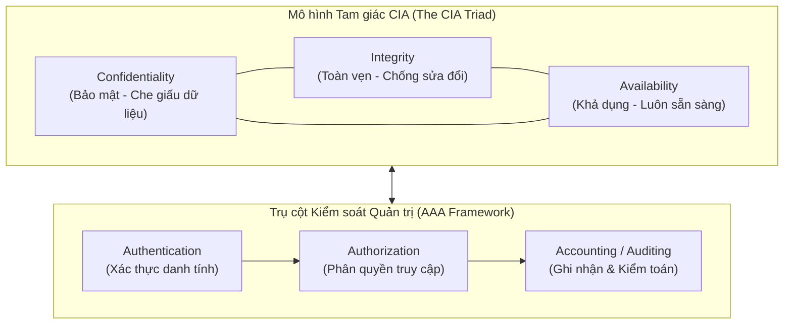
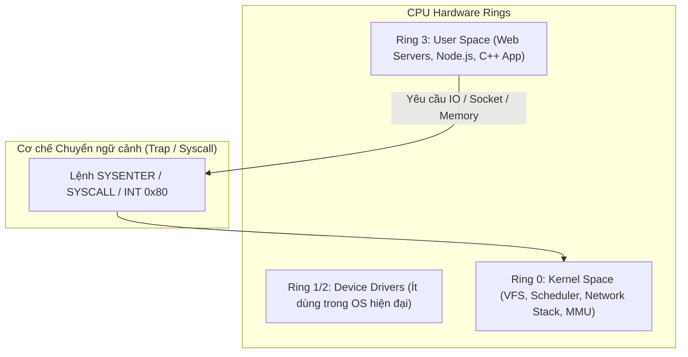
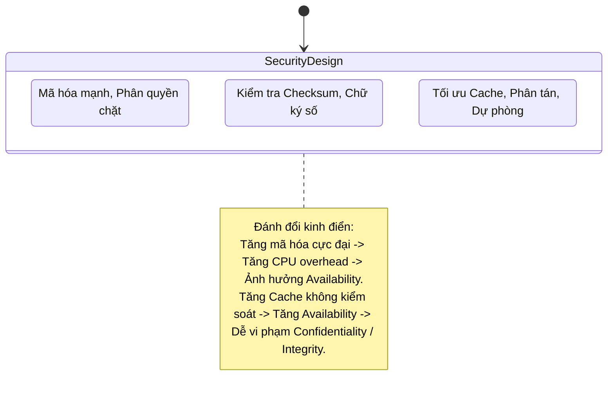
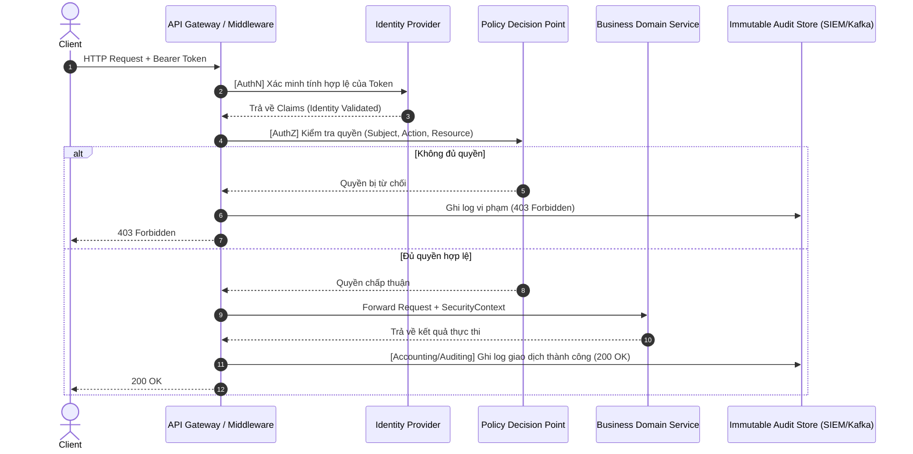
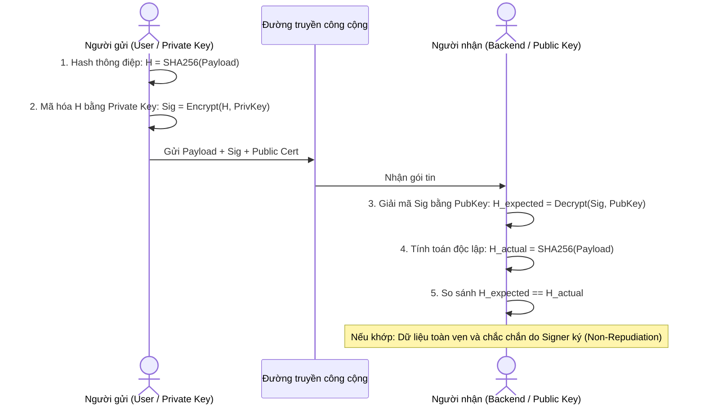

# 1.1. Core Principles and CIA Triad (Nguyên lý Cốt lõi & Tam giác CIA)

## Tổng quan về Security Fundamentals
Trong kỹ thuật phần mềm và kiến trúc hệ thống Backend, **Bảo mật máy tính (Computer Security)** không đơn thuần là việc cài đặt các thư viện mã hóa hay kiểm tra token. Đó là một môn khoa học có tính hệ thống nhằm bảo vệ tính toán, lưu trữ, truyền tải dữ liệu và tài nguyên hệ thống chống lại các hành vi truy cập, sửa đổi, phá hoại trái phép hoặc thảm họa ngoài ý muốn.

- **Vấn đề cốt lõi**: Mọi hệ thống máy tính đều tồn tại trong một môi trường có sự đối kháng (Adversarial Environment). Một hệ thống chỉ thực sự an toàn khi chi phí kinh tế và thời gian mà kẻ tấn công (Attacker) phải bỏ ra để bẻ gãy hệ thống vượt xa giá trị của tài sản mà chúng chiếm đoạt được.
- **Bản chất dưới tầng kỹ thuật**: An ninh thông tin đòi hỏi sự phối hợp chặt chẽ từ phần cứng (CPU privilege rings, MMU memory isolation, TPM/Secure Enclave), nhân hệ điều hành (Kernel syscall filters, memory limits, capability systems) cho đến tầng ứng dụng (Memory safety, Cryptographic algorithms, Access Control logic).



---

## 2. Chi tiết từng Keyword (Under-the-Hood Deep Dive)

### 1. Information Security, Computer Security & Cybersecurity Fundamentals

#### 1. Khái niệm bản chất (What & Why)
- **Information Security (InfoSec)**: Khoa học bảo vệ thông tin và các hệ thống thông tin khỏi sự truy cập, sử dụng, tiết lộ, gián đoạn, sửa đổi hoặc phá hủy trái phép. InfoSec bao quát cả dữ liệu vật lý (giấy tờ, tủ hồ sơ) lẫn dữ liệu số.
- **Computer Security**: Tập trung vào việc bảo vệ tính toàn vẹn và an toàn của chính máy tính, bao gồm phần cứng, firmware, hệ điều hành và phần mềm chạy trên đó trước các phần mềm độc hại, khai thác bộ nhớ và can thiệp vật lý.
- **Cybersecurity**: Phạm vi bảo vệ không gian mạng (Cyberspace) – bao gồm mạng máy tính kết nối liên thông, Internet, các dịch vụ đám mây, các thiết bị IoT và các tương tác xuyên biên giới.

#### 2. Cơ chế hoạt động sâu (Under the hood / Hardcore Internals)
Bảo mật hệ thống bắt đầu từ kiến trúc phần cứng máy tính:
- **Ring Architecture (CPU Rings)**: CPU phân cấp mức đặc quyền phần cứng từ Ring 0 (Kernel Space - toàn quyền truy cập thanh ghi điều khiển, trang nhớ vật lý, cổng I/O) đến Ring 3 (User Space - ứng dụng người dùng, bị hạn chế qua bảng trang MMU).
- **Memory Protection**: Con trỏ của ứng dụng User-space không bao giờ tham chiếu trực tiếp đến địa chỉ vật lý. MMU (Memory Management Unit) phối hợp với bảng phân trang (Page Tables) của OS Kernel để kích hoạt cờ `U/S` (User/Supervisor), `R/W` (Read/Write) và `NX/XD` (No-Execute / Execute-Disable). Bất kỳ hành vi ghi đè ngoài ranh giới bộ nhớ đều kích hoạt phần cứng sinh ngắt ngoại lệ `#GP` (General Protection Fault) hoặc `#PF` (Page Fault), dẫn tới việc Kernel gửi tín hiệu `SIGSEGV` để tiêu diệt tiến trình.

#### 3. Sơ đồ minh họa (Hardware Privilege Rings & Memory Isolation)


#### 4. Code ví dụ thực chiến (C++ Memory Protection via VirtualAlloc / mprotect)
```cpp
#include <iostream>
#include <sys/mman.h>
#include <unistd.h>
#include <cstring>
#include <cerrno>

// Minh họa việc thiết lập Security Boundary trực tiếp trên RAM bằng POSIX mprotect
int main() {
    size_t pageSize = sysconf(_SC_PAGESIZE);
    
    // 1. Cấp phát trang nhớ có căn chỉnh (Page-aligned memory)
    void* buffer = nullptr;
    if (posix_memalign(&buffer, pageSize, pageSize) != 0) {
        std::cerr << "Memory allocation failed: " << strerror(errno) << "\n";
        return 1;
    }

    // 2. Ghi thông tin nhạy cảm (Private Key / API Secret)
    std::strcpy(static_cast<char*>(buffer), "SUPER_SECRET_PAYMENT_PRIVATE_KEY");
    std::cout << "Data written: " << static_cast<char*>(buffer) << "\n";

    // 3. Khóa quyền truy cập bộ nhớ: PROT_NONE (Không cho Đọc, Ghi, Thực thi)
    // Dưới tầng Kernel, cờ Page Table Entry bị tước quyền
    if (mprotect(buffer, pageSize, PROT_NONE) != 0) {
        std::cerr << "mprotect PROT_NONE failed: " << strerror(errno) << "\n";
        return 1;
    }

    std::cout << "Page memory locked with PROT_NONE. Attempting read will trigger SIGSEGV.\n";

    // 4. Mở lại quyền PROT_READ khi cần tiêu thụ an toàn
    if (mprotect(buffer, pageSize, PROT_READ) != 0) {
        std::cerr << "mprotect restore failed: " << strerror(errno) << "\n";
        return 1;
    }
    std::cout << "Safe Read after authorization: " << static_cast<char*>(buffer) << "\n";

    // Dọn dẹp và giải phóng
    mprotect(buffer, pageSize, PROT_READ | PROT_WRITE);
    free(buffer);
    return 0;
}
```

#### 5. Ưu / Nhược điểm, Pitfalls & Anti-patterns
- **Pitfall**: Nhầm lẫn giữa "Mã hóa một chiều" và "Bảo mật toàn diện". Nhà phát triển backend thường chỉ hash mật khẩu nhưng để lộ API token trong RAM không được zero-fill sau khi sử dụng, khiến attacker có thể dump memory qua `/proc/$PID/mem` hoặc core dump.
- **Anti-pattern**: Ứng dụng Backend chạy trực tiếp dưới quyền `root` (UID 0), vô hiệu hóa hoàn toàn hàng rào phân quyền User-space.

#### 6. Ứng dụng thực tế trong Backend / Systems
Trong kiến trúc Cloud-native và Microservices, việc hiểu rõ Computer Security giúp triển khai Linux Hardening, chạy Docker containers dưới quyền Non-root user, kích hoạt AppArmor/SELinux profiles và cấu hình Read-Only Root Filesystem.

---

### 2. CIA Triad: Confidentiality, Integrity & Availability

#### 1. Khái niệm bản chất (What & Why)
**CIA Triad** là mô hình nền tảng cấu thành mọi tiêu chuẩn bảo mật trên thế giới:
- **Confidentiality (Tính Bảo mật / Bí mật)**: Đảm bảo dữ liệu chỉ được tiếp cận bởi các chủ thể (Users, Services, Processes) đã được cấp quyền hợp lệ. Ngăn chặn việc nghe lén (Sniffing), trích xuất trái phép.
- **Integrity (Tính Toàn vẹn)**: Đảm bảo dữ liệu và mã nguồn không bị sửa đổi, chèn ép hoặc xóa bỏ trái phép trong quá trình lưu trữ (At Rest), xử lý (In Use) hoặc truyền tải (In Transit).
- **Availability (Tính Khả dụng)**: Đảm bảo hệ thống và dữ liệu luôn sẵn sàng phục vụ khi các đối tượng hợp lệ yêu cầu. Khả năng chống chịu trước lỗi phần cứng, nghẽn mạng và tấn công từ chối dịch vụ (DoS/DDoS).

#### 2. Cơ chế hoạt động sâu (Under the hood / Hardcore Internals)
- **Bảo mật (C)**: Được hiện thực ở tầng toán học bởi mã hóa đối xứng (AES-256-GCM, ChaCha20) và bất đối xứng (RSA, ECC), kết hợp cách ly bộ nhớ ảo (Virtual Memory isolation via CR3 register trong x86-64).
- **Toàn vẹn (I)**: Dựa trên các hàm băm mật mã học (Cryptographic Hashes như SHA-256, BLAKE3) và mã xác thực thông điệp (HMAC, Digital Signatures). Nếu một bit dữ liệu bị lật trong gói tin mạng, giá trị hash sẽ biến đổi hoàn toàn (Avalanche effect), khiến kernel drop gói tin ngay tại tầng NIC hoặc TLS layer.
- **Khả dụng (A)**: Được đảm bảo thông qua kỹ thuật cân bằng tải đa tầng (L4/L7 Load Balancing), kiến trúc vô trạng thái (Stateless services), cơ chế tự phục hồi (Kubernetes ReplicaSets), Rate Limiting và Circuit Breaker.

#### 3. Sơ đồ minh họa (Mối quan hệ đánh đổi trong CIA)


#### 4. Code ví dụ thực chiến (TypeScript Constant-Time Verification for Integrity)
```typescript
import * as crypto from 'crypto';

/**
 * Xác thực tính toàn vẹn của dữ liệu bằng HMAC-SHA256 với thuật toán so sánh thời gian bất biến (Constant-Time)
 * Ngăn chặn hoàn toàn Timing Attacks nhằm phá vỡ tính toàn vẹn (Integrity).
 */
export class IntegrityValidator {
    private readonly secretKey: Buffer;

    constructor(secretHex: string) {
        this.secretKey = Buffer.from(secretHex, 'hex');
    }

    public generateHMAC(payload: string): string {
        return crypto
            .createHmac('sha256', this.secretKey)
            .update(payload, 'utf8')
            .digest('hex');
    }

    public verifyIntegrity(payload: string, receivedHmacHex: string): boolean {
        const computedHmacHex = this.generateHMAC(payload);
        
        const computedBuffer = Buffer.from(computedHmacHex, 'hex');
        const receivedBuffer = Buffer.from(receivedHmacHex, 'hex');

        // Độ dài khác nhau => Không hợp lệ ngay lập tức
        if (computedBuffer.length !== receivedBuffer.length) {
            return false;
        }

        // crypto.timingSafeEqual thực thi so sánh O(N) chu kỳ xung nhịp bất kể điểm sai lệch,
        // ngăn chặn kẻ tấn công suy đoán byte bằng độ trễ phản hồi mạng (Microsecond latency).
        return crypto.timingSafeEqual(computedBuffer, receivedBuffer);
    }
}
```

#### 5. Ưu / Nhược điểm, Pitfalls & Anti-patterns
- **Pitfall**: Coi nhẹ một trong ba đỉnh tam giác. Ví dụ, thiết lập chính sách khóa tài khoản quá nghiêm ngặt để bảo vệ C và I (sai mật khẩu 3 lần khóa vĩnh viễn IP) sẽ bị kẻ tấn công lợi dụng để DoS toàn bộ người dùng thực (phá vỡ tính Availability).
- **Anti-pattern**: Dùng toán tử `===` hoặc hàm `strcmp` thông thường để so sánh Hash hoặc Token chữ ký.

#### 6. Ứng dụng thực tế trong Backend / Systems
Thiết kế kiến trúc thanh toán phân tán: Dữ liệu thẻ tín dụng được mã hóa field-level (Confidentiality), mỗi giao dịch kèm chữ ký số HMAC kiểm soát trạng thái không bị sửa đổi (Integrity), và dịch vụ được chạy Active-Active đa vùng trên Cloud kèm Autoscaling (Availability).

---

### 3. AAA Framework: Authentication, Authorization, Accounting & Auditing

#### 1. Khái niệm bản chất (What & Why)
- **Authentication (Xác thực - AuthN)**: "Bạn là ai?" – Quá trình kiểm chứng danh tính của một thực thể (User, API Client, Daemon service) dựa trên các bằng chứng số (Credentials).
- **Authorization (Phân quyền - AuthZ)**: "Bạn được phép làm gì?" – Xác định các hành động cụ thể mà một danh tính đã xác thực được phép thực hiện trên tài nguyên mục tiêu.
- **Accounting & Auditing (Ghi nhận & Kiểm toán)**: "Bạn đã làm gì, vào thời điểm nào, và kết quả ra sao?" – Đo lường việc tiêu thụ tài nguyên và ghi lại nhật ký (Log/Audit Trail) bất biến phục vụ việc truy vết, đối soát pháp lý và phát hiện xâm nhập.

#### 2. Cơ chế hoạt động sâu (Under the hood / Hardcore Internals)
- **Chuỗi thực thi (Execution Pipeline)** trong Web/API Framework:
  1. Gói tin TCP/HTTP đi qua Network Layer -> TLS Termination.
  2. Middleware AuthN: Trích xuất `Authorization: Bearer <token>`, giải mã và xác thực chữ ký số bằng thuật toán CPU/Crypto. Gắn `SecurityContext` (User ID, Tenant ID, Roles) vào đối tượng Request.
  3. Middleware AuthZ: Đọc Resource Identifier và Action (ví dụ: `POST /api/v1/orders`), đối chiếu với chính sách (RBAC/ABAC matrix). Nếu từ chối, trả về HTTP `403 Forbidden` ngay lập tức, ngắt luồng gọi vào Controller/Service logic.
  4. Interceptor Auditing: Sau khi xử lý xong (kể cả thành công hay lỗi), ghi một dòng log có định dạng JSON/Protobuf chứa: `Timestamp`, `ActorID`, `Action`, `Resource`, `ClientIP`, `StatusCode`, `CorrelationID`. Dữ liệu này được đẩy vào socket UDP/TCP tới Daemon log cục bộ hoặc Kafka stream.

#### 3. Sơ đồ minh họa (Luồng xử lý AAA trong Backend Pipeline)


#### 4. Code ví dụ thực chiến (C++ Structured Audit Logger with Monotonic Clock)
```cpp
#include <iostream>
#include <string>
#include <chrono>
#include <sstream>
#include <iomanip>

struct AuditEvent {
    std::string actorId;
    std::string action;
    std::string resource;
    int statusCode;
    std::string ipAddress;
};

class SecurityAuditLogger {
public:
    static void log(const AuditEvent& event) {
        // Sử dụng std::chrono::system_clock để lấy mốc thời gian thực chuẩn UTC
        auto now = std::chrono::system_clock::now();
        auto in_time_t = std::chrono::system_clock::to_time_t(now);
        auto ms = std::chrono::duration_cast<std::chrono::milliseconds>(now.time_since_epoch()) % 1000;

        std::stringstream ss;
        ss << std::put_time(std::gmtime(&in_time_t), "%Y-%m-%dT%H:%M:%S");
        ss << '.' << std::setfill('0') << std::setw(3) << ms.count() << "Z";

        // Ghi log dưới dạng JSON dòng (NDJSON) phù hợp với chuẩn ingestion của SIEM (Splunk, Elastic)
        std::cout << "{\"timestamp\":\"" << ss.str() << "\","
                  << "\"event_type\":\"AUDIT_LOG\","
                  << "\"actor_id\":\"" << event.actorId << "\","
                  << "\"action\":\"" << event.action << "\","
                  << "\"resource\":\"" << event.resource << "\","
                  << "\"status\":" << event.statusCode << ","
                  << "\"source_ip\":\"" << event.ipAddress << "\"}\n";
    }
};

int main() {
    AuditEvent event{
        .actorId = "usr_01HXYZ89ABC",
        .action = "PAYMENT_REFUND_EXECUTE",
        .resource = "txn_987654321",
        .statusCode = 200,
        .ipAddress = "192.168.1.15"
    };

    SecurityAuditLogger::log(event);
    return 0;
}
```

#### 5. Ưu / Nhược điểm, Pitfalls & Anti-patterns
- **Pitfall**: Ghi đè log kiểm toán hoặc lưu trữ log trực tiếp trên local disk của web server mà không đẩy ra external collector. Khi server bị thỏa hiệp, attacker chỉ cần chạy lệnh `rm -rf /var/log/*` hoặc sửa file log để xóa sạch dấu vết.
- **Anti-pattern**: Ghi cả mật khẩu dạng plaintext, mã thẻ tín dụng CVV hoặc private key vào audit logs (vi phạm nghiêm trọng PCI-DSS và GDPR).

#### 6. Ứng dụng thực tế trong Backend / Systems
Mọi hệ thống ngân hàng, fintech và core backend bắt buộc phải phân tách rạch ròi ba tầng: Database user của ứng dụng chỉ có quyền `INSERT` vào bảng `audit_events`, không bao giờ được cấp quyền `UPDATE` hoặc `DELETE` (Append-only storage).

---

### 4. Non-Repudiation, Accountability & Privacy

#### 1. Khái niệm bản chất (What & Why)
- **Non-Repudiation (Tính Không thể Chối bỏ)**: Cơ chế kỹ thuật đảm bảo rằng một bên tham gia giao dịch không thể phủ nhận tính xác thực của thông điệp hoặc chữ ký số mà họ đã phát hành.
- **Accountability (Tính Trách nhiệm Giải trình)**: Khả năng quy trách nhiệm một hành vi hoặc biến cố an ninh cụ thể cho một cá nhân hoặc quy trình duy nhất trong hệ thống thông qua định danh, phân quyền và nhật ký kiểm toán.
- **Privacy (Quyền Riêng tư Số)**: Quyền của cá nhân được kiểm soát cách thức thông tin nhận dạng cá nhân (PII) của họ được thu thập, lưu trữ, xử lý, chia sẻ và tiêu hủy theo các khung pháp lý (GDPR, CCPA, HIPAA).

#### 2. Cơ chế hoạt động sâu (Under the hood / Hardcore Internals)
- **Chữ ký số bất đối xứng (Asymmetric Cryptography)** là xương sống của tính Không thể chối bỏ. Khi Client gửi một giao dịch:
  $$\text{Signature} = \text{Sign}_{PrivKey}(\text{Hash}(Data))$$
  Chỉ duy nhất người sở hữu Private Key (được lưu an toàn trong phần cứng HSM, YubiKey hoặc Apple Secure Enclave) mới có thể tạo ra `Signature` này. Bất kỳ ai sở hữu Public Key tương ứng đều có thể xác minh được:
  $$\text{Verify}_{PubKey}(Data, \text{Signature}) \in \{True, False\}$$
- Nếu hệ thống dùng Symmetric Key (HMAC shared secret) giữa Server và Client, tính Không thể chối bỏ **không được đảm bảo hoàn toàn** trước tòa án, vì Server cũng sở hữu secret key đó và về lý thuyết Server hoàn toàn có thể tự giả mạo thông điệp.

#### 3. Sơ đồ minh họa (Mô hình chữ ký số đảm bảo Non-Repudiation)


#### 4. Code ví dụ thực chiến (TypeScript Ed25519 Digital Signature & Verification)
```typescript
import * as crypto from 'crypto';

// Sử dụng thuật toán đường cong Elliptic Ed25519 hiện đại, bảo mật cao và chống side-channel
export class NonRepudiationSigner {
    // Tạo cặp khóa định danh
    public static generateKeyPair() {
        return crypto.generateKeyPairSync('ed25519', {
            publicKeyEncoding: { type: 'spki', format: 'pem' },
            privateKeyEncoding: { type: 'pkcs8', format: 'pem' }
        });
    }

    // Ký thông điệp giao dịch bằng Private Key
    public static signTransaction(transactionPayload: string, privateKeyPem: string): string {
        const sign = crypto.createSign(undefined); // Ed25519 ngầm định thuật toán băm nội tại
        sign.update(Buffer.from(transactionPayload, 'utf8'));
        return sign.sign(privateKeyPem, 'base64');
    }

    // Xác thực tính Không thể chối bỏ bằng Public Key
    public static verifyTransaction(
        transactionPayload: string,
        signatureBase64: string,
        publicKeyPem: string
    ): boolean {
        const verify = crypto.createVerify(undefined);
        verify.update(Buffer.from(transactionPayload, 'utf8'));
        return verify.verify(publicKeyPem, signatureBase64, 'base64');
    }
}

// Minh họa thực thi
const { privateKey, publicKey } = NonRepudiationSigner.generateKeyPair();
const txData = JSON.stringify({ transferId: "tx_102938", from: "Alice", to: "Bob", amount: 5000 });

const signature = NonRepudiationSigner.signTransaction(txData, privateKey);
const isValid = NonRepudiationSigner.verifyTransaction(txData, signature, publicKey);

console.log("Transaction Signature:", signature);
console.log("Non-Repudiation Verified:", isValid); // True
```

#### 5. Ưu / Nhược điểm, Pitfalls & Anti-patterns
- **Pitfall**: Đăng nhập bằng tài khoản dùng chung (Shared Accounts như `admin`, `support`). Khi xảy ra rò rỉ dữ liệu, cơ chế Accountability bị vô hiệu hóa vì không thể chứng minh cá nhân cụ thể nào đã thực hiện hành vi.
- **Anti-pattern**: Lưu trữ PII của người dùng (Email, Số điện thoại, Địa chỉ) dưới dạng plaintext trong Database không có chính sách mã hóa phân tầng hoặc mặt nạ dữ liệu (Data Masking).

#### 6. Ứng dụng thực tế trong Backend / Systems
Trong các dịch vụ Banking Gateway và Blockchain Smart Contracts, mọi giao dịch tài chính bắt buộc phải đính kèm chữ ký Ed25519 hoặc ECDSA từ Client để phục vụ đối soát pháp lý, giải quyết tranh chấp (Dispute resolution) và tuân thủ các quy định ngân hàng trung ương.
