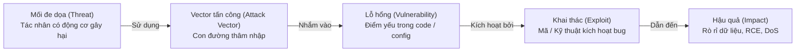
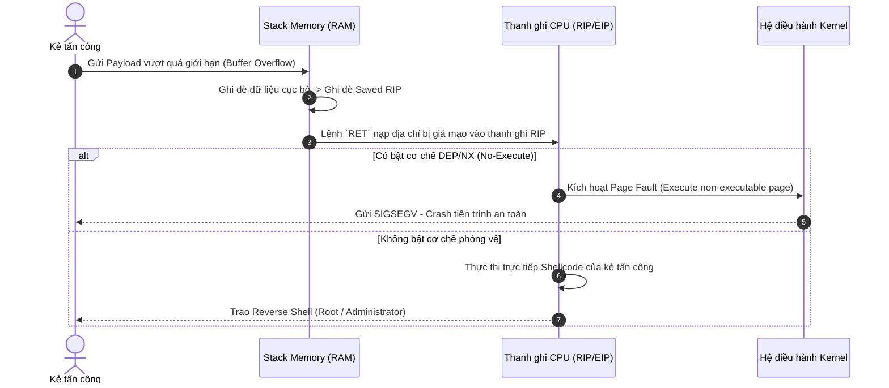
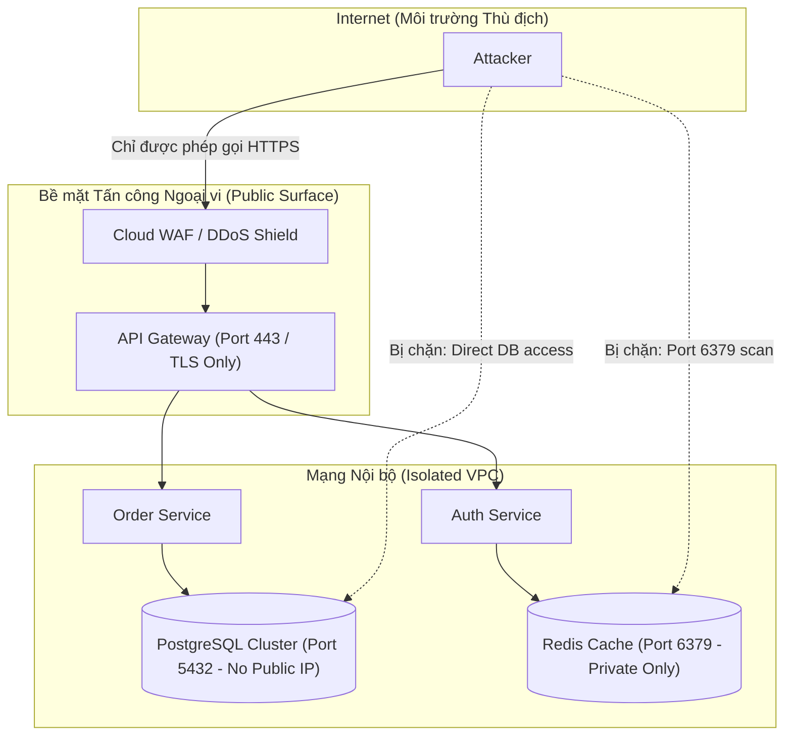
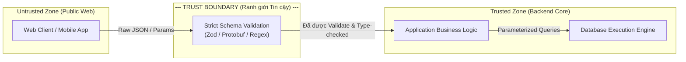

# 1.2. Threats, Vulnerabilities, and Attack Surfaces (Mối đe dọa, Lỗ hổng & Bề mặt Tấn công)

## Tổng quan về Phân tích Rủi ro & Bề mặt Tấn công
Trong mô hình kỹ thuật phần mềm hướng bảo mật, việc hiểu rõ sự khác biệt giữa **Mối đe dọa (Threat)**, **Lỗ hổng (Vulnerability)** và **Khai thác (Exploit)** là điều kiện tiên quyết để xây dựng các hàng rào phòng thủ. Một hệ thống an toàn không phải là một hệ thống không có bug, mà là một hệ thống kiểm soát chặt chẽ bề mặt tấn công (Attack Surface) và thiết lập các ranh giới tin cậy (Trust Boundaries) không thể bị xuyên thủng.



---

## 2. Chi tiết từng Keyword (Under-the-Hood Deep Dive)

### 1. Threat, Vulnerability, Exploit & Attack

#### 1. Khái niệm bản chất (What & Why)
- **Threat (Mối đe dọa)**: Bất kỳ sự cố tiềm tàng nào (do con người cố ý, phần mềm độc hại, lỗi vận hành hoặc thiên tai) có thể gây tổn hại đến hệ thống thông tin hoặc vi phạm tam giác CIA. Ví dụ: Kẻ gian muốn đánh cắp cơ sở dữ liệu khách hàng.
- **Vulnerability (Lỗ hổng bảo mật)**: Điểm yếu, khiếm khuyết trong thiết kế kiến trúc, mã nguồn, cấu hình hệ thống hoặc quy trình vận hành mà kẻ tấn công có thể lợi dụng. Ví dụ: Câu truy vấn SQL nối chuỗi trực tiếp (SQL Injection) hoặc biến con trỏ bị giải phóng hai lần (Double Free).
- **Exploit (Mã khai thác / Hành vi khai thác)**: Một chuỗi lệnh, đoạn code hoặc dữ liệu đầu vào đặc thù được thiết kế để kích hoạt lỗ hổng bảo mật, biến lỗi phần mềm thành quyền kiểm soát thực tế hoặc rò rỉ dữ liệu.
- **Attack (Cuộc tấn công)**: Hành động chủ động của kẻ tấn công nhằm thực thi mã khai thác, xuyên phá rào chắn bảo mật và chiếm quyền kiểm soát hệ thống.

#### 2. Cơ chế hoạt động sâu (Under the hood / Hardcore Internals)
Xét về bản chất thực thi dưới tầng máy tính:
- Một **Lỗ hổng tràn bộ đệm (Buffer Overflow)** xuất hiện khi một hàm như `strcpy()` sao chép dữ liệu từ User Space vào một mảng trên Call Stack mà không kiểm tra kích thước.
- **Cấu trúc Stack Frame**:
  ```text
  [ Lower Address ]
  Local Variables (Buffer[64])  <--- Dữ liệu ghi đè bắt đầu từ đây
  Saved Frame Pointer (EBP/RBP) <--- Bị ghi đè bằng rác
  Saved Return Address (EIP/RIP)<--- Bị ghi đè trỏ tới địa chỉ Shellcode độc hại
  Arguments
  [ Higher Address ]
  ```
- **Exploit**: Kẻ tấn công gửi vào input một chuỗi gồm 64 byte padding + 8 byte ghi đè RBP + 8 byte địa chỉ mới. Khi hàm thực thi lệnh `RET` (Return), CPU x86-64 sẽ nạp địa chỉ độc hại từ đỉnh stack vào thanh ghi chỉ lệnh `RIP` (Instruction Pointer), khiến CPU chuyển sang thực thi shellcode của hacker thay vì quay về luồng chính.

#### 3. Sơ đồ minh họa (Chu trình khai thác lỗ hổng bộ nhớ)


#### 4. Code ví dụ thực chiến (C++ Stack Protection & Safe Memory Copy)
```cpp
#include <iostream>
#include <string_view>
#include <array>
#include <cstring>
#include <stdexcept>

// Minh họa việc ngăn chặn lỗ hổng tràn bộ đệm thông qua C++ Bounds Checking
class SafeBufferWriter {
public:
    static constexpr size_t BUFFER_SIZE = 64;

    // PHƯƠNG THỨC NGUY HIỂM (Vulnerability): Dùng hàm C kinh điển không kiểm soát biên
    static void vulnerableCopy(const char* untrustedInput) {
        char insecureStackBuffer[BUFFER_SIZE];
        // strcpy không kiểm tra kích thước đầu vào -> Khai thác Buffer Overflow
        // strcpy(insecureStackBuffer, untrustedInput); // Nguy cơ RCE nghiêm trọng
    }

    // PHƯƠNG THỨC AN TOÀN (Remediated): Kiểm tra biên nghiêm ngặt ở compile-time & runtime
    static void secureCopy(std::string_view untrustedInput) {
        std::array<char, BUFFER_SIZE> secureStackBuffer{};

        if (untrustedInput.size() >= secureStackBuffer.size()) {
            throw std::length_error("Security Alert: Input exceeds stack buffer boundary!");
        }

        // Sao chép an toàn kèm null-terminator
        std::memcpy(secureStackBuffer.data(), untrustedInput.data(), untrustedInput.size());
        secureStackBuffer[untrustedInput.size()] = '\0';

        std::cout << "Data safely written: " << secureStackBuffer.data() << "\n";
    }
};

int main() {
    try {
        std::string_view safeInput = "Hello, Secure Backend!";
        SafeBufferWriter::secureCopy(safeInput);

        // Kẻ tấn công cố tình gửi payload lớn vượt biên
        std::string maliciousInput(128, 'A');
        SafeBufferWriter::secureCopy(maliciousInput);
    } catch (const std::exception& e) {
        std::cerr << "Defense Triggered: " << e.what() << "\n";
    }
    return 0;
}
```

#### 5. Ưu / Nhược điểm, Pitfalls & Anti-patterns
- **Pitfall**: Chỉ dựa vào cơ chế lọc chuỗi sơ sài (Blacklisting/Sanitization bằng Regex) thay vì triệt tiêu hoàn toàn lỗ hổng bằng kiến trúc an toàn (Parameterized Queries, Memory bounds checks).
- **Anti-pattern**: Tắt các cờ biên dịch bảo vệ như `-fstack-protector-strong`, `-D_FORTIFY_SOURCE=2`, hoặc tắt ASLR (Address Space Layout Randomization) trên server để "tối ưu hiệu năng".

#### 6. Ứng dụng thực tế trong Backend / Systems
Trong quy trình quản trị bảo mật (Vulnerability Management), các lỗ hổng phần mềm được định danh chuẩn hóa bằng mã **CVE (Common Vulnerabilities and Exposures)** và đo lường mức độ nghiêm trọng bằng thang điểm **CVSS (Common Vulnerability Scoring System)** từ 0.0 đến 10.0 để ưu tiên bản vá (Patching).

---

### 2. Attack Surface & Attack Vector

#### 1. Khái niệm bản chất (What & Why)
- **Attack Surface (Bề mặt Tấn công)**: Tổng hợp tất cả các điểm chạm, đường dẫn, cổng mạng, API endpoints, file uploads, giao thức và dịch vụ mà một kẻ tấn công bên ngoài hoặc nội bộ có thể tiếp cận để cố gắng xâm nhập vào hệ thống.
  - *Mục tiêu kỹ thuật*: Thu hẹp tối đa bề mặt tấn công (**Minimizing Attack Surface**).
- **Attack Vector (Vector Tấn công)**: Con đường hoặc phương tiện cụ thể mà kẻ tấn công sử dụng để truyền tải mã độc hoặc tiếp cận lỗ hổng. Ví dụ: Phishing email, Cổng SSH mở ra Internet công cộng, SQL Injection qua query param, hay lỗ hổng thư viện phụ thuộc của bên thứ ba (Supply chain vector).

#### 2. Cơ chế hoạt động sâu (Under the hood / Hardcore Internals)
Khi một backend service khởi chạy:
- Mỗi socket lắng nghe (Listen socket) mở ra một cổng TCP/UDP trên hệ điều hành (`bind()` + `listen()`). Nếu ứng dụng bind vào địa chỉ `0.0.0.0` thay vì `127.0.0.1`, cổng đó sẽ mở ra cho toàn bộ mạng nội bộ và Internet, trực tiếp mở rộng Attack Surface.
- Các API endpoints không có xác thực (Unauthenticated routes), các debug endpoints (ví dụ: `/actuator`, `/__debug__`, `phpinfo.php`) do lập trình viên quên xóa khi deploy production đều cấu thành các Attack Vectors trọng yếu.

#### 3. Sơ đồ minh họa (Phân tích Bề mặt tấn công hệ thống Microservices)


#### 4. Code ví dụ thực chiến (TypeScript Thu hẹp Attack Surface trong HTTP Server)
```typescript
import express, { Request, Response, NextFunction } from 'express';
import helmet from 'helmet';

const app = express();

// 1. Thu hẹp Attack Surface bằng cách thiết lập HTTP Security Headers nghiêm ngặt
app.use(helmet());

// 2. Chặn các phương thức HTTP không được hỗ trợ (Method Restriction)
const allowedMethods = ['GET', 'POST', 'PUT', 'DELETE'];
app.use((req: Request, res: Response, next: NextFunction) => {
    if (!allowedMethods.includes(req.method)) {
        return res.status(405).json({ error: "Method Not Allowed" });
    }
    next();
});

// 3. Giới hạn Payload Size để chống tấn công DoS / Memory Exhaustion Attack Vector
app.use(express.json({ limit: '10kb' }));

// 4. Tuyệt đối không để lộ thông tin phiên bản Framework (Information Disclosure)
app.disable('x-powered-by');

app.get('/api/v1/health', (req: Request, res: Response) => {
    res.status(200).json({ status: 'HEALTHY' });
});

// Lắng nghe DUY NHẤT trên Private Loopback Interface nếu đứng sau Reverse Proxy
const HOST = process.env.NODE_ENV === 'production' ? '127.0.0.1' : '0.0.0.0';
const PORT = 3000;

app.listen(PORT, HOST, () => {
    console.log(`Server strictly bound to ${HOST}:${PORT} to minimize attack surface.`);
});
```

#### 5. Ưu / Nhược điểm, Pitfalls & Anti-patterns
- **Pitfall**: Để lộ các cổng Database (PostgreSQL 5432, MySQL 3306, MongoDB 27017) hoặc Cache (Redis 6379) ra ngoài Public IP với mật khẩu mặc định hoặc không mật khẩu.
- **Anti-pattern**: Mở toàn bộ dải cổng (`0.0.0.0/0`) trong Security Groups của Cloud Provider (AWS EC2 / GCP Firewall) để "tiện debug".

#### 6. Ứng dụng thực tế trong Backend / Systems
Triển khai kỹ thuật **Port Scanning định kỳ** bằng Nmap/Masscan trong CI/CD pipeline để quét chính hạ tầng nội bộ, đảm bảo không có bất kỳ service nào vô tình mở thêm cổng lạ ra Internet.

---

### 3. Security Boundary & Trust Boundary

#### 1. Khái niệm bản chất (What & Why)
- **Security Boundary (Ranh giới Bảo mật)**: Đường ranh giới kỹ thuật phân tách giữa hai ngữ cảnh thực thi có mức độ đặc quyền khác nhau, được cưỡng chế bởi phần cứng hoặc OS Kernel (ví dụ: Kernel Space vs User Space, Container vs Host, Virtual Machine vs Hypervisor).
- **Trust Boundary (Ranh giới Tin cậy)**: Điểm giao thoa trong kiến trúc phần mềm nơi luồng dữ liệu di chuyển từ một vùng có mức độ tin cậy thấp (Untrusted Zone - ví dụ: Dữ liệu gửi lên từ trình duyệt người dùng) sang một vùng có mức độ tin cậy cao hơn (Trusted Zone - ví dụ: Database nội bộ).
  - *Quy tắc vàng*: Mọi dữ liệu đi xuyên qua Trust Boundary **bắt buộc phải được kiểm tra (Validate), làm sạch (Sanitize) và xác thực (Authenticate)**. Không bao giờ tin tưởng dữ liệu từ bên kia ranh giới.

#### 2. Cơ chế hoạt động sâu (Under the hood / Hardcore Internals)
- **Hardware Isolation**: Intel VT-x / AMD-V cung cấp các lệnh `VMCALL`, `VMXON`, `VMXOFF` để thiết lập Security Boundary giữa Hypervisor (Ring -1) và Máy ảo khách (Guest VM). Nếu một tiến trình trong máy ảo bị crash hoặc bị hack, nó không thể vượt qua ranh giới phần cứng để đọc RAM của máy ảo láng giềng.
- **Process Isolation**: Mỗi tiến trình trên Linux có một không gian địa chỉ ảo 64-bit độc lập (`mm_struct` trong Kernel). Hai tiến trình không thể đọc trộm bộ nhớ của nhau trừ khi chủ động chia sẻ qua IPC (Shared Memory) có phân quyền `shmget()`.

#### 3. Sơ đồ minh họa (Mô hình Trust Boundary trong Xử lý Dữ liệu Backend)


#### 4. Code ví dụ thực chiến (TypeScript Schema Enforcement at Trust Boundary)
```typescript
import { z } from 'zod';

// Định nghĩa hợp đồng dữ liệu nghiêm ngặt tại Trust Boundary
const CreateUserTransferSchema = z.object({
    recipientId: z.string().uuid({ message: "Invalid Recipient UUID format" }),
    amountInCents: z.number().int().positive({ message: "Amount must be a positive integer" }).max(100_000_000), // Max $1,000,000
    currency: z.enum(['USD', 'EUR', 'VND']),
    idempotencyKey: z.string().min(16).max(64)
}).strict(); // Từ chối tất cả các trường lạ (Chống Mass Assignment Attack)

export type CreateUserTransferDTO = z.infer<typeof CreateUserTransferSchema>;

export class TrustBoundaryGateway {
    // Phương thức nằm tại cửa ngõ Trust Boundary
    public static sanitizeAndValidate(rawPayload: unknown): CreateUserTransferDTO {
        const parseResult = CreateUserTransferSchema.safeParse(rawPayload);

        if (!parseResult.success) {
            // Ghi log cảnh báo dữ liệu không hợp lệ vượt qua ranh giới
            const issues = parseResult.error.format();
            throw new Error(`Trust Boundary Violation: ${JSON.stringify(issues)}`);
        }

        // Dữ liệu an toàn được đẩy vào tầng nghiệp vụ bên trong
        return parseResult.data;
    }
}
```

#### 5. Ưu / Nhược điểm, Pitfalls & Anti-patterns
- **Pitfall**: Xem "Mạng nội bộ (Internal Network)" là vùng hoàn toàn tin cậy (Implicit Trust). Khi kẻ tấn công thâm nhập được một service phụ qua phishing hoặc SSRF, chúng sẽ dễ dàng di chuyển ngang (Lateral Movement) và khai thác toàn bộ database vì bên trong không có cơ chế xác thực nội bộ.
- **Anti-pattern**: Thực hiện validate dữ liệu ở Client (JavaScript trên Browser) nhưng bỏ qua validate ở Backend Controller với suy nghĩ "Frontend đã check rồi".

#### 6. Ứng dụng thực tế trong Backend / Systems
Nền tảng của mô hình **Zero Trust Architecture (ZTA)**: Xóa bỏ hoàn toàn khái niệm "mạng nội bộ đáng tin cậy". Mọi lời gọi dịch vụ giữa các Microservices (Service-to-Service) đều phải đi qua Trust Boundary, yêu cầu mã hóa đường truyền mTLS và xác thực định danh qua Spiffe/Spire hoặc JWT.
