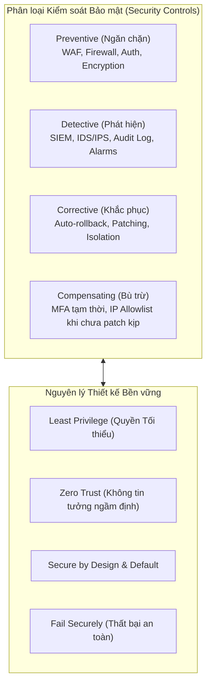
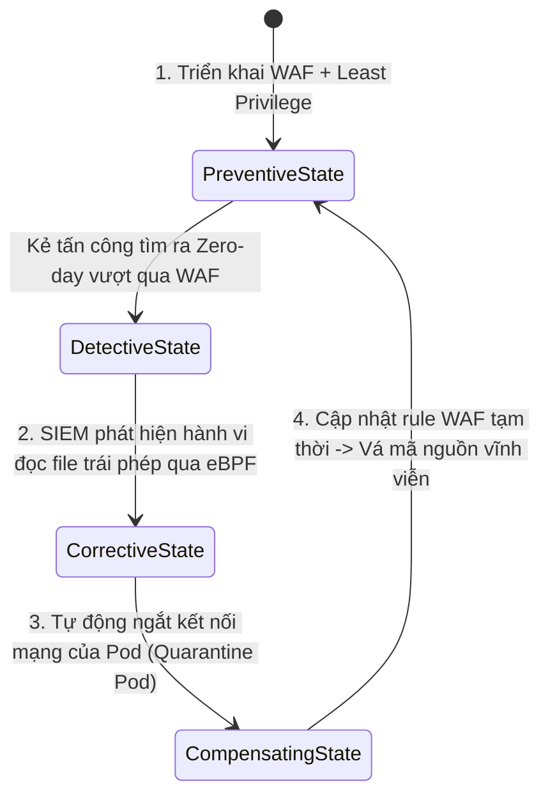
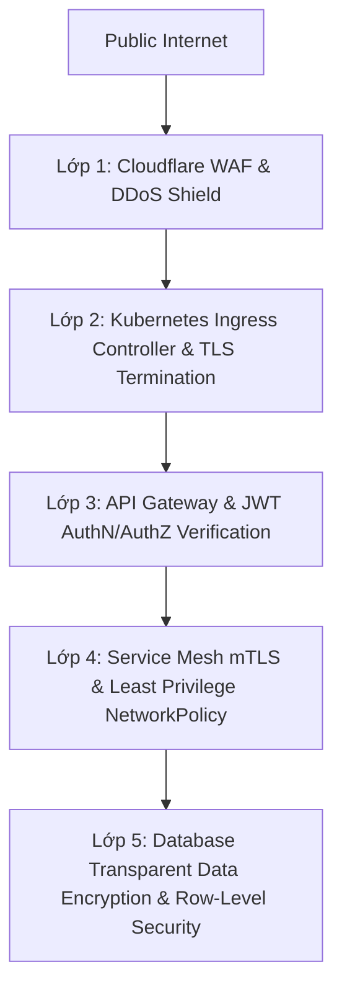
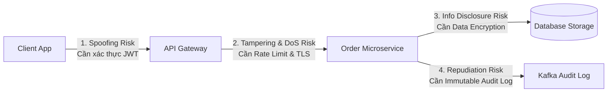

# 1.3. Security Architecture and Defense Controls (Kiến trúc Bảo mật & Các Cơ chế Kiểm soát Phòng vệ)

## Tổng quan về Kiến trúc Phòng thủ Đa tầng
Trong thiết kế hệ thống phân tán và backend hiện đại, không có một công nghệ đơn lẻ nào có thể bảo vệ hệ thống tuyệt đối. Kiến trúc bảo mật là sự kết hợp chặt chẽ giữa **Chính sách (Policies)**, **Mô hình hóa Mối đe dọa (Threat Modeling)**, **Đánh giá Rủi ro (Risk Management)** và **Phòng thủ Đa tầng (Defense in Depth)**. 

Hệ thống phải được thiết kế trên nguyên tắc: Sự cố thỏa hiệp (Compromise) là điều chắc chắn sẽ xảy ra; mục tiêu kiến trúc là cô lập phạm vi thiệt hại (Blast Radius), phát hiện tức thời và tự động khôi phục an toàn.



---

## 2. Chi tiết từng Keyword (Under-the-Hood Deep Dive)

### 1. Security Policy & Security Controls (Preventive, Detective, Corrective, Compensating)

#### 1. Khái niệm bản chất (What & Why)
- **Security Policy (Chính sách Bảo mật)**: Bộ quy tắc, tài liệu chuẩn mực và hướng dẫn cấp tổ chức xác định cách thức bảo vệ tài sản thông tin, trách nhiệm người dùng và các hành vi được phép hoặc bị cấm.
- **Security Controls (Các biện pháp kiểm soát an ninh)**: Các cơ chế kỹ thuật, vật lý hoặc hành chính được triển khai nhằm giảm thiểu rủi ro bảo mật:
  - **Preventive Controls (Kiểm soát Ngăn chặn)**: Ngăn chặn chủ động hành vi tấn công xảy ra (ví dụ: Tường lửa, Xác thực MFA, Parameterized queries).
  - **Detective Controls (Kiểm soát Phát hiện)**: Giám sát và cảnh báo khi có biến cố bất thường hoặc hành vi xâm nhập đang diễn ra (ví dụ: Intrusion Detection System - IDS, Phân tích log SIEM, Giám sát file integrity).
  - **Corrective Controls (Kiểm soát Khắc phục)**: Khôi phục trạng thái an toàn sau khi sự cố an ninh được phát hiện (ví dụ: Khôi phục dữ liệu từ bản backup sạch, cô lập máy chủ bị nhiễm, tự động chạy playbook vá lỗi).
  - **Compensating Controls (Kiểm soát Bù trừ)**: Biện pháp thay thế tạm thời khi biện pháp kiểm soát chính không thể áp dụng được (ví dụ: Một dịch vụ legacy không hỗ trợ TLS 1.3 được đặt sau một Reverse Proxy hiện đại để bọc TLS).

#### 2. Cơ chế hoạt động sâu (Under the hood / Hardcore Internals)
Trong kiến trúc Linux Server và Cloud Backend:
- **Preventive**: Được thực thi ở tầng Kernel qua cơ chế `iptables` / `nftables` (drop các gói tin bất thường tại tầng IP packet filter trước khi tiến trình User space nhận được), hoặc qua `seccomp-bpf` (chặn các system call nguy hiểm như `ptrace`, `reboot`).
- **Detective**: Kernel sử dụng công nghệ `eBPF` (Extended Berkeley Packet Filter) để hook trực tiếp vào các hàm Kernel (`sys_enter_execve`, `tcp_v4_connect`) mà không gây suy giảm hiệu năng, ghi nhận mọi hành vi mở shell lạ và đẩy về Daemon cảnh báo Falco/Wazuh.

#### 3. Sơ đồ minh họa (Vòng lặp phối hợp giữa 4 loại Security Controls)


#### 4. Code ví dụ thực chiến (C++ Linux Seccomp BPF Sandbox as Preventive Control)
```cpp
#include <iostream>
#include <unistd.h>
#include <sys/syscall.h>
#include <linux/seccomp.h>
#include <linux/filter.h>
#include <linux/audit.h>
#include <sys/prctl.h>
#include <cstddef>

// Triển khai Preventive Control: Chặn lệnh thực thi shell độc hại bằng Seccomp Filter
void applySeccompFilter() {
    // Ngăn chặn tiến trình con nâng đặc quyền thông qua cờ PR_SET_NO_NEW_PRIVS
    if (prctl(PR_SET_NO_NEW_PRIVS, 1, 0, 0, 0) != 0) {
        perror("PR_SET_NO_NEW_PRIVS failed");
        exit(1);
    }

    // Bộ lọc BPF: Nếu gọi execve (thực thi file nhị phân/shell) -> Tiêu diệt tiến trình ngay lập tức
    struct sock_filter filter[] = {
        // Nạp kiến trúc CPU vào bộ tích lũy
        BPF_STMT(BPF_LD | BPF_W | BPF_ABS, (offsetof(struct seccomp_data, arch))),
        BPF_JUMP(BPF_JMP | BPF_JEQ | BPF_K, AUDIT_ARCH_X86_64, 1, 0),
        BPF_STMT(BPF_RET | BPF_K, SECCOMP_RET_KILL_PROCESS),

        // Nạp số hiệu System Call vào bộ tích lũy
        BPF_STMT(BPF_LD | BPF_W | BPF_ABS, (offsetof(struct seccomp_data, nr))),

        // Kiểm tra nếu syscall là __NR_execve (hàm chạy bash shell) -> KILL
        BPF_JUMP(BPF_JMP | BPF_JEQ | BPF_K, __NR_execve, 0, 1),
        BPF_STMT(BPF_RET | BPF_K, SECCOMP_RET_KILL_PROCESS),

        // Cho phép tất cả các syscall an toàn khác tiếp tục
        BPF_STMT(BPF_RET | BPF_K, SECCOMP_RET_ALLOW),
    };

    struct sock_fprog prog = {
        .len = (unsigned short)(sizeof(filter) / sizeof(filter[0])),
        .filter = filter,
    };

    // Áp dụng bộ lọc Seccomp vào nhân Linux
    if (prctl(PR_SET_SECCOMP, SECCOMP_MODE_FILTER, &prog) != 0) {
        perror("PR_SET_SECCOMP failed");
        exit(1);
    }
    std::cout << "[Security Control] Seccomp BPF Filter active: execve is blocked.\n";
}

int main() {
    applySeccompFilter();

    std::cout << "Normal execution: Calculating balance...\n";

    // Thử nghiệm tấn công: Giả sử hacker inject code gọi execve để spawn bash shell
    std::cout << "Simulating RCE attack: attempting to spawn /bin/sh...\n";
    char* args[] = { (char*)"/bin/sh", nullptr };
    execve(args[0], args, nullptr); // Nhân Linux sẽ gửi SIGSYS/KILL ngay tại đây!

    std::cout << "This line will NEVER be reached!\n";
    return 0;
}
```

#### 5. Ưu / Nhược điểm, Pitfalls & Anti-patterns
- **Pitfall**: Quá phụ thuộc vào Detective Controls (chỉ thu thập log mà không có cảnh báo thời gian thực). Đến khi phát hiện thì dữ liệu đã bị exfiltrate từ nhiều tháng trước.
- **Anti-pattern**: Dùng Compensating Controls thay thế vĩnh viễn cho bản vá lỗi cốt lõi (ví dụ: Chặn IP thay vì fix lỗ hổng SQL Injection trong source code).

#### 6. Ứng dụng thực tế trong Backend / Systems
Trong tiêu chuẩn SOC 2 và ISO 27001, các doanh nghiệp bắt buộc phải có ma trận ánh xạ (Control Matrix) thể hiện rõ ràng hệ thống đã áp dụng Preventive, Detective, Corrective và Compensating Controls như thế nào cho từng danh mục dữ liệu.

---

### 2. Core Security Principles: Defense in Depth, Least Privilege, Zero Trust, Secure by Design & Default, Fail Securely

#### 1. Khái niệm bản chất (What & Why)
- **Defense in Depth (Phòng thủ Chiều sâu)**: Thiết kế hệ thống với nhiều lớp bảo vệ độc lập lồng nhau. Nếu kẻ tấn công xuyên thủng một lớp (ví dụ: WAF), chúng vẫn bị chặn lại bởi các lớp tiếp theo (ví dụ: Network Segmentation, IAM, Database Encryption).
- **Least Privilege (Đặc quyền Tối thiểu)**: Mỗi thực thể (User, Tiến trình, Service Account) chỉ được cấp những quyền hạn tối thiểu tuyệt đối cần thiết để hoàn thành nhiệm vụ và chỉ trong thời gian cần thiết.
- **Zero Trust (Không tin tưởng ngầm định)**: Mô hình kiến trúc hoạt động theo triết lý: "Never Trust, Always Verify" (Không bao giờ tin tưởng, luôn luôn xác thực). Mọi kết nối đều được xem là đến từ mạng thù địch.
- **Secure by Design (Bảo mật ngay từ Thiết kế)**: Tích hợp tư duy bảo mật ngay từ khâu thiết kế kiến trúc phần mềm, không phải "chắp vá" tính năng bảo mật sau khi code xong.
- **Secure by Default (Bảo mật Mặc định)**: Cấu hình mặc định của phần mềm phải là cấu hình an toàn nhất (ví dụ: Cổng debug bị đóng, HTTPS bắt buộc, mật khẩu rỗng bị từ chối).
- **Fail Securely (Thất bại An toàn)**: Khi hệ thống gặp lỗi ngoại lệ (Exception, Crash, Timeout), nó phải rơi vào trạng thái đóng (Fail-Closed) thay vì mở toang quyền truy cập (Fail-Open).

#### 2. Cơ chế hoạt động sâu (Under the hood / Hardcore Internals)
- **Cơ chế Fail Securely trong code**:
  Khi bộ máy kiểm tra phân quyền (Authorization Engine) gặp lỗi kết nối Redis Cache hoặc cơ sở dữ liệu:
  - *Fail-Open (Sai lầm chết người)*: Bắt exception và mặc định cho qua (`return true`). Kẻ tấn công chỉ cần làm nghẽn Redis là có thể đăng nhập bằng quyền Admin.
  - *Fail-Closed (Chuẩn xác)*: Bắt exception, ghi log báo động và mặc định từ chối (`return false` / ném `AuthorizationDeniedException`).

#### 3. Sơ đồ minh họa (Mô hình Phòng thủ Chiều sâu 5 Lớp)


#### 4. Code ví dụ thực chiến (TypeScript Fail-Closed Authorization Middleware)
```typescript
import { Request, Response, NextFunction } from 'express';

interface CustomRequest extends Request {
    user?: { id: string; role: string };
}

// Minh họa Fail Securely (Fail-Closed) & Least Privilege
export function requireAdminRole(req: CustomRequest, res: Response, next: NextFunction): void {
    try {
        // 1. Kiểm tra sự tồn tại của ngữ cảnh xác thực
        if (!req.user || !req.user.role) {
            // Fail-Closed: Không có user -> Từ chối ngay
            res.status(401).json({ error: "Unauthorized: Missing authentication context." });
            return;
        }

        // 2. Least Privilege: Chỉ duy nhất role 'SUPER_ADMIN' mới được thực thi thao tác nguy hiểm
        const isAuthorized = (req.user.role === 'SUPER_ADMIN');

        if (!isAuthorized) {
            // Fail-Closed: Không đủ quyền -> Từ chối
            res.status(403).json({ error: "Forbidden: Insufficient privileges." });
            return;
        }

        // Cho phép tiếp tục nếu và chỉ nếu thỏa mãn tất cả điều kiện an toàn
        next();
    } catch (unhandledError: unknown) {
        // FAIL SECURELY: Bất kỳ exception không lường trước nào đều dẫn tới từ chối truy cập
        console.error("Critical Security Failure in AuthZ:", unhandledError);
        res.status(500).json({ error: "Internal Security Error: Access Denied by Default." });
    }
}
```

#### 5. Ưu / Nhược điểm, Pitfalls & Anti-patterns
- **Pitfall**: Cấp quyền `*` (Wildcard Admin) trên Cloud IAM cho backend developer hoặc service account vì "để chạy cho nhanh đỡ bị lỗi quyền".
- **Anti-pattern**: Khởi tạo database hoặc admin account với tài khoản mặc định `admin/admin` hoặc `root/root` mà không ép buộc đổi mật khẩu ở lần đăng nhập đầu tiên (Vi phạm Secure by Default).

#### 6. Ứng dụng thực tế trong Backend / Systems
Trong kiến trúc Kubernetes, áp dụng `PodSecurityStandards` ở cấp độ `Restricted` (chặn chạy privileged containers, chặn mount hostPath, buộc drop capabilities `ALL` và chỉ thêm `NET_BIND_SERVICE`).

---

### 3. Threat Modeling, Risk Assessment & Risk Management

#### 1. Khái niệm bản chất (What & Why)
- **Threat Modeling (Mô hình hóa Mối đe dọa)**: Phương pháp có cấu trúc nhằm xác định, phân loại và xếp hạng các mối nguy tiềm ẩn trong kiến trúc ứng dụng trước khi viết code (thường áp dụng khung STRIDE, DREAD, PASTA).
- **Risk Assessment (Đánh giá Rủi ro)**: Quá trình định lượng hoặc định tính rủi ro dựa trên công thức toán học:
  $$\text{Risk (Mức độ Rủi ro)} = \text{Likelihood (Xác suất xảy ra)} \times \text{Impact (Mức độ thiệt hại)}$$
- **Risk Management (Quản trị Rủi ro)**: Chiến lược toàn diện nhằm xử lý rủi ro thông qua 4 biện pháp:
  1. *Mitigate (Giảm thiểu)*: Cài đặt thêm các giải pháp kiểm soát bảo mật.
  2. *Transfer (Chuyển giao)*: Mua bảo hiểm an ninh mạng hoặc thuê bên thứ ba đảm bảo dịch vụ (Cloud SLA).
  3. *Avoid (Né tránh)*: Không thu thập dữ liệu nhạy cảm nếu không thật sự cần thiết.
  4. *Accept (Chấp nhận)*: Chấp nhận mức rủi ro còn lại (Residual Risk) nếu chi phí phòng vệ lớn hơn thiệt hại có thể xảy ra.

#### 2. Cơ chế hoạt động sâu (Under the hood / Hardcore Internals)
Khi thực hiện Threat Modeling cho một Backend API Service:
- **Phân tách luồng dữ liệu (Data Flow Diagram - DFD)**: Xác định tất cả các Process (Node.js/Go server), Data Store (Postgres/Redis), Data Flow (HTTP/gRPC/AMQP) và External Entity (Browser, Third-party Payment Gateway).
- Xác định vị trí các **Trust Boundaries**. Bất kỳ luồng dữ liệu nào cắt ngang Trust Boundary đều phải chịu phân tích mối nguy theo mô hình **STRIDE**:
  - **S**poofing (Giả mạo danh tính) -> Cần cơ chế AuthN mạnh.
  - **T**ampering (Sửa đổi dữ liệu) -> Cần chữ ký số, HMAC, Checksum.
  - **R**epudiation (Chối bỏ trách nhiệm) -> Cần Audit Logs bất biến.
  - **I**nformation Disclosure (Lộ thông tin) -> Cần mã hóa TLS, AES.
  - **D**enial of Service (Từ chối dịch vụ) -> Cần Rate Limiting, Throttling.
  - **E**levation of Privilege (Leo thang đặc quyền) -> Cần AuthZ Least Privilege.

#### 3. Sơ đồ minh họa (Mô hình STRIDE gắn với Luồng Dữ liệu Backend)


#### 4. Code ví dụ thực chiến (C++ Threat Severity & Risk Scoring Matrix Calculator)
```cpp
#include <iostream>
#include <string>
#include <vector>
#include <algorithm>

enum class ImpactLevel { LOW = 1, MEDIUM = 2, HIGH = 3, CRITICAL = 4 };
enum class LikelihoodLevel { UNLIKELY = 1, POSSIBLE = 2, LIKELY = 3, CERTAIN = 4 };

struct SecurityRiskItem {
    std::string threatName;
    ImpactLevel impact;
    LikelihoodLevel likelihood;

    // Tính điểm rủi ro: Risk = Impact * Likelihood (Thang điểm 1 - 16)
    int calculateRiskScore() const {
        return static_cast<int>(impact) * static_cast<int>(likelihood);
    }

    std::string getPriority() const {
        int score = calculateRiskScore();
        if (score >= 12) return "P0 - CRITICAL (Block Release)";
        if (score >= 8)  return "P1 - HIGH (Fix within Sprint)";
        if (score >= 4)  return "P2 - MEDIUM (Schedule backlog)";
        return "P3 - LOW (Acceptable Risk)";
    }
};

int main() {
    std::vector<SecurityRiskItem> threatRegister = {
        {"SQL Injection in Admin Export Endpoint", ImpactLevel::CRITICAL, LikelihoodLevel::POSSIBLE},
        {"Missing Rate Limiting on Login Route", ImpactLevel::HIGH, LikelihoodLevel::CERTAIN},
        {"Server Version Header Disclosure", ImpactLevel::LOW, LikelihoodLevel::LIKELY}
    };

    // Sắp xếp rủi ro theo thứ tự ưu tiên giảm dần
    std::sort(threatRegister.begin(), threatRegister.end(), [](const auto& a, const auto& b) {
        return a.calculateRiskScore() > b.calculateRiskScore();
    });

    std::cout << "--- SECURITY THREAT MODELING REGISTER ---\n";
    for (const auto& item : threatRegister) {
        std::cout << "[Score: " << item.calculateRiskScore() << "] "
                  << item.threatName << " -> " << item.getPriority() << "\n";
    }
    return 0;
}
```

#### 5. Ưu / Nhược điểm, Pitfalls & Anti-patterns
- **Pitfall**: Đánh giá rủi ro một lần duy nhất vào ngày đầu dự án rồi đóng tài liệu lại. Trong thực tế, mỗi lần release code mới hoặc nâng cấp thư viện phụ thuộc đều làm thay đổi hồ sơ rủi ro (Risk Profile).
- **Anti-pattern**: Thực hiện Threat Modeling sau khi toàn bộ mã nguồn đã hoàn thành và chuẩn bị golive, dẫn đến việc kiến trúc sai lầm không thể sửa chữa và phải chấp nhận rủi ro nguy hiểm.

#### 6. Ứng dụng thực tế trong Backend / Systems
Trong quy trình DevSecOps, các buổi "Threat Modeling Workshop" được tổ chức định kỳ giữa Software Architects và Security Engineers trước mỗi Epic lớn để thống nhất ranh giới tin cậy và giải pháp kiểm soát bảo mật ngay từ bản thiết kế kiến trúc (System Architecture Document).
