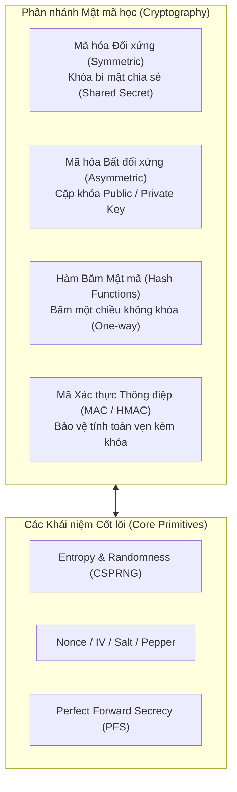
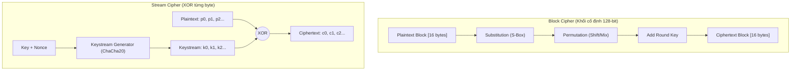
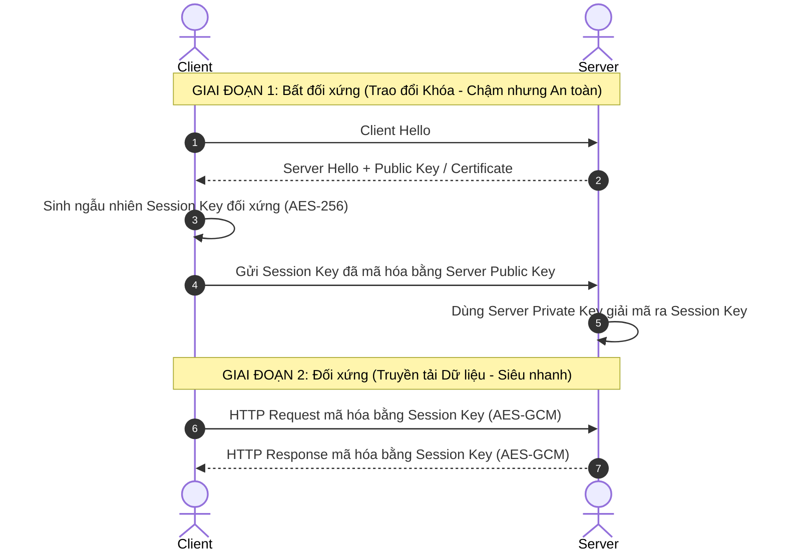
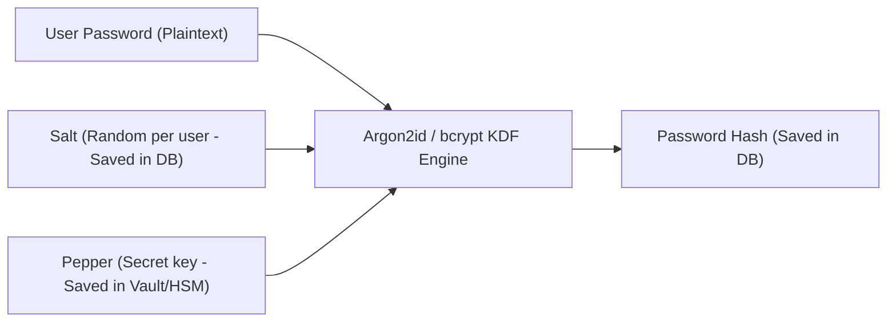
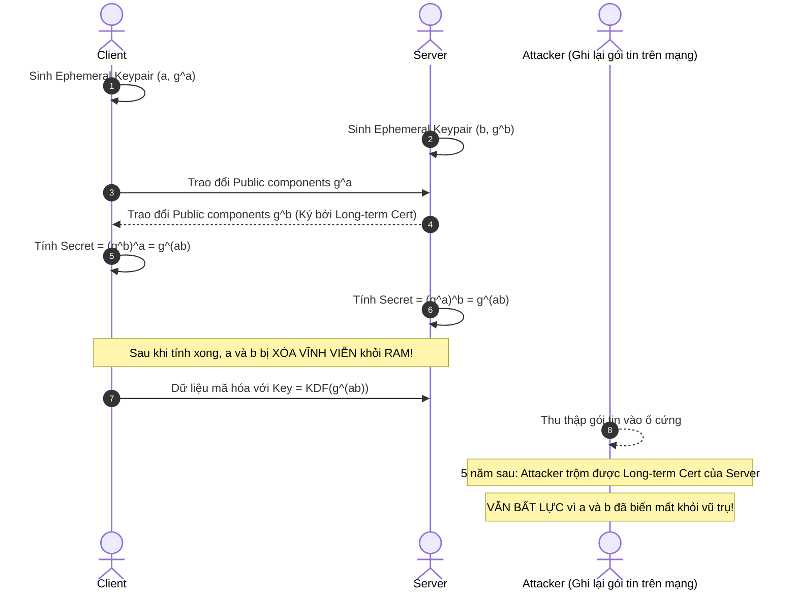

# 2.1. Cryptographic Concepts and Foundations (Khái niệm & Nền tảng Mật mã học)

## Tổng quan về Cryptography Fundamentals
Mật mã học (Cryptography) là nền tảng toán học và kỹ thuật tối thượng của toàn bộ nền kinh tế số và bảo mật hệ thống. Trong kỹ thuật Backend hiện đại, cryptography không chỉ là việc gọi các hàm `encrypt()` hay `decrypt()` từ thư viện, mà đòi hỏi kỹ sư phải thấu hiểu bản chất toán học của entropy, tính ngẫu nhiên, không gian khóa (keyspace), các đặc tính kháng hàm băm và bảo mật chuyển tiếp hoàn hảo (Perfect Forward Secrecy).

- **Vấn đề cốt lõi**: Làm thế nào để truyền tải và lưu trữ thông tin an toàn qua một kênh truyền thông công cộng vốn đã bị đối phương kiểm soát hoàn toàn mà không để lộ nội dung hay bị sửa đổi trái phép.
- **Bản chất dưới tầng máy tính**: Cryptography chuyển hóa các bài toán tính toán dễ dàng theo một chiều (One-way functions như phép nhân số nguyên tố lớn hoặc nhân điểm trên đường cong Elliptic) thành các bài toán bất khả thi về mặt tính toán để đảo ngược trong thời gian đa thức (NP-hard / Discrete Logarithm Problem).



---

## 2. Chi tiết từng Keyword (Under-the-Hood Deep Dive)

### 1. Plaintext, Ciphertext, Cipher & Basic Encryption Mechanics

#### 1. Khái niệm bản chất (What & Why)
- **Plaintext (Bản rõ - $P$ hoặc $M$)**: Dữ liệu gốc nguyên bản, có thể đọc và hiểu được bởi con người hoặc máy tính trước khi mã hóa.
- **Ciphertext (Bản mã - $C$)**: Dữ liệu sau khi đã được biến đổi bởi thuật toán mã hóa; trông giống như các byte ngẫu nhiên vô nghĩa và không thể giải mã nếu không có khóa hợp lệ.
- **Cipher (Thuật toán Mật mã)**: Cặp hàm toán học nghịch đảo:
  $$C = E_K(P) \quad \text{và} \quad P = D_K(C)$$
- **Key (Khóa bí mật - $K$)**: Tham số đầu vào bí mật của thuật toán cipher. Theo **Nguyên lý Kerckhoffs**: Hệ thống mật mã phải an toàn ngay cả khi thuật toán mã hóa được công khai hoàn toàn cho đối phương, miễn là Khóa (Key) được giữ bí mật tuyệt đối.
- **Keyspace (Không gian Khóa)**: Tập hợp tất cả các giá trị khóa khả dĩ có thể có của một thuật toán. Độ lớn không gian khóa quyết định khả năng chống chịu tấn công vét cạn (Brute-force). Ví dụ: AES-256 có keyspace là $2^{256} \approx 1.15 \times 10^{77}$ khả năng – lớn hơn số lượng nguyên tử trong toàn bộ vũ trụ quan sát được.
- **Cryptanalysis (Thám mã)**: Khoa học nghiên cứu các phương pháp phá vỡ hoặc tìm ra điểm yếu của các thuật toán mật mã mà không cần biết trước khóa bí mật.

#### 2. Cơ chế hoạt động sâu (Under the hood / Hardcore Internals)
- **Phân loại thuật toán kinh điển**:
  - **Substitution Cipher (Mật mã Thay thế)**: Thay thế từng ký tự/byte bản rõ bằng ký tự/byte khác (ví dụ: Caesar cipher, Vigenère cipher, S-Box trong AES). Lỗ hổng: Dễ bị phá vỡ bằng phân tích tần suất xuất hiện chữ cái (Frequency Analysis).
  - **Transposition Cipher (Mật mã Hoán vị)**: Giữ nguyên các ký tự nhưng hoán đổi vị trí của chúng theo quy tắc ma trận (ví dụ: Rail Fence cipher, P-Box trong DES).
- **Phân loại theo cấu trúc dòng dữ liệu**:
  - **Block Cipher (Mật mã Khối)**: Chia bản rõ thành các khối có kích thước cố định (ví dụ: AES sử dụng khối 128 bit = 16 byte) và xử lý từng khối một thông qua nhiều vòng lặp toán học (Rounds gồm SubBytes, ShiftRows, MixColumns, AddRoundKey).
  - **Stream Cipher (Mật mã Dòng)**: Tạo ra một dòng khóa giả ngẫu nhiên liên tục (Keystream) và thực hiện phép toán XOR bit từng bit một với dòng bản rõ:
    $$C_i = P_i \oplus K_i \quad \Longleftrightarrow \quad P_i = C_i \oplus K_i$$
    Ví dụ: RC4 (đã bị khai tử do rò rỉ thiên vị byte), ChaCha20 (hiện đại, hiệu năng cực cao).

#### 3. Sơ đồ minh họa (Mô hình Block Cipher vs Stream Cipher)


#### 4. Code ví dụ thực chiến (C++ Constant-Time XOR Stream Cipher Primitive)
```cpp
#include <iostream>
#include <vector>
#include <string>
#include <iomanip>

// Minh họa nguyên lý cốt lõi của Stream Cipher: Tính khả nghịch tuyệt đối của phép XOR
class SimpleStreamCipherPrimitive {
public:
    static std::vector<uint8_t> process(const std::vector<uint8_t>& input, const std::vector<uint8_t>& keystream) {
        if (input.size() != keystream.size()) {
            throw std::invalid_argument("Input and Keystream must be identical in length.");
        }
        
        std::vector<uint8_t> output(input.size());
        // XOR bit-by-bit: C = P ^ K, và P = C ^ K
        for (size_t i = 0; i < input.size(); ++i) {
            output[i] = input[i] ^ keystream[i];
        }
        return output;
    }
};

int main() {
    std::string secretMessage = "DATABASE_PASSWORD_SECRET";
    std::vector<uint8_t> plaintext(secretMessage.begin(), secretMessage.end());

    // Giả lập một Keystream giả ngẫu nhiên có cùng kích thước
    std::vector<uint8_t> keystream = {
        0x1A, 0x7F, 0x3C, 0x4D, 0x9B, 0x22, 0x01, 0x88,
        0xFE, 0x54, 0x32, 0x11, 0xAA, 0xBC, 0xDE, 0xF0,
        0x45, 0x67, 0x89, 0xAB, 0xCD, 0xEF, 0x01, 0x23
    };

    // 1. Mã hóa
    auto ciphertext = SimpleStreamCipherPrimitive::process(plaintext, keystream);
    std::cout << "Ciphertext (HEX): ";
    for (uint8_t b : ciphertext) {
        std::cout << std::hex << std::setfill('0') << std::setw(2) << (int)b << " ";
    }
    std::cout << "\n";

    // 2. Giải mã (Chạy cùng hàm XOR với cùng Keystream)
    auto decrypted = SimpleStreamCipherPrimitive::process(ciphertext, keystream);
    std::string recoveredText(decrypted.begin(), decrypted.end());
    std::cout << "Recovered Plaintext: " << recoveredText << "\n";
    return 0;
}
```

#### 5. Ưu / Nhược điểm, Pitfalls & Anti-patterns
- **Pitfall**: Tái sử dụng Keystream trong Stream Cipher (ví dụ: dùng chung Key và Nonce trong ChaCha20 hoặc WEP WiFi). Kẻ tấn công chỉ cần lấy $C_1 \oplus C_2 = (P_1 \oplus K) \oplus (P_2 \oplus K) = P_1 \oplus P_2$, triệt tiêu hoàn toàn khóa $K$ và khôi phục bản rõ dễ dàng.
- **Anti-pattern**: Tự chế thuật toán mã hóa (Roll your own crypto). Các thuật toán mật mã chuẩn (AES, ChaCha) đã trải qua hàng chục năm thám mã toàn cầu của các nhà toán học hàng đầu.

#### 6. Ứng dụng thực tế trong Backend / Systems
Trong giao thức truyền thông VPN wire-speed (WireGuard) và HTTP/2, Stream Cipher (ChaCha20) được ưu tiên trên các thiết bị di động hoặc máy chủ không có phần cứng tăng tốc AES-NI vì cho tốc độ xử lý nhanh gấp 3 lần và tiết kiệm pin.

---

### 2. Symmetric vs Asymmetric Cryptography, Hash Functions, MAC & Digital Signatures

#### 1. Khái niệm bản chất (What & Why)
- **Symmetric Cryptography (Mật mã Đối xứng)**: Cả bên gửi và bên nhận dùng chung một khóa bí mật $K$ để mã hóa và giải mã. Tốc độ cực nhanh (Gigabytes/giây nhờ phần cứng CPU). Khó khăn: Vấn đề phân phối khóa (Key Distribution Problem).
- **Asymmetric Cryptography (Mật mã Bất đối xứng / Public-Key Crypto)**: Sử dụng một cặp khóa riêng biệt về mặt toán học:
  - **Public Key**: Được công khai rộng rãi cho mọi người (dùng để mã hóa dữ liệu hoặc xác minh chữ ký).
  - **Private Key**: Được giữ bí mật tuyệt đối bởi chủ sở hữu (dùng để giải mã dữ liệu hoặc tạo chữ ký).
  - Tốc độ: Chậm hơn mã hóa đối xứng từ 100 đến 1000 lần.
- **Cryptographic Hash Function (Hàm Băm Mật mã)**: Ánh xạ dữ liệu có độ dài bất kỳ thành một chuỗi bit có độ dài cố định $N$ bit (ví dụ: SHA-256 sinh 256 bit = 32 bytes) mang tính một chiều không thể đảo ngược.
- **Message Authentication Code (MAC / HMAC)**: Chuỗi mã xác thực được tính toán từ bản tin $M$ kết hợp với một Khóa bí mật $K$, đảm bảo cả hai yếu tố: Tính toàn vẹn (Integrity) và Tính xác thực nguồn gốc (Authenticity).
- **Digital Signature (Chữ ký số)**: Mã xác thực được tạo bằng Private Key và xác minh bằng Public Key, cung cấp thêm tính Không thể chối bỏ (Non-Repudiation).

#### 2. Cơ chế hoạt động sâu (Under the hood / Hardcore Internals)
- **Hệ thống Mã hóa Lai (Hybrid Encryption Architecture)**:
  Trong các giao thức thực tế như TLS, SSH và PGP:
  1. Asymmetric Crypto (RSA, ECDH) **chỉ được dùng trong vài miligiây đầu tiên** để thực hiện **Key Exchange** (trao đổi khóa) một cách an toàn qua mạng Internet.
  2. Sau khi đã thiết lập được một khóa bí mật chung (gọi là Session Key), hai bên chuyển sang dùng Symmetric Crypto (AES-GCM hoặc ChaCha20-Poly1305) để mã hóa toàn bộ dữ liệu ứng dụng với tốc độ tối đa của phần cứng.

#### 3. Sơ đồ minh họa (Mô hình Mã hóa Lai - Hybrid Cryptography trong HTTPS/TLS)


#### 4. Code ví dụ thực chiến (TypeScript Hybrid Encryption Pattern via Node.js Crypto)
```typescript
import * as crypto from 'crypto';

export class HybridCryptosystem {
    // 1. Mã hóa lai: Dùng AES-256-GCM cho Payload và RSA-OAEP cho Session Key
    public static encryptHybrid(
        plaintextPayload: string,
        recipientPublicKeyPem: string
    ): { encryptedKeyHex: string; ivHex: string; authTagHex: string; ciphertextHex: string } {
        // Sinh khóa đối xứng ngẫu nhiên cho phiên (Symmetric Session Key - 32 bytes = 256 bits)
        const sessionKey = crypto.randomBytes(32);
        const iv = crypto.randomBytes(12); // Chuẩn 12 bytes cho GCM mode

        // Mã hóa payload bằng AES-256-GCM
        const cipher = crypto.createCipheriv('aes-256-gcm', sessionKey, iv);
        let ciphertext = cipher.update(plaintextPayload, 'utf8', 'hex');
        ciphertext += cipher.final('hex');
        const authTag = cipher.getAuthTag().toString('hex');

        // Mã hóa Session Key bằng Public Key của người nhận (RSA-OAEP with SHA-256)
        const encryptedKey = crypto.publicEncrypt({
            key: recipientPublicKeyPem,
            padding: crypto.constants.RSA_PKCS1_OAEP_PADDING,
            oaepHash: 'sha256'
        }, sessionKey).toString('hex');

        return {
            encryptedKeyHex: encryptedKey,
            ivHex: iv.toString('hex'),
            authTagHex: authTag,
            ciphertextHex: ciphertext
        };
    }

    // 2. Giải mã lai: Dùng Private Key giải mã Session Key, sau đó giải mã Payload
    public static decryptHybrid(
        packageData: { encryptedKeyHex: string; ivHex: string; authTagHex: string; ciphertextHex: string },
        recipientPrivateKeyPem: string
    ): string {
        // Giải mã Session Key bằng RSA Private Key
        const sessionKey = crypto.privateDecrypt({
            key: recipientPrivateKeyPem,
            padding: crypto.constants.RSA_PKCS1_OAEP_PADDING,
            oaepHash: 'sha256'
        }, Buffer.from(packageData.encryptedKeyHex, 'hex'));

        // Giải mã Payload bằng AES-256-GCM
        const decipher = crypto.createDecipheriv(
            'aes-256-gcm',
            sessionKey,
            Buffer.from(packageData.ivHex, 'hex')
        );
        decipher.setAuthTag(Buffer.from(packageData.authTagHex, 'hex'));

        let decrypted = decipher.update(packageData.ciphertextHex, 'hex', 'utf8');
        decrypted += decipher.final('utf8');
        return decrypted;
    }
}
```

#### 5. Ưu / Nhược điểm, Pitfalls & Anti-patterns
- **Pitfall**: Dùng trực tiếp RSA để mã hóa một file lớn vài Gigabytes. Thao tác này sẽ làm tê liệt CPU vì RSA thực hiện các phép lũy thừa modulo trên các số nguyên hàng ngàn bit (`BigInt`), gây nghẽn nghiêm trọng luồng xử lý.
- **Anti-pattern**: Dùng hàm băm đơn thuần (như `MD5` hoặc `SHA-1`) để bảo vệ tính toàn vẹn dữ liệu mạng. Vì kẻ tấn công đứng giữa hoàn toàn có thể sửa bản tin $M \to M'$ và tính lại $H' = \text{MD5}(M')$ tương ứng (Phải dùng HMAC hoặc Digital Signature).

#### 6. Ứng dụng thực tế trong Backend / Systems
Mọi kết nối HTTPS, database replication có mã hóa (PostgreSQL SSL), kết nối gRPC và hệ thống thanh toán qua API của Stripe/PayPal đều hoạt động trên nền tảng Hybrid Cryptography này.

---

### 3. Entropy, Randomness, Nonce, IV, Salt & Pepper

#### 1. Khái niệm bản chất (What & Why)
- **Randomness & Entropy**:
  - **Randomness (Tính ngẫu nhiên)**: Trạng thái không thể dự đoán được của các bit dữ liệu.
  - **Entropy (Độ hỗn loạn)**: Thước đo toán học (theo Shannon) về mức độ khó đoán của thông tin. Mật mã học bắt buộc phải sử dụng **CSPRNG (Cryptographically Secure Pseudo-Random Number Generator)** thay vì PRNG thông thường (như `rand()` trong C hay `Math.random()` trong JS).
- **Cryptographic Nonce (Number used ONCE)**: Một giá trị số chỉ được phép sử dụng **duy nhất một lần** trong một ngữ cảnh cryptographic cụ thể để chống tấn công phát lại (Replay attack).
- **Initialization Vector (IV - Vector Khởi tạo)**: Một khối dữ liệu ngẫu nhiên được đưa vào bước khởi đầu của thuật toán mã hóa khối (Block cipher mode như CBC, GCM) để đảm bảo hai bản rõ giống hệt nhau khi mã hóa bằng cùng một khóa sẽ sinh ra hai bản mã hoàn toàn khác nhau.
- **Salt (Muối)**: Chuỗi byte ngẫu nhiên được sinh mới cho mỗi mật khẩu người dùng trước khi băm, giúp vô hiệu hóa kỹ thuật tra bảng tính sẵn (Rainbow Tables). Salt được lưu công khai kèm hash trong cơ sở dữ liệu.
- **Pepper (Hạt tiêu)**: Chuỗi bí mật có độ dài cố định do hệ thống quản lý, được nối vào mật khẩu trước khi băm. Pepper được lưu trong HSM, biến môi trường (Environment Variable) hoặc Secret Manager bên ngoài database, bảo vệ mật khẩu ngay cả khi kẻ tấn công dump toàn bộ database.

#### 2. Cơ chế hoạt động sâu (Under the hood / Hardcore Internals)
Dưới tầng Linux Kernel:
- Kernel thu thập **Entropy** từ các hiện tượng vật lý ngẫu nhiên của phần cứng: Biến thiên thời gian ngắt bàn phím, di chuyển chuột, độ trễ truy xuất cơ học của ổ cứng, biến thiên xung nhịp ngắt mạng (NIC interrupts) và lệnh CPU `RDRAND`/`RDSEED`.
- Dữ liệu entropy được nạp vào Entropy Pool. Hàm gọi hệ thống `getrandom(2)` hoặc file thiết bị `/dev/urandom` sử dụng thuật toán ChaCha20 để sinh ra dòng byte ngẫu nhiên có độ bảo mật quân sự (Cryptographically Secure). Khác với `/dev/random` thời kỳ cũ bị blocking khi cạn pool, `/dev/urandom` hiện đại trên Linux không bao giờ block sau khi đã được khởi tạo hạt giống đầy đủ (Seeded).

#### 3. Sơ đồ minh họa (Mối quan hệ Salt & Pepper trong Password Hashing)


#### 4. Code ví dụ thực chiến (C++ CSPRNG Random Generation via Linux getrandom)
```cpp
#include <iostream>
#include <vector>
#include <sys/random.h>
#include <iomanip>
#include <system_error>

class SecureRandomGenerator {
public:
    // Sinh mảng byte ngẫu nhiên chuẩn mật mã học bằng Syscall getrandom(2) của nhân Linux
    static std::vector<uint8_t> generateBytes(size_t length) {
        std::vector<uint8_t> buffer(length);
        ssize_t result = getrandom(buffer.data(), length, 0);

        if (result < 0 || static_cast<size_t>(result) != length) {
            throw std::system_error(errno, std::generic_category(), "CSPRNG getrandom syscall failed");
        }
        return buffer;
    }
};

int main() {
    try {
        // Sinh IV 12 bytes cho AES-GCM
        auto iv = SecureRandomGenerator::generateBytes(12);
        // Sinh Salt 16 bytes cho Argon2id
        auto salt = SecureRandomGenerator::generateBytes(16);

        std::cout << "Generated Secure IV (12 bytes): ";
        for (uint8_t b : iv) std::cout << std::hex << std::setw(2) << std::setfill('0') << (int)b;
        std::cout << "\n";

        std::cout << "Generated Secure Salt (16 bytes): ";
        for (uint8_t b : salt) std::cout << std::hex << std::setw(2) << std::setfill('0') << (int)b;
        std::cout << "\n";
    } catch (const std::exception& e) {
        std::cerr << "Entropy Error: " << e.what() << "\n";
    }
    return 0;
}
```

#### 5. Ưu / Nhược điểm, Pitfalls & Anti-patterns
- **Pitfall**: Dùng `rand()` hoặc `srand(time(NULL))` trong C++ để sinh token xác thực hoặc khóa mã hóa. Thời gian tính theo giây quá dễ đoán; kẻ tấn công chỉ cần vét cạn vài ngàn timestamp xung quanh thời điểm sinh token là có thể bẻ khóa trong tích tắc.
- **Anti-pattern**: Dùng một IV tĩnh (Static/Hardcoded IV) lặp đi lặp lại cho mọi bản mã.

#### 6. Ứng dụng thực tế trong Backend / Systems
Tất cả các cơ chế sinh Session ID, CSRF Token, Reset Password Token, OAuth `state` và `code_verifier` trong web framework đều bắt buộc phải lấy entropy trực tiếp từ CSPRNG của hệ điều hành.

---

### 4. Hash Properties & Perfect Forward Secrecy (PFS)

#### 1. Khái niệm bản chất (What & Why)
- **Các thuộc tính bắt buộc của Hàm băm Mật mã học (Hash Properties)**:
  1. **Preimage Resistance (Tính kháng tiền ảnh - One-way)**: Cho trước giá trị băm $y = H(x)$, bất khả thi về mặt tính toán để tìm ra bản rõ ban đầu $x$.
  2. **Second Preimage Resistance (Tính kháng tiền ảnh thứ hai - Weak Collision Resistance)**: Cho trước một đầu vào cụ thể $x_1$, bất khả thi để tìm một đầu vào khác $x_2 \neq x_1$ sao cho $H(x_1) = H(x_2)$.
  3. **Collision Resistance (Tính kháng xung đột - Strong Collision Resistance)**: Bất khả thi để tìm bất kỳ cặp đầu vào nào $(x_1, x_2)$ với $x_1 \neq x_2$ sao cho $H(x_1) = H(x_2)$ (Dựa trên nghịch lý ngày sinh - Birthday Paradox, độ phức tạp là $O(2^{N/2})$).
- **Forward Secrecy & Perfect Forward Secrecy (PFS - Bảo mật Chuyển tiếp Hoàn hảo)**: Đặc tính an ninh đảm bảo rằng nếu Khóa Riêng Tư dài hạn (Long-term Private Key của máy chủ) bị lộ trong tương lai, kẻ tấn công **vẫn không thể giải mã các phiên liên lạc trong quá khứ** mà chúng đã ghi lại trước đó.

#### 2. Cơ chế hoạt động sâu (Under the hood / Hardcore Internals)
- **Tại sao RSA không có PFS?**
  Trước TLS 1.3, máy khách mã hóa Pre-Master Secret bằng RSA Public Key của Server rồi gửi qua mạng. Nếu kẻ tấn công lưu trữ toàn bộ lưu lượng HTTPS trên đường truyền trong nhiều năm (Kỹ thuật "Harvest Now, Decrypt Later"), sau đó chúng đột nhập vào datacenter đánh cắp được RSA Private Key của Server, chúng sẽ giải mã được toàn bộ Session Keys của mọi phiên trong quá khứ!
- **Tại sao Ephemeral Diffie-Hellman (ECDHE) đạt chuẩn PFS?**
  Với ECDHE (chế độ duy nhất được phép trong TLS 1.3):
  Trong mỗi phiên TLS mới, Server và Client sinh ra một cặp khóa tạm thời (Ephemeral Keypair). Khóa này chỉ tồn tại trong RAM trong tích tắc để tính toán ra Shared Secret, sau đó **bị hủy bỏ ngay lập tức bằng việc ghi đè bộ nhớ (Zeroize)**. Private Key dài hạn của Server chỉ dùng để ký xác thực (Sign), không dùng để mã hóa Session Key. Do đó, kể cả khi Private Key dài hạn bị lộ, quá khứ vẫn an toàn tuyệt đối.

#### 3. Sơ đồ minh họa (Cơ chế PFS với Ephemeral Diffie-Hellman)


#### 4. Code ví dụ thực chiến (TypeScript ECDH Key Exchange Demonstrating Ephemeral Keys)
```typescript
import * as crypto from 'crypto';

export class EphemeralECDHExchange {
    public static demonstratePFS() {
        // 1. Phía Client sinh cặp khóa tạm thời (Ephemeral keypair trên đường cong prime256v1 / secp256r1)
        const clientECDH = crypto.createECDH('prime256v1');
        const clientPublicKey = clientECDH.generateKeys();

        // 2. Phía Server sinh cặp khóa tạm thời của riêng mình
        const serverECDH = crypto.createECDH('prime256v1');
        const serverPublicKey = serverECDH.generateKeys();

        // 3. Hai bên trao đổi Public Key qua mạng công cộng và tính toán Shared Secret độc lập
        const clientComputedSecret = clientECDH.computeSecret(serverPublicKey);
        const serverComputedSecret = serverECDH.computeSecret(clientPublicKey);

        // Kiểm tra xem hai bí mật tính toán có khớp tuyệt đối không
        const isMatched = clientComputedSecret.equals(serverComputedSecret);
        console.log("ECDH Ephemeral Shared Secret Matched:", isMatched);
        console.log("Derived Secret (HEX):", clientComputedSecret.toString('hex'));

        // 4. Mô phỏng PFS: Zeroize bộ nhớ RAM để đảm bảo tính an toàn chuyển tiếp
        clientComputedSecret.fill(0);
        serverComputedSecret.fill(0);
        console.log("Secrets memory safely wiped from RAM.");
    }
}

EphemeralECDHExchange.demonstratePFS();
```

#### 5. Ưu / Nhược điểm, Pitfalls & Anti-patterns
- **Pitfall**: Vẫn hỗ trợ các bộ Cipher Suites cũ (như `TLS_RSA_WITH_AES_128_CBC_SHA`) trên Web Server / Nginx. Điều này mở đường cho kẻ tấn công thực hiện Downgrade Attack để ép Server không sử dụng PFS.
- **Anti-pattern**: Sử dụng thuật toán băm đã bị chứng minh va chạm như MD5 hoặc SHA-1 để kiểm tra tính toàn vẹn file hoặc ký số.

#### 6. Ứng dụng thực tế trong Backend / Systems
Chuẩn **TLS 1.3** đã chính thức loại bỏ hoàn toàn cơ chế trao đổi khóa RSA và tất cả các Cipher Suites không hỗ trợ PFS. Mọi hệ thống Backend hiện đại bắt buộc phải cấu hình TLS 1.3 với ECDHE (Curve25519 hoặc P-256) làm tiêu chuẩn tối thiểu.
