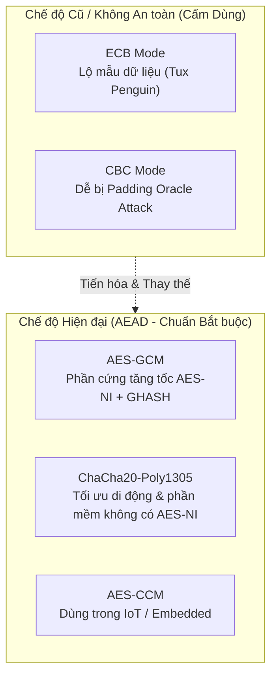
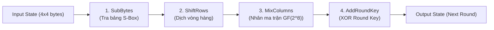
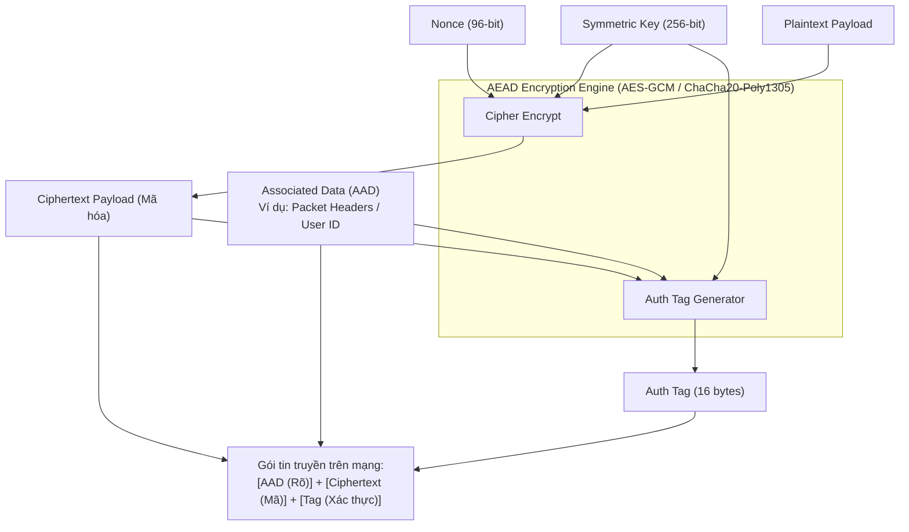

# 2.2. Symmetric Encryption and Block Cipher Modes (Mã hóa Đối xứng & Các Chế độ Hoạt động Mã hóa Khối)

## Tổng quan về Symmetric Encryption & AEAD
Mã hóa đối xứng (Symmetric Encryption) là "ngựa thồ" xử lý dữ liệu nặng trong kỹ thuật Backend: Từ việc mã hóa dữ liệu lưu trữ trên ổ đĩa (Data at Rest trong MySQL, PostgreSQL, S3) cho đến truyền tải lưu lượng hàng chục Gigabits/giây qua đường truyền mạng HTTPS/gRPC (Data in Transit). 

Tuy nhiên, bản thân một thuật toán mã hóa khối (Block Cipher như AES) chỉ biết mã hóa một khối dữ liệu cố định (128 bit). Để mã hóa các luồng dữ liệu tùy ý (File ảnh, JSON payload, Database records), ta phải sử dụng các **Chế độ Hoạt động (Cipher Modes)**. Hiểu rõ sự khác biệt giữa các chế độ không an toàn (ECB), chế độ truyền thống (CBC) và chế độ hiện đại có kèm xác thực (AEAD - GCM, ChaCha20-Poly1305) là kỹ năng sống còn của kỹ sư hệ thống.



---

## 2. Chi tiết từng Keyword (Under-the-Hood Deep Dive)

### 1. AES & Các Độ Dài Khóa: AES-128, AES-192, AES-256

#### 1. Khái niệm bản chất (What & Why)
- **AES (Advanced Encryption Standard)**: Chuẩn mã hóa khối được viện NIST (Hoa Kỳ) chuẩn hóa vào năm 2001 sau cuộc thi toàn cầu thay thế chuẩn cũ DES (vốn có kích thước khóa 56 bit quá nhỏ). Thuật toán gốc có tên là **Rijndael** do hai nhà mật mã học người Bỉ (Joan Daemen và Vincent Rijmen) phát minh.
- **Kích thước khối (Block Size)**: AES **luôn luôn cố định là 128 bit (16 bytes)** bất kể độ dài khóa là bao nhiêu.
- **Các biến thể độ dài khóa**:
  - **AES-128**: Khóa 128 bit (16 bytes), thực thi qua **10 vòng biến đổi (Rounds)**. Cung cấp mức an toàn $2^{128}$ thao tác. Đủ an toàn trước mọi siêu máy tính cổ điển trong hàng thế kỷ tới.
  - **AES-192**: Khóa 192 bit (24 bytes), thực thi qua **12 vòng biến đổi**.
  - **AES-256**: Khóa 256 bit (32 bytes), thực thi qua **14 vòng biến đổi**. Chuẩn an toàn tuyệt đối chống lại cả các thuật toán lượng tử tương lai (Thuật toán Grover trên máy tính lượng tử chỉ giảm độ phức tạp xuống căn bậc hai: $\sqrt{2^{256}} = 2^{128}$ bit an toàn).

#### 2. Cơ chế hoạt động sâu (Under the hood / Hardcore Internals)
Bên dưới tầng vi kiến trúc CPU và mã máy:
- Dữ liệu 16 byte của khối được xếp thành một ma trận $4 \times 4$ byte gọi là **State Matrix**.
- Mỗi vòng biến đổi (Round) trong AES gồm 4 bước đại số tuyến tính và phi tuyến trên trường hữu hạn Galois $\text{GF}(2^8)$:
  1. **SubBytes**: Thay thế phi tuyến từng byte bằng bảng tra cứu S-Box (chống thám mã vi sai - Differential Cryptanalysis).
  2. **ShiftRows**: Dịch chuyển xoay vòng các hàng trong ma trận (Hàng 0 dịch 0 byte, Hàng 1 dịch 1 byte, Hàng 2 dịch 2 byte, Hàng 3 dịch 3 byte).
  3. **MixColumns**: Phép nhân ma trận đại số tuyến tính kết hợp 4 byte của mỗi cột, tạo tính khuếch tán (Diffusion) cao độ. (Vòng cuối cùng bỏ qua bước này).
  4. **AddRoundKey**: Thực hiện phép XOR trực tiếp giữa State Matrix và khóa vòng (Round Key được sinh từ bộ mở rộng khóa - Key Expansion).
- **Phần cứng AES-NI (AES New Instructions)**: Các dòng CPU Intel/AMD hiện đại tích hợp sẵn tập lệnh phần cứng chuyên dụng (`AESENC`, `AESENCLAST`, `AESDEC`, `AESDECLAST`). Thay vì phải tính toán hàng trăm chu kỳ CPU bằng code phần mềm (dễ dính Cache-timing side-channel attacks), một lệnh `AESENC` thực thi toàn bộ một vòng AES trực tiếp trong phần cứng silicon chỉ trong 1 chu kỳ xung nhịp (Clock cycle)!

#### 3. Sơ đồ minh họa (State Matrix và 4 Bước Biến đổi của AES Round)


#### 4. Code ví dụ thực chiến (C++ OpenSSL Low-Level AES-256-GCM Hardware Accelerated)
```cpp
#include <iostream>
#include <vector>
#include <openssl/evp.h>
#include <openssl/rand.h>
#include <iomanip>

class AesGcmEngine {
public:
    static constexpr int KEY_SIZE = 32;   // 256 bits
    static constexpr int IV_SIZE = 12;    // 96 bits chuẩn cho GCM
    static constexpr int TAG_SIZE = 16;   // 128 bits authentication tag

    static bool encrypt(
        const std::vector<uint8_t>& plaintext,
        const std::vector<uint8_t>& key,
        const std::vector<uint8_t>& iv,
        std::vector<uint8_t>& ciphertext,
        std::vector<uint8_t>& authTag
    ) {
        EVP_CIPHER_CTX* ctx = EVP_CIPHER_CTX_new();
        if (!ctx) return false;

        int len = 0;
        int ciphertext_len = 0;
        ciphertext.resize(plaintext.size());
        authTag.resize(TAG_SIZE);

        // Khởi tạo thuật toán AES-256-GCM (OpenSSL tự động kích hoạt AES-NI phần cứng)
        if (EVP_EncryptInit_ex(ctx, EVP_aes_256_gcm(), nullptr, nullptr, nullptr) != 1 ||
            EVP_CIPHER_CTX_ctrl(ctx, EVP_CTRL_GCM_SET_IVLEN, IV_SIZE, nullptr) != 1 ||
            EVP_EncryptInit_ex(ctx, nullptr, nullptr, key.data(), iv.data()) != 1) {
            EVP_CIPHER_CTX_free(ctx);
            return false;
        }

        // Mã hóa payload
        if (EVP_EncryptUpdate(ctx, ciphertext.data(), &len, plaintext.data(), plaintext.size()) != 1) {
            EVP_CIPHER_CTX_free(ctx);
            return false;
        }
        ciphertext_len = len;

        // Hoàn tất quá trình mã hóa
        if (EVP_EncryptFinal_ex(ctx, ciphertext.data() + len, &len) != 1) {
            EVP_CIPHER_CTX_free(ctx);
            return false;
        }

        // Trích xuất Authentication Tag (16 bytes)
        if (EVP_CIPHER_CTX_ctrl(ctx, EVP_CTRL_GCM_GET_TAG, TAG_SIZE, authTag.data()) != 1) {
            EVP_CIPHER_CTX_free(ctx);
            return false;
        }

        EVP_CIPHER_CTX_free(ctx);
        return true;
    }
};

int main() {
    std::string secretData = "High-performance encrypted payload in C++";
    std::vector<uint8_t> plaintext(secretData.begin(), secretData.end());

    std::vector<uint8_t> key(AesGcmEngine::KEY_SIZE);
    std::vector<uint8_t> iv(AesGcmEngine::IV_SIZE);
    RAND_bytes(key.data(), key.size());
    RAND_bytes(iv.data(), iv.size());

    std::vector<uint8_t> ciphertext;
    std::vector<uint8_t> tag;

    if (AesGcmEngine::encrypt(plaintext, key, iv, ciphertext, tag)) {
        std::cout << "AES-256-GCM Encryption Succeeded!\n";
        std::cout << "Ciphertext size: " << ciphertext.size() << " bytes\n";
        std::cout << "Auth Tag (HEX): ";
        for (uint8_t b : tag) std::cout << std::hex << std::setw(2) << std::setfill('0') << (int)b;
        std::cout << "\n";
    }
    return 0;
}
```

#### 5. Ưu / Nhược điểm, Pitfalls & Anti-patterns
- **Pitfall**: Nghĩ rằng AES-256 luôn luôn tốt hơn AES-128 trong mọi tình huống. Trên thực tế, AES-128 nhanh hơn khoảng $40\%$ vì chỉ có 10 vòng so với 14 vòng của AES-256, và đến nay chưa có cuộc tấn công toán học nào tiệm cận được $2^{128}$.
- **Anti-pattern**: Tự cài đặt các bảng tra S-Box bằng mảng C/C++ trong User-space. Thao tác này tạo ra các lỗ hổng **Cache-Timing Attack** khi kẻ tấn công cùng chia sẻ CPU vật lý (Cloud multi-tenancy) có thể đo độ trễ truy cập cache L1/L2 để suy ngược khóa bí mật.

#### 6. Ứng dụng thực tế trong Backend / Systems
Chuẩn mã hóa mặc định trong AWS KMS, Google Cloud Cloud KMS, LUKS Disk Encryption trên Linux, và Database Encryption at Rest của MySQL/MongoDB.

---

### 2. Block Cipher Modes: ECB, CBC, CTR & GCM

#### 1. Khái niệm bản chất (What & Why)
- **ECB (Electronic Codebook Mode)**: Chế độ đơn giản nhất: Chia dữ liệu thành các khối 16 byte độc lập và dùng cùng một khóa mã hóa từng khối một cách riêng rẽ.
  - *Hiểm họa chí tử*: Hai khối bản rõ giống hệt nhau sẽ luôn sinh ra hai khối bản mã giống hệt nhau. ECB làm lộ hoàn toàn cấu trúc mẫu dữ liệu (Hình ảnh nổi tiếng chim cánh cụt Linux "ECB Tux Penguin" sau khi mã hóa ECB vẫn nhìn rõ từng đường nét con chim). **TUYỆT ĐỐI CẤM SỬ DỤNG TRONG MỌI TRƯỜNG HỢP**.
- **CBC (Cipher Block Chaining Mode)**: Mỗi khối bản rõ trước khi mã hóa được XOR với khối bản mã của bước liền trước (Khối đầu tiên được XOR với IV). 
  - Khắc phục nhược điểm của ECB nhưng không hỗ trợ tính toán song song (Parallelization) khi mã hóa và cực kỳ nhạy cảm với lỗi Padding Oracle.
- **CTR (Counter Mode)**: Biến Block cipher thành Stream cipher. Mã hóa một bộ đếm (Counter + Nonce) tăng dần để tạo Keystream, sau đó XOR với bản rõ. Hỗ trợ tính toán song song đa luồng tối đa cả chiều mã hóa lẫn giải mã.
- **GCM (Galois/Counter Mode)**: Kết hợp chế độ CTR với phép nhân Galois (GHASH) để tạo ra mã xác thực (Authentication Tag). Hiện là chế độ mã hóa khối thống trị toàn cầu.

#### 2. Cơ chế hoạt động sâu (Under the hood / Hardcore Internals)
- **Cơ chế Padding trong CBC (PKCS#7 Padding)**:
  Vì kích thước khối cố định 16 byte, nếu dữ liệu cuối cùng dài 11 byte, ta phải thêm 5 byte có giá trị `0x05`. Khi giải mã, server kiểm tra các byte đệm này:
  - **Padding Oracle Attack**: Kẻ tấn công can thiệp vào các byte của ciphertext truyền trên mạng. Nếu server trả về lỗi khác nhau (ví dụ: HTTP 500 khi Padding không hợp lệ vs HTTP 200 khi Padding hợp lệ), kẻ tấn công có thể giải mã từng byte dữ liệu mà không cần biết khóa!
- **GCM Galois Field Multiplication**:
  GCM tính toán Tag xác thực bằng phép toán nhân trên trường Galois $\text{GF}(2^{128})$ biểu diễn bởi đa thức bất khả quy $P(x) = x^{128} + x^7 + x^2 + x + 1$. CPU hiện đại hỗ trợ lệnh phần cứng `PCLMULQDQ` (Carry-Less Multiplication) giúp tính toán tag xác thực này gần như không tốn thêm tài nguyên CPU.

#### 3. Sơ đồ minh họa (So sánh luồng xử lý ECB vs CBC vs GCM)

```mermaid
flowchart TD
    subgraph ECB_Fail ["ECB Mode (Nguy Hiểm - Lộ Mẫu)"]
        P1["Plaintext 1"] --> Enc1["Encrypt(Key)"] --> C1["Ciphertext 1"]
        P2["Plaintext 1"] --> Enc2["Encrypt(Key)"] --> C2["Ciphertext 1 (Trùng lặp!)"]
    end
    subgraph CBC_Mode ["CBC Mode (Chậm - Dễ dính Padding Oracle)"]
        IV["IV"] --> XOR1((XOR))
        P11["Plaintext 1"] --> XOR1 --> Enc11["Encrypt(Key)"] --> C11["Ciphertext 1"]
        C11 --> XOR2((XOR))
        P12["Plaintext 2"] --> XOR2 --> Enc12["Encrypt(Key)"] --> C12["Ciphertext 2"]
    end
    subgraph GCM_Mode ["GCM Mode (Song Song Hóa + Xác Thực AEAD)"]
        CTR["Nonce + Counter"] --> EncCTR["Encrypt(Key)"] --> KS["Keystream"]
        Plain["Plaintext"] --> XOR_GCM((XOR)) --> Cipher["Ciphertext"]
        KS --> XOR_GCM
        Cipher --> GHASH["GHASH GF(2^128)"] --> Tag["16-byte Auth Tag"]
    end
```


#### 4. Code ví dụ thực chiến (TypeScript Padding Oracle Defense & Proper Mode Selection)
```typescript
import * as crypto from 'crypto';

// So sánh sự nguy hiểm của ECB và sức mạnh của AEAD GCM
export class CipherModeComparator {
    // VÍ DỤ PHẢN DIỆN: Mã hóa bằng ECB làm lộ cấu trúc
    public static demonstrateECBLeakage(repeatedString: string, key: Buffer): string {
        // TUYỆT ĐỐI KHÔNG DÙNG TRONG PRODUCTION!
        const cipher = crypto.createCipheriv('aes-128-ecb', key, null);
        let encrypted = cipher.update(repeatedString, 'utf8', 'hex');
        encrypted += cipher.final('hex');
        return encrypted;
    }

    // CHUẨN MỰC HIỆN ĐẠI: AEAD AES-256-GCM
    public static encryptSecureGCM(
        plaintext: string,
        key: Buffer
    ): { ciphertext: string; iv: string; tag: string } {
        const iv = crypto.randomBytes(12); // Chuẩn NIST SP 800-38D
        const cipher = crypto.createCipheriv('aes-256-gcm', key, iv);

        let ciphertext = cipher.update(plaintext, 'utf8', 'hex');
        ciphertext += cipher.final('hex');
        const tag = cipher.getAuthTag().toString('hex');

        return {
            ciphertext,
            iv: iv.toString('hex'),
            tag
        };
    }
}

const key128 = crypto.randomBytes(16);
const key256 = crypto.randomBytes(32);

// Đầu vào gồm các khối 16 bytes giống hệt nhau
const repeatedPattern = "1234567890ABCDEF1234567890ABCDEF"; 
const ecbOutput = CipherModeComparator.demonstrateECBLeakage(repeatedPattern, key128);

console.log("ECB Output (Chú ý 2 nửa chuỗi mã hóa giống hệt nhau):");
console.log(ecbOutput.substring(0, 32));
console.log(ecbOutput.substring(32, 64)); // Khối 1 == Khối 2! Lộ mẫu dữ liệu!
```

#### 5. Ưu / Nhược điểm, Pitfalls & Anti-patterns
- **Pitfall**: Dùng AES-CBC mà không có HMAC đi kèm (Unauthenticated Encryption). Khi bị tấn công giải mã sai padding, việc trả về thông báo lỗi chi tiết cho client sẽ giúp hacker dựng Padding Oracle giải mã được mật khẩu.
- **Anti-pattern**: Sử dụng IV có độ dài tùy tiện trong GCM (ví dụ: dùng IV 16 bytes thay vì 12 bytes chuẩn). Khi IV khác 12 bytes, GCM buộc phải thực hiện thêm phép băm GHASH để ép về 12 bytes, vừa làm giảm hiệu năng vừa tăng nguy cơ va chạm.

#### 6. Ứng dụng thực tế trong Backend / Systems
Trong giao thức TLS 1.3, NIST đã chính thức loại bỏ hoàn toàn các chế độ CBC, chỉ giữ lại các chế độ Authenticated Encryption hiện đại (AES-GCM, AES-CCM, ChaCha20-Poly1305).

---

### 3. Authenticated Encryption with Associated Data (AEAD) & ChaCha20-Poly1305

#### 1. Khái niệm bản chất (What & Why)
- **Authenticated Encryption (Mã hóa Có Xác thực)**: Mô hình kết hợp đồng thời việc bảo vệ bí mật dữ liệu (Confidentiality) và tính toàn vẹn/chống giả mạo dữ liệu (Integrity & Authenticity). Bất kỳ sự thay đổi dù chỉ 1 bit của bản mã sẽ khiến quá trình giải mã bị từ chối ngay lập tức trước khi lộ bản rõ.
- **AEAD (Authenticated Encryption with Associated Data)**: Mở rộng của Authenticated Encryption, cho phép bảo vệ thêm dữ liệu phụ trợ liên kết (Associated Data - $AD$). Dữ liệu $AD$ này **không được mã hóa** (vẫn là plaintext để các router trung gian hoặc header HTTP có thể đọc để định tuyến), nhưng **được bảo vệ tính toàn vẹn tuyệt đối** bằng Tag xác thực.
- **ChaCha20-Poly1305**: Thuật toán AEAD hiện đại do Daniel J. Bernstein (djb) thiết kế. Kết hợp giữa Stream Cipher **ChaCha20** (20 vòng biến đổi Quarter-Round dựa trên các phép toán ARX: Add-Rotate-Xor) và bộ tạo mã xác thực tốc độ cao **Poly1305** trên trường số nguyên tố $2^{130} - 5$.

#### 2. Cơ chế hoạt động sâu (Under the hood / Hardcore Internals)
- **Tại sao ChaCha20-Poly1305 lại vượt trội trên phần mềm thuần (Pure Software)?**
  - AES dựa vào ma trận Galois và bảng tra cứu S-Box. Nếu phần cứng không có module AES-NI (như vi điều khiển IoT, điện thoại cũ, hoặc chip ARM giá rẻ), AES chạy bằng code C thông thường sẽ rất chậm và dễ bị lỗ hổng Cache-Timing.
  - ChaCha20 chỉ sử dụng 3 phép toán CPU cơ bản nhất: Cộng 32-bit (`ADD`), Dịch vòng bit (`ROTL`), và Phép `XOR`. Mọi thanh ghi CPU đa năng (General Purpose Registers) đều thực thi các lệnh này với độ trễ cố định (Constant-time instruction cycle), loại bỏ hoàn toàn nguy cơ rò rỉ thời gian mà không cần tập lệnh phần cứng chuyên biệt.

#### 3. Sơ đồ minh họa (Kiến trúc AEAD với Associated Data)


#### 4. Code ví dụ thực chiến (TypeScript Production-Ready ChaCha20-Poly1305 with AAD)
```typescript
import * as crypto from 'crypto';

export class ChaCha20Poly1305AEAD {
    /**
     * Mã hóa tin nhắn kèm dữ liệu liên kết AAD (Metadata không mã hóa nhưng chống sửa đổi)
     */
    public static encrypt(
        plaintext: string,
        associatedData: string,
        key: Buffer
    ): { ciphertextHex: string; nonceHex: string; tagHex: string } {
        if (key.length !== 32) throw new Error("ChaCha20 key must be exactly 32 bytes.");

        // Nonce chuẩn cho ChaCha20-Poly1305 là 12 bytes (96 bits) theo chuẩn RFC 7539 / RFC 8439
        const nonce = crypto.randomBytes(12);

        // Khởi tạo cipher chacha20-poly1305
        const cipher = crypto.createCipheriv('chacha20-poly1305', key, nonce, {
            authTagLength: 16
        });

        // Nạp dữ liệu phụ trợ liên kết (Associated Data - AAD)
        cipher.setAAD(Buffer.from(associatedData, 'utf8'));

        let ciphertext = cipher.update(plaintext, 'utf8', 'hex');
        ciphertext += cipher.final('hex');
        const tag = cipher.getAuthTag();

        return {
            ciphertextHex: ciphertext,
            nonceHex: nonce.toString('hex'),
            tagHex: tag.toString('hex')
        };
    }

    /**
     * Giải mã và xác thực đồng thời bản mã và AAD
     */
    public static decrypt(
        ciphertextHex: string,
        nonceHex: string,
        tagHex: string,
        associatedData: string,
        key: Buffer
    ): string {
        const decipher = crypto.createDecipheriv(
            'chacha20-poly1305',
            key,
            Buffer.from(nonceHex, 'hex'),
            { authTagLength: 16 }
        );

        // Nạp AAD để xác thực tính toàn vẹn
        decipher.setAAD(Buffer.from(associatedData, 'utf8'));
        decipher.setAuthTag(Buffer.from(tagHex, 'hex'));

        let decrypted = decipher.update(ciphertextHex, 'hex', 'utf8');
        // decipher.final() sẽ ném Exception nếu Ciphertext hoặc AAD bị can thiệp dù chỉ 1 bit!
        decrypted += decipher.final('utf8');
        return decrypted;
    }
}

// Minh họa thực thi
const secretKey = crypto.randomBytes(32);
const payload = JSON.stringify({ transferAmount: 1000000, recipient: "Alice" });
const packetHeader = "Content-Type: application/json; Source-IP: 10.0.0.1";

const encryptedPkg = ChaCha20Poly1305AEAD.encrypt(payload, packetHeader, secretKey);
console.log("Encrypted with ChaCha20-Poly1305:", encryptedPkg.ciphertextHex);

// Giải mã thành công
const decrypted = ChaCha20Poly1305AEAD.decrypt(
    encryptedPkg.ciphertextHex,
    encryptedPkg.nonceHex,
    encryptedPkg.tagHex,
    packetHeader,
    secretKey
);
console.log("Decrypted Payload:", decrypted);

// Thử nghiệm tấn công: Hacker sửa đổi packetHeader AAD
try {
    ChaCha20Poly1305AEAD.decrypt(
        encryptedPkg.ciphertextHex,
        encryptedPkg.nonceHex,
        encryptedPkg.tagHex,
        "Content-Type: application/json; Source-IP: 192.168.1.99", // Sửa IP!
        secretKey
    );
} catch (err) {
    console.log("Attack Neutralized: Thư viện phát hiện AAD bị giả mạo và từ chối giải mã!");
}
```

#### 5. Ưu / Nhược điểm, Pitfalls & Anti-patterns
- **Pitfall**: Tái sử dụng cặp `(Key, Nonce)` trong GCM hoặc ChaCha20-Poly1305. Sự cố này được gọi là **Nonce-Reuse Catastrophe**: Kẻ tấn công có thể khôi phục được khóa xác thực GHASH/Poly1305 và bắt đầu tự tạo các tag xác thực giả mạo để inject dữ liệu độc hại vào phiên liên lạc.
- **Anti-pattern**: Thực hiện giải mã bản mã trước khi kiểm tra Tag xác thực (MAC-then-Decrypt). Mô hình an toàn bắt buộc phải là **AEAD** hoặc **Encrypt-then-MAC**.

#### 6. Ứng dụng thực tế trong Backend / Systems
ChaCha20-Poly1305 là thuật toán mã hóa cốt lõi của giao thức mạng thế hệ mới **WireGuard VPN**, giao thức SSH hiện đại (`chacha20-poly1305@openssh.com`), và được cấu hình làm cipher ưu tiên số 1 trong TLS trên Google Cloud khi phục vụ các thiết bị Android di động.
