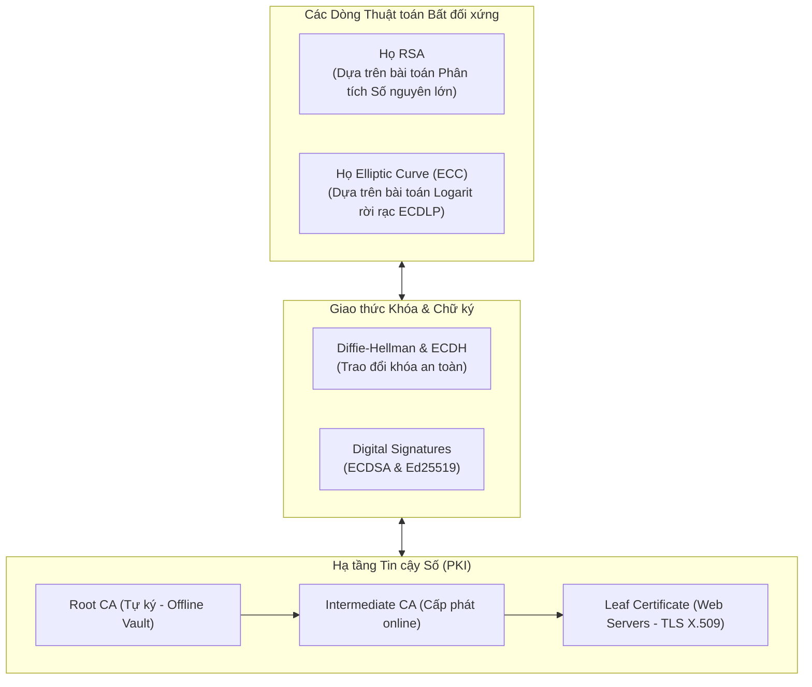
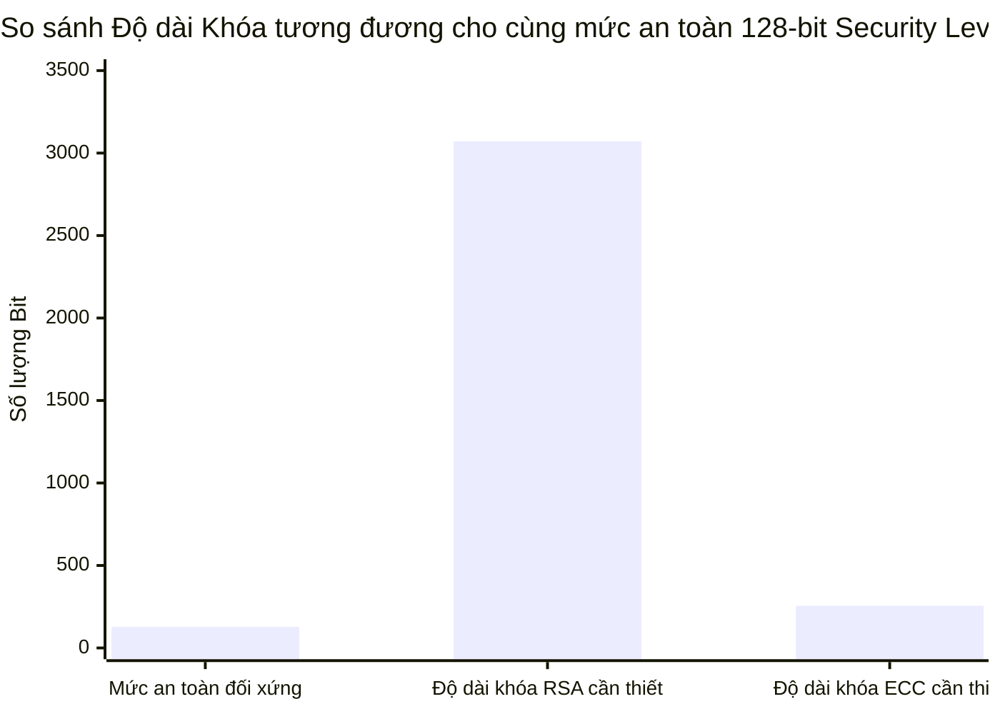
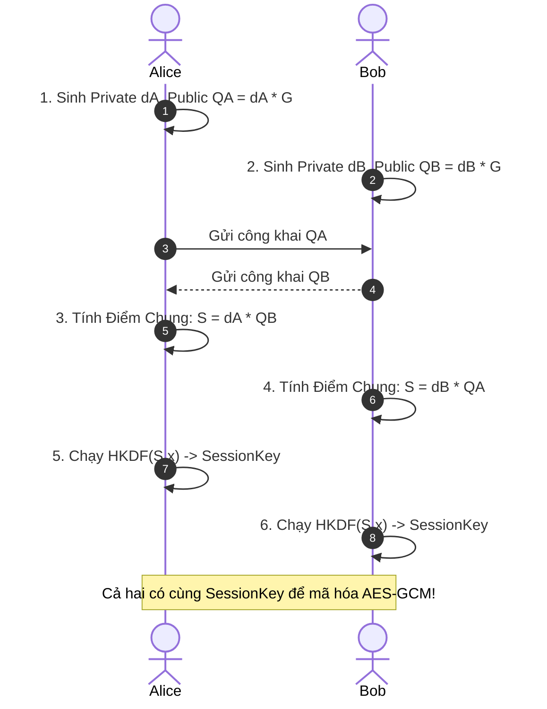
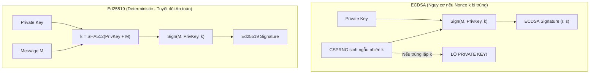
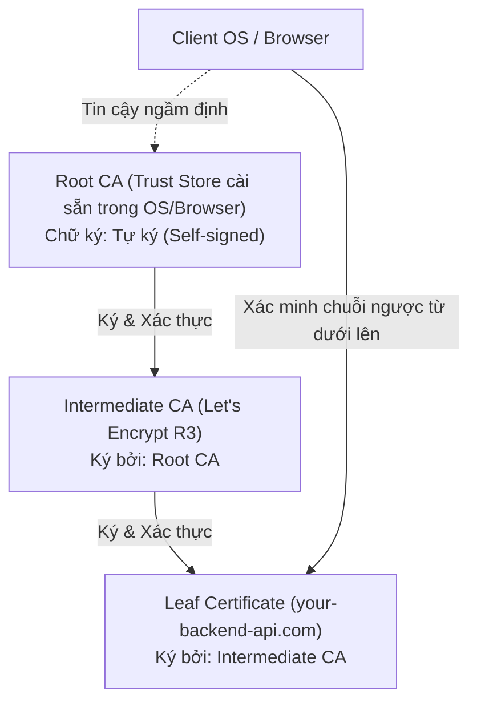

# 2.3. Asymmetric Encryption and PKI (Mã hóa Bất đối xứng & Hạ tầng Khóa Công khai)

## Tổng quan về Asymmetric Cryptography & PKI
Mã hóa bất đối xứng (Asymmetric Cryptography) hay Mật mã khóa công khai (Public Key Cryptography) giải quyết bài toán lớn nhất của mật mã học cổ điển: **Làm thế nào để hai thực thể chưa từng gặp mặt và không có bí mật dùng chung từ trước có thể giao tiếp an toàn qua một kênh truyền thông công cộng bị kẻ thù rình rập?**

Để đảm bảo tính xác thực của chính các Public Key này, nhân loại đã xây dựng nên **Hạ tầng Khóa Công khai (Public Key Infrastructure - PKI)** – mạng lưới các cơ quan cấp phát chứng chỉ (Certificate Authorities - CA) bảo chứng cho danh tính số của mọi máy chủ trên Internet.



---

## 2. Chi tiết từng Keyword (Under-the-Hood Deep Dive)

### 1. RSA vs Elliptic Curve Cryptography (ECC)

#### 1. Khái niệm bản chất (What & Why)
- **RSA (Rivest–Shamir–Adleman - 1977)**: Thuật toán mật mã khóa công khai đầu tiên trên thế giới. Độ an toàn của RSA dựa trên độ khó toán học của **Bài toán Phân tích Số nguyên Cực lớn thành Tích hai Số nguyên tố (Integer Factorization Problem)**:
  - Cho hai số nguyên tố bí mật rất lớn $p$ và $q$, việc tính modulo $n = p \times q$ là siêu dễ (O(1)).
  - Nhưng cho trước $n$ (độ dài 2048 đến 4096 bit), việc phân tích ngược lại để tìm $p$ và $q$ đòi hỏi hàng ngàn năm tính toán của mọi máy tính hiện tại.
- **Elliptic Curve Cryptography (ECC - Mật mã Đường cong Elliptic)**: Thế hệ mật mã bất đối xứng hiện đại. Độ an toàn dựa trên **Bài toán Logarit Rời rạc trên Đường cong Elliptic (ECDLP - Elliptic Curve Discrete Logarithm Problem)**:
  - Cho điểm cơ sở $G$ trên đường cong và khóa riêng số nguyên $d$, việc tính điểm công khai $Q = d \times G$ (phép cộng điểm lặp lại) rất nhanh.
  - Nhưng cho trước điểm $Q$ và điểm $G$, việc tìm ra số nguyên $d$ là bài toán khó vượt trội so với phân tích số nguyên của RSA.
  - *Hệ quả đột phá*: Khóa **ECC 256-bit** cung cấp mức độ an toàn tương đương khóa **RSA 3072-bit**, nhưng kích thước khóa nhỏ hơn 12 lần, tốc độ tính toán nhanh hơn hàng chục lần và tiêu tốn cực ít băng thông mạng.

#### 2. Cơ chế hoạt động sâu (Under the hood / Hardcore Internals)
- **Phương trình Đại số Đường cong Elliptic Weierstrass**:
  $$y^2 = x^3 + ax + b \pmod p$$
  Tập hợp các điểm $(x, y)$ thỏa mãn phương trình trên cùng với "Điểm vô cực" $\mathcal{O}$ tạo thành một nhóm Abel (Abelian Group) với phép cộng điểm hình học (Point Addition & Point Doubling).
- **Phép nhân vô hướng (Scalar Multiplication)**:
  Để tính $Q = d \cdot G$, thuật toán sử dụng kỹ thuật **Double-and-Add** tương tự lũy thừa nhị phân:
  ```text
  Thuật toán: Lặp qua từng bit của d từ MSB đến LSB:
  - Mỗi bước: Q = 2 * Q (Point Doubling)
  - Nếu bit = 1: Q = Q + G (Point Addition)
  ```
  *Bảo mật vi kiến trúc*: Nếu phép Double và phép Add tiêu thụ năng lượng hoặc thời gian CPU khác nhau, hacker có thể soi dao động điện áp (Simple Power Analysis - SPA) để đọc từng bit của $d$. Các thuật toán hiện đại (như Curve25519) bắt buộc phải sử dụng **Montgomery Ladder** để thời gian tính toán luôn bất biến độc lập với giá trị bit của khóa riêng.

#### 3. Sơ đồ minh họa (So sánh Kích thước Khóa và Độ an toàn giữa RSA vs ECC)


#### 4. Code ví dụ thực chiến (C++ OpenSSL RSA vs ECC Key Generation & Benchmark)
```cpp
#include <iostream>
#include <chrono>
#include <openssl/evp.h>
#include <openssl/rsa.h>
#include <openssl/ec.h>

void benchmarkRSA() {
    auto start = std::chrono::high_resolution_clock::now();
    EVP_PKEY_CTX* ctx = EVP_PKEY_CTX_new_id(EVP_PKEY_RSA, nullptr);
    EVP_PKEY* pkey = nullptr;

    EVP_PKEY_keygen_init(ctx);
    EVP_PKEY_CTX_set_rsa_keygen_bits(ctx, 3072); // Chuẩn NIST hiện đại tương đương 128-bit security
    EVP_PKEY_keygen(ctx, &pkey);

    auto end = std::chrono::high_resolution_clock::now();
    std::chrono::duration<double, std::milli> elapsed = end - start;
    std::cout << "RSA-3072 Key Generation Time: " << elapsed.count() << " ms\n";

    EVP_PKEY_free(pkey);
    EVP_PKEY_CTX_free(ctx);
}

void benchmarkECC() {
    auto start = std::chrono::high_resolution_clock::now();
    EVP_PKEY_CTX* ctx = EVP_PKEY_CTX_new_id(EVP_PKEY_EC, nullptr);
    EVP_PKEY* pkey = nullptr;

    EVP_PKEY_keygen_init(ctx);
    EVP_PKEY_CTX_set_ec_paramgen_curve_nid(ctx, NID_X9_62_prime256v1); // NIST P-256 (256-bit)
    EVP_PKEY_keygen(ctx, &pkey);

    auto end = std::chrono::high_resolution_clock::now();
    std::chrono::duration<double, std::milli> elapsed = end - start;
    std::cout << "ECC P-256 Key Generation Time: " << elapsed.count() << " ms\n";

    EVP_PKEY_free(pkey);
    EVP_PKEY_CTX_free(ctx);
}

int main() {
    std::cout << "--- BENCHMARK ASYMMETRIC KEY GENERATION ---\n";
    benchmarkRSA();
    benchmarkECC();
    return 0;
}
```

#### 5. Ưu / Nhược điểm, Pitfalls & Anti-patterns
- **Pitfall**: Vẫn cấu hình chứng chỉ TLS sử dụng khóa RSA 1024-bit (đã bị bẻ gãy từ lâu) hoặc RSA 2048-bit cho các hệ thống dài hạn (cần nâng cấp lên RSA 3072/4096-bit hoặc chuyển hẳn sang ECC P-256 / Ed25519).
- **Anti-pattern**: Sử dụng padding PKCS#1 v1.5 cho RSA encryption. Cơ chế này dính lỗ hổng **Bleichenbacher's Million Message Attack** cho phép giải mã dữ liệu thông qua phản hồi lỗi từ server. Bắt buộc phải dùng **RSA-OAEP** (Optimal Asymmetric Encryption Padding).

#### 6. Ứng dụng thực tế trong Backend / Systems
Hầu hết các tập đoàn công nghệ lớn (Google, Cloudflare, Meta) đã chuyển dịch toàn bộ SSL/TLS edge sang chứng chỉ ECC (ECDSA) giúp giảm dung lượng gói tin TLS Certificate trao đổi ở bước handshake từ 3KB xuống dưới 1KB, loại bỏ việc phân mảnh gói tin TCP và giảm thiểu độ trễ kết nối cho người dùng di động.

---

### 2. Key Exchange: Diffie-Hellman & ECDH

#### 1. Khái niệm bản chất (What & Why)
- **Diffie-Hellman (DH - 1976)**: Giao thức toán học đầu tiên cho phép hai bên Alice và Bob thiết lập một khóa bí mật chung qua một kênh truyền thông không an toàn mà không cần gửi trực tiếp khóa bí mật đó.
- **ECDH (Elliptic Curve Diffie-Hellman)**: Biến thể hiện đại của Diffie-Hellman hoạt động trên nhóm các điểm của đường cong Elliptic.
- **Quy tắc toán học thanh lịch của ECDH**:
  - Alice chọn số ngẫu nhiên bí mật $d_A$ (Private Key) $\implies$ Tính điểm công khai $Q_A = d_A \cdot G$.
  - Bob chọn số ngẫu nhiên bí mật $d_B$ (Private Key) $\implies$ Tính điểm công khai $Q_B = d_B \cdot G$.
  - Alice và Bob gửi công khai $Q_A$ và $Q_B$ cho nhau.
  - Alice tính: $S = d_A \cdot Q_B = d_A \cdot (d_B \cdot G)$.
  - Bob tính: $S = d_B \cdot Q_A = d_B \cdot (d_A \cdot G)$.
  - Vì phép nhân vô hướng có tính giao hoán: $d_A d_B G = d_B d_A G$, Alice và Bob độc lập tạo ra cùng một điểm bí mật $S = (x_S, y_S)$ mà kẻ nghe lén trên đường truyền chỉ biết $G, Q_A, Q_B$ thì bất khả thi để tính được $S$!

#### 2. Cơ chế hoạt động sâu (Under the hood / Hardcore Internals)
- **Key Derivation từ Shared Secret**:
  Điểm bí mật $S$ trên đường cong không được dùng trực tiếp làm khóa mã hóa AES. Tọa độ $x_S$ (thường là 32 bytes) được đưa qua một hàm dẫn xuất khóa chuẩn hóa **HKDF (HMAC-based Extract-and-Expand Key Derivation Function - RFC 5869)**:
  $$\text{PRK} = \text{HKDF-Extract}(\text{Salt}, x_S)$$
  $$\text{SessionKey} = \text{HKDF-Expand}(\text{PRK}, \text{"TLS 1.3 Key Expansion"}, 32)$$
  Quá trình này "san phẳng" độ phân bố entropy của điểm trên đường cong, tạo ra một khóa AES-256 hoàn toàn ngẫu nhiên và an toàn.

#### 3. Sơ đồ minh họa (Luồng trao đổi khóa ECDH kết hợp HKDF)


#### 4. Code ví dụ thực chiến (TypeScript Complete ECDH + HKDF Flow)
```typescript
import * as crypto from 'crypto';

export class SecureKeyExchange {
    public static executeECDHWithHKDF(): { aliceKeyHex: string; bobKeyHex: string } {
        // 1. Khởi tạo đường cong P-256 (secp256r1) cho cả hai bên
        const alice = crypto.createECDH('prime256v1');
        const alicePublic = alice.generateKeys();

        const bob = crypto.createECDH('prime256v1');
        const bobPublic = bob.generateKeys();

        // 2. Trao đổi và tính toán Shared Secret nguyên thủy
        const aliceRawSecret = alice.computeSecret(bobPublic);
        const bobRawSecret = bob.computeSecret(alicePublic);

        // 3. Chuẩn hóa qua HKDF (RFC 5869) để sinh khóa AES-256 đối xứng
        const salt = crypto.randomBytes(16);
        const info = Buffer.from('HANDSHAKE_ENCRYPTION_V1', 'utf8');

        // Alice dẫn xuất khóa
        const aliceSessionKey = crypto.hkdfSync('sha256', aliceRawSecret, salt, info, 32);
        // Bob dẫn xuất khóa
        const bobSessionKey = crypto.hkdfSync('sha256', bobRawSecret, salt, info, 32);

        return {
            aliceKeyHex: Buffer.from(aliceSessionKey).toString('hex'),
            bobKeyHex: Buffer.from(bobSessionKey).toString('hex')
        };
    }
}

const result = SecureKeyExchange.executeECDHWithHKDF();
console.log("Alice Derived Key:", result.aliceKeyHex);
console.log("Bob Derived Key:  ", result.bobKeyHex);
console.log("Are Keys Identical?:", result.aliceKeyHex === result.bobKeyHex);
```

#### 5. Ưu / Nhược điểm, Pitfalls & Anti-patterns
- **Pitfall**: Diffie-Hellman thuần túy **không có khả năng chống tấn công Man-in-the-Middle (MITM)**. Kẻ tấn công đứng giữa có thể đóng vai Bob đối với Alice và đóng vai Alice đối với Bob. Vì vậy, các giá trị Public Key trong ECDH bắt buộc phải được bọc trong chữ ký số hoặc chứng chỉ số (X.509 Certificate).
- **Anti-pattern**: Sử dụng số nguyên tố Diffie-Hellman cổ điển (DH Groups) có độ dài dưới 2048-bit (Lỗ hổng Logjam attack).

#### 6. Ứng dụng thực tế trong Backend / Systems
Là trái tim của quy trình thiết lập kết nối mã hóa trong **TLS 1.3 Handshake**, SSH connection setup và giao thức truyền thông an toàn tức thời (Signal Protocol / WhatsApp End-to-End Encryption).

---

### 3. Digital Signatures: ECDSA vs Ed25519

#### 1. Khái niệm bản chất (What & Why)
- **Digital Signatures (Chữ ký số)**: Cơ chế mật mã học đảm bảo 3 đặc tính: **Tính toàn vẹn (Integrity)**, **Tính xác thực nguồn gốc (Authenticity)**, và **Tính không thể chối bỏ (Non-Repudiation)**.
- **ECDSA (Elliptic Curve Digital Signature Algorithm)**: Tiêu chuẩn chữ ký đường cong Elliptic của ANSI/NIST (chuẩn hóa năm 1999). Sử dụng các đường cong như secp256k1 (Bitcoin/Ethereum) hoặc prime256v1 (NIST P-256).
- **Ed25519 (Edwards-curve Digital Signature Algorithm)**: Thuật toán chữ ký thế hệ mới nhất dựa trên đường cong Edwards xoắn (Twisted Edwards curve Ed25519, chuẩn RFC 8032). Thiết kế bởi Dan Bernstein với mục tiêu loại bỏ hoàn toàn các lỗ hổng thực thi side-channel và lỗi sinh số ngẫu nhiên của ECDSA.

#### 2. Cơ chế hoạt động sâu (Under the hood / Hardcore Internals)
- **Hiểm họa Nonce trong ECDSA (Sony PS3 Cryptographic Disaster)**:
  Khi tạo chữ ký ECDSA cho thông điệp $M$:
  $$\text{Ký: } s = k^{-1} (H(M) + r \cdot d) \pmod n$$
  Trong đó $k$ là một số ngẫu nhiên bí mật (Per-signature Nonce).
  - *Lỗ hổng chết người*: Nếu số $k$ bị tái sử dụng cho 2 chữ ký khác nhau $(M_1, M_2)$ hoặc bộ sinh số ngẫu nhiên bị thiên vị (Biased PRNG), kẻ tấn công chỉ cần thực hiện phép trừ đại số cấp 2:
    $$s_1 - s_2 = k^{-1} (H(M_1) - H(M_2)) \implies k = \frac{H(M_1) - H(M_2)}{s_1 - s_2}$$
    Tìm ra được $k$, kẻ tấn công suy ngược trực tiếp ra **Private Key $d$** của hệ thống! (Đây chính là cách nhóm hacker fail0verflow tìm ra Root Private Key của hệ máy Sony PlayStation 3).
- **Ed25519 - Giải pháp Triệt tiêu Lỗ hổng**:
  Ed25519 **loại bỏ hoàn toàn bộ sinh số ngẫu nhiên khi ký**. Giá trị nonce $k$ được sinh một cách xác định (Deterministic) bằng hàm băm SHA-512 của chính Private Key và nội dung thông điệp:
  $$k = \text{SHA-512}(\text{Prefix}(PrivKey) \ || \ M)$$
  Do đó, Ed25519 miễn nhiễm 100% với lỗi tái sử dụng nonce hoặc lỗi RNG kém chất lượng!

#### 3. Sơ đồ minh họa (So sánh luồng ký ECDSA vs Ed25519)


#### 4. Code ví dụ thực chiến (TypeScript Ed25519 Modern Signature & Verification)
```typescript
import * as crypto from 'crypto';

export class ModernSignerEngine {
    // Sinh cặp khóa Ed25519 chuẩn RFC 8032
    public static generateKeys() {
        return crypto.generateKeyPairSync('ed25519', {
            publicKeyEncoding: { type: 'spki', format: 'pem' },
            privateKeyEncoding: { type: 'pkcs8', format: 'pem' }
        });
    }

    // Ký thông điệp (Bất biến, tốc độ siêu cao)
    public static sign(message: string, privateKeyPem: string): Buffer {
        const signer = crypto.createSign(undefined);
        signer.update(Buffer.from(message, 'utf8'));
        return signer.sign(privateKeyPem);
    }

    // Xác thực chữ ký
    public static verify(message: string, signature: Buffer, publicKeyPem: string): boolean {
        const verifier = crypto.createVerify(undefined);
        verifier.update(Buffer.from(message, 'utf8'));
        return verifier.verify(publicKeyPem, signature);
    }
}

const keys = ModernSignerEngine.generateKeys();
const message = "AUTHORIZE_PAYMENT_TX_987654";
const sig = ModernSignerEngine.sign(message, keys.privateKey);

console.log("Ed25519 Signature Length:", sig.length, "bytes (Luôn luôn cố định 64 bytes)");
console.log("Signature Valid:", ModernSignerEngine.verify(message, sig, keys.publicKey));
```

#### 5. Ưu / Nhược điểm, Pitfalls & Anti-patterns
- **Pitfall**: Dùng ECDSA mà không áp dụng RFC 6979 (Deterministic ECDSA). Nếu viết app trên thiết bị nhúng có bộ đệm entropy yếu, hệ thống sẽ sớm bị rò rỉ private key.
- **Anti-pattern**: Lưu trữ Private Key của hệ thống dưới dạng file plaintext trên ổ cứng máy chủ thay vì dùng Hardware Security Module (HSM) hoặc Secret Manager có mã hóa.

#### 6. Ứng dụng thực tế trong Backend / Systems
Ed25519 là tiêu chuẩn chữ ký mặc định của **SSH keys (`ssh-ed25519`)**, các hệ thống blockchain thế hệ mới (Solana, Cardano), và hệ thống xác thực máy chủ phân tán.

---

### 4. Public Key Infrastructure (PKI) & X.509 Certificates

#### 1. Khái niệm bản chất (What & Why)
- **Public Key Infrastructure (PKI - Hạ tầng Khóa Công khai)**: Tập hợp các vai trò, chính sách, phần cứng, phần mềm và quy trình cần thiết để tạo, quản lý, phân phối, sử dụng, lưu trữ và thu hồi các chứng chỉ số (Digital Certificates).
- **Vấn đề cốt lõi PKI giải quyết**: Làm sao Bob biết chắc chắn rằng Public Key mang tên `google.com` thực sự thuộc về Google chứ không phải của kẻ tấn công đang đứng giữa mạng WiFi công cộng?
- **X.509 Certificate**: Định dạng chuẩn quốc tế (ITU-T) liên kết một Public Key với một danh tính cụ thể (Domain name, Organization, Country) thông qua chữ ký số của một cơ quan uy tín.

#### 2. Cơ chế hoạt động sâu (Under the hood / Hardcore Internals)
- **Chuỗi Tin cậy (Certificate Chain of Trust)**:
  1. **Root CA (Certificate Authority Cấp cao nhất)**: Sở hữu cặp khóa tối thượng. Public Certificate của Root CA được tích hợp sẵn (Hardcoded / Trust Store) vào Hệ điều hành (Windows, Linux `/etc/ssl/certs`, macOS Keychain) và Trình duyệt (Mozilla NSS). Private Key của Root CA được cất giữ trong két sắt ngoại tuyến (Air-gapped HSM) và không bao giờ kết nối Internet.
  2. **Intermediate CA (CA Trung gian)**: Root CA ký cấp chứng chỉ cho Intermediate CA. Intermediate CA được dùng để cấp phát chứng chỉ hàng ngày cho các website. Nếu một Intermediate CA bị lộ khóa, Root CA chỉ cần thu hồi chứng chỉ của Intermediate đó mà không làm sụp đổ toàn bộ Trust Store của thế giới.
  3. **Leaf Certificate (End-entity Certificate)**: Chứng chỉ cấp cho website (ví dụ: `api.example.com`).
- **Xác thực Chứng chỉ trong TLS Handshake**:
  Client kiểm tra đệ quy ngược từ Leaf $\to$ Intermediate $\to$ Root:
  - Tên miền trùng khớp (SAN - Subject Alternative Name).
  - Còn trong hạn sử dụng (`NotBefore` $\le$ Hiện tại $\le$ `NotAfter`).
  - Chữ ký số của mỗi nốt trong chuỗi hợp lệ về mặt toán học.
  - Chứng chỉ chưa bị thu hồi (Kiểm tra qua danh sách **CRL - Certificate Revocation List** hoặc giao thức kiểm tra thời gian thực **OCSP - Online Certificate Status Protocol**).

#### 3. Sơ đồ minh họa (Chuỗi Tin cậy X.509 Certificate Chain of Trust)


#### 4. Code ví dụ thực chiến (C++ OpenSSL X.509 Certificate Verification Engine)
```cpp
#include <iostream>
#include <openssl/x509.h>
#include <openssl/x509_vfy.h>
#include <openssl/pem.h>

// Minh họa cơ chế thẩm định chuỗi chứng chỉ X.509 trong C++
class CertificateChainVerifier {
public:
    static bool verifyCertificate(X509* leafCert, STACK_OF(X509)* intermediateChain, X509_STORE* caStore) {
        X509_STORE_CTX* ctx = X509_STORE_CTX_new();
        if (!ctx) return false;

        // Thiết lập ngữ cảnh xác thực với CA Store tin cậy của Hệ điều hành
        X509_STORE_CTX_init(ctx, caStore, leafCert, intermediateChain);

        // Kích hoạt việc kiểm tra chuỗi chứng chỉ đầy đủ
        int result = X509_verify_cert(ctx);
        if (result != 1) {
            int err = X509_STORE_CTX_get_error(ctx);
            std::cerr << "Certificate Verification Failed: " 
                      << X509_verify_cert_error_string(err) << "\n";
            X509_STORE_CTX_free(ctx);
            return false;
        }

        std::cout << "Certificate Chain successfully verified against Root CA Store!\n";
        X509_STORE_CTX_free(ctx);
        return true;
    }
};

int main() {
    OpenSSL_add_all_algorithms();
    // Khởi tạo CA store chuẩn từ hệ điều hành
    X509_STORE* store = X509_STORE_new();
    X509_STORE_set_default_paths(store);

    std::cout << "OS Default Trusted CA Store successfully loaded.\n";
    // Trong production, leafCert và intermediateChain được trích xuất trực tiếp từ TLS Handshake Socket
    X509_STORE_free(store);
    return 0;
}
```

#### 5. Ưu / Nhược điểm, Pitfalls & Anti-patterns
- **Pitfall**: Sử dụng tùy chọn `rejectUnauthorized: false` (trong Node.js/axios) hoặc `curl -k` (bỏ qua kiểm tra chứng chỉ) trong môi trường production để "tránh lỗi chứng chỉ tự ký". Hành vi này hủy hoại 100% khả năng phòng thủ, cho phép bất kỳ ai trên cùng mạng WiFi thực hiện MITM đọc toàn bộ mật khẩu và token.
- **Anti-pattern**: Quên cấu hình gia hạn tự động chứng chỉ (ví dụ: dùng Certbot cho Let's Encrypt), dẫn đến việc chứng chỉ hết hạn làm gián đoạn toàn bộ dịch vụ của khách hàng.

#### 6. Ứng dụng thực tế trong Backend / Systems
Nền tảng của toàn bộ bảo mật web (HTTPS), bảo mật truyền thông nội bộ giữa các microservices qua **mTLS (Mutual TLS)** trong Kubernetes Service Mesh (Istio / Linkerd), và mã hóa chữ ký trong Docker Image Signing (Cosign / Sigstore).
