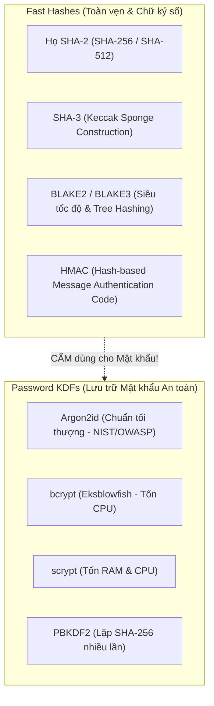
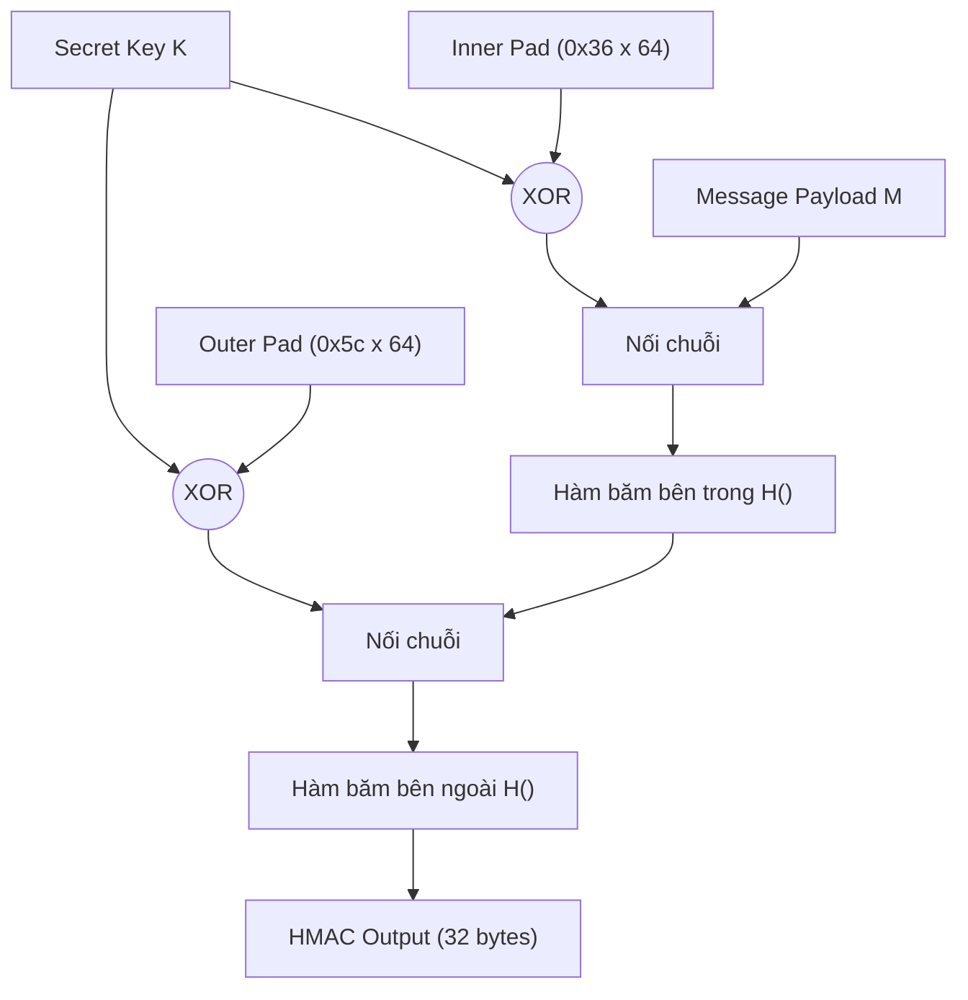
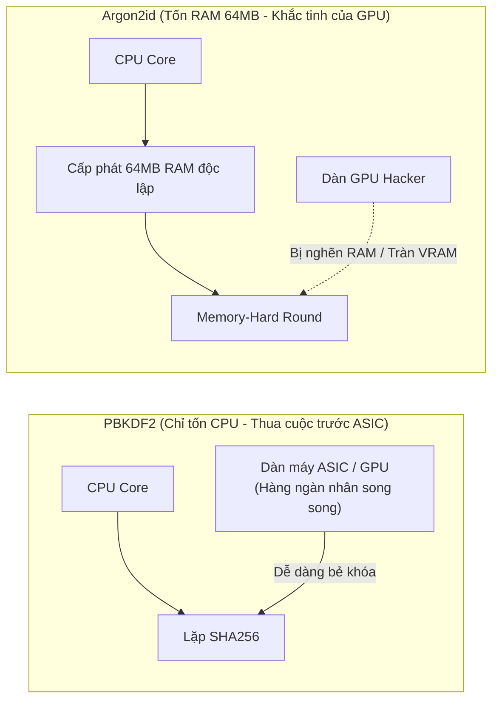
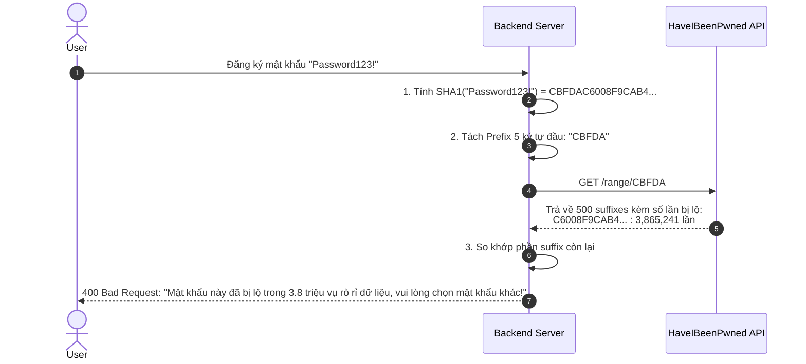

# 2.4. Hashing and Password Security (Băm Dữ liệu & Bảo mật Mật khẩu)

## Tổng quan về Hashing vs Password Hashing
Một trong những sai lầm kinh điển và tai hại nhất của các kỹ sư phần mềm là **đánh đồng giữa Hàm băm Mật mã Tốc độ cao (Fast Cryptographic Hash) và Hàm băm Mật khẩu Chậm có chủ đích (Slow/Memory-Hard Password KDF)**. 

- Các hàm băm như **SHA-256, SHA-512 hay BLAKE3** được thiết kế để tính toán nhanh nhất có thể (hàng trăm triệu phép tính mỗi giây trên CPU/GPU) nhằm phục vụ kiểm tra tính toàn vẹn gói tin, blockchain và chữ ký số.
- Ngược lại, **Mật khẩu người dùng** có entropy rất thấp (con người thường đặt mật khẩu ngắn, dễ nhớ). Nếu dùng SHA-256 để băm mật khẩu, một dàn máy đào coin GPU thông thường có thể vét cạn hàng tỷ mật khẩu mỗi giây! Do đó, lưu trữ mật khẩu bắt buộc phải sử dụng các thuật toán **Key Derivation Functions (KDF)** có tính toán chậm, tốn nhiều bộ nhớ RAM (Memory-hard) và có thể điều chỉnh độ khó (Work Factor) như **Argon2id, bcrypt, scrypt**.



---

## 2. Chi tiết từng Keyword (Under-the-Hood Deep Dive)

### 1. Fast Cryptographic Hashes: SHA-2, SHA-3, BLAKE2/3 & HMAC

#### 1. Khái niệm bản chất (What & Why)
- **SHA-2 (Secure Hash Algorithm 2)**: Gia đình hàm băm chuẩn NIST công bố năm 2001, thiết kế theo cấu trúc **Merkle–Damgård**. Bao gồm SHA-224, SHA-256, SHA-384, SHA-512. Đến nay SHA-256 và SHA-512 vẫn an toàn tuyệt đối trước mọi cuộc tấn công va chạm thực tế.
- **SHA-3 (Keccak)**: Chuẩn hàm băm được NIST lựa chọn năm 2015 sau cuộc thi mở rộng toàn cầu. Không sử dụng cấu trúc Merkle-Damgård mà dùng kiến trúc **Sponge Construction (Hấp thụ & Bóp ép bọt biển)**. Miễn nhiễm hoàn toàn với tấn công mở rộng độ dài (Length Extension Attack).
- **BLAKE2 & BLAKE3**: Thế hệ hàm băm hiện đại nhất. BLAKE3 (công bố năm 2020) có tốc độ tính toán nhanh hơn SHA-256 gấp 10 lần và nhanh hơn MD5/SHA-1, dựa trên cấu trúc **Tree Hashing** cho phép tính toán song song đa luồng tối đa trên các thanh ghi SIMD (AVX-512, NEON).
- **HMAC (Hash-based Message Authentication Code - RFC 2104)**: Cơ chế kết hợp một khóa bí mật $K$ với một hàm băm $H$:
  $$\text{HMAC}(K, M) = H\Big((K \oplus \text{opad}) \ || \ H((K \oplus \text{ipad}) \ || \ M)\Big)$$
  HMAC giải quyết triệt để lỗi Length Extension Attack của các hàm băm Merkle-Damgård thông thường khi dùng làm mã xác thực.

#### 2. Cơ chế hoạt động sâu (Under the hood / Hardcore Internals)
- **Length Extension Attack (Tại sao `Hash(Key || Message)` là một thảm họa?)**:
  Trong cấu trúc Merkle-Damgård (SHA-256), trạng thái nội tại (Internal State) sau khi xử lý xong khối cuối cùng chính là giá trị Output Hash. Kẻ tấn công trên mạng chỉ cần biết `Hash(Key || Message)` và độ dài của nó là có thể nạp giá trị này vào làm Internal State mới và nối thêm dữ liệu độc hại `MaliciousData` vào đuôi:
  $$H_{\text{forged}} = \text{SHA-256}(Key \ || \ Message \ || \ Padding \ || \ MaliciousData)$$
  Server nhận được bản tin giả mạo này sẽ vẫn tính ra hash khớp hoàn toàn! 
  - **Giải pháp**: Bắt buộc phải sử dụng **HMAC** (băm 2 lớp lồng nhau với `ipad` và `opad`) hoặc chuyển sang dùng **SHA-3 / BLAKE3**.

#### 3. Sơ đồ minh họa (Kiến trúc tính toán hai tầng của HMAC)


#### 4. Code ví dụ thực chiến (C++ High-Performance HMAC-SHA256 via OpenSSL)
```cpp
#include <iostream>
#include <vector>
#include <string>
#include <openssl/hmac.h>
#include <iomanip>

class HmacCalculator {
public:
    static std::string calculate(const std::string& key, const std::string& message) {
        unsigned char result[EVP_MAX_MD_SIZE];
        unsigned int resultLen = 0;

        HMAC(
            EVP_sha256(),
            key.data(), key.size(),
            reinterpret_cast<const unsigned char*>(message.data()), message.size(),
            result, &resultLen
        );

        std::stringstream ss;
        for (unsigned int i = 0; i < resultLen; ++i) {
            ss << std::hex << std::setw(2) << std::setfill('0') << static_cast<int>(result[i]);
        }
        return ss.str();
    }
};

int main() {
    std::string apiSecret = "sk_live_983748293482394823";
    std::string webhookPayload = "{\"event\":\"invoice.paid\",\"amount\":50000}";

    std::string hmacSignature = HmacCalculator::calculate(apiSecret, webhookPayload);
    std::cout << "Computed Webhook HMAC-SHA256: " << hmacSignature << "\n";
    return 0;
}
```

#### 5. Ưu / Nhược điểm, Pitfalls & Anti-patterns
- **Pitfall**: Dùng `crypto.createHash('sha256').update(secret + message).digest()` trong Node.js để làm webhook signature thay vì `createHmac()`. Thao tác này mở đường cho Length Extension Attack.
- **Anti-pattern**: Dùng MD5 hoặc SHA-1 để hash mật khẩu hoặc tạo checksum trong các hệ thống mới xây dựng.

#### 6. Ứng dụng thực tế trong Backend / Systems
HMAC là tiêu chuẩn xác thực chữ ký của tất cả các dịch vụ Webhook quy mô lớn (GitHub Webhooks, Stripe Signatures, AWS Signature Version 4) và là nền tảng ký của **JSON Web Tokens (JWT với thuật toán HS256)**.

---

### 2. Password Hashing & Key Derivation: Argon2, Argon2id, bcrypt, scrypt & PBKDF2

#### 1. Khái niệm bản chất (What & Why)
- **Password Hashing (Băm mật khẩu)**: Cơ chế chuyển đổi mật khẩu thành một chuỗi đại diện không thể đảo ngược, phục vụ việc so khớp khi đăng nhập.
- **Tại sao cần thuật toán chuyên dụng?**: Khi cơ sở dữ liệu người dùng bị rò rỉ, hacker sẽ dùng các hệ thống ASIC (mạch tích hợp chuyên dụng) hoặc hàng ngàn card đồ họa GPU để chạy các hàm băm hàng triệu lần mỗi giây. Thuật toán Password Hashing bắt buộc phải có tính năng:
  1. **Work Factor / Iterations**: Làm chậm thời gian tính toán của CPU.
  2. **Memory-Hardness**: Buộc thuật toán phải chiếm dụng một lượng RAM lớn (ví dụ: 64MB cho mỗi mật khẩu). Card GPU có hàng ngàn nhân tính toán nhưng bộ nhớ cache/RAM trên mỗi nhân cực kỳ hạn chế; khi thuật toán đòi hỏi nhiều RAM, GPU sẽ bị nghẽn băng thông bộ nhớ (Memory bandwidth bottleneck), triệt tiêu lợi thế tính toán song song của hacker.
- **Bảng xếp hạng thuật toán**:
  - **Argon2 (Argon2id)**: Quán quân cuộc thi Password Hashing Competition (PHC 2015). **Tiêu chuẩn số 1 thế giới hiện tại (Khuyến nghị bởi OWASP/NIST)**. Kết hợp chống tấn công dựa trên GPU/ASIC (Argon2d) và chống tấn công dựa trên Side-Channel Cache-timing (Argon2i).
  - **bcrypt**: Dựa trên thuật toán mã hóa khối Blowfish (Eksblowfish setup). Rất phổ biến, hiệu quả cao chống GPU, nhưng giới hạn mật khẩu đầu vào tối đa là **72 bytes** và không tiêu tốn nhiều RAM như Argon2.
  - **scrypt**: Thiết kế bởi Colin Percival năm 2009, là thuật toán memory-hard đầu tiên.
  - **PBKDF2**: Thuật toán cũ chuẩn NIST (chỉ lặp đi lặp lại SHA-256 hàng trăm ngàn lần). Không có tính năng memory-hard nên dễ bị khai thác bởi FPGA và ASIC chuyên dụng.

#### 2. Cơ chế hoạt động sâu (Under the hood / Hardcore Internals)
- **Cấu trúc Tham số của Argon2id**:
  1. **$t$ (Time Cost / Iterations)**: Số vòng duyệt qua bộ nhớ (thường chọn $t = 2$ hoặc $3$).
  2. **$m$ (Memory Cost)**: Dung lượng RAM cấp phát (khuyến nghị của OWASP là 64 MiB = $65536$ KiB cho server thông thường hoặc 19 MiB cho môi trường hạn chế tài nguyên).
  3. **$p$ (Parallelism / Threads)**: Số luồng CPU song song thực thi (thường là 1 đến 4 luồng).
- **Cấu trúc chuỗi băm thành phẩm (Argon2 Hash Format)**:
  `$argon2id$v=19$m=65536,t=3,p=4$<salt>$<hash>`
  Chuỗi này tự chứa đầy đủ các siêu dữ liệu cấu hình, cho phép server tự động điều chỉnh độ khó trong tương lai mà không làm hỏng mật khẩu cũ.

#### 3. Sơ đồ minh họa (Khả năng kháng phần cứng tấn công của Argon2id vs PBKDF2)


#### 4. Code ví dụ thực chiến (TypeScript Secure Password Hashing via @node-rs/argon2)
```typescript
import { hash, verify, argon2id } from '@node-rs/argon2';

export class SecurePasswordManager {
    // Cấu hình chuẩn khuyến nghị của OWASP cho môi trường Backend
    private static readonly ARGON2_OPTIONS = {
        algorithm: argon2id,
        memoryCost: 65536, // 64 MB RAM
        timeCost: 3,       // 3 iterations
        parallelism: 4,    // 4 luồng CPU
    };

    /**
     * Băm mật khẩu người dùng với Salt ngẫu nhiên được sinh tự động
     */
    public static async hashPassword(plainPassword: string): Promise<string> {
        return await hash(plainPassword, this.ARGON2_OPTIONS);
    }

    /**
     * Xác thực mật khẩu với Constant-Time Verification nội tại của Argon2
     */
    public static async verifyPassword(plainPassword: string, hashString: string): Promise<boolean> {
        try {
            return await verify(hashString, plainPassword);
        } catch (error) {
            console.error("Argon2 Verification Internal Error:", error);
            return false;
        }
    }
}

// Minh họa chu trình đăng ký & đăng nhập
async function run() {
    const userPass = "P@ssw0rdSecure!2026";

    console.log("Hashing password with Argon2id...");
    const hashedPassword = await SecurePasswordManager.hashPassword(userPass);
    console.log("Stored DB Hash:", hashedPassword);

    const isMatch = await SecurePasswordManager.verifyPassword(userPass, hashedPassword);
    console.log("Login Verification:", isMatch ? "SUCCESS" : "FAILED");
}

run();
```

#### 5. Ưu / Nhược điểm, Pitfalls & Anti-patterns
- **Pitfall**: Sử dụng bcrypt nhưng không xử lý vấn đề cắt ngắn mật khẩu 72 bytes. Nếu người dùng nhập mật khẩu dài 100 ký tự, bcrypt sẽ âm thầm bỏ qua 28 ký tự cuối cùng! (Để khắc phục, một số hệ thống băm trước bằng SHA-256 rồi mới đẩy vào bcrypt, nhưng cách tốt nhất là chuyển sang dùng **Argon2id**).
- **Anti-pattern**: Tự ý tăng tham số Time Cost và Memory Cost quá cao trên Backend API. Nếu việc verify tốn tới 2 giây CPU cho mỗi request đăng nhập, kẻ tấn công chỉ cần gửi 100 requests đăng nhập đồng thời là có thể làm sập hoàn toàn Web Server (Resource Exhaustion DoS).

#### 6. Ứng dụng thực tế trong Backend / Systems
Là kiến trúc xác thực mặc định của các framework hiện đại như Django 4+, Ruby on Rails 7+, Laravel, và hệ thống quản trị người dùng phân tán (Keycloak, Auth0).

---

### 3. Password Attacks & Defense: Rainbow Tables, Credential Stuffing & Password Spraying

#### 1. Khái niệm bản chất (What & Why)
- **Rainbow Tables**: Bảng dữ liệu khổng lồ tính toán sẵn hàng tỷ cặp `(Plaintext, Hash)` sử dụng hàm giảm (Reduction function) để tiết kiệm dung lượng đĩa. Giúp hacker tra ngược mật khẩu từ hash bị lộ chỉ trong vài mili-giây.
  - *Giải pháp*: **Salting** (Mỗi người dùng có một Salt ngẫu nhiên độc nhất $\implies$ Vô hiệu hóa 100% Rainbow Tables).
- **Brute-Force Attacks (Tấn công Vét cạn)**: Thử nghiệm mọi tổ hợp ký tự có thể có (`aaaa`, `aaab`, `aaac`...) cho đến khi tìm ra mật khẩu chính xác.
- **Dictionary Attacks (Tấn công Từ điển)**: Thử danh sách các mật khẩu phổ biến nhất (danh sách RockYou với hàng triệu từ khóa) kết hợp các biến thể số và ký tự đặc biệt (`admin123!`).
- **Credential Stuffing (Nhồi nhét Thông tin Đăng nhập)**: Kẻ tấn công thu thập các cặp `(Username/Email, Password)` bị rò rỉ từ các vụ hack website khác trên thế giới, sau đó dùng botnet tự động thử đăng nhập hàng loạt vào website của bạn (dựa trên thói quen dùng chung một mật khẩu cho nhiều dịch vụ của người dùng).
- **Password Spraying (Xịt Mật khẩu)**: Ngược lại với Brute-force (thử nhiều mật khẩu trên 1 tài khoản $\implies$ dễ bị khóa tài khoản): Kẻ tấn công chọn một mật khẩu duy nhất rất phổ biến (ví dụ: `Spring2026!`) và thử đăng nhập vào hàng ngàn tài khoản người dùng khác nhau. Kỹ thuật này né tránh các ngưỡng khóa tài khoản (Account Lockout Thresholds) truyền thống.

#### 2. Cơ chế hoạt động sâu (Under the hood / Hardcore Internals)
- **Kiến trúc Phòng vệ Credential Stuffing & Password Spraying**:
  Để chống lại các đợt tấn công phân tán từ hàng triệu IP botnet:
  1. **Tầng Biên (Edge WAF / Cloudflare Bot Management)**: Phân tích hành vi TLS Fingerprint (JA3/JA4), HTTP/2 Client Frames và điểm uy tín IP (IP Reputation Score).
  2. **Rate Limiting Đa chiều (Multi-dimensional Leaky Bucket / Token Bucket)**:
     - Rate limit theo `IP`.
     - Rate limit theo `Username / Account ID`.
     - Rate limit theo `Global Failed Login Attempts` trên toàn cụm hệ thống.
  3. **Tích hợp API Kiểm tra Mật khẩu Rò rỉ (Have I Been Pwned - k-Anonymity)**:
     Khi người dùng đặt mật khẩu mới, backend băm mật khẩu bằng SHA-1, lấy 5 ký tự đầu (Prefix) gửi lên API của *HaveIBeenPwned*. Server HIBP trả về danh sách các hash có cùng prefix (k-Anonymity model không để lộ mật khẩu đầy đủ). Nếu mật khẩu nằm trong danh sách đã bị lộ trên Dark Web, backend từ chối cho phép đăng ký!

#### 3. Sơ đồ minh họa (Mô hình k-Anonymity kiểm tra mật khẩu rò rỉ an toàn)


#### 4. Code ví dụ thực chiến (TypeScript HaveIBeenPwned k-Anonymity Password Check)
```typescript
import * as crypto from 'crypto';

export class PasswordBreachChecker {
    /**
     * Kiểm tra mật khẩu có nằm trong cơ sở dữ liệu rò rỉ toàn cầu mà không làm lộ mật khẩu
     */
    public static async isPasswordPwned(password: string): Promise<boolean> {
        // 1. Tính toán SHA-1 hash của mật khẩu dạng in hoa
        const sha1Hash = crypto
            .createHash('sha1')
            .update(password, 'utf8')
            .digest('hex')
            .toUpperCase();

        const prefix = sha1Hash.substring(0, 5);
        const suffix = sha1Hash.substring(5);

        // 2. Gửi duy nhất 5 ký tự prefix lên HIBP API (Bảo vệ tuyệt đối Privacy của User)
        const response = await fetch(`https://api.pwnedpasswords.com/range/${prefix}`, {
            headers: { 'User-Agent': 'Security-Education-Checker' }
        });

        if (!response.ok) {
            console.warn("Could not reach HIBP API, failing open with caution.");
            return false;
        }

        const responseText = await response.text();
        const lines = responseText.split('\n');

        // 3. Tìm kiếm suffix trong kết quả trả về
        for (const line of lines) {
            const [returnedSuffix, countStr] = line.trim().split(':');
            if (returnedSuffix === suffix) {
                console.log(`Alert: Password was found in breaches ${countStr} times!`);
                return true;
            }
        }
        return false;
    }
}
```

#### 5. Ưu / Nhược điểm, Pitfalls & Anti-patterns
- **Pitfall**: Thiết lập chính sách khóa cứng tài khoản (Hard Lockout) sau 5 lần gõ sai mà không có CAPTCHA hoặc Exponential Backoff. Kẻ tấn công sẽ chạy Password Spraying hoặc cố tình gõ sai mật khẩu của toàn bộ nhân viên công ty để gây tê liệt hệ thống (Account Lockout DoS).
- **Anti-pattern**: Ép buộc người dùng đổi mật khẩu định kỳ 30 hoặc 60 ngày một lần mà không có lý do nghi ngờ rò rỉ. Nghiên cứu của NIST chỉ ra rằng việc này phản tác dụng vì người dùng sẽ chỉ đổi ký tự cuối cùng (`Password1` $\to$ `Password2`), làm mật khẩu yếu đi.

#### 6. Ứng dụng thực tế trong Backend / Systems
Mọi hệ thống IdP lớn (Google Accounts, Microsoft Entra ID, Okta) đều áp dụng tính năng **Smart Lockout**, chấm điểm rủi ro phiên đăng nhập (Risk-based score) và tích hợp k-Anonymity breached password feed trực tiếp vào luồng xác thực tài khoản.
