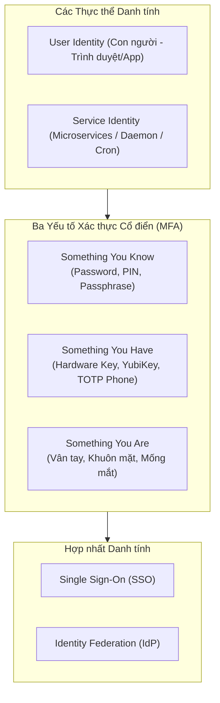
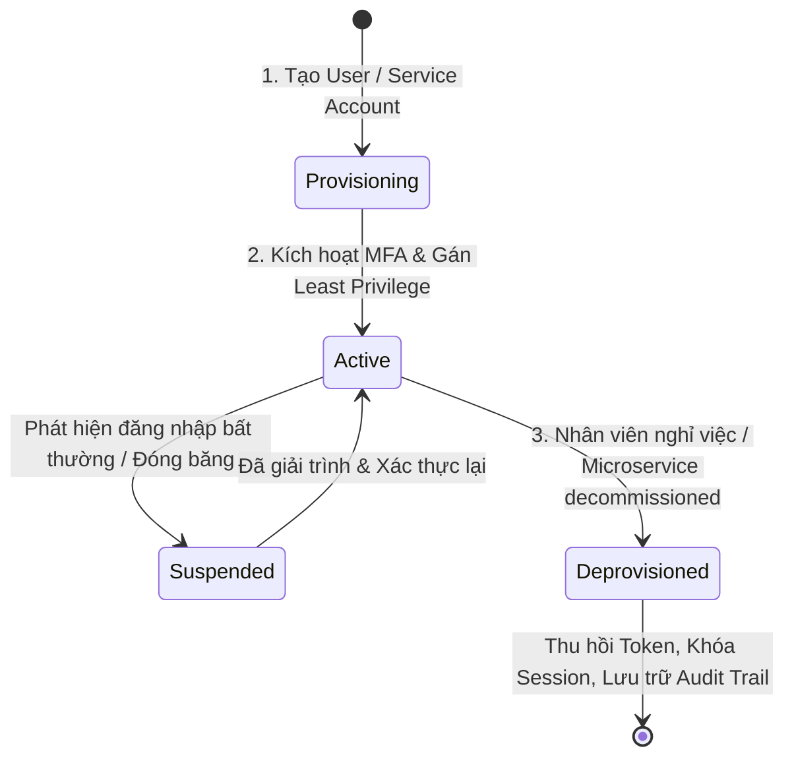
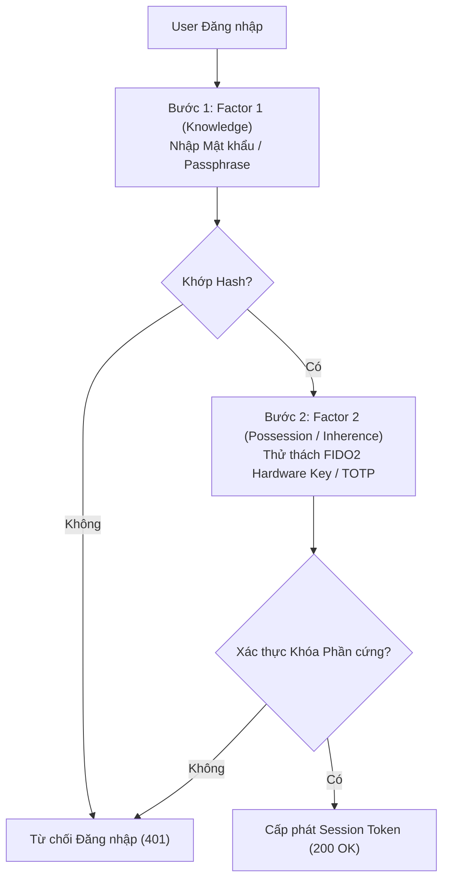
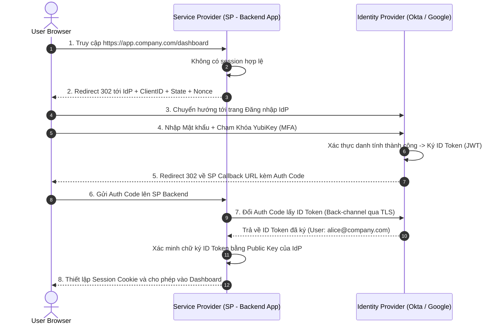

# 3.1. Identity and Authentication Factors (Quản trị Danh tính & Các Yếu tố Xác thực)

## Tổng quan về Identity & Authentication
Trong hệ thống tính toán phân tán và kiến trúc microservices hiện đại, **Danh tính (Identity)** là chu vi bảo mật mới (The New Security Perimeter). Khi tường lửa mạng truyền thống dần mất đi vai trò thống trị trước làn sóng Cloud và Remote Work, câu hỏi "Chủ thể nào đang thực hiện yêu cầu này?" trở thành lớp phòng thủ đầu tiên và quan trọng nhất.

- **Vấn đề cốt lõi**: Xác lập sự tin cậy rằng một thực thể (Con người hoặc Dịch vụ máy tính) thực sự là chính họ mà không làm suy giảm trải nghiệm người dùng hoặc tạo ra điểm nghẽn hệ thống.
- **Bản chất dưới tầng máy tính**: Xác thực danh tính là quá trình ánh xạ một tập hợp các bằng chứng số (Credentials / Cryptographic Proofs) sang một định danh số duy nhất (Security Principal / User ID) trong không gian bộ nhớ của hệ thống.



---

## 2. Chi tiết từng Keyword (Under-the-Hood Deep Dive)

### 1. Identity Management, Identity Lifecycle, User Identity & Service Identity

#### 1. Khái niệm bản chất (What & Why)
- **Identity Management (Quản trị Danh tính - IdM / IAM)**: Tập hợp các chính sách, quy trình và công nghệ để quản lý thông tin danh tính, phân quyền và đảm bảo quyền truy cập an toàn vào các tài nguyên số của tổ chức.
- **Identity Lifecycle (Vòng đời Danh tính)**: Chu trình khép kín từ khi một danh tính được sinh ra cho đến khi bị hủy bỏ hoàn toàn, bao gồm 4 giai đoạn cốt lõi:
  1. **Provisioning (Khởi tạo)**: Đăng ký tài khoản, sinh ID, gán vai trò ban đầu.
  2. **Maintenance (Duy trì & Cập nhật)**: Đổi mật khẩu, kích hoạt MFA, điều chỉnh quyền hạn khi luân chuyển phòng ban (Role transitions).
  3. **Suspension (Tạm khóa)**: Đóng băng quyền truy cập khi phát hiện hành vi khả nghi hoặc nghỉ phép dài hạn.
  4. **Deprovisioning (Thu hồi & Tiêu hủy)**: Xóa tài khoản, thu hồi toàn bộ token, vô hiệu hóa khóa API khi nhân viên nghỉ việc hoặc dịch vụ bị dừng vận hành.
- **User Identity (Danh tính Người dùng)**: Đại diện cho một con người cụ thể tương tác với hệ thống qua UI/App, thường gắn liền với email, số điện thoại, thông tin sinh trắc học.
- **Service Identity (Danh tính Dịch vụ / Machine-to-Machine)**: Đại diện cho một tiến trình phần mềm, container, daemon, background worker hoặc microservice tương tác với các hệ thống khác mà không có sự can thiệp của con người (Machine Identity).

#### 2. Cơ chế hoạt động sâu (Under the hood / Hardcore Internals)
- **Service Identity trong Cloud-Native (SPIFFE / SPIRE & Workload Identity)**:
  Trong kiến trúc microservice, việc dùng chung một API Key bí mật hardcoded trong file config là cực kỳ nguy hiểm.
  - Chuẩn **SPIFFE (Secure Production Identity Framework for Everyone)** định danh mỗi tiến trình bằng một URI duy nhất: `spiffe://cluster.local/ns/production/sa/payment-service`.
  - Kernel và Daemon SPIRE xác thực pod thông qua kiểm tra cgroup, Linux namespace, service account token (`/var/run/secrets/kubernetes.io/serviceaccount/token`), sau đó cấp phát một chứng chỉ X.509 ngắn hạn trong RAM (**SVID - SPIFFE Verifiable Identity Document**). Dịch vụ dùng chứng chỉ này để kết nối mTLS với các microservice khác mà không cần quản lý mật khẩu.

#### 3. Sơ đồ minh họa (Vòng đời Danh tính và Kiến trúc Service Identity)


#### 4. Code ví dụ thực chiến (TypeScript Service Identity Verification via JWT Claims)
```typescript
import * as crypto from 'crypto';

interface ServiceIdentityClaims {
    iss: string; // Issuer (e.g. "https://auth.internal.company.com")
    sub: string; // Subject (e.g. "service:billing-engine")
    aud: string; // Audience (e.g. "service:ledger-db")
    exp: number; // Expiration timestamp
    serviceName: string;
    environment: 'production' | 'staging' | 'development';
}

export class ServiceIdentityValidator {
    /**
     * Xác thực định danh máy móc (Machine-to-Machine Service Identity)
     */
    public static validateServiceToken(claims: ServiceIdentityClaims, expectedAudience: string): boolean {
        const currentTime = Math.floor(Date.now() / 1000);

        // 1. Kiểm tra thời hạn sống của token dịch vụ (Service token thường có TTL rất ngắn, ví dụ 5 phút)
        if (claims.exp <= currentTime) {
            console.error("Authentication Error: Service Identity token has expired.");
            return false;
        }

        // 2. Kiểm tra Audience để chống hiện tượng dùng lại Token ở sai dịch vụ (Token Confused Deputy)
        if (claims.aud !== expectedAudience) {
            console.error(`Security Violation: Token intended for ${claims.aud}, rejected by ${expectedAudience}`);
            return false;
        }

        // 3. Cô lập môi trường: Cấm tuyệt đối service staging kết nối vào database production
        if (claims.environment !== 'production') {
            console.error("Critical: Non-production service identity rejected in production environment.");
            return false;
        }

        console.log(`Service Identity Verified: ${claims.sub} authorized.`);
        return true;
    }
}
```

#### 5. Ưu / Nhược điểm, Pitfalls & Anti-patterns
- **Pitfall**: Quên quy trình **Deprovisioning** khi nhân viên rời công ty hoặc decommission một microservice. Các tài khoản "mồ côi" (Orphaned Accounts) và API keys cũ không được xóa bỏ là con đường số một dẫn tới các vụ hack xâm nhập từ bên ngoài.
- **Anti-pattern**: Dùng chung một Service Account / API Key cho tất cả các microservices gọi vào cơ sở dữ liệu.

#### 6. Ứng dụng thực tế trong Backend / Systems
AWS IAM Roles for Service Accounts (IRSA), Google Cloud Workload Identity Federation và HashiCorp Vault Service AppRole đều là các hiện thực công nghiệp của mô hình Service Identity hiện đại.

---

### 2. Authentication Factors: Something You Know, Have, Are & MFA/2FA

#### 1. Khái niệm bản chất (What & Why)
Một hệ thống xác thực an toàn dựa trên sự kết hợp độc lập của ít nhất hai trong **ba yếu tố xác thực kinh điển (Three Classical Factors of Authentication)**:
1. **Something You Know (Yếu tố Tri thức)**: Thông tin mà chỉ người dùng biết (Mật khẩu, Mã PIN, Câu hỏi bảo mật). *Nhược điểm*: Dễ bị đoán, bị nhìn trộm (Shoulder surfing), dính Phishing hoặc rò rỉ trong data breach.
2. **Something You Have (Yếu tố Sở hữu)**: Vật phẩm vật lý hoặc thiết bị mà chỉ người dùng nắm giữ (Điện thoại nhận SMS OTP, Ứng dụng Google Authenticator sinh TOTP, Khóa bảo mật phần cứng YubiKey FIDO2, Thẻ Smart Card).
3. **Something You Are (Yếu tố Sinh trắc học - Inherence)**: Đặc điểm sinh học độc nhất của cơ thể con người (Dấu vân tay, Khuôn mặt - FaceID, Quét võng mạc, Giọng nói). *Đặc trưng*: Không thể quên, nhưng nếu bị rò rỉ dữ liệu biểu diễn sinh trắc học thì không thể "đổi" như đổi mật khẩu.
- **2FA (Two-Factor Authentication)**: Xác thực sử dụng chính xác hai yếu tố khác loại (ví dụ: Mật khẩu [Know] + Mã TOTP từ điện thoại [Have]).
- **MFA (Multi-Factor Authentication)**: Thuật ngữ tổng quát cho việc sử dụng từ hai yếu tố trở lên, có thể kết hợp thêm các yếu tố ngữ cảnh (Contextual Factors: Vị trí địa lý IP, Thiết bị quen thuộc).

#### 2. Cơ chế hoạt động sâu (Under the hood / Hardcore Internals)
- **Sai lầm về 2FA (Pseudo-2FA)**:
  Nếu một hệ thống yêu cầu "Mật khẩu" (Know) + "Mã PIN 4 số" (Know) $\implies$ Đây **KHÔNG PHẢI LÀ 2FA**! Đó chỉ là 2 lần kiểm tra của cùng một yếu tố (Two things you know). Nếu máy tính người dùng bị nhiễm phần mềm gián điệp Keylogger, cả mật khẩu và mã PIN đều sẽ bị hacker ghi lại cùng một lúc.
- **Phân loại độ an toàn của yếu tố "Have"**:
  1. *SMS OTP / Voice Call*: **Kém an toàn nhất** vì dễ bị tấn công hoán đổi SIM (SIM Swapping) hoặc nghe lén mạng viễn thông SS7.
  2. *Authenticator App (TOTP RFC 6238)*: An toàn tốt, nhưng vẫn có thể bị người dùng gõ nhầm vào trang web giả mạo (Phishable).
  3. *Hardware Security Key (FIDO2 / WebAuthn)*: **An toàn tuyệt đối chống Phishing (Phishing-Resistant MFA)** vì chữ ký mật mã được gắn chặt với tên miền website (Domain-bound).

#### 3. Sơ đồ minh họa (Mô hình Xác thực Đa Yếu tố MFA)


#### 4. Code ví dụ thực chiến (C++ Enforcement of Distinct Authentication Factors)
```cpp
#include <iostream>
#include <string>
#include <set>

enum class FactorCategory { KNOWLEDGE, POSSESSION, INHERENCE };

struct AuthFactorClaim {
    FactorCategory category;
    std::string identifier;
    bool verified;
};

class MultiFactorEngine {
public:
    static bool evaluateMFA(const std::vector<AuthFactorClaim>& factors) {
        std::set<FactorCategory> verifiedCategories;

        for (const auto& factor : factors) {
            if (factor.verified) {
                verifiedCategories.insert(factor.category);
            }
        }

        // Bắt buộc phải có ít nhất HAI danh mục yếu tố HOÀN TOÀN KHÁC NHAU
        if (verifiedCategories.size() >= 2) {
            std::cout << "[MFA Engine] Authentication SUCCESS: Distinct factors verified.\n";
            return true;
        }

        std::cerr << "[MFA Engine] Authentication FAILED: Less than 2 distinct factor categories provided.\n";
        return false;
    }
};

int main() {
    // Trường hợp 1: Nhập Mật khẩu + Mã PIN (Cả hai đều là KNOWLEDGE -> Thất bại)
    std::vector<AuthFactorClaim> invalidAttempt = {
        { FactorCategory::KNOWLEDGE, "Password", true },
        { FactorCategory::KNOWLEDGE, "Secret_PIN", true }
    };
    MultiFactorEngine::evaluateMFA(invalidAttempt); // Sẽ in FAILED

    // Trường hợp 2: Nhập Mật khẩu + Quét khóa FIDO2 (KNOWLEDGE + POSSESSION -> Thành công)
    std::vector<AuthFactorClaim> validAttempt = {
        { FactorCategory::KNOWLEDGE, "Password", true },
        { FactorCategory::POSSESSION, "YubiKey_5C_NFC", true }
    };
    MultiFactorEngine::evaluateMFA(validAttempt); // Sẽ in SUCCESS
    return 0;
}
```

#### 5. Ưu / Nhược điểm, Pitfalls & Anti-patterns
- **Pitfall**: Cho phép người dùng sử dụng tin nhắn SMS làm kênh khôi phục 2FA duy nhất. Hacker chỉ cần hối lộ nhân viên nhà mạng viễn thông để chuyển hướng SIM sang máy hacker là có thể chiếm đoạt tài khoản (SIM Swap Scam).
- **Anti-pattern**: "MFA Fatigue Attack" (Tấn công làm kiệt sức MFA): Kẻ tấn công có mật khẩu gửi liên tục hàng chục thông báo đẩy (Push Notification) vào nửa đêm cho đến khi nạn nhân bực bội bấm "Chấp thuận" để điện thoại ngừng rung.

#### 6. Ứng dụng thực tế trong Backend / Systems
Các chỉ thị an ninh mạng liên bang (như US Executive Order 14028) và tiêu chuẩn ngân hàng PCI-DSS 4.0 hiện đã bắt buộc triển khai MFA chống Phishing (Phishing-Resistant MFA dựa trên FIDO2/WebAuthn) cho mọi truy cập quản trị hệ thống.

---

### 3. Single Sign-On (SSO) & Federated Identity

#### 1. Khái niệm bản chất (What & Why)
- **Single Sign-On (SSO - Đăng nhập một lần)**: Cơ chế xác thực tập trung cho phép người dùng chỉ cần đăng nhập một lần duy nhất với một bộ thông tin danh tính, sau đó có thể truy cập an toàn vào nhiều ứng dụng và hệ thống phần mềm độc lập khác nhau mà không phải nhập lại mật khẩu.
- **Lợi ích kiến trúc**:
  - Trải nghiệm người dùng mượt mà (Không phải ghi nhớ hàng chục mật khẩu).
  - Giảm thiểu bề mặt tấn công: Mật khẩu người dùng không bao giờ được chia sẻ hay chạm tới các ứng dụng dịch vụ con (Service Providers - SP).
  - Quản trị tập trung: Khi một nhân viên rời công ty, quản trị viên chỉ cần vô hiệu hóa tài khoản tại Identity Provider (IdP), ngay lập tức quyền truy cập vào Slack, GitHub, Jira, AWS Console đều bị cắt bỏ đồng thời.

#### 2. Cơ chế hoạt động sâu (Under the hood / Hardcore Internals)
- **Hai thực thể trung tâm**:
  1. **Identity Provider (IdP - Nhà cung cấp Danh tính)**: Nơi lưu trữ thông tin tài khoản người dùng, chịu trách nhiệm xác thực mật khẩu, MFA và phát hành các Assertion/Token có ký số (ví dụ: Google Workspace, Okta, Microsoft Entra ID, Keycloak).
  2. **Service Provider (SP / Relying Party - RP)**: Ứng dụng Backend mà người dùng muốn truy cập (ví dụ: Web Dashboard nội bộ của bạn). SP hoàn toàn tin tưởng vào IdP thông qua việc kiểm tra chữ ký số của IdP.
- **Giao thức chuẩn**:
  - **SAML 2.0 (Security Assertion Markup Language)**: Dựa trên XML, phổ biến trong các doanh nghiệp truyền thống (Enterprise).
  - **OpenID Connect (OIDC)**: Dựa trên giao thức OAuth 2.0 và định dạng JSON/JWT, là tiêu chuẩn thống trị trên nền tảng Web và Di động hiện đại.

#### 3. Sơ đồ minh họa (Luồng Đăng nhập SSO qua Identity Provider)


#### 4. Code ví dụ thực chiến (TypeScript SSO ID Token Verification using JWKS)
```typescript
import * as crypto from 'crypto';

interface IdTokenPayload {
    iss: string;
    sub: string;
    aud: string;
    exp: number;
    email: string;
    nonce: string;
}

export class SSOVerifier {
    /**
     * Xác minh ID Token do Identity Provider (IdP) cấp phát bằng Public Key (PEM)
     */
    public static verifySSOIdToken(
        rawJwt: string,
        idpPublicKeyPem: string,
        expectedAudience: string,
        expectedIssuer: string,
        storedNonce: string
    ): IdTokenPayload {
        const parts = rawJwt.split('.');
        if (parts.length !== 3) {
            throw new Error("Invalid JWT token format.");
        }

        const [headerB64, payloadB64, signatureB64] = parts;
        const signedData = `${headerB64}.${payloadB64}`;

        // 1. Kiểm tra chữ ký mật mã bằng Public Key của IdP (Chống giả mạo Token)
        const verifier = crypto.createVerify('RSA-SHA256');
        verifier.update(signedData);
        const isSignatureValid = verifier.verify(
            idpPublicKeyPem,
            Buffer.from(signatureB64, 'base64url')
        );

        if (!isSignatureValid) {
            throw new Error("Security Alert: Invalid SSO Token Signature! Token has been tampered with.");
        }

        // 2. Parse và kiểm tra các Claims ngữ cảnh
        const payload: IdTokenPayload = JSON.parse(
            Buffer.from(payloadB64, 'base64url').toString('utf8')
        );

        const now = Math.floor(Date.now() / 1000);
        if (payload.exp < now) {
            throw new Error("SSO Token has expired.");
        }

        if (payload.iss !== expectedIssuer) {
            throw new Error(`Invalid Issuer. Expected ${expectedIssuer}, got ${payload.iss}`);
        }

        if (payload.aud !== expectedAudience) {
            throw new Error(`Invalid Audience. Token not intended for this Application.`);
        }

        // 3. Kiểm tra Nonce để chống Replay Attack trong SSO
        if (payload.nonce !== storedNonce) {
            throw new Error("Replay Attack Detected: Nonce mismatch.");
        }

        return payload;
    }
}
```

#### 5. Ưu / Nhược điểm, Pitfalls & Anti-patterns
- **Pitfall**: IdP trở thành điểm lỗi đơn lẻ (Single Point of Failure - SPoF). Nếu hệ thống Okta hoặc Google Auth bị gián đoạn, toàn bộ hàng trăm ứng dụng phụ thuộc trong công ty sẽ không thể đăng nhập được.
- **Anti-pattern**: Bỏ qua việc kiểm tra trường `aud` (Audience) hoặc `iss` (Issuer) trong ID Token SSO. Khi đó kẻ tấn công có thể dùng một ID Token hợp lệ lấy từ ứng dụng khác của cùng một IdP để đăng nhập trái phép vào ứng dụng của bạn.

#### 6. Ứng dụng thực tế trong Backend / Systems
Toàn bộ các doanh nghiệp hiện đại đều bắt buộc tích hợp SSO qua SAML hoặc OIDC với các hệ sinh thái như Google Workspace, Okta, Microsoft Azure Active Directory (Entra ID) hoặc giải pháp On-premise mã nguồn mở như Keycloak.
