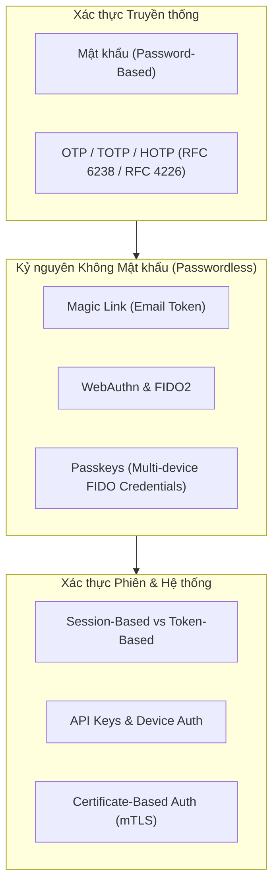
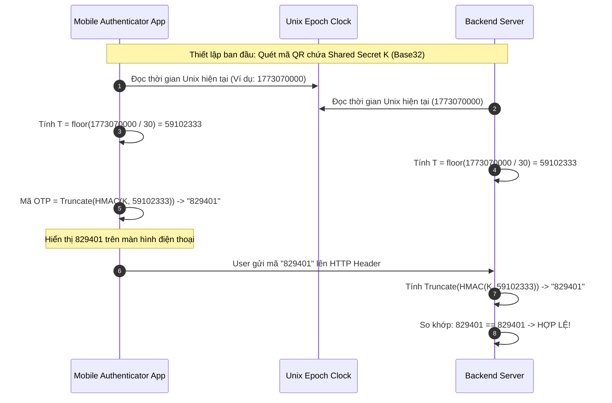
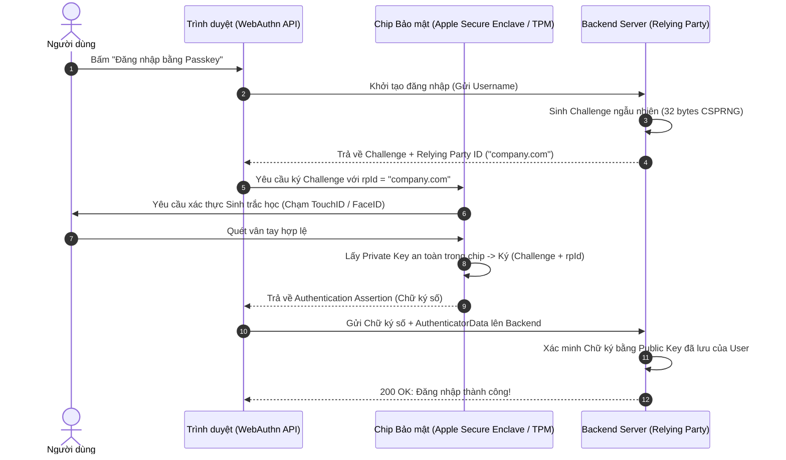
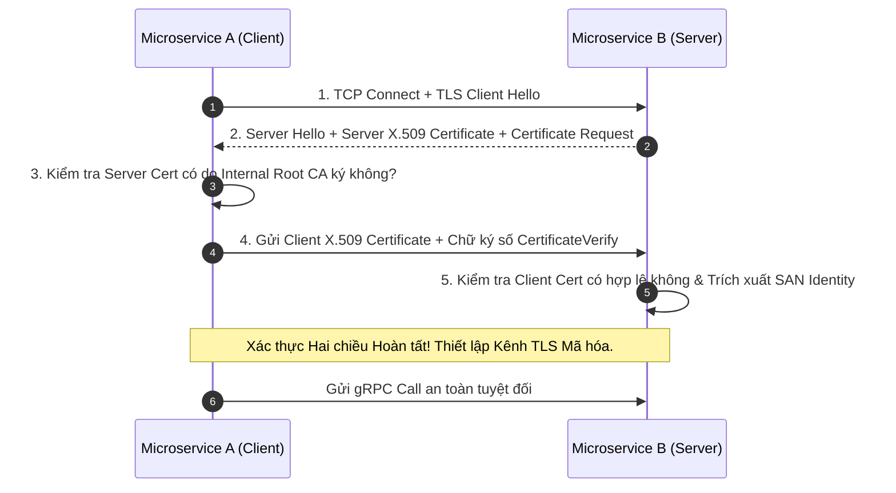

# 3.2. Modern Authentication Mechanisms (Các Cơ chế Xác thực Hiện đại)

## Tổng quan về Sự Tiến hóa của Cơ chế Xác thực
Từ thời kỳ đầu của Internet với mật khẩu văn bản thô (Plaintext Password) cho đến cuộc cách mạng không mật khẩu (**Passwordless**) dựa trên tiêu chuẩn WebAuthn/FIDO2, các kỹ sư hệ thống liên tục tìm kiếm sự cân bằng hoàn hảo giữa **Bảo mật tuyệt đối (Security)** và **Trải nghiệm người dùng không ma sát (Frictionless UX)**.

Mỗi cơ chế xác thực được sinh ra để giải quyết một bài toán cụ thể: Từ bảo vệ phiên người dùng cuối trên trình duyệt (Session vs Token), xác thực giao tiếp giữa các máy chủ (mTLS / API Keys), cho đến việc loại bỏ hoàn toàn nguy cơ Phishing bằng các cặp khóa bất đối xứng gắn với phần cứng (Passkeys).



---

## 2. Chi tiết từng Keyword (Under-the-Hood Deep Dive)

### 1. One-Time Passwords: OTP, HOTP & TOTP

#### 1. Khái niệm bản chất (What & Why)
- **One-Time Password (OTP - Mật khẩu Dùng Một Lần)**: Mật khẩu chỉ có giá trị hiệu lực duy nhất cho một lần đăng nhập hoặc một giao dịch cụ thể, hết hạn ngay sau khi sử dụng hoặc sau một khoảng thời gian ngắn.
- **HOTP (HMAC-based One-Time Password - RFC 4226)**: Thuật toán sinh mã OTP dựa trên một **Bộ đếm sự kiện (Counter - $C$)** tăng dần và một Khóa bí mật chia sẻ ($K$):
  $$\text{HOTP}(K, C) = \text{Truncate}(\text{HMAC-SHA-1}(K, C)) \pmod{10^d}$$
- **TOTP (Time-Based One-Time Password - RFC 6238)**: Thuật toán mở rộng của HOTP, thay thế bộ đếm sự kiện $C$ bằng **Thời gian thực Unix Epoch (Time-step)**:
  $$T = \left\lfloor \frac{\text{CurrentTime} - T_0}{X} \right\rfloor$$
  Trong đó $X$ thường là bước nhảy thời gian 30 giây (Time Window). Cứ mỗi 30 giây, ứng dụng Authenticator (Google/Microsoft Authenticator) và Backend tự động tính toán ra cùng một mã số 6 chữ số mà **hoàn toàn không cần kết nối mạng Internet giữa hai thiết bị**!

#### 2. Cơ chế hoạt động sâu (Under the hood / Hardcore Internals)
- **Cơ chế Cắt ngắn Động (Dynamic Truncation Algorithm)**:
  Làm thế nào để chuyển một chuỗi HMAC-SHA1 20 byte thành một mã số 6 chữ số dễ nhìn cho con người?
  1. Tính toán giá trị HMAC 20 bytes: $H = \text{HMAC-SHA1}(K, T)$.
  2. Lấy 4 bit cuối cùng (Low-order 4 bits) của byte thứ 19 làm độ lệch (**Offset**):
     $$\text{Offset} = H[19] \ \& \ \text{0x0F} \quad (\text{Giá trị từ } 0 \text{ đến } 15)$$
  3. Trích xuất 4 byte liên tiếp bắt đầu từ vị trí Offset:
     $$P = (H[\text{Offset}] \ \& \ \text{0x7F}) \ll 24 \ | \ (H[\text{Offset}+1]) \ll 16 \ | \ (H[\text{Offset}+2]) \ll 8 \ | \ H[\text{Offset}+3]$$
     (Mặt nạ `0x7F` dùng để xóa bit dấu, đảm bảo số nguyên luôn dương 31-bit).
  4. Lấy phần dư Modulo $10^6$ để thu được đúng 6 chữ số:
     $$\text{TOTP} = P \pmod{1,000,000}$$

#### 3. Sơ đồ minh họa (Cơ chế sinh TOTP dựa trên Đồng hồ Monotonic)


#### 4. Code ví dụ thực chiến (C++ RFC 6238 Compliant TOTP Generator Engine)
```cpp
#include <iostream>
#include <vector>
#include <chrono>
#include <cmath>
#include <iomanip>
#include <openssl/hmac.h>

class TotpEngine {
public:
    // Chuyển đổi số nguyên 64-bit Big-Endian byte array
    static std::vector<uint8_t> intToBytes(uint64_t value) {
        std::vector<uint8_t> result(8);
        for (int i = 7; i >= 0; --i) {
            result[i] = static_cast<uint8_t>(value & 0xFF);
            value >>= 8;
        }
        return result;
    }

    // Sinh mã TOTP 6 số từ Shared Secret Key
    static uint32_t generateTOTP(const std::vector<uint8_t>& secretKey, int timeStepSeconds = 30) {
        auto now = std::chrono::duration_cast<std::chrono::seconds>(
            std::chrono::system_clock::now().time_since_epoch()
        ).count();

        uint64_t counter = now / timeStepSeconds;
        auto counterBytes = intToBytes(counter);

        // 1. Tính HMAC-SHA1
        unsigned char hmacResult[EVP_MAX_MD_SIZE];
        unsigned int hmacLen = 0;
        HMAC(EVP_sha1(), secretKey.data(), secretKey.size(),
             counterBytes.data(), counterBytes.size(),
             hmacResult, &hmacLen);

        // 2. Thuật toán Dynamic Truncation (RFC 4226 Section 5.4)
        int offset = hmacResult[hmacLen - 1] & 0x0F;
        uint32_t binaryCode =
            ((hmacResult[offset] & 0x7F) << 24) |
            ((hmacResult[offset + 1] & 0xFF) << 16) |
            ((hmacResult[offset + 2] & 0xFF) << 8) |
            (hmacResult[offset + 3] & 0xFF);

        // 3. Modulo 10^6
        return binaryCode % 1000000;
    }
};

int main() {
    // Secret Key 20 bytes dùng chung giữa Client và Server
    std::vector<uint8_t> secret = {
        0x48, 0x65, 0x6c, 0x6c, 0x6f, 0x21, 0xde, 0xad,
        0xbe, 0xef, 0x01, 0x23, 0x45, 0x67, 0x89, 0xab,
        0xcd, 0xef, 0xfe, 0xdc
    };

    uint32_t totp = TotpEngine::generateTOTP(secret);
    std::cout << "Current Real-time 6-digit TOTP: " 
              << std::setfill('0') << std::setw(6) << totp << "\n";
    return 0;
}
```

#### 5. Ưu / Nhược điểm, Pitfalls & Anti-patterns
- **Pitfall**: Server và Client bị lệch đồng hồ thời gian (Clock Drift). Nếu đồng hồ server lệch quá 30 giây, mã TOTP của người dùng sẽ luôn bị từ chối. *Khắc phục*: Server luôn cho phép kiểm tra thêm một bước thời gian liền trước và liền sau ($T-1$, $T$, $T+1$).
- **Anti-pattern**: Cho phép tái sử dụng lại mã TOTP trong cùng một khung thời gian 30 giây. Bắt buộc backend phải lưu mã vừa verify thành công vào Redis cache với TTL 60 giây để chặn hoàn toàn Replay Attack!

#### 6. Ứng dụng thực tế trong Backend / Systems
Tiêu chuẩn xác thực 2FA của GitHub, AWS IAM Virtual MFA, Google Authenticator, Authy, và 1Password.

---

### 2. Passwordless, WebAuthn, FIDO2 & Passkeys

#### 1. Khái niệm bản chất (What & Why)
- **Passwordless Authentication (Xác thực Không Mật khẩu)**: Bất kỳ phương thức xác thực nào cho phép người dùng đăng nhập mà không cần nhập mật khẩu tĩnh do con người tự nhớ. Bao gồm Magic Link gửi qua Email và tiêu chuẩn đỉnh cao **FIDO2 / WebAuthn / Passkeys**.
- **Magic Link**: Server sinh một token ngẫu nhiên mã hóa có thời hạn ngắn (15 phút), lưu vào database và gửi đường link URL tới email của người dùng. Khi người dùng bấm vào link, server xác thực token và cấp session.
- **FIDO2 (Fast Identity Online 2)**: Liên minh toàn cầu gồm Google, Apple, Microsoft, Yubico nhằm thay thế mật khẩu bằng **Mật mã Khóa Công khai trên Phần cứng**:
  - Gồm 2 chuẩn: **CTAP (Client to Authenticator Protocol)** - giao tiếp giữa máy tính và USB YubiKey/Vân tay, và **WebAuthn (W3C Standard)** - API JavaScript trên trình duyệt.
- **Passkeys**: Tên gọi thương mại phổ cập của các thông tin xác thực FIDO2 có thể đồng bộ hóa đa thiết bị (Multi-device FIDO Credentials) thông qua iCloud Keychain, Google Password Manager hoặc 1Password.

#### 2. Cơ chế hoạt động sâu (Under the hood / Hardcore Internals)
- **Tại sao WebAuthn/Passkeys Miễn nhiễm 100% với Phishing?**
  - Trong các cuộc tấn công Phishing truyền thống, kẻ tấn công dựng website giả mạo `faceb00k-login.com`. Người dùng không để ý nhập mật khẩu và mã OTP, hacker đứng giữa chuyển tiếp mật khẩu đó lên website thật `facebook.com` để chiếm tài khoản (Reverse Proxy Phishing qua Modlishka / Evilginx).
  - Với **WebAuthn**, khi trình duyệt gọi lệnh `navigator.credentials.get()`:
    1. Trình duyệt tự động lấy tên miền gốc thực sự từ thanh địa chỉ (ví dụ: `origin = https://example.com`) đưa vào cấu trúc `clientDataJSON`.
    2. Bộ xác thực phần cứng (Secure Enclave / TPM) tạo chữ ký số trên hash của `clientDataJSON` kèm theo `rpId` (Relying Party ID).
    3. Nếu người dùng đang ở trên trang web lừa đảo `phishing-example.com`, trình duyệt sẽ gửi `rpId = phishing-example.com`. Khi gửi chữ ký này về server thật của `example.com`, server lập tức phát hiện sai lệch tên miền và từ chối chữ ký! Kẻ tấn công **không có cách nào đánh cắp hay chuyển tiếp được chữ ký này**.

#### 3. Sơ đồ minh họa (Luồng Đăng nhập Chống Phishing của WebAuthn / Passkeys)


#### 4. Code ví dụ thực chiến (TypeScript WebAuthn Challenge Generation & Verification)
```typescript
import * as crypto from 'crypto';

interface StoredPasskeyCredential {
    credentialId: string;
    publicKeyPem: string;
    counter: number;
}

export class WebAuthnBackendService {
    // 1. Sinh Challenge an toàn cho client
    public static generateAuthenticationChallenge(): { challengeBase64: string; timeoutMs: number } {
        const challengeBytes = crypto.randomBytes(32);
        return {
            challengeBase64: challengeBytes.toString('base64url'),
            timeoutMs: 60000 // 60 giây hết hạn
        };
    }

    // 2. Xác thực Assertion Signature từ Passkey Client
    public static verifyPasskeyAssertion(
        clientDataJSON: string,
        authenticatorData: Buffer,
        signature: Buffer,
        storedCredential: StoredPasskeyCredential,
        expectedChallenge: string,
        expectedOrigin: string
    ): boolean {
        // A. Parse và kiểm tra ClientDataJSON
        const clientData = JSON.parse(clientDataJSON);

        if (clientData.type !== 'webauthn.get') {
            throw new Error("Invalid assertion type.");
        }

        if (clientData.challenge !== expectedChallenge) {
            throw new Error("Security Alert: Challenge mismatch! Possible Replay Attack.");
        }

        // TÍNH NĂNG VÀNG: Kiểm tra Origin chống Phishing tuyệt đối
        if (clientData.origin !== expectedOrigin) {
            throw new Error(`Phishing Detected! Expected origin ${expectedOrigin}, but received ${clientData.origin}`);
        }

        // B. Tính Hash của ClientDataJSON
        const clientDataHash = crypto.createHash('sha256').update(clientDataJSON).digest();

        // C. Ghép AuthenticatorData và ClientDataHash để tạo dữ liệu đã ký (Signed Data)
        const signedData = Buffer.concat([authenticatorData, clientDataHash]);

        // D. Xác thực chữ ký số bằng Public Key của Passkey
        const verifier = crypto.createVerify('sha256');
        verifier.update(signedData);
        const isValid = verifier.verify(storedCredential.publicKeyPem, signature);

        if (!isValid) {
            throw new Error("Invalid cryptographic signature from Authenticator device.");
        }

        // E. Kiểm tra Sign Counter để phát hiện thiết bị Passkey bị Clone
        const signCounter = authenticatorData.readUInt32BE(33);
        if (signCounter <= storedCredential.counter && signCounter !== 0) {
            throw new Error("Cloned Authenticator Device Detected! Sign counter did not advance.");
        }

        // Cập nhật counter mới
        storedCredential.counter = signCounter;
        return true;
    }
}
```

#### 5. Ưu / Nhược điểm, Pitfalls & Anti-patterns
- **Pitfall**: Với Magic Link: Người dùng mở email trên một thiết bị khác (Laptop) trong khi bấm link trên điện thoại. Nếu hệ thống thiết lập session ràng buộc cứng vào IP hoặc User-Agent của phiên bấm link, người dùng trên laptop sẽ không vào được.
- **Anti-pattern**: Triển khai WebAuthn mà không kiểm tra trường `signCounter` trong `authenticatorData`. Khi đó nếu thiết bị phần cứng bị sao chép (Cloned token), backend sẽ không phát hiện ra.

#### 6. Ứng dụng thực tế trong Backend / Systems
Passkeys đang được Apple, Google, Microsoft, Amazon, và PayPal triển khai làm phương thức đăng nhập mặc định thay thế mật khẩu trên toàn cầu từ năm 2023.

---

### 3. Session-Based vs Token-Based & Machine Authentication (API Keys, mTLS)

#### 1. Khái niệm bản chất (What & Why)
- **Session-Based Authentication (Xác thực Hướng Trạng thái - Stateful)**: Server tạo ra một Session ID ngẫu nhiên lưu trong RAM/Redis/Database sau khi người dùng đăng nhập thành công. Session ID được gửi về trình duyệt qua HTTP Cookie. Mỗi request gửi lên, server dùng Session ID để truy vấn Database tìm thông tin user tương ứng.
- **Token-Based Authentication (Xác thực Vô trạng thái - Stateless)**: Server mã hóa hoặc ký số thông tin danh tính người dùng vào chính chuỗi Token (như JWT) và gửi cho client. Server không cần lưu trạng thái token trong database; mỗi request gửi lên, server chỉ cần xác thực chữ ký toán học của token là biết danh tính người dùng.
- **API Key Authentication**: Chuỗi bí mật tĩnh có độ dài cố định do người dùng/nhà phát triển sinh ra trong dashboard để xác thực các lời gọi API tự động từ server-to-server.
- **Certificate-Based Authentication (Mutual TLS - mTLS)**: Cơ chế xác thực hai chiều ở tầng Transport Layer (TCP/TLS). Cả Server và Client đều phải xuất trình chứng chỉ số X.509 hợp lệ trước khi bắt đầu trao đổi dữ liệu ứng dụng.

#### 2. Cơ chế hoạt động sâu (Under the hood / Hardcore Internals)
- **So sánh Kiến trúc Session vs Token**:
  | Tiêu chí | Session-Based (Stateful) | Token-Based (Stateless JWT) |
  | :--- | :--- | :--- |
  | **Lưu trữ Server** | Tốn RAM / Redis để lưu session table | Zero Storage (Không tốn lưu trữ) |
  | **Khả năng Thu hồi** | **Tức thì (Instant Revocation)**: Xóa session khỏi Redis là xong | Khó thu hồi ngay lập tức trước khi token hết hạn |
  | **Mở rộng (Scalability)** | Cần cụm Redis cluster phân tán | Tự mở rộng vô hạn qua nhiều vùng Cloud |
  | **Bảo mật Trình duyệt** | Rất cao với `HttpOnly`, `SameSite` Cookies | Thường bị lưu vào `localStorage` $\to$ Dễ bị XSS đánh cắp |

#### 3. Sơ đồ minh họa (Mô hình Xác thực mTLS Hai Chiều Máy-đến-Máy)


#### 4. Code ví dụ thực chiến (TypeScript Secure API Key Generation & Constant-Time Hashing)
```typescript
import * as crypto from 'crypto';

export class SecureApiKeyService {
    private static readonly KEY_PREFIX = "ak_live_";

    /**
     * Sinh API Key có cấu trúc chuẩn như Stripe: ak_live_<random_bytes>
     * CHỈ HIỂN THỊ 1 LẦN DUY NHẤT CHO USER
     */
    public static generateApiKey(): { fullApiKey: string; keyHashForDb: string; keyPrefix: string } {
        const rawSecret = crypto.randomBytes(24).toString('base64url');
        const fullApiKey = `${this.KEY_PREFIX}${rawSecret}`;

        // LƯU Ý BẢO MẬT: Tuyệt đối KHÔNG BAO GIỜ lưu trực tiếp fullApiKey vào Database!
        // Phải băm bằng SHA-256 trước khi lưu để nếu DB bị rò rỉ, hacker không dùng được API Key
        const keyHashForDb = crypto
            .createHash('sha256')
            .update(fullApiKey, 'utf8')
            .digest('hex');

        return {
            fullApiKey,
            keyHashForDb,
            keyPrefix: fullApiKey.substring(0, 12) // Lưu prefix để user dễ nhận diện trên Dashboard
        };
    }

    /**
     * Xác thực API Key từ Client gửi lên bằng cách Hash và so sánh Constant-Time
     */
    public static verifyApiKey(clientApiKey: string, storedDbHashHex: string): boolean {
        const clientHash = crypto
            .createHash('sha256')
            .update(clientApiKey, 'utf8')
            .digest('hex');

        const clientBuf = Buffer.from(clientHash, 'hex');
        const storedBuf = Buffer.from(storedDbHashHex, 'hex');

        if (clientBuf.length !== storedBuf.length) return false;
        // So sánh thời gian bất biến chống Timing Attack
        return crypto.timingSafeEqual(clientBuf, storedBuf);
    }
}
```

#### 5. Ưu / Nhược điểm, Pitfalls & Anti-patterns
- **Pitfall**: Lưu API Keys dưới dạng plaintext trong Database. Khi cơ sở dữ liệu bị lộ, toàn bộ API Keys của khách hàng doanh nghiệp bị chiếm dụng ngay lập tức.
- **Anti-pattern**: Lưu JWT vào `localStorage` của trình duyệt. Bất kỳ lỗ hổng XSS (Cross-Site Scripting) nào dù nhỏ nhất đều có thể đọc trộm toàn bộ token của người dùng qua `window.localStorage`.

#### 6. Ứng dụng thực tế trong Backend / Systems
mTLS là kiến trúc bảo mật nền tảng của toàn bộ mạng lưới **Service Mesh** (Envoy, Istio) trong các cụm Kubernetes quy mô lớn của Netflix, Uber và các ngân hàng trực tuyến.
