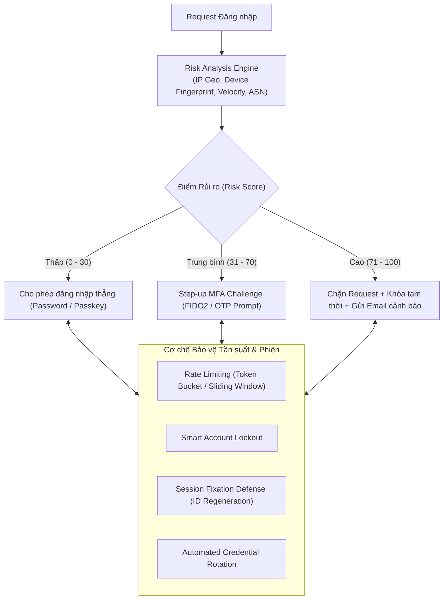
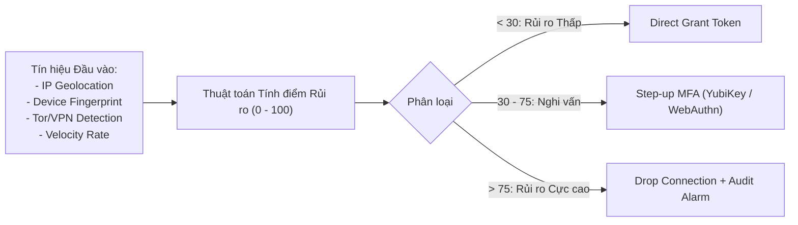
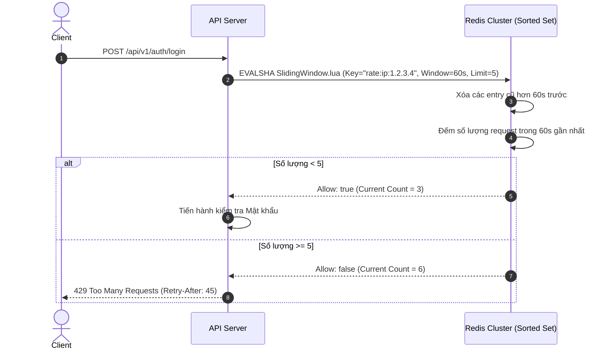
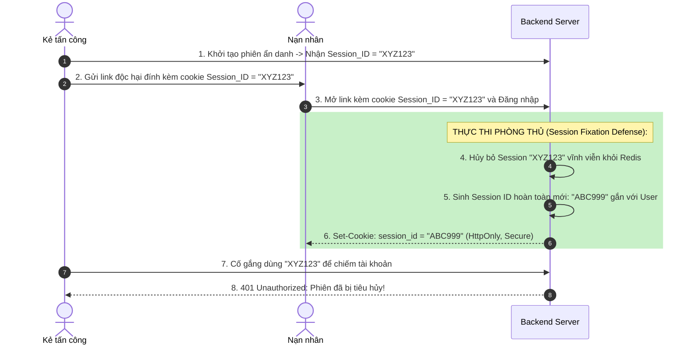

# 3.3. Risk-Based Adaptive Authentication & Brute-Force Defense (Xác thực Thích ứng theo Rủi ro & Phòng vệ Vét cạn)

## Tổng quan về Dynamic Defense in Authentication
Xác thực tĩnh (Static Authentication) – nơi mà mọi yêu cầu đăng nhập đều trải qua một quy trình cứng nhắc giống hệt nhau – đã không còn đủ sức chống chọi trước các mạng lưới Botnet phân tán toàn cầu. Hệ thống hiện đại phải áp dụng **Xác thực Thích ứng theo Rủi ro (Risk-Based / Adaptive Authentication)**: Tự động đánh giá ngữ cảnh và độ khả nghi của từng phiên đăng nhập trong thời gian thực để kích hoạt mức độ kiểm tra tương xứng (Step-up Authentication).

Song song đó, các cơ chế kiểm soát giới hạn tần suất (Rate Limiting), phòng vệ vét cạn (Brute-Force Protection), chống cố định phiên (Session Fixation Defense) và luân chuyển thông tin xác thực định kỳ (Credential Rotation) tạo nên một hàng rào bảo vệ vững chắc cho hệ thống backend.



---

## 2. Chi tiết từng Keyword (Under-the-Hood Deep Dive)

### 1. Risk-Based & Adaptive Authentication

#### 1. Khái niệm bản chất (What & Why)
- **Risk-Based Authentication (RBA / Xác thực Dựa trên Rủi ro)**: Phương pháp bảo mật tính toán điểm số rủi ro (Risk Score) theo thời gian thực cho từng nỗ lực đăng nhập dựa trên tập hợp các tín hiệu ngữ cảnh môi trường.
- **Adaptive Authentication (Xác thực Thích ứng)**: Khả năng của hệ thống tự động điều chỉnh hành vi và rào cản bảo mật một cách linh hoạt dựa trên điểm số rủi ro của RBA:
  - Nếu người dùng đăng nhập từ chiếc MacBook quen thuộc tại nhà riêng $\implies$ Không làm phiền người dùng, cho phép vào ngay.
  - Nếu người dùng đăng nhập từ một địa chỉ IP lạ tại một quốc gia khác cách xa nửa vòng trái đất chỉ sau đó 15 phút (Hiện tượng di chuyển bất khả thi - Impossible Travel) $\implies$ Lập tức kích hoạt bước xác thực bổ sung (Step-up Authentication) yêu cầu quét TouchID hoặc mã TOTP.

#### 2. Cơ chế hoạt động sâu (Under the hood / Hardcore Internals)
- **Các Vector Tín hiệu Đánh giá Rủi ro (Risk Signals)**:
  1. **Vị trí Địa lý (Geolocation & Impossible Travel)**:
     $$\text{Tốc độ Di chuyển} = \frac{\text{Khoảng cách Địa lý giữa 2 IP}}{\Delta \text{Thời gian giữa 2 lần đăng nhập}}$$
     Nếu vận tốc tính toán lớn hơn vận tốc máy bay thương mại ($> 900\text{ km/h}$), điểm rủi ro lập tức tăng vọt lên 95/100.
  2. **Đặc trưng Mạng (Network & IP Reputation)**:
     Kiểm tra địa chỉ IP qua cơ sở dữ liệu mối đe dọa (Threat Intel feed): IP có thuộc dải Tor Exit Node, Public VPN (NordVPN, ExpressVPN), Web Hosting/Cloud Datacenter (AWS EC2, DigitalOcean) thay vì dải IP dân cư (Residential ISP) không?
  3. **Device Fingerprinting**:
     Nhận diện đặc trưng phần cứng/phần mềm của client: User-Agent, Canvas fingerprint, WebGL vendor, Độ phân giải màn hình, Múi giờ hệ thống, Cấu hình ngôn ngữ bàn phím.
  4. **Hành vi Tốc độ (Velocity Checks)**:
     Số lượng tài khoản khác nhau cố gắng đăng nhập từ cùng một dải subnet `/24` trong vòng 1 phút qua.

#### 3. Sơ đồ minh họa (Mô hình Tính điểm Rủi ro & Xác thực Thích ứng)


#### 4. Code ví dụ thực chiến (TypeScript Adaptive Risk Evaluation Engine)
```typescript
interface LoginContext {
    userId: string;
    ipAddress: string;
    latitude: number;
    longitude: number;
    timestamp: number;
    isVpnOrTor: boolean;
    knownDeviceId: string;
}

interface LastKnownSession {
    latitude: number;
    longitude: number;
    timestamp: number;
    deviceId: string;
}

export class AdaptiveRiskEngine {
    // Công thức Haversine tính khoảng cách địa lý giữa 2 tọa độ (km)
    private static calculateDistanceKm(lat1: number, lon1: number, lat2: number, lon2: number): number {
        const R = 6371; // Bán kính Trái Đất (km)
        const dLat = (lat2 - lat1) * Math.PI / 180;
        const dLon = (lon2 - lon1) * Math.PI / 180;
        const a = Math.sin(dLat / 2) * Math.sin(dLat / 2) +
                  Math.cos(lat1 * Math.PI / 180) * Math.cos(lat2 * Math.PI / 180) *
                  Math.sin(dLon / 2) * Math.sin(dLon / 2);
        const c = 2 * Math.atan2(Math.sqrt(a), Math.sqrt(1 - a));
        return R * c;
    }

    public static evaluateRiskScore(ctx: LoginContext, lastSession: LastKnownSession | null): number {
        let riskScore = 0;

        // 1. Kiểm tra VPN / Tor / Proxy
        if (ctx.isVpnOrTor) {
            riskScore += 40;
        }

        // 2. Kiểm tra Thiết bị Lạ (Unknown Device)
        if (!lastSession || ctx.knownDeviceId !== lastSession.deviceId) {
            riskScore += 25;
        }

        // 3. Phân tích Hiện tượng Di chuyển Bất khả thi (Impossible Travel)
        if (lastSession) {
            const distanceKm = this.calculateDistanceKm(
                lastSession.latitude, lastSession.longitude,
                ctx.latitude, ctx.longitude
            );
            const timeDiffHours = (ctx.timestamp - lastSession.timestamp) / (1000 * 3600);

            if (timeDiffHours > 0) {
                const velocityKmH = distanceKm / timeDiffHours;
                // Vận tốc phi lý (Nhanh hơn máy bay siêu thanh)
                if (velocityKmH > 900) {
                    console.warn(`Impossible Travel Alert: ${velocityKmH.toFixed(0)} km/h detected!`);
                    riskScore += 60;
                }
            }
        }

        return Math.min(riskScore, 100);
    }
}
```

#### 5. Ưu / Nhược điểm, Pitfalls & Anti-patterns
- **Pitfall**: Đánh giá vị trí IP quá tuyệt đối. Mạng di động (4G/5G) thường định tuyến lưu lượng qua các Gateway đặt tại các thành phố khác nhau cách xa hàng trăm km, dẫn đến việc báo động giả (False Positive) cho người dùng di động.
- **Anti-pattern**: Đặt ngưỡng điểm rủi ro quá nhạy khiến người dùng liên tục bị đòi hỏi quét OTP mỗi ngày, gây ra sự ức chế và làm giảm mức độ hài lòng về sản phẩm.

#### 6. Ứng dụng thực tế trong Backend / Systems
Google Account Alert ("Phát hiện phiên đăng nhập mới từ địa điểm lạ"), Netflix Device Management, và các ngân hàng trực tuyến kích hoạt mã OTP SMS bắt buộc khi người dùng thực hiện giao dịch lớn từ một thiết bị chưa từng dùng trước đó.

---

### 2. Login Rate Limiting, Account Lockout & Brute-Force Protection

#### 1. Khái niệm bản chất (What & Why)
- **Login Rate Limiting (Giới hạn Tần suất Đăng nhập)**: Thuật toán kiểm soát số lượng nỗ lực đăng nhập tối đa được phép trong một đơn vị thời gian (ví dụ: Tối đa 5 lần thử trong 1 phút).
- **Brute-Force Protection (Phòng vệ Vét cạn)**: Tổng thể các giải pháp kỹ thuật nhằm vô hiệu hóa hành vi thử nghiệm mật khẩu tự động bằng máy móc.
- **Account Lockout (Khóa tài khoản)**: Cơ chế tạm khóa tài khoản sau một số lần đăng nhập thất bại liên tiếp:
  - **Hard Lockout (Khóa Cứng)**: Khóa hoàn toàn cho đến khi quản trị viên mở lại hoặc người dùng thực hiện quy trình Reset Password qua email. *Nhược điểm*: Dễ bị hacker lợi dụng làm công cụ tấn công Từ chối dịch vụ (DoS).
  - **Smart Lockout (Khóa Thông minh)**: Khóa mềm có thời hạn tăng dần theo cấp số nhân (Exponential Backoff: Thử sai 5 lần chờ 1 phút, thử sai 6 lần chờ 5 phút, 7 lần chờ 30 phút). Khóa duy nhất IP hoặc thiết bị khả nghi nhưng vẫn cho phép người dùng chính chủ đăng nhập bình thường từ thiết bị quen thuộc đã lưu.

#### 2. Cơ chế hoạt động sâu (Under the hood / Hardcore Internals)
- **Thuật toán Sliding Window Counter trong Redis**:
  Để triển khai Rate Limiting chính xác trong môi trường phân tán:
  Sử dụng cấu trúc dữ liệu **Redis Sorted Set (`ZSET`)**:
  1. Mỗi lần đăng nhập thất bại, thêm một phần tử vào key `rate_limit:login:<IP>` với `score = timestamp_ms` và `member = timestamp_ms + random_uuid`.
  2. Xóa tất cả các phần tử cũ nằm ngoài khung thời gian trượt (Sliding Window):
     `ZREMRANGEBYSCORE key 0 (current_timestamp - window_ms)`
  3. Đếm số lượng phần tử còn lại trong Sorted Set bằng lệnh:
     `ZCARD key`
  4. Nếu `count >= max_allowed`, trả về mã lỗi HTTP `429 Too Many Requests` kèm Header `Retry-After: 60`.
  5. Đặt TTL tự động cho key để dọn dẹp bộ nhớ Redis. Toàn bộ chuỗi thao tác này được thực thi nguyên tử (Atomic) trong một script Lua duy nhất trên Redis server!

#### 3. Sơ đồ minh họa (Mô hình Sliding Window Rate Limiter trong Redis)


#### 4. Code ví dụ thực chiến (C++ Token Bucket Rate Limiter with Monotonic Clock)
```cpp
#include <iostream>
#include <chrono>
#include <algorithm>
#include <thread>

// Triển khai thuật toán Token Bucket chuẩn xác bằng Đồng hồ Đơn điệu (Steady Clock)
class TokenBucketRateLimiter {
private:
    const double capacity;       // Dung lượng tối đa của xô token
    const double refillRatePerSec; // Tốc độ bơm token mỗi giây
    double currentTokens;
    std::chrono::steady_clock::time_point lastRefillTime;

    void refill() {
        auto now = std::chrono::steady_clock::now();
        std::chrono::duration<double> elapsed = now - lastRefillTime;
        double tokensToAdd = elapsed.count() * refillRatePerSec;

        currentTokens = std::min(capacity, currentTokens + tokensToAdd);
        lastRefillTime = now;
    }

public:
    TokenBucketRateLimiter(double maxCapacity, double refillRate)
        : capacity(maxCapacity), refillRatePerSec(refillRate),
          currentTokens(maxCapacity), lastRefillTime(std::chrono::steady_clock::now()) {}

    bool tryAcquire(double tokensRequested = 1.0) {
        refill();

        if (currentTokens >= tokensRequested) {
            currentTokens -= tokensRequested;
            return true; // Cho phép thực thi request
        }
        return false; // Bị Rate Limit!
    }
};

int main() {
    // Cấu hình: Xô chứa tối đa 3 tokens, mỗi giây bơm thêm 1 token
    TokenBucketRateLimiter loginLimiter(3.0, 1.0);

    for (int i = 1; i <= 5; ++i) {
        bool allowed = loginLimiter.tryAcquire();
        std::cout << "Request " << i << ": " << (allowed ? "ALLOWED (200)" : "RATE LIMITED (429)") << "\n";
    }

    std::cout << "Sleeping 2 seconds to refill bucket...\n";
    std::this_thread::sleep_for(std::chrono::seconds(2));

    std::cout << "Request after sleep: " << (loginLimiter.tryAcquire() ? "ALLOWED (200)" : "RATE LIMITED (429)") << "\n";
    return 0;
}
```

#### 5. Ưu / Nhược điểm, Pitfalls & Anti-patterns
- **Pitfall**: Chỉ Rate Limit theo địa chỉ IP mà không giới hạn theo Username. Khi kẻ tấn công dùng mạng botnet gồm 100,000 địa chỉ IP khác nhau, mỗi IP chỉ thử 1 lần (Distributed Password Spraying), bộ lọc IP sẽ hoàn toàn bất lực. Bắt buộc phải Rate Limit đồng thời cả theo `(IP)` và theo `(Username)`.
- **Anti-pattern**: Lưu trữ bộ đếm thất bại trực tiếp trong bộ nhớ cục bộ (Local in-memory map) của Web process. Khi ứng dụng chạy nhiều instances (Kubernetes scaling), các request sẽ rơi vào các pod khác nhau làm bộ đếm bị phân mảnh và mất tác dụng.

#### 6. Ứng dụng thực tế trong Backend / Systems
Cloudflare Rate Limiting Rules, Nginx `limit_req_zone`, và các API Gateway công nghiệp (Kong, Traefik, AWS WAF).

---

### 3. Session Fixation Defense & Credential Rotation

#### 1. Khái niệm bản chất (What & Why)
- **Session Fixation (Tấn công Cố định Phiên)**: Kịch bản tấn công trong đó kẻ gian tạo sẵn một Session ID hợp lệ từ server, sau đó "gài" (Fix) Session ID này vào trình duyệt của nạn nhân (thông qua link URL hoặc XSS). Khi nạn nhân đăng nhập thành công bằng tài khoản của họ, server vẫn giữ nguyên Session ID cũ đó. Hậu quả là kẻ tấn công đã có sẵn Session ID trong tay có thể ung dung truy cập vào tài khoản nạn nhân.
  - *Nguyên tắc Phòng thủ Tuyệt đối*: **Luôn luôn hủy bỏ Session ID cũ và tái sinh một Session ID hoàn toàn mới (Regenerate Session ID) ngay tại khoảnh khắc người dùng đăng nhập thành công**.
- **Credential Rotation (Luân chuyển Thông tin Xác thực)**: Quy trình định kỳ hoặc tức thì thay thế các khóa bí mật cũ (API Keys, Database Passwords, JWT Signing Private Keys, TLS Certificates) bằng các khóa mới nhằm thu hẹp khoảng thời gian tiếp xúc rủi ro khi khóa bị lộ ngầm.

#### 2. Cơ chế hoạt động sâu (Under the hood / Hardcore Internals)
- **Kiến trúc Luân chuyển Khóa Bất đối xứng (Graceful Key Rotation with JWKS)**:
  Làm thế nào để đổi khóa ký JWT mà không làm văng hàng triệu người dùng đang online?
  1. Hệ thống Auth Server duy trì một danh sách các cặp khóa được định danh bởi **`kid` (Key ID)**:
     - Khóa Hiện tại (`kid: "key-2026-q1"`): Dùng để **Ký (Sign)** các token mới sinh ra.
     - Khóa Cũ (`kid: "key-2025-q4"`): Vẫn được giữ lại ở chế độ **Chỉ Xác thực (Verify-only)** cho đến khi tất cả các token cũ hết hạn (TTL).
  2. Public Key Set được công khai qua endpoint chuẩn **`/.well-known/jwks.json`**.
  3. Các Resource Servers (Microservices) định kỳ cache danh sách JWKS này; khi gặp một token có `kid` cũ, nó vẫn xác thực thành công cho đến khi token tự nhiên hết hạn.

#### 3. Sơ đồ minh họa (Cơ chế Chống Session Fixation)


#### 4. Code ví dụ thực chiến (TypeScript Session Regeneration & Rotation Middleware)
```typescript
import { Request, Response, NextFunction } from 'express';
import * as crypto from 'crypto';

interface AppSession {
    sessionId: string;
    userId?: string;
    createdAt: number;
}

// Giả lập Session Store trên Redis
const memoryRedisSessionStore = new Map<string, AppSession>();

export class SessionSecurityService {
    /**
     * Tái sinh Session ID mới sau khi đăng nhập thành công để chống Session Fixation
     */
    public static regenerateSessionOnLogin(oldSessionId: string, authenticatedUserId: string): string {
        // 1. Tiêu hủy hoàn toàn Session cũ trong Database/Redis
        if (memoryRedisSessionStore.has(oldSessionId)) {
            memoryRedisSessionStore.delete(oldSessionId);
            console.log(`Defense: Old session ${oldSessionId} destroyed.`);
        }

        // 2. Sinh một Session ID mới hoàn toàn với 32 bytes CSPRNG
        const newSessionId = crypto.randomBytes(32).toString('hex');

        // 3. Khởi tạo phiên mới gắn với User ID
        memoryRedisSessionStore.set(newSessionId, {
            sessionId: newSessionId,
            userId: authenticatedUserId,
            createdAt: Date.now()
        });

        console.log(`New secure session ${newSessionId} issued for User ${authenticatedUserId}.`);
        return newSessionId;
    }
}
```

#### 5. Ưu / Nhược điểm, Pitfalls & Anti-patterns
- **Pitfall**: Thực hiện luân chuyển thông tin bí mật Database (Credential Rotation) một cách thủ công qua chat/email, dẫn đến việc downtime hệ thống khi ứng dụng không kịp nạp mật khẩu mới.
- **Anti-pattern**: Giữ nguyên Session ID của người dùng từ trước khi đăng nhập cho đến sau khi đăng nhập (Lỗ hổng cố định phiên kinh điển).

#### 6. Ứng dụng thực tế trong Backend / Systems
AWS Secrets Manager và HashiCorp Vault cung cấp tính năng **Automated Dynamic Secrets Rotation**: Tự động kết nối vào RDS PostgreSQL xoay vòng mật khẩu của database user sau mỗi 30 ngày mà không làm gián đoạn các kết nối connection pool đang chạy.
