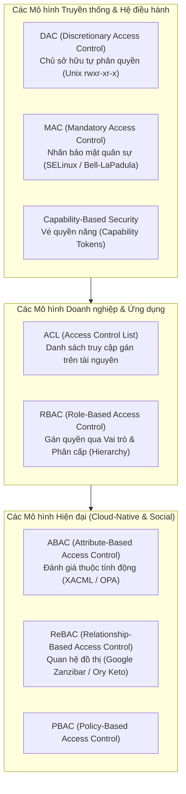
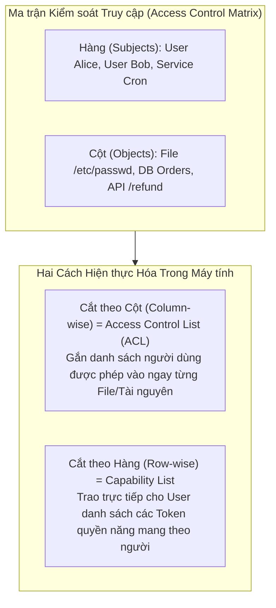
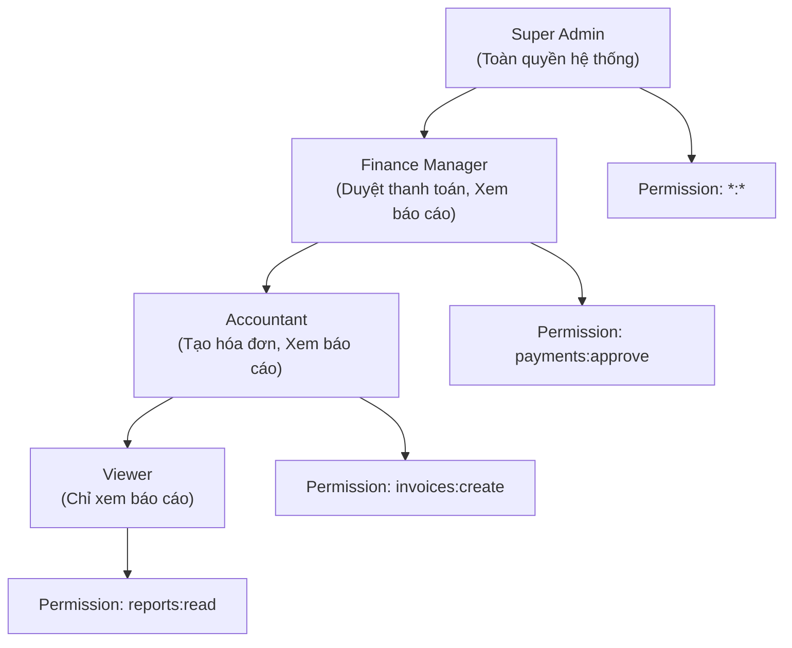
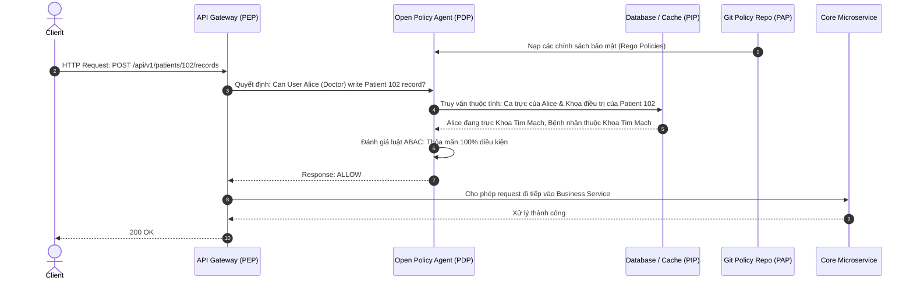

# 4.1. Access Control Models (Các Mô hình Kiểm soát Quyền Truy cập)

## Tổng quan về Access Control Models
Nếu như **Xác thực (Authentication)** trả lời cho câu hỏi: *"Bạn là ai trong không gian số?"*, thì **Ủy quyền & Kiểm soát Truy cập (Authorization & Access Control)** giải quyết bài toán phức tạp và nhạy cảm hơn gấp bội: *"Bạn có quyền hạn thực hiện hành động này trên tài nguyên cụ thể này vào thời điểm này hay không?"*.

Trong các hệ thống phân tán quy mô lớn, việc cứng nhắc gắn chặt các câu lệnh kiểm tra quyền hạn (như `if (user.role === 'admin')`) vào sâu trong mã nguồn nghiệp vụ sẽ nhanh chóng biến hệ thống thành một "mớ bòng bong" không thể bảo trì (Authorization Spaghetti Code). Các mô hình kiểm soát quyền truy cập hình thức (**Formal Access Control Models**) từ DAC, MAC, RBAC đến ABAC và ReBAC được thiết kế để phân tách độc lập giữa **Logic Nghiệp vụ (Business Logic)** và **Chính sách Quyền hạn (Authorization Policy)**.



---

## 2. Chi tiết từng Keyword (Under-the-Hood Deep Dive)

### 1. Fundamentals, DAC, MAC & Capability-Based Security

#### 1. Khái niệm bản chất (What & Why)
- **Authentication vs Authorization**: Sự khác biệt bản chất:
  - *Authentication (401 Unauthorized)*: Chưa chứng minh được danh tính.
  - *Authorization (403 Forbidden)*: Đã biết rõ danh tính, nhưng không có quyền hạn đối với hành động hoặc tài nguyên được yêu cầu.
- **Access Control Matrix (Ma trận Kiểm soát Quyền)**: Bảng trừu tượng toán học hai chiều mô tả toàn bộ trạng thái bảo mật của hệ thống:
  - Các hàng biểu diễn **Chủ thể (Subjects - Users, Groups, Processes)**.
  - Các cột biểu diễn **Đối tượng / Tài nguyên (Objects - Files, API Endpoints, Databases)**.
  - Mỗi ô $(S, O)$ chứa tập hợp các **Quyền (Rights / Permissions - Read, Write, Execute, Delete)**.
- **DAC (Discretionary Access Control - Kiểm soát Tùy ý)**: Mô hình bảo mật trong đó **Chủ sở hữu của tài nguyên (Owner)** có toàn quyền quyết định ai được phép truy cập vào tài nguyên đó và được phép chuyển giao quyền cho người khác.
  - *Ví dụ kinh điển*: Hệ thống phân quyền tập tin của Unix/Linux (`chmod 755 file.txt` do chính user tạo file quyết định).
- **MAC (Mandatory Access Control - Kiểm soát Bắt buộc)**: Mô hình bảo mật cấp cao cưỡng chế bởi Hệ điều hành hoặc Nhân Kernel. Người dùng và chủ sở hữu tài nguyên **không có quyền tự ý thay đổi quyền truy cập**.
  - Dựa trên các nhãn bảo mật (Security Labels - Top Secret, Secret, Confidential).
  - *Mô hình Bell-LaPadula (Bảo vệ tính Bí mật)*: "No Read Up, No Write Down" (Không đọc tài liệu cấp cao hơn, không ghi dữ liệu xuống cấp thấp hơn).
  - *Hiện thực công nghiệp*: **SELinux (Security-Enhanced Linux)** và **AppArmor**.
- **Capability-Based Security**: Thay vì kiểm tra danh sách xem ai được vào (như danh sách khách mời ở cửa), hệ thống trao cho chủ thể một "tấm vé quyền năng không thể giả mạo" (Capability). Bất kỳ ai cầm tấm vé này đều có thể thực hiện hành động trên tài nguyên.

#### 2. Cơ chế hoạt động sâu (Under the hood / Hardcore Internals)
- **Triển khai Linux File Permission (DAC) ở tầng Inode**:
  Trong hệ thống tập tin Linux (ext4, XFS):
  Mỗi file được đại diện bởi một cấu trúc **Inode** chứa:
  `i_uid` (Owner UID), `i_gid` (Owner GID), và `i_mode` (16-bit unsigned integer).
  9 bit cuối cùng của `i_mode` quy định 3 nhóm quyền: `[rwx]` User, `[rwx]` Group, `[rwx]` Others.
  Khi một tiến trình gọi syscall `open("/etc/shadow", O_RDWR)`:
  1. Kernel trích xuất `effective_uid` (eUID) của tiến trình gọi.
  2. Kernel so sánh eUID với `i_uid` của inode. Nếu khớp, kiểm tra 3 bit Owner.
  3. Nếu không khớp, so sánh với `i_gid`. Nếu khớp, kiểm tra 3 bit Group.
  4. Nếu vẫn không khớp, kiểm tra 3 bit Others.
  5. Nếu bất kỳ bước nào thiếu bit quyền yêu cầu, Kernel trả về ngay lập tức lỗi `-EACCES` (Permission Denied).

#### 3. Sơ đồ minh họa (Mô hình Access Control Matrix và Cắt dọc thành ACL vs Capability)


#### 4. Code ví dụ thực chiến (C++ Capability-Based File Descriptor Architecture)
```cpp
#include <iostream>
#include <unistd.h>
#include <fcntl.h>
#include <cstring>
#include <cerrno>

// Minh họa nguyên lý Capability-Based Security thông qua File Descriptor trong Unix
class CapabilityHandle {
private:
    int fileDescriptor;
    std::string resourceName;

public:
    CapabilityHandle(const std::string& path, int flags) : resourceName(path) {
        // Mở file và nhận về một Descriptor (Đại diện cho một Capability token do OS cấp)
        fileDescriptor = open(path.c_str(), flags);
        if (fileDescriptor < 0) {
            std::cerr << "Failed to acquire capability for " << path << ": " << strerror(errno) << "\n";
        }
    }

    ~CapabilityHandle() {
        if (fileDescriptor >= 0) {
            close(fileDescriptor);
        }
    }

    bool isValid() const { return fileDescriptor >= 0; }

    // Người sở hữu CapabilityHandle có quyền Đọc mà không cần xuất trình lại mật khẩu hay quyền hạn
    ssize_t readData(char* buffer, size_t size) {
        if (!isValid()) return -1;
        return read(fileDescriptor, buffer, size);
    }
};

int main() {
    // Chương trình chạy với đặc quyền ban đầu, thu thập Capability (File Descriptor chỉ đọc)
    CapabilityHandle licenseCap("/etc/hosts", O_RDONLY);

    if (licenseCap.isValid()) {
        char buffer[128] = {0};
        ssize_t bytesRead = licenseCap.readData(buffer, sizeof(buffer) - 1);
        std::cout << "[Capability Granted] Read " << bytesRead << " bytes:\n" << buffer << "\n";
    }
    return 0;
}
```

#### 5. Ưu / Nhược điểm, Pitfalls & Anti-patterns
- **Pitfall**: Lạm dụng quyền `chmod 777` trên máy chủ Linux khi gặp lỗi phân quyền. Thao tác này mở toang toàn bộ hệ thống cho bất kỳ tiến trình User-space nào đọc, sửa, xóa file cấu hình.
- **Anti-pattern**: Trong Capability-Based Security: Không có cơ chế thu hồi quyền (Revocation). Khi một Capability Token (như Presigned URL của AWS S3) được phát hành ra ngoài, rất khó để hủy nó trước thời hạn hết hạn.

#### 6. Ứng dụng thực tế trong Backend / Systems
Mô hình **Presigned URLs** trong AWS S3 hoặc Google Cloud Storage (cấp quyền download/upload một file cụ thể trong 15 phút mà không cần tài khoản AWS) chính là hiện thực chuẩn mực của Capability-Based Security trên Cloud.

---

### 2. Role-Based Access Control (RBAC) & Hierarchies

#### 1. Khái niệm bản chất (What & Why)
- **Role-Based Access Control (RBAC)**: Mô hình phân quyền phổ biến nhất trong các ứng dụng doanh nghiệp và Backend Web. Thay vì gán trực tiếp hàng trăm quyền hạn (Permissions) cho từng người dùng riêng lẻ, người dùng được gán vào các **Vai trò (Roles)**, và các quyền hạn được gán cho các vai trò đó:
  $$\text{Users} \longleftrightarrow \text{Roles} \longleftrightarrow \text{Permissions}$$
- **Role Hierarchy (Phân cấp Vai trò)**: Cấu trúc kế thừa quan hệ giữa các vai trò theo hình thái đồ thị không chu trình (DAG - Directed Acyclic Graph). Vai trò cấp cao hơn tự động kế thừa toàn bộ quyền hạn của các vai trò cấp thấp hơn:
  $$\text{Admin} \succ \text{Manager} \succ \text{Editor} \succ \text{Viewer}$$
- **Permission Hierarchy (Phân cấp Quyền hạn)**: Phân cấp hành động theo phạm vi (ví dụ: Quyền `billing:write` ngầm định bao hàm quyền `billing:read`).

#### 2. Cơ chế hoạt động sâu (Under the hood / Hardcore Internals)
- **Cơ sở Dữ liệu Quan hệ cho RBAC**:
  Một schema chuẩn cho RBAC cấp doanh nghiệp bao gồm 5 bảng:
  1. `users` (`id`, `username`, `email`)
  2. `roles` (`id`, `name`, `parent_role_id`)
  3. `permissions` (`id`, `action`, `resource`) -- ví dụ: `orders:create`, `orders:delete`
  4. `user_roles` (`user_id`, `role_id`)
  5. `role_permissions` (`role_id`, `permission_id`)
- **Thuật toán Đánh giá Phân cấp (Recursive Role Flattening)**:
  Khi kiểm tra xem User có quyền `orders:delete` hay không:
  Thay vì thực hiện nhiều câu truy vấn đệ quy `JOIN` làm chậm database ở mỗi HTTP request, hệ thống Auth service tính toán trước (Pre-compute) ma trận đóng chuyển tiếp (**Transitive Closure**) của tất cả các quyền của User tại thời điểm đăng nhập và nạp vào Redis Cache hoặc JWT claims dưới dạng một mảng phẳng các chuỗi quyền (`permissions: ["orders:read", "orders:create", "orders:delete"]`).

#### 3. Sơ đồ minh họa (Mô hình Cây Phân cấp Kế thừa trong RBAC)


#### 4. Code ví dụ thực chiến (TypeScript Production RBAC Engine with Role Inheritance)
```typescript
type Permission = string;

interface RoleDefinition {
    name: string;
    permissions: Permission[];
    inherits?: string[];
}

export class HierarchicalRBAC {
    private rolesMap = new Map<string, RoleDefinition>();

    public registerRole(role: RoleDefinition): void {
        this.rolesMap.set(role.name, role);
    }

    /**
     * Thu thập toàn bộ quyền của một Role bao gồm cả các quyền được kế thừa đệ quy
     */
    public resolveAllPermissionsForRole(roleName: string, visited = new Set<string>()): Set<Permission> {
        const resolvedPermissions = new Set<Permission>();
        const role = this.rolesMap.get(roleName);

        if (!role || visited.has(roleName)) {
            return resolvedPermissions;
        }

        visited.add(roleName);

        // 1. Thêm quyền trực tiếp của role
        for (const perm of role.permissions) {
            resolvedPermissions.add(perm);
        }

        // 2. Kế thừa quyền từ các parent roles
        if (role.inherits) {
            for (const parentRole of role.inherits) {
                const parentPerms = this.resolveAllPermissionsForRole(parentRole, visited);
                for (const p of parentPerms) {
                    resolvedPermissions.add(p);
                }
            }
        }

        return resolvedPermissions;
    }

    /**
     * Kiểm tra User có được phép thực thi action hay không
     */
    public isAuthorized(userRoles: string[], requiredPermission: Permission): boolean {
        for (const r of userRoles) {
            const allPerms = this.resolveAllPermissionsForRole(r);
            // Hỗ trợ Wildcard Permission (ví dụ: "reports:*" bao hàm "reports:read")
            if (allPerms.has(requiredPermission) || allPerms.has('*')) {
                return true;
            }
        }
        return false;
    }
}

// Khởi tạo hệ thống phân quyền
const rbac = new HierarchicalRBAC();
rbac.registerRole({ name: 'Viewer', permissions: ['documents:read'] });
rbac.registerRole({ name: 'Editor', permissions: ['documents:write'], inherits: ['Viewer'] });
rbac.registerRole({ name: 'Admin', permissions: ['documents:delete', 'users:manage'], inherits: ['Editor'] });

console.log("Editor can read?:", rbac.isAuthorized(['Editor'], 'documents:read')); // True (Kế thừa từ Viewer)
console.log("Editor can delete?:", rbac.isAuthorized(['Editor'], 'documents:delete')); // False
console.log("Admin can delete?:", rbac.isAuthorized(['Admin'], 'documents:delete')); // True
```

#### 5. Ưu / Nhược điểm, Pitfalls & Anti-patterns
- **Pitfall**: Hiện tượng **Bùng nổ Vai trò (Role Explosion)**. Khi nghiệp vụ mở rộng, các yêu cầu đặc thù xuất hiện ("Kế toán nhưng chỉ được xem chi nhánh Đà Nẵng vào giờ hành chính"). Nếu tiếp tục dùng RBAC thuần túy, bạn sẽ phải tạo hàng trăm role như `Accountant_DaNang_OfficeHours`, khiến hệ thống quản trị sụp đổ. Lúc này bắt buộc phải chuyển sang **ABAC**.
- **Anti-pattern**: Kiểm tra trực tiếp tên Role trong Controller (`if (user.role === 'admin')`). Nếu sau này công ty tạo thêm role `SuperUser` hoặc đổi tên thành `SystemLead`, bạn sẽ phải sửa code ở hàng trăm controllers khác nhau. Thay vào đó, luôn luôn kiểm tra quyền cụ thể: `hasPermission('documents:delete')`.

#### 6. Ứng dụng thực tế trong Backend / Systems
RBAC là mô hình phân quyền mặc định của **Kubernetes RBAC (ClusterRole, RoleBinding)**, AWS IAM Policies, và hệ thống quản trị người dùng của hầu hết các phần mềm SaaS B2B.

---

### 3. Modern Access Models: ABAC, ReBAC & PBAC

#### 1. Khái niệm bản chất (What & Why)
- **ABAC (Attribute-Based Access Control - Phân quyền theo Thuộc tính)**: Mô hình phân quyền động thế hệ mới. Quyết định cho phép hay từ chối dựa trên việc đánh giá biểu thức logic kết hợp giữa 4 nhóm thuộc tính:
  1. **Subject Attributes** (Người dùng: Tuổi, Phòng ban, Điểm tín nhiệm, Vị trí).
  2. **Resource Attributes** (Tài nguyên: Phân loại nhạy cảm PII, Chủ sở hữu, Trạng thái đơn hàng).
  3. **Action Attributes** (Hành động: Đọc, Duyệt chi, Xóa).
  4. **Environment Attributes** (Ngữ cảnh môi trường: Múi giờ, Giờ hành chính, Địa chỉ IP, Mức độ rủi ro).
  - *Ví dụ*: *"Cho phép nhân viên phòng Y tế xem hồ sơ bệnh án NẾU bệnh nhân thuộc khoa của họ VÀ thời gian hiện tại nằm trong ca trực của bác sĩ"*.
- **ReBAC (Relationship-Based Access Control - Phân quyền theo Mối quan hệ)**: Mô hình quản lý quyền truy cập dựa trên đồ thị quan hệ (Graph relationships) giữa các thực thể, lấy cảm hứng từ hệ thống **Google Zanzibar**.
  - Rất mạnh trong các mạng xã hội và ứng dụng chia sẻ cộng tác (Google Drive, Notion, Figma).
  - *Ví dụ*: *"Alice có thể sửa Document X vì Alice là `member` của Team Design, và Team Design là `editor` của Document X"*.
- **PBAC (Policy-Based Access Control)**: Thuật ngữ chung cho việc biểu diễn quyền truy cập dưới dạng các tập luật (Declarative Policies) được viết bằng các ngôn ngữ chuyên biệt (Rego trong Open Policy Agent - OPA, hoặc Cedar của AWS) và được đánh giá bởi một Policy Engine độc lập.

#### 2. Cơ chế hoạt động sâu (Under the hood / Hardcore Internals)
- **Kiến trúc Chuẩn XACML / OPA (Decoupled Policy Architecture)**:
  Tách rời bộ máy phân quyền khỏi Backend server qua 4 thành phần:
  1. **PEP (Policy Enforcement Point)**: Nằm ngay tại API Gateway hoặc Middleware. Chặn request, gom thông tin ngữ cảnh gửi sang PDP.
  2. **PDP (Policy Decision Point)**: Bộ não chính sách (ví dụ: Open Policy Agent daemon). Tiếp nhận ngữ cảnh, biên dịch chính sách và trả lời `ALLOW` hoặc `DENY`.
  3. **PIP (Policy Information Point)**: Nguồn cung cấp dữ liệu phụ trợ (ví dụ: Truy vấn database để lấy trạng thái hồ sơ bệnh nhân).
  4. **PAP (Policy Administration Point)**: Nơi người quản trị viết, kiểm thử và deploy các chính sách bảo mật mới (thường lưu trong Git repository).

#### 3. Sơ đồ minh họa (Kiến trúc Decoupled Policy PEP-PDP-PIP-PAP)


#### 4. Code ví dụ thực chiến (TypeScript Policy-Based Evaluation Engine)
```typescript
interface PolicySubject {
    id: string;
    department: string;
    ipAddress: string;
}

interface PolicyResource {
    type: string;
    departmentOwner: string;
    isConfidential: boolean;
}

interface PolicyEnvironment {
    isBusinessHours: boolean;
    isCorporateNetwork: boolean;
}

export class ABACPolicyEvaluator {
    /**
     * Đánh giá chính sách ABAC linh hoạt dựa trên đa chiều thuộc tính
     */
    public static canAccessResource(
        subject: PolicySubject,
        resource: PolicyResource,
        action: 'READ' | 'WRITE' | 'DELETE',
        env: PolicyEnvironment
    ): { allowed: boolean; reason: string } {
        // LUẬT 1: Dữ liệu tối mật (Confidential) chỉ được đọc trong giờ hành chính từ mạng nội bộ công ty
        if (resource.isConfidential) {
            if (!env.isCorporateNetwork || !env.isBusinessHours) {
                return {
                    allowed: false,
                    reason: "Access Denied: Confidential data can only be accessed from Corporate Network during Business Hours."
                };
            }
        }

        // LUẬT 2: Quyền DELETE bắt buộc Subject và Resource phải cùng phòng ban quản lý
        if (action === 'DELETE') {
            if (subject.department !== resource.departmentOwner) {
                return {
                    allowed: false,
                    reason: "Access Denied: Cannot delete resources owned by another department."
                };
            }
        }

        // Mặc định chấp thuận nếu vượt qua toàn bộ chính sách ràng buộc
        return { allowed: true, reason: "Authorized by ABAC Policy." };
    }
}

// Minh họa thực thi
const doctor: PolicySubject = { id: "doc_1", department: "Cardiology", ipAddress: "10.0.1.5" };
const patientRecord: PolicyResource = { type: "MedicalRecord", departmentOwner: "Cardiology", isConfidential: true };

// Kịch bản A: Truy cập từ mạng ngoài lúc nửa đêm
const outsideEnv: PolicyEnvironment = { isBusinessHours: false, isCorporateNetwork: false };
console.log("Outside Attempt:", ABACPolicyEvaluator.canAccessResource(doctor, patientRecord, 'READ', outsideEnv));

// Kịch bản B: Truy cập tại văn phòng trong giờ làm việc
const secureEnv: PolicyEnvironment = { isBusinessHours: true, isCorporateNetwork: true };
console.log("Office Attempt: ", ABACPolicyEvaluator.canAccessResource(doctor, patientRecord, 'READ', secureEnv));
```

#### 5. Ưu / Nhược điểm, Pitfalls & Anti-patterns
- **Pitfall**: Hiệu năng PDP bị chậm (Latency Overhead). Nếu với mỗi API request, PDP lại phải thực hiện 5 câu query SQL sang PIP để gom thuộc tính, độ trễ hệ thống sẽ tăng từ 10ms lên 200ms. *Giải pháp*: Đồng bộ thuộc tính vào RAM của OPA agent thông qua Kafka hoặc In-memory Cache.
- **Anti-pattern**: Viết các chính sách ABAC quá phức tạp và mâu thuẫn chồng chéo, khiến ngay cả quản trị viên cũng không giải thích được vì sao một user bị chặn quyền hoặc được cấp quyền bất thường.

#### 6. Ứng dụng thực tế trong Backend / Systems
**Open Policy Agent (OPA)** chuẩn hóa trên Kubernetes Admission Controllers, **Google Zanzibar** cung cấp nền tảng ReBAC cho Google Drive/Calendar/Cloud, và giải pháp mã nguồn mở **Ory Keto / Auth0 Fine-Grained Authorization (FGA)**.
