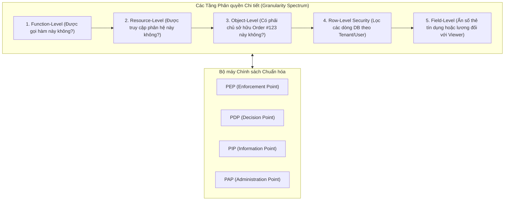
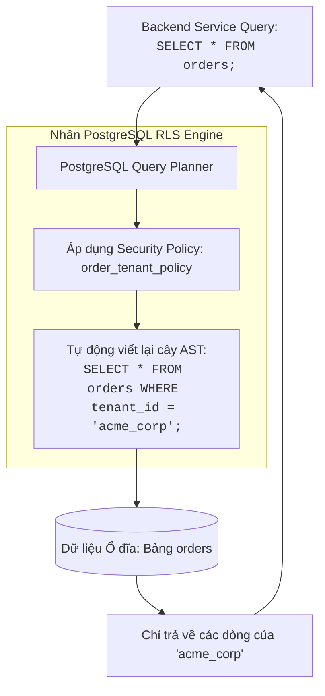
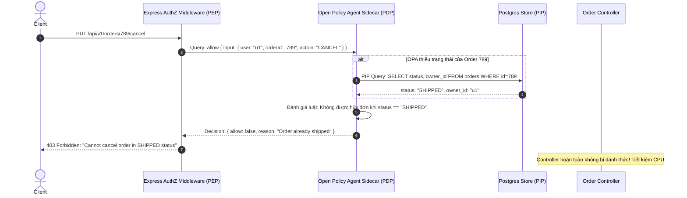
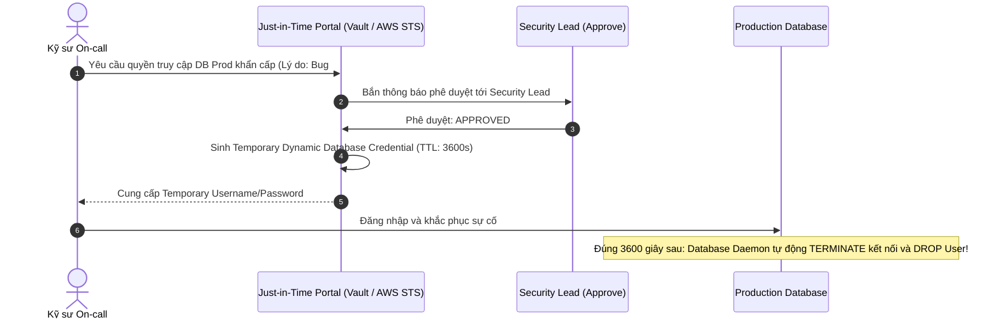

# 4.2. Granular Authorization and Policy Engine (Phân quyền Chi tiết & Bộ máy Thực thi Chính sách)

## Tổng quan về Fine-Grained Authorization (FGA)
Trong các hệ thống phân tán và ứng dụng Multi-tenant (Đa khách thuê), việc chỉ kiểm tra quyền hạn ở cửa ngõ API (như "User này là Admin hay Member") hoàn toàn bất lực trước các yêu cầu bảo mật hiện đại. Một kiến trúc chuẩn mực đòi hỏi **Phân quyền Chi tiết (Fine-Grained Authorization - FGA)** trên từng lớp trừu tượng của dữ liệu: Từ cấp độ đối tượng (Object-level), hàm nghiệp vụ (Function-level), cho đến từng dòng dữ liệu trong cơ sở dữ liệu (**Row-Level Security - RLS**) và từng trường thuộc tính cụ thể trong payload JSON (**Field-Level Authorization**).

Để hiện thực hóa điều này mà không gây nghẽn hiệu năng, hệ thống áp dụng kiến trúc chuẩn hóa **PEP-PDP-PIP-PAP** kết hợp cơ chế ủy thác quyền tạm thời (**Temporary Permissions / Permission Delegation**).



---

## 2. Chi tiết từng Keyword (Under-the-Hood Deep Dive)

### 1. Granular Authorization: Object, Function, Field-Level & Row-Level Security (RLS)

#### 1. Khái niệm bản chất (What & Why)
- **Function-Level Authorization**: Kiểm soát việc người dùng có được phép thực thi một hàm nghiệp vụ cụ thể hay không (ví dụ: `exportPdfReport()`, `deleteAccount()`).
- **Object-Level Authorization**: Kiểm soát quyền hạn trên một **thể hiện cụ thể (Specific Instance / Record)** của đối tượng dữ liệu. *Bài toán*: Alice và Bob đều có quyền "Đọc Hóa đơn", nhưng Alice chỉ được đọc Hóa đơn do chính Alice tạo ra (`invoice_id: 101`), không được đọc Hóa đơn của Bob (`invoice_id: 102`).
- **Field-Level Authorization**: Kiểm soát quyền đọc hoặc ghi trên từng trường thuộc tính (Columns / Properties) bên trong một đối tượng dữ liệu. *Ví dụ*: Khi gọi `GET /api/v1/employees/1`, HR Manager nhìn thấy đầy đủ trường `salary` và `ssn`, nhưng đồng nghiệp cùng phòng ban chỉ nhìn thấy `fullName` và `email`.
- **Row-Level Security (RLS)**: Cơ chế bảo vệ được cưỡng chế trực tiếp tại tầng nhân của Cơ sở dữ liệu quan hệ (PostgreSQL / MySQL / Oracle). Hệ thống Database tự động chèn thêm điều kiện lọc bảo mật vào mọi câu truy vấn SQL (`WHERE tenant_id = current_tenant()`) một cách ngầm định và minh bạch, ngăn chặn hoàn toàn nguy cơ lập trình viên backend quên thêm điều kiện `WHERE` trong mã nguồn.

#### 2. Cơ chế hoạt động sâu (Under the hood / Hardcore Internals)
- **Cơ chế Row-Level Security (RLS) bên trong PostgreSQL Engine**:
  Khi RLS được kích hoạt trên một bảng:
  `ALTER TABLE orders ENABLE ROW LEVEL SECURITY;`
  `CREATE POLICY order_isolation_policy ON orders USING (user_id = CURRENT_USER_ID());`
  - Ở tầng Query Planner & Optimizer của PostgreSQL:
    Khi ứng dụng backend gửi câu truy vấn ngây thơ: `SELECT * FROM orders;`
    Parser và Planner của Postgres sẽ **tự động viết lại cây cú pháp đại số quan hệ (Abstract Syntax Tree)** trước khi thực thi:
    `SELECT * FROM orders WHERE user_id = CURRENT_USER_ID();`
    Ngay cả khi kẻ tấn công inject được một truy vấn không có mệnh đề `WHERE`, nhân Postgres vẫn lọc sạch các dòng dữ liệu không thuộc quyền sở hữu của user đó trước khi trả về con trỏ Cursor!

#### 3. Sơ đồ minh họa (Mô hình Row-Level Security trực tiếp tại Database Engine)


#### 4. Code ví dụ thực chiến (SQL & TypeScript Row-Level Security & Field-Level Masking)
```sql
-- 1. Định nghĩa RLS Policy trực tiếp trên PostgreSQL
ALTER TABLE user_invoices ENABLE ROW LEVEL SECURITY;

-- Cưỡng chế chỉ cho phép xem hóa đơn thuộc về chính Tenant của user đang kết nối
CREATE POLICY tenant_isolation_policy ON user_invoices
    FOR ALL
    TO application_role
    USING (tenant_id = NULLIF(current_setting('app.current_tenant_id', true), ''));
```

```typescript
// 2. Tầng Field-Level Authorization & DTO Data Masking trong TypeScript
export interface FullUserDocument {
    id: string;
    fullName: string;
    email: string;
    socialSecurityNumber: string; // PII Cực kỳ nhạy cảm
    bankAccountNumber: string;     // PII Tài chính
}

export class FieldLevelAuthorizer {
    /**
     * Lọc và che mặt nạ (Masking) dữ liệu trường tùy theo quyền hạn của người yêu cầu
     */
    public static sanitizeForRole(doc: FullUserDocument, userRole: 'ADMIN' | 'HR' | 'USER'): Partial<FullUserDocument> {
        // ADMIN và HR được xem đầy đủ thông tin
        if (userRole === 'ADMIN' || userRole === 'HR') {
            return { ...doc };
        }

        // USER thường chỉ được xem thông tin cơ bản; các trường tài chính bị ẩn hoặc làm mờ
        return {
            id: doc.id,
            fullName: doc.fullName,
            email: doc.email,
            // Masking: Chỉ hiển thị 4 số cuối
            socialSecurityNumber: `***-**-${doc.socialSecurityNumber.slice(-4)}`,
            bankAccountNumber: `******${doc.bankAccountNumber.slice(-4)}`
        };
    }
}
```

#### 5. Ưu / Nhược điểm, Pitfalls & Anti-patterns
- **Pitfall**: Thực hiện phân quyền Object-Level sau khi đã kéo toàn bộ hàng triệu records từ Database lên RAM của Backend server rồi mới dùng hàm JavaScript `records.filter(r => r.userId === user.id)`. Thao tác này gây tràn bộ nhớ RAM (OOM Crash) và làm tê liệt database do tải I/O khổng lồ vô nghĩa.
- **Anti-pattern**: Sử dụng chung một Connection Pool với quyền `superuser` (như user `postgres`) vào Database mà không kích hoạt cờ `FORCE ROW LEVEL SECURITY`. Mặc định trong PostgreSQL, quyền `superuser` và bảng chủ sở hữu (Table Owner) sẽ **bỏ qua hoàn toàn (Bypass) các luật RLS**.

#### 6. Ứng dụng thực tế trong Backend / Systems
Kiến trúc Multi-tenant SaaS (Shopify, Salesforce, Supabase) nơi hàng trăm ngàn doanh nghiệp khác nhau chia sẻ chung một cơ sở dữ liệu PostgreSQL nhưng tuyệt đối không bao giờ nhìn thấy dữ liệu của nhau nhờ RLS.

---

### 2. PEP, PDP, PIP, PAP Architecture & Authorization Middleware

#### 1. Khái niệm bản chất (What & Why)
- **Mô hình XACML / Open Policy Architecture**:
  - **PEP (Policy Enforcement Point - Điểm Thực thi Chính sách)**: Cửa ngõ kỹ thuật chặn các luồng gọi (API Middleware, Envoy Proxy, Ingress Controller). Nhiệm vụ: Bắt giữ request, hỏi PDP và thi hành quyết định (Chặn 403 hoặc Cho qua).
  - **PDP (Policy Decision Point - Điểm Quyết định Chính sách)**: Bộ xử lý trung tâm độc lập. Nhận thông tin bối cảnh từ PEP, tính toán các điều kiện chính sách và đưa ra phán quyết cuối cùng (`ALLOW` / `DENY`).
  - **PIP (Policy Information Point - Điểm Cung cấp Thông tin)**: Nguồn dữ liệu phụ trợ mà PDP truy vấn khi thiếu dữ liệu để ra quyết định (ví dụ: Database khách hàng, Redis cache).
  - **PAP (Policy Administration Point - Điểm Quản trị Chính sách)**: Nơi các kỹ sư bảo mật biên soạn, cập nhật và lưu trữ các tệp chính sách (Policy files).
- **Authorization Middleware**: Thành phần mã nguồn trung gian trong web server framework (Express, NestJS, FastAPI, Gin) đóng vai trò là một PEP cục bộ nhằm kiểm soát quyền trước khi request chạm vào Business Logic Controller.

#### 2. Cơ chế hoạt động sâu (Under the hood / Hardcore Internals)
- **Quy trình Thực thi Middleware trong Request Lifecycle**:
  1. Gói tin HTTP đến Router $\to$ Router xác định Route Handler cần gọi.
  2. Middleware AuthN chạy trước: Giải mã token, kiểm tra chữ ký số, nạp `req.user`.
  3. Middleware AuthZ (PEP) chạy tiếp theo:
     - Lấy `req.user` (Subject), `req.params.id` (Object), `req.method` (Action).
     - Gửi RPC/IPC tới PDP cục bộ (thường là một sidecar container OPA chạy song song qua localhost gRPC socket với độ trễ $< 1\text{ ms}$).
     - Nhận phản hồi Boolean: Nếu `false` $\implies$ dừng ngay chuỗi middleware (`res.status(403).json()`), giải phóng bộ nhớ và không bao giờ gọi hàm `next()`.

#### 3. Sơ đồ minh họa (Mô hình PEP Middleware tích hợp OPA Engine)


#### 4. Code ví dụ thực chiến (TypeScript Generic PEP Middleware for Express)
```typescript
import { Request, Response, NextFunction } from 'express';

export interface SecurityUserContext {
    id: string;
    role: string;
    department: string;
}

// Mở rộng kiểu Request của Express để chứa Security Context
declare global {
    namespace Express {
        interface Request {
            user?: SecurityUserContext;
        }
    }
}

// Điểm Quyết định Chính sách (PDP Mock)
class PolicyDecisionPoint {
    public static async evaluate(subject: SecurityUserContext, action: string, resourceId: string): Promise<boolean> {
        // Giả lập logic kiểm tra chính sách bảo mật
        if (subject.role === 'SUPER_ADMIN') return true;
        if (action === 'DELETE' && subject.department !== 'FINANCE') return false;
        return true;
    }
}

// PEP Authorization Middleware
export function createPolicyEnforcementPoint(action: string) {
    return async (req: Request, res: Response, next: NextFunction): Promise<void> => {
        try {
            const user = req.user;
            if (!user) {
                res.status(401).json({ error: "Unauthorized: Unauthenticated user context." });
                return;
            }

            const resourceId = req.params.id || 'GLOBAL';

            // Gửi yêu cầu sang PDP
            const isAllowed = await PolicyDecisionPoint.evaluate(user, action, resourceId);

            if (!isAllowed) {
                console.warn(`[PEP Blocked] User ${user.id} denied action ${action} on resource ${resourceId}`);
                res.status(403).json({ error: "Forbidden: You lack necessary permissions for this resource." });
                return;
            }

            // Cho phép đi tiếp vào Controller
            next();
        } catch (error) {
            console.error("PEP Internal Error:", error);
            // FAIL SECURELY: Lỗi hệ thống kiểm tra quyền -> Từ chối mặc định
            res.status(500).json({ error: "Access Denied due to Policy Engine Failure." });
        }
    };
}
```

#### 5. Ưu / Nhược điểm, Pitfalls & Anti-patterns
- **Pitfall**: Đặt PEP quá xa tài nguyên cần bảo vệ (ví dụ: chỉ kiểm tra ở API Gateway ngoài rìa). Khi một microservice nội bộ gọi trực tiếp sang microservice khác, lớp kiểm tra bị bỏ qua hoàn toàn.
- **Anti-pattern**: Đưa quá nhiều logic tính toán phức tạp vào Middleware khiến mọi request đều bị nghẽn (Blocking Event Loop).

#### 6. Ứng dụng thực tế trong Backend / Systems
**Envoy External Authorization Filter (`ext_authz`)**: Cho phép Envoy Proxy chuyển tiếp mọi quyết định phân quyền sang một PDP server độc lập (gRPC) với hiệu năng xử lý hàng trăm ngàn requests/giây.

---

### 3. Permission Delegation & Temporary Permissions

#### 1. Khái niệm bản chất (What & Why)
- **Permission Delegation (Ủy thác Quyền hạn)**: Cơ chế cho phép một chủ thể (Delegator) tạm thời chuyển giao một phần quyền hạn của mình cho một thực thể khác (Delegatee) để thay mặt họ thực thi một nhiệm vụ cụ thể mà không cần chia sẻ mật khẩu hay khóa riêng tư dài hạn.
  - *Ví dụ*: Người dùng Alice ủy thác cho ứng dụng PrintService quyền "Đọc ảnh trong thư viện" trong vòng 10 phút.
- **Temporary Permissions (Quyền hạn Tạm thời / Just-in-Time Access - JIT)**: Nguyên lý cấp quyền động có giới hạn nghiêm ngặt về mặt thời gian (Time-to-Live - TTL). Thay vì để tài khoản kỹ sư có quyền Admin vĩnh viễn trên production, kỹ sư chỉ được cấp quyền trong 2 giờ khi có sự cố khẩn cấp (Incident Response) và quyền sẽ tự động bốc hơi sau khi hết hạn.

#### 2. Cơ chế hoạt động sâu (Under the hood / Hardcore Internals)
- **Cơ chế Token Minting với Time-Bound Cryptographic Claims**:
  Để cấp quyền tạm thời an toàn:
  1. Thay vì sửa đổi bảng phân quyền cố định trong Database (dễ bị quên xóa sau khi xong việc), Authentication Service sinh một token ngắn hạn được ký bằng Private Key của Server.
  2. Token chứa các claims ràng buộc:
     - `scope`: Danh sách quyền hạn được ủy thác tối thiểu.
     - `nbf` (Not Before): Thời điểm token bắt đầu có hiệu lực.
     - `exp` (Expiration): Thời điểm token hết hạn tuyệt đối (ví dụ: 15 phút).
     - `delegator_id`: Danh tính người ủy thác.
     - `act` (Actor Claim - RFC 8693): Xác thực chuỗi ủy thác ủy quyền (Token Exchange).

#### 3. Sơ đồ minh họa (Mô hình Ủy thác Quyền Just-in-Time - JIT Access)


#### 4. Code ví dụ thực chiến (TypeScript Delegated Access Token Generator via Crypto)
```typescript
import * as crypto from 'crypto';

interface DelegationTokenPayload {
    delegatorUserId: string;
    delegateeServiceId: string;
    grantedScopes: string[];
    exp: number; // Unix Epoch timestamp (Giới hạn thời gian)
    nonce: string;
}

export class DelegationSecurityManager {
    private static readonly PRIVATE_KEY = crypto.generateKeyPairSync('ed25519').privateKey;
    public static readonly PUBLIC_KEY = crypto.generateKeyPairSync('ed25519').publicKey;

    /**
     * Sinh Token ủy thác quyền hạn ngắn hạn (Ví dụ: 15 phút)
     */
    public static issueDelegationToken(
        delegatorId: string,
        delegateeId: string,
        scopes: string[],
        validitySeconds: number = 900 // 15 phút
    ): { token: string; expiresAt: Date } {
        const now = Math.floor(Date.now() / 1000);
        const expiresAtEpoch = now + validitySeconds;

        const payload: DelegationTokenPayload = {
            delegatorUserId: delegatorId,
            delegateeServiceId: delegateeId,
            grantedScopes: scopes,
            exp: expiresAtEpoch,
            nonce: crypto.randomBytes(16).toString('hex')
        };

        const payloadJson = JSON.stringify(payload);
        const signature = crypto.sign(undefined, Buffer.from(payloadJson, 'utf8'), this.PRIVATE_KEY);

        const token = `${Buffer.from(payloadJson).toString('base64url')}.${signature.toString('base64url')}`;

        return {
            token,
            expiresAt: new Date(expiresAtEpoch * 1000)
        };
    }

    /**
     * Xác thực Token ủy quyền
     */
    public static verifyDelegationToken(tokenString: string, publicKey: crypto.KeyObject): DelegationTokenPayload {
        const [payloadB64, sigB64] = tokenString.split('.');
        const payloadBytes = Buffer.from(payloadB64, 'base64url');
        const sigBytes = Buffer.from(sigB64, 'base64url');

        // Xác thực chữ ký Ed25519
        const isValid = crypto.verify(undefined, payloadBytes, publicKey, sigBytes);
        if (!isValid) throw new Error("Security Alert: Invalid delegation token signature!");

        const payload: DelegationTokenPayload = JSON.parse(payloadBytes.toString('utf8'));
        const now = Math.floor(Date.now() / 1000);

        if (payload.exp < now) {
            throw new Error("Delegation Token Expired! Temporary permissions have lapsed.");
        }

        return payload;
    }
}
```

#### 5. Ưu / Nhược điểm, Pitfalls & Anti-patterns
- **Pitfall**: Cấp quyền tạm thời mà không có cơ chế thu hồi khẩn cấp (Emergency Kill Switch). Nếu delegatee bị xâm nhập trong thời gian token còn hiệu lực, attacker có thể sử dụng toàn bộ thời gian còn lại mà không thể bị ngắt.
- **Anti-pattern**: Cho phép Delegatee tiếp tục ủy thác quyền hạn cho một bên thứ ba nữa mà không có giới hạn độ sâu (Unconstrained Transitive Delegation).

#### 6. Ứng dụng thực tế trong Backend / Systems
**AWS Security Token Service (AWS STS `AssumeRole`)**, HashiCorp Vault Dynamic Secrets, và giao thức OAuth 2.0 Token Exchange (RFC 8693).
