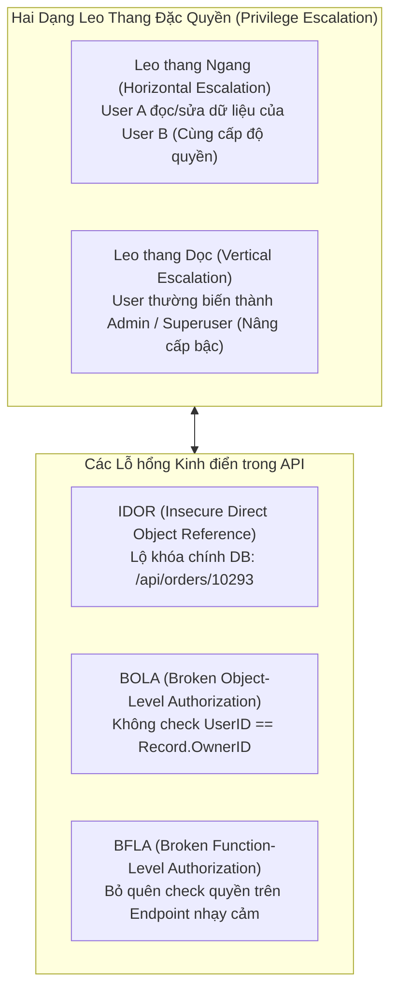
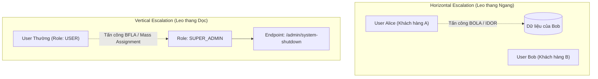
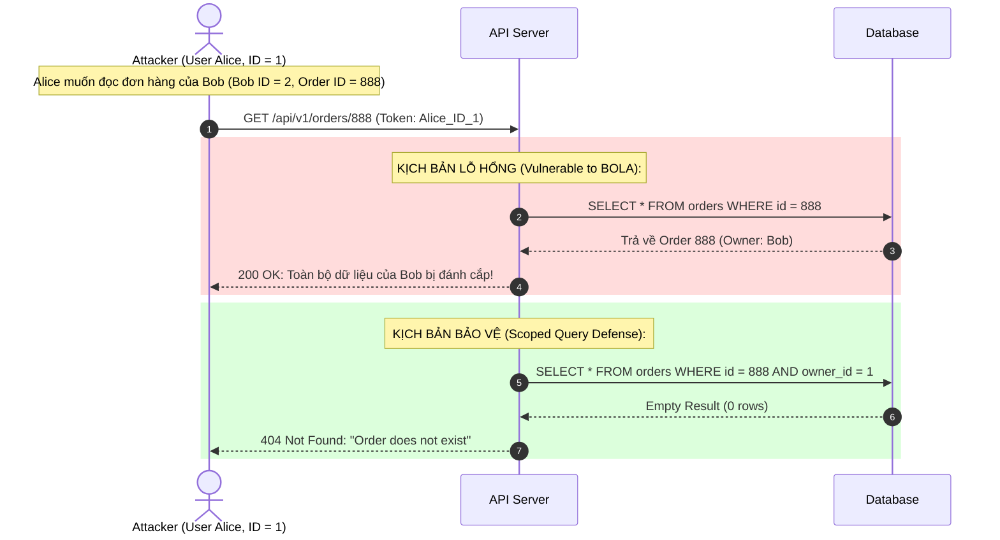
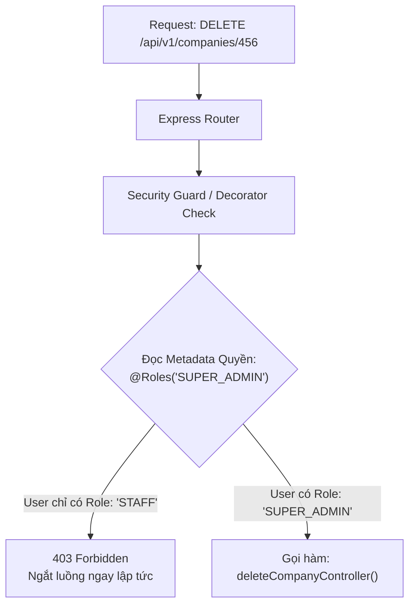

# 4.3. Privilege Escalation and Access Flaws (Leo thang Đặc quyền & Lỗ hổng Kiểm soát Truy cập)

## Tổng quan về Access Control Failures
Theo thống kê chính thức của **OWASP Top 10**, lỗ hổng **Broken Access Control (Kiểm soát Truy cập Bị phá vỡ)** hiện là mối đe dọa bảo mật phổ biến nhất và gây thiệt hại nặng nề nhất trên toàn cầu (chiếm vị trí **A01:2021**). Trong thế giới API RESTful và Microservices, lỗ hổng này biểu hiện rõ rệt nhất qua các biến thể: **BOLA (Broken Object-Level Authorization)** - lỗ hổng số 1 trong OWASP API Security Top 10, **BFLA (Broken Function-Level Authorization)** và kỹ thuật **IDOR (Insecure Direct Object Reference)**.

- **Vấn đề cốt lõi**: Hệ thống xác thực danh tính người dùng rất tốt (User đã login hợp lệ), nhưng ở tầng mã nguồn lại tin tưởng mù quáng vào ID do người dùng gửi lên mà không kiểm tra quyền sở hữu đối tượng.
- **Bản chất dưới tầng máy tính**: Kẻ tấn công can thiệp vào các tham số URL, Query strings hoặc JSON body để thay thế ID của chính mình bằng ID của nạn nhân hoặc nâng cờ đặc quyền trong bộ nhớ.



---

## 2. Chi tiết từng Keyword (Under-the-Hood Deep Dive)

### 1. Privilege Escalation: Horizontal vs Vertical

#### 1. Khái niệm bản chất (What & Why)
- **Privilege Escalation (Leo thang Đặc quyền)**: Hành vi khai thác một lỗi thiết kế, lỗ hổng lập trình hoặc sai sót cấu hình để một chủ thể có được các quyền hạn truy cập hoặc khả năng thực thi cao hơn mức mà người quản trị hệ thống dự định cấp cho họ.
- **Horizontal Privilege Escalation (Leo thang Đặc quyền Ngang)**:
  - Kẻ tấn công chiếm đoạt hoặc can thiệp vào tài nguyên của một người dùng khác có **cùng cấp độ quyền hạn**.
  - *Ví dụ*: Alice (khách hàng ngân hàng) đổi số tài khoản trong request HTTP để xem số dư và lịch sử giao dịch của Bob (cũng là một khách hàng ngân hàng).
- **Vertical Privilege Escalation (Leo thang Đặc quyền Dọc)**:
  - Một người dùng có quyền hạn thấp (ví dụ: Viewer, Khách hàng thông thường) chiếm đoạt được quyền hạn của các vai trò cấp cao hơn (ví dụ: Staff, Moderator, Super Admin).
  - *Ví dụ*: Người dùng thông thường gửi payload đổi mật khẩu của Admin, hoặc kích hoạt endpoint `/api/v1/admin/delete-database`.

#### 2. Cơ chế hoạt động sâu (Under the hood / Hardcore Internals)
- **Tại sao Leo thang Ngang lại phổ biến trong REST API?**
  Mã nguồn Backend ngây thơ thường được viết như sau:
  ```typescript
  // LỖ HỔNG CHẾT NGƯỜI (Horizontal Escalation / BOLA)
  app.get('/api/v1/documents/:id', async (req, res) => {
      // 1. Chỉ kiểm tra xem user đã login hay chưa (AuthN)
      const currentUser = req.user; 
      
      // 2. Lấy trực tiếp ID từ URL để SELECT database
      const doc = await db.query('SELECT * FROM documents WHERE id = $1', [req.params.id]);
      
      // 3. HOÀN TOÀN BỎ QUÊN VIỆC SO SÁNH: doc.owner_id === currentUser.id
      res.json(doc);
  });
  ```
  Kẻ tấn công chỉ cần dùng công cụ như Burp Suite hoặc viết một script Python `for id in range(1, 1000000)` để tải sạch toàn bộ tài liệu mật của toàn bộ công ty về máy mình.

#### 3. Sơ đồ minh họa (So sánh Leo thang Đặc quyền Ngang vs Dọc)


#### 4. Code ví dụ thực chiến (TypeScript Ngăn chặn Leo thang Ngang & Dọc)
```typescript
import { Request, Response } from 'express';

interface UserContext {
    id: string;
    role: 'USER' | 'ADMIN';
}

interface DocumentEntity {
    id: string;
    ownerId: string;
    title: string;
    isPublic: boolean;
}

// Giả lập Database Layer
class DocumentRepository {
    public static async findById(id: string): Promise<DocumentEntity | null> {
        // Trong thực tế là câu query database
        return { id, ownerId: "usr_alice_123", title: "Financial Report", isPublic: false };
    }
}

export class SafeDocumentController {
    /**
     * PHƯƠNG THỨC AN TOÀN: Phòng thủ tuyệt đối BOLA & Horizontal Escalation
     */
    public static async getDocumentById(req: Request, res: Response): Promise<void> {
        const currentUser = (req as any).user as UserContext;
        const requestedDocId = req.params.id;

        const doc = await DocumentRepository.findById(requestedDocId);

        if (!doc) {
            res.status(404).json({ error: "Document not found" });
            return;
        }

        // 1. KIỂM SOÁT BẬC DỌC (Vertical Check): Admin được phép xem tất cả
        if (currentUser.role === 'ADMIN') {
            res.json(doc);
            return;
        }

        // 2. KIỂM SOÁT BẬC NGANG (Horizontal Check): Chỉ cho phép chủ sở hữu hoặc tài liệu công khai
        const isOwner = (doc.ownerId === currentUser.id);
        if (!isOwner && !doc.isPublic) {
            // LƯU Ý BẢO MẬT: Trả về 404 thay vì 403 để tránh rò rỉ sự tồn tại của ID (Information Enumeration)
            res.status(404).json({ error: "Document not found" });
            return;
        }

        res.json(doc);
    }
}
```

#### 5. Ưu / Nhược điểm, Pitfalls & Anti-patterns
- **Pitfall**: Chỉ dựa vào giao diện Frontend (ẩn nút "Delete" hoặc ẩn menu Admin) để bảo vệ hệ thống. Kẻ tấn công không dùng trình duyệt; họ dùng `curl` hoặc Postman để gọi thẳng vào API endpoint bên dưới.
- **Anti-pattern**: Sử dụng ID tự tăng số nguyên (`1, 2, 3, 4...`) làm Primary Key công khai trên API URL.

#### 6. Ứng dụng thực tế trong Backend / Systems
Mọi bài kiểm thử thâm nhập (Penetration Testing) và chương trình Bug Bounty của các tập đoàn công nghệ lớn (Google, Facebook, HackerOne) đều dành phần lớn thời gian để săn lùng các lỗi Privilege Escalation vì khả năng khai thác trực tiếp vào dữ liệu khách hàng.

---

### 2. Insecure Direct Object References (IDOR) & Broken Object-Level Authorization (BOLA)

#### 1. Khái niệm bản chất (What & Why)
- **IDOR (Insecure Direct Object Reference)**: Thuật ngữ kinh điển chỉ lỗ hổng xuất hiện khi một ứng dụng để lộ trực tiếp tham chiếu định danh của một đối tượng dữ liệu nội bộ (ví dụ: Khóa chính Database, Tên file trên ổ đĩa) cho người dùng cuối trong các tham số request mà không có cơ chế xác minh tính hợp lệ của quyền truy cập.
- **BOLA (Broken Object-Level Authorization)**: Thuật ngữ hiện đại được OWASP chuẩn hóa riêng cho thế giới API RESTful / GraphQL (Đứng vị trí **API1:2023** trong OWASP API Security Top 10). BOLA chính là phiên bản API của IDOR.
  - *Bản chất của BOLA*: API Endpoint thường có dạng `/api/v1/users/{userId}/credit_cards/{cardId}`. Nếu hacker đổi `userId` thành ID của người khác mà server vẫn trả về thông tin thẻ tín dụng, API đó dính lỗi BOLA ở mức nghiêm trọng tối đa.

#### 2. Cơ chế hoạt động sâu (Under the hood / Hardcore Internals)
- **Chiến lược Phòng ngự Đa tầng chống BOLA**:
  1. **UUIDv4 / Nanoid / ULID thay thế ID Tự tăng (Auto-increment Integer)**:
     - Dùng ID tự tăng (`/invoices/1001`): Kẻ tấn công chỉ cần lặp vòng `for i = 1 to 10000` là vét sạch dữ liệu trong 5 phút.
     - Dùng UUIDv4 (`/invoices/9b1deb4d-3b7d-4bad-9bdd-2b0d7b3dcb6d`): Không gian khóa $2^{128}$ giá trị khiến việc quét mò ID ngẫu nhiên trở nên bất khả thi về mặt toán học.
  2. **Scoped Database Queries (Truy vấn theo Phạm vi Sở hữu)**:
     Thay vì truy vấn 2 bước (Tìm theo ID rồi so sánh ngoài code), hãy ép buộc điều kiện sở hữu trực tiếp vào câu lệnh SQL:
     ```sql
     -- Cưỡng chế trực tiếp quyền sở hữu tại mệnh đề WHERE
     SELECT * FROM invoices 
     WHERE id = :requested_invoice_id 
       AND user_id = :authenticated_user_id;
     ```
     Nếu user không phải chủ sở hữu, câu lệnh trả về rỗng (0 rows) ngay lập tức, ngăn ngừa hoàn toàn nguy cơ lập trình viên quên viết code check logic!

#### 3. Sơ đồ minh họa (Tấn công BOLA/IDOR và Cách Phòng vệ bằng Scoped Query)


#### 4. Code ví dụ thực chiến (C++ Scoped Database Query Builder Pattern)
```cpp
#include <iostream>
#include <string>
#include <sstream>

// Minh họa mẫu thiết kế Scoped Query ép buộc điều kiện Authorization ở Compile-Time
class ScopedOrderRepository {
public:
    // Tuyệt đối không cung cấp hàm getOrderById(orderId) đơn thuần
    // Bắt buộc mọi lời gọi hàm phải truyền SecurityContext (authenticatedUserId)
    static std::string buildSecureSelectQuery(const std::string& orderUuid, const std::string& authenticatedUserId) {
        std::stringstream sql;
        // Ràng buộc kép: Vừa kiểm tra Order UUID, vừa kiểm tra Owner User ID
        sql << "SELECT order_id, amount, status FROM orders "
            << "WHERE order_uuid = '" << orderUuid << "' "
            << "AND owner_user_id = '" << authenticatedUserId << "' "
            << "LIMIT 1;";
        return sql.str();
    }
};

int main() {
    std::string userAliceId = "usr_alice_uuid_888";
    std::string requestedOrderUuid = "ord_bob_secret_999";

    // Sinh câu truy vấn có ràng buộc sở hữu
    std::string safeSql = ScopedOrderRepository::buildSecureSelectQuery(requestedOrderUuid, userAliceId);
    std::cout << "[Secure SQL Engine] Generated Query:\n" << safeSql << "\n";
    // Nếu Alice cố tình đọc đơn hàng của Bob, database sẽ trả về 0 dòng!
    return 0;
}
```

#### 5. Ưu / Nhược điểm, Pitfalls & Anti-patterns
- **Pitfall**: Nghĩ rằng chỉ cần đổi sang dùng UUID là đã an toàn trước BOLA. UUID chỉ giải quyết vấn đề "khó đoán ID" (Security by Obscurity), không giải quyết vấn đề "kiểm tra quyền hạn". Nếu Bob vô tình gửi link UUID của mình cho Alice, Alice vẫn đọc được nếu backend không kiểm tra `owner_id`.
- **Anti-pattern**: Truyền `userId` qua Request Body hoặc Query Param trong khi người dùng đã đăng nhập bằng JWT Bearer Token. Thông tin `userId` **bắt buộc phải được trích xuất trực tiếp từ Token đã ký số**, không bao giờ tin dữ liệu do client tự khai báo trong body!

#### 6. Ứng dụng thực tế trong Backend / Systems
Tất cả các kiến trúc API Gateway hiện đại đều cấu hình bộ phân tích OpenAPI/JSON Schema để kiểm tra tính toàn vẹn của Object-level parameters và bắt buộc các ORM (Prisma, TypeORM, Hibernate) sử dụng Global Scope Filters.

---

### 3. Broken Function-Level Authorization (BFLA)

#### 1. Khái niệm bản chất (What & Why)
- **Broken Function-Level Authorization (BFLA - Hỏng Phân quyền Cấp độ Hàm)**: Lỗ hổng bảo mật (Đứng vị trí **API5:2023** trong OWASP API Security Top 10) xảy ra khi ứng dụng không kiểm tra hoặc kiểm tra sai quyền hạn của người dùng trước khi cho phép họ gọi các hàm, API endpoints hoặc thao tác quản trị nhạy cảm.
  - *Ví dụ kinh điển*: Hệ thống có 2 endpoint:
    - `GET /api/v1/users/profile` (Người dùng thông thường)
    - `POST /api/v1/users/export-all-data` (Chỉ dành cho Quản trị viên)
    Nếu lập trình viên quên gắn middleware kiểm tra quyền Admin vào endpoint `export-all-data`, một người dùng thông thường chỉ cần gửi request HTTP POST tới URL này là có thể dump toàn bộ cơ sở dữ liệu của công ty!

#### 2. Cơ chế hoạt động sâu (Under the hood / Hardcore Internals)
- **Các Biến thể Tinh vi của BFLA**:
  1. **HTTP Method Manipulation (Thao túng Phương thức HTTP)**:
     Hệ thống cấu hình phân quyền: `GET /api/v1/articles` $\to$ Cho phép mọi người; nhưng quên cấu hình cho `POST`, `PUT`, `DELETE`. Hoặc Firewall chỉ chặn `POST /admin/users` nhưng lại bỏ quên phương thức `PUT` hoặc `PATCH` có cùng chức năng.
  2. **URL Path Traversal / Case Sensitivity Bypass**:
     API Gateway chặn `/admin/*`, nhưng do máy chủ Backend phía sau (ví dụ: Spring Boot hoặc IIS) hỗ trợ tính năng Path Normalization hoặc phân biệt hoa thường không đồng nhất, kẻ tấn công gửi `/Admin/users` hoặc `/api/v1/public/../admin/users` để vượt qua bộ lọc Gateway!

#### 3. Sơ đồ minh họa (Cơ chế Phòng vệ BFLA bằng Declarative Method Decorators)


#### 4. Code ví dụ thực chiến (TypeScript Type-Safe Function Guard Pattern)
```typescript
import { Request, Response, NextFunction } from 'express';

type UserRole = 'CUSTOMER' | 'SUPPORT_AGENT' | 'SYSTEM_ADMIN';

// Metadata ánh xạ danh sách Role được phép cho từng Function Action
const FUNCTION_PERMISSIONS_REGISTRY: Record<string, UserRole[]> = {
    'GET_ORDER_HISTORY': ['CUSTOMER', 'SUPPORT_AGENT', 'SYSTEM_ADMIN'],
    'REFUND_PAYMENT':    ['SUPPORT_AGENT', 'SYSTEM_ADMIN'],
    'PURGE_SYSTEM_LOGS': ['SYSTEM_ADMIN'] // Chỉ duy nhất Admin
};

export class FunctionAuthorizationGuard {
    /**
     * Middleware bảo vệ hàm nghiêm ngặt chống lại BFLA
     */
    public static requireFunctionAccess(functionName: string) {
        return (req: Request, res: Response, next: NextFunction): void => {
            const user = (req as any).user as { id: string; role: UserRole } | undefined;

            if (!user) {
                res.status(401).json({ error: "Authentication required." });
                return;
            }

            const allowedRoles = FUNCTION_PERMISSIONS_REGISTRY[functionName];

            if (!allowedRoles || !allowedRoles.includes(user.role)) {
                console.error(`[BFLA Alert] User ${user.id} with role ${user.role} attempted unauthorized execution of ${functionName}`);
                // Chặn đứng hành vi leo thang đặc quyền dọc
                res.status(403).json({ error: "Access Denied: You do not possess the required function privilege." });
                return;
            }

            next();
        };
    }
}
```

#### 5. Ưu / Nhược điểm, Pitfalls & Anti-patterns
- **Pitfall**: "Security through Obscurity" (Bảo mật bằng sự mập mờ): Giấu các endpoint quản trị nhạy cảm vào các URL khó đoán như `/api/v1/secret-internal-admin-console-9812` mà không cài đặt xác thực. Kẻ tấn công chỉ cần dùng công cụ quét tự động (GoBuster / Ffuf) là tìm ra trong vài phút.
- **Anti-pattern**: Kiểm tra quyền hạn không nhất quán giữa các HTTP Methods (ví dụ: chỉ check quyền ở `POST` mà quên check ở `PUT`).

#### 6. Ứng dụng thực tế trong Backend / Systems
Áp dụng **Role Guards** và **Method Decorators** (ví dụ: `@PreAuthorize("hasRole('ADMIN')")` trong Spring Security hoặc `@UseGuards(RolesGuard)` trong NestJS) để toàn bộ định nghĩa quyền được ghim chặt vào mã nguồn và kiểm tra tĩnh ở compile-time.
