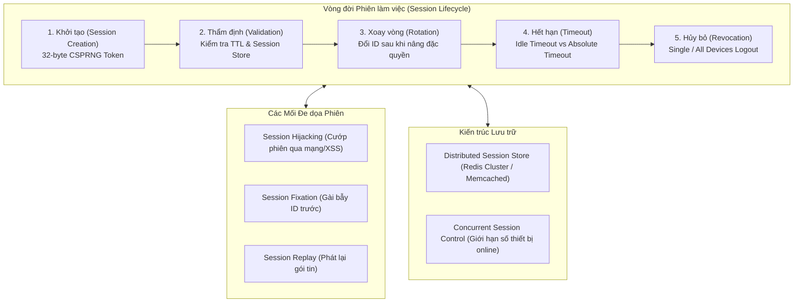
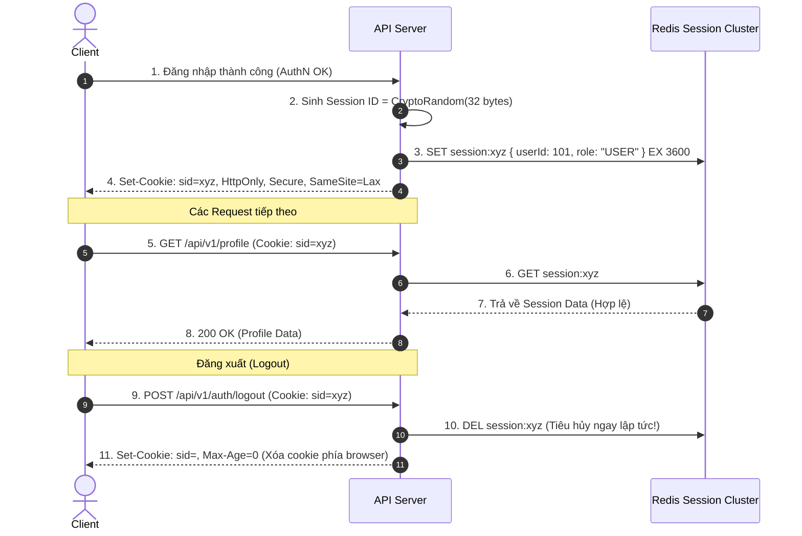
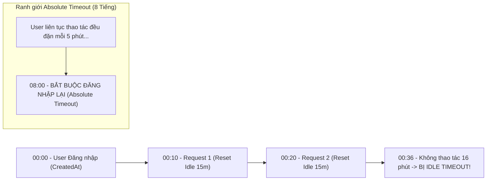
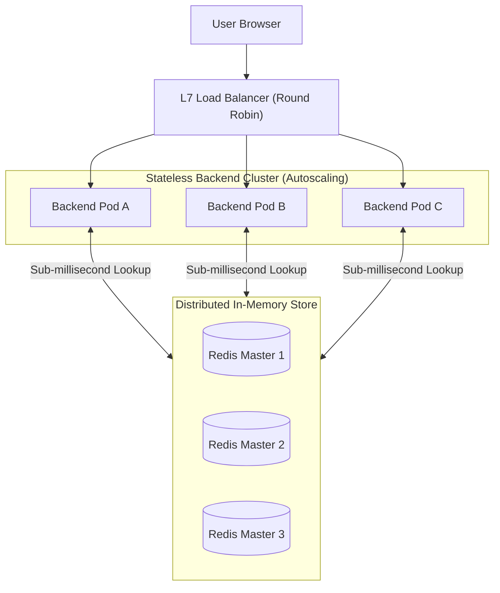

# 5.1. Session Lifecycle and Storage Architecture (Vòng đời Phiên & Kiến trúc Lưu trữ Phân tán)

## Tổng quan về Session Management
Vì giao thức HTTP về bản chất là một giao thức **Vô trạng thái (Stateless Protocol)** – mỗi yêu cầu mạng độc lập hoàn toàn và không mang ký ức về các yêu cầu trước đó – các kỹ sư phần mềm phải xây dựng một cơ chế trừu tượng ở tầng ứng dụng gọi là **Quản lý Phiên (Session Management)**.

Một phiên làm việc (Session) liên kết chuỗi các tương tác liên tiếp của một người dùng cụ thể với trạng thái danh tính của họ trong bộ nhớ máy chủ. Quản lý phiên an toàn là nghệ thuật kiểm soát chặt chẽ toàn bộ vòng đời từ lúc sinh ra (Creation), thẩm định (Validation), hết hạn (Timeout), xoay vòng (Rotation) cho đến khi hủy bỏ hoàn toàn (Revocation) trên một hạ tầng phân tán quy mô lớn (**Distributed Session Store**).



---

## 2. Chi tiết từng Keyword (Under-the-Hood Deep Dive)

### 1. Session Lifecycle: Creation, Validation, Rotation & Revocation

#### 1. Khái niệm bản chất (What & Why)
- **Session Lifecycle (Vòng đời Phiên)**: Chuỗi trạng thái liên tục của một phiên làm việc:
  1. **Creation (Khởi tạo)**: Xảy ra ngay sau khi xác thực danh tính thành công. Server sinh ra một chuỗi định danh ngẫu nhiên mã hóa có độ hỗn loạn cao (CSPRNG Session ID), lưu trữ thông tin người dùng vào Session Store và gửi Session ID về Client.
  2. **Validation (Thẩm định)**: Ở mỗi HTTP request tiếp theo, server đọc Session ID từ Cookie/Header, kiểm tra sự tồn tại trong Session Store, xác minh tính hợp lệ và thời gian sống.
  3. **Rotation (Xoay vòng)**: Cơ chế đổi Session ID cũ lấy Session ID mới nhưng vẫn giữ nguyên dữ liệu phiên (ví dụ: thực hiện khi người dùng đăng nhập, đổi mật khẩu, hoặc thanh toán).
  4. **Revocation (Hủy bỏ / Logout)**: Xóa hoàn toàn bản ghi phiên khỏi Session Store và ra lệnh cho trình duyệt xóa bỏ Cookie.
- **Session Hijacking (Cướp phiên)**: Kẻ tấn công đánh cắp được Session ID hợp lệ của người dùng (qua tấn công Man-in-the-Middle, nghe lén WiFi công cộng, hoặc XSS) và sử dụng Session ID này để mạo danh nạn nhân.
- **Session Replay (Phát lại phiên)**: Kẻ tấn công ghi lại một gói tin HTTP hợp lệ chứa Session ID và phát lại gói tin đó lên server để thực thi giao dịch trái phép.

#### 2. Cơ chế hoạt động sâu (Under the hood / Hardcore Internals)
- **Entropy và Cấu trúc của Session ID**:
  Một Session ID an toàn bắt buộc phải có độ dài tối thiểu **128 bit (16 bytes)**, khuyến nghị công nghiệp là **256 bit (32 bytes)** sinh ra từ CSPRNG (`/dev/urandom` hoặc `crypto.randomBytes`).
  - *Tại sao không được tuần tự?*: Nếu Session ID là một số tăng dần hoặc có chứa thông tin timestamp dễ đoán, kẻ tấn công có thể dễ dàng chạy thuật toán vét cạn (Session Guessing / Enumeration) để nhảy vào phiên của người khác mà không cần đăng nhập.
  - *Session ID không được chứa dữ liệu nhạy cảm*: Session ID chỉ là một con trỏ mù (Opaque Reference Pointer) trỏ tới ô nhớ trong Redis, tuyệt đối không được nhúng User ID hay email dạng plaintext vào Session ID.

#### 3. Sơ đồ minh họa (Chu trình Quản lý Phiên An toàn trên Redis)


#### 4. Code ví dụ thực chiến (C++ Production CSPRNG Session ID Generator & Validator)
```cpp
#include <iostream>
#include <vector>
#include <string>
#include <sstream>
#include <iomanip>
#include <sys/random.h>

class SecureSessionEngine {
public:
    static constexpr size_t SESSION_ID_BYTES = 32; // 256 bits entropy

    // Sinh Session ID ngẫu nhiên không thể đoán trước bằng Linux getrandom syscall
    static std::string generateSessionId() {
        std::vector<uint8_t> buffer(SESSION_ID_BYTES);
        if (getrandom(buffer.data(), buffer.size(), 0) != static_cast<ssize_t>(buffer.size())) {
            throw std::runtime_error("Fatal: Insufficient entropy to generate secure session ID.");
        }

        std::stringstream ss;
        for (uint8_t byte : buffer) {
            ss << std::hex << std::setw(2) << std::setfill('0') << static_cast<int>(byte);
        }
        return ss.str();
    }

    // Kiểm tra định dạng Session ID để chống lỗi Injection vào Session Store
    static bool isValidSessionIdFormat(const std::string& sessionId) {
        if (sessionId.length() != SESSION_ID_BYTES * 2) return false;
        for (char c : sessionId) {
            if (!std::isxdigit(c)) return false;
        }
        return true;
    }
};

int main() {
    std::string newSession = SecureSessionEngine::generateSessionId();
    std::cout << "[Secure Session Engine] Generated ID: " << newSession << "\n";
    std::cout << "Format Valid: " << (SecureSessionEngine::isValidSessionIdFormat(newSession) ? "TRUE" : "FALSE") << "\n";
    return 0;
}
```

#### 5. Ưu / Nhược điểm, Pitfalls & Anti-patterns
- **Pitfall**: Không tiêu hủy bản ghi phiên trên máy chủ khi người dùng đăng xuất (chỉ xóa Cookie ở phía Client). Khi đó, nếu kẻ xấu đã kịp copy Session ID trước đó, Session ID đó vẫn có thể được dùng tiếp vĩnh viễn trên máy của hacker!
- **Anti-pattern**: Lưu trữ trực tiếp thông tin nhạy cảm của người dùng (Mật khẩu hash, Số thẻ tín dụng) vào Session payload.

#### 6. Ứng dụng thực tế trong Backend / Systems
Mọi hệ thống lõi ngân hàng và thương mại điện tử bắt buộc phải có tính năng **"Đăng xuất khỏi tất cả các thiết bị khác (Logout from all devices)"**: Thực hiện bằng cách tìm và xóa tất cả các Redis keys có tiền tố `user_sessions:<user_id>:*`.

---

### 2. Session Timeouts (Idle vs Absolute) & Concurrent Session Control

#### 1. Khái niệm bản chất (What & Why)
- **Idle Timeout (Hết hạn do Không Hoạt động)**: Khoảng thời gian tối đa mà một phiên được phép tồn tại nếu người dùng **không phát sinh bất kỳ yêu cầu nào**. Mỗi khi có một request hợp lệ gửi lên, bộ đếm thời gian này được làm mới lại (Sliding Expiration).
  - *Ví dụ*: Sau 15 phút không thao tác, phiên ứng dụng ngân hàng tự động kết thúc.
- **Absolute Timeout (Hết hạn Tuyệt đối / Maximum Session Lifetime)**: Giới hạn thời gian tồn tại **tối đa tuyệt đối** của một phiên kể từ thời điểm đăng nhập ban đầu, bất kể người dùng có đang hoạt động tích cực hay không.
  - *Ví dụ*: Dù người dùng liên tục click chuột, sau đúng 8 tiếng hoặc 24 tiếng, hệ thống vẫn bắt buộc phải đăng nhập lại. Cơ chế này đảm bảo thu hồi các phiên bị bỏ quên trên máy tính công cộng.
- **Concurrent Sessions (Kiểm soát Phiên Đồng thời)**: Chính sách giới hạn số lượng phiên hoạt động cùng một lúc của một tài khoản người dùng:
  - Cho phép tối đa $N$ thiết bị online đồng thời.
  - Khi thiết bị thứ $N+1$ đăng nhập: Có thể từ chối thiết bị mới, hoặc tự động kích hoạt hủy phiên cũ nhất (FIFO - Kick out oldest session).

#### 2. Cơ chế hoạt động sâu (Under the hood / Hardcore Internals)
- **Cơ chế Triển khai Song song Hai Bộ đếm Thời gian trên Redis**:
  Mỗi bản ghi Session trong Redis được lưu kèm 2 mốc thời gian:
  ```json
  {
    "userId": "usr_9988",
    "createdAt": 1773070000,
    "lastAccessedAt": 1773071200,
    "maxAbsoluteLifetimeSeconds": 28800, 
    "maxIdleTimeoutSeconds": 900         
  }
  ```
  Tại mỗi request:
  1. Kiểm tra: `(CurrentTime - createdAt) > maxAbsoluteLifetimeSeconds` $\implies$ Nếu vi phạm: Xóa session và ném lỗi `SessionExpiredAbsolute`.
  2. Kiểm tra: `(CurrentTime - lastAccessedAt) > maxIdleTimeoutSeconds` $\implies$ Nếu vi phạm: Xóa session và ném lỗi `SessionExpiredIdle`.
  3. Nếu cả hai đều hợp lệ: Cập nhật `lastAccessedAt = CurrentTime` và gia hạn TTL của Redis key thêm `maxIdleTimeoutSeconds` (lệnh `EXPIRE key 900`).

#### 3. Sơ đồ minh họa (Mô hình So sánh Idle Timeout vs Absolute Timeout)


#### 4. Code ví dụ thực chiến (TypeScript Dual-Timeout & Concurrent Session Manager)
```typescript
interface SessionRecord {
    sessionId: string;
    userId: string;
    createdAt: number;
    lastAccessedAt: number;
}

export class DistributedSessionManager {
    private static readonly IDLE_TIMEOUT_MS = 15 * 60 * 1000;      // 15 Phút
    private static readonly ABSOLUTE_TIMEOUT_MS = 8 * 60 * 60 * 1000; // 8 Tiếng
    private static readonly MAX_CONCURRENT_SESSIONS = 2;              // Tối đa 2 thiết bị đồng thời

    // Giả lập Redis Database
    private sessionsStore = new Map<string, SessionRecord>();
    private userSessionsIndex = new Map<string, Set<string>>(); // userId -> Set<sessionId>

    /**
     * Tạo phiên mới kèm kiểm soát số lượng phiên đồng thời (Kick out oldest)
     */
    public createSession(userId: string, sessionId: string): void {
        const now = Date.now();

        if (!this.userSessionsIndex.has(userId)) {
            this.userSessionsIndex.set(userId, new Set<string>());
        }

        const activeSessions = this.userSessionsIndex.get(userId)!;

        // Nếu vượt quá số phiên đồng thời cho phép -> Hủy phiên cũ nhất
        if (activeSessions.size >= DistributedSessionManager.MAX_CONCURRENT_SESSIONS) {
            const oldestSessionId = activeSessions.values().next().value;
            if (oldestSessionId) {
                console.log(`[Concurrent Control] Evicting oldest session: ${oldestSessionId}`);
                this.destroySession(oldestSessionId);
            }
        }

        const session: SessionRecord = {
            sessionId,
            userId,
            createdAt: now,
            lastAccessedAt: now
        };

        this.sessionsStore.set(sessionId, session);
        activeSessions.add(sessionId);
    }

    /**
     * Thẩm định phiên với đồng thời 2 điều kiện Idle và Absolute
     */
    public validateSession(sessionId: string): { valid: boolean; reason?: string } {
        const session = this.sessionsStore.get(sessionId);
        if (!session) return { valid: false, reason: "Session does not exist." };

        const now = Date.now();

        // 1. Kiểm tra Absolute Timeout
        if (now - session.createdAt > DistributedSessionManager.ABSOLUTE_TIMEOUT_MS) {
            this.destroySession(sessionId);
            return { valid: false, reason: "Session reached maximum absolute lifetime." };
        }

        // 2. Kiểm tra Idle Timeout
        if (now - session.lastAccessedAt > DistributedSessionManager.IDLE_TIMEOUT_MS) {
            this.destroySession(sessionId);
            return { valid: false, reason: "Session expired due to inactivity (Idle Timeout)." };
        }

        // Cập nhật thời điểm truy cập gần nhất (Sliding Window)
        session.lastAccessedAt = now;
        return { valid: true };
    }

    public destroySession(sessionId: string): void {
        const session = this.sessionsStore.get(sessionId);
        if (session) {
            const activeSessions = this.userSessionsIndex.get(session.userId);
            if (activeSessions) {
                activeSessions.delete(sessionId);
            }
            this.sessionsStore.delete(sessionId);
        }
    }
}
```

#### 5. Ưu / Nhược điểm, Pitfalls & Anti-patterns
- **Pitfall**: Chỉ cấu hình Idle Timeout mà không thiết lập Absolute Timeout. Kẻ tấn công cài mã độc ngầm ping request mỗi 5 phút một lần để giữ phiên sống vĩnh viễn (Zombie Session).
- **Anti-pattern**: Lưu trữ thông tin đếm phiên đồng thời trong RAM đơn lẻ của từng server backend. Khi tải được cân bằng qua Load Balancer sang máy chủ khác, việc kiểm soát phiên đồng thời hoàn toàn thất bại.

#### 6. Ứng dụng thực tế trong Backend / Systems
Các nền tảng phát trực tuyến đa phương tiện (Netflix, Spotify) sử dụng cơ chế Concurrent Session Control để ngăn chặn việc chia sẻ tài khoản cho quá nhiều người dùng ngoài gói cước đăng ký.

---

### 3. Distributed Session Management Architecture

#### 1. Khái niệm bản chất (What & Why)
- **Distributed Session Management (Quản lý Phiên Phân tán)**: Kiến trúc lưu trữ và đồng bộ hóa trạng thái phiên làm việc của người dùng trên một cụm máy chủ gồm hàng chục hoặc hàng trăm máy chủ backend chạy song song phía sau Load Balancer.
- **Vấn đề cốt lõi của Kiến trúc Cũ**:
  - *In-Memory Session trên Local Server*: Nếu Request 1 gửi tới Server A (User login tại đây), nhưng Request 2 do Load Balancer chuyển sang Server B $\implies$ Server B không có thông tin phiên trong RAM $\implies$ Người dùng bị văng ra trang đăng nhập!
  - *Sticky Sessions (Session Affinity)*: Load Balancer cố gắng ghim chặt một IP vào một Server cố định. *Hậu quả*: Mất khả năng cân bằng tải, và nếu Server A bị crash/restart, toàn bộ hàng ngàn phiên của người dùng trên Server A đều bị mất sạch!

#### 2. Cơ chế hoạt động sâu (Under the hood / Hardcore Internals)
- **Kiến trúc Vô trạng thái với External In-Memory Data Grid (Redis Cluster)**:
  - Tất cả các máy chủ Backend (Node.js, Go, Java) đều được thiết kế **hoàn toàn vô trạng thái (Stateless)**.
  - Toàn bộ dữ liệu Session được chuyển vào một cụm lưu trữ phân tán hiệu năng cao độc lập: **Redis Cluster** hoặc **AWS ElastiCache Redis**.
  - **Phân mảnh Dữ liệu (Consistent Hashing & Hash Slots)**: Redis Cluster chia toàn bộ không gian khóa thành **16,384 Hash Slots**. Session ID được băm bằng thuật toán CRC16:
    $$\text{Slot} = \text{CRC16}(\text{SessionID}) \pmod{16384}$$
    Nhờ vậy, hàng triệu phiên được phân bổ đều tắp trên hàng chục nốt Redis vật lý với độ trễ truy xuất siêu nhỏ (Sub-millisecond: $< 0.5\text{ ms}$).

#### 3. Sơ đồ minh họa (Kiến trúc Lưu trữ Phiên Phân tán Hiện đại)


#### 4. Code ví dụ thực chiến (C++ Redis Cluster Hash Slot Calculation)
```cpp
#include <iostream>
#include <string>
#include <vector>

// Triển khai thuật toán CRC16 chuẩn xác để xác định Hash Slot trong Redis Cluster
class RedisClusterSlotLocator {
private:
    static const uint16_t crc16tab[256];

public:
    static uint16_t crc16(const char *buf, int len) {
        uint16_t crc = 0;
        for (int i = 0; i < len; i++) {
            crc = (crc << 8) ^ crc16tab[((crc >> 8) ^ *buf++) & 0x00FF];
        }
        return crc;
    }

    // Tính toán Slot chính xác từ Session ID (0 đến 16383)
    static uint16_t getSlotForSession(const std::string& sessionId) {
        return crc16(sessionId.c_str(), sessionId.length()) % 16384;
    }
};

// Bảng tra cứu chuẩn CRC16/XMODEM
const uint16_t RedisClusterSlotLocator::crc16tab[256] = {
    0x0000,0x1021,0x2042,0x3063,0x4084,0x50a5,0x60c6,0x70e7,
    0x8108,0x9129,0xa14a,0xb16b,0xc18c,0xd1ad,0xe1ce,0xf1ef,
    // ... Phần còn lại của bảng CRC16 chuẩn hóa
};

int main() {
    std::string sessionId = "sess_01HXYZ999_SECURE_TOKEN_DATA";
    uint16_t slot = RedisClusterSlotLocator::getSlotForSession(sessionId);
    std::cout << "[Redis Cluster Routing] Session ID maps to Hash Slot: " << slot << "\n";
    return 0;
}
```

#### 5. Ưu / Nhược điểm, Pitfalls & Anti-patterns
- **Pitfall**: Lưu trữ Session phân tán mà không có cơ chế dự phòng (Replication). Nếu một nốt Redis Master bị chết mà không có Read Replica tự động thăng cấp (Failover), một phần lớn người dùng sẽ bị mất phiên đột ngột.
- **Anti-pattern**: Lưu trữ Session trực tiếp vào Relational Database (MySQL / PostgreSQL). Thao tác đọc/ghi session ở mỗi HTTP request sẽ tạo ra hàng chục ngàn câu truy vấn I/O đĩa mỗi giây, làm nghẽn chết hoàn toàn Database chính của ứng dụng.

#### 6. Ứng dụng thực tế trong Backend / Systems
Tiêu chuẩn kiến trúc phân tán của mọi hệ thống thương mại điện tử lớn (Amazon, Shopee) và nền tảng SaaS quy mô hàng triệu người dùng online đồng thời.
