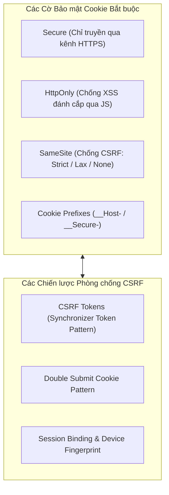
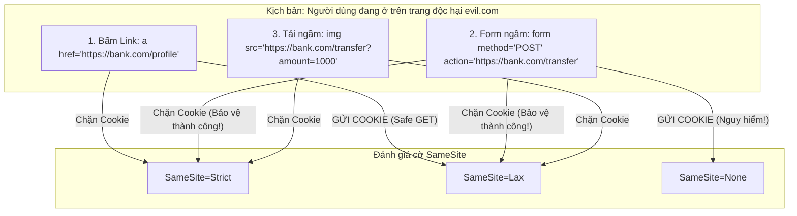
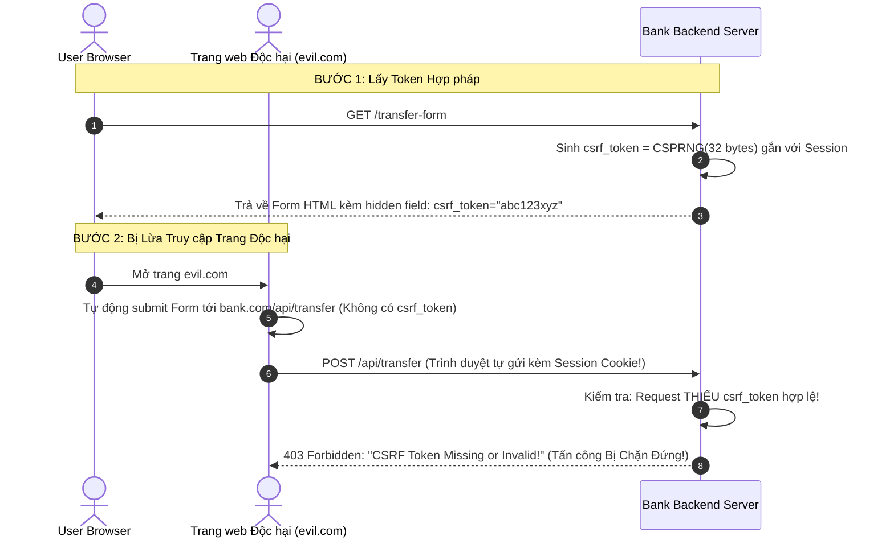
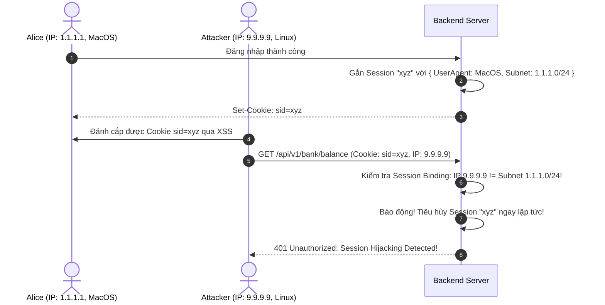

# 5.2. Cookie Security and CSRF Mitigation (Bảo mật Cookie & Phòng vệ Tấn công Giả mạo Yêu cầu)

## Tổng quan về Cookie Security & Cross-Site Request Forgery
Trong kiến trúc web hướng trình duyệt (Browser-based Web Applications), **HTTP Cookies** là cơ chế lâu đời và mạnh mẽ nhất để duy trì trạng thái phiên. Tuy nhiên, tính năng tự động đính kèm cookie của trình duyệt (Automatic Credential Inclusion) cũng chính là con dao hai lưỡi mở đường cho lỗ hổng kinh điển: **CSRF (Cross-Site Request Forgery - Giả mạo Yêu cầu Đa trang)**.

Bảo vệ phiên làm việc dựa trên Cookie đòi hỏi sự kết hợp đồng bộ giữa các cờ bảo vệ bắt buộc (`HttpOnly`, `Secure`, `SameSite`), cấu hình phạm vi chặt chẽ (`Domain`, `Path`, `Cookie Prefixes`) cùng các chiến lược phòng ngự CSRF hiện đại (Double Submit Cookie, Synchronizer Token Pattern, Session/Device Binding).



---

## 2. Chi tiết từng Keyword (Under-the-Hood Deep Dive)

### 1. Cookie Security Flags: Secure, HttpOnly, SameSite, Domain, Path & Prefixes

#### 1. Khái niệm bản chất (What & Why)
- **Cookie-Based Sessions**: Cơ chế trong đó server thiết lập một header HTTP `Set-Cookie` chứa Session ID. Trình duyệt tự động lưu trữ và gửi kèm cookie này trong mọi request tiếp theo tới cùng nguồn (Origin).
- **Các Cờ Bảo mật Cốt lõi (Security Directives)**:
  - **`Secure`**: Chỉ thị cho trình duyệt **chỉ gửi cookie qua các kết nối được mã hóa bằng HTTPS**. Tuyệt đối không bao giờ gửi cookie qua kết nối HTTP văn bản thô (chống nghe lén Man-in-the-Middle trên mạng công cộng).
  - **`HttpOnly`**: Ngăn chặn hoàn toàn việc mã JavaScript phía Client (như `document.cookie`) có thể đọc hoặc ghi đè cookie. *Tác dụng cốt lõi*: Nếu website chẳng may dính lỗ hổng XSS (Cross-Site Scripting), kẻ tấn công cũng **không thể đánh cắp được Session ID**.
  - **`SameSite`**: Quy định việc trình duyệt có được tự động gửi kèm cookie trong các yêu cầu bắt nguồn từ trang web của bên thứ ba (Cross-Site Requests) hay không:
    - `SameSite=Strict`: Cookie **chỉ được gửi** khi request bắt nguồn từ chính domain hiện tại. Ngay cả khi người dùng bấm vào một đường link từ email hoặc chat, cookie cũng không được gửi đi ở request đầu tiên.
    - `SameSite=Lax` (Mặc định trên các trình duyệt hiện đại): Cookie được gửi kèm trong các điều hướng cấp cao an toàn (Safe Top-Level Navigations như click link thẻ `<a href>` với phương thức `GET`), nhưng bị chặn đối với các request không an toàn (như form `POST` từ trang web khác).
    - `SameSite=None`: Cookie được gửi trong mọi ngữ cảnh chéo trang (Cross-site). Bắt buộc phải đi kèm cờ `Secure`.
  - **`Domain` & `Path`**: Xác định phạm vi máy chủ và đường dẫn URL mà cookie có hiệu lực.
  - **Cookie Prefixes (Tiền tố Cookie chuẩn hóa RFC 6265bis)**:
    - **`__Host-`**: Bắt buộc cookie phải có cờ `Secure`, đường dẫn `Path=/`, và **không được chứa thuộc tính Domain** (nghĩa là cookie bị khóa cứng vào chính xác hostname đó, các subdomain như `blog.example.com` không thể can thiệp hay đọc trộm).
    - **`__Secure-`**: Bắt buộc cookie phải có cờ `Secure`.

#### 2. Cơ chế hoạt động sâu (Under the hood / Hardcore Internals)
- **Hiểm họa Subdomain Cookie Tossing**:
  Nếu server đặt cookie không có tiền tố trên domain cha: `Set-Cookie: sid=123; Domain=example.com`.
  Một hacker xâm nhập được một subdomain phụ (ví dụ: `vulnerable.example.com`) có thể thiết lập một cookie trùng tên ghi đè lên domain chính (`Set-Cookie: sid=attacker_fixed; Domain=example.com`). Khi user truy cập `api.example.com`, trình duyệt gửi cả hai cookie hoặc gửi cookie của hacker!
  - **Giải pháp triệt để**: Sử dụng tiền tố **`__Host-`**:
    `Set-Cookie: __Host-sid=xyz999; Secure; Path=/; HttpOnly; SameSite=Strict`
    Nhân trình duyệt (Chromium / WebKit) sẽ từ chối lưu cookie này nếu phát hiện có thuộc tính `Domain`, cô lập hoàn toàn khỏi mọi nguy cơ từ các subdomain khác.

#### 3. Sơ đồ minh họa (Ma trận Hoạt động của Cờ SameSite)


#### 4. Code ví dụ thực chiến (TypeScript Production Hardened Cookie Setter)
```typescript
import { Response } from 'express';

export class HardenedCookieService {
    /**
     * Thiết lập Session Cookie đạt chuẩn bảo mật cấp cao nhất của OWASP
     */
    public static setSecureSessionCookie(res: Response, sessionId: string, isProduction: boolean): void {
        const cookieName = isProduction ? "__Host-SessionId" : "SessionId";

        res.cookie(cookieName, sessionId, {
            httpOnly: true,                    // Chống XSS đọc trộm qua JavaScript
            secure: isProduction,              // Bắt buộc HTTPS trong production
            sameSite: 'lax',                   // Cân bằng hoàn hảo giữa bảo mật CSRF và UX
            path: '/',                         // Toàn bộ ứng dụng
            maxAge: 8 * 60 * 60 * 1000,        // 8 Tiếng (Absolute Timeout)
            // LƯU Ý: Tuyệt đối không set thuộc tính 'domain' để tuân thủ chuẩn __Host- prefix
        });

        console.log(`[Cookie Security] Hardened Cookie ${cookieName} set successfully.`);
    }
}
```

#### 5. Ưu / Nhược điểm, Pitfalls & Anti-patterns
- **Pitfall**: Thiết lập `SameSite=None` nhưng quên cờ `Secure`. Trình duyệt hiện đại sẽ từ chối lưu cookie này và ném cảnh báo trong console.
- **Anti-pattern**: Lưu trữ JWT Token hoặc API Secret trực tiếp vào `document.cookie` mà không có cờ `HttpOnly`.

#### 6. Ứng dụng thực tế trong Backend / Systems
Tiêu chuẩn thiết lập Session Cookie của GitHub, Google Workspace và các hệ thống ngân hàng trực tuyến nhằm đảm bảo phiên làm việc được cách ly tuyệt đối khỏi các website độc hại.

---

### 2. CSRF Attacks & Mitigation: Synchronizer Token Pattern & Double Submit Cookie

#### 1. Khái niệm bản chất (What & Why)
- **CSRF (Cross-Site Request Forgery - Tấn công Giả mạo Yêu cầu Đa trang)**: Kịch bản tấn công trong đó kẻ gian lừa trình duyệt của nạn nhân (đang có phiên đăng nhập hợp lệ tại `bank.com`) tự động thực thi một thao tác ngoài ý muốn trên `bank.com` mà nạn nhân không hề hay biết.
  - *Cơ chế*: Vì trình duyệt tự động đính kèm cookie của `bank.com` trong mọi request gửi tới `bank.com`, kẻ tấn công chỉ cần nhúng một đoạn script hoặc thẻ `` / `<form>` tự động submit trên trang web của chúng:
    `<form action="https://bank.com/api/transfer" method="POST">`
    `<input type="hidden" name="amount" value="1000000">`
    `<input type="hidden" name="to" value="hacker_account">`
    `</form><script>document.forms[0].submit();</script>`
- **Các Chiến lược Phòng vệ Kinh điển**:
  1. **Synchronizer Token Pattern (CSRF Token)**: Server sinh ra một chuỗi token ngẫu nhiên bí mật gắn với phiên làm việc của người dùng. Khi trả về trang web, server nhúng token này vào form HTML hoặc trả về qua API. Khi người dùng submit, server kiểm tra xem CSRF token gửi lên có khớp với token trong session hay không. Kẻ tấn công trên `evil.com` do bị ràng buộc bởi **Same-Origin Policy (SOP)** nên không thể đọc được token này.
  2. **Double Submit Cookie Pattern**: Kỹ thuật bảo vệ CSRF không trạng thái (Stateless). Server sinh một giá trị ngẫu nhiên và gửi về cho client qua một Cookie (ví dụ: `XSRF-TOKEN`). Khi client gửi request thay đổi dữ liệu, client đọc cookie này bằng JavaScript và nhúng nó vào một Header HTTP tùy biến (ví dụ: `X-XSRF-TOKEN`). Server chỉ cần so khớp giá trị trong Header và Cookie có bằng nhau hay không.

#### 2. Cơ chế hoạt động sâu (Under the hood / Hardcore Internals)
- **Tại sao Kẻ tấn công không thể vượt qua CSRF Header?**
  Theo đặc tả kỹ thuật của W3C và kiến trúc bảo mật trình duyệt:
  Mã nguồn JavaScript trên `evil.com` **không bao giờ được phép thêm các Custom HTTP Headers** (như `X-CSRF-Token`) vào một Cross-Origin Request trừ khi server mục tiêu chủ động cho phép điều đó thông qua cấu hình CORS (`Access-Control-Allow-Headers`). Ngay cả khi hacker cố tình thêm header, trình duyệt sẽ tự động kích hoạt **CORS Preflight Request (`OPTIONS`)** và chặn đứng request ngay tại tầng mạng trước khi chạm tới Controller backend!

#### 3. Sơ đồ minh họa (Mô hình Phòng thủ CSRF bằng Synchronizer Token)


#### 4. Code ví dụ thực chiến (TypeScript Constant-Time CSRF Protection Middleware)
```typescript
import { Request, Response, NextFunction } from 'express';
import * as crypto from 'crypto';

interface SessionWithCSRF {
    csrfSecret?: string;
}

export class CSRFProtectionService {
    /**
     * Sinh CSRF Token an toàn bằng HMAC-SHA256
     */
    public static generateToken(sessionSecret: string): string {
        const salt = crypto.randomBytes(16).toString('hex');
        const hmac = crypto.createHmac('sha256', sessionSecret).update(salt).digest('hex');
        return `${salt}.${hmac}`;
    }

    /**
     * Middleware kiểm tra CSRF cho các phương thức gây biến đổi dữ liệu (State-changing methods)
     */
    public static verifyCSRFMiddleware(req: Request, res: Response, next: NextFunction): void {
        const safeMethods = ['GET', 'HEAD', 'OPTIONS'];
        if (safeMethods.includes(req.method)) {
            return next(); // Các phương thức an toàn được bỏ qua
        }

        const session = (req as any).session as SessionWithCSRF | undefined;
        if (!session || !session.csrfSecret) {
            res.status(403).json({ error: "Access Denied: Missing session CSRF context." });
            return;
        }

        // Lấy token từ Header tùy biến (Khuyến nghị cho API)
        const submittedToken = req.headers['x-csrf-token'] as string | undefined;

        if (!submittedToken || !submittedToken.includes('.')) {
            res.status(403).json({ error: "CSRF Violation: Missing or malformed CSRF Token." });
            return;
        }

        const [salt, receivedHmac] = submittedToken.split('.');
        const expectedHmac = crypto.createHmac('sha256', session.csrfSecret).update(salt).digest('hex');

        // So sánh thời gian bất biến (Constant-Time)
        const expectedBuf = Buffer.from(expectedHmac, 'hex');
        const receivedBuf = Buffer.from(receivedHmac, 'hex');

        if (expectedBuf.length !== receivedBuf.length || !crypto.timingSafeEqual(expectedBuf, receivedBuf)) {
            console.error("[CSRF Alert] Invalid CSRF Token signature detected!");
            res.status(403).json({ error: "CSRF Violation: Invalid CSRF Token signature." });
            return;
        }

        next();
    }
}
```

#### 5. Ưu / Nhược điểm, Pitfalls & Anti-patterns
- **Pitfall**: Dùng phương thức HTTP `GET` để thực thi các hành động thay đổi trạng thái (ví dụ: `GET /api/v1/users/delete?id=5`). Phương thức `GET` hoàn toàn không được bảo vệ bởi các cơ chế chống CSRF mặc định và rất dễ bị kích hoạt qua thẻ ``.
- **Anti-pattern**: Kiểm tra CSRF token nhưng cho phép bỏ qua nếu request gửi kèm header `Content-Type: application/json`. Các kỹ thuật khai thác hiện đại (như Flash hoặc HTML5 fetch API) hoàn toàn có thể gửi JSON qua Cross-site nếu CORS bị lỏng lẻo.

#### 6. Ứng dụng thực tế trong Backend / Systems
Mọi Web Framework chuẩn công nghiệp (Django CSRF Middleware, Ruby on Rails ProtectFromForgery, Laravel VerifyCsrfToken, Spring Security CSRF) đều bật chế độ bảo vệ CSRF bắt buộc mặc định cho tất cả các routes không phải là read-only.

---

### 3. Session Binding & Device Binding

#### 1. Khái niệm bản chất (What & Why)
- **Session Binding (Ràng buộc Phiên)**: Kỹ thuật bảo mật liên kết một Session ID với một hoặc nhiều đặc tính bất biến của kết nối mạng hoặc môi trường của máy khách (Client Context) tại thời điểm đăng nhập ban đầu.
- **Device Binding (Ràng buộc Thiết bị)**: Cơ chế cấp cao hơn, liên kết phiên làm việc với một cặp khóa mật mã học được tạo ra và cất giữ an toàn bên trong phần cứng của thiết bị (Hardware TPM, Secure Enclave) của người dùng.
- **Mục tiêu tối hậu**: Nếu kẻ tấn công đánh cắp được Session ID của nạn nhân và cố gắng sử dụng Session ID đó trên một máy tính khác hoặc mạng khác, server lập tức phát hiện sự sai lệch về ràng buộc và vô hiệu hóa phiên ngay tức khắc.

#### 2. Cơ chế hoạt động sâu (Under the hood / Hardcore Internals)
- **Các Cấp độ Ràng buộc**:
  1. **Ràng buộc Mạng (IP Binding - Cân nhắc rủi ro)**: Ghim chặt Session ID với địa chỉ IP. *Hạn chế*: Người dùng di động (4G sang WiFi) sẽ bị văng phiên liên tục; nhiều người dùng sau cùng mạng NAT có chung Public IP.
  2. **Ràng buộc Client TLS (TLS Channel Binding / Token Binding RFC 8473)**:
     Liên kết Session ID với khóa định danh của kết nối TLS (TLS Handshake Master Secret). Kẻ tấn công dùng proxy ở giữa không thể tái tạo lại TLS Binding này.
  3. **Ràng buộc Phần cứng Thiết bị (DPoP - Demonstrating Proof-of-Possession & mTLS)**:
     Mỗi request gửi lên không chỉ có Session/Token mà còn phải đính kèm một chữ ký số được ký bởi Private Key của thiết bị (chỉ tồn tại trong chip bảo mật cục bộ của máy khách).

#### 3. Sơ đồ minh họa (Mô hình Session Binding Ngăn chặn Cướp Phiên)


#### 4. Code ví dụ thực chiến (TypeScript Session Context Fingerprint Validator)
```typescript
import * as crypto from 'crypto';

interface BoundSessionMetadata {
    sessionId: string;
    userId: string;
    expectedFingerprintHash: string;
}

export class SessionBindingValidator {
    /**
     * Tạo chuỗi băm Fingerprint từ các đặc trưng mạng và thiết bị
     */
    public static generateContextFingerprint(ipAddress: string, userAgent: string, acceptLanguage: string): string {
        // Gom các thuộc tính bất biến (Chuẩn hóa dải subnet /24 để người dùng 4G đổi IP nhẹ không bị logout)
        const ipSubnet = ipAddress.split('.').slice(0, 3).join('.'); // e.g., 192.168.1
        const rawString = `${ipSubnet}|${userAgent}|${acceptLanguage}`;

        return crypto
            .createHash('sha256')
            .update(rawString, 'utf8')
            .digest('hex');
    }

    /**
     * Thẩm định xem Request có thực sự đến từ thiết bị và mạng ban đầu hay không
     */
    public static validateBinding(
        boundSession: BoundSessionMetadata,
        currentIp: string,
        currentUserAgent: string,
        currentLang: string
    ): boolean {
        const currentFingerprint = this.generateContextFingerprint(currentIp, currentUserAgent, currentLang);

        const expectedBuf = Buffer.from(boundSession.expectedFingerprintHash, 'hex');
        const currentBuf = Buffer.from(currentFingerprint, 'hex');

        if (expectedBuf.length !== currentBuf.length || !crypto.timingSafeEqual(expectedBuf, currentBuf)) {
            console.warn(`[Hijack Detected] Session ${boundSession.sessionId} binding mismatch! Possible token theft.`);
            return false;
        }

        return true;
    }
}
```

#### 5. Ưu / Nhược điểm, Pitfalls & Anti-patterns
- **Pitfall**: Khóa cứng phiên vào địa chỉ IP chính xác của người dùng (`192.168.1.15`). Khi người dùng di chuyển từ WiFi sang mạng dữ liệu di động hoặc văn phòng có nhiều đường truyền Internet (Multi-homed routing), phiên làm việc sẽ bị đứt gãy liên tục.
- **Anti-pattern**: Dùng User-Agent làm yếu tố định danh duy nhất. User-Agent là một chuỗi văn bản thô rất dễ bị kẻ tấn công sao chép (Spoofing) bằng Burp Suite.

#### 6. Ứng dụng thực tế trong Backend / Systems
Tiêu chuẩn **DPoP (Demonstrating Proof-of-Possession at the Application Layer - RFC 9449)** và **Mutual TLS Client Certificate Binding** trong các hệ sinh thái tài chính mở (Open Banking UK / FAPI) bắt buộc mọi Access Token phải được liên kết mật mã học với khóa riêng tư của thiết bị khách.
