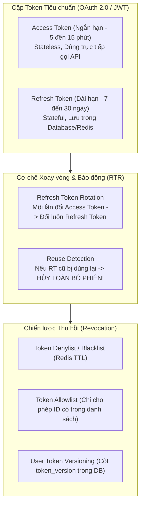
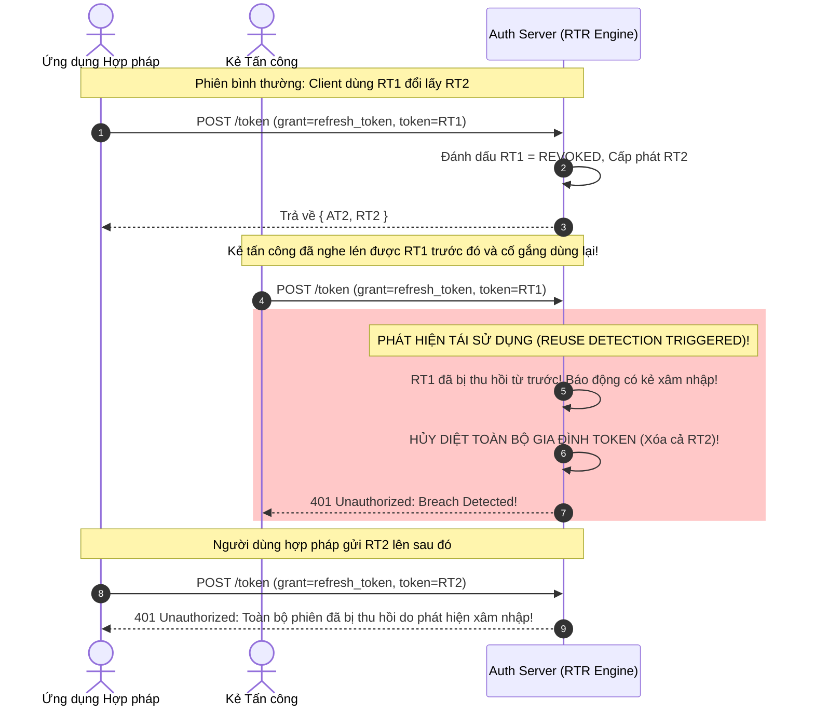
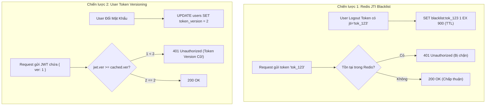

# 5.3. Token Lifecycle and Revocation Strategies (Vòng đời Token & Các Chiến lược Thu hồi Token)

## Tổng quan về Token Lifecycle & Revocation
Một trong những thách thức kỹ thuật lớn nhất khi áp dụng kiến trúc **Vô trạng thái (Stateless Tokens như JWT)** là: **Làm thế nào để thu hồi (Revoke) ngay lập tức một token đã được ký số và trao vào tay Client trước khi nó tự hết hạn theo thời gian (TTL)?**

Nếu một nhân viên bị sa thải, hoặc một người dùng báo mất điện thoại, hệ thống không thể thụ động chờ 1 tiếng hoặc 24 tiếng cho Access Token hết hạn. Sự kết hợp giữa **Refresh Token Rotation (RTR)**, **Cơ chế Phát hiện Tái sử dụng (Reuse Detection)** cùng các giải pháp lưu trữ **Blacklist / Denylist / Allowlist** hiệu năng cao tạo nên lời giải toàn diện cho bài toán quản trị vòng đời token trong môi trường phân tán.



---

## 2. Chi tiết từng Keyword (Under-the-Hood Deep Dive)

### 1. Refresh Token Rotation (RTR) & Refresh Token Reuse Detection

#### 1. Khái niệm bản chất (What & Why)
- **Refresh Token Rotation (RTR - Xoay vòng Refresh Token)**: Kỹ thuật bảo mật theo chuẩn OAuth 2.1. Mỗi khi Client gửi một Refresh Token ($RT_1$) lên Authorization Server để lấy Access Token mới ($AT_2$), Authorization Server **vô hiệu hóa ngay lập tức $RT_1$ và phát hành một Refresh Token hoàn toàn mới ($RT_2$)**.
- **Refresh Token Reuse Detection (Phát hiện Tái sử dụng Refresh Token)**:
  - Nếu một Refresh Token đã bị thu hồi/đã dùng ($RT_1$) lại xuất hiện một lần nữa trong yêu cầu cấp phát mới $\implies$ Đây là bằng chứng toán học chắc chắn rằng **đã có sự cố rò rỉ token (Token Theft) xảy ra** (kẻ tấn công hoặc nạn nhân đang dùng lại token cũ).
  - *Hành động phòng thủ tối thượng*: Server lập tức kích hoạt báo động đỏ, **hủy bỏ toàn bộ gia đình token (Token Family / Ancestor Tree)**, đăng xuất người dùng khỏi tất cả các thiết bị và buộc họ phải đăng nhập lại từ đầu.

#### 2. Cơ chế hoạt động sâu (Under the hood / Hardcore Internals)
- **Kiến trúc Cây Gia đình Token (Token Family Ancestry Tracking)**:
  Trong Database/Redis, mỗi chuỗi token xoay vòng được gán một **`family_id`** duy nhất:
  ```text
  [Family ID: fam_102]
  RT_1 (Trạng thái: REVOKED) -> Đã sinh ra RT_2
  RT_2 (Trạng thái: REVOKED) -> Đã sinh ra RT_3
  RT_3 (Trạng thái: ACTIVE)   <--- Token hợp lệ duy nhất hiện tại
  ```
  - *Kịch bản Tấn công*: Kẻ tấn công đánh cắp được $RT_2$ và gửi lên server để đổi token.
  - Sau đó, ứng dụng hợp pháp của người dùng (vẫn giữ $RT_2$) cố gắng đổi token.
  - Server thấy $RT_2$ đã ở trạng thái `REVOKED`. Hệ thống phát hiện ngay: $RT_2$ bị sử dụng lần thứ 2!
  - Thay vì chỉ từ chối $RT_2$, Server truy vấn theo `family_id = fam_102` và **hủy diệt toàn bộ $RT_1, RT_2, RT_3$**, tước quyền truy cập của cả hacker lẫn người dùng hợp pháp, ngăn chặn kẻ tấn công âm thầm duy trì quyền kiểm soát tài khoản.

#### 3. Sơ đồ minh họa (Chu trình Xoay vòng và Phát hiện Tái sử dụng Token)


#### 4. Code ví dụ thực chiến (TypeScript Token Family Rotation & Reuse Detection Service)
```typescript
import * as crypto from 'crypto';

interface RefreshTokenEntity {
    tokenHash: string;
    familyId: string;
    userId: string;
    isRevoked: boolean;
    expiresAt: number;
}

export class TokenRotationManager {
    // Giả lập cơ sở dữ liệu Token Store
    private tokenStore = new Map<string, RefreshTokenEntity>(); // tokenHash -> Entity
    private familiesStore = new Map<string, Set<string>>();      // familyId -> Set<tokenHash>

    private hashToken(rawToken: string): string {
        return crypto.createHash('sha256').update(rawToken).digest('hex');
    }

    /**
     * Khởi tạo gia đình Token mới khi đăng nhập
     */
    public issueInitialTokens(userId: string): { accessToken: string; refreshToken: string } {
        const familyId = crypto.randomUUID();
        const rawRefreshToken = crypto.randomBytes(32).toString('hex');
        const tokenHash = this.hashToken(rawRefreshToken);

        const entity: RefreshTokenEntity = {
            tokenHash,
            familyId,
            userId,
            isRevoked: false,
            expiresAt: Date.now() + 7 * 24 * 3600 * 1000 // 7 Ngày
        };

        this.tokenStore.set(tokenHash, entity);
        this.familiesStore.set(familyId, new Set([tokenHash]));

        return {
            accessToken: `at_${crypto.randomBytes(16).toString('hex')}`,
            refreshToken: rawRefreshToken
        };
    }

    /**
     * Xoay vòng Refresh Token và Phát hiện tái sử dụng
     */
    public rotateToken(rawSubmittedToken: string): { accessToken: string; refreshToken: string } {
        const submittedHash = this.hashToken(rawSubmittedToken);
        const entity = this.tokenStore.get(submittedHash);

        if (!entity) {
            throw new Error("Invalid Refresh Token.");
        }

        // PHÁT HIỆN TÁI SỬ DỤNG (REUSE DETECTION): Token này đã từng bị thu hồi nhưng lại được gửi lên!
        if (entity.isRevoked) {
            console.error(`[CRITICAL SECURITY ALERT] Refresh Token Reuse Detected for User ${entity.userId}!`);
            // Hủy toàn bộ gia đình token ngay lập tức
            this.revokeEntireFamily(entity.familyId);
            throw new Error("Security Violation: Token reuse detected. All sessions terminated.");
        }

        if (Date.now() > entity.expiresAt) {
            throw new Error("Refresh Token Expired.");
        }

        // 1. Thu hồi token hiện tại
        entity.isRevoked = true;

        // 2. Phát hành token mới trong cùng gia đình
        const newRawRefreshToken = crypto.randomBytes(32).toString('hex');
        const newHash = this.hashToken(newRawRefreshToken);

        const newEntity: RefreshTokenEntity = {
            tokenHash: newHash,
            familyId: entity.familyId,
            userId: entity.userId,
            isRevoked: false,
            expiresAt: Date.now() + 7 * 24 * 3600 * 1000
        };

        this.tokenStore.set(newHash, newEntity);
        this.familiesStore.get(entity.familyId)!.add(newHash);

        console.log(`[RTR] Successfully rotated token for Family ${entity.familyId}`);
        return {
            accessToken: `at_${crypto.randomBytes(16).toString('hex')}`,
            refreshToken: newRawRefreshToken
        };
    }

    private revokeEntireFamily(familyId: string): void {
        const hashes = this.familiesStore.get(familyId);
        if (hashes) {
            for (const h of hashes) {
                const ent = this.tokenStore.get(h);
                if (ent) ent.isRevoked = true;
            }
            console.warn(`[Defense Neutralized] Entire Token Family ${familyId} eradicated.`);
        }
    }
}
```

#### 5. Ưu / Nhược điểm, Pitfalls & Anti-patterns
- **Pitfall**: Client thực hiện đồng thời nhiều request API khi Access Token vừa hết hạn (Race Condition). Trình duyệt có thể gửi cùng một Refresh Token 2 lần cách nhau vài mili-giây. Nếu server không thiết lập một khoảng dung sai nhỏ (ví dụ: Grace Period 10-30 giây cho phép xử lý trùng), người dùng hợp pháp sẽ vô tình kích hoạt Reuse Detection và bị văng ra ngoài.
- **Anti-pattern**: Lưu trữ Refresh Token vô thời hạn (không có absolute expiration).

#### 6. Ứng dụng thực tế trong Backend / Systems
Tiêu chuẩn bắt buộc trong thông số kỹ thuật **OAuth 2.1 (Draft 2023)** cho các ứng dụng công khai (Public Clients như Single Page Applications và Mobile Apps).

---

### 2. Token Revocation Strategies: Blacklisting / Denylist vs Allowlist vs Token Versioning

#### 1. Khái niệm bản chất (What & Why)
- **Bài toán Thu hồi Token (The Token Revocation Problem)**: Access Token (JWT) được thiết kế để các microservices xác thực cục bộ mà không cần truy vấn Database. Tuy nhiên, nếu một token còn hạn 15 phút nhưng người dùng bấm "Đăng xuất" hoặc bị khóa tài khoản, làm sao để chặn đứng token đó ngay lập tức?
- **Token Blacklisting / Denylist (Danh sách Đen)**: Cơ chế lưu trữ các định danh token đã bị thu hồi (`jti` - JWT ID) vào một bộ nhớ phân tán tốc độ cao (Redis). Mỗi khi microservice nhận được token, nó đối chiếu xem `jti` có nằm trong Blacklist hay không.
- **Token Allowlist (Danh sách Trắng)**: Ngược lại với Blacklist: Chỉ những token có ID nằm trong danh sách được cấp phép mới được chấp thuận. *Đặc trưng*: Cực kỳ an toàn nhưng biến hệ thống trở về trạng thái Stateful.
- **Token Versioning / User Epoch (Đánh số Phiên bản Danh tính)**: Giải pháp kiến trúc tối ưu không cần lưu từng token riêng lẻ: Bảng `users` trong cơ sở dữ liệu có thêm một cột số nguyên `token_version` (hoặc mốc thời gian `tokens_valid_after`).

#### 2. Cơ chế hoạt động sâu (Under the hood / Hardcore Internals)
- **Tối ưu Bộ nhớ Redis cho Token Blacklist bằng TTL**:
  Nếu ta lưu mọi token bị hủy vào Redis mãi mãi, RAM của Redis sẽ nhanh chóng phát nổ (OOM).
  - *Kỹ thuật tối ưu*:
    Mỗi khi người dùng logout một Access Token có thời hạn sống còn lại là $\Delta t = \text{exp} - \text{CurrentTime}$:
    Server chỉ cần đẩy `jti` vào Redis với lệnh:
    `SET token_blacklist:<jti> "revoked" EX <Delta_t>`
    Khi Access Token tự nó hết hạn theo thời gian, Redis **tự động xóa sạch key đó khỏi RAM**! Nhờ vậy, kích thước Blacklist luôn được giới hạn ở mức cực nhỏ (chỉ chứa các token bị hủy trước hạn trong vòng 15 phút).
- **Cơ chế Token Versioning (Cực kỳ thanh lịch)**:
  1. Khi người dùng đổi mật khẩu hoặc bấm "Đăng xuất tất cả thiết bị", server tăng:
     `UPDATE users SET token_version = token_version + 1 WHERE id = :user_id;`
  2. Giá trị `token_version` này được nhúng vào JWT Payload khi sinh token.
  3. Khi User gọi API, microservice kiểm tra: Nếu `jwt.token_version < user.token_version` trong cache $\implies$ Từ chối ngay lập tức! Chỉ với một thao tác cập nhật một số nguyên duy nhất, hàng ngàn token cũ trên toàn thế giới bị vô hiệu hóa đồng loạt mà không cần lưu từng token.

#### 3. Sơ đồ minh họa (So sánh Blacklist vs Token Versioning)


#### 4. Code ví dụ thực chiến (C++ Token Blacklist Checker with Redis TTL Logic)
```cpp
#include <iostream>
#include <string>
#include <unordered_map>
#include <chrono>

struct BlacklistEntry {
    std::string jti;
    int64_t expiresAtEpoch;
};

class InMemoryTokenBlacklist {
private:
    std::unordered_map<std::string, int64_t> blacklistMap;

    int64_t getCurrentTime() const {
        return std::chrono::duration_cast<std::chrono::seconds>(
            std::chrono::system_clock::now().time_since_epoch()
        ).count();
    }

public:
    // Đưa Token ID (jti) vào danh sách đen kèm TTL tự động hết hạn
    void revokeToken(const std::string& jti, int64_t tokenExpirationEpoch) {
        int64_t now = getCurrentTime();
        if (tokenExpirationEpoch > now) {
            blacklistMap[jti] = tokenExpirationEpoch;
            std::cout << "[Blacklist] Token " << jti << " blacklisted for " << (tokenExpirationEpoch - now) << " seconds.\n";
        }
    }

    // Kiểm tra xem token có nằm trong Blacklist hay không
    bool isRevoked(const std::string& jti) {
        auto it = blacklistMap.find(jti);
        if (it == blacklistMap.end()) {
            return false; // Token sạch, chưa bị thu hồi
        }

        // Tự động dọn dẹp các key đã hết hạn (Lazy Expiration tương tự Redis)
        if (getCurrentTime() > it->second) {
            blacklistMap.erase(it);
            return false;
        }

        return true; // Token đã bị thu hồi!
    }
};

int main() {
    InMemoryTokenBlacklist blacklist;
    std::string jti = "jwt_token_unique_id_9999";
    int64_t exp = std::chrono::duration_cast<std::chrono::seconds>(
        std::chrono::system_clock::now().time_since_epoch()
    ).count() + 10; // Hết hạn sau 10 giây

    std::cout << "Token Valid initially: " << (!blacklist.isRevoked(jti) ? "YES" : "NO") << "\n";
    blacklist.revokeToken(jti, exp);
    std::cout << "Token Valid after revoke: " << (!blacklist.isRevoked(jti) ? "YES" : "NO") << "\n";
    return 0;
}
```

#### 5. Ưu / Nhược điểm, Pitfalls & Anti-patterns
- **Pitfall**: Cấp phát Access Token có thời hạn sống quá dài (ví dụ: 30 ngày) mà không có bất kỳ cơ chế Blacklist hay Token Versioning nào. Khi tài khoản bị lộ, hacker có toàn quyền kiểm soát tài khoản trong suốt 1 tháng mà quản trị viên hoàn toàn bất lực không thể thu hồi token.
- **Anti-pattern**: Kiểm tra Blacklist bằng cách query vào bảng Database ổ đĩa HDD/SSD ở mỗi request thay vì dùng In-memory Cache (Redis).

#### 6. Ứng dụng thực tế trong Backend / Systems
Tiêu chuẩn **OAuth 2.0 Token Revocation (RFC 7009)** triển khai endpoint `POST /oauth/revoke` trên các Identity Provider công nghiệp như Auth0, Okta và Keycloak.
