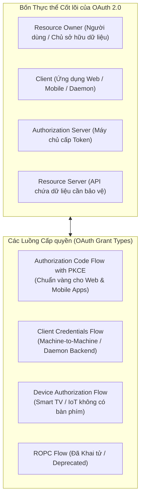
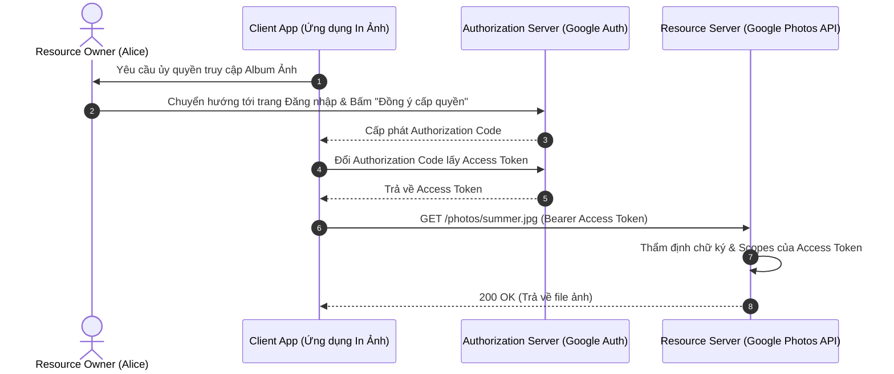
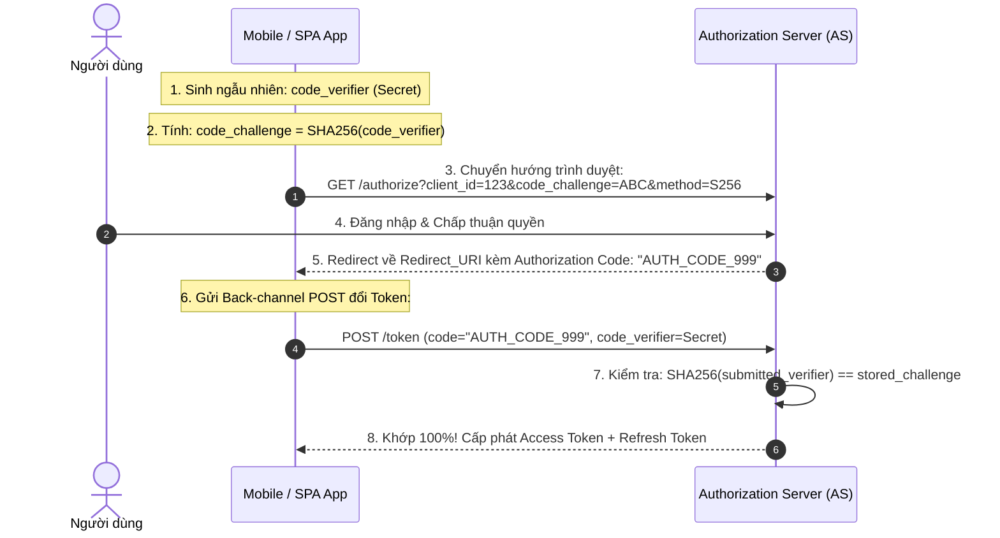
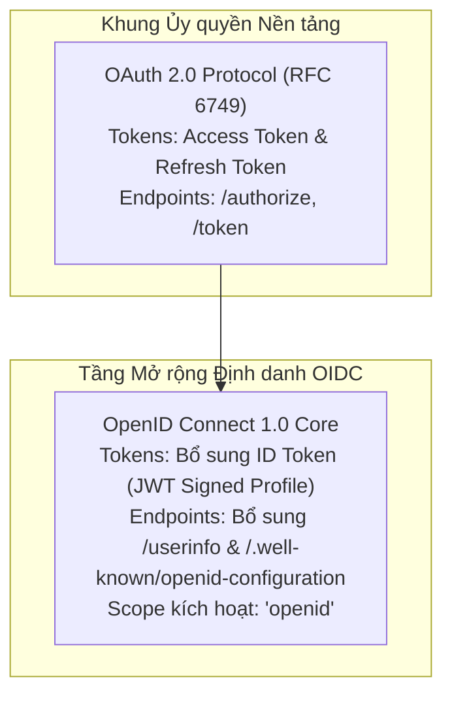

# 6.2. OAuth 2.0, OAuth 2.1 & OpenID Connect Protocols (Giao thức Ủy quyền OAuth & Định danh OIDC)

## Tổng quan về OAuth Framework & OIDC
Một sự nhầm lẫn phổ biến nhất trong thế giới lập trình là: **OAuth 2.0 KHÔNG PHẢI là một giao thức Xác thực (Authentication Protocol) – OAuth 2.0 là một Khung Ủy quyền Phân quyền (Delegated Authorization Framework)**. 

OAuth 2.0 được sinh ra để giải quyết bài toán: Làm thế nào để người dùng cho phép ứng dụng in ảnh của bên thứ ba (Third-party App) truy cập vào kho ảnh của họ trên Google Drive mà **không cần phải trao mật khẩu tài khoản Google** của mình cho ứng dụng in ảnh đó?

Để giải quyết nhu cầu xác thực danh tính (Authentication), lớp tiêu chuẩn **OpenID Connect (OIDC)** đã được xây dựng bổ sung trực tiếp bên trên nền tảng OAuth 2.0. Song song đó, chuẩn thế hệ mới **OAuth 2.1** đã chính thức khai tử các luồng bảo mật cũ kỹ (Implicit Flow, Resource Owner Password Credentials) và bắt buộc sử dụng **PKCE** cho mọi ứng dụng.



---

## 2. Chi tiết từng Keyword (Under-the-Hood Deep Dive)

### 1. OAuth 2.0 vs OAuth 2.1 & Role Definitions (RO, Client, AS, RS)

#### 1. Khái niệm bản chất (What & Why)
- **Bốn Vai trò (Roles) trong OAuth 2.0 (RFC 6749)**:
  1. **Resource Owner (RO - Chủ sở hữu Tài nguyên)**: Người dùng cuối có quyền cấp phép truy cập vào dữ liệu của chính mình.
  2. **Client (Ứng dụng Khách)**: Ứng dụng thực hiện các yêu cầu truy cập tài nguyên thay mặt cho Resource Owner. Được phân làm hai loại:
     - *Confidential Client (Ứng dụng Tin cậy)*: Có thể bảo vệ bí mật Client Secret trên máy chủ backend (Node.js, Java).
     - *Public Client (Ứng dụng Công khai)*: Không thể giữ bí mật Client Secret (Single Page Apps chạy trên Browser, Mobile Apps trên iOS/Android).
  3. **Authorization Server (AS - Máy chủ Ủy quyền)**: Máy chủ xác thực Resource Owner và phát hành Access Token sau khi nhận được sự đồng thuận (Consent).
  4. **Resource Server (RS - Máy chủ Tài nguyên)**: Máy chủ lưu trữ API dữ liệu được bảo vệ (ví dụ: Google Drive API, Spotify API).
- **OAuth 2.1 (Sự Tiến hóa Làm sạch Chuẩn)**:
  Một tài liệu cập nhật (IETF Draft) gom tất cả các khuyến nghị thực hành tốt nhất (BCP - Best Current Practices) của OAuth 2.0 trong suốt một thập kỷ qua:
  - Khai tử hoàn toàn **Implicit Grant Flow** (vì trả về Access Token trực tiếp trên URL hash Fragment, dễ bị rò rỉ qua Referer header và lịch sử duyệt web).
  - Khai tử hoàn toàn **Resource Owner Password Credentials (ROPC)** (vì yêu cầu người dùng nhập trực tiếp Username/Password vào ứng dụng bên thứ ba).
  - Bắt buộc kích hoạt **PKCE (Proof Key for Code Exchange)** cho **TẤT CẢ** các Client sử dụng luồng Authorization Code Flow.
  - Chặn sử dụng các Redirect URI dạng Wildcard (`*`).

#### 2. Cơ chế hoạt động sâu (Under the hood / Hardcore Internals)
- **Bản chất của Tách rời AS và RS**:
  Trong các hệ thống phân tán cấp doanh nghiệp:
  Authorization Server (Keycloak, Okta) và Resource Server (API Gateway) **hoàn toàn độc lập về mặt vật lý và mã nguồn**.
  - Client chỉ giao tiếp với AS trong bước lấy quyền.
  - Khi gọi RS, Client chỉ gửi chuỗi Bearer Token qua header `Authorization: Bearer <token>`.
  - RS xác thực token hoàn toàn cục bộ bằng thuật toán mã hóa (Public Key JWKS của AS) mà không cần gọi ngược lại AS trên mỗi request, triệt tiêu nguy cơ biến AS thành điểm nghẽn cổ chai (Bottleneck).

#### 3. Sơ đồ minh họa (Bản đồ Tương tác Bốn Thực thể OAuth 2.0)


#### 4. Code ví dụ thực chiến (TypeScript Resource Server Bearer Token Verification Middleware)
```typescript
import { Request, Response, NextFunction } from 'express';
import * as crypto from 'crypto';

interface OAuthSecurityContext {
    clientId: string;
    userId: string;
    scopes: string[];
}

export class ResourceServerGuard {
    private static readonly AS_PUBLIC_KEY = crypto.generateKeyPairSync('rsa', { modulusLength: 2048 }).publicKey;

    /**
     * Middleware bảo vệ API Resource Server: Thẩm định Bearer Token tại Gateway
     */
    public static requireScope(requiredScope: string) {
        return (req: Request, res: Response, next: NextFunction): void => {
            const authHeader = req.headers['authorization'];

            // 1. Kiểm tra định dạng Authorization: Bearer <token>
            if (!authHeader || !authHeader.startsWith('Bearer ')) {
                res.status(401).json({ error: "invalid_token", error_description: "Missing or malformed Bearer Token." });
                return;
            }

            const token = authHeader.substring(7);

            try {
                // 2. Tách và xác minh chữ ký (Minh họa Compact JWS)
                const [headerB64, payloadB64, signatureB64] = token.split('.');
                const signedData = `${headerB64}.${payloadB64}`;

                const verifier = crypto.createVerify('RSA-SHA256');
                verifier.update(signedData);

                const isValid = verifier.verify(this.AS_PUBLIC_KEY, Buffer.from(signatureB64, 'base64url'));
                if (!isValid) {
                    res.status(401).json({ error: "invalid_token", error_description: "Signature verification failed." });
                    return;
                }

                const claims = JSON.parse(Buffer.from(payloadB64, 'base64url').toString('utf8'));

                // 3. Kiểm tra Scope ủy quyền
                const grantedScopes: string[] = claims.scope ? claims.scope.split(' ') : [];
                if (!grantedScopes.includes(requiredScope)) {
                    res.status(403).json({
                        error: "insufficient_scope",
                        error_description: `Access requires '${requiredScope}' scope.`
                    });
                    return;
                }

                // Gắn ngữ cảnh vào request
                (req as any).auth = { clientId: claims.client_id, userId: claims.sub, scopes: grantedScopes };
                next();
            } catch (err) {
                res.status(401).json({ error: "invalid_token", error_description: "Token parse failure." });
            }
        };
    }
}
```

#### 5. Ưu / Nhược điểm, Pitfalls & Anti-patterns
- **Pitfall**: Dùng Client Secret trong ứng dụng React/Vue SPA hoặc Mobile App. Hacker chỉ cần mở DevTools hoặc dịch ngược file APK/IPA là lấy được Client Secret trong 30 giây! (Các ứng dụng này là Public Clients, bắt buộc phải dùng **PKCE không có Client Secret**).
- **Anti-pattern**: Tiếp tục triển khai **ROPC (Resource Owner Password Credentials)** trong các ứng dụng mới. Luồng này biến ứng dụng thành mục tiêu phishing và làm mất hoàn toàn tính năng MFA của Identity Provider.

#### 6. Ứng dụng thực tế trong Backend / Systems
Kiến trúc tiêu chuẩn của API Ecosystems toàn cầu: GitHub API, Twitter/X API v2, Stripe Connect, và Google Cloud Platform APIs.

---

### 2. OAuth Grant Types: Auth Code with PKCE, Client Credentials & Device Flow

#### 1. Khái niệm bản chất (What & Why)
- **Authorization Code Flow with PKCE (Proof Key for Code Exchange - RFC 7636)**: Luồng ủy quyền an toàn số một cho mọi ứng dụng có người dùng tương tác (Web App, Single Page App, Mobile App). Sử dụng một mã ủy quyền tạm thời (Auth Code) kết hợp với một thử thách mật mã học động (PKCE Challenge) để lấy Token qua kênh phụ (Back-channel), loại bỏ hoàn toàn nguy cơ bị chặn mã Authorization Code.
- **Client Credentials Flow**: Luồng ủy quyền dành riêng cho giao tiếp Máy-đến-Máy (Machine-to-Machine / M2M) hoặc các dịch vụ Daemon chạy ngầm nội bộ (Background Cron, Microservice-to-Microservice). **Không có sự tham gia của con người (Không có Resource Owner)**. Client dùng chính `client_id` và `client_secret` của mình để xin cấp Access Token trực tiếp từ Auth Server.
- **Device Authorization Flow (RFC 8628)**: Luồng cấp quyền dành cho các thiết bị thông minh không có bàn phím hoặc trình duyệt hạn chế (Smart TV, Apple TV, Máy chơi game PlayStation, Thiết bị IoT, CLI tools):
  - Thiết bị hiển thị một mã số ngắn 8 chữ số và một đường dẫn (ví dụ: `google.com/device` + Mã `ABCD-EFGH`).
  - Người dùng dùng điện thoại hoặc laptop mở web đó lên để đăng nhập và phê duyệt.
  - Thiết bị thông minh liên tục thăm dò (Polling) Auth Server cho đến khi nhận được Access Token.

#### 2. Cơ chế hoạt động sâu (Under the hood / Hardcore Internals)
- **Cơ chế Hoạt động của PKCE (Proof Key for Code Exchange)**:
  Làm thế nào để bảo vệ ứng dụng Mobile/SPA khi không có Client Secret?
  1. Client sinh ngẫu nhiên một chuỗi bí mật có độ dài từ 43 đến 128 ký tự gọi là **`code_verifier`** (CSPRNG).
  2. Client tính toán giá trị băm SHA-256 của chuỗi này và mã hóa Base64URL để tạo thành **`code_challenge`**:
     $$\text{code\_challenge} = \text{Base64URL}\Big(\text{SHA-256}(\text{code\_verifier})\Big)$$
  3. Client gửi `code_challenge` và `code_challenge_method=S256` lên Auth Server trong request cấp Auth Code ban đầu. Auth Server lưu lại giá trị này.
  4. Khi nhận được Auth Code, Client gửi Auth Code kèm theo bản rõ **`code_verifier`** lên Auth Server qua request POST HTTPS (Back-channel) để đổi lấy Token.
  5. Auth Server tự băm `SHA-256(code_verifier)` và so sánh với `code_challenge` đã lưu trước đó. Nếu khớp $\implies$ Cấp Token!
  - *Tại sao bất khả chiến bại?*: Kẻ tấn công trên điện thoại dù có hook được hệ điều hành để đọc trộm Authorization Code từ custom URL scheme (`myapp://callback?code=xyz`) thì cũng **hoàn toàn vô dụng**, vì hacker không sở hữu chuỗi bí mật `code_verifier` nằm sâu trong bộ nhớ tiến trình của ứng dụng gốc!

#### 3. Sơ đồ minh họa (Toàn bộ Chu trình Authorization Code Flow with PKCE)


#### 4. Code ví dụ thực chiến (C++ PKCE Challenge Generation & Verification Primitive)
```cpp
#include <iostream>
#include <string>
#include <vector>
#include <openssl/sha.h>
#include <openssl/rand.h>

class PkceSecurityModule {
public:
    // Chuyển đổi chuỗi Base64 sang Base64URL (RFC 7636 Section 3)
    static std::string base64UrlEncode(const unsigned char* data, size_t length) {
        static const char b64Chars[] = "ABCDEFGHIJKLMNOPQRSTUVWXYZabcdefghijklmnopqrstuvwxyz0123456789-_";
        std::string result;
        int val = 0, valb = -6;
        for (size_t i = 0; i < length; ++i) {
            val = (val << 8) + data[i];
            valb += 8;
            while (valb >= 0) {
                result.push_back(b64Chars[(val >> valb) & 0x3F]);
                valb -= 6;
            }
        }
        if (valb > -6) result.push_back(b64Chars[((val << 8) >> (valb + 8)) & 0x3F]);
        return result;
    }

    // Sinh code_verifier ngẫu nhiên 32 bytes (256 bits)
    static std::string generateCodeVerifier() {
        unsigned char randomBuffer[32];
        RAND_bytes(randomBuffer, sizeof(randomBuffer));
        return base64UrlEncode(randomBuffer, sizeof(randomBuffer));
    }

    // Tính toán code_challenge = Base64Url(SHA256(code_verifier))
    static std::string deriveCodeChallenge(const std::string& codeVerifier) {
        unsigned char shaHash[SHA256_DIGEST_LENGTH];
        SHA256(reinterpret_cast<const unsigned char*>(codeVerifier.data()), codeVerifier.size(), shaHash);
        return base64UrlEncode(shaHash, SHA256_DIGEST_LENGTH);
    }
};

int main() {
    std::string verifier = PkceSecurityModule::generateCodeVerifier();
    std::string challenge = PkceSecurityModule::deriveCodeChallenge(verifier);

    std::cout << "[PKCE Engine] Generated code_verifier:  " << verifier << "\n";
    std::cout << "[PKCE Engine] Computed code_challenge: " << challenge << "\n";
    return 0;
}
```

#### 5. Ưu / Nhược điểm, Pitfalls & Anti-patterns
- **Pitfall**: Sử dụng phương thức `code_challenge_method=plain` thay vì `S256`. Nếu dùng `plain`, `code_challenge` chính là `code_verifier`, triệt tiêu hoàn toàn khả năng bảo vệ của PKCE nếu gói tin authorize bị bắt trộm. Chuẩn OAuth 2.1 đã cấm dùng `plain` và bắt buộc `S256`.
- **Anti-pattern**: Sử dụng Client Credentials Flow cho ứng dụng Frontend di động. Điều này đòi hỏi phải nhúng `client_secret` vào file code, khiến bất kỳ ai cũng có thể trích xuất secret để mạo danh ứng dụng.

#### 6. Ứng dụng thực tế trong Backend / Systems
Toàn bộ luồng đăng nhập "Sign in with Google", "Log in with Apple" trên iOS/Android và các công cụ dòng lệnh (như `gcloud auth login` hay `gh auth login` sử dụng Device Authorization Flow).

---

### 3. OpenID Connect (OIDC) vs OAuth 2.0

#### 1. Khái niệm bản chất (What & Why)
- **OpenID Connect (OIDC)**: Một tầng nhận dạng mỏng (Identity Layer) được chuẩn hóa bởi OpenID Foundation, hoạt động trực tiếp bên trên giao thức OAuth 2.0.
- **Sự Khác Biệt Cốt Lõi giữa OAuth 2.0 và OIDC**:
  $$\textbf{OAuth 2.0} = \text{Ủy quyền (Authorization)} \implies \text{Cấp "Access Token" để truy cập API}$$
  $$\textbf{OpenID Connect} = \text{Xác thực (Authentication)} \implies \text{Cấp "ID Token" để chứng minh Bạn là Ai}$$
- **Bộ Ba Thành phần Bổ sung của OIDC so với OAuth 2.0**:
  1. **ID Token (JWT)**: Chứa thông tin hồ sơ của người dùng đã được ký số bởi IdP.
  2. **UserInfo Endpoint (`/userinfo`)**: API được bảo vệ trả về thông tin chi tiết của người dùng khi xuất trình Access Token có scope `openid`.
  3. **Discovery Document (`/.well-known/openid-configuration`)**: Endpoint JSON chứa toàn bộ thông tin cấu hình của IdP (Issuer, Endpoints, Supported Scopes, JWKS URI), giúp các ứng dụng client có thể tự động cấu hình mà không cần hardcode địa chỉ URL.

#### 2. Cơ chế hoạt động sâu (Under the hood / Hardcore Internals)
- **Scope Phép thuật `openid`**:
  Khi Client gửi request authorize tới Auth Server:
  - Nếu `scope = "read:photos"` $\implies$ Server chạy chế độ **OAuth 2.0 thuần túy**, chỉ trả về Access Token.
  - Nếu `scope = "openid profile email"` $\implies$ Server hiểu rằng Client muốn chạy **OpenID Connect**. Sau khi người dùng đăng nhập thành công, response trả về sẽ bao gồm **cả ID Token (danh tính) lẫn Access Token (quyền hạn)**!
- **Tính toán Hash c_hash và at_hash trong ID Token**:
  Để ngăn chặn kẻ tấn công hoán đổi Authorization Code hoặc Access Token trên đường truyền, đặc tả OIDC Core 1.0 yêu cầu nhúng mã hash:
  $$\text{at\_hash} = \text{Base64URL}\Big(\text{Trái 128 bit của SHA-256}(AccessToken)\Big)$$
  Client sau khi nhận được cả ID Token và Access Token sẽ tự băm Access Token để so sánh với `at_hash`. Nếu không khớp, Client từ chối xử lý ngay lập tức!

#### 3. Sơ đồ minh họa (Mối quan hệ Kế thừa OIDC trên nền OAuth 2.0)


#### 4. Code ví dụ thực chiến (TypeScript OIDC Discovery Document Dynamic Fetcher)
```typescript
interface OidcConfiguration {
    issuer: string;
    authorization_endpoint: string;
    token_endpoint: string;
    userinfo_endpoint: string;
    jwks_uri: string;
    response_types_supported: string[];
    id_token_signing_alg_values_supported: string[];
}

export class OidcDiscoveryClient {
    private static cache = new Map<string, OidcConfiguration>();

    /**
     * Tự động khám phá cấu hình của bất kỳ Identity Provider chuẩn OIDC nào
     */
    public static async discover(idpBaseUrl: string): Promise<OidcConfiguration> {
        if (this.cache.has(idpBaseUrl)) {
            return this.cache.get(idpBaseUrl)!;
        }

        const wellKnownUrl = `${idpBaseUrl.replace(/\/$/, '')}/.well-known/openid-configuration`;
        console.log(`[OIDC Discovery] Fetching provider metadata from: ${wellKnownUrl}`);

        const response = await fetch(wellKnownUrl);
        if (!response.ok) {
            throw new Error(`Failed to fetch OIDC metadata from ${wellKnownUrl}: HTTP ${response.status}`);
        }

        const config: OidcConfiguration = await response.json();

        // THẨM ĐỊNH BẢO MẬT BẮT BUỘC (RFC 8414): Issuer trả về phải khớp tuyệt đối với URL ban đầu!
        if (config.issuer !== idpBaseUrl) {
            throw new Error(`OIDC Security Violation: Issuer mismatch! Expected ${idpBaseUrl}, got ${config.issuer}`);
        }

        this.cache.set(idpBaseUrl, config);
        return config;
    }
}
```

#### 5. Ưu / Nhược điểm, Pitfalls & Anti-patterns
- **Pitfall**: Sử dụng Access Token để nhận dạng người dùng trong Single Page App thay vì ID Token. Access Token được thiết kế mờ đục (Opaque) đối với Client, Client không nên tự ý parse Access Token để lấy email hay họ tên.
- **Anti-pattern**: Gửi ID Token lên API Backend và dùng ID Token đó để phân quyền. ID Token chỉ có giá trị đối với Client đã xin cấp nó (Audience là Client ID), Resource Server không phải là đối tượng tiêu thụ của ID Token.

#### 6. Ứng dụng thực tế trong Backend / Systems
Nền tảng của toàn bộ hệ thống "Social Login" toàn cầu (Google, Apple, Microsoft, GitHub) và các giải pháp Identity Provider doanh nghiệp tập trung (Keycloak, Okta, Ping Identity).
