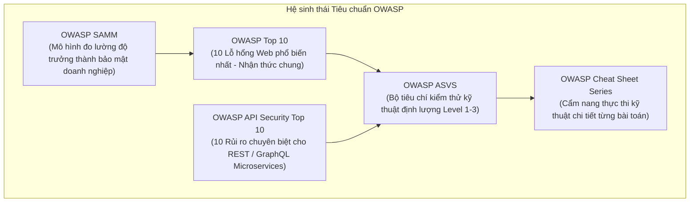
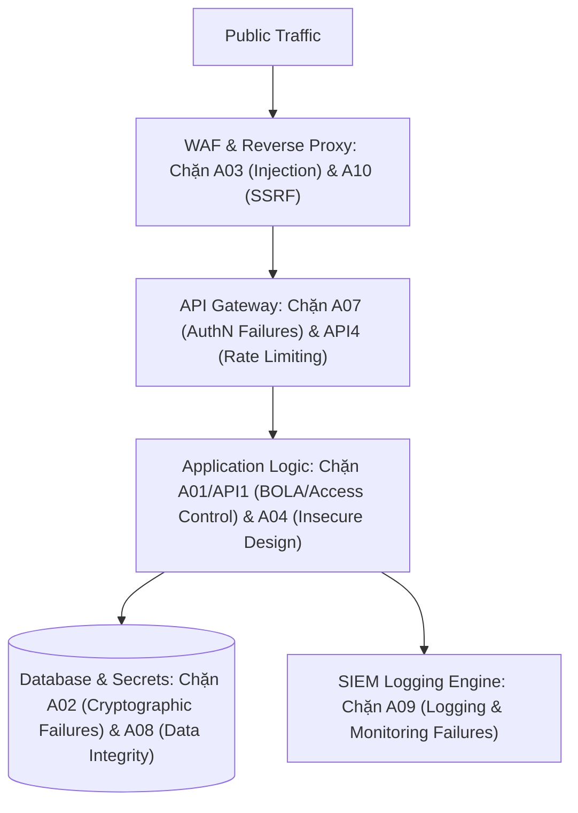
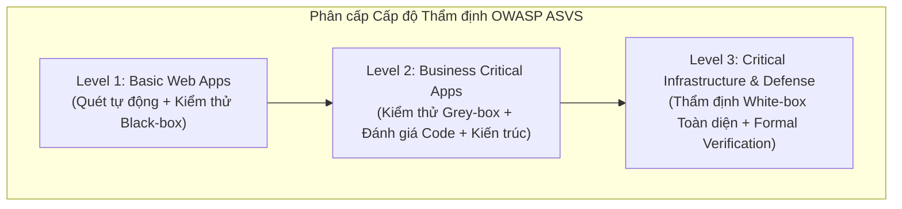
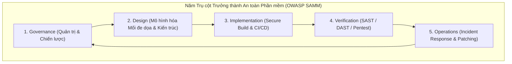

# 7.1. OWASP Standards and Methodologies (Các Chuẩn mực & Phương pháp luận Bảo mật OWASP)

## Tổng quan về Tổ chức OWASP
**OWASP (Open Web Application Security Project)** là tổ chức phi lợi nhuận quốc tế uy tín hàng đầu thế giới về an ninh phần mềm. Các tài liệu, tiêu chuẩn kiểm thử và khung đánh giá của OWASP được coi là "Kinh thánh an toàn thông tin" được tham chiếu bắt buộc trong các quy định pháp lý, tiêu chuẩn công nghiệp (PCI-DSS, ISO 27001, SOC 2, HIPAA) và toàn bộ quy trình công nghệ của các tập đoàn công nghệ lớn.

Đối với một kỹ sư Backend và kiến trúc sư hệ thống, việc hiểu và áp dụng các khung chuẩn từ tổng quát (**OWASP Top 10**), chi tiết kỹ thuật chuyên sâu (**ASVS**), chuyên biệt cho hệ thống phân tán (**API Security Top 10**), tài liệu thực chiến (**Cheat Sheet Series**) cho đến mô hình trưởng thành phần mềm (**SAMM**) là nền tảng để xây dựng hệ thống phần mềm bảo mật bền vững.



---

## 2. Chi tiết từng Keyword (Under-the-Hood Deep Dive)

### 1. OWASP Top 10 & OWASP API Security Top 10

#### 1. Khái niệm bản chất (What & Why)
- **OWASP Top 10**: Báo cáo đồng thuận được cập nhật định kỳ (phiên bản mới nhất là **OWASP Top 10:2021**) xếp hạng 10 nhóm rủi ro bảo mật ứng dụng web nghiêm trọng nhất dựa trên dữ liệu thống kê từ hàng trăm ngàn ứng dụng trên toàn cầu:
  1. **A01:2021 - Broken Access Control (Hỏng Kiểm soát Truy cập)**: Chiếm vị trí số 1 (94% ứng dụng được kiểm thử có lỗi này).
  2. **A02:2021 - Cryptographic Failures (Lỗi Mật mã)**: Lộ dữ liệu nhạy cảm do thuật toán yếu, không bật TLS, dùng hardcoded key.
  3. **A03:2021 - Injection (Tiêm mã)**: SQLi, NoSQLi, Command Injection, XSS (được gộp vào đây).
  4. **A04:2021 - Insecure Design (Thiết kế Kém An toàn)**: Lỗi kiến trúc ngay từ khâu thiết kế (thiếu Threat Modeling).
  5. **A05:2021 - Security Misconfiguration (Cấu hình Sai Bảo mật)**: Để lộ tài khoản mặc định, cổng debug, bật directory listing.
  6. **A06:2021 - Vulnerable and Outdated Components (Thành phần Lỗi thời & Lỗ hổng)**: Rủi ro chuỗi cung ứng mã nguồn mở (Supply chain risks).
  7. **A07:2021 - Identification and Authentication Failures (Lỗi Định danh & Xác thực)**: Không có brute-force defense, session fixation.
  8. **A08:2021 - Software and Data Integrity Failures (Lỗi Toàn vẹn Phần mềm & Dữ liệu)**: Insecure Deserialization, auto-update không ký số.
  9. **A09:2021 - Security Logging and Monitoring Failures (Lỗi Ghi nhận & Giám sát)**: Không phát hiện được xâm nhập do thiếu audit log.
  10. **A10:2021 - Server-Side Request Forgery (SSRF)**: Server bị lợi dụng để tấn công các dịch vụ nội bộ (Internal VPC/Cloud Metadata).
- **OWASP API Security Top 10 (Phiên bản 2023)**:
  Tập trung chuyên biệt vào các đặc thù của kiến trúc Microservices và REST/GraphQL APIs:
  - **API1:2023 - Broken Object Level Authorization (BOLA)**: Thay đổi ID trên URL để đọc dữ liệu người khác.
  - **API2:2023 - Broken Authentication**: Lỗi token, thiếu rate limit login.
  - **API3:2023 - Broken Object Property Level Authorization**: Bao gồm Mass Assignment và Excessive Data Exposure.
  - **API4:2023 - Unrestricted Resource Consumption**: Thiếu giới hạn tài nguyên CPU/RAM/Rate limit dẫn tới DoS.
  - **API5:2023 - Broken Function Level Authorization (BFLA)**: Người dùng gọi được API Admin.
  - **API6:2023 - Unrestricted Access to Sensitive Business Flows**: Botnet mua vét vé xem phim hoặc đồ giảm giá.
  - **API7:2023 - Server Side Request Forgery (SSRF)**.
  - **API8:2023 - Security Misconfiguration**: Lộ thông tin debug qua stack trace.
  - **API9:2023 - Improper Inventory Management**: Quên đóng các API phiên bản cũ (Zombie / Shadow APIs).
  - **API10:2023 - Unsafe Consumption of APIs**: Tin tưởng mù quáng vào dữ liệu trả về từ API của bên thứ ba.

#### 2. Cơ chế hoạt động sâu (Under the hood / Hardcore Internals)
- **Sự Chuyển dịch Trọng tâm Kỹ thuật**:
  Trước đây, các lỗ hổng kỹ thuật cấp thấp (như SQLi, XSS) chiếm ngôi vương. Ngày nay, nhờ các Framework hiện đại (ORM, React/Vue tự escape HTML), các lỗi kỹ thuật cấp thấp đã giảm dần, nhường chỗ cho **Lỗ hổng Logic Nghiệp vụ & Kiểm soát Truy cập (Broken Access Control / BOLA)**. 
  - Máy quét tự động (Automated Vulnerability Scanners) rất khó phát hiện ra lỗi BOLA vì chúng không hiểu được ngữ cảnh nghiệp vụ: Ví dụ: Với máy quét, việc một user gọi `GET /api/v1/orders/123` và nhận về `200 OK` là hoàn toàn bình thường; chỉ có con người hoặc bài kiểm thử logic mới biết được user đó không sở hữu đơn hàng 123!

#### 3. Sơ đồ minh họa (Bản đồ Ánh xạ OWASP Top 10 sang Tầng Kiến trúc Backend)


#### 4. Code ví dụ thực chiến (TypeScript API Defense Against API3 - Mass Assignment & Data Exposure)
```typescript
import { z } from 'zod';

// ĐỊNH NGHĨA CONTRACT DỮ LIỆU ĐẦU VÀO (Input DTO) - Chống Mass Assignment (API3)
const UpdateUserProfileSchema = z.object({
    displayName: z.string().min(2).max(50),
    phoneNumber: z.string().regex(/^\+[1-9]\d{1,14}$/),
    // TUYỆT ĐỐI KHÔNG cho phép user truyền 'role' hoặc 'isVerified' từ body lên!
}).strict(); // Từ chối tất cả các trường lạ

// ĐỊNH NGHĨA DỮ LIỆU ĐẦU RA (Output DTO) - Chống Excessive Data Exposure (API3)
export class UserSerializer {
    public static serializeForPublic(fullDbUser: Record<string, any>) {
        return {
            id: fullDbUser.id,
            displayName: fullDbUser.displayName,
            email: fullDbUser.email,
            // LOẠI BỎ TRIỆT ĐỂ: password_hash, mfa_secret, internal_notes
        };
    }
}
```

#### 5. Ưu / Nhược điểm, Pitfalls & Anti-patterns
- **Pitfall**: Nhầm tưởng rằng "Đạt chuẩn OWASP Top 10 là hệ thống đã hoàn toàn bảo mật". OWASP Top 10 chỉ là danh sách **nhận thức tối thiểu (Minimum Awareness)**, không phải là một tiêu chuẩn kiểm thử toàn diện.
- **Anti-pattern**: Bỏ quên các API phiên bản cũ (`/api/v1/...`) khi đã phát hành `/api/v2/`. Kẻ tấn công sẽ luôn nhắm vào các phiên bản cũ (Zombie APIs) vốn không được cập nhật các bản vá bảo mật mới.

#### 6. Ứng dụng thực tế trong Backend / Systems
Bắt buộc phải tích hợp quy trình quét lỗ hổng theo OWASP Top 10 và API Top 10 trong các bài kiểm thử tĩnh (SAST) và kiểm thử động (DAST) của quy trình CI/CD.

---

### 2. OWASP ASVS (Application Security Verification Standard)

#### 1. Khái niệm bản chất (What & Why)
- **OWASP ASVS (Chuẩn Thẩm định An ninh Ứng dụng)**: Bộ tiêu chuẩn kỹ thuật định lượng chi tiết nhất thế giới dành cho các nhà phát triển, kiến trúc sư và chuyên gia kiểm thử bảo mật. Cung cấp một danh sách hàng trăm yêu cầu kỹ thuật cụ thể (Checklist) được chia thành 14 chương chức năng (V1 Kiến trúc, V2 Xác thực, V3 Quản lý Phiên, V4 Kiểm soát Truy cập, V5 Xác thực Dữ liệu...).
- **Ba Mức độ Thẩm định (Verification Levels)**:
  - **Level 1 (Cơ bản - Opportunistic)**: Dành cho mọi phần mềm ứng dụng thông thường. Có thể kiểm thử tự động hoàn toàn hoặc kiểm thử hộp đen (Black-box testing). Bảo vệ trước các cuộc tấn công tự động phổ biến trên Internet.
  - **Level 2 (Tiêu chuẩn Doanh nghiệp - Standard)**: Dành cho các ứng dụng xử lý dữ liệu nhạy cảm (Giao dịch B2B, Dữ liệu y tế, Bán lẻ trực tuyến, Ngân hàng). Đòi hỏi kiểm thử hộp xám (Grey-box testing) kết hợp đọc mã nguồn và phân tích kiến trúc.
  - **Level 3 (Tối thượng - Advanced / Critical)**: Dành cho các hệ thống hạ tầng trọng yếu quốc gia, lõi ngân hàng, y tế sinh mệnh, hoặc ứng dụng quốc phòng. Đòi hỏi phân tích hộp trắng (White-box testing), mô hình hóa mối đe dọa chuyên sâu và xác minh tính toàn vẹn toán học.

#### 2. Cơ chế hoạt động sâu (Under the hood / Hardcore Internals)
- **Cấu trúc Yêu cầu Kỹ thuật của ASVS**:
  Mỗi yêu cầu trong ASVS được định danh theo mã số chuẩn: `[Chương].[Mục].[Số thứ tự]`.
  Ví dụ:
  - `V2.1.1`: Xác minh rằng mật khẩu người dùng phải cho phép độ dài tối thiểu ít nhất 64 ký tự (hỗ trợ passphrases).
  - `V3.2.1`: Xác minh rằng Session ID phải được sinh ra từ một CSPRNG đã được chứng nhận và có độ dài tối thiểu 128 bit.
  - `V5.1.2`: Xác minh rằng các tham số phân trang (`limit`, `offset`) phải được kiểm tra kiểu số nguyên dương và có giới hạn cận trên tối đa (Upper bound limit) để chống DoS bộ nhớ.

#### 3. Sơ đồ minh họa (Ba Cấp độ Thẩm định ASVS Level 1-2-3)


#### 4. Code ví dụ thực chiến (C++ Enforcement of ASVS V5 Input Boundary Limits)
```cpp
#include <iostream>
#include <stdexcept>

// Minh họa việc tuân thủ ASVS V5.1.2: Giới hạn biên phân trang nghiêm ngặt chống DoS
class PaginationValidator {
public:
    static constexpr int DEFAULT_LIMIT = 20;
    static constexpr int MAX_ALLOWED_LIMIT = 100; // Giới hạn cận trên tuyệt đối

    static std::pair<int, int> sanitizePagination(int requestedLimit, int requestedOffset) {
        if (requestedOffset < 0) {
            throw std::invalid_argument("ASVS V5 Violation: Offset must be non-negative.");
        }

        int safeLimit = requestedLimit;
        if (safeLimit <= 0) {
            safeLimit = DEFAULT_LIMIT;
        } else if (safeLimit > MAX_ALLOWED_LIMIT) {
            std::cout << "[ASVS Guard] Requested limit " << safeLimit 
                      << " exceeded maximum! Clamping to " << MAX_ALLOWED_LIMIT << ".\n";
            safeLimit = MAX_ALLOWED_LIMIT; // Kẹp giá trị an toàn
        }

        return { safeLimit, requestedOffset };
    }
};

int main() {
    auto [limit, offset] = PaginationValidator::sanitizePagination(500000, 0);
    std::cout << "Sanitized Query Limits: LIMIT " << limit << " OFFSET " << offset << "\n";
    return 0;
}
```

#### 5. Ưu / Nhược điểm, Pitfalls & Anti-patterns
- **Pitfall**: Đặt mục tiêu đạt Level 3 cho một ứng dụng nội bộ nhỏ, gây lãng phí ngân sách và làm chậm tiến độ dự án nhiều tháng.
- **Anti-pattern**: Tự chấm điểm đạt ASVS Level 2 chỉ bằng cách chạy một công cụ quét tự động (như OWASP ZAP) trong 10 phút. Level 2 bắt buộc phải có sự tham gia của con người để phân tích logic mã nguồn.

#### 6. Ứng dụng thực tế trong Backend / Systems
Được các cơ quan quản lý tài chính và ngân hàng sử dụng làm tiêu chí nghiệm thu bảo mật bắt buộc trong các hợp đồng phát triển phần mềm với nhà thầu bên ngoài.

---

### 3. OWASP SAMM (Software Assurance Maturity Model) & Cheat Sheet Series

#### 1. Khái niệm bản chất (What & Why)
- **OWASP SAMM (Software Assurance Maturity Model)**: Mô hình đánh giá và đo lường mức độ trưởng thành về an toàn phần mềm của toàn bộ một tổ chức/doanh nghiệp. SAMM chia bảo mật thành **5 Chức năng Nghiệp vụ Cốt lõi**:
  1. **Governance (Quản trị)**: Chiến lược, Đo lường, Chính sách, Đào tạo nhân sự.
  2. **Design (Thiết kế)**: Đánh giá mối đe dọa (Threat Modeling), Kiến trúc an toàn.
  3. **Implementation (Hiện thực)**: Quy trình build an toàn, Quản lý phụ thuộc, Triển khai an toàn.
  4. **Verification (Kiểm chứng)**: Đánh giá kiến trúc, Kiểm thử tự động (SAST/DAST), Thử nghiệm thâm nhập.
  5. **Operations (Vận hành)**: Quản lý sự cố, Quản trị bản vá, Quản trị dữ liệu.
- **OWASP Cheat Sheet Series**: Thư viện cẩm nang kỹ thuật thực hành mã nguồn mở cực kỳ chi tiết, hướng dẫn cụ thể cách phòng chống từng loại lỗ hổng cho từng ngôn ngữ lập trình (Authentication Cheat Sheet, Cryptographic Storage Cheat Sheet, SQL Injection Prevention Cheat Sheet, REST Security Cheat Sheet...).

#### 2. Cơ chế hoạt động sâu (Under the hood / Hardcore Internals)
- **Các Cấp độ Trưởng thành (Maturity Levels 1-3) trong SAMM**:
  Mỗi hoạt động trong SAMM được đánh giá theo 3 cấp độ:
  - *Mức 1 (Khởi phát)*: Các biện pháp bảo mật được thực hiện tự phát, không có quy trình chuẩn (ví dụ: Thi thoảng lập trình viên tự chạy tool quét code).
  - *Mức 2 (Quy chuẩn)*: Có quy trình chính thức được ghi nhận bằng văn bản và áp dụng nhất quán trên các dự án (ví dụ: Mọi commit vào nhánh `main` đều bắt buộc phải vượt qua pipeline SAST).
  - *Mức 3 (Tối ưu hóa liên tục)*: Tự động hóa toàn diện, có chỉ số KPI đo lường và liên tục cải tiến dựa trên dữ liệu thực tế.

#### 3. Sơ đồ minh họa (Mô hình 5 Trụ cột của OWASP SAMM)


#### 4. Code ví dụ thực chiến (C++ Security Policy Enforcement Checklist Generator)
```cpp
#include <iostream>
#include <string>
#include <vector>

struct SecurityMaturityCriterion {
    std::string domain;
    std::string requirement;
    int currentLevel; // 0 to 3
    int targetLevel;
};

class SammAssessmentReporter {
public:
    static void generateReport(const std::vector<SecurityMaturityCriterion>& criteria) {
        std::cout << "--- OWASP SAMM MATURITY GAP ASSESSMENT ---\n";
        for (const auto& item : criteria) {
            std::cout << "[" << item.domain << "] " << item.requirement << "\n"
                      << "  Current: Level " << item.currentLevel 
                      << " -> Target: Level " << item.targetLevel;
            if (item.currentLevel < item.targetLevel) {
                std::cout << " [ACTION REQUIRED: Gap to close]\n";
            } else {
                std::cout << " [COMPLIANT]\n";
            }
        }
    }
};

int main() {
    std::vector<SecurityMaturityCriterion> audit = {
        {"Governance", "Annual Security Training for Engineers", 1, 2},
        {"Design", "Threat Modeling in Architecture Review", 0, 2},
        {"Implementation", "Automated Secret Scanning in CI/CD", 2, 2},
        {"Verification", "Automated DAST in Staging Environment", 1, 2}
    };
    SammAssessmentReporter::generateReport(audit);
    return 0;
}
```

#### 5. Ưu / Nhược điểm, Pitfalls & Anti-patterns
- **Pitfall**: Sử dụng các Cheat Sheet đã quá cũ từ các nguồn không chính thống trên mạng. Luôn luôn tham chiếu trực tiếp tại kho chính thức `cheatsheetseries.owasp.org` để cập nhật các tiêu chuẩn mật mã học mới nhất.
- **Anti-pattern**: Thực hiện đánh giá SAMM một lần rồi cất vào ngăn kéo như một tài liệu hình thức mà không biến các mục tiêu thành User Stories trong Jira sprint backlog.

#### 6. Ứng dụng thực tế trong Backend / Systems
Các Giám đốc An toàn Thông tin (CISO) và Trưởng phòng Kỹ thuật sử dụng OWASP SAMM để xây dựng lộ trình nâng cao năng lực bảo mật (AppSec Roadmap) trong 3-5 năm cho doanh nghiệp.
